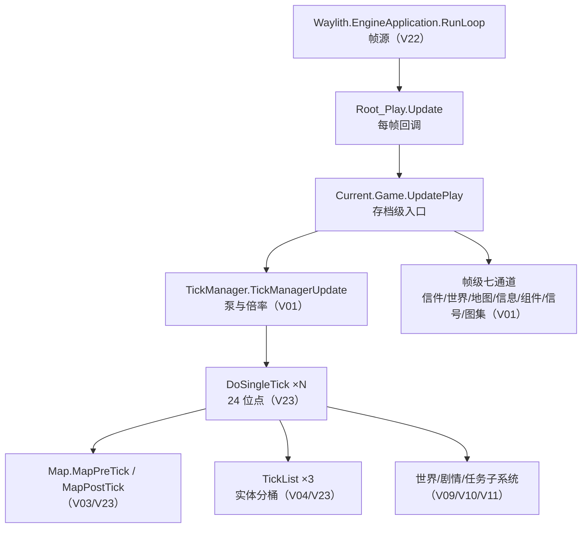

# V00 总览：程序集、主链与卷地图

> **30 秒速览**
>
> - 游戏由 **5 个程序集**组成：`Assembly-CSharp`（全部玩法逻辑）、`UnityStubs`（Unity 桩层）、`Waylith`（自研引擎）、`RimWorld`（启动器）、`Waylith.UnityCompat`（兼容层）。
> - 主链只有一条：**引擎帧 → `Root_Play.Update` → `Current.Game.UpdatePlay` → `TickManager` → `DoSingleTick`（24 位点）→ 地图/世界**。
> - 本卷是**导航层**：不深入任何机制，只回答「代码在哪、从哪进、哪卷讲什么」。
> - 语料有两处坑：`Waylith` 目录存在**两套转储**（413 个重名文件）、`Bc7BlockEncoder` 只有 IL 版本。
> - 读法建议：V00（本卷）→ V23（单 tick 24 位点）→ V22（帧从哪来）→ V01（泵与倍率）→ 按域卷深入。
>
> **读前须知**：v3 轨道与 v1 轨道并存——v1 的 `docs/mechanisms/` 24 卷冻结不动，v3 的 `docs/mechanisms-v3/` **24 卷已全部重写**；本卷断言编号独立于 v1 同名卷。

## Where it sits

**本模块的类结构**

```csharp
public static class Verse.Current {  // 全局单例入口
    private static Game gameInt;  // 当前存档
    ...
    public static Game Game  // 当前存档容器（读写）
    public static ProgramState ProgramState  // 程序三态
    public static Root Root  // 场景根
}

public enum Verse.ProgramState : byte {  // 程序状态机
    Entry,  // 主菜单/加载
    MapInitializing,  // 建图/读档中（不推进世界）
    Playing  // 正常游玩
}

public class Verse.Root_Play : Verse.Root {  // 游玩场景根（MonoBehaviour）
    public override void Update()  // 引擎每帧回调
}

public class Verse.Game : IExposable, IDisposable {  // 存档级容器
    public TickManager tickManager = new TickManager();  // 时间泵
    public World World  // 世界层
    public List<Map> Maps  // 地图列表
    ...
    public void UpdatePlay()  // 每帧入口：泵 + 帧级通道
}

public sealed class Verse.TickManager : IExposable {  // 时间推进唯一入口
    public void TickManagerUpdate()  // 每帧：累积 + 双闸门
    public void DoSingleTick()  // 一个 tick 的 24 位点
}

public sealed class Waylith.EngineApplication : IDisposable {  // 自研引擎入口
    public int RunLoop()  // 帧循环（详见 V22）
}
```

**这一段怎么走**：先认四个「入口级」类型——`EngineApplication` 提供帧，`Root_Play` 接住帧，`Current` 提供全局访问点，`Game` 持有 `TickManager`/`World`/`Maps`；再看 `ProgramState` 三态，它决定「现在该不该推进世界」。这五个类型之外的东西都属于「被主链调用」的下游。

## Evolution



| 层 | 谁负责 | 频率 | 详见 |
|---|---|---|---|
| 帧 | `EngineApplication.RunLoop` → `Root_Play.Update` | 每帧 | V22、V17 |
| 泵 | `Game.UpdatePlay` → `TickManagerUpdate` | 每帧 | V01 |
| tick | `DoSingleTick` 的 24 位点 | 每 tick | V23 |
| 实体 | `TickList` → `Thing.DoTick` → `TickInterval` | 每 tick / 区间 | V04、V05 |
| 域 | 世界、剧情、任务、战斗… | 各自主链挂点 | V02–V21 |

**这一段怎么走**：图给「一条主链 + 一个旁路（帧级七通道）」，表给「每一层由哪卷负责、以什么频率发生」。看任何一卷之前，先在表里找到它挂在哪一层，再决定要不要回本卷。

## Stage detail

### S0 五个程序集与命名空间

**这一段做什么**：把「代码在哪」一次说清——五个程序集各自负责什么、命名空间怎么分、语料目录长什么样。

| 程序集 | 职责 | 语料文件数 | 语料体积 |
|---|---|---:|---:|
| `Assembly-CSharp` | 全部游戏逻辑（`Verse` 框架 + `RimWorld` 玩法） | 9263 | 32.7 MB |
| `Waylith` | 自研引擎：渲染、音频、窗口、作业 | 1323（含 2 套转储） | 10.4 MB |
| `UnityStubs` | Unity API 桩层，转发到 Waylith 兼容层 | 704 | 2.5 MB |
| `RimWorld` | 启动器：入口、参数、崩溃处理、资源烘焙 | 49 | 0.6 MB |
| `Waylith.UnityCompat` | Unity 兼容层（帧、时间、诊断） | 8 | 0.1 MB |

命名空间规模（两种口径，不要混用）：

| 口径 | 数字 | 来源 |
|---|---|---|
| 类型总数 | **12234** | `analysis/index/types.tsv`（脚本抽取） |
| 命名空间数 | **111** | `analysis/index/namespaces.tsv` |
| `Assembly-CSharp/RimWorld` 目录文件数 | 6770 | 目录实测（一类型一文件，含嵌套类型） |
| `Assembly-CSharp/Verse` 目录文件数 | 2358 | 同上 |
| 根级（无命名空间）文件 | 30 | 同上 |

> **要点**：`types.tsv` 是「类型」口径，目录计数是「文件」口径——嵌套类型会多出文件，两者不能直接相减。
>
> **陷阱**：`Waylith` 有 1323 个文件，但其中 **413 个是重名**：外层 525 个是早期项目级转储，内层 `Waylith/Waylith/` 798 个才是逐类型补全的结果。检索时必须限定内层，否则重复计数。

**这一段怎么走**：先按「程序集 → 职责」认领范围，再用两种口径看规模：索引给类型数、目录给文件数。`Waylith` 的两套转储是唯一需要特别处理的目录。

### S1 主链上的五个类型

**这一段做什么**：把主链的接缝逐个指出来——`Root_Play.Update` 怎么接住帧、`Current.Game` 怎么暴露存档、`Game.UpdatePlay` 怎么把控制权交给泵。

**源码**（`Verse.Root_Play.Update`；中文注释为本文档所加）

```csharp
public override void Update()                                            // 引擎每帧调用
{
    base.Update();                                                       // 基类：实时钟、长事件、UI 根
    if (LongEventHandler.ShouldWaitForEvent || this.destroyed)           // 长事件期间 / 已销毁
    {
        return;                                                          // 本帧不推进游戏
    }
    try
    {
        ShipCountdown.ShipCountdownUpdate();                             // 飞船倒计时
        if (ModsConfig.IdeologyActive)
        {
            ArchonexusCountdown.ArchonexusCountdownUpdate();             // Ideology 结局倒计时
        }
        TargetHighlighter.TargetHighlighterUpdate();                     // 目标高亮
        Current.Game.UpdatePlay();                                       // 进入存档级入口
        ...
    }
```

**伪代码**

```text
过程 每帧更新():
    基类.更新()                                    # 实时钟 / 长事件 / UI 根
    若 长事件等待中 或 已销毁:                       # 本帧不推进
        返回
    试:
        飞船倒计时()
        若 Ideology 开启:
            结局倒计时()
        目标高亮更新()
        当前存档.每帧入口()                          # Game.UpdatePlay
        …（省略：音乐、性能基准、异常日志）
```

- `base.Update()` 在派生逻辑**之前**：UI 根与长事件先跑（V17）；
- `LongEventHandler.ShouldWaitForEvent` 为真时整帧直接返回——长事件（加载、切场景）期间不推进游戏；
- `Current.Game` 是全局访问点，实际值存在 `Current.gameInt`。

**这一段做什么**：`Current.Game` 是可写静态属性——读走全局字段，写直接换掉整个存档对象；读档不是「改现有 Game」，而是替换引用。

**源码**（`Verse.Current.Game`；中文注释为本文档所加）

```csharp
public static Game Game            // 当前存档
{
    get
    {
        return Current.gameInt;    // 读全局字段
    }
    set
    {
        Current.gameInt = value;   // 写全局字段（读档时替换整个 Game）
    }
}
```

**伪代码**

```text
属性 当前存档:
    取值:
    返回 全局字段
    赋值:
    全局字段 = 新值                # 读档即换整个 Game
```

> **要点**：`Current.Game` 是可写的静态属性——读档不是「修改现有 Game」，而是**换掉整个对象**；任何缓存了旧 `Game` 引用的对象都会指向过期实例。
>
> **陷阱**：`ProgramState` 有 `MapInitializing` 一态，建图/读档期间世界不推进；如果此时有人调用 `DoSingleTick`，会看到半初始化的地图。

**这一段怎么走**：`Root_Play.Update` 先跑基类与长事件判断，再按「倒计时 → 高亮 → `Current.Game.UpdatePlay`」顺序推进；`Current.Game` 只是一个可写的静态转发。两者的接缝就在 `Current.Game.UpdatePlay()` 这一行——它之后的一切都属于 V01/V23 的范围。

### S2 卷地图：哪一卷讲什么

**这一段做什么**：把 24 个主题映射到「v3 卷 + 主链挂点 + 主要命名空间」，让读者按需跳转；v3 已覆盖全部 24 卷，v1 只作历史对照。

| v3 卷 | 状态 | 主题 | 主链挂点 | 主要命名空间 |
|---|---|---|---|---|
| **V00** | 本卷 | 程序集、主链与卷地图 | 全链 | 全部 |
| **V01** | ✅ v3 | 帧循环与 tick 泵 | `Game.UpdatePlay` → `TickManagerUpdate` | `Verse` |
| **V02** | ✅ v3 | 时间与历法 | `DateNotifierTick` / `TicksAbs` | `Verse`、`RimWorld` |
| **V03** | ✅ v3 | 地图、网格与寻路（含 A* 本体） | `MapPreTick` → `PathFinderTick` → `PathFinderJob` | `Verse`、`Verse.AI` |
| **V04** | ✅ v3 | Thing 生命周期与分桶 | `TickList.Tick` → `Thing.DoTick` | `Verse` |
| **V05** | ✅ v3 | Pawn 构成与状态 | `Pawn.Tick` / `Pawn.TickInterval` | `Verse`、`RimWorld` |
| **V06** | ✅ v3 | AI：ThinkTree / Job / Toil | `JobTrackerTickInterval` → `DriverTick` | `Verse.AI` |
| **V07** | ✅ v3 | 工作与生产：WorkGiver / Bill | `JobGiver_Work.TryIssueJobPackage` | `RimWorld` |
| **V08** | ✅ v3 | 战斗、伤害与护甲 | `Thing.TakeDamage` 链 | `Verse`、`RimWorld` |
| **V09** | ✅ v3 | 故事叙述者与事件 | `StorytellerTick` / `IncidentQueueTick` | `RimWorld` |
| **V10** | ✅ v3 | 世界、地块与远行队 | `WorldTick` / `WorldPostTick` | `RimWorld.Planet` |
| **V11** | ✅ v3 | 派系、社交与关系 | `OpinionOf` / `TryInteractRandomly` | `RimWorld` |
| **V12** | ✅ v3 | 经济、价格与贸易 | `MarketValue` / `TradeDeal` | `Verse`、`RimWorld` |
| **V13** | ✅ v3 | 需求与心情 | `NeedInterval` / `MentalBreaker` | `RimWorld`、`Verse.AI` |
| **V14** | ✅ v3 | 医疗、身体与伤势 | `HealthTickInterval` / `Hediff.TickInterval` | `Verse` |
| **V15** | ✅ v3 | Def 与 XML 管线 | `DefDatabase.AddAllInMods` | `Verse` |
| **V16** | ✅ v3 | 存档与序列化 | `ScribeLoader.InitLoading` | `Verse` |
| **V17** | ✅ v3 | UI 与渲染桥接 | `Root.Update` / `OnGUI` | `Verse`、`RimWorld`、`Waylith` |
| **V18** | ✅ v3 | DLC 增量 | `ModsConfig.*Active` | `Verse`、`RimWorld` |
| **V19** | ✅ v3 | 空间构建：区域与房间 | `RegionAndRoomUpdater` | `Verse` |
| **V20** | ✅ v3 | Ideology | `IdeoTrackerTickInterval` | `RimWorld` |
| **V21** | ✅ v3 | 渲染树与绘制管线 | `MapMeshDirty` / `DrawMapMesh` | `Verse` |
| **V22** | ✅ v3 | Waylith 运行模式 | `RunLoop` / `RenderThread` | `Waylith` |
| **V23** | ✅ v3 | 单 tick 全景（24 位点） | `DoSingleTick` | `Verse` |

> **要点**：v3 24 卷齐全（V00–V23）；v1 已冻结，只作历史对照，引用旧卷号时请注明「v1」。
>
> **陷阱**：v1 的 V23 写「18 步」、V01 写「22 阶段」，与 v3 的 24 位点不一致；以 v3 V23 为准（依据 `DoSingleTick` 源码逐条数）。

**这一段怎么走**：先看「主链挂点」列决定从哪进主链，再按「命名空间」列找代码。24 卷全部以 v3 为准；v1 只用于对照历史写法。

### S3 语料索引与检索路径

**这一段做什么**：给出「在 11347 个文件里找某个类型」的最短路径——先查索引，再定位文件，最后用 `match` 串复核。

`analysis/index/types.tsv` 的列：`assembly`、`namespace`、`type`、`kind`、`token`、`file`、`line`、`loc_approx`。三条可重跑命令：

```powershell
# 1) 按类型名查文件
Select-String -Path 'analysis\index\types.tsv' -Pattern "`tTickManager`t"

# 2) 在语料里找常量/字符串
Select-String -Path 'analysis\decompiled\Assembly-CSharp\Verse\TickManager.cs' -Pattern '45.454544' -Context 2,2

# 3) Waylith 只在「内层」目录里搜，避免 413 个重名
Get-ChildItem analysis\decompiled\Waylith\Waylith -Recurse -Filter '*RenderThread*'
```

> **要点**：`types.tsv` 的 `file` 列是相对 `analysis/decompiled/` 的路径，直接拼就能定位；`token` 列是 `0x02xxxxxx`，与 claim 里的 Token 对应。
>
> **陷阱**：`assembly` 列写的是程序集名，不是目录名——`RimWorld` 程序集的语料在 `analysis/decompiled/RimWorld/` 下只有启动器类型，别把 `RimWorld` 命名空间（在 `Assembly-CSharp` 里）混进来。

**这一段怎么走**：查类型用索引、查符号用语料 `Select-String`、查引擎类型限定内层目录。三步之后得到的是「文件 + 行号 + Token」，正好能填 claim 的 `file` 与 `src` 两行。

## Branches

| 分支 | 内容 | 影响 |
|---|---|---|
| **v1 / v3 并存** | 两套文档目录，v1 冻结、v3 逐卷重写 | 引用时必须带目录或声明「v3」 |
| **语料两套 Waylith 转储** | 外层 525 + 内层 798 | 检索限定内层；统计时去重 |
| **`Bc7BlockEncoder` 只有 IL** | 1.9 MB `.il` | 该类型无法给出 C# 断言 |
| **索引口径** | 类型数（12234）≠ 文件数（11347） | 报数时说明口径 |
| **断言编号** | v1 与 v3 同名卷编号互不对应 | 跨卷引用先确认版本 |

**层积与遗留痕迹**：

1. **项目级反编译留下外层 Waylith**：早期整程序集转储在 `Bc7BlockEncoder` 上死循环，后来改用逐类型导出；外层文件因此不完整且与内层重名。
2. **v1 的步数三写法**：18（V23 标题）/20（V23 正文）/22（V01）——v3 统一为 24 位点，历史写法保留在 v1 里作为对照。
3. **`Current.Game` 可写**：读档换对象而不是改字段，是「全局单例 + 可替换容器」的折中设计。

> **要点**：分支表回答「读文档时会踩到什么」，层积表回答「这些坑是怎么留下的」。
>
> **陷阱**：不要用 v1 的「步数」去核对 v3 的 24 位点——两套编号体系从标题到正文都不一致。

**这一段怎么走**：五条分支各对应一个具体的读文档风险：版本并存、语料重名、IL 类型、口径差异、编号不对应。层积三条说明这些风险的来源，读到时不必再猜。

## Contracts

| 方向 | 契约 |
|---|---|
| 入 | 读者需要一份 `docs/mechanisms-v3/` 与 `analysis/` 语料；v1 目录作为对照阅读 |
| 出 | 主链地图、卷索引、检索命令、口径声明 |
| 时序 | V00 → V23（24 位点）→ V22（帧源）→ V01（泵）→ 域卷 |
| 不变量 | 每条结论可回到 `file` + `match`；v1 目录不改动；语料不重建 |
| 边界 | 本卷不解释任何机制的细节；数值与实现一律指向域卷 |

## Evidence

[claim:V00-C01] `Current` 是静态类，持有全局状态。
  src: Verse.Current
  file: analysis/decompiled/Assembly-CSharp/Verse/Current.cs
  match: public static class Current

[claim:V00-C02] `Current.Game` 是可读写的静态属性，实际值存在私有字段。
  src: Verse.Current.Game
  file: analysis/decompiled/Assembly-CSharp/Verse/Current.cs
  match: return Current.gameInt;

[claim:V00-C03] 程序状态包含三态，其中有「建图中」。
  src: Verse.ProgramState
  file: analysis/decompiled/Assembly-CSharp/Verse/ProgramState.cs
  match: MapInitializing

[claim:V00-C04] 帧回调的落点是 `Root_Play.Update`，它转交给 `Game.UpdatePlay`。
  src: Verse.Root_Play.Update
  file: analysis/decompiled/Assembly-CSharp/Verse/Root_Play.cs
  match: Current.Game.UpdatePlay();

[claim:V00-C05] 长事件等待期间整帧不推进游戏。
  src: Verse.Root_Play.Update
  file: analysis/decompiled/Assembly-CSharp/Verse/Root_Play.cs
  match: if (LongEventHandler.ShouldWaitForEvent || this.destroyed)

[claim:V00-C06] `Game` 直接持有 `TickManager` 字段。
  src: Verse.Game
  file: analysis/decompiled/Assembly-CSharp/Verse/Game.cs
  match: public TickManager tickManager = new TickManager();

[claim:V00-C07] `Game` 以属性暴露地图列表。
  src: Verse.Game.Maps
  file: analysis/decompiled/Assembly-CSharp/Verse/Game.cs
  match: public List<Map> Maps

[claim:V00-C08] `Game` 以属性暴露世界层。
  src: Verse.Game.World
  file: analysis/decompiled/Assembly-CSharp/Verse/Game.cs
  match: public World World

[claim:V00-C09] 引擎入口是 sealed 的 `EngineApplication`，帧循环由 `RunLoop` 返回退出码。
  src: Waylith.EngineApplication.RunLoop
  file: analysis/decompiled/Waylith/Waylith/EngineApplication.cs
  match: public int RunLoop()

## Open questions

1. `[unresolved]` 程序集与命名空间的数字是 2026-10-20 的实测值；语料若重建（`decompile.ps1`）需重跑一遍统计，本卷未做成自动断言。
2. `[unresolved]` `types.tsv` 的 `loc_approx` 是「到下一个类型声明」的近似行数，只可用于排序，不可当精确行数引用。
3. `[unresolved]` v1（24 卷，冻结）与 v3（24 卷，当前）并存：跨版本引用必须注明版本，否则同名卷号会歧义。

**这一段怎么走**：三条未结项都与「数字与覆盖会变」有关：语料重建会让统计过期、近似行数不可当精确值、两套文档并存期需要持续维护卷地图。
