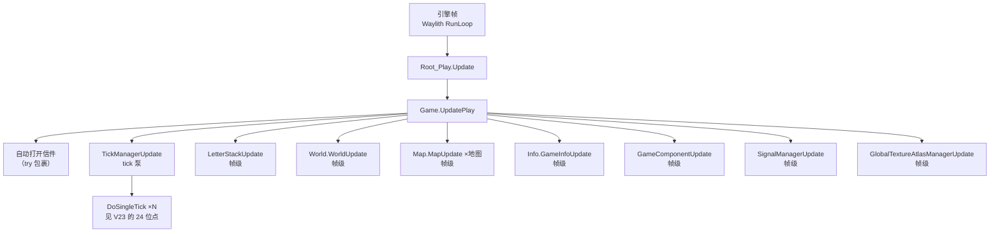

# V01 帧循环与 tick 泵：一帧怎么变成若干 tick

> **30 秒速览**
>
> - 引擎每帧回调一次，`Game.UpdatePlay` 先跑 tick 泵，再跑七个**帧级**通道（信件、世界、地图、信息、组件、信号、图集）。
> - 泵的输入是 `Time.deltaTime`（被 `Time.maximumDeltaTime = 0.33333334` 截断），输出是 0..N 个 tick；每 tick 消耗 `1 / (60 × 倍率)` 秒。
> - 倍率不止四档：`Superfast` 是 18/12/6 三值，`Ultrafast` 是 20000/150/15 三值，取决于「有没有地图」「是否无事可做」「是否开了调试加速」。
> - 暂停有两个来源：玩家按下的 `TimeSpeed.Paused`，以及系统强制的 `ForcePaused`（窗口、长事件、瓦片选择器、过场、落地确认、建图调试）。
> - 一帧能跑几个 tick 由两道闸门夹住（倍率×2、45.454544 ms），欠账不跨帧——细节见 V23 §S0，本卷只补泵与倍率。
>
> **读前须知**：本卷讲「帧怎么进来、倍率怎么算、暂停从哪来、帧级通道有哪些」；`DoSingleTick` 的 24 个位点见 V23，实体内部见 V04/V05，时间换算见 V02。**本卷断言编号（V01-C01..）独立于 v1 同名卷，不与 v1 编号对应。**

## Where it sits

**本模块的类结构**

```csharp
public sealed class Verse.TickManager : IExposable {  // tick 泵与倍率
    private TimeSpeed curTimeSpeed;  // 玩家选择的档位
    private TimeSpeed prePauseTimeSpeed;  // 暂停前的档位（恢复用）
    private int ticksGameInt;  // 累计 tick
    private int ticksThisFrame;  // 本帧已推进
    private float realTimeToTickThrough;  // 待消费时间
    private Stopwatch clock = new Stopwatch();  // 单帧预算计时
    private bool nothingHappeningCached;  // 「无事可做」缓存
    private int lastNothingHappeningCheckTick;  // 缓存所在 tick
    ...
    public float TickRateMultiplier  // 实际倍率（见 §S1）
    private float CurTimePerTick  // 1 / (60 × 倍率)
    public bool Paused  // 玩家暂停 或 强制暂停
    public bool ForcePaused  // 系统强制暂停（见 §S2）
    public TimeSpeed CurTimeSpeed  // 当前档位
    ...
    public void TickManagerUpdate()  // 每帧：累积 → 双闸门 → DoSingleTick（V23 §S0）
    public void TogglePaused()  // 空格键：暂停/恢复
    public void Pause()  // 直接暂停
    private bool NothingHappeningInGame()  // 是否「没事发生」
}

public enum Verse.TimeSpeed : byte {  // 五档
    Paused,  // 0
    Normal,  // 1×
    Fast,  // 3×
    Superfast,  // 6/12/18×
    Ultrafast  // 15/150/20000×
}

public class Verse.Game {  // 每帧入口
    public TickManager tickManager;  // 泵
    public LetterStack letterStack;  // 信件（帧级）
    public World world;  // 世界（帧级）
    public List<Map> maps;  // 地图（帧级）
    public GameInfo Info;  // 游戏信息（帧级）
    public SignalManager signalManager;  // 信号（帧级）
    ...
    public void UpdatePlay()  // 帧级：泵 + 七个通道
}

public static class UnityEngine.Time {  // 桩层：真实时间来自 Waylith
    public static float deltaTime  // 帧间隔（被上限截断）
    public static float maximumDeltaTime { get; set; } = 0.33333334f;  // 1/3 秒
}

public class Verse.Root_Play {  // 场景根
    public void Update()  // 引擎回调 → Game.UpdatePlay
}
```

**这一段怎么走**：先把「谁每帧被调」摆清楚——`Root_Play.Update` → `Game.UpdatePlay`，后者第一件事是 tick 泵，其余七件事是帧级通道；泵内部读 `Time.deltaTime` 与倍率，算出这一帧要跑几个 tick。本卷的其余部分就是拆这四样：入口、倍率、暂停、帧级通道。

## Evolution



| 层 | 内容 | 频率 |
|---|---|---|
| 帧级（本卷） | 自动信件、tick 泵、信件栈、世界、地图、信息、组件、信号、图集 | 每帧一次 |
| tick 级（V23） | 24 个执行位点 | 每 tick 一次，一帧 0..N 次 |

**这一段怎么走**：演进图把一帧拆成「泵 + 七通道」；下面的阶段表按入口、倍率、暂停、帧级通道四块展开。读的时候记住一条分界：**泵以外的东西每帧只跑一次，与这一帧跑了多少 tick 无关**。

## Stage detail

### S0 每帧入口：`Game.UpdatePlay` 做了什么

**这一段做什么**：`Game.UpdatePlay` 是每帧的总入口——先自动打开该开的信，再跑 tick 泵，最后依次跑七个帧级通道；其中只有自动信件被 try 包住。

**源码**（`Verse.Game.UpdatePlay`；中文注释为本文档所加）

```csharp
try
{
    Find.LetterStack.OpenAutomaticLetters();                 // 自动打开积压的信件
}
catch (Exception ex)
{
    Log.Error(ex.ToString());                                // 只记日志
}
this.tickManager.TickManagerUpdate();                        // tick 泵（本帧 0..N 个 tick）
this.letterStack.LetterStackUpdate();                        // 信件栈帧级更新
this.World.WorldUpdate();                                    // 世界帧级更新
for (int i = 0; i < this.maps.Count; i++)
{
    this.maps[i].MapUpdate();                                // 每张地图的帧级更新
}
this.Info.GameInfoUpdate();                                  // 游戏信息（殖民者列表等）
GameComponentUtility.GameComponentUpdate();                  // 所有 GameComponent 的帧级更新
this.signalManager.SignalManagerUpdate();                    // 信号系统
GlobalTextureAtlasManager.GlobalTextureAtlasManagerUpdate(); // 全局图集
```

**伪代码**

```text
试:                                      # 只有这一项被 try 包住
    自动打开信件()
捕获:
    记录错误
tick 泵()                                # 本帧 0..N 个 tick
信件栈.帧级更新()
世界.帧级更新()
循环 每张地图:
    地图.帧级更新()
信息.帧级更新()                           # 殖民者列表等
所有 GameComponent.帧级更新()
信号系统.更新()
全局图集.更新()
```

- 自动信件在泵**之前**：信件带的动作（如弹窗）可能影响本帧是否暂停；
- 七个通道在泵**之后**：它们吃到的是本帧 tick 推进后的状态；
- 只有 `OpenAutomaticLetters` 有 try——其余任一通道抛异常都会中断本帧剩余的通道（与 tick 内 24 位点的隔离策略不同）。

> **要点**：帧级通道与 tick 数无关：跑 0 个 tick 的帧（暂停）里，这七件事照样执行。
>
> **陷阱**：`MapUpdate` 是帧级，不是 tick 级——所以「区域/房间重建」这类工作每帧都可能发生，而 `MapPreTick`/`MapPostTick` 才是每 tick（见 V23）。

**这一段怎么走**：先试开自动信件，再跑泵，然后按「信件 → 世界 → 地图 → 信息 → 组件 → 信号 → 图集」顺序跑七个帧级通道。顺序上有两处值得记：自动信件在泵前（可能触发暂停），其余通道在泵后（读到本帧推进结果）。

### S1 倍率：`TimeSpeed` 五种档位，八种取值

**这一段做什么**：`TickRateMultiplier` 把玩家选的档位翻译成实际倍率——它不是一个 `switch` 返回五档常量，而是 8 条分支：`Superfast` 与 `Ultrafast` 各按「有无地图 / 是否无事 / 调试加速」拆成三值。

**源码**（`Verse.TickManager.TickRateMultiplier`，`Ultrafast` 分支；中文注释为本文档所加）

```csharp
case TimeSpeed.Ultrafast:                    // 最快速档
    if (TickManager.UltraSpeedBoost)         // 调试加速开关
    {
        return 20000f;                       // 极端倍率
    }
    if (Find.Maps.Count == 0)                // 无地图（主菜单/加载中）
    {
        return 150f;                         // 用高倍率快速推进世界
    }
    return 15f;                              // 正常最快：15×
```

**伪代码**

```text
分支 Ultrafast:                        # 最快速档
    若 UltraSpeedBoost:                # 调试加速
        返回 20000                     # 极端倍率
    若 地图数为 0:                      # 主菜单/加载中
        返回 150                       # 快速推进世界
    返回 15                            # 正常最快
```

同一方法里其余分支的实际取值：

| 档位 | 条件 | 倍率 |
|---|---|---|
| `ForcedNormalSpeed`（外部强制） | 当前是 `Paused` | 0 |
| 同上 | 其他 | 1 |
| `Paused` | — | 0 |
| `Normal` | — | 1 |
| `Fast` | — | 3 |
| `Superfast` | 无地图 | 18 |
| `Superfast` | 无事可做 | 12 |
| `Superfast` | 其他 | 6 |
| `Ultrafast` | `UltraSpeedBoost` | 20000 |
| `Ultrafast` | 无地图 | 150 |
| `Ultrafast` | 其他 | 15 |

#### 案例 A：同一个档位，不同倍率

| 场景 | 档位 | 实际倍率 | 每 tick 消耗 |
|---|---|---|---|
| 正常游玩 | Normal | 1 | 16.67 ms |
| 正常游玩 | Fast | 3 | 5.56 ms |
| 正常游玩、殖民地有人醒着 | Superfast | 6 | 2.78 ms |
| 正常游玩、所有人睡着且无危险 | Superfast | 12 | 1.39 ms |
| 主菜单/无地图 | Superfast | 18 | 0.93 ms |
| 正常游玩 | Ultrafast | 15 | 1.11 ms |
| 无地图 | Ultrafast | 150 | 0.11 ms |
| 调试加速 | Ultrafast | 20000 | 0.00083 ms |

结论：**「最快速」不是一个固定数字**；同一档位可以相差 3 倍（6 vs 18）甚至 1333 倍（15 vs 20000）。读日志或做平衡推算时必须先确认当时的「有无地图 / 是否无事 / 是否调试」。

> **要点**：倍率是「每 tick 消耗多少真实时间」的倒数因子；倍率越高，`CurTimePerTick` 越小，同样一帧能塞进更多 tick。
>
> **陷阱**：`ForcedNormalSpeed` 会把倍率压回 1（暂停时为 0）——例如播片、强制过场、某些事件会用这个开关临时夺走倍率控制权；此时玩家选的是 Ultrafast，实际仍是 1×。

**这一段怎么走**：先看是否被 `ForcedNormalSpeed` 夺权，否则按档位查表；`Superfast` 与 `Ultrafast` 各自还有「无地图 / 无事 / 调试」三条内部分支。倍率只决定「每 tick 消耗多少真实时间」，具体一帧跑几个 tick 由泵的两道闸门再夹一次（V23 §S0）。

### S2 暂停：两个来源，一个结论

**这一段做什么**：`Paused` 是「玩家暂停」与「系统强制暂停」的并集；`ForcePaused` 又由六种情况触发——窗口要求、长事件、瓦片选择器、过场、落地确认、建图调试。

**源码**（`Verse.TickManager.Paused` 与 `ForcePaused`；中文注释为本文档所加）

```csharp
public bool Paused                                                    // 对外统一判断
{
    get
    {
        return this.curTimeSpeed == TimeSpeed.Paused || this.ForcePaused;  // 玩家暂停 或 强制暂停
    }
}
```

**伪代码**

```text
属性 已暂停:
    取值:
    返回 当前档位 = Paused 或 强制暂停
```

```csharp
public bool ForcePaused                                               // 系统强制暂停
{
    get
    {
        if ((Find.WindowStack == null || !Find.WindowStack.WindowsForcePause) && !LongEventHandler.ForcePause && !Find.TilePicker.Active && !WorldComponent_GravshipController.CutsceneInProgress)  // 六项都不成立
        {
            WorldComponent_GravshipController gravshipController = Find.GravshipController;
            if (gravshipController == null || !gravshipController.LandingAreaConfirmationInProgress)  // 且没有落地确认
            {
                return MapGenerator.debugMode;                        // 只受建图调试影响
            }
        }
        return true;                                                  // 任一成立即强制暂停
    }
}
```

**伪代码**

```text
属性 强制暂停:
    取值:
    若 无窗口强制暂停 且 无长事件 且 无瓦片选择器 且 无过场:      # 六项都不成立
        控制器 = 重力船控制器
        若 控制器为空 或 没有落地确认:                          # 且没有落地确认
            返回 建图调试模式                                   # 只剩这一项
    返回 真                                                     # 任一成立即暂停
```

`ForcePaused` 的六个来源与后果：

| 来源 | 触发场景 | 玩家能做什么 |
|---|---|---|
| `WindowStack.WindowsForcePause` | 强制暂停的窗口（如某些对话框） | 关闭窗口 |
| `LongEventHandler.ForcePause` | 长事件执行期间 | 等待 |
| `Find.TilePicker.Active` | 世界地图上选落点 | 取消选择 |
| `GravshipController.CutsceneInProgress` | 重力船过场 | 等待过场 |
| `GravshipController.LandingAreaConfirmationInProgress` | 落地区域确认 | 确认/取消 |
| `MapGenerator.debugMode` | 建图调试模式 | 退出调试 |

> **要点**：`Paused` 是「或」关系——只要任一强制源成立，即使玩家选的是 Ultrafast，泵也会整帧返回。
>
> **陷阱**：`ForcePaused` 里有 `Find.GravshipController` 的空判断，但同一表达式里已经直接读了 `WorldComponent_GravshipController.CutsceneInProgress`（静态）；有重力船组件与没组件两种情况走的是不同分支，读代码时容易误以为只有一个条件。

**这一段怎么走**：先算「玩家是否按了暂停」，再算「系统是否强制暂停」（六项或关系，其中落地确认要先取控制器），两者取或得到 `Paused`；泵在最外层直接读这个结论，为真就整帧不推进 tick，但帧级通道照跑。

### S3 泵：累积器怎么把帧变成 tick

**这一段做什么**：`TickManagerUpdate` 是「帧 → tick」的转换器：把帧时间累进待消费时间，按 `CurTimePerTick` 一个接一个扣，直到时间用完或撞上两道闸门。完整源码与双闸门细节已在 V23 §S0 拆过，这里只补它的**输入**——`CurTimePerTick` 怎么算。

**源码**（`Verse.TickManager.CurTimePerTick`；中文注释为本文档所加）

```csharp
private float CurTimePerTick                       // 每个 tick 消耗的真实秒数
{
    get
    {
        if (this.TickRateMultiplier == 0f)         // 倍率为 0（暂停）
        {
            return 0f;                             // 避免除零
        }
        return 1f / (60f * this.TickRateMultiplier);  // 60 tick = 1 秒
    }
}
```

**伪代码**

```text
属性 每tick秒数:
    取值:
    若 倍率 = 0:                       # 暂停
        返回 0                         # 避免除零
    返回 1 / (60 × 倍率)               # 60 tick = 1 秒
```

#### 案例 B：Ultrafast 下抖动抑制几乎不生效

泵里判断「用理论值还是实测帧时间」的带宽是 `CurTimePerTick × 0.1`：

| 档位 | 每 tick 秒数 | 抖动带（±10%） | 60 FPS 帧时间 | 落在带内？ |
|---|---|---|---|---|
| Normal | 16.67 ms | ±1.67 ms | 16.7 ms | 是 → 用理论值 |
| Fast | 5.56 ms | ±0.56 ms | 16.7 ms | 否 → 用实测值 |
| Ultrafast | 1.11 ms | ±0.11 ms | 16.7 ms | 否 → 用实测值 |

结论：**只有 Normal 档能吃到抖动抑制**；Fast 以上每帧都走「实测值」分支，也就是说高倍速下的实际推进量由帧率与单 tick 成本决定，理论倍率只是上限。

> **要点**：`CurTimePerTick` 是「理论值」，`Time.deltaTime` 是「实测值」；抖动带的作用是让低倍速不被帧率噪声带偏。
>
> **陷阱**：倍率为 0 时返回 0，而泵里 `while (realTimeToTickThrough > 0 …)` 仍可能进入——所以暂停判断必须在泵的最外层先做（`if (!this.Paused)`），不能只靠 `CurTimePerTick == 0`。

**这一段怎么走**：倍率先换成「每 tick 秒数」，泵再用它去扣待消费时间；抖动带只在低倍速下起作用。高倍速时每帧都用实测帧时间，所以「表值倍率」和「观感倍率」会分叉。

### S4 帧级通道：七件事与 tick 无关

**这一段做什么**：泵之后有七个通道每帧执行一次，它们不随 tick 数变化；其中 `MapUpdate` 与 `GameComponentUpdate` 最容易被误认为「每 tick」。

| 通道 | 干什么 | 为什么放在帧级 |
|---|---|---|
| `LetterStackUpdate` | 信件过期、清理、排序 | 与时间流速无关，按真实时间过期 |
| `WorldUpdate` | 世界层帧级工作（路径网格刷新等） | 玩家看世界地图时要即时响应 |
| `MapUpdate` | 天空、电力连接、区域重建、领主、绘制 | 表现相关，按帧刷新 |
| `GameInfoUpdate` | 殖民者列表、UI 数据 | 每帧重算，避免 tick 滞后 |
| `GameComponentUpdate` | 所有 `GameComponent` 的帧级更新 | 组件自己的节奏 |
| `SignalManagerUpdate` | 信号系统 | 事件派发需要即时 |
| `GlobalTextureAtlasManagerUpdate` | 全局图集维护 | 与渲染帧同步 |

> **要点**：区分「每帧」与「每 tick」的最快方法是看调用点——在 `DoSingleTick` 里的才是每 tick，在 `UpdatePlay` 里的都是每帧。
>
> **陷阱**：`GameComponentUpdate`（帧级）与 `GameComponentTick`（tick 级第 18 位点）是两个不同方法，名字只差一个词；前者每帧、后者每 tick，且后者是唯一不包 try 的位点（V23 §S2）。

**这一段怎么走**：泵跑完后按固定顺序跑七个帧级通道；它们吃本帧推进后的状态，但不参与 tick 计数。判断某段逻辑属于哪一层，只看调用点在哪：`UpdatePlay` 内是帧级，`DoSingleTick` 内是 tick 级。

### S5 时间来源：`Time.deltaTime` 从哪来、被谁截断

**这一段做什么**：泵读的 `Time.deltaTime` 不是 Unity 原生时间，而是桩层包装：真实值来自 Waylith 的 `UnityRuntime.Time.DeltaTime`，并在返回前被 `maximumDeltaTime`（1/3 秒）截断。

**源码**（`UnityEngine.Time.deltaTime`；中文注释为本文档所加）

```csharp
public static float deltaTime                    // 帧间隔
{
    get
    {
        return Math.Min((unityRuntime != null) ? unityRuntime.Time.DeltaTime : 0f, Time.maximumDeltaTime);  // 取真实值，上限 1/3 秒
    }
}
```

**伪代码**

```text
属性 帧间隔:
    真实值 = 运行时为空 ? 0 : 运行时的帧间隔
    返回 min(真实值, 最大帧间隔)          # 上限 1/3 秒
```

- `maximumDeltaTime` 默认 `0.33333334f`（1/3 秒），是 Unity 的经典默认值；
- 截断的意义：卡顿超过 1/3 秒时，泵最多只按 1/3 秒算，避免一帧内跑过多 tick。

> **要点**：卡顿帧不会「补时间」——泵拿到的上限是 1/3 秒，且循环结束还会把欠账清零，两重限制共同防雪崩。
>
> **陷阱**：`Time.maximumDeltaTime` 是 `{ get; set; }`，运行期可被改；调试工具改过它之后，泵的实际行为会与默认文档不一致。

**这一段怎么走**：引擎给出真实帧间隔 → 桩层用 1/3 秒截断 → 泵把它累进待消费时间。到这里，「一帧能跑多少 tick」的全部输入就齐了：帧间隔、倍率、暂停状态，以及泵内部的两道闸门。

## Branches

| 分支 | 触发条件 | 行为 | 与主链的差异 |
|---|---|---|---|
| **无事可做** | `NothingHappeningInGame()` 为真 | `Superfast` 从 6 升到 12 | 只在 Superfast 生效；判定按 tick 缓存 |
| **无地图** | `Find.Maps.Count == 0` | `Superfast` 18、`Ultrafast` 150 | 主菜单/加载期快速推进世界 |
| **调试加速** | `TickManager.UltraSpeedBoost` | `Ultrafast` 变 20000 | 仅调试；用于快速跑时间 |
| **强制正常速** | `slower.ForcedNormalSpeed` | 所有档位压成 1（暂停时 0） | 事件/过场夺权 |
| **强制暂停** | 六种来源任一 | 泵整帧返回 | 帧级通道照跑 |
| **卡顿截断** | 帧间隔 > 1/3 秒 | 按 1/3 秒计算 | 防一帧跑过多 tick |

**层积与遗留痕迹**：

1. **八种取值来自五次改动**：`Superfast` 原是单一 6×，后来为「无事可做」加 12、为「无地图」加 18；`Ultrafast` 同理（15 → 150 → 20000）。表里的一档多值就是这些改动的沉积。
2. **`ForcePaused` 的混合判空**：同一表达式里既读静态 `WorldComponent_GravshipController.CutsceneInProgress`，又对 `Find.GravshipController` 做空判断——后加的分支没有统一风格。
3. **`Time.deltaTime` 是桩**：`UnityEngine.Time` 不是引擎真实类型，而是转发到 Waylith 的桩（V22）；读「Unity 时间」时实际读的是自研引擎的时间。

> **要点**：分支表回答「什么条件下倍率/暂停被改写」，层积表回答「为什么一档有多值、判空风格为什么不统一」。
>
> **陷阱**：`ForcedNormalSpeed` 与 `ForcePaused` 是两套机制——前者把倍率压到 1（时间仍在走），后者把时间完全停住；混用会得到「以为暂停了其实在 1× 跑」的结果。

**这一段怎么走**：六条分支各自改写主链的一环：无人无事改倍率上限、无地图改世界推进速度、调试加速改极端倍率、强制正常速夺权、强制暂停停表、卡顿截断限幅。层积三条说明这些分支是多次追加的结果。

## Contracts

| 方向 | 契约 |
|---|---|
| 入 | `Root_Play.Update` 每帧调 `Game.UpdatePlay`；泵读 `Time.deltaTime`、`TickRateMultiplier`、`Paused` |
| 出 | 0..N 次 `DoSingleTick`；帧级通道各一次调用 |
| 时序 | 自动信件 → 泵 → 信件栈 → 世界 → 地图 → 信息 → 组件 → 信号 → 图集 |
| 不变量 | 帧级通道与 tick 数无关；暂停时泵不推进但帧级通道照跑；欠账不跨帧 |
| 边界 | 倍率 0 → `CurTimePerTick` 为 0；帧间隔上限 1/3 秒；强制正常速压成 1 |

## Evidence

本卷断言均为本轮新写并逐条核对（编号独立于 v1 同名卷）。

### 帧入口

[claim:V01-C01] 每帧先跑 tick 泵，再跑帧级通道。
  src: Verse.Game.UpdatePlay
  file: analysis/decompiled/Assembly-CSharp/Verse/Game.cs
  match: this.tickManager.TickManagerUpdate();

[claim:V01-C02] 自动打开信件在泵之前，且只有它被 try 包住。
  src: Verse.Game.UpdatePlay
  file: analysis/decompiled/Assembly-CSharp/Verse/Game.cs
  match: Find.LetterStack.OpenAutomaticLetters();

[claim:V01-C03] 信件栈是帧级更新。
  src: Verse.Game.UpdatePlay
  file: analysis/decompiled/Assembly-CSharp/Verse/Game.cs
  match: this.letterStack.LetterStackUpdate();

[claim:V01-C04] 世界层是帧级更新。
  src: Verse.Game.UpdatePlay
  file: analysis/decompiled/Assembly-CSharp/Verse/Game.cs
  match: this.World.WorldUpdate();

[claim:V01-C05] 地图帧级更新按地图顺序逐张执行。
  src: Verse.Game.UpdatePlay
  file: analysis/decompiled/Assembly-CSharp/Verse/Game.cs
  match: this.maps[i].MapUpdate();

[claim:V01-C06] 游戏信息是帧级更新。
  src: Verse.Game.UpdatePlay
  file: analysis/decompiled/Assembly-CSharp/Verse/Game.cs
  match: this.Info.GameInfoUpdate();

[claim:V01-C07] 所有 GameComponent 有独立的帧级更新入口。
  src: Verse.Game.UpdatePlay
  file: analysis/decompiled/Assembly-CSharp/Verse/Game.cs
  match: GameComponentUtility.GameComponentUpdate();
  note: 该匹配在目标文件出现 2 次；本条对应 Verse.Game.UpdatePlay 内的那一处。

[claim:V01-C08] 信号系统是帧级更新。
  src: Verse.Game.UpdatePlay
  file: analysis/decompiled/Assembly-CSharp/Verse/Game.cs
  match: this.signalManager.SignalManagerUpdate();

[claim:V01-C09] 全局图集是帧级更新。
  src: Verse.Game.UpdatePlay
  file: analysis/decompiled/Assembly-CSharp/Verse/Game.cs
  match: GlobalTextureAtlasManager.GlobalTextureAtlasManagerUpdate();

### 倍率与暂停

[claim:V01-C10] `ForcedNormalSpeed` 会夺走倍率控制权。
  src: Verse.TickManager.TickRateMultiplier
  file: analysis/decompiled/Assembly-CSharp/Verse/TickManager.cs
  match: if (this.slower.ForcedNormalSpeed)

[claim:V01-C11] `Superfast` 无地图时为 18×。
  src: Verse.TickManager.TickRateMultiplier
  file: analysis/decompiled/Assembly-CSharp/Verse/TickManager.cs
  match: return 18f;

[claim:V01-C12] `Superfast` 无事可做时为 12×。
  src: Verse.TickManager.TickRateMultiplier
  file: analysis/decompiled/Assembly-CSharp/Verse/TickManager.cs
  match: return 12f;

[claim:V01-C13] `Superfast` 默认 6×。
  src: Verse.TickManager.TickRateMultiplier
  file: analysis/decompiled/Assembly-CSharp/Verse/TickManager.cs
  match: return 6f;

[claim:V01-C14] `Ultrafast` 在调试加速下为 20000×。
  src: Verse.TickManager.TickRateMultiplier
  file: analysis/decompiled/Assembly-CSharp/Verse/TickManager.cs
  match: return 20000f;

[claim:V01-C15] `Ultrafast` 无地图时为 150×。
  src: Verse.TickManager.TickRateMultiplier
  file: analysis/decompiled/Assembly-CSharp/Verse/TickManager.cs
  match: return 150f;

[claim:V01-C16] `Ultrafast` 默认 15×。
  src: Verse.TickManager.TickRateMultiplier
  file: analysis/decompiled/Assembly-CSharp/Verse/TickManager.cs
  match: return 15f;

[claim:V01-C17] 暂停是「玩家暂停」与「强制暂停」的并集。
  src: Verse.TickManager.Paused
  file: analysis/decompiled/Assembly-CSharp/Verse/TickManager.cs
  match: return this.curTimeSpeed == TimeSpeed.Paused || this.ForcePaused;

[claim:V01-C18] 强制暂停由窗口、长事件、瓦片选择器、过场、落地确认、建图调试共同决定。
  src: Verse.TickManager.ForcePaused
  file: analysis/decompiled/Assembly-CSharp/Verse/TickManager.cs
  match: if ((Find.WindowStack == null || !Find.WindowStack.WindowsForcePause) && !LongEventHandler.ForcePause && !Find.TilePicker.Active && !WorldComponent_GravshipController.CutsceneInProgress)

[claim:V01-C19] 每 tick 秒数为 `1 / (60 × 倍率)`，倍率为 0 时返回 0。
  src: Verse.TickManager.CurTimePerTick
  file: analysis/decompiled/Assembly-CSharp/Verse/TickManager.cs
  match: return 1f / (60f * this.TickRateMultiplier);

[claim:V01-C20] 切换暂停会记住暂停前的档位。
  src: Verse.TickManager.TogglePaused
  file: analysis/decompiled/Assembly-CSharp/Verse/TickManager.cs
  match: this.prePauseTimeSpeed = this.curTimeSpeed;

[claim:V01-C21] 「无事可做」按 tick 缓存，不是每帧重算。
  src: Verse.TickManager.NothingHappeningInGame
  file: analysis/decompiled/Assembly-CSharp/Verse/TickManager.cs
  match: if (this.lastNothingHappeningCheckTick != this.TicksGame)

[claim:V01-C22] 判定标准包含「有清醒的人形殖民者」。
  src: Verse.TickManager.NothingHappeningInGame
  file: analysis/decompiled/Assembly-CSharp/Verse/TickManager.cs
  match: if (pawn.HostFaction == null && pawn.RaceProps.Humanlike && pawn.Awake() && !pawn.IsGhoul)

[claim:V01-C23] 家园地图危险等级达到 Low 就不算「无事」。
  src: Verse.TickManager.NothingHappeningInGame
  file: analysis/decompiled/Assembly-CSharp/Verse/TickManager.cs
  match: if (maps[k].IsPlayerHome && maps[k].dangerWatcher.DangerRating >= StoryDanger.Low)

### 时间来源

[claim:V01-C24] `Time.deltaTime` 被 `maximumDeltaTime` 截断（默认 1/3 秒）。
  src: UnityEngine.Time.deltaTime
  file: analysis/decompiled/UnityStubs/UnityEngine/Time.cs
  match: return Math.Min((unityRuntime != null) ? unityRuntime.Time.DeltaTime : 0f, Time.maximumDeltaTime);

[claim:V01-C25] `UltraSpeedBoost` 是调试用的极端倍率开关。
  src: Verse.TickManager.TickRateMultiplier
  file: analysis/decompiled/Assembly-CSharp/Verse/TickManager.cs
  match: if (TickManager.UltraSpeedBoost)

## Open questions

1. `[unresolved]` `NothingHappeningInGame` 的完整判据（除人形与危险外还有哪些）尚未逐条取证；本卷只列已确认的三条。取证：读完该方法剩余部分。
2. `[unresolved]` 七个帧级通道的内部顺序依赖（例如 `MapUpdate` 是否依赖 `WorldUpdate` 的结果）未逐项验证；本卷只给调用顺序。
3. `[runtime-only]` `ForcedNormalSpeed` 的所有触发点（哪些事件/过场会用它）未逐一列举；需在运行期打点或全语料检索 `SignalForceNormalSpeed`。

**这一段怎么走**：三条未结项分别指向「无事判定的完整条件」「帧级通道的依赖」「强制正常速的触发点」；前两条静态可推进，第三条需要检索调用点。
