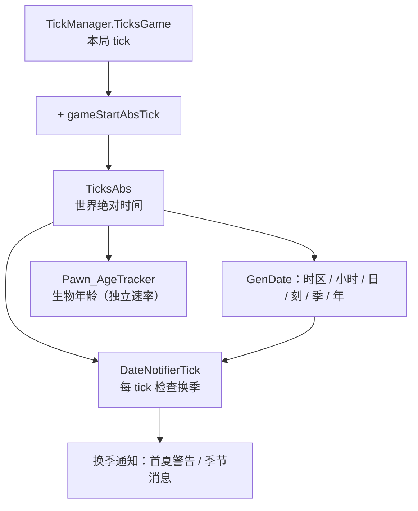

# V02 时间与历法：tick 怎么变成「第几年、第几季、几岁」

> **30 秒速览**
>
> - 时间的原子是 tick：**60 tick = 1 游戏秒，2500 tick = 1 小时，60000 tick = 1 天，3600000 tick = 1 年**。
> - `TicksGame` 是「本局跑了多久」，`TicksAbs` 是「世界绝对时间」= `ticksGameInt + gameStartAbsTick`；后者在开局时一次性定好。
> - 日历不是你所在地的日历：`DateNotifier` 取**时区最靠西**的玩家家园地图，按它的经纬度算季节。
> - 季节变化只在「不是回到上一季」时通知；第一年入夏会给「严冬警告」，之后每次换季给一条消息（且要过了第 5 天）。
> - 生物年龄是「浮点累加、整数进位」：`BiologicalTicksPerTick × interval` 先加进余数，满 1 才 +1 个生物 tick。
>
> **读前须知**：本卷讲「tick 怎么被解释成日期与年龄」；tick 怎么产生见 V01/V23，日历数据（`GenDate` 的纯函数）只在需要处引用。

## Where it sits

**本模块的类结构**

```csharp
public sealed class Verse.TickManager : IExposable {  // 时间基准
    private int ticksGameInt;  // 本局累计 tick
    private int gameStartAbsTick;  // 开局时的绝对 tick 偏移
    ...
    public int TicksGame  // 本局 tick
    public int TicksAbs  // 绝对 tick（世界时间）
    public int TicksSinceSettle  // 从落地算起的 tick
}

public static class RimWorld.GenDate {  // 历法常量与纯函数
    public const int TicksPerHour = 2500;  // 1 小时
    public const int TicksPerDay = 60000;  // 1 天
    public const int TicksPerTwelfth = 300000;  // 1 刻（十二分之一年）
    public const int TicksPerSeason = 900000;  // 1 季（三个月）
    public const int TicksPerYear = 3600000;  // 1 年
    public const int GameStartHourOfDay = 6;  // 开局时刻（第 6 小时）
    public const float TimeZoneWidth = 15f;  // 每个时区的经度宽度
    ...
    public static int TimeZoneAt(float longitude)  // 经度 → 时区
    public static Season Season(long ticksAbs, float latitude, float longitude)  // 绝对 tick → 季节
    public static int YearsPassed  // 已过整年
    public static int DaysPassed  // 已过整日
}

public class RimWorld.DateNotifier : GameComponent {  // 日历推进与通知
    private Season lastSeason;  // 上一 tick 观察到的季节
    ...
    public void DateNotifierTick()  // 每 tick：算季节、判断是否换季
    private Map FindPlayerHomeWithMinTimezone()  // 时区最西的家园
    private bool AnyPlayerHomeSeasonsAreMeaningful()  // 季节是否有意义（非极地常夏等）
    private bool AnyPlayerHomeAvgTempIsLowInWinter()  // 冬季是否够冷
}

public class Verse.Pawn_AgeTracker : IExposable {  // 年龄推进
    private long ageBiologicalTicksInt;  // 生物年龄（tick）
    private float progressToNextBiologicalTick;  // 未满 1 tick 的余数
    private bool lifeStageChange;  // 是否刚跨过生命阶段
    ...
    public float BiologicalTicksPerTick  // 生物钟速率
    public void AgeTickInterval(int delta)  // 区间推进
    private void TickBiologicalAge(int interval)  // 累加与进位
}
```

**这一段怎么走**：先认三个层级——`TickManager` 给绝对时间，`GenDate` 把绝对 tick 翻译成「小时/日/季/年」，`DateNotifier` 每 tick 检查是否换季，`Pawn_AgeTracker` 走独立的一套「生物 tick」。本卷依次讲这四层。

## Evolution



| 标尺 | 换算 | 出处 |
|---|---|---|
| 1 游戏秒 | 60 tick | `GenTicks.TicksToSeconds` |
| 1 小时 | 2500 tick | `GenDate.TicksPerHour` |
| 1 天 | 60000 tick | `GenDate.TicksPerDay` |
| 1 刻（1/12 年） | 300000 tick | `GenDate.TicksPerTwelfth` |
| 1 季 | 900000 tick | `GenDate.TicksPerSeason` |
| 1 年 | 3600000 tick | `GenDate.TicksPerYear` |

**这一段怎么走**：主链只有两步——`TicksGame` 加上开局偏移得到 `TicksAbs`，再由 `GenDate` 换算成日历量；`DateNotifier` 每 tick 观察一次日历量，`Pawn_AgeTracker` 则用另一套速率走年龄。表里六行是全部换算关系，记不住时按 60/2500/60000/3600000 四个数推。

## Stage detail

### S0 时间标尺：四个数就是全部历法

**这一段做什么**：`GenDate` 的常量定义了 tick 与人类时间单位的全部换算；其中「刻」（twelfth）是游戏特有的单位（一年十二刻），不是现实时间。

| 常量 | 值 | 含义 |
|---|---:|---|
| `TicksPerHour` | 2500 | 1 小时 |
| `TicksPerDay` | 60000 | 1 天（24 小时） |
| `TicksPerTwelfth` | 300000 | 1 刻 = 5 天 = 1/12 年 |
| `TicksPerSeason` | 900000 | 1 季 = 3 刻 = 15 天 |
| `TicksPerYear` | 3600000 | 1 年 = 4 季 = 60 天 |
| `GameStartHourOfDay` | 6 | 开局固定在第 6 小时 |
| `TimeZoneWidth` | 15° | 每 15° 经度一个时区 |

换算示例（可直接当单位表用）：

| 问 | 算式 | 答 |
|---|---|---|
| 1 天多少游戏秒？ | 60000 / 60 | 1000 秒 |
| 1 季多少天？ | 900000 / 60000 | 15 天 |
| 1 年多少天？ | 3600000 / 60000 | 60 天 |
| 1 小时多少 tick？ | 2500 | 2500 |

> **要点**：游戏内「一天」是 1000 秒真实时间（正常倍率下约 16.7 分钟）；所有日历量都能从 tick 整除得到，没有闰年、没有时区 DST。
>
> **陷阱**：「刻」不是「季节的四分之一」，而是「年的十二分之一」；季节是 3 刻（45 天？不，15 天）——两者都基于 300000/900000 这两个常量，别把刻当成季节的下级。

**这一段怎么走**：先记住四个数（2500、60000、300000、3600000），其余单位都能整除推出来；`GameStartHourOfDay` 与 `TimeZoneWidth` 只影响「从哪个时区开始算」和「时区怎么分」。

### S1 `TicksAbs`：绝对时间与开局偏移

**这一段做什么**：`TicksAbs` 是「世界绝对时间」——本局 tick 加上开局时定好的绝对偏移；若偏移还没设就访问，会报一次错并退回本局 tick。

**源码**（`Verse.TickManager.TicksAbs`；中文注释为本文档所加）

```csharp
public int TicksAbs                     // 世界绝对时间
{
    get
    {
        if (this.gameStartAbsTick == 0)                                   // 开局偏移未设
        {
            Log.ErrorOnce("Accessing TicksAbs but gameStartAbsTick is not set yet (you most likely want to use GenTicks.TicksAbs instead).", 1049580013);  // 只报一次
            return this.ticksGameInt;                                     // 退回本局 tick
        }
        return this.ticksGameInt + this.gameStartAbsTick;                 // 正常：本局 + 偏移
    }
}
```

**伪代码**

```text
属性 绝对时间:
    取值:
    若 开局偏移 = 0:                        # 还没设
        记录错误一次                         # 建议改用 GenTicks.TicksAbs
        返回 本局 tick                       # 退化值
    返回 本局 tick + 开局偏移
```

- `gameStartAbsTick`：开局时按「起始年 + 第 6 小时」算好的绝对偏移，存档保存；
- `Log.ErrorOnce` 的键是常量 `1049580013`，同一进程只报一次。

> **要点**：`TicksAbs` 才是日历函数的输入；`TicksGame` 只是「本局跑了多久」，两者差一个常量偏移。
>
> **陷阱**：偏移为 0 时 `TicksAbs` 静默退回 `TicksGame`——读到「第 1 年春天」这类明显不对的日期，先怀疑偏移没设，而不是日历算错。

**这一段怎么走**：访问 `TicksAbs` 时先检查偏移，未设则报错并退回本局 tick；正常路径就是一次加法。所有日历计算都从这条加法开始。

### S2 日历推进：`DateNotifier` 每 tick 做什么

**这一段做什么**：`DateNotifierTick` 每 tick 取「时区最西的家园地图」，用它的经纬度算季节；季节变化且不是「退回上一季」时，触发首夏警告或季节消息，并记住新季节。

**源码**（`RimWorld.DateNotifier.DateNotifierTick`；中文注释为本文档所加）

```csharp
Map map = this.FindPlayerHomeWithMinTimezone();                                        // 时区最西的家园
float num = ((map != null) ? Find.WorldGrid.LongLatOf(map.Tile).y : 0f);               // 纬度
float num2 = ((map != null) ? Find.WorldGrid.LongLatOf(map.Tile).x : 0f);              // 经度
Season season = GenDate.Season((long)Find.TickManager.TicksAbs, num, num2);            // 用绝对时间算季节
if (season != this.lastSeason && (this.lastSeason == Season.Undefined || season != this.lastSeason.GetPreviousSeason()))  // 换季且不是回退
{
    if (this.lastSeason != Season.Undefined && this.AnyPlayerHomeSeasonsAreMeaningful())  // 不是首次、且季节有意义
    {
        if (GenDate.YearsPassed == 0 && season == Season.Summer && this.AnyPlayerHomeAvgTempIsLowInWinter())  // 第一年入夏且冬冷
        {
            Find.LetterStack.ReceiveLetter(...);                                       // 严冬警告信
        }
        else if (GenDate.DaysPassed > 5)                                               // 过了第 5 天
        {
            Messages.Message(...);                                                     // 季节开始消息
        }
    }
    this.lastSeason = season;                                                          // 记住新季节
}
```

**伪代码**

```text
地图 = 时区最西的家园
纬度 = 地图 ? 地图纬度 : 0
经度 = 地图 ? 地图经度 : 0
季节 = 绝对时间 → 季节(纬度, 经度)
若 季节 ≠ 上次季节 且（上次未定义 或 季节不是上一季的回退）:
    若 上次已定义 且 季节对这些家园有意义:
        若 第 0 年 且 入夏 且 冬天够冷:
            发严冬警告信
        否则 若 已过 5 天:
            发季节开始消息
    上次季节 = 季节
```

- 「不是退回上一季」（`season != lastSeason.GetPreviousSeason()`）：支持从秋直接跳回春这类回退，不重复通知；
- 只有**家园地图**参与，远行队/临时地图不算；
- 「时区最西」由 `FindPlayerHomeWithMinTimezone` 遍历取 `TimeZoneAt` 最小值。

> **要点**：全殖民地只认一张地图的季节——时区最西的那张；多殖民地跨时区时，其他地图的日期显示会与通知不一致。
>
> **陷阱**：首夏警告只看**第一年**（`YearsPassed == 0`），而且要求「冬天够冷」；温带图第一年入夏通常不会触发。

**这一段怎么走**：取地图 → 取经纬度 → 算季节 → 判断是否换季 → 按「第一年首夏 / 过了 5 天」两条分支发通知 → 记住新季节。整段每 tick 执行一次，但真正发消息的分支一年只命中几次。

### S3 生物年龄：浮点累加、整数进位

**这一段做什么**：年龄不按 tick 一比一涨——每 tick 按 `BiologicalTicksPerTick`（可小于 1）累加余数，满 1 才让生物年龄 +1 tick；这样不同基因/状态可以用不同速率老化。

**源码**（`Verse.Pawn_AgeTracker.TickBiologicalAge`；中文注释为本文档所加）

```csharp
private void TickBiologicalAge(int interval)                                        // interval = 本次推进的 tick 数
{
    this.progressToNextBiologicalTick += this.BiologicalTicksPerTick * (float)interval;  // 累加余数
    int num = Mathf.FloorToInt(this.progressToNextBiologicalTick);                  // 取出整数部分
    if (num > 0)                                                                    // 满 1 才进位
    {
        this.progressToNextBiologicalTick -= (float)num;                            // 扣掉已进位部分
        this.ageBiologicalTicksInt += (long)num;                                    // 生物年龄 +num
    }
}
```

**伪代码**

```text
过程 推进生物年龄(interval):
    余数 += 生物速率 × interval          # 可能是小数
    进位 = 向下取整(余数)
    若 进位 > 0:
        余数 -= 进位
        生物年龄 += 进位
```

#### 案例 A：不同生物速率下的老化速度

假设一个 Pawn 每 250 tick 被区间链推一次（`interval = 250`）：

| `BiologicalTicksPerTick` | 每次余数增量 | 多少次推进涨 1 tick | 折合现实时间（生物 tick / 总 tick） |
|---|---|---|---|
| 1.0 | 250 | 1 次 | 250 / 250 = 100% |
| 0.1 | 25 | 每 10 次涨 250 | 25 / 250 = 10% |
| 0.01 | 2.5 | 每 100 次涨 250 | 2.5 / 250 = 1% |

结论：`BiologicalTicksPerTick` 就是「生物年龄相对于游戏时间的流速」；`1.0` 表示与游戏时间同速，`0.1` 表示老化慢十倍。余数机制保证**长期平均速率精确**，不会因为整数截断而整体偏慢。

> **要点**：年龄推进由 `AgeTickInterval(delta)` 驱动，它把 `delta` 传给 `TickBiologicalAge`——所以区间链的 `delta` 越大，单次累加越多，但长期速率不变。
>
> **陷阱**：`progressToNextBiologicalTick` 是存档字段；读档后余数继续累加，不会重置——这也是「相位不漂移」的原因。

**这一段怎么走**：`AgeTickInterval` 收到区间 delta → 交给 `TickBiologicalAge` → 余数累加、整数进位 → 生物年龄增长。整段只做浮点累加与一次 `floor`，不依赖真实帧率。

## Branches

| 分支 | 触发条件 | 行为 | 与主链的差异 |
|---|---|---|---|
| **快进生态** | `DebugSettings.fastEcology` | `TicksGame` 一次 +2000（V23 §S1） | 日历每 tick 跳 2000，季节判定变密 |
| **无家园地图** | 玩家没有家园 | 经纬度取 0,0 | 季节按赤道基准算 |
| **极地/特殊季节** | `AnyPlayerHomeSeasonsAreMeaningful()` 为假 | 不发季节通知 | 只更新 `lastSeason` |
| **锁定生命阶段** | `lockedLifeStageIndex >= 0` | `AgeTickInterval` 提前返回 | 年龄不再推进 |
| **突变体禁老化** | `mutant.Def.disableAging` | 同上 | 生物钟停走 |

**层积与遗留痕迹**：

1. **`TicksAbs` 的退化分支**：偏移为 0 时退回 `TicksGame` 并报错一次——说明早期代码曾直接把两者混用。
2. **「刻」这个单位**：现实没有「一年十二刻」，它来自早期日历设计，现在只用于显示日期。
3. **`DateNotifier` 只认时区最西**：多殖民地出现后没有改成「逐地图判断」，属于单殖民地时代的设计。

> **要点**：分支表里前三条改「时间怎么走」，后两条改「年龄怎么停」。
>
> **陷阱**：`fastEcology` 下每 tick 跳 2000，会让季节判定在极短时间内连续命中——`lastSeason` 的回退判断因此可能反复触发。

**这一段怎么走**：快进改变 tick 步长、无家园退化为赤道、特殊季节不发通知、锁定阶段与突变体停表。层积三条说明日历设计是「单殖民地 + 单一时区」时代的产物。

## Contracts

| 方向 | 契约 |
|---|---|
| 入 | `TicksGame` 由 tick 泵推进（V01/V23）；`gameStartAbsTick` 在开局时定好并存档 |
| 出 | `TicksAbs`、季节、年龄、换季通知 |
| 时序 | `TicksAbs` = 本局 tick + 偏移；`DateNotifierTick` 每 tick 观察一次；年龄由区间链驱动 |
| 不变量 | 六组换算常量固定；季节只在「真换季」时通知；生物年龄长期速率 = `BiologicalTicksPerTick` |
| 边界 | 偏移为 0 时退化并报错；无家园按赤道算；锁定阶段/禁老化时不推进 |

## Evidence

[claim:V02-C01] 1 小时 = 2500 tick。
  src: RimWorld.GenDate.TicksPerHour
  file: analysis/decompiled/Assembly-CSharp/RimWorld/GenDate.cs
  match: public const int TicksPerHour = 2500;

[claim:V02-C02] 1 天 = 60000 tick。
  src: RimWorld.GenDate.TicksPerDay
  file: analysis/decompiled/Assembly-CSharp/RimWorld/GenDate.cs
  match: public const int TicksPerDay = 60000;

[claim:V02-C03] 1 刻 = 300000 tick。
  src: RimWorld.GenDate.TicksPerTwelfth
  file: analysis/decompiled/Assembly-CSharp/RimWorld/GenDate.cs
  match: public const int TicksPerTwelfth = 300000;

[claim:V02-C04] 1 季 = 900000 tick。
  src: RimWorld.GenDate.TicksPerSeason
  file: analysis/decompiled/Assembly-CSharp/RimWorld/GenDate.cs
  match: public const int TicksPerSeason = 900000;

[claim:V02-C05] 1 年 = 3600000 tick。
  src: RimWorld.GenDate.TicksPerYear
  file: analysis/decompiled/Assembly-CSharp/RimWorld/GenDate.cs
  match: public const int TicksPerYear = 3600000;

[claim:V02-C06] 开局时刻固定在第 6 小时。
  src: RimWorld.GenDate.GameStartHourOfDay
  file: analysis/decompiled/Assembly-CSharp/RimWorld/GenDate.cs
  match: public const int GameStartHourOfDay = 6;

[claim:V02-C07] 时区宽度为 15 度经度。
  src: RimWorld.GenDate.TimeZoneWidth
  file: analysis/decompiled/Assembly-CSharp/RimWorld/GenDate.cs
  match: public const float TimeZoneWidth = 15f;

[claim:V02-C08] 绝对时间 = 本局 tick + 开局偏移。
  src: Verse.TickManager.TicksAbs
  file: analysis/decompiled/Assembly-CSharp/Verse/TickManager.cs
  match: return this.ticksGameInt + this.gameStartAbsTick;

[claim:V02-C09] 开局偏移未设时只报一次错并退回本局 tick。
  src: Verse.TickManager.TicksAbs
  file: analysis/decompiled/Assembly-CSharp/Verse/TickManager.cs
  match: Log.ErrorOnce("Accessing TicksAbs but gameStartAbsTick is not set yet (you most likely want to use GenTicks.TicksAbs instead).", 1049580013);

[claim:V02-C10] 日历取「时区最西」的家园地图。
  src: RimWorld.DateNotifier.DateNotifierTick
  file: analysis/decompiled/Assembly-CSharp/RimWorld/DateNotifier.cs
  match: Map map = this.FindPlayerHomeWithMinTimezone();

[claim:V02-C11] 季节由绝对时间与经纬度共同决定。
  src: RimWorld.DateNotifier.DateNotifierTick
  file: analysis/decompiled/Assembly-CSharp/RimWorld/DateNotifier.cs
  match: Season season = GenDate.Season((long)Find.TickManager.TicksAbs, num, num2);

[claim:V02-C12] 换季判断排除「退回上一季」。
  src: RimWorld.DateNotifier.DateNotifierTick
  file: analysis/decompiled/Assembly-CSharp/RimWorld/DateNotifier.cs
  match: if (season != this.lastSeason && (this.lastSeason == Season.Undefined || season != this.lastSeason.GetPreviousSeason()))

[claim:V02-C13] 第一年入夏且冬季寒冷时发严冬警告。
  src: RimWorld.DateNotifier.DateNotifierTick
  file: analysis/decompiled/Assembly-CSharp/RimWorld/DateNotifier.cs
  match: if (GenDate.YearsPassed == 0 && season == Season.Summer && this.AnyPlayerHomeAvgTempIsLowInWinter())

[claim:V02-C14] 季节消息要求已过 5 天。
  src: RimWorld.DateNotifier.DateNotifierTick
  file: analysis/decompiled/Assembly-CSharp/RimWorld/DateNotifier.cs
  match: else if (GenDate.DaysPassed > 5)

[claim:V02-C15] 生物年龄按「速率 × 区间」累加余数。
  src: Verse.Pawn_AgeTracker.TickBiologicalAge
  file: analysis/decompiled/Assembly-CSharp/Verse/Pawn_AgeTracker.cs
  match: this.progressToNextBiologicalTick += this.BiologicalTicksPerTick * (float)interval;

[claim:V02-C16] 余数满 1 才进位到生物年龄。
  src: Verse.Pawn_AgeTracker.TickBiologicalAge
  file: analysis/decompiled/Assembly-CSharp/Verse/Pawn_AgeTracker.cs
  match: this.ageBiologicalTicksInt += (long)num;

[claim:V02-C17] 年龄推进由区间链的 delta 驱动。
  src: Verse.Pawn_AgeTracker.AgeTickInterval
  file: analysis/decompiled/Assembly-CSharp/Verse/Pawn_AgeTracker.cs
  match: this.TickBiologicalAge(delta);

## Open questions

1. `[unresolved]` 季节函数 `GenDate.Season` 内部的纬度插值与极地特例未逐行拆解；本卷只给调用点与常量。
2. `[unresolved]` `AnyPlayerHomeSeasonsAreMeaningful` / `AnyPlayerHomeAvgTempIsLowInWinter` 的判据未逐条取证。
3. `[runtime-only]` `fastEcology` 下季节通知的实际触发频率需实测（每 tick 跳 2000 会让判定非常密）。

**这一段怎么走**：三条未结项分别指向「季节函数的内部」「两条判据的具体条件」「快进下的通知频率」；前两条静态可补，第三条需运行期观察。
