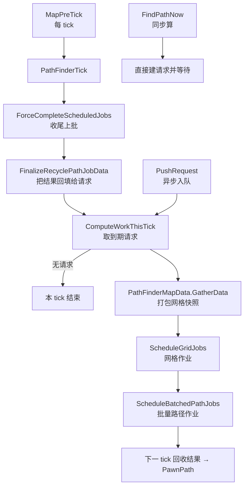

# V03 地图、网格与寻路：一张地图由什么组成、路径怎么算出来

> **30 秒速览**
>
> - 一张 `Map` 不是「一个二维数组」，而是**十几个网格叠在一起**：物体、建筑、地形、屋顶、区域、光照、雪、气体、污染、深层资源、出口、避让……
> - 寻路在 1.7 是**批量作业**：请求先进 `workQueue`，每 tick 取到期的请求，打包网格快照，交给后台作业算，算完再回收成 `PawnPath`。
> - 同步入口 `FindPathNow` 仍然存在（作业等不到结果时用），异步入口是 `PushRequest`。
> - 每 tick 的寻路泵只做四件事：**收尾上批 → 取本批 → 打包并调度 → 排下一批**；没有请求时直接返回。
> - 一张地图上「代价变化」的传播严格不外扩：物体落地/消失只改它占用的格（详见 V19）。
>
> **读前须知**：本卷讲地图的网格族与寻路管线；区域/房间的围合与代价传播见 V19，`Thing` 进入地图的注册级联见 V04，`Pawn` 怎么用路径见 V06。

## Where it sits

**本模块的类结构**

```csharp
public class Verse.Map {  // 一张地图
    public ThingGrid thingGrid;  // 物体格网
    public CoverGrid coverGrid;  // 掩体格网
    public EdificeGrid edificeGrid;  // 建筑格网
    public BlueprintGrid blueprintGrid;  // 蓝图格网
    public FogGrid fogGrid;  // 战争迷雾
    public RegionGrid regionGrid;  // 区域格网（区域/区群/房间的入口）
    public GlowGrid glowGrid;  // 光照
    public TerrainGrid terrainGrid;  // 地形
    public Pathing pathing;  // 寻路代价与通行性
    public RoofGrid roofGrid;  // 屋顶
    public FertilityGrid fertilityGrid;  // 肥力
    public SnowGrid snowGrid;  // 雪
    public DeepResourceGrid deepResourceGrid;  // 深层资源
    public ExitMapGrid exitMapGrid;  // 出口
    public AvoidGrid avoidGrid;  // 避让
    public GasGrid gasGrid;  // 气体
    public PollutionGrid pollutionGrid;  // 污染
    private PathFinder pathFinder;  // 寻路器
    ...
    public void MapPreTick()  // 每 tick 前置：含 PathFinderTick
}

public class Verse.PathFinder {  // 批量寻路器
    private List<PathRequest> workQueue;  // 等待处理的请求
    private List<PathRequest> tmpCurrentWork;  // 本 tick 取出的请求
    private PathFinderMapData mapData;  // 网格快照打包
    private List<ScheduledPathJob> scheduledPathJobs;  // 已调度的作业
    ...
    public void PathFinderTick()  // 每 tick：收尾 → 取批 → 打包 → 调度
    public void PushRequest(PathRequest request)  // 异步入队
    public PawnPath FindPathNow(IntVec3 start, LocalTargetInfo target, TraverseParms parms, ...)  // 同步算
}

public class Verse.PathRequest {  // 一次寻路请求
    public IntVec3 Start;  // 起点
    public LocalTargetInfo Target;  // 目标
    public TraverseParms TraverseParms;  // 通行参数
    public int TickStart;  // 最早开始 tick
    public bool Cancelled;  // 是否已取消
    public bool ResultIsReady;  // 结果是否已就绪
    ...
    public bool Validate()  // 请求是否仍有效
    public void Resolve(PawnPath path)  // 回填结果
}

public class Verse.Pathing {  // 代价与通行性
    public void RecalculatePerceivedPathCostUnderThing(Thing t)  // 物体落地/消失后重算（V19）
}
```

**这一段怎么走**：先看 `Map` 的网格族——它决定了「地图上有什么」；再看 `PathFinder` 的三个队列（`workQueue` / `tmpCurrentWork` / `scheduledPathJobs`），它们决定「路径怎么被算出来」；`PathRequest` 是两者之间的数据包。区域/房间（`RegionGrid` 背后的东西）留给 V19。

## Evolution



| 阶段 | 触发者 | 频率 | 产物 |
|---|---|---|---|
| 入队 | `PushRequest` | 任意时刻 | 请求进 `workQueue` |
| 取批 | `ComputeWorkThisTick` | 每 tick | 到期请求进 `tmpCurrentWork` |
| 打包 | `PathFinderMapData.GatherData` | 每 tick（有请求时） | 网格快照 |
| 调度 | `ScheduleGridJobs` / `ScheduleBatchedPathJobs` | 每 tick | `JobHandle` |
| 回收 | `FinalizeRecyclePathJobData` | 下一 tick | `PawnPath` 回填请求 |

**这一段怎么走**：请求可以从任意时刻入队；每 tick 只做「收尾 → 取批 → 打包 → 调度」四步，结果要等下一 tick 才回收。同步入口是另一条路，不走队列。

## Stage detail

### S0 地图的网格族：十几个网格叠在一张图上

**这一段做什么**：`Map` 用一组网格字段表达「每个格子上有什么」；不同系统各读各的网格，互不干扰。

| 网格 | 记什么 | 谁在用 |
|---|---|---|
| `thingGrid` | 每格的物体列表 | 渲染、战斗、拾取 |
| `edificeGrid` | 每格的建筑（墙/门） | 通行、掩体、破墙 |
| `coverGrid` | 掩体遮挡物 | 远程命中（V08/V23） |
| `terrainGrid` | 地形（地板/泥地） | 移动速度、肥力 |
| `roofGrid` | 屋顶 | 光照、温度、迫击炮 |
| `regionGrid` | 区域（Region/District/Room 的入口） | 房间、寻路抽象（V19） |
| `glowGrid` | 光照 | 心情、种植、黑暗战斗 |
| `pathing` | 通行性与代价 | 寻路 |
| `fertilityGrid` | 肥力 | 种植 |
| `snowGrid` | 积雪深度 | 移动、温度 |
| `gasGrid` | 气体（烟、毒气） | 战斗、窒息 |
| `pollutionGrid` | 污染 | 心情、种植（Odyssey） |
| `deepResourceGrid` | 深层矿 | 采矿 |
| `avoidGrid` | 避让代价 | 寻路 |
| `exitMapGrid` | 出口方向 | 远行、撤离 |
| `fogGrid` | 迷雾（已探索） | 渲染、AI |
| `blueprintGrid` | 蓝图 | 建造 |

> **要点**：所谓「地图」是**多个网格的叠加视图**；任何系统只改自己关心的网格，跨网格一致性靠 `Thing.SpawnSetup` 的注册级联（V04）保证。
>
> **陷阱**：`regionGrid` 不是「区域本身」，而是「区域在格上的映射」；真正的 Region/District/Room 对象由它持有并在变更时重建（V19）。

**这一段怎么走**：先认网格表——每个字段对应一类信息；再理解「改一个物体要同时动多个网格」这件事由 V04 的注册级联完成，本卷只关心 `pathing` 与 `regionGrid` 这两条与寻路相关的线。

### S1 入队：`PushRequest` 的三道检查

**这一段做什么**：异步寻路的入口只做三件事——拒绝重复、拒绝已算好的结果、入队。

**源码**（`Verse.PathFinder.PushRequest`；中文注释为本文档所加）

```csharp
public void PushRequest(PathRequest request)                              // 异步入队
{
    if (this.workQueue.Contains(request))                                // 已在队列里
    {
        Log.Error("Tried to add the same PathRequest twice to PathFinder.");  // 报错
        return;                                                          // 不入队
    }
    if (request.ResultIsReady)                                           // 结果已就绪
    {
        Log.Error("Tried to add PathRequest to PathFinder but it already has its result calculated.");  // 报错
        return;                                                          // 不入队
    }
    this.workQueue.Add(request);                                         // 入队
}
```

**伪代码**

```text
过程 入队(请求):
    若 队列里已有该请求:                      # 重复
        记录错误
        返回
    若 请求结果已就绪:                        # 已算完
        记录错误
        返回
    队列.加入(请求)
```

- `Contains` 是线性查找：同一请求重复入队会被拒绝；
- 已就绪的请求不允许再入队——避免覆盖已有结果。

> **要点**：`PushRequest` 不做任何校验（起点是否可通行、目标是否存在），这些留到 `ComputeWorkThisTick` 的 `Validate`。
>
> **陷阱**：`PathRequest` 是引用类型且按引用比较；两次 `CreateRequest` 生成的是两个不同对象，`Contains` 拦不住「同一目标重复请求」——去重要在调用方做。

**这一段怎么走**：入队只做「重复 / 已就绪」两道拒绝，其余一律接受；校验与取批在下一 tick 的泵里做。

### S2 每 tick 的寻路泵：`PathFinderTick` 四步

**这一段做什么**：`PathFinderTick` 把「上一批的结果收回来、这一批的请求取出来、打包网格、调度作业」串成四步；没有到期请求时直接返回。

**源码**（`Verse.PathFinder.PathFinderTick`；中文注释为本文档所加）

```csharp
if (this.disposed)                                  // 已销毁
{
    return;                                         // 直接返回
}
this.ForceCompleteScheduledJobs();                  // 1 收尾上一批作业
this.FinalizeRecyclePathJobData();                  // 2 回收结果并回填请求
this.ComputeWorkThisTick();                         // 3 取本 tick 到期的请求
if (this.tmpCurrentWork.Count == 0)                 // 没有请求
{
    return;                                         // 本 tick 结束
}
if (this.mapData.GatherData(this.tmpCurrentWork))   // 4 打包网格快照
{
    this.RecycleGridJobData();                      // 需要时回收网格作业数据
}
JobHandle jobHandle = this.ScheduleGridJobs();      // 5 调度网格作业
this.ScheduleBatchedPathJobs(jobHandle);            // 6 调度批量路径作业
```

**伪代码**

```text
若 已销毁:                        # 已释放
    返回
收尾上一批作业()
回收结果并回填()
取本 tick 到期的请求()
若 没有到期请求:
    返回
若 打包网格快照() 需要回收:
    回收网格作业数据()
作业句柄 = 调度网格作业()
调度批量路径作业(作业句柄)
```

- `ForceCompleteScheduledJobs`：把上一 tick 还没完成的作业强制跑完（避免无限堆积）；
- `FinalizeRecyclePathJobData`：把已完成作业的结果转成 `PawnPath` 并 `Resolve` 给请求；
- `GatherData` 返回「是否需要回收」，与网格数据复用有关。

> **要点**：顺序是「先收尾、再取批、最后调度」——本 tick 调度出去的作业，结果最早下一 tick 才回收。
>
> **陷阱**：`ForceCompleteScheduledJobs` 会**阻塞等待**作业完成；如果某帧作业特别重，这里就是掉帧点。

**这一段怎么走**：销毁检查 → 收尾 → 回收 → 取批 → 打包 → 调度两条作业链。四个阶段各自独立，只有「有到期请求」时才进入后三步。

### S3 取批：`ComputeWorkThisTick` 的三种去向

**这一段做什么**：从队列尾部往前扫，把请求分成三类——已取消、无效、到期；前两类直接移除，到期类搬进 `tmpCurrentWork`。

**源码**（`Verse.PathFinder.ComputeWorkThisTick`，核心循环；中文注释为本文档所加）

```csharp
this.tmpCurrentWork.Clear();                                    // 清空本批
int ticksGame = GenTicks.TicksGame;                             // 当前 tick
for (int i = this.workQueue.Count - 1; i >= 0; i--)             // 从尾往前扫
{
    PathRequest pathRequest = this.workQueue[i];                // 取一个请求
    if (pathRequest.Cancelled)                                  // 已取消
    {
        this.workQueue.RemoveAt(i);                             // 移除
    }
    else if (!pathRequest.Validate())                           // 校验不通过
    {
        this.workQueue.RemoveAt(i);                             // 移除
    }
    else if (pathRequest.TickStart <= ticksGame)                // 已到期
    {
        this.tmpCurrentWork.Add(pathRequest);                   // 进入本批
        this.workQueue.RemoveAt(i);                             // 从队列移除
    }
}
```

**伪代码**

```text
清空本批
当前 tick = 游戏 tick
循环 i 从队尾到队首:
    请求 = 队列[i]
    若 已取消:
        移除该请求
    否则 若 校验不通过:
        移除该请求
    否则 若 起始 tick ≤ 当前 tick:
        加入本批
        从队列移除
```

- 倒序扫描 + `RemoveAt(i)`：倒序删除不会打乱未处理下标；
- `TickStart`：请求可以指定「最早从哪个 tick 开始」，用于错峰（例如大量动物同时寻路）。

> **要点**：取消与失效都在这里被清理——`workQueue` 不会无限增长。
>
> **陷阱**：扫描方向是「从尾到头」，所以 `tmpCurrentWork` 里的顺序与入队顺序相反；依赖顺序的调用方不应假设 FIFO。

**这一段怎么走**：先清空本批，再从队尾往前扫；取消/无效直接删，到期的搬进本批。一次扫描同时完成「清理」与「取批」两件事。

### S4 回收：结果怎么回到请求

**这一段做什么**：`FinalizeRecyclePathJobData` 遍历上一批已调度的作业，把作业输出转成 `PawnPath`，再回填给请求；同时把状态对象与输出对象放回池子复用。

**源码**（`Verse.PathFinder.FinalizeRecyclePathJobData`，核心段；中文注释为本文档所加）

```csharp
foreach (PathFinder.ScheduledPathJob scheduledPathJob in this.scheduledPathJobs)  // 遍历已调度作业
{
    if (scheduledPathJob.request.Cancelled)                                       // 已取消
    {
        ...                                                                       // 省略：跳过并回收
    }
    ...
    PawnPath pawnPath = this.EmitPath(in scheduledPathJob.output);                // 作业输出 → PawnPath
    scheduledPathJob.request.Resolve(pawnPath);                                   // 回填结果
    ...
}
this.scheduledPathJobs.Clear();                                                   // 清空已调度列表
```

**伪代码**

```text
循环 每个已调度作业:
    若 请求已取消:
        …（省略：跳过并回收对象）
    …（省略：无路径时的告警分支）
    路径 = 输出 → PawnPath
    请求.回填(路径)
    …（省略：把状态/输出对象放回池子）
清空已调度列表
```

- `EmitPath`：把作业输出（节点列表）转成 `PawnPath`；
- `Resolve`：请求的完成回调，可能同步或在主线程执行；
- 池化：`pathUniqueStates` / `pathJobOutputs` 都是队列，避免每次分配。

> **要点**：结果回收发生在**下一 tick 的泵开头**，所以 `PushRequest` 之后至少等一 tick 才能拿到结果。
>
> **陷阱**：请求被取消后仍会出现在已调度列表里，回收时靠 `Cancelled` 跳过——取消不会立刻释放作业占用的资源。

**这一段怎么走**：遍历已调度作业 → 跳过取消项 → 输出转路径 → 回填请求 → 清空列表。结果的生命周期跨两个 tick：调度在 T，回填在 T+1。

### S5 同步入口：`FindPathNow`

**这一段做什么**：需要立即拿到路径的调用方走同步入口——它把请求直接送进同一套管线，但**阻塞等待**结果，而不是等下一 tick。

签名是 `public PawnPath FindPathNow(IntVec3 start, LocalTargetInfo target, Pawn pawn, PathFinderCostTuning? tuning = null, PathEndMode peMode = PathEndMode.OnCell)`，以及一个收 `TraverseParms` 的重载（内部先按 `pawn` 构造通行参数再转调）。

规则：同步入口适合「少量、必须立刻得到结果」的调用（如 UI 预览）；大量请求应走 `PushRequest`，否则会退化成每帧同步算路径。

> **要点**：两条入口共用同一套代价与网格，区别只在「等不等」。
>
> **陷阱**：同步调用发生在主线程，会直接吃掉本帧预算；`FindPathNow` 里若路径很长，表现就是卡顿而不是加载。

**这一段怎么走**：同步入口构造请求 → 立即求解 → 返回 `PawnPath`；异步入口入队 → 下一 tick 回收。选哪条取决于「能不能等一 tick」。

### S6 算法本体：`PathFinderJob` 里的 A*

**这一段做什么**：前面几节讲的是管线（入队、取批、调度、回收），真正的路径搜索在 `Verse/PathFinderJob.cs`——一个 `[BurstCompile]` 的 `IJob` 结构体；`PathFinder` 只负责打包网格数据、调度作业、回收结果，算法本身在作业里跑。

**本模块的类结构**

```csharp
[BurstCompile(CompileSynchronously = true)]
public struct Verse.PathFinderJob : IJob {  // A* 作业
    private const int Cost_Blocked = 175;  // 阻挡格附加代价
    public CellIndices indices;  // 格 ↔ 下标
    public float heuristicStrength;  // 启发强度（人形 1、动物 1.75）
    public int moveTicksCardinal;  // 直行代价
    public int moveTicksDiagonal;  // 斜行代价
    public IntVec3 start;  // 起点
    public IntVec3 destCell;  // 终点格
    public CellRect destRect;  // 目标区域
    public PathFinder.UnmanagedGridTraverseParams traverseParams;  // 通行参数
    public NativeArray<PathFinderJob.CalcNode> calcGrid;  // 开放/关闭表
    public NativePriorityQueue<int, float, FloatMinComparer> frontier;  // 按 fCost 的最小堆
    public NativeList<IntVec3> path;  // 输出路径
    public NativeReference<PathFinderJob.ResultData> result;  // 输出代价
    [ReadOnly] public NativeArray<int>.ReadOnly grid;  // 格子代价
    [ReadOnly] public NativeArray<ushort>.ReadOnly providerCost;  // 动态代价（0xFFFF = 不可通行）
    [ReadOnly] public NativeArray<bool>.ReadOnly blocked;  // 阻挡标记
    [ReadOnly] public NativeList<int> excludedRectIndices;  // 目标矩形里要排除的格
    [ReadOnly] public NativeArray<CellConnection>.ReadOnly connectivity;  // 邻居连接位
    [ReadOnly] public NativeBitArray.ReadOnly fences;  // 栅栏
    [ReadOnly] public NativeBitArray.ReadOnly buildings;  // 建筑

    public void Execute()  // A* 主循环
    private int IndexCost(int index)  // 单格代价
    private void InitalizeSearch()  // 起点入堆
    private void FinalizePath(int finalIndex)  // 回溯 parentIndex 生成路径
}

public struct Verse.PathFinderJob.CalcNode {  // 每个格子的搜索状态
    public int gCost;  // 从起点到本格的实际代价
    public float hCost;  // 到终点的启发估计
    public float fCost;  // g + h
    public int parentIndex;  // 来路
    public PathFinderJob.CalcNode.Status status;  // None / Open / Closed
}
```

**A* 的四件套**：

| 组件 | 对应字段 | 作用 |
|---|---|---|
| 开放表 | `frontier`（`NativePriorityQueue`） | 按 `fCost` 取最小 |
| 关闭表 | `calcGrid[i].status == Closed` | 已确定最短的格 |
| 代价表 | `calcGrid[i].gCost` | 从起点累计 |
| 启发 | `calcGrid[i].hCost` | 到终点估计，乘 `heuristicStrength` |

**这一段做什么**：A* 主循环——从优先队列取出 fCost 最小的格、丢弃过期条目、判断是否到达目标。

**源码**（`Verse.PathFinderJob.Execute`，主循环取最小并判目标；中文注释为本文档所加）

```csharp
this.frontier.Dequeue(out num3, out num4);                                          // 取出 fCost 最小的格
if (Mathf.Approximately(num4, this.calcGrid[num3].fCost) && this.calcGrid[num3].status != PathFinderJob.CalcNode.Status.Closed)  // 堆里的值仍有效
{
    IntVec3 intVec = this.indices.IndexToCell(num3);                                 // 下标 → 格
    if (flag)                                                                        // 目标是单格
    {
        if (num3 == num)                                                             // 到达终点
        {
            this.FinalizePath(num3);                                                 // 回溯生成路径
            return;                                                                  // 结束
        }
    }
    else if (this.destRect.Contains(intVec) && !this.excludedRectIndices.Contains(num3))  // 目标是区域
    {
        this.FinalizePath(num3);                                                     // 回溯生成路径
        return;                                                                      // 结束
    }
    if (num2 >= this.indices.NumGridCells)                                           // 搜遍全图
    {
        return;                                                                      // 放弃
    }
```

**伪代码**

```text
优先队列.出队(out 下标, out 堆值)          # fCost 最小的格
若 堆值 ≈ 该格.fCost 且 该格未关闭:        # 堆里的旧值要丢弃
    格 = 下标 → 格子坐标
    若 目标是单格:
        若 下标 = 终点下标:
            回溯生成路径(下标)
            返回
    否则 若 目标矩形包含该格 且 不在排除表:
        回溯生成路径(下标)
        返回
    若 已处理格数 ≥ 格子总数:              # 搜遍
        返回
```

- 第一行的 `Mathf.Approximately` 检查是**懒删除**：优先队列不支持改键，旧值留在堆里，取出来时用「堆值 ≠ 当前 fCost」丢掉；
- 目标有两种形态：单格（`flag`）与矩形（`destRect`，可排除某些格）；
- `num2` 是已展开节点数，超过格子总数就放弃，避免死循环。

> **要点**：这是标准 A*——开放表按 `fCost` 取最小、关闭表去重、`gCost` 累计、`hCost` 估计；差别只在启发函数与代价项。
>
> **陷阱**：`Dequeue` 出的可能是过期条目（同一格被多次入堆），必须靠 `Approximately` 比对丢弃；漏掉这一步会重复展开节点。

**这一段怎么走**：从优先队列取出 fCost 最小的格 → 丢弃过期条目 → 判是否到达目标（单格或矩形）→ 未到达则进入邻居松弛。`num2` 的兜底保证「无解」时也能退出。

**这一段做什么**：邻居松弛——算八方向启发、更新 g 与 f、记录来路并把邻居入堆。

**源码**（同方法，邻居松弛与启发计算；中文注释为本文档所加）

```csharp
IntVec3 intVec3 = this.destCell - intVec2;                                                   // 到终点的偏移
if (intVec3.x != 0 || intVec3.z != 0)                                                        // 不在终点上
{
    int num12 = math.abs(intVec3.x);                                                         // |dx|
    int num13 = math.abs(intVec3.z);                                                         // |dz|
    float num14 = 1f * (float)(num12 + num13) + -0.58579004f * (float)math.min(num12, num13); // 八方向距离
    PathFinderJob.CalcNode calcNode = this.calcGrid[num6];                                   // 取邻居节点
    calcNode.hCost = num14 * 13f * this.heuristicStrength;                                   // 启发 = 距离 × 13 × 强度
    this.calcGrid[num6] = calcNode;                                                          // 写回
}
float num15 = (float)num10 + this.calcGrid[num6].hCost;                                      // f = g + h
if (num15 < 0f)                                                                              // 防负
{
    num15 = 0f;
}
PathFinderJob.CalcNode calcNode2 = this.calcGrid[num6];                                      // 取邻居节点
calcNode2.gCost = num10;                                                                     // 更新 g
calcNode2.fCost = num15;                                                                     // 更新 f
calcNode2.parentIndex = num3;                                                                // 记录来路
calcNode2.status = PathFinderJob.CalcNode.Status.Open;                                       // 标记开放
this.calcGrid[num6] = calcNode2;                                                             // 写回
this.frontier.Enqueue(num6, num15);                                                          // 入堆
```

**伪代码**

```text
偏移 = 终点格 − 邻居格
若 偏移非零:                                   # 不在终点上
    dx = |偏移.x|
    dz = |偏移.z|
    距离 = (dx + dz) − 0.58579004 × min(dx, dz)   # 八方向距离
    邻居 = 取该格节点
    邻居.hCost = 距离 × 13 × 启发强度              # 13 是基准代价
    写回邻居
f = 新 g + 邻居.hCost
若 f < 0:
    f = 0
节点 = 邻居
节点.gCost = 新 g
节点.fCost = f
节点.parentIndex = 当前格
节点.status = 开放
写回节点
优先队列.入队(邻居, f)
```

- **启发函数**：`(dx + dz) − 0.58579 × min(dx, dz)`，再乘 `13`（基准格代价）与 `heuristicStrength`；这是「八方向距离」的近似（对角比直行便宜约 0.586）；
- `13` 不是魔法数：它等于直行基准代价（`moveTicksCardinal` 的默认量级），所以启发与 g 同单位；
- `hCost` 只在第一次展开邻居时算（`status == None` 的分支），之后复用。

> **要点**：启发强度越大，搜索越「贪心」——动物用 1.75，所以路径更直、搜索更快，但可能不是最省时的路径。
>
> **陷阱**：`hCost` 只在首次展开时算；如果动态代价（`providerCost`）在本 tick 中途变化，已算的 `hCost` 不会更新——这也是「一次寻路用一张快照」的原因。

**这一段怎么走**：取邻居 → 算八方向距离 → 乘基准代价与强度得到 h → 算 f → 写回节点并入堆。启发函数决定「往哪边搜」，g 决定「已经花了多少」。

**这一段做什么**：回溯生成路径——从终点沿 `parentIndex` 一路回到起点，并写出总代价。

**源码**（`Verse.PathFinderJob.FinalizePath`；中文注释为本文档所加）

```csharp
int num = finalIndex;                                        // 从终点开始
for (;;)
{
    IntVec3 intVec = this.indices.IndexToCell(num);          // 下标 → 格
    this.path.Add(in intVec);                                // 加入路径
    int parentIndex = this.calcGrid[num].parentIndex;        // 来路
    if (num == parentIndex)                                  // 回到起点（起点的 parent 是自己）
    {
        break;
    }
    num = parentIndex;                                       // 继续回溯
}
PathFinderJob.ResultData resultData;                         // 结果结构
resultData.pathCost = this.calcGrid[finalIndex].gCost;       // 总代价
this.result.Value = resultData;                              // 写出
```

**伪代码**

```text
下标 = 终点下标
循环:
    格 = 下标 → 格子
    路径.加入(格)
    父下标 = 该格.parentIndex
    若 下标 = 父下标:                # 起点自指
        跳出
    下标 = 父下标
声明 结果
结果.总代价 = 终点格.gCost
结果引用 = 结果
```

- 路径是**倒序生成**（终点 → 起点），消费方需要反向使用或自行反转；
- `pathCost` 取自终点格的 `gCost`，与启发无关。

> **要点**：回溯只依赖 `parentIndex`，不做任何代价再计算；所以路径总代价就是终点 `gCost`。
>
> **陷阱**：路径列表里包含起点与终点两端；`Pawn_PathFollower` 消费时要跳过起点，否则第一步会「原地走一格」。

**这一段怎么走**：从终点沿 `parentIndex` 一路回溯到「父指针指向自己」的起点，逐格加入列表，最后写出总代价。路径方向与搜索方向相反。

**算法在管线里的位置**：`ScheduleBatchedPathJobs` 把本批请求按 `batches` 分成若干组，每组先 `Schedule` 门阻塞检查作业，再 `ParameterizePathJob` 填充参数并 `Schedule` 这个 `PathFinderJob`，最后 `JobHandle.ScheduleBatchedJobs()` 批量提交。

> **要点**：`PathFinderJob` 的输入全是 `NativeArray`/`NativeBitArray` 快照与 `[ReadOnly]` 标记——作业运行期间主线程不能改这些数组，这是「打包快照」的真正原因。
>
> **陷阱**：`Cost_Blocked = 175` 是「可破坏物阻挡」的附加代价，不是「不可通行」；不可通行由 `providerCost == 65535` 映射成 `10000`（见 `IndexCost`）。

#### 案例 A：一次 10 格直线移动的代价

假设直行基准代价 `13`、目标在正东 10 格、沿途无阻挡：

| 项 | 算式 | 结果 |
|---|---|---|
| 每格 g | `13` | 13 |
| 10 格总 g | `13 × 10` | 130 |
| 启发（起点） | `(10 + 0) − 0.58579 × 0` | 10 → 乘 13 = 130 |
| f（起点） | `g(0) + h(130)` | 130 |
| 路径代价 | 终点 `gCost` | **130** |

若中间有一格是「可破坏物」（`Cost_Blocked = 175`），该格代价变成 `13 + 175 = 188`，总代价随之 +175；若是不可通行（`providerCost == 65535`），该格代价为 `10000`，路径会绕开而不是穿过。

> **要点**：g 与 h 同单位（都乘了 13），所以 `f = g + h` 可以直接比较；175 与 10000 是两档「加价」，用来表达「能过但很贵」与「等价于不可过」。
>
> **陷阱**：`10000` 不是「无限大」，只是足够大——理论上仍可能被选进路径（若全图都被堵），所以外层还有 `num2 >= NumGridCells` 的兜底。

**这一段怎么走**：一次寻路 = 打包快照 → 逐请求填参 → 调度门检查作业 → 调度 A* 作业 → 批量提交 → 下一 tick 回收。算法本体只认数字代价：13 是基准、175 是阻挡加价、10000 是近似不可通行。

## Branches

| 分支 | 触发条件 | 行为 | 与主链的差异 |
|---|---|---|---|
| **取消** | 请求 `Cancelled` | 取批时移除；回收时跳过 | 结果可能永远不产生 |
| **失效** | `Validate()` 为假 | 取批时移除 | 无日志、无回调 |
| **无路径** | 作业输出为空 | 记录 `Log.WarningOnce` 并 `Resolve(null)` | 调用方拿到 null |
| **门阻塞** | 门被挡住 | `GetDoorBlockedJob` 专用作业 | 需要额外判定 |
| **动物启发** | `pawn.RaceProps.Animal` | 启发强度 1.75（人形为 1） | 更偏向直线，减少计算 |
| **销毁** | `disposed` | 整个泵直接返回 | 不再调度 |

**层积与遗留痕迹**：

1. **同步与异步并存**：`FindPathNow` 是旧入口，`PushRequest` 是后来加的批量管线；两套代码共享代价模型但不共享调度。
2. **倒序扫描 + `RemoveAt`**：典型的「删除安全」写法，说明队列曾被频繁清理。
3. **`Log.WarningOnce` 的哈希键**：`HashCode.Combine(request, 163511)` 用请求对象与魔法数做去重键。

> **要点**：分支表里只有「门阻塞」与「动物启发」改变计算本身，其余都是生命周期处理。
>
> **陷阱**：`disposed` 检查在泵的最前面，但 `PushRequest` 没有——销毁后仍可入队，只是永远不处理。

**这一段怎么走**：取消与失效在取批阶段清理，无路径在回收阶段告警，门阻塞与动物启发改变计算，销毁直接短路。层积三条说明这套管线是「旧同步 + 新批量」叠加的结果。

## Contracts

| 方向 | 契约 |
|---|---|
| 入 | `PushRequest`（异步）/ `FindPathNow`（同步）；`MapPreTick` 每 tick 调一次 `PathFinderTick` |
| 出 | `PawnPath`（可能为 null）；请求的 `Resolve` 回调 |
| 时序 | 入队 → 下一 tick 取批 → 打包 → 调度 → 再下一 tick 回收 |
| 不变量 | 同一请求不重复入队；已就绪请求不再入队；取消请求不产生结果 |
| 边界 | 销毁后不再调度；无到期请求时整泵返回；门阻塞走专用作业 |

## Evidence

[claim:V03-C01] 地图持有物体格网。
  src: Verse.Map
  file: analysis/decompiled/Assembly-CSharp/Verse/Map.cs
  match: public ThingGrid thingGrid;

[claim:V03-C02] 地图持有区域格网。
  src: Verse.Map
  file: analysis/decompiled/Assembly-CSharp/Verse/Map.cs
  match: public RegionGrid regionGrid;

[claim:V03-C03] 地图持有通行性与代价对象。
  src: Verse.Map
  file: analysis/decompiled/Assembly-CSharp/Verse/Map.cs
  match: public Pathing pathing;

[claim:V03-C04] 地图持有地形格网。
  src: Verse.Map
  file: analysis/decompiled/Assembly-CSharp/Verse/Map.cs
  match: public TerrainGrid terrainGrid;

[claim:V03-C05] 地图持有屋顶格网。
  src: Verse.Map
  file: analysis/decompiled/Assembly-CSharp/Verse/Map.cs
  match: public RoofGrid roofGrid;

[claim:V03-C06] 地图前置阶段会推进寻路泵。
  src: Verse.Map.MapPreTick
  file: analysis/decompiled/Assembly-CSharp/Verse/Map.cs
  match: this.pathFinder.PathFinderTick();

[claim:V03-C07] 寻路泵第一步是强制收尾上一批作业。
  src: Verse.PathFinder.PathFinderTick
  file: analysis/decompiled/Assembly-CSharp/Verse/PathFinder.cs
  match: this.ForceCompleteScheduledJobs();
  note: 该匹配在目标文件出现 2 次；本条对应 Verse.PathFinder.PathFinderTick 内的那一处。

[claim:V03-C08] 收尾后回收结果并回填请求。
  src: Verse.PathFinder.PathFinderTick
  file: analysis/decompiled/Assembly-CSharp/Verse/PathFinder.cs
  match: this.FinalizeRecyclePathJobData();

[claim:V03-C09] 取批在当前 tick 进行，无请求则整泵返回。
  src: Verse.PathFinder.PathFinderTick
  file: analysis/decompiled/Assembly-CSharp/Verse/PathFinder.cs
  match: if (this.tmpCurrentWork.Count == 0)

[claim:V03-C10] 网格快照打包后才调度作业。
  src: Verse.PathFinder.PathFinderTick
  file: analysis/decompiled/Assembly-CSharp/Verse/PathFinder.cs
  match: if (this.mapData.GatherData(this.tmpCurrentWork))

[claim:V03-C11] 网格作业返回句柄，供批量路径作业依赖。
  src: Verse.PathFinder.PathFinderTick
  file: analysis/decompiled/Assembly-CSharp/Verse/PathFinder.cs
  match: JobHandle jobHandle = this.ScheduleGridJobs();

[claim:V03-C12] 已取消的请求在取批时被移除。
  src: Verse.PathFinder.ComputeWorkThisTick
  file: analysis/decompiled/Assembly-CSharp/Verse/PathFinder.cs
  match: if (pathRequest.Cancelled)

[claim:V03-C13] 校验不通过的请求被移除。
  src: Verse.PathFinder.ComputeWorkThisTick
  file: analysis/decompiled/Assembly-CSharp/Verse/PathFinder.cs
  match: else if (!pathRequest.Validate())

[claim:V03-C14] 到期的请求进入本批并从队列移除。
  src: Verse.PathFinder.ComputeWorkThisTick
  file: analysis/decompiled/Assembly-CSharp/Verse/PathFinder.cs
  match: else if (pathRequest.TickStart <= ticksGame)

[claim:V03-C15] 异步入队拒绝重复请求。
  src: Verse.PathFinder.PushRequest
  file: analysis/decompiled/Assembly-CSharp/Verse/PathFinder.cs
  match: if (this.workQueue.Contains(request))

[claim:V03-C16] 异步入队拒绝已有结果的请求。
  src: Verse.PathFinder.PushRequest
  file: analysis/decompiled/Assembly-CSharp/Verse/PathFinder.cs
  match: if (request.ResultIsReady)

[claim:V03-C17] 结果回收把作业输出转成 `PawnPath` 并回填。
  src: Verse.PathFinder.FinalizeRecyclePathJobData
  file: analysis/decompiled/Assembly-CSharp/Verse/PathFinder.cs
  match: PawnPath pawnPath = this.EmitPath(in scheduledPathJob.output);

[claim:V03-C18] 动物的启发强度高于人形。
  src: Verse.PathFinder.DetermineHeuristicStrength
  file: analysis/decompiled/Assembly-CSharp/Verse/PathFinder.cs
  match: if (pawn.RaceProps.Animal)

[claim:V03-C19] 同步入口以农民为重载参数，内部构造通行参数后转调。
  src: Verse.PathFinder.FindPathNow
  file: analysis/decompiled/Assembly-CSharp/Verse/PathFinder.cs
  match: public PawnPath FindPathNow(IntVec3 start, LocalTargetInfo target, Pawn pawn, PathFinderCostTuning? tuning = null, PathEndMode peMode = PathEndMode.OnCell)


[claim:V03-C20] 寻路算法是 `BurstCompile` 的 `IJob` 结构体。
  src: Verse.PathFinderJob
  file: analysis/decompiled/Assembly-CSharp/Verse/PathFinderJob.cs
  match: [BurstCompile(CompileSynchronously = true)]

[claim:V03-C21] 每次执行先清空搜索状态。
  src: Verse.PathFinderJob.Execute
  file: analysis/decompiled/Assembly-CSharp/Verse/PathFinderJob.cs
  match: this.calcGrid.Clear<PathFinderJob.CalcNode>();

[claim:V03-C22] 单格目标按下标相等判定到达。
  src: Verse.PathFinderJob.Execute
  file: analysis/decompiled/Assembly-CSharp/Verse/PathFinderJob.cs
  match: if (num3 == num)

[claim:V03-C23] 区域目标要求落在 `destRect` 且不在排除表。
  src: Verse.PathFinderJob.Execute
  file: analysis/decompiled/Assembly-CSharp/Verse/PathFinderJob.cs
  match: else if (this.destRect.Contains(intVec) && !this.excludedRectIndices.Contains(num3))

[claim:V03-C24] 启发距离采用「(dx+dz) − 0.58579×min」的八方向近似。
  src: Verse.PathFinderJob.Execute
  file: analysis/decompiled/Assembly-CSharp/Verse/PathFinderJob.cs
  match: float num14 = 1f * (float)(num12 + num13) + -0.58579004f * (float)math.min(num12, num13);

[claim:V03-C25] 启发代价 = 八方向距离 × 13 × 启发强度。
  src: Verse.PathFinderJob.Execute
  file: analysis/decompiled/Assembly-CSharp/Verse/PathFinderJob.cs
  match: calcNode.hCost = num14 * 13f * this.heuristicStrength;

[claim:V03-C26] 阻挡格的附加代价常量为 175。
  src: Verse.PathFinderJob
  file: analysis/decompiled/Assembly-CSharp/Verse/PathFinderJob.cs
  match: private const int Cost_Blocked = 175;

[claim:V03-C27] 动态代价 `0xFFFF` 被映射为近似不可通行的 10000。
  src: Verse.PathFinderJob.IndexCost
  file: analysis/decompiled/Assembly-CSharp/Verse/PathFinderJob.cs
  match: if (this.providerCost[index] == 65535)

[claim:V03-C28] 关闭节点可被重开，容差为直行代价的 0.8 倍。
  src: Verse.PathFinderJob.Execute
  file: analysis/decompiled/Assembly-CSharp/Verse/PathFinderJob.cs
  match: num11 = Mathf.CeilToInt((float)this.moveTicksCardinal * 0.8f);

[claim:V03-C29] 单格代价 = max(静态代价, 动态代价) + 阻挡附加。
  src: Verse.PathFinderJob.IndexCost
  file: analysis/decompiled/Assembly-CSharp/Verse/PathFinderJob.cs
  match: return math.max(this.grid[index], (int)this.providerCost[index]) + (this.blocked[index] ? 175 : 0);

[claim:V03-C30] 路径由 `parentIndex` 回溯生成，总代价取终点 `gCost`。
  src: Verse.PathFinderJob.FinalizePath
  file: analysis/decompiled/Assembly-CSharp/Verse/PathFinderJob.cs
  match: int parentIndex = this.calcGrid[num].parentIndex;

[claim:V03-C31] 每个请求先调度门阻塞作业，再调度 A* 作业。
  src: Verse.PathFinder.ScheduleBatchedPathJobs
  file: analysis/decompiled/Assembly-CSharp/Verse/PathFinder.cs
  match: jobHandle = pathFinderJob.Schedule(jobHandle);

[claim:V03-C32] 所有作业在同一帧批量提交。
  src: Verse.PathFinder.ScheduleBatchedPathJobs
  file: analysis/decompiled/Assembly-CSharp/Verse/PathFinder.cs
  match: JobHandle.ScheduleBatchedJobs();

## Open questions

1. `[unresolved]` `PathFinderCostTuning` 的九个代价维度未逐项取值；本卷只确认它们在打包阶段参与。
2. `[unresolved]` `PathFinderMapData.GatherData` 打包了哪些网格、快照何时失效，未逐行拆解。
3. `[runtime-only]` `ForceCompleteScheduledJobs` 的实际阻塞时长需实测；静态只能确定它会等待。

**这一段怎么走**：三条未结项分别指向「代价参数」「打包范围」「阻塞时长」；前两条静态可补，第三条需运行期测量。
