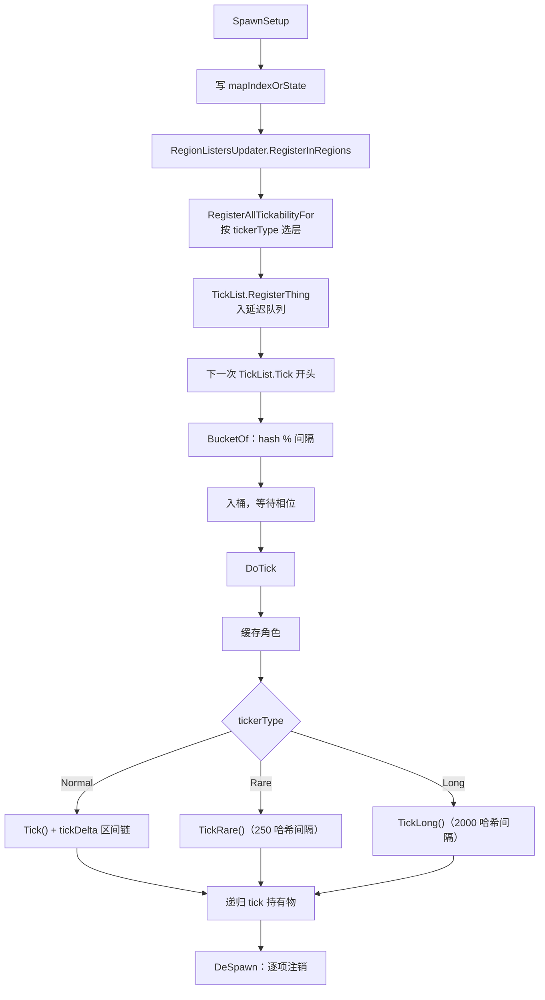

# V04 Thing 生命周期与分桶：一个物体怎么被造出来、被 tick、被移除

> **30 秒速览**
>
> - `Thing.DoTick` 只做四段：**缓存角色 → 按 `TickerType` 走 Normal/Rare/Long → 维护 `tickDelta` 区间链 → 递归 tick 持有物**。
> - `Normal` 类型每 tick 都会 `Tick()`，但 `TickInterval()` 只在累计够 `UpdateRateTicks`（相机更新率）时才跑；`Rare`/`Long` 则用 250/2000 的哈希间隔。
> - 注册是**延迟**的：`RegisterThing` 只把物体塞进 `thingsToRegister`，真正入桶发生在下一次 `TickList.Tick` 开头。
> - 桶由 `GetHashCode() % 间隔` 决定，所以「哪个相位醒」在物体创建时就定了，之后不会漂移。
> - 进出地图是镜像操作：`SpawnSetup` 写 `mapIndexOrState`、注册区域/分桶/标脏；`DeSpawn` 逐项反向注销。
>
> **读前须知**：本卷讲单个物体的生命周期与它在分桶里的位置；分桶的整体调度见 V23 §S3，网格的读写见 V03，Pawn 内部的组件链见 V05。

## Where it sits

**本模块的类结构**

```csharp
public class Verse.Thing : IExposable, ILoadReferenceable, ISignalReceiver, IThingHolder {  // 一切可放置物的基类
    private sbyte mapIndexOrState;  // 所在地图索引（-1 = 未生成）
    private int tickDelta;  // 距上次 TickInterval 的 tick 数
    private bool cached;  // 角色缓存是否已建
    private IThingHolder cachedHolder;  // 自身作为持有者
    private IThingHolderTickable cachedTickable;  // 可决定子物是否 tick
    private bool cachedIsHolder;  // 是否为持有者
    private List<IThingHolder> tmpHolders;  // 递归用临时列表
    ...
    public TickerType tickerType  // 来自 def：Normal / Rare / Long / Never
    public virtual int UpdateRateTicks  // 相机更新率（默认取 GenTicks.GetCameraUpdateRate）
    protected virtual int MinTickIntervalRate  // 区间下限
    protected virtual int MaxTickIntervalRate  // 区间上限
    public void DoTick()  // 四段式
    public override void SpawnSetup(Map map, bool respawningAfterLoad)  // 进入地图
    public override void DeSpawn(DestroyMode mode = DestroyMode.Vanish)  // 离开地图
    protected virtual void Tick()  // Normal 每 tick
    protected virtual void TickRare()  // Rare 每 250
    protected virtual void TickLong()  // Long 每 2000
    protected virtual void TickInterval(int delta)  // 区间链（delta = 累计 tick）
}

public class Verse.TickList {  // 一层分桶
    private List<Thing>[] thingLists;  // 每个相位一个桶
    private List<Thing> thingsToRegister;  // 延迟注册队列
    private List<Thing> thingsToDeregister;  // 延迟注销队列
    private int TickInterval  // 1 / 250 / 2000
    public void RegisterThing(Thing t)  // 只入队
    public void DeregisterThing(Thing t)  // 只入队
    private List<Thing> BucketOf(Thing t)  // 哈希取模定位桶
}

public sealed class Verse.TickManager {  // 分桶总入口
    public void RegisterAllTickabilityFor(Thing t)  // 按 tickerType 选层并入队
    public void DeRegisterAllTickabilityFor(Thing t)  // 反向
    private TickList TickListFor(Thing t)  // 选层
}
```

**这一段怎么走**：先认 `Thing` 的三个状态字段（`mapIndexOrState` / `tickDelta` / 角色缓存）与三个 tick 方法（`Tick` / `TickRare` / `TickLong`）；再认 `TickList` 的延迟队列与哈希桶；`TickManager` 只是「按类型选层」的转发。

## Evolution



| 阶段 | 方法 | 关键动作 |
|---|---|---|
| 进入地图 | `SpawnSetup` | 写地图索引、注册区域、注册分桶、标脏 |
| 等待入桶 | `RegisterThing` | 只入延迟队列 |
| 定位相位 | `BucketOf` | `hash % TickInterval` |
| 运行 | `DoTick` | 四段式（缓存 → 类型分支 → 区间链 → 持有物） |
| 离开地图 | `DeSpawn` | 镜像注销 |

**这一段怎么走**：一个物体从 `SpawnSetup` 进图，注册进延迟队列，下一 tick 被哈希入桶，之后每次相位命中就走 `DoTick` 的四段；`DeSpawn` 再逐项注销。整条链里只有「入桶」是延迟的，其余都同步。

## Stage detail

### S0 `DoTick`：四段式

**这一段做什么**：`DoTick` 是所有物体的统一入口——先建角色缓存，再按 `TickerType` 分派到 `Tick`/`TickRare`/`TickLong`，最后递归 tick 自己持有的子物。

**源码**（`Verse.Thing.DoTick`，核心段；中文注释为本文档所加）

```csharp
bool flag = this.holdingOwner != null && !this.Spawned;                            // 在容器里但未在地图上
if (this.def.tickerType == TickerType.Normal)                                      // Normal 类型
{
    this.Tick();                                                                   // 每 tick
    if (this.Destroyed)
    {
        return;                                                                    // tick 中被销毁
    }
    this.tickDelta++;                                                              // 累计距上次区间
    int num = Mathf.Min(Mathf.Max(this.UpdateRateTicks, this.MinTickIntervalRate), this.MaxTickIntervalRate);  // 区间钳制
    if (this.tickDelta >= num || GenTicks.IsTickInterval(this.UpdateRateTickOffset, num))  // 够区间
    {
        this.TickInterval(this.tickDelta);                                         // 区间链
        this.tickDelta = 0;                                                        // 归零
    }
    ...
}
if (this.def.tickerType == TickerType.Rare && ((!this.cachedIsHolder && !flag) || this.IsHashIntervalTick(250)))  // Rare
{
    this.TickRare();                                                              // 每 250
    ...
}
if (this.def.tickerType == TickerType.Long && ((!this.cachedIsHolder && !flag) || this.IsHashIntervalTick(2000)))  // Long
{
    this.TickLong();                                                              // 每 2000
}
```

**伪代码**

```text
在容器里 = 有持有者 且 未在地图上
若 类型 = Normal:
    每 tick()
    若 已销毁:
        返回
    距上次区间 += 1
    区间 = min(max(相机更新率, 下限), 上限)          # 钳制
    若 距上次区间 ≥ 区间 或 命中区间偏移:
        区间链(距上次区间)
        距上次区间 = 0
    …（省略：跳过后续分支）
若 类型 = Rare 且（非持有者 或 命中 250）:
    每 250()
    …（省略：跳过后续分支）
若 类型 = Long 且（非持有者 或 命中 2000）:
    每 2000()
```

- `TickerType` 来自 `ThingDef`，一个物体只有一个类型；
- `UpdateRateTicks` 默认是**相机更新率**（离镜头越远越慢），所以「同一 tick 内哪些 Normal 物体会跑区间链」取决于镜头；
- `UpdateRateTickOffset` 让不同物体的区间相位错开，避免同一 tick 集体跑重活。

> **要点**：`Tick()` 每 tick 都跑，`TickInterval()` 只在累计够区间时跑——两者不是「二选一」，而是「细粒度 + 粗粒度」两层。
>
> **陷阱**：`tickDelta` 在调用 `TickInterval` 前**没有**先归零，而是把「累计值」作为参数传进去；如果 `TickInterval` 内部按「已经过多少 tick」算产量，用错会翻倍。

**这一段怎么走**：先判「在容器里但不在图上」，再按类型走三条分支；Normal 分支额外维护 `tickDelta` 与区间钳制。三条分支互斥（只有一个 `TickerType`），所以每个物体每 tick 只走其中一条。

### S1 分桶：哈希取模与延迟注册

**这一段做什么**：`TickList` 用两个延迟队列处理注册/注销，用 `GetHashCode() % 间隔` 决定物体属于哪个相位桶；入桶发生在下一次 `Tick` 开头。

**源码**（`Verse.TickList.RegisterThing` 与 `BucketOf`；中文注释为本文档所加）

```csharp
public void RegisterThing(Thing t)          // 注册只入队
{
    this.thingsToRegister.Add(t);           // 等下一次 Tick 处理
}

private List<Thing> BucketOf(Thing t)       // 定位相位桶
{
    int num = t.GetHashCode();              // 用物体哈希
    if (num < 0)                            // 负数取正
    {
        num *= -1;
    }
    int num2 = num % this.TickInterval;     // 取模得相位
    return this.thingLists[num2];           // 对应桶
}
```

**伪代码**

```text
过程 注册(物体):
    延迟注册队列.加入(物体)                  # 不在本 tick 入桶

过程 定位桶(物体):
    哈希 = 物体.GetHashCode()
    若 哈希 < 0:
        哈希 = −哈希
    相位 = 哈希 % 间隔
    返回 桶[相位]
```

- `TickInterval`：Normal 1、Rare 250、Long 2000；
- 负数取正：`GetHashCode` 可能为负，取模前必须归正；
- 延迟注册：避免在遍历 `thingLists` 时改集合。

> **要点**：相位由**对象哈希**决定，与位置、类型无关；所以同一物体在整个存档生命周期里总是同一个相位。
>
> **陷阱**：`GetHashCode` 默认基于对象引用，**读档后会变**——所以入桶必须发生在读档后的注册阶段，不能把相位当存档数据。

**这一段怎么走**：注册先入延迟队列 → 下一 tick 的 `Tick` 开头用哈希取模入桶 → 之后每次相位命中才被 `DoTick`。相位在运行期稳定，但不跨存档。

### S2 进入地图：`SpawnSetup` 的注册顺序

**这一段做什么**：`SpawnSetup` 依次写地图索引、注册区域、尝试加入 `spawnedThings`、注册分桶、给网格打脏——顺序不能换。

**源码**（`Verse.Thing.SpawnSetup`，注册段；中文注释为本文档所加）

```csharp
this.mapIndexOrState = (sbyte)num;                                      // 记录地图索引
RegionListersUpdater.RegisterInRegions(this, map);                      // 注册进区域列表
if (!map.spawnedThings.TryAdd(this, false))                             // 加入已生成集合
{
    Log.Error("Couldn't add thing " + ((this != null) ? this.ToString() : null) + " to spawned things.");
}
...
Find.TickManager.RegisterAllTickabilityFor(this);                       // 注册进分桶
```

**伪代码**

```text
地图索引 = 地图下标
注册进区域(本物体, 地图)
若 加入已生成集合 失败:
    记录错误
…（省略：其它注册）
按类型注册分桶()
```

- `mapIndexOrState` 是 `sbyte`：既是「在哪张图」，也是「是否已生成」的状态位；
- 注册顺序：先索引（后续代码靠它判断 `Spawned`）、再区域、再分桶；
- `TryAdd` 失败只记日志，不抛异常——物体仍留在半注册状态。

> **要点**：`Spawned` 就是「`mapIndexOrState >= 0`」，所以写索引必须最先做。
>
> **陷阱**：`TryAdd` 失败后没有回滚，后续注册照跑——这种半注册物体在 tick 时可能出现「找不到区域」的错误。

**这一段怎么走**：写索引 → 注册区域 → 加入集合 → 注册分桶 → 打脏。前两步决定「物体是否算在地图上」，后两步决定「它会不会被 tick、会不会被画」。

### S3 离开地图：`DeSpawn` 的镜像注销

**这一段做什么**：`DeSpawn` 按与注册相反的顺序逐项清理：先释放覆盖层句柄，再从区域、集合、格网、信号、选中、绘制器里注销。

**源码**（`Verse.Thing.DeSpawn`，注销段；中文注释为本文档所加）

```csharp
Map map = this.Map;                                          // 当前地图
map.overlayDrawer.DisposeHandle(this);                       // 释放覆盖层句柄
RegionListersUpdater.DeregisterInRegions(this, map);          // 从区域注销
map.spawnedThings.Remove(this);                              // 从已生成集合移除
map.listerThings.Remove(this);                               // 从物品列表移除
map.thingGrid.Deregister(this, false);                       // 从物体格网移除
map.coverGrid.DeRegister(this);                              // 从掩体格网移除
```

**伪代码**

```text
地图 = 本物体地图
释放覆盖层句柄(本物体)
从区域注销(本物体, 地图)
已生成集合.移除(本物体)
物品列表.移除(本物体)
物体格网.注销(本物体)
掩体格网.注销(本物体)
```

后续还有：信号接收者注销、链接格网通知、选中取消、绘制器注销、`DeRegisterAllTickabilityFor`（第 1194 行）。

> **要点**：`DeSpawn` 不清 `mapIndexOrState` 为 -1 之前的所有步骤都假定「物体仍在地图上」——所以顺序必须与注册镜像。
>
> **陷阱**：`DeSpawn` 里若某一步抛异常，后面的注销不会执行，物体可能留在格网里「幽灵存在」；这也是 `DeSpawn` 被大量 try 包裹的原因（在调用方）。

**这一段怎么走**：先从表现层释放句柄，再从逻辑层逐项注销（区域 → 集合 → 列表 → 格网 → 掩体），最后注销分桶与选中。顺序与 `SpawnSetup` 相反，避免注销期间还被别的系统看到。

### S4 区间链：`TickInterval` 与相机更新率

**这一段做什么**：Normal 物体的「粗粒度」工作由 `TickInterval(delta)` 承担，触发条件是 `tickDelta` 达到 `UpdateRateTicks`——默认这个值来自相机距离。

```csharp
public virtual int UpdateRateTicks          // 默认相机更新率
{
    get
    {
        return GenTicks.GetCameraUpdateRate(this);   // 离镜头越远越慢
    }
}
```

```text
属性 相机更新率:
    取值:
    返回 相机更新率(本物体)                 # 按屏幕距离分档
```

案例：一个 Normal 物体在镜头中心附近 `UpdateRateTicks = 1`（每 tick 跑区间链），在屏幕外可能变成 30 或更高——**同一份逻辑，屏幕外的执行频率低一个数量级**。

> **要点**：`MinTickIntervalRate`/`MaxTickIntervalRate` 把相机更新率钳在合理范围，防止「贴脸 1 tick、远到永不执行」。
>
> **陷阱**：`UpdateRateTickOffset` 让相位错开，但只在「没达到 tickDelta 阈值」时生效；达到阈值的物体仍会在同一 tick 集中执行。

**这一段怎么走**：Normal 物体每 tick 跑 `Tick()`，每 `UpdateRateTicks` 个 tick 跑一次 `TickInterval()`；相机距离决定前者，钳制上下限决定后者。屏幕外的物体不是不跑，而是跑得稀。

## Branches

| 分支 | 触发条件 | 行为 | 与主链的差异 |
|---|---|---|---|
| **Rare 型** | `tickerType == Rare` | `TickRare()`，250 哈希间隔 | 不走 `Tick()` |
| **Long 型** | `tickerType == Long` | `TickLong()`，2000 哈希间隔 | 同上 |
| **持有者** | `cachedIsHolder` 为真且子物可 tick | 递归 `directlyHeldThings.DoTick()` | 多一段子物遍历 |
| **容器内未生成** | `holdingOwner != null && !Spawned` | Rare/Long 每 tick 都跑（跳过哈希） | 不受相位约束 |
| **半注册** | `TryAdd` 失败 | 只记日志，继续注册 | 可能出现「找不到区域」 |
| **镜头远近** | 相机更新率变化 | 调 `TickInterval` 频率 | 逻辑不变、频率变 |

**层积与遗留痕迹**：

1. **`mapIndexOrState` 用 `sbyte`**：一个字段同时表达「地图索引」与「未生成」，是早期省内存的写法。
2. **延迟注册队列**：`thingsToRegister`/`thingsToDeregister` 存在的原因是「遍历中不能改集合」，属于补丁式设计。
3. **`TickerType` 三分**：Normal/Rare/Long 是性能分层，`Never` 类型完全不被 tick——分层在 `ThingDef` 里定死，运行期不能改。

> **要点**：分支表里只有「持有者」与「容器内未生成」会改变 tick 的实际频率，其余都是类型分派。
>
> **陷阱**：`Rare`/`Long` 物体的 `TickRare` 只在哈希命中时跑，但**每 tick 都会进 `DoTick`**——所以「Rare 物体不 tick」是误解。

**这一段怎么走**：六条分支里，类型分派决定走哪个方法，持有者决定要不要递归，容器内未生成跳过相位，半注册是错误路径，镜头远近只调频率。层积三条说明这些设计都是「省内存 / 防并发 / 分性能层」的产物。

## Contracts

| 方向 | 契约 |
|---|---|
| 入 | `SpawnSetup` / `DeSpawn` 由地图与容器调用；`DoTick` 由 `TickList` 调用 |
| 出 | `Tick`/`TickRare`/`TickLong`/`TickInterval` 四个可覆写点；子物递归 |
| 时序 | 注册延迟到下一 tick；`DoTick` 先 `Tick()` 再区间链；`DeSpawn` 与注册镜像 |
| 不变量 | 每个物体只有一个 `TickerType`；相位由哈希决定且运行期稳定；`Spawned` ⇔ `mapIndexOrState >= 0` |
| 边界 | 已销毁不再 tick；区间被上下限钳制；容器内未生成不受相位约束 |

## Evidence

[claim:V04-C01] `DoTick` 遇到已销毁物体直接返回。
  src: Verse.Thing.DoTick
  file: analysis/decompiled/Assembly-CSharp/Verse/Thing.cs
  match: if (this.Destroyed)
  note: 该匹配在目标文件出现 9 次；本条对应 Verse.Thing.DoTick 内的那一处。

[claim:V04-C02] 角色缓存包含「持有者」与「可 tick 子物」两种身份。
  src: Verse.Thing.DoTick
  file: analysis/decompiled/Assembly-CSharp/Verse/Thing.cs
  match: this.cachedTickable = this as IThingHolderTickable;

[claim:V04-C03] Normal 类型每 tick 调 `Tick()`。
  src: Verse.Thing.DoTick
  file: analysis/decompiled/Assembly-CSharp/Verse/Thing.cs
  match: this.Tick();

[claim:V04-C04] 区间累计由 `tickDelta` 自增维护。
  src: Verse.Thing.DoTick
  file: analysis/decompiled/Assembly-CSharp/Verse/Thing.cs
  match: this.tickDelta++;

[claim:V04-C05] 区间值为相机更新率并被上下限钳制。
  src: Verse.Thing.DoTick
  file: analysis/decompiled/Assembly-CSharp/Verse/Thing.cs
  match: int num = Mathf.Min(Mathf.Max(this.UpdateRateTicks, this.MinTickIntervalRate), this.MaxTickIntervalRate);

[claim:V04-C06] 达到区间后调用 `TickInterval` 并归零。
  src: Verse.Thing.DoTick
  file: analysis/decompiled/Assembly-CSharp/Verse/Thing.cs
  match: this.TickInterval(this.tickDelta);

[claim:V04-C07] Rare 类型按 250 的哈希间隔执行。
  src: Verse.Thing.DoTick
  file: analysis/decompiled/Assembly-CSharp/Verse/Thing.cs
  match: this.IsHashIntervalTick(250)

[claim:V04-C08] Long 类型按 2000 的哈希间隔执行。
  src: Verse.Thing.DoTick
  file: analysis/decompiled/Assembly-CSharp/Verse/Thing.cs
  match: this.IsHashIntervalTick(2000)

[claim:V04-C09] 持有者会递归 tick 子物。
  src: Verse.Thing.DoTick
  file: analysis/decompiled/Assembly-CSharp/Verse/Thing.cs
  match: directlyHeldThings.DoTick();

[claim:V04-C10] 进入地图时先写地图索引。
  src: Verse.Thing.SpawnSetup
  file: analysis/decompiled/Assembly-CSharp/Verse/Thing.cs
  match: this.mapIndexOrState = (sbyte)num;

[claim:V04-C11] 进入地图时注册进区域列表。
  src: Verse.Thing.SpawnSetup
  file: analysis/decompiled/Assembly-CSharp/Verse/Thing.cs
  match: RegionListersUpdater.RegisterInRegions(this, map);

[claim:V04-C12] 进入地图时按类型注册分桶。
  src: Verse.Thing.SpawnSetup
  file: analysis/decompiled/Assembly-CSharp/Verse/Thing.cs
  match: Find.TickManager.RegisterAllTickabilityFor(this);

[claim:V04-C13] 注册只入延迟队列，不立即入桶。
  src: Verse.TickList.RegisterThing
  file: analysis/decompiled/Assembly-CSharp/Verse/TickList.cs
  match: this.thingsToRegister.Add(t);

[claim:V04-C14] 相位由对象哈希取模决定。
  src: Verse.TickList.BucketOf
  file: analysis/decompiled/Assembly-CSharp/Verse/TickList.cs
  match: int num2 = num % this.TickInterval;

[claim:V04-C15] 离开地图时从物体格网注销。
  src: Verse.Thing.DeSpawn
  file: analysis/decompiled/Assembly-CSharp/Verse/Thing.cs
  match: map.thingGrid.Deregister(this, false);
  note: 该匹配在目标文件出现 3 次；本条对应 Verse.Thing.DeSpawn 内的那一处。

[claim:V04-C16] 离开地图时从掩体格网注销。
  src: Verse.Thing.DeSpawn
  file: analysis/decompiled/Assembly-CSharp/Verse/Thing.cs
  match: map.coverGrid.DeRegister(this);
  note: 该匹配在目标文件出现 2 次；本条对应 Verse.Thing.DeSpawn 内的那一处。

[claim:V04-C17] 默认更新率取自相机距离分档。
  src: Verse.Thing.UpdateRateTicks
  file: analysis/decompiled/Assembly-CSharp/Verse/Thing.cs
  match: return GenTicks.GetCameraUpdateRate(this);

[claim:V04-C18] 离开地图最终注销分桶。
  src: Verse.Thing.DeSpawn
  file: analysis/decompiled/Assembly-CSharp/Verse/Thing.cs
  match: Find.TickManager.DeRegisterAllTickabilityFor(this);

## Open questions

1. `[unresolved]` `TickList.TickInterval` 为 1/250/2000 的取模边界与 `thingLists` 长度关系未逐行核对（V23 §S3 只给了取桶一侧）。
2. `[unresolved]` `GenTicks.GetCameraUpdateRate` 的分档阈值（屏幕距离 → tick 数）未逐档列出。
3. `[runtime-only]` `GetHashCode` 在读档后的稳定性只能靠「重新注册」保证，未做运行期验证。

**这一段怎么走**：三条未结项分别指向「分桶数组长度」「相机分档阈值」「哈希跨存档」；前两条静态可补，第三条需运行期确认。
