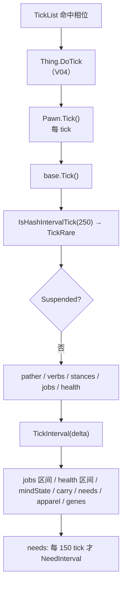

# V05 Pawn 构成与状态：一个人由哪些部件组成、每 tick 按什么顺序醒

> **30 秒速览**
>
> - `Pawn` 是「躯干 + 二十多个组件」：移动、动词、姿态、工作、健康、需求、心态、装备、服装、背包、征召、关系、访客、故事、能力、基因、意识形态、年龄、记录……
> - `Pawn.Tick()` 每 tick 跑一次，负责**细粒度**组件（移动、动词、姿态、工作、健康）；`TickInterval(delta)` 跑**粗粒度**组件（工作区间、健康区间、心态、需求、服装、基因……）。
> - 需求不是每 tick 结算：`IsHashIntervalTick(150, delta)` 命中才逐个调 `NeedInterval()`——**150 tick = 2.5 游戏秒**。
> - `Suspended`（冷冻、吊舱、被携带）会跳过大部分组件链，但 `health` 与 `needs` 仍有条件执行。
> - 死亡后 `mindState`、`needs` 等停跑，`health` 仍要做区间结算（尸体处理）。
>
> **读前须知**：本卷讲 Pawn 的**组件编排**；单个组件的内部逻辑分属各卷——工作与 AI 见 V06/V07，健康与伤势见 V14，需求与心情见 V13，年龄见 V02，战斗姿态见 V08。

## Where it sits

**本模块的类结构**

```csharp
public class Verse.Pawn : ThingWithComps {  // 人形/动物
    public Pawn_PathFollower pather;  // 移动
    public VerbTracker verbTracker;  // 动词（攻击/交互）
    public Pawn_StanceTracker stances;  // 姿态（站立/瞄准/倒地）
    public Pawn_JobTracker jobs;  // 工作
    public Pawn_HealthTracker health;  // 健康
    public Pawn_NeedsTracker needs;  // 需求
    public Pawn_MindState mindState;  // 心态（AI 目标、精神崩溃）
    public Pawn_EquipmentTracker equipment;  // 装备
    public Pawn_ApparelTracker apparel;  // 服装
    public Pawn_InventoryTracker inventory;  // 背包
    public Pawn_DraftController drafter;  // 征召
    public Pawn_RelationsTracker relations;  // 关系
    public Pawn_GuestTracker guest;  // 访客/囚犯
    public Pawn_StoryTracker story;  // 背景与特质
    public Pawn_AbilityTracker abilities;  // 能力
    public Pawn_GeneTracker genes;  // 基因
    public Pawn_IdeoTracker ideo;  // 意识形态
    public Pawn_AgeTracker ageTracker;  // 年龄
    public Pawn_RecordsTracker records;  // 统计
    public Pawn_InteractionsTracker interactions;  // 社交互动
    public Pawn_RopeTracker roping;  // 牵引
    public Pawn_FlightTracker flight;  // 飞行
    public Pawn_CarryTracker carryTracker;  // 搬运
    public Pawn_InfectionVectorTracker infectionVectors;  // 感染途径
    ...
    public bool Suspended  // 是否被冻结/停滞
    protected override void Tick()  // 每 tick 的组件链
    protected override void TickInterval(int delta)  // 区间链
    public override void TickRare()  // 250 tick
}

public class RimWorld.Pawn_NeedsTracker {  // 需求容器
    private List<Need> needs;  // 全部需求
    public void NeedsTrackerTickInterval(int delta)  // 150 tick 量子
}

public class RimWorld.Need {  // 单条需求
    public float CurLevel  // 当前水平
    public virtual void NeedInterval()  // 按区间结算
}
```

**这一段怎么走**：先看 `Pawn` 持有的组件清单——它们按「细粒度 / 粗粒度」分两批被调用；再看 `Tick`/`TickInterval` 两个入口的分工；最后看需求为什么用 150 tick 的量子。组件内部逻辑不展开，只讲编排。

## Evolution



| 入口 | 频率 | 负责 |
|---|---|---|
| `Tick()` | 每 tick | 移动、动词、姿态、工作推进、健康每 tick 段 |
| `TickRare()` | 每 250 tick（哈希） | 粗粒度杂项 |
| `TickInterval(delta)` | 每区间（相机更新率，V04） | 工作区间、健康区间、心态、需求、服装、基因 |

**这一段怎么走**：`Thing.DoTick` 调 `Tick()` 后再调 `TickInterval(delta)`（V04）；`Tick()` 管「每 tick 必须动」的组件，`TickInterval` 管「可以攒着算」的组件；需求在区间链里再套一层 150 tick 量子。

## Stage detail

### S0 `Pawn.Tick()`：每 tick 的组件链

**这一段做什么**：`Pawn.Tick()` 先跑基类，再按「是否被暂停」决定要不要跑移动、动词、姿态、工作与健康；其中 `Spawned` 与 `IsWorldPawn` 再各自过滤一部分组件。

**源码**（`Verse.Pawn.Tick`，核心段；中文注释为本文档所加）

```csharp
bool suspended = this.Suspended;                  // 是否被冻结/停滞
if (!suspended)
{
    if (base.Spawned)                             // 在地图上
    {
        this.pather.PatherTick();                 // 移动
    }
    if (base.Spawned)
    {
        this.verbTracker.VerbsTick();             // 动词
    }
    ...
    if (base.Spawned)
    {
        this.stances.StanceTrackerTick();         // 姿态
    }
    if (!this.IsWorldPawn())                      // 不在世界层
    {
        ...
        this.jobs.JobTrackerTick();               // 工作
    }
    this.health.HealthTick();                     // 健康（每 tick 段）
}
```

**伪代码**

```text
已暂停 = 是否被冻结
若 未暂停:
    若 在地图上:
        移动 tick()
    若 在地图上:
        动词 tick()
    …（省略：牵引/飞行/原生动词）
    若 在地图上:
        姿态 tick()
    若 不在世界层:
        …（省略：空值检查）
        工作 tick()
    健康.每tick()
```

- `Suspended`：被冷冻舱、吊舱、搬运容器等「停滞」时为真；
- `Spawned`：只有在地图上才有移动/动词/姿态；
- `IsWorldPawn()`：世界层（远行队、商队）的 Pawn 不跑工作。

> **要点**：`health.HealthTick()` 在 `Spawned` 判断**之外**——即使不在图上，健康每 tick 段仍执行。
>
> **陷阱**：`Suspended` 为真时整段跳过，包括健康；这意味着冷冻中的 Pawn 不会恶化，也不会愈合。

**这一段怎么走**：先判暂停，再依次跑移动 → 动词 → 姿态 → 工作 → 健康；前三个要求 `Spawned`，工作要求非世界层，健康无条件。顺序体现「移动先于动作、动作先于状态结算」。

### S1 `Pawn.TickInterval(delta)`：区间链

**这一段做什么**：区间链负责「可以攒着算」的组件——工作区间、健康区间、心态、搬运、需求、服装、基因等；`delta` 是自上次调用以来累计的 tick 数（V04 §S0）。

**源码**（`Verse.Pawn.TickInterval`，核心段；中文注释为本文档所加）

```csharp
base.TickInterval(delta);                                          // 基类区间链
bool suspended = this.Suspended;                                   // 是否暂停
if (!suspended)
{
    if (!this.IsWorldPawn())                                       // 非世界层
    {
        ...
        this.jobs.JobTrackerTickInterval(delta);                   // 工作区间
    }
    ...
    this.health.HealthTickInterval(delta);                         // 健康区间
    if (!this.Dead)                                                // 未死亡
    {
        ...
        this.mindState.MindStateTickInterval(delta);               // 心态
        this.carryTracker.CarryHandsTickInterval(delta);           // 搬运
    }
}
```

**伪代码**

```text
基类.区间链(delta)
已暂停 = 是否被冻结
若 未暂停:
    若 不在世界层:
        …（省略：空值检查）
        工作.区间链(delta)
    …（省略：其它区间组件）
    健康.区间链(delta)
    若 未死亡:
        …（省略：空值检查）
        心态.区间链(delta)
        搬运.区间链(delta)
```

- `delta` 可能大于 1（相机远处的 Pawn 区间更长），所以所有区间组件都必须按 `delta` 缩放；
- 死亡后 `mindState`/`carryTracker` 停跑，但 `health` 仍跑（尸体腐烂、伤口结算）。

> **要点**：区间链与每 tick 链**不是互斥**：`health` 两者都跑——每 tick 段做即时反应，区间段做累积结算。
>
> **陷阱**：`delta` 是「上次区间到现在的 tick 数」，不是固定值；任何把区间逻辑写成「每次 +1」的组件都会在屏幕外变慢。

**这一段怎么走**：先跑基类，再按暂停/世界层/死亡三层过滤，依次跑工作、健康、心态、搬运、需求、服装等区间组件。`delta` 是这一段的唯一时间参数。

### S2 需求：150 tick 量子

**这一段做什么**：需求不在每个区间都结算——`NeedsTrackerTickInterval` 先用 `IsHashIntervalTick(150, delta)` 过滤，命中才逐个调 `NeedInterval()`。

**源码**（`RimWorld.Pawn_NeedsTracker.NeedsTrackerTickInterval`；中文注释为本文档所加）

```csharp
public void NeedsTrackerTickInterval(int delta)          // 区间入口
{
    if (!this.pawn.IsHashIntervalTick(150, delta))       // 每 150 tick 才命中
    {
        return;                                          // 未命中直接返回
    }
    for (int i = 0; i < this.needs.Count; i++)           // 遍历全部需求
    {
        this.needs[i].NeedInterval();                    // 逐条结算
    }
}
```

**伪代码**

```text
过程 需求区间(delta):
    若 不命中 150 tick 哈希:
        返回
    循环 每条需求:
        需求.区间结算()
```

- `150 tick = 2.5 游戏秒`（2500 tick/小时 → 150 tick = 3.6 分钟游戏内？按 60 tick/秒算：150/60 = 2.5 秒真实时间）；
- `IsHashIntervalTick(150, delta)` 把 `delta` 纳入判断，所以屏幕外的大区间也能正确命中；
- 所有需求共享同一个量子，但各自的 `NeedInterval` 内部按自己的速率变化。

> **要点**：需求结算是「低频批量」——一次命中把所有需求都算一遍，而不是每条需求各自计时。
>
> **陷阱**：`delta` 很大时（例如 30），`IsHashIntervalTick(150, 30)` 可能连续几次都不命中，导致需求在屏幕外「看起来没变化」；这是设计，不是 bug。

**这一段怎么走**：区间链进入需求容器 → 150 tick 过滤 → 遍历所有需求逐个结算。量子固定、批量执行，是 Pawn 组件里最典型的「低频批处理」。

### S3 组件清单：谁在哪个链上

**这一段做什么**：把二十多个组件按「每 tick / 区间 / 250 tick」三档归类，方便定位某个状态是在哪条链上更新的。

| 组件 | 字段 | 所在链 | 备注 |
|---|---|---|---|
| 移动 | `pather` | 每 tick（需 `Spawned`） | 路径跟随（V06） |
| 动词 | `verbTracker` | 每 tick（需 `Spawned`） | 攻击/交互（V08） |
| 姿态 | `stances` | 每 tick（需 `Spawned`） | 瞄准/倒地（V08） |
| 工作 | `jobs` | 每 tick + 区间 | 状态机推进（V06/V07） |
| 健康 | `health` | 每 tick + 区间 | 伤势/流血（V14） |
| 需求 | `needs` | 区间（150 量子） | 饥饿/休息/心情（V13） |
| 心态 | `mindState` | 区间（未死亡） | AI 目标/崩溃（V06） |
| 搬运 | `carryTracker` | 区间（未死亡） | 手上物品 |
| 装备 | `equipment` | 每 tick（`Suspended` 之外） | 武器 |
| 服装 | `apparel` | 区间 | 衣物磨损/温度 |
| 背包 | `inventory` | 事件驱动 | 拾取/掉落 |
| 征召 | `drafter` | 事件驱动 | 玩家命令 |
| 关系 | `relations` | 事件驱动 | 社交（V11） |
| 访客 | `guest` | 事件驱动 | 囚犯/访客 |
| 故事 | `story` | 初始化 | 背景/特质 |
| 能力 | `abilities` | 事件驱动 | 冷却 |
| 基因 | `genes` | 区间 | 基因效果（V14/V18） |
| 意识形态 | `ideo` | 事件驱动 | 信仰（V20） |
| 年龄 | `ageTracker` | 区间 | 生物年龄（V02） |
| 记录 | `records` | 事件驱动 | 统计 |
| 互动 | `interactions` | 区间 | 社交冷却 |
| 感染 | `infectionVectors` | 区间（人形且未冷冻） | 疾病 |

> **要点**：判断某个状态「多久更新一次」，先看它挂在哪个组件、组件挂在哪条链上——三档频率（每 tick / 区间 / 150 量子）覆盖了绝大多数。
>
> **陷阱**：`equipment` 与 `apparel` 不在同一条链上——装备每 tick、服装按区间，所以「武器状态」和「衣物磨损」的更新频率不同。

**这一段怎么走**：按「每 tick / 区间 / 事件」三档把组件归类；需要定位某个数值的更新时机时，先查组件、再查链。表里 22 个组件覆盖了 Pawn 的绝大部分可观察状态。

## Branches

| 分支 | 触发条件 | 行为 | 与主链的差异 |
|---|---|---|---|
| **暂停** | `Suspended` | 跳过移动/动词/姿态/工作/健康每 tick 段 | 只剩基类与部分区间组件 |
| **世界层** | `IsWorldPawn()` | 跳过工作与工作区间 | 远行队 Pawn 不跑 Job |
| **死亡** | `Dead` | 跳过心态、搬运、需求 | 健康仍结算 |
| **动物调试** | `DebugSettings.noAnimals` | 直接销毁动物 | 不进入组件链 |
| **冷冻** | `InCryptosleep` | 跳过感染区间 | 其它区间照跑 |
| **相机远处** | `delta` 变大 | 区间组件按 delta 缩放 | 频率降低、总量不变 |

**层积与遗留痕迹**：

1. **两条链并存**：`Tick` 与 `TickInterval` 的分工不是一开始就有，而是性能优化后逐步把组件从每 tick 挪到区间。
2. **`health` 同时在两条链上**：即时反应（每 tick）与累积结算（区间）分开，是「不能漏掉致命伤」的折中。
3. **150 tick 量子**：需求统一量子，避免每个需求各自计时；代价是屏幕外需求响应变粗。

> **要点**：分支表里只有「暂停」与「死亡」会大范围跳过组件，其余是单点过滤。
>
> **陷阱**：`Suspended` 时健康不跑，但 `Dead` 时健康仍跑——两者语义不同：前者是「时间停止」，后者是「尸体仍要结算」。

**这一段怎么走**：六条分支分别改「跑不跑」「跑哪条链」「按什么频率跑」。层积三条说明两条链与 150 量子都是性能优化的产物。

## Contracts

| 方向 | 契约 |
|---|---|
| 入 | `Thing.DoTick` 调 `Tick()` 与 `TickInterval(delta)`（V04） |
| 出 | 各组件的每 tick / 区间入口；`NeedInterval` 批量结算 |
| 时序 | `Tick`：基类 → 移动 → 动词 → 姿态 → 工作 → 健康；`TickInterval`：基类 → 工作 → 健康 → 心态 → 搬运 → 需求 |
| 不变量 | 需求固定 150 tick 量子；`delta` 是唯一时间参数；死亡后心态/搬运停跑 |
| 边界 | `Suspended` 跳过大部分链；世界层 Pawn 不跑工作；`noAnimals` 直接销毁动物 |

## Evidence

[claim:V05-C01] 动物调试开关会直接销毁动物。
  src: Verse.Pawn.Tick
  file: analysis/decompiled/Assembly-CSharp/Verse/Pawn.cs
  match: if (DebugSettings.noAnimals && base.Spawned && this.IsAnimal)
  note: 该匹配在目标文件出现 2 次；本条对应 Verse.Pawn.Tick 内的那一处。

[claim:V05-C02] 每 tick 链先跑基类。
  src: Verse.Pawn.Tick
  file: analysis/decompiled/Assembly-CSharp/Verse/Pawn.cs
  match: base.Tick();

[claim:V05-C03] 250 tick 哈希命中时触发 `TickRare`。
  src: Verse.Pawn.Tick
  file: analysis/decompiled/Assembly-CSharp/Verse/Pawn.cs
  match: if (this.IsHashIntervalTick(250))

[claim:V05-C04] 暂停时跳过整段组件链。
  src: Verse.Pawn.Tick
  file: analysis/decompiled/Assembly-CSharp/Verse/Pawn.cs
  match: bool suspended = this.Suspended;
  note: 该匹配在目标文件出现 2 次；本条对应 Verse.Pawn.Tick 内的那一处。

[claim:V05-C05] 在地图上才跑移动。
  src: Verse.Pawn.Tick
  file: analysis/decompiled/Assembly-CSharp/Verse/Pawn.cs
  match: this.pather.PatherTick();

[claim:V05-C06] 在地图上才跑动词。
  src: Verse.Pawn.Tick
  file: analysis/decompiled/Assembly-CSharp/Verse/Pawn.cs
  match: this.verbTracker.VerbsTick();

[claim:V05-C07] 在地图上才跑姿态。
  src: Verse.Pawn.Tick
  file: analysis/decompiled/Assembly-CSharp/Verse/Pawn.cs
  match: this.stances.StanceTrackerTick();

[claim:V05-C08] 世界层 Pawn 不跑工作。
  src: Verse.Pawn.Tick
  file: analysis/decompiled/Assembly-CSharp/Verse/Pawn.cs
  match: if (!this.IsWorldPawn())
  note: 该匹配在目标文件出现 2 次；本条对应 Verse.Pawn.Tick 内的那一处。

[claim:V05-C09] 健康每 tick 段不受 `Spawned` 限制。
  src: Verse.Pawn.Tick
  file: analysis/decompiled/Assembly-CSharp/Verse/Pawn.cs
  match: this.health.HealthTick();

[claim:V05-C10] 区间链先跑基类。
  src: Verse.Pawn.TickInterval
  file: analysis/decompiled/Assembly-CSharp/Verse/Pawn.cs
  match: base.TickInterval(delta);

[claim:V05-C11] 工作区间链接收 `delta`。
  src: Verse.Pawn.TickInterval
  file: analysis/decompiled/Assembly-CSharp/Verse/Pawn.cs
  match: pawn_JobTracker.JobTrackerTickInterval(delta);

[claim:V05-C12] 健康区间链接收 `delta`。
  src: Verse.Pawn.TickInterval
  file: analysis/decompiled/Assembly-CSharp/Verse/Pawn.cs
  match: this.health.HealthTickInterval(delta);

[claim:V05-C13] 未死亡才跑心态区间。
  src: Verse.Pawn.TickInterval
  file: analysis/decompiled/Assembly-CSharp/Verse/Pawn.cs
  match: this.mindState.MindStateTickInterval(delta);

[claim:V05-C14] 搬运区间链接收 `delta`。
  src: Verse.Pawn.TickInterval
  file: analysis/decompiled/Assembly-CSharp/Verse/Pawn.cs
  match: this.carryTracker.CarryHandsTickInterval(delta);

[claim:V05-C15] 需求按 150 tick 量子结算。
  src: RimWorld.Pawn_NeedsTracker.NeedsTrackerTickInterval
  file: analysis/decompiled/Assembly-CSharp/RimWorld/Pawn_NeedsTracker.cs
  match: if (!this.pawn.IsHashIntervalTick(150, delta))

[claim:V05-C16] 命中后逐条调用需求的区间结算。
  src: RimWorld.Pawn_NeedsTracker.NeedsTrackerTickInterval
  file: analysis/decompiled/Assembly-CSharp/RimWorld/Pawn_NeedsTracker.cs
  match: this.needs[i].NeedInterval();

[claim:V05-C17] 死亡后需求不再结算。
  src: Verse.Pawn.TickInterval
  file: analysis/decompiled/Assembly-CSharp/Verse/Pawn.cs
  match: if (!this.Dead)
  note: 该匹配在目标文件出现 8 次；本条对应 Verse.Pawn.TickInterval 内的那一处。

[claim:V05-C18] 装备有独立的每 tick 入口。
  src: Verse.Pawn.Tick
  file: analysis/decompiled/Assembly-CSharp/Verse/Pawn.cs
  match: this.equipment.EquipmentTrackerTick();

## Open questions

1. `[unresolved]` `Suspended` 的具体判定（冷冻、吊舱、被携带）未逐条取证；本卷只确认它对组件链的短路作用。
2. `[unresolved]` `IsHashIntervalTick(150, delta)` 的 `delta` 语义（累计区间还是偏移）只从调用点推断，未读实现。
3. `[unresolved]` 组件完整清单（约 30 个）中仍有若干未列入表格，例如 `abilities`/`ideo` 之外的 DLC 组件。

**这一段怎么走**：三条未结项分别指向「暂停判定」「哈希区间语义」「组件完整性」；第一条与第二条静态可补，第三条需按 DLC 增量逐卷补。
