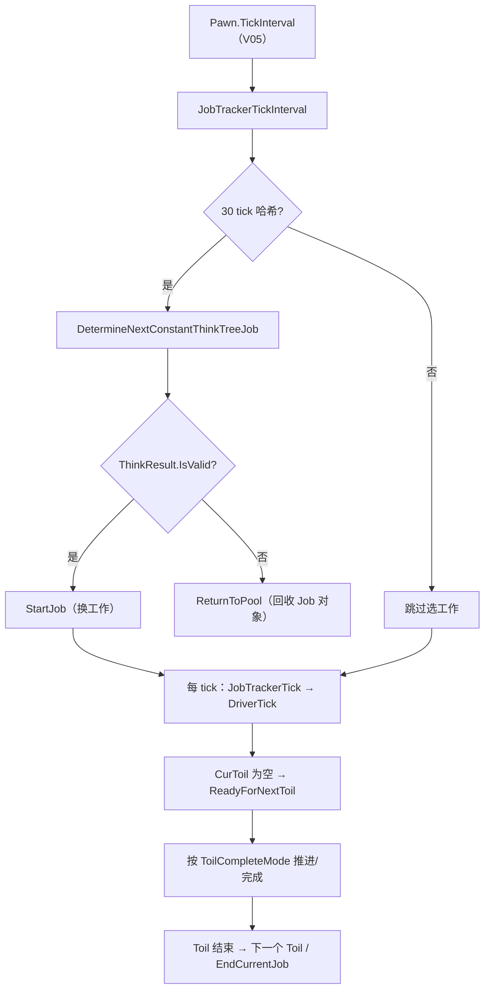

# V06 AI：ThinkTree / Job / Toil —— 一个 Pawn 怎么决定「接下来做什么」

> **30 秒速览**
>
> - 每 tick 只做一件事：把当前 `JobDriver` 往前推一格（`DriverTick`）；**换工作不由每 tick 链决定**。
> - 每 **30 tick**（哈希间隔）才跑一次「固定思维树」：`DetermineNextConstantThinkTreeJob` 产出一个 `ThinkResult`，有效就 `StartJob`。
> - 没有当前工作、没死、且 `mindState.Active` 时，才调 `TryFindAndStartJob` 去选新工作。
> - `JobDriver` 是「一串 `Toil` 的状态机」：`ticksLeftThisToil` 递减、`CheckCurrentToilEndOrFail` 判结束、`ReadyForNextToil` 推进。
> - `ToilCompleteMode` 决定推进方式：`Instant` 立即完成、`Delay` 等倒计时、`FinishedBusy` 等姿态结束。
>
> **读前须知**：本卷讲「选工作 — 跑工作 — 推进 Toil」三层；具体工作内容（采集、建造、搬运）见 V07，需求与心情见 V13，移动见 V03。

## Where it sits

**本模块的类结构**

```csharp
public class Verse.AI.Pawn_JobTracker {  // 工作调度器
    public Job curJob;  // 当前工作
    public JobDriver curDriver;  // 当前工作的驱动器
    public JobQueue jobQueue;  // 排队的工作
    private int jobsGivenThisTick;  // 本 tick 派发数（防死循环）
    ...
    public virtual void JobTrackerTick()  // 每 tick：推进驱动器
    public virtual void JobTrackerTickInterval(int delta)  // 区间：换工作/过期
    public void StartJob(Job newJob, JobCondition lastJobEndCondition = JobCondition.None, ThinkNode jobGiver = null, ...)  // 换工作
    public void EndCurrentJob(JobCondition condition, bool startNewJob = true, bool canReturnToPool = true)  // 结束
    private void TryFindAndStartJob()  // 从思维树选一个
    private void FinalizeTick()  // 收尾统计
}

public class Verse.AI.JobDriver {  // 一串 Toil
    public Pawn pawn;  // 执行者
    public Job job;  // 所属工作
    public List<Toil> toils;  // Toil 列表
    public Toil CurToil;  // 当前 Toil
    public int ticksLeftThisToil;  // 当前 Toil 剩余 tick
    public bool wantBeginNextToil;  // 是否请求进入下一个
    ...
    public void DriverTick()  // 每 tick 推进
    public void DriverTickInterval(int delta)  // 区间推进
    protected virtual void SetupToils()  // 子类定义 Toil 列表
    private bool CheckCurrentToilEndOrFail()  // 结束/失败判定
    private void ReadyForNextToil()  // 标记进入下一个
}

public class Verse.AI.Toil {  // 一个原子步骤
    public ToilCompleteMode defaultCompleteMode;  // Instant / Delay / FinishedBusy
    public List<Action> preTickActions;  // tick 前动作
    public Action tickAction;  // 每 tick 动作
    public Action initAction;  // 开始动作
    public Action endAction;  // 结束动作
}

public class Verse.ThinkTreeDef : Def {  // 思维树定义
    public ThinkNode root;  // 根节点
}
```

**这一段怎么走**：先认三个对象——`Pawn_JobTracker`（调度）、`JobDriver`（状态机）、`Toil`（原子步骤）；`ThinkTreeDef` 只是「选工作的决策树」的定义。三者关系是：调度器每 30 tick 问一次思维树，拿到工作后交给驱动器，驱动器再逐 tick 推进 Toil。

## Evolution



| 层 | 方法 | 频率 | 职责 |
|---|---|---|---|
| 选工作 | `DetermineNextConstantThinkTreeJob` | 30 tick | 产出 `ThinkResult` |
| 换工作 | `StartJob` / `EndCurrentJob` | 事件 | 切换/结束 |
| 跑工作 | `JobTrackerTick` → `DriverTick` | 每 tick | 推进当前 Toil |
| 区间推进 | `DriverTickInterval(delta)` | 区间 | 长动作的批量推进 |

**这一段怎么走**：选工作在 30 tick 的节拍上发生，跑工作在每 tick 发生；两者通过 `curJob`/`curDriver` 交接。没有工作时才会触发「重新选」，所以「空闲」是唯一的主动选工作入口。

## Stage detail

### S0 每 tick：`JobTrackerTick` 只推进驱动器

**这一段做什么**：`JobTrackerTick` 做两件事——把当前 `JobDriver` 往前推一格，然后把本 tick 的派发计数清零（防死循环）。

**源码**（`Verse.AI.Pawn_JobTracker.JobTrackerTick`；中文注释为本文档所加）

```csharp
JobDriver jobDriver = this.curDriver;      // 当前驱动器
if (jobDriver != null)                     // 有工作在跑
{
    jobDriver.DriverTick();                // 推进一格
}
this.jobsGivenThisTick = 0;                // 本 tick 派发数清零
this.jobsGivenThisTickTextual = "";        // 文本记录清零
```

**伪代码**

```text
驱动器 = 当前驱动器
若 驱动器 非空:
    驱动器.每tick()
本 tick 派发数 = 0
本 tick 派发文本 = ""
```

> **要点**：换工作**不在这里**——每 tick 链只推进，不决策。
>
> **陷阱**：`jobsGivenThisTick` 归零在推进之后，所以「本 tick 派发了几个工作」的统计包含刚推进时触发的那次。

**这一段怎么走**：取驱动器 → 非空则推进 → 清零计数。三行代码，是 AI 每 tick 的全部动作。

### S1 每 30 tick：固定思维树选工作

**这一段做什么**：`JobTrackerTickInterval` 在 30 tick 哈希命中时问一次固定思维树；结果有效就换工作，无效就回收对象；之后再处理「工作过期」与「没工作就选一个」。

**源码**（`Verse.AI.Pawn_JobTracker.JobTrackerTickInterval`，核心段；中文注释为本文档所加）

```csharp
if (this.pawn.IsHashIntervalTick(30, delta))                              // 每 30 tick
{
    ThinkResult thinkResult = this.DetermineNextConstantThinkTreeJob();   // 问固定思维树
    if (thinkResult.IsValid)                                             // 有结果
    {
        if (this.ShouldStartJobFromThinkTree(thinkResult))               // 允许启动
        {
            ...
            this.StartJob(thinkResult.Job, JobCondition.InterruptForced, thinkResult.SourceNode, false, false, this.pawn.thinker.ConstantThinkTree, thinkResult.Tag, false, false, null, false, true, false);  // 换工作
        }
        else if (thinkResult.Job != this.curJob && !this.jobQueue.Contains(thinkResult.Job))  // 没被采用
        {
            JobMaker.ReturnToPool(thinkResult.Job);                      // 回收
        }
    }
}
if (this.curDriver != null)                                              // 有驱动器
{
    ...
    this.curDriver.DriverTickInterval(delta);                            // 区间推进
}
if (this.curJob == null && !this.pawn.Dead && this.pawn.mindState.Active)  // 空闲且活着
{
    ...
    this.TryFindAndStartJob();                                           // 主动选工作
}
this.FinalizeTick();                                                     // 收尾统计
```

**伪代码**

```text
若 命中 30 tick:
    结果 = 固定思维树.下一个()
    若 结果.有效:
        若 允许从思维树启动:
            …（省略：离开 joinable lord 处理）
            启动工作(结果.工作, 强制打断, 结果.来源, …, 固定思维树, 结果.标签, …)
        否则 若 结果.工作 ≠ 当前工作 且 队列里没有:
            回收(结果.工作)
若 有驱动器:
    …（省略：过期判定）
    驱动器.区间推进(delta)
若 当前工作为空 且 未死亡 且 心态活跃:
    …（省略：调试日志）
    尝试找并启动工作()
收尾统计()
```

- `IsHashIntervalTick(30, delta)`：30 tick 一次，约 0.5 游戏秒；
- `DetermineNextConstantThinkTreeJob`：固定思维树（`ConstantThinkTree`）负责「随时该做的事」，如吃饭、睡觉、反击；
- `StartJob` 的第 13 个参数 `true`（`addToJobsThisTick`）表明这次派发计入本 tick 统计。

> **要点**：30 tick 是「决策节拍」，不是「反应延迟」——紧急反应（被攻击）由别处（`CheckForJobOverride`）触发，不走这条节拍。
>
> **陷阱**：`thinkResult.Job` 没被采用时必须 `ReturnToPool`，否则每 30 tick 泄漏一个 `Job` 对象；这是对象池最容易漏的地方。

**这一段怎么走**：30 tick 命中 → 问固定思维树 → 有效则启动、无效则回收 → 推进驱动器区间 → 空闲则主动选工作 → 收尾。决策与推进在同一个方法里，但节拍不同。

### S2 `DriverTick`：Toil 状态机

**这一段做什么**：`DriverTick` 每 tick 递减当前 Toil 的剩余时间，按 `ToilCompleteMode` 判断是否完成，并在需要时请求进入下一个 Toil。

**源码**（`Verse.AI.JobDriver.DriverTick`，开头段；中文注释为本文档所加）

```csharp
this.ticksLeftThisToil--;                                       // 剩余时间递减
this.debugTicksSpentThisToil++;                                 // 调试计数
if (this.CurToil == null)                                       // 还没有当前 Toil
{
    if (!this.pawn.stances.FullBodyBusy || this.CanStartNextToilInBusyStance)  // 不忙
    {
        this.ReadyForNextToil();                                // 请求下一个
    }
}
else if (!this.CheckCurrentToilEndOrFail())                     // 当前 Toil 未结束
{
    if (this.CurToil.defaultCompleteMode == ToilCompleteMode.Instant)  // 立即完成
    {
        this.ReadyForNextToil();                                // 直接请求下一个
    }
    ...
}
```

**伪代码**

```text
剩余时间 -= 1
调试计数 += 1
若 当前 Toil 为空:
    若 不忙 或 允许在忙碌姿态中开始:
        请求下一个 Toil()
否则 若 未结束或失败:
    若 完成模式 = 立即:
        请求下一个 Toil()
    …（省略：Delay / FinishedBusy 分支）
```

- `FullBodyBusy`：正在做全身动作（如睡觉、被击倒）时不能开始新 Toil；
- `CheckCurrentToilEndOrFail()`：返回真表示「已结束或失败」，本 tick 不再推进；
- `ReadyForNextToil()` 只是置 `wantBeginNextToil`，真正切换在后续的 `TryActuallyStartNextToil`。

> **要点**：`ticksLeftThisToil` 每 tick 都减，即使当前 Toil 是 `Instant` 模式——所以它对 `Instant` 无意义，只对 `Delay` 有效。
>
> **陷阱**：`ReadyForNextToil` 不是「立即切换」；如果同一 tick 内重复调用，会重复排队，导致 Toil 跳步。

**这一段怎么走**：递减 → 判当前 Toil 是否存在 → 不存在则请求下一个 → 存在则判结束/失败 → 按完成模式决定是否请求下一个。真正的 Toil 切换发生在 `wantBeginNextToil` 被消费时。

## Branches

| 分支 | 触发条件 | 行为 | 与主链的差异 |
|---|---|---|---|
| **空闲** | `curJob == null && !Dead && mindState.Active` | `TryFindAndStartJob` | 主动选工作 |
| **过期** | `startTick + expiryInterval <= now` | 结束或 `CheckForJobOverride` | 可能中断当前工作 |
| **无敌人** | `expireRequiresEnemiesNearby` 且附近无敌人 | 跳过过期 | 工作继续 |
| **忙碌姿态** | `FullBodyBusy` | 不开新 Toil | 等姿态结束 |
| **固定思维树无效** | `ThinkResult` 无效或不被采用 | `ReturnToPool` | 回收 Job 对象 |
| **队列** | `jobQueue` 非空 | 结束后取下一个 | 不重新决策 |

**层积与遗留痕迹**：

1. **`StartJob` 有 13 个参数**：从最初的两三个参数一路加到现在，绝大多数调用点只传前几个，其余用默认值。
2. **30 tick 决策节拍**：早期是每 tick 决策，性能优化后改成哈希间隔；紧急反应因此另开了 `CheckForJobOverride` 通道。
3. **`jobsGivenThisTick` 计数**：防「一 tick 内无限换工作」的保护，说明曾经出现过这种死循环。

> **要点**：分支表里只有「过期」与「固定思维树」会改当前工作，其余是推进细节。
>
> **陷阱**：`jobQueue` 非空时结束当前工作会直接取队列，不再问思维树——排队工作的优先级高于决策。

**这一段怎么走**：六条分支各改一处：空闲触发选工作、过期触发中断、无敌人跳过过期、忙碌阻塞推进、无效结果回收、队列优先。层积三条说明这套 AI 是「性能优化 + 补丁」堆出来的。

## Contracts

| 方向 | 契约 |
|---|---|
| 入 | `Pawn.Tick` 调 `JobTrackerTick`；`Pawn.TickInterval` 调 `JobTrackerTickInterval(delta)`（V05） |
| 出 | `StartJob` / `EndCurrentJob`；`DriverTick` 推进 Toil |
| 时序 | 每 tick 推进 → 每 30 tick 决策 → 空闲才主动选工作 |
| 不变量 | 一个 Pawn 同时只有一个 `curJob`；`ThinkResult` 未采用必须回池；`Toil` 切换经 `wantBeginNextToil` |
| 边界 | 死亡/非活跃不选工作；忙碌姿态不开新 Toil；过期可选「需敌人附近」 |

## Evidence

[claim:V06-C01] 每 tick 只推进当前驱动器。
  src: Verse.AI.Pawn_JobTracker.JobTrackerTick
  file: analysis/decompiled/Assembly-CSharp/Verse/AI/Pawn_JobTracker.cs
  match: jobDriver.DriverTick();

[claim:V06-C02] 每 tick 派发计数在推进后清零。
  src: Verse.AI.Pawn_JobTracker.JobTrackerTick
  file: analysis/decompiled/Assembly-CSharp/Verse/AI/Pawn_JobTracker.cs
  match: this.jobsGivenThisTick = 0;
  note: 该匹配在目标文件出现 2 次；本条对应 Verse.AI.Pawn_JobTracker.JobTrackerTick 内的那一处。

[claim:V06-C03] 固定思维树按 30 tick 哈希间隔询问。
  src: Verse.AI.Pawn_JobTracker.JobTrackerTickInterval
  file: analysis/decompiled/Assembly-CSharp/Verse/AI/Pawn_JobTracker.cs
  match: if (this.pawn.IsHashIntervalTick(30, delta))

[claim:V06-C04] 思维树结果是 `ThinkResult`，有效才启动。
  src: Verse.AI.Pawn_JobTracker.JobTrackerTickInterval
  file: analysis/decompiled/Assembly-CSharp/Verse/AI/Pawn_JobTracker.cs
  match: ThinkResult thinkResult = this.DetermineNextConstantThinkTreeJob();
  note: 该匹配在目标文件出现 2 次；本条对应 Verse.AI.Pawn_JobTracker.JobTrackerTickInterval 内的那一处。

[claim:V06-C05] 启动前要过 `ShouldStartJobFromThinkTree` 守卫。
  src: Verse.AI.Pawn_JobTracker.JobTrackerTickInterval
  file: analysis/decompiled/Assembly-CSharp/Verse/AI/Pawn_JobTracker.cs
  match: if (this.ShouldStartJobFromThinkTree(thinkResult))

[claim:V06-C06] 未被采用的工作对象会被回收。
  src: Verse.AI.Pawn_JobTracker.JobTrackerTickInterval
  file: analysis/decompiled/Assembly-CSharp/Verse/AI/Pawn_JobTracker.cs
  match: JobMaker.ReturnToPool(thinkResult.Job);
  note: 该匹配在目标文件出现 2 次；本条对应 Verse.AI.Pawn_JobTracker.JobTrackerTickInterval 内的那一处。

[claim:V06-C07] 工作过期由起始 tick 加区间判定。
  src: Verse.AI.Pawn_JobTracker.JobTrackerTickInterval
  file: analysis/decompiled/Assembly-CSharp/Verse/AI/Pawn_JobTracker.cs
  match: flag = this.curJob.startTick + this.curJob.expiryInterval <= GenTicks.TicksGame && this.pawn.IsHashIntervalTick(this.curJob.expiryInterval, delta);

[claim:V06-C08] 过期可要求附近有敌人才生效。
  src: Verse.AI.Pawn_JobTracker.JobTrackerTickInterval
  file: analysis/decompiled/Assembly-CSharp/Verse/AI/Pawn_JobTracker.cs
  match: if (!this.curJob.expireRequiresEnemiesNearby || PawnUtility.EnemiesAreNearby(this.pawn, 25, false, -1f, 1, false))

[claim:V06-C09] 空闲且活着才主动找工作。
  src: Verse.AI.Pawn_JobTracker.JobTrackerTickInterval
  file: analysis/decompiled/Assembly-CSharp/Verse/AI/Pawn_JobTracker.cs
  match: if (this.curJob == null && !this.pawn.Dead && this.pawn.mindState.Active)

[claim:V06-C10] 每次区间链末尾都做统计收尾。
  src: Verse.AI.Pawn_JobTracker.JobTrackerTickInterval
  file: analysis/decompiled/Assembly-CSharp/Verse/AI/Pawn_JobTracker.cs
  match: this.FinalizeTick();
  note: 该匹配在目标文件出现 2 次；本条对应 Verse.AI.Pawn_JobTracker.JobTrackerTickInterval 内的那一处。

[claim:V06-C11] Toil 剩余时间每 tick 递减。
  src: Verse.AI.JobDriver.DriverTick
  file: analysis/decompiled/Assembly-CSharp/Verse/AI/JobDriver.cs
  match: this.ticksLeftThisToil--;

[claim:V06-C12] 忙碌姿态下不开始下一个 Toil。
  src: Verse.AI.JobDriver.DriverTick
  file: analysis/decompiled/Assembly-CSharp/Verse/AI/JobDriver.cs
  match: if (!this.pawn.stances.FullBodyBusy || this.CanStartNextToilInBusyStance)

[claim:V06-C13] 当前 Toil 结束/失败判定为真时本 tick 不推进。
  src: Verse.AI.JobDriver.DriverTick
  file: analysis/decompiled/Assembly-CSharp/Verse/AI/JobDriver.cs
  match: else if (!this.CheckCurrentToilEndOrFail())

[claim:V06-C14] `Instant` 完成模式立即请求下一个 Toil。
  src: Verse.AI.JobDriver.DriverTick
  file: analysis/decompiled/Assembly-CSharp/Verse/AI/JobDriver.cs
  match: if (this.CurToil.defaultCompleteMode == ToilCompleteMode.Instant)

## Open questions

1. `[unresolved]` `DetermineNextConstantThinkTreeJob` 内部如何遍历思维树节点（优先级、随机权重）未展开。
2. `[unresolved]` `CheckForJobOverride` 的触发频率与条件未逐条取证。
3. `[unresolved]` `Job` 对象池的容量与回收时机未统计。

**这一段怎么走**：三条未结项分别指向「思维树内部」「覆盖通道」「对象池」；第一条是 V06 的下一层，第二条与紧急反应相关，第三条属性能细节。
