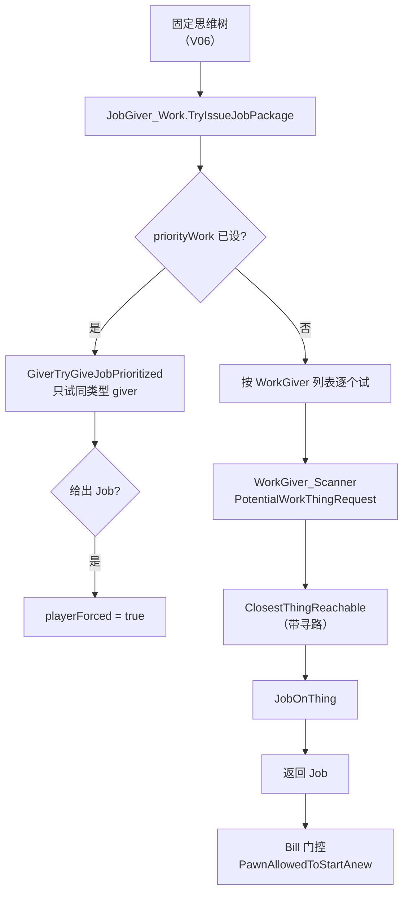

# V07 工作与生产：WorkGiver 怎么挑活、Bill 怎么排产

> **30 秒速览**
>
> - 工作的入口是 `JobGiver_Work`：它按「工作类型 → WorkGiver 列表」逐个试，找到第一个能给出 `Job` 的就返回。
> - `WorkGiver_Scanner` 是扫描型工作基类：声明「找什么东西」（`PotentialWorkThingRequest`）、「是否按优先级排」（`Prioritized`）、「给这个物体什么工作」（`JobOnThing`）。
> - 找目标有两条路：**全局最近**（`ClosestThing_Global`）与**可达最近**（`ClosestThingReachable`，带寻路与区域扫描上限）。
> - `Bill` 是生产订单：能不能开工由 `PawnAllowedToStartAnew` 决定——人种限制、奴隶/机械专属、技能区间逐条筛。
> - 排产由 `repeatMode` 决定：`RepeatCount`（做 N 个）与 `TargetCount`（补到 N 个）。
>
> **读前须知**：本卷讲「工作怎么被选中、生产订单怎么被门控」；AI 决策节拍见 V06，寻路见 V03，物品与堆叠见 V04。

## Where it sits

**本模块的类结构**

```csharp
public class RimWorld.JobGiver_Work : ThinkNode_JobGiver {  // 工作类 ThinkNode
    public bool emergency;  // 是否紧急（只做优先级工作）
    public override ThinkResult TryIssueJobPackage(Pawn pawn, JobIssueParams jobParams)  // 找工作
    private Job GiverTryGiveJobPrioritized(Pawn pawn, WorkGiver giver, IntVec3 cell)  // 优先级分支
    private bool WorkGiversRelated(WorkGiver giver, WorkGiverDef def)  // 是否同一工作类型
}

public class RimWorld.WorkGiver_Scanner : WorkGiver {  // 扫描型工作基类
    public virtual ThingRequest PotentialWorkThingRequest  // 找什么
    public virtual int MaxRegionsToScanBeforeGlobalSearch  // 区域扫描上限
    public virtual bool Prioritized  // 是否按优先级
    public virtual IEnumerable<Thing> PotentialWorkThingsGlobal(Pawn pawn)  // 候选集合
    public virtual bool HasJobOnThing(Pawn pawn, Thing t, bool forced = false)  // 能不能做
    public virtual Job JobOnThing(Pawn pawn, Thing t, bool forced = false)  // 做什么
    public virtual Job JobOnCell(Pawn pawn, IntVec3 cell, bool forced = false)  // 格子版
    public virtual float GetPriority(Pawn pawn, TargetInfo t)  // 排序权重
}

public class RimWorld.Bill : IExposable, ILoadReferenceable {  // 生产订单
    public RecipeDef recipe;  // 配方
    public Pawn pawnRestriction;  // 指定执行者
    public bool slavesOnly;  // 仅奴隶
    public bool mechsOnly;  // 仅机械
    public bool nonMechsOnly;  // 排除机械
    public IntRange allowedSkillRange;  // 技能区间
    public virtual bool PawnAllowedToStartAnew(Pawn p)  // 门控
    public bool IsFixedOrAllowedIngredient(ThingDef def)  // 材料是否可用
}

public class RimWorld.Bill_Production : Bill {  // 生产类订单
    public BillRepeatModeDef repeatMode;  // RepeatCount / TargetCount
    public int repeatCount;  // 做几个
}
```

**这一段怎么走**：先认四层——`JobGiver_Work`（选工作类型）、`WorkGiver_Scanner`（在类型内找目标）、`Bill`（生产订单）、`Bill_Production`（排产模式）。工作选择的每一层只回答一个问题，层层收窄到「某个物体的某个 Job」。

## Evolution



| 层 | 谁 | 回答什么问题 |
|---|---|---|
| 工作类型 | `WorkTypeDef` / `WorkGiverDef` | 这类活归谁做、优先级如何 |
| 目标选择 | `WorkGiver_Scanner` | 做哪个物体/格子 |
| 订单 | `Bill` | 能不能开工、做几个 |
| 执行 | `JobDriver`（V06） | 怎么做 |

**这一段怎么走**：思维树决定「试哪类工作」，`JobGiver_Work` 在类型内逐个 `WorkGiver` 试，`WorkGiver_Scanner` 找具体目标，`Bill` 最后门控。四层里只有订单层是「玩家意图」，其余都是自动选择。

## Stage detail

### S0 `WorkGiver_Scanner` 的契约

**这一段做什么**：扫描型工作只暴露四个可覆写点——找什么、扫多远、是否按优先级、给什么工作；默认实现全部「不做」。

**源码**（`RimWorld.WorkGiver_Scanner`，契约段；中文注释为本文档所加）

```csharp
public virtual ThingRequest PotentialWorkThingRequest       // 找什么
{
    get
    {
        return ThingRequest.ForGroup(ThingRequestGroup.Undefined);  // 默认：不找
    }
}

public virtual int MaxRegionsToScanBeforeGlobalSearch       // 区域扫描上限
{
    get
    {
        return -1;                                          // -1 = 直接全局搜
    }
}

public virtual bool Prioritized                              // 是否按优先级
{
    get
    {
        return false;                                       // 默认：不排序
    }
}
```

**伪代码**

```text
属性 找什么:
    取值:
    返回 未定义组                       # 默认不找

属性 区域扫描上限:
    取值:
    返回 -1                            # 直接全局搜

属性 是否按优先级:
    取值:
    返回 假
```

- `PotentialWorkThingRequest`：`ThingRequestGroup` 的批量查询，比遍历所有物体快；
- `MaxRegionsToScanBeforeGlobalSearch`：先在附近区域找，超过上限转全局；
- `Prioritized`：为真时用 `GetPriority` 排序，否则用距离。

> **要点**：默认实现全是「空」，所以每个具体 `WorkGiver` 必须覆写至少 `JobOnThing` 才有意义。
>
> **陷阱**：`MaxRegionsToScanBeforeGlobalSearch = -1` 不是「不扫」，而是「不限制」——直接走全局搜索。

**这一段怎么走**：四个虚成员构成扫描契约：找什么、扫多远、怎么排序、给什么活。默认值保证「没覆写就不干活」，避免误派。

### S1 `JobGiver_Work`：优先分支与普通分支

**这一段做什么**：`TryIssueJobPackage` 先处理「玩家指定的优先工作」——只在该工作类型内试；否则走普通流程，按 `WorkGiver` 列表逐个找。

**源码**（`RimWorld.JobGiver_Work.TryIssueJobPackage`，开头段；中文注释为本文档所加）

```csharp
if (CS$<>8__locals1.pawn.RaceProps.Humanlike && CS$<>8__locals1.pawn.health.hediffSet.InLabor(true))  // 分娩中
{
    return ThinkResult.NoJob;                                                        // 不派活
}
if (this.emergency && CS$<>8__locals1.pawn.mindState.priorityWork.IsPrioritized)      // 紧急 + 有优先工作
{
    List<WorkGiverDef> workGiversByPriority = CS$<>8__locals1.pawn.mindState.priorityWork.WorkGiver.workType.workGiversByPriority;  // 同类型 giver
    for (int i = 0; i < workGiversByPriority.Count; i++)                              // 逐个试
    {
        WorkGiver worker = workGiversByPriority[i].Worker;                            // 取 giver
        if (this.WorkGiversRelated(CS$<>8__locals1.pawn.mindState.priorityWork.WorkGiver, worker.def))  // 同类型
        {
            Job job = this.GiverTryGiveJobPrioritized(CS$<>8__locals1.pawn, worker, CS$<>8__locals1.pawn.mindState.priorityWork.Cell);  // 指定格子找工作
            if (job != null)                                                          // 找到
            {
                job.playerForced = true;                                              // 标记玩家强制
                ...
            }
        }
    }
}
```

**伪代码**

```text
若 人形 且 正在分娩:
    返回 无工作
若 紧急 且 有优先工作:
    列表 = 优先工作所属类型的 giver 列表
    循环 每个 giver:
        若 与优先工作同类型:
            工作 = 在指定格子上找工作(giver, 格子)
            若 工作 非空:
                工作.玩家强制 = 真
                …（省略：调试日志与返回）
…（省略：普通分支）
```

- `emergency`：紧急模式，只处理玩家右键指定的工作；
- `priorityWork.IsPrioritized`：玩家是否指定了「优先做这个」；
- `playerForced = true`：让后续逻辑知道这是玩家命令（影响中断与优先级）。

> **要点**：优先分支只在指定格子上找，不做全局搜索——这是「右键优先」比普通工作快的原因。
>
> **陷阱**：分娩检查在最前面，且对所有 `JobGiver_Work` 生效；产妇在分娩期间不会接任何普通工作。

**这一段怎么走**：先排除分娩，再看是否紧急优先；优先分支按类型过滤后在指定格找，普通分支（后续代码）按 giver 列表逐个试。两条分支最终都返回一个 `ThinkResult`。

### S2 `Bill` 的门控：谁能开这张订单

**这一段做什么**：`PawnAllowedToStartAnew` 用一串条件筛执行者——指定人、奴隶专属、机械专属、排除机械、技能区间；任一不满足就换人。

**源码**（`RimWorld.Bill.PawnAllowedToStartAnew`，开头段；中文注释为本文档所加）

```csharp
public virtual bool PawnAllowedToStartAnew(Pawn p)          // 门控入口
{
    if (this.pawnRestriction != null)                        // 指定了执行者
    {
        return this.pawnRestriction == p;                     // 只允许本人
    }
    if (this.slavesOnly && !p.IsSlave)                       // 仅奴隶
    {
        return false;
    }
    if (this.mechsOnly && !p.IsColonyMechPlayerControlled)    // 仅机械
    {
        return false;
    }
    if (this.nonMechsOnly && p.IsColonyMechPlayerControlled)  // 排除机械
    {
        return false;
    }
    ...
}
```

**伪代码**

```text
过程 允许开工(p):
    若 指定执行者 非空:
        返回 指定执行者 = p
    若 仅奴隶 且 p 不是奴隶:
        返回 假
    若 仅机械 且 p 不是殖民地机械:
        返回 假
    若 排除机械 且 p 是殖民地机械:
        返回 假
    …（省略：技能区间等后续检查）
```

- 指定执行者优先级最高：一旦设定，其他人直接被拒；
- 奴隶/机械三选项互斥使用，但同时为真时按顺序短路；
- 技能检查在后面：`allowedSkillRange` 与 `recipe.workSkill`。

> **要点**：门控只回答「这个人能不能开这张订单」，不回答「材料够不够」——材料由 `IsFixedOrAllowedIngredient` 与库存判断负责。
>
> **陷阱**：`pawnRestriction` 一旦设置，技能/奴隶等检查全部跳过——指定人拥有绝对优先权。

**这一段怎么走**：先看是否指定人，再依次过奴隶/机械三选项，最后查技能区间。任一条拒绝就换下一个候选人。

### S3 排产：`RepeatCount` 与 `TargetCount`

**这一段做什么**：生产订单的「做多少」由 `repeatMode` 决定——`RepeatCount` 是「再做 N 个」，`TargetCount` 是「库存补到 N 个」。

| 模式 | 语义 | 何时停 |
|---|---|---|
| `RepeatCount` | 做固定数量 | 计数到 `repeatCount` |
| `TargetCount` | 补到目标库存 | 库存 ≥ 目标 |

`BillRepeatModeUtility.MakeConfigFloatMenu` 负责把这两个选项做成右键菜单：

```csharp
bill.repeatMode = BillRepeatModeDefOf.RepeatCount;   // 切到「做 N 个」
```

```text
订单.排产模式 = 做N个
```

> **要点**：`TargetCount` 需要「当前库存」参与判断，所以它依赖地图上的物品统计；`RepeatCount` 只看订单自己的计数。
>
> **陷阱**：`TargetCount` 在库存被其他来源补满时会「自动停工」，看起来像订单消失——其实是条件不满足。

**这一段怎么走**：排产模式决定「按数量还是按库存」，菜单只是切换模式；真正的「是否继续」由 BillStack 在每次开工前判断。

## Branches

| 分支 | 触发条件 | 行为 | 与主链的差异 |
|---|---|---|---|
| **分娩** | 人形且 `InLabor` | 直接 `NoJob` | 不接任何工作 |
| **紧急优先** | `emergency && IsPrioritized` | 只试同类型 giver | 指定格子、标记 `playerForced` |
| **可达搜索** | 目标不可直达 | `ClosestThingReachable` | 带寻路与区域上限 |
| **全局搜索** | 区域扫描超限 | `ClosestThing_Global` | 忽略寻路、只看距离 |
| **门控拒绝** | `PawnAllowedToStartAnew` 为假 | 换下一个候选人 | 订单保留 |
| **库存达标** | `TargetCount` 且库存足够 | 不派活 | 订单暂停 |

**层积与遗留痕迹**：

1. **`<>c__DisplayClass` 满天飞**：闭包捕获 `pawn` 与 `scanner`，是 lambda 排序键的副产品。
2. **`playerForced` 标记**：优先工作的结果必须标记，否则会被普通决策覆盖。
3. **两条搜索路径并存**：`Global` 与 `Reachable` 是性能与正确性的折中，调用点按 `MaxRegionsToScanBeforeGlobalSearch` 切换。

> **要点**：分支表里只有「分娩」与「门控拒绝」会让人完全不干活，其余是搜索策略差异。
>
> **陷阱**：`ClosestThing_Global` 不考虑可达性，可能选出「直线最近但走不到」的目标；`Reachable` 才带寻路。

**这一段怎么走**：六条分支分别改「派不派活」「怎么找目标」「谁来做」「做多少」。层积三条说明这套代码是闭包 + 标记 + 双路径的混合体。

## Contracts

| 方向 | 契约 |
|---|---|
| 入 | `ThinkNode_JobGiver` 由思维树调用（V06）；`Bill` 由玩家/UI 创建 |
| 出 | `ThinkResult`（Job 或 NoJob）；`playerForced` 标记 |
| 时序 | 分娩检查 → 优先分支 → 普通分支 → 门控 → 搜索 → 返回 |
| 不变量 | 一个 `ThinkResult` 至多一个 Job；优先工作只试同类型；门控拒绝不改订单 |
| 边界 | 分娩不派活；`TargetCount` 达标即停；全局搜索忽略可达性 |

## Evidence

[claim:V07-C01] 扫描型工作默认不找任何东西。
  src: RimWorld.WorkGiver_Scanner.PotentialWorkThingRequest
  file: analysis/decompiled/Assembly-CSharp/RimWorld/WorkGiver_Scanner.cs
  match: return ThingRequest.ForGroup(ThingRequestGroup.Undefined);

[claim:V07-C02] 区域扫描上限默认 -1（不限制）。
  src: RimWorld.WorkGiver_Scanner.MaxRegionsToScanBeforeGlobalSearch
  file: analysis/decompiled/Assembly-CSharp/RimWorld/WorkGiver_Scanner.cs
  match: return -1;

[claim:V07-C03] 默认不按优先级排序。
  src: RimWorld.WorkGiver_Scanner.Prioritized
  file: analysis/decompiled/Assembly-CSharp/RimWorld/WorkGiver_Scanner.cs
  match: return false;
  note: 该匹配在目标文件出现 2 次；本条对应 RimWorld.WorkGiver_Scanner.Prioritized 内的那一处。

[claim:V07-C04] 扫描型工作必须实现「给这个物体什么工作」。
  src: RimWorld.WorkGiver_Scanner.JobOnThing
  file: analysis/decompiled/Assembly-CSharp/RimWorld/WorkGiver_Scanner.cs
  match: public virtual Job JobOnThing(Pawn pawn, Thing t, bool forced = false)

[claim:V07-C05] 分娩中的殖民者不接工作。
  src: RimWorld.JobGiver_Work.TryIssueJobPackage
  file: analysis/decompiled/Assembly-CSharp/RimWorld/JobGiver_Work.cs
  match: if (CS$<>8__locals1.pawn.RaceProps.Humanlike && CS$<>8__locals1.pawn.health.hediffSet.InLabor(true))

[claim:V07-C06] 紧急且指定优先工作时走优先分支。
  src: RimWorld.JobGiver_Work.TryIssueJobPackage
  file: analysis/decompiled/Assembly-CSharp/RimWorld/JobGiver_Work.cs
  match: if (this.emergency && CS$<>8__locals1.pawn.mindState.priorityWork.IsPrioritized)

[claim:V07-C07] 优先分支只遍历该工作类型的 giver 列表。
  src: RimWorld.JobGiver_Work.TryIssueJobPackage
  file: analysis/decompiled/Assembly-CSharp/RimWorld/JobGiver_Work.cs
  match: List<WorkGiverDef> workGiversByPriority = CS$<>8__locals1.pawn.mindState.priorityWork.WorkGiver.workType.workGiversByPriority;

[claim:V07-C08] 优先分支在指定格子上找工作。
  src: RimWorld.JobGiver_Work.TryIssueJobPackage
  file: analysis/decompiled/Assembly-CSharp/RimWorld/JobGiver_Work.cs
  match: Job job = this.GiverTryGiveJobPrioritized(CS$<>8__locals1.pawn, worker, CS$<>8__locals1.pawn.mindState.priorityWork.Cell);

[claim:V07-C09] 优先工作的结果被标记为玩家强制。
  src: RimWorld.JobGiver_Work.TryIssueJobPackage
  file: analysis/decompiled/Assembly-CSharp/RimWorld/JobGiver_Work.cs
  match: job.playerForced = true;

[claim:V07-C10] 普通分支用带寻路的可达搜索。
  src: RimWorld.JobGiver_Work.TryIssueJobPackage
  file: analysis/decompiled/Assembly-CSharp/RimWorld/JobGiver_Work.cs
  match: thing = GenClosest.ClosestThingReachable(CS$<>8__locals2.CS$<>8__locals1.pawn.Position, CS$<>8__locals2.CS$<>8__locals1.pawn.Map, CS$<>8__locals2.scanner.PotentialWorkThingRequest, CS$<>8__locals2.scanner.PathEndMode, TraverseParms.For(CS$<>8__locals2.CS$<>8__locals1.pawn, CS$<>8__locals2.scanner.MaxPathDanger(CS$<>8__locals2.CS$<>8__locals1.pawn), TraverseMode.ByPawn, false, false, false, true), 9999f, new Predicate<Thing>(CS$<>8__locals2.<TryIssueJobPackage>g__Validator|0), enumerable, 0, CS$<>8__locals2.scanner.MaxRegionsToScanBeforeGlobalSearch, enumerable != null, RegionType.Set_Passable, false, false);

[claim:V07-C11] 指定执行者时只允许本人开工。
  src: RimWorld.Bill.PawnAllowedToStartAnew
  file: analysis/decompiled/Assembly-CSharp/RimWorld/Bill.cs
  match: return this.pawnRestriction == p;

[claim:V07-C12] 「仅奴隶」会拒绝非奴隶。
  src: RimWorld.Bill.PawnAllowedToStartAnew
  file: analysis/decompiled/Assembly-CSharp/RimWorld/Bill.cs
  match: if (this.slavesOnly && !p.IsSlave)

[claim:V07-C13] 「仅机械」会拒绝非机械。
  src: RimWorld.Bill.PawnAllowedToStartAnew
  file: analysis/decompiled/Assembly-CSharp/RimWorld/Bill.cs
  match: if (this.mechsOnly && !p.IsColonyMechPlayerControlled)

[claim:V07-C14] 「排除机械」会拒绝机械。
  src: RimWorld.Bill.PawnAllowedToStartAnew
  file: analysis/decompiled/Assembly-CSharp/RimWorld/Bill.cs
  match: if (this.nonMechsOnly && p.IsColonyMechPlayerControlled)

[claim:V07-C15] 排产模式可切换为「做 N 个」。
  src: RimWorld.BillRepeatModeUtility.MakeConfigFloatMenu
  file: analysis/decompiled/Assembly-CSharp/RimWorld/BillRepeatModeUtility.cs
  match: bill.repeatMode = BillRepeatModeDefOf.RepeatCount;

## Open questions

1. `[unresolved]` 普通分支的完整 giver 遍历顺序与 `WorkTypeDef` 优先级未逐行核对。
2. `[unresolved]` `Bill_Production` 的 `TargetCount` 库存统计口径未展开。
3. `[unresolved]` 配方产物生成（`GenRecipe.MakeRecipeProducts`）未拆解，本卷只到「订单能不能开」。

**这一段怎么走**：三条未结项分别指向「giver 顺序」「库存口径」「产物生成」；第三条是 V07 的自然续篇，可作为后续补充。
