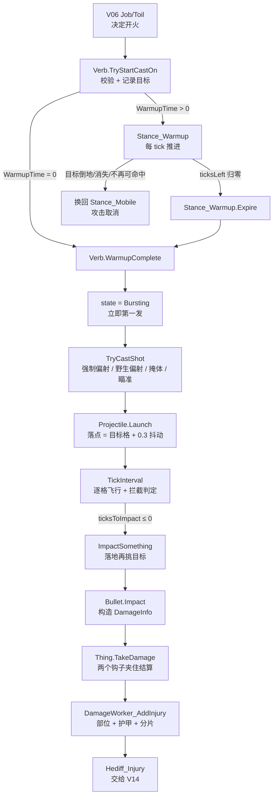
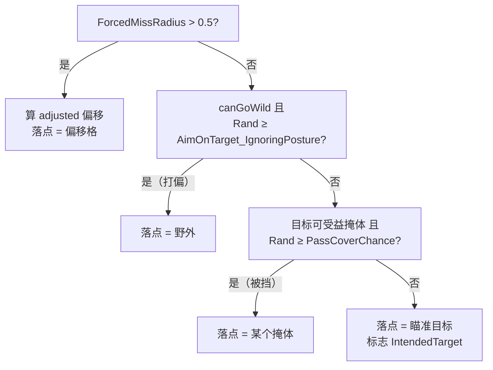
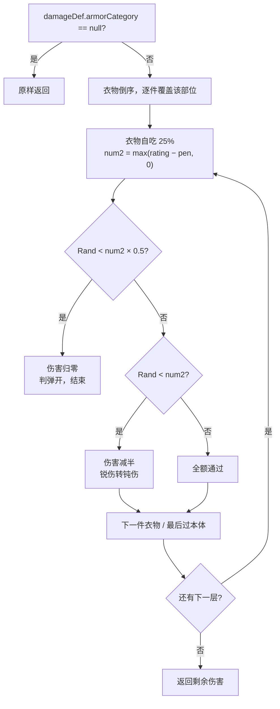

# V08 战斗与伤害：一次攻击如何变成一道伤口

> **30 秒速览**
>
> - 一次远程攻击分五段：举枪（暖机）→ 三段掷骰决定「打向哪」→ 抛射物逐格飞行 → 落地再挑目标 → 伤口落地。
> - **命中在发射那一瞬间就定了**：野生偏射、掩体、瞄准目标，三次判断，全过才「瞄准目标」。飞出去之后只剩「拦截」和「落地选靶」。
> - **护甲不是减伤**，是两次概率判定：弹开（伤害归零）或减半（锐伤转钝伤）。每件覆盖部位的衣物各掷一次，本体再掷一次。
> - `DamageInfo` 是**可变对象**：一路被改写——`Amount` 被缩放、`Def` 可能被换成 `Blunt`、`HitPart` 被填入。
> - 伤口最终是 `Hediff_Injury`，它的 `Severity` 就是落地伤害值；之后怎么愈合、怎么留疤，归 V14。
>
> **读前须知**：本卷是 v3 样张（对应 v1 同名卷）。断言 ID 沿用 `V08-C01…C30`，新增从 `C31` 起。需要先读 V04（Thing 生命周期）、V05（Pawn tick）、V06（Job/Toil）。

> **本卷写法**：每个模块先列**所属类的结构**（字段、函数签名与作用，不展开函数体），再进逻辑；每段逻辑给「源码 + 伪代码」两段，**按语句同序对应**（同一位置即同一语句；花括号行只出现在源码里）。每个部分结尾都有一段「这一段怎么走」，用散文把该部分的推进顺序复述一遍，读完这段就知道这一节在讲什么。源码行内注释为本文档所加，语句本身与语料逐字一致；`…` 表示省略。

## Where it sits

玩家点「攻击」，小人走过去、举枪、开火、对面掉血。中间发生了什么，是这一卷要回答的。

这件事可以拆成三块：

1. **谁决定开火**——属于 V06 的 Job/Toil；本卷只讲 `Verb` 这一侧的入口契约。
2. **一次攻击的演进**——本卷主体：暖机 → 发射 → 飞行 → 落地 → 伤口。
3. **伤害如何被削**——护甲、部位、分片、过杀保护。

| 项 | 内容 |
|---|---|
| 上游 | V06（Job/Toil 调 `Verb.TryStartCastOn`）、V05（`Pawn.Tick` → `verbTracker.VerbsTick` → `Verb.VerbTick`） |
| 下游 | V14（`Hediff_Injury` 愈合与疤痕）、V13（疼痛→心情）、V11（`Notify_PawnDamagedThing` → 派系与社交）、V04（`Thing.TakeDamage` 契约） |
| 不覆盖 | 武器数值面（`VerbProperties` / `ThingDef` 数据，属 V15）；AI 选目标（V06）；爆炸全链只作分支提及；近战只作分支提及 |

**这一段怎么走**：先把玩家看到的现象拆成「谁决定开火 / 一次攻击的演进 / 伤害如何被削」三块，再把三块对到具体卷：上游是 V06 的 Job 与 V05 的 tick，下游是 V14 的伤口。这样安排是为了让后面的代码段各有归属——讲「怎么开火」的只到 `Verb` 为止，讲「伤口怎么长」的留给 V14。

### 变量与类型速查（读代码前先看这张表）

| 名称 | 类型 | 含义 | 出处 |
|---|---|---|---|
| `caster` / `Caster` | `Thing` | 施法者本体：人、炮塔、陷阱都可能是 | `Verb` |
| `CasterPawn` | `Pawn` | 施法者是 Pawn 时的强类型视图（姿态、属性都在它身上） | `Verb` |
| `verbProps` | `VerbProperties` | 该 verb 的静态配置：射程、暖机、连发、音效、`canGoWild`、`ForcedMissRadius` | Def 数据（V15） |
| `state` | `VerbState` | `Idle`（空闲）/ `Bursting`（连发中） | `Verb` |
| `WarmupTime` | `float` 秒 | 基础暖机时长，未乘瞄准延迟 | `Verb` |
| `WarmupTicksLeft` / `WarmupProgress` | `int` / `float` 0–1 | 暖机剩余 tick 与进度（UI 读它） | `Verb` |
| `AimingDelayFactor` | Stat 值 | 瞄准延迟系数：暖机时间 × 它 = 实际暖机 | Stat（V15） |
| `ShotsPerBurst` / `burstShotsLeft` | `int` | 一轮几发 / 本轮还剩几发 | `Verb` |
| `TicksBetweenBurstShots` / `ticksToNextBurstShot` | `int` | 连发间隔 / 距下一发的 tick | `Verb` |
| `currentTarget` | `LocalTargetInfo` | 当前瞄准（可能只有格子，也可能带 Thing） | `Verb` |
| `usedTarget` | `LocalTargetInfo` | **实际**落点目标（打偏时是野外或掩体） | `Projectile` |
| `intendedTarget` | `LocalTargetInfo` | **原本想打**的目标（战斗日志、仇恨都看它） | `Projectile` |
| `hitFlags` | `ProjectileHitFlags` | 允许命中哪些类别：`IntendedTarget` / `NonTargetPawns` / `NonTargetWorld` / `All` | `Projectile` |
| `ShotReport` | `struct` | 一次射击的命中率分解 | `ShotReport` |
| `shootLine` | `ShootLine` | 射击线：起点格、终点格、中间经过的格 | `ShootLine` |
| `destination` | `Vector3` | 落点（含 0.3 格随机抖动） | `Projectile` |
| `ticksToImpact` / `StartingTicksToImpact` | `int` / `float` | 剩余飞行 tick / 起飞时算好的总飞行 tick | `Projectile` |
| `SpeedTilesPerTick` | `float` 格/tick | 抛射物速度（Def 数据） | `ProjectileProperties` |
| `CoverInfo` | `struct` | 一个掩体的描述：`cover`（物体）+ `BlockChance`（遮挡率） | `CoverUtility` |
| `amount` / `damAmount` | `float` | 当前伤害量（会被逐层改写） | `ArmorUtility` 等 |
| `armorRating` / `armorPenetration` | `float` | 护甲值 / 穿甲值 | Stat |
| `metalArmor` | `bool`（out） | 这层护甲是否算金属（只用来看特效） | `ArmorUtility` |
| `DamageInfo` | `struct` | 伤害数据包：`Def`/`Amount`/`ArmorPenetrationInt`/`HitPart`/`Height`/`Depth`/`Instigator`/`IgnoreArmor`/`AllowDamagePropagation` | `DamageInfo` |
| `DamageResult` | `class` | 结算结果：`totalDamageDealt`/`deflected`/`diminished`/`headshot`/`LastHitPart`/`parts`/`hediffs` | `DamageWorker` |
| `wornApparel` | `List<Apparel>` | 当前穿戴的衣物，**倒序**参与护甲判定（后穿先算） | `Pawn_ApparelTracker` |

`ShotReport` 的字段单独列（它们决定命中率）：

| 字段 | 含义 |
|---|---|
| `factorFromShooterAndDist` | 射手精度 ^距离 × 距离段修正（只有 `canGoWild` 才计算） |
| `factorFromEquipment` | 武器精度曲线 |
| `factorFromWeather` | 天气精度乘数（一端在户外才生效） |
| `factorFromCoveringGas` | 视线穿过致盲烟则 0.7 |
| `factorFromTargetSize` | Pawn 用 `BodySize`；其他用 `fillPercent × size.x × size.z × 2.5`，钳 0.5–2 |
| `FactorFromPosture` | 目标非站立且 ≥4.5 格 → 0.5（**只进显示，见案例 A**） |
| `FactorFromExecution` | 目标非站立且 ≤3.9 格 → 7.5（处决） |
| `offsetFromDarkness` | Ideology 黑暗修正，**加法**项 |
| `coversOverallBlockChance` | 掩体总体遮挡率 |

**这一段怎么走**：速查表按「施法者 → 配置 → 目标 → 飞行 → 掩体 → 护甲 → 伤害包」的顺序排；读代码时遇到陌生标识符先回这里对含义，再回正文看它被谁改写。表只回答「是什么、在哪」，不回答「怎么变」——后者是各阶段的事。

## Evolution

从「决定开火」到「生成伤口」一共六段，中间有两处**不可逆**分叉（一旦打偏，后面的掩体与瞄准判定都不再执行）。



| 阶段 | 触发者 | 推进单位 | 产物 | 中断方式 |
|---|---|---|---|---|
| S0 举枪 | Job/Toil → `Verb.TryStartCastOn` | 一次调用 | 目标与姿态就位 | 校验失败返回 false |
| S1 暖机 | `Stance_Warmup.StanceTick` | **每 tick** | 暖机进度 | 目标倒地/消失/被击晕 |
| S2 发射 | `Stance_Warmup.Expire` → `WarmupComplete` | 一次 + 连发间隔 tick | 连发计数、第一发 | — |
| S3 掷骰 | `TryCastShot` | **每次发射一次** | 落点与命中标志 | 无目标/无抛射物 → false |
| S4 飞行 | `Projectile.TickInterval` | **视野内每 tick / 视野外每 15 tick** | 位置推进 | 越界销毁 / 被拦截 |
| S5 落地 | `ImpactSomething` | 一次 | 被命中的 Thing（或 null） | — |
| S6 伤口 | `Bullet.Impact` → `TakeDamage` | 一次 | `DamageResult` + `Hediff_Injury` | 吸收 / 弹开 / 伤害归零 |

三条贯穿全卷的规则：

1. **命中是一组「发射时」的判断**，飞出去之后只判「拦截」和「落地打谁」。
2. **`DamageInfo` 是可变对象**，从子弹构造到伤口生成至少被改写三次。
3. **护甲是概率，不是减伤**；每件衣物各掷一次，本体再掷一次。

**这一段怎么走**：演进图先给六段骨架，阶段表再补每段的触发者、推进单位、产物与中断方式；读法是先看图建立「下一次呼吸在哪」，再看表确认「谁在推」。

## Stage detail

### S0 举枪：`TryStartCastOn` 在检查什么？

**本模块的类结构**

```csharp
abstract class class Verse.Verb {  // 攻击动作的公共状态机（抽象基类）
    public Thing caster;  // 施法者：人、炮塔、陷阱都可能
    public VerbState state;  // Idle / Bursting
    protected LocalTargetInfo currentTarget;  // 当前瞄准目标（中断后不自动清空）
    protected int burstShotsLeft;  // 本轮剩余发数
    protected int ticksToNextBurstShot;  // 距下一发的 tick
    public virtual float WarmupTime  // 基础暖机秒数
    protected virtual int ShotsPerBurst  // 一轮几发
    ...
    public virtual bool TryStartCastOn(LocalTargetInfo castTarg, LocalTargetInfo destTarg, bool surpriseAttack = false, bool canHitNonTargetPawns = true, bool preventFriendlyFire = false, bool nonInterruptingSelfCast = false)  // 入口：校验 → 暖机或直接发射
    public virtual void WarmupComplete()  // 暖机结束：进连发并打第一发
    public void VerbTick()  // 每 tick 推进连发
    public virtual bool CanHitTargetFrom(IntVec3 root, LocalTargetInfo targ)  // 射界/射程校验
    public virtual void Reset()  // 连发中断
    ...
}

class Verse.Verb_LaunchProjectile : Verse.Verb {  // 远程分支
    public virtual ThingDef Projectile  // 本次使用的抛射物 Def
    protected override bool TryCastShot()  // 生成抛射物并调用 Launch
    ...
}

class Verse.VerbTracker {  // 持有者身上所有 verb 的集合
    public List<Verb> AllVerbs  // 全部 verb
    public void VerbsTick()  // 每 tick 逐个 VerbTick
    ...
}

class Verse.Stance_Warmup : Verse.Stance_Busy {  // 暖机姿态
    public override void StanceTick()  // 中断检查 + 推进剩余 tick
    protected override void Expire()  // 到期：交回 verb.WarmupComplete
    public void Interrupt()  // 外部打断
    ...
}

class Verse.Pawn_StanceTracker {  // 姿态容器
    public Pawn pawn;  // 所属 Pawn
    public Stance curStance = new Stance_Mobile();  // 当前姿态
    public StunHandler stunner;  // 眩晕状态
    public void SetStance(Stance newStance)  // 切换姿态
    ...
}
```


**这一段做什么**：三段前置检查——施法者是否存在、是否在场、是否已在连发；任一不成立就直接拒绝，不进入暖机。

**源码**（`Verse.Verb.TryStartCastOn`，前半段校验；中文注释为本文档所加）

```csharp
if (this.caster == null)                                                      // 施法者丢失：读档损坏或物体被销毁
{
    Log.Error("Verb " + this.GetUniqueLoadID() + " needs caster to work (possibly lost during saving/loading).");
    return false;                                                             // 直接拒绝
}
if (!this.caster.Spawned)                                                      // 不在场上（可能装在容器/背包里）
{
    return false;                                                             // 拒绝
}
if (this.state == VerbState.Bursting || !this.CanHitTarget(castTarg))          // 正在连发，或目标不可达
{
    return false;                                                             // 拒绝
}
...
this.currentTarget = castTarg;                                                 // 记录目标（之后不会自动回滚）
```

**伪代码**（同一段逻辑，按语句同序对应；花括号行只出现在源码里）

```text
若 caster 为空:                                        # 读档损坏或物体被销毁
    记录错误（含 verb 的 UniqueLoadID）
    返回 假
若 caster 不在场上:                                    # 在容器/背包里
    返回 假
若 状态 = Bursting 或 不可命中(目标):                   # 连发中 / 目标不可达
    返回 假
…（省略：减速信号、记录 surpriseAttack / 友伤标志等参数）
currentTarget = 目标                                   # 记录后不自动回滚
```


**这一段做什么**：校验通过后按暖机时长分叉：有暖机就把「秒 × 瞄准延迟」换算成 tick 并换姿态，没有暖机就当场发射。

**源码**（同方法后半段：暖机分支；中文注释为本文档所加）

```csharp
if (this.CasterIsPawn && this.WarmupTime > 0f)                                         // 有暖机：走姿态
{
    ShootLine shootLine;                                                               // 声明射击线
    if (!this.TryFindShootLineFromTo(this.caster.Position, castTarg, out shootLine, false))
    {
        return false;                                                                  // 没有射击线 → 开不了火
    }
    this.CasterPawn.Drawer.Notify_WarmingCastAlongLine(shootLine, this.caster.Position);  // 通知渲染：沿射击线预热
    float statValue = this.CasterPawn.GetStatValue(StatDefOf.AimingDelayFactor, true, -1); // 瞄准延迟系数
    int num = (this.WarmupTime * statValue).SecondsToTicks();                           // 秒 → tick（×60）
    this.CasterPawn.stances.SetStance(new Stance_Warmup(num, castTarg, this));            // 换姿态即开始暖机
}
else
{
    ...
    this.WarmupComplete();                                                              // 零暖机：此刻第一发
}
```

**伪代码**

```text
若 施法者是 Pawn 且 暖机时长 > 0:                        # 有暖机：换姿态
    声明 shootLine
    若 取不到射击线:
        返回 假                                          # 开不了火
    通知渲染：沿射击线预热
    statValue = Pawn 的 AimingDelayFactor                # 瞄准延迟系数
    num = 暖机时长 × statValue × 60                      # 秒 → tick
    换姿态 Stance_Warmup(num, 目标, 本 verb)             # 换姿态即开始暖机
否则:
    …（省略：Ability 的 lastCastTick 记录）
    WarmupComplete()                                     # 零暖机：此刻第一发
```

- `num`（反编译合成名）在这里的业务含义是「暖机总 tick 数」。
- `SecondsToTicks()` 是扩展方法，内部乘 60（60 tick = 1 游戏秒）。

> **要点**：攻击进度不挂在 `Verb` 自己的计时器上，而是**换了一个姿态**（`Stance_Warmup`）；姿态是 Pawn 的状态机（V05 的 `stances`）。
>
> **陷阱**：`WarmupTime = 0` 的武器没有 S1 阶段。`TryStartCastOn` 返回 true 的时候子弹已经在飞了。

**这一段怎么走**：`TryStartCastOn` 从最便宜、最致命的检查开始（施法者是否存在、是否在场、是否已在连发），全通过才把目标写进 `currentTarget`；随后按 `WarmupTime` 分叉——有暖机就换 `Stance_Warmup`，没有就当场发射。这个顺序解释了为什么零暖机武器在被调用的瞬间就已经开火，也解释了为什么连发中无法重新瞄准。

### S1 暖机：每 tick 到底在等什么？

**本模块的类结构**

```csharp
abstract class class Verse.Stance {  // 姿态基类
    protected Pawn Pawn  // 所属 Pawn（protected 属性）
    public Pawn_StanceTracker stanceTracker;  // 所属容器
    public virtual void StanceTick()  // 通用推进
    ...
}

abstract class class Verse.Stance_Busy : Verse.Stance {  // 带剩余 tick 与目标的姿态
    public int ticksLeft;  // 剩余 tick
    public Verb verb;  // 发起者
    public LocalTargetInfo focusTarg;  // 锁定目标
    public override void StanceTick()  // 推进
    ...
}

class Verse.Stance_Warmup : Verse.Stance_Busy {  // 暖机姿态
    public override void StanceTick()  // 中断检查 + 推进
    protected override void Expire()  // 到期
    ...
}

class Verse.Stance_Mobile : Verse.Stance {  // 默认姿态（空实现）
    ...
}

class Verse.Pawn_StanceTracker {  // 姿态容器
    public Stance curStance = new Stance_Mobile();  // 当前姿态
    public StunHandler stunner;  // 眩晕
    public void SetStance(Stance newStance)  // 切换
    ...
}
```


**这一段做什么**：暖机期间每 tick 的判定——目标倒地或不再可命中就换回移动姿态退出，否则推进剩余 tick。

**源码**（`Verse.Stance_Warmup.StanceTick`，中断判定段；中文注释为本文档所加）

```csharp
if (!this.stanceTracker.stunner.Stunned)                                                    // 未被击晕才判定中断
{
    if (!this.targetStartedDowned && this.focusTarg.HasThing && this.focusTarg.Thing is Pawn && ((Pawn)this.focusTarg.Thing).Downed)
    {                                                                                        // 目标原本站着、现在倒地
        this.stanceTracker.SetStance(new Stance_Mobile());                                   // 取消攻击
        return;                                                                              // 结束本 tick
    }
    if (this.focusTarg.HasThing && (!this.focusTarg.Thing.Spawned || this.verb == null || !this.verb.CanHitTargetFrom(base.Pawn.Position, this.focusTarg)))
    {                                                                                        // 目标消失 / verb 失效 / 不可命中
        this.stanceTracker.SetStance(new Stance_Mobile());                                   // 取消攻击
        return;                                                                              // 结束本 tick
    }
    ...
}
base.StanceTick();                                                                           // 推进剩余 tick（归零触发 Expire）
```

**伪代码**

```text
若 未被击晕:                                      # 击晕时只暂停，不中断
    若 目标原本站着 且 现在是倒地的 Pawn:
        换成 Stance_Mobile                        # 取消攻击
        返回
    若 目标消失 / 未生成 / verb 失效 / 不可命中:
        换成 Stance_Mobile                        # 取消攻击
        返回
    …（省略：交战中标记、瞄准特效外观更新）
base.StanceTick()                                 # 推进 tick，归零触发 Expire
```


**这一段做什么**：姿态到期时把控制权交回 `Verb`，由它决定发射；姿态本身只做清理。

**源码**（`Verse.Stance_Warmup.Expire`；中文注释为本文档所加）

```csharp
protected override void Expire()                     // 姿态到期（ticksLeft 归零）
{
    Verb verb = this.verb;                           // 取回发起暖机的 verb
    if (verb != null)                                // verb 可能随装备销毁
    {
        verb.WarmupComplete();                       // 发射交给 Verb
    }
    ...
}
```

**伪代码**

```text
过程 姿态过期():                        # ticksLeft 归零
    verb = 本姿态记录的 verb
    若 verb 非空:                        # 可能随装备销毁
        verb.WarmupComplete()            # 发射交给 Verb
    …（省略：清理特效）
```

- `focusTarg`：暖机开始时锁定的目标，**不是每 tick 重新取的**；
- `targetStartedDowned`：暖机开始时目标是否已倒地；已倒地则不因「目标倒地」取消（处决倒地者合法）；
- `Stance_Mobile`：默认姿态，等价于「没有特殊动作」。

> **要点**：暖机进度就是 `Stance_Warmup.ticksLeft` 倒数，由**姿态**推进；`Verb` 只负责在开始时算好这个数。
>
> **陷阱**：中断不是「回到 Idle」，而是换姿态。`Verb.currentTarget` 不会被清空——下一次 `TryStartCastOn` 才会覆盖它。

**这一段怎么走**：暖机期间每 tick 只做三件事——维持表现、检查目标是否仍然有效、推进剩余 tick；目标失效就换成 `Stance_Mobile` 退出，剩余 tick 归零则由 `Expire` 把控制权交回 `Verb`。所以进度不在 `Verb` 里而在姿态里，中断也不是撤销攻击，而是换一个姿态。

### S2 发射：为什么「连发」是姿态之外的第二个计时器？

**本模块的类结构**

```csharp
abstract class class Verse.Verb {  // 连发调度
    public VerbState state;  // Idle / Bursting
    protected int burstShotsLeft;  // 本轮剩余
    protected int ticksToNextBurstShot;  // 距下一发
    protected virtual int ShotsPerBurst  // 一轮几发
    public int TicksBetweenBurstShots  // 发间隔
    ...
    public virtual void WarmupComplete()  // 进连发并打第一发
    public void VerbTick()  // 每 tick 递减
    protected void TryCastNextBurstShot()  // 打下一发
    public virtual void Reset()  // 中断
    ...
}

enum class Verse.VerbState {  // 枚举
    Idle,  // 空闲
    Bursting  // 连发中
}

class Verse.VerbProperties {  // 连发的静态参数
    public int burstShotCount = 1;  // 一轮发数
    public int ticksBetweenBurstShots = 15;  // 发间隔
    public float muzzleFlashScale;  // 枪口火焰大小
    ...
}

class Verse.Verb_LaunchProjectile : Verse.Verb {  // 远程实现
    protected override bool TryCastShot()  // 生成并发射
    ...
}

class Verse.VerbTracker {  // 推进所有 verb
    public void VerbsTick()  // 逐 verb 调 VerbTick
    ...
}
```


**这一段做什么**：暖机结束的收口——写入本轮发数、切到连发态、并立刻打第一发。

**源码**（`Verse.Verb.WarmupComplete`；中文注释为本文档所加）

```csharp
public virtual void WarmupComplete()                // 暖机结束的收口
{
    this.burstShotsLeft = this.ShotsPerBurst;       // 本轮发数
    this.state = VerbState.Bursting;                // 进入连发态（挡掉新施法）
    this.TryCastNextBurstShot();                    // 立刻打第一发
}
```

**伪代码**

```text
过程 暖机完成():
    burstShotsLeft = ShotsPerBurst        # 本轮发数
    state = Bursting                      # 进入连发态，挡掉新施法
    TryCastNextBurstShot()                # 立刻打第一发
```


**这一段做什么**：连发态每 tick 的推进——递减到期间隔、到点补一发；被击晕或施法者消失则整轮中断。

**源码**（`Verse.Verb.VerbTick`，连发分支；中文注释为本文档所加）

```csharp
if (this.state == VerbState.Bursting)                          // 只在连发态推进
{
    if (this.caster.Spawned)                                   // 施法者还在场上
    {
        Pawn pawn = this.caster as Pawn;                       // 取 Pawn 视图（炮塔为 null）
        if (pawn == null || !pawn.stances.stunner.Stunned)     // 不是 Pawn，或未被击晕
        {
            this.ticksToNextBurstShot--;                       // 距下一发 -1
            if (this.ticksToNextBurstShot <= 0)                // 到点
            {
                this.TryCastNextBurstShot();                   // 补一发
            }
            this.BurstingTick();                               // 子类钩子（后坐力、特效）
            goto IL_0062;                                      // 跳过 Reset
        }
    }
    this.Reset();                                              // 击晕或消失：整轮中断
}
```

**伪代码**

```text
若 状态 = Bursting:                        # 只在连发态推进
    若 施法者在场上:
        pawn = 施法者转 Pawn                # 炮塔为 null
        若 不是 Pawn 或 未被击晕:
            ticksToNextBurstShot -= 1       # 距下一发 -1
            若 ticksToNextBurstShot ≤ 0:    # 到点
                TryCastNextBurstShot()      # 补一发
            BurstingTick()                  # 子类钩子
            跳到末尾                        # 跳过 Reset
    Reset()                                 # 击晕或消失：整轮中断
```

- `IL_0062`：反编译出的跳转标签，语义是「跳过 `Reset` 直接进入特效维护」；
- `Reset()` 是连发中断的唯一出口：清状态、清目标、回 `Idle`。

> **要点**：`ShotsPerBurst` 是「一轮几发」，`TicksBetweenBurstShots` 是「每发之间几 tick」，两者都在 `Verb` 上；姿态只负责暖机那一段。
>
> **陷阱**：连发期间再次 `TryStartCastOn` 会被 `state == Bursting` 挡掉。想打断射击只能靠击杀、击晕，或让 `CanHitTarget` 失效。

**这一段怎么走**：暖机结束时先写发数、切 `Bursting`，然后立刻打第一发；之后每 tick 由 `VerbTick` 递减到期间隔，到点再打下一发，被击晕或施法者消失则整轮 `Reset`。连发的节奏因此在 `Verb` 手里，姿态只在开头参与一次。

### S3 掷骰：命中为什么在发射瞬间就定了？

**本模块的类结构**

```csharp
class Verse.Verb_LaunchProjectile : Verse.Verb {  // 发射决策
    public virtual ThingDef Projectile  // 抛射物 Def
    protected override bool TryCastShot()  // 强制偏射 / 野生 / 掩体 / 瞄准
    ...
}

struct class Verse.ShotReport {  // struct：命中率分解
    private float factorFromShooterAndDist;  // 射手精度 ^ 距离 × 段修正
    private float factorFromEquipment;  // 武器精度曲线
    private float coversOverallBlockChance;  // 掩体总体遮挡
    ...
    public float AimOnTargetChance_IgnoringPosture  // 含体型、不含姿态（判定用）
    public float PassCoverChance  // 1 − 遮挡率
    public float TotalEstimatedHitChance  // 最终读数（UI 用）
    public static ShotReport HitReportFor(Thing caster, Verb verb, LocalTargetInfo target)  // 唯一构造入口
    public Thing GetRandomCoverToMissInto()  // 打偏落到哪个掩体
    ...
}

static class class Verse.CoverUtility {  // 掩体
    public static List<CoverInfo> CalculateCoverGiverSet(LocalTargetInfo target, IntVec3 shooterLoc, Map map)  // 周围有效掩体
    public static float CalculateOverallBlockChance(LocalTargetInfo target, IntVec3 shooterLoc, Map map)  // 总体遮挡
    ...
}

struct class Verse.ShootLine {  // struct：射击线
    public IntVec3 Source  // 起点
    public IntVec3 Dest  // 终点
    public void ChangeDestToMissWild(float aimOnChance, bool flyOverhead, Map map)  // 改到野外
    ...
}

enum class Verse.ProjectileHitFlags {  // 枚举
    None = 0,  // 不允许命中
    IntendedTarget = 1,  // 打瞄准目标
    NonTargetPawns = 2,  // 可打其他 Pawn
    NonTargetWorld = 4,  // 可打世界
    All = -1  // 全部
}
```


**这一段做什么**：发射前的强制偏射处理——按武器与射手修正半径，再按距离折算成偏移格。

**源码**（`Verse.Verb_LaunchProjectile.TryCastShot`，强制偏射段；中文注释为本文档所加）

```csharp
if (this.verbProps.ForcedMissRadius > 0.5f)                                                          // 有强制偏射半径
{
    float num = this.verbProps.ForcedMissRadius;                                                      // 基础半径
    Pawn pawn = thing as Pawn;                                                                        // 实际开火者
    if (pawn != null)
    {
        num *= this.verbProps.GetForceMissFactorFor(thing2, pawn);                                    // 按武器与射手修正
    }
    float num2 = VerbUtility.CalculateAdjustedForcedMiss(num, this.currentTarget.Cell - this.caster.Position);  // 按距离折算
    ...
}
```

**伪代码**

```text
若 ForcedMissRadius > 0.5:                      # 有强制偏射
    num = ForcedMissRadius
    pawn = 实际开火者转 Pawn
    若 pawn 非空:
        num *= 武器与射手的偏射修正
    num2 = 按距离折算(num, 目标格 − 施法者格)     # 远距离偏射更明显
    …（省略：折算后 > 0.5 则改落点并直接发射）
```


**这一段做什么**：三条互斥出口的实际判定——野生偏射、掩体、瞄准目标，前一条命中就不再执行后面。

**源码**（同方法后半段：野生偏射 / 掩体 / 瞄准；中文注释为本文档所加）

```csharp
if (this.verbProps.canGoWild && !Rand.Chance(shotReport.AimOnTargetChance_IgnoringPosture))       // 野生偏射判定
{
    shootLine.ChangeDestToMissWild(shotReport.AimOnTargetChance_StandardTarget, flag3, this.caster.Map);  // 落点改到野外
    ...
    projectile2.Launch(thing, drawPos, shootLine.Dest, this.currentTarget, projectileHitFlags2, this.preventFriendlyFire, thing2, thingDef);  // 照常发射
    return true;                                                                                 // 结束
}
if (this.currentTarget.Thing != null && this.currentTarget.Thing.def.CanBenefitFromCover && !Rand.Chance(shotReport.PassCoverChance))  // 掩体判定
{
    projectile2.Launch(thing, drawPos, randomCoverToMissInto, this.currentTarget, projectileHitFlags3, this.preventFriendlyFire, thing2, thingDef);  // 落点 = 掩体
    return true;                                                                                 // 结束
}
ProjectileHitFlags projectileHitFlags4 = ProjectileHitFlags.IntendedTarget;                        // 瞄准命中
```

**伪代码**

```text
若 canGoWild 且 随机 ≥ AimOnTarget_IgnoringPosture:      # 野生偏射
    落点改到野外
    …（省略：调试文字、命中标志组合）
    发射
    返回 真
若 目标可受益掩体 且 随机 ≥ PassCoverChance:              # 被掩体挡住
    发射（落点 = 某个掩体）
    返回 真
projectileHitFlags4 = IntendedTarget                      # 瞄准命中
```

- `thing` / `thing2`：实际开火者与武器。炮塔被操纵时 `thing` 是操纵者（人），`thing2` 是炮塔本体；
- `randomCoverToMissInto`：**只用于打偏时挑掩体**，不参与命中目标的情形；
- `projectileHitFlags2/3/4`：三种落点各自允许命中的类别，打偏时通常只允许打地。



> **要点**：「命中率 60%」在代码里是**两次独立判断**（野生偏射、掩体）加一条默认分支，不是一次 `Rand.Chance(hitChance)`。
>
> **陷阱**：把 `TotalEstimatedHitChance` 当「命中概率」会和实际有偏差——它算进了姿态因子，而判定链里没有读它（案例 A 会算给你看）。

**这一段怎么走**：`TryCastShot` 把「打向哪」拆成四条互斥出口——强制偏射先判、野生偏射次之、掩体再次之、全过才是瞄准目标；每条出口只决定落点与命中标志，不决定伤害。顺序不可交换：一旦前一条命中，后面就不再执行。

### 命中率是怎么拼出来的？

**本模块的类结构**

```csharp
struct class Verse.ShotReport {  // 因子与读数
    private float factorFromShooterAndDist;  // 射手精度 ^ 距离 × 段修正
    private float factorFromTargetSize;  // 目标体型（0.5–2）
    private float coversOverallBlockChance;  // 掩体总体遮挡
    ...
    public float AimOnTargetChance_StandardTarget  // 不含体型/姿态
    public float AimOnTargetChance_IgnoringPosture  // 含体型、不含姿态
    public float AimOnTargetChance  // 含姿态（只喂 UI）
    public float TotalEstimatedHitChance  // 最终读数
    ...
}

static class class Verse.CoverUtility {  // 提供遮挡率
    public static float CalculateOverallBlockChance(LocalTargetInfo target, IntVec3 shooterLoc, Map map)
    ...
}

static class class DarknessCombatUtility {  // Ideology 明暗判定（全局命名空间）
    public static bool IsOutdoorsAndDark(Thing thing)
    public static bool IsOutdoorsAndLit(Thing thing)
    public static bool IsIndoorsAndDark(Thing thing)
    public static bool IsIndoorsAndLit(Thing thing)
    ...
}
```

合成规则（照抄运算符与下限）：

```text
AimOnTarget_StandardTarget   = shooter × equipment × weather × gas × execution + darknessOffset
                               → 下限 0.0201
AimOnTarget_IgnoringPosture  = StandardTarget × targetSize
AimOnTarget                  = IgnoringPosture × posture
TotalEstimatedHitChance      = clamp01(AimOnTarget × (1 − coverBlock))
```

- `AimOnTargetChance_StandardTarget`：打偏到野外时用的就是这个数（`ChangeDestToMissWild` 的入参）；
- `AimOnTargetChance_IgnoringPosture`：含体型、不含姿态——**判定链用的就是它**；
- `AimOnTargetChance`：含姿态，但唯一消费者是 UI 读数（C61/C62）；
- `PassCoverChance = 1 − coversOverallBlockChance`。

#### 案例 A：一次 12 格射击的完整推演

> 目的：把「两次判定」算成具体概率，并演示姿态因子的真正归属。带 `[假设]` 的数值来自 Def 数据面，带 `[常量]` 的来自代码。

假设：`ShootingAccuracyPawn = 0.96 [假设]`、距离 12 格、`factorFromEquipment = 0.80 [假设]`、天气 0.90 `[假设]`、无烟、无黑暗、目标体型 1.0 `[假设]`、站立、掩体遮挡 0.75 `[假设]`。

| 步骤 | 计算 | 结果 |
|---|---|---|
| 1 | `0.96 ^ 12` | 0.6128 |
| 2 | 距离段修正（12 格 → `≤12` 段，插值位置 (12−3)/9 = 1.0）| ×1.0 → 0.6128 |
| 3 | × 武器精度 0.80 | 0.4902 |
| 4 | × 天气 0.90 | 0.4412 |
| 5 | × 气体 1.0 × 处决 1.0 | 0.4412 |
| 6 | + 黑暗 0（不低于 0.0201） | **0.4412** |
| 7 | × 体型 1.0 | 0.4412（= `IgnoringPosture`） |
| 8 | × 姿态 1.0（站立） | 0.4412（= `AimOnTarget`） |
| 9 | `PassCoverChance = 1 − 0.75` | 0.25 |
| 10 | `TotalEstimatedHitChance = 0.4412 × 0.25` | **0.1103（11.0%）** |

判定链的实际概率分布（`canGoWild = true`）：

| 结局 | 概率 | 算式 |
|---|---|---|
| 打偏到野外 | 55.9% | `1 − 0.4412` |
| 打向掩体 | 33.1% | `0.4412 × 0.75` |
| 瞄准命中 | 11.0% | `0.4412 × 0.25` |
| 合计 | 100% | — |

**姿态陷阱**：同一发，若目标趴下且距离 ≥4.5 格 → `FactorFromPosture = 0.5 [常量]`：

| 量 | 站立 | 趴下 |
|---|---|---|
| `AimOnTarget_IgnoringPosture`（打偏判定用） | 0.4412 | **0.4412（不变）** |
| `AimOnTarget`（含姿态） | 0.4412 | 0.2206 |
| `PassCoverChance`（掩体判定用） | 0.25 | 0.25 |
| 实际「瞄准命中」概率 | 11.0% | **11.0%（不变）** |
| UI 显示 `TotalEstimatedHitChance` | 11.0% | **5.5%（减半）** |

也就是说：**趴下让界面读数减半，但判定链并没有因此更容易打偏**。真正生效的「卧倒减半」在 S5：目标卧倒且飞行距离 ≥4.5 格时，`ImpactSomething` 有 50% 直接把这一发判成打空。

> **要点**：命中率是乘法链，任一项为 0 就归零；唯一的加法项是 Ideology 的黑暗修正。
>
> **陷阱**：`TotalEstimatedHitChance` 是**展示值**，不是判定值。以它做平衡性推算会系统性偏高（它扣了姿态），且误判了作用位置。

**这一段怎么走**：`HitReportFor` 在发射瞬间把九个因子一次算完，合成顺序是「先乘、后加、再钳」；随后判定链只用其中两个量（忽略姿态的瞄准率、穿掩体率），含姿态的那个量只喂界面读数。案例 A 把这条链算成具体概率，并顺带说明「趴下减半」其实发生在落地阶段。

### S4 飞行：抛射物是在「走格子」，不是「飞直线」

**本模块的类结构**

```csharp
abstract class class Verse.Projectile {  // 飞行与落地骨架
    public LocalTargetInfo usedTarget;  // 实际落点目标
    protected bool landed;  // 是否已落地
    protected int ticksToImpact;  // 剩余飞行 tick
    protected float StartingTicksToImpact  // 起飞时算好的总飞行 tick
    protected IntVec3 DestinationCell  // 落点格
    ...
    public void Launch(Thing launcher, LocalTargetInfo usedTarget, LocalTargetInfo intendedTarget, ProjectileHitFlags hitFlags, bool preventFriendlyFire = false, Thing equipment = null)  // 初始化落点与时长
    public override int UpdateRateTicks  // 屏幕内 1 / 屏幕外 15
    protected override void TickInterval(int delta)  // 逐格推进 + 拦截
    protected virtual void ImpactSomething()  // 落地选靶
    ...
}

class RimWorld.Bullet : Verse.Projectile {  // 子弹
    protected override void Impact(Thing hitThing, bool blockedByShield = false)  // 造伤害
    ...
}

class Verse.ProjectileProperties {  // 抛射物 Def 参数
    public float SpeedTilesPerTick  // 每 tick 格数（= speed / 100）
    ...
}

class RimWorld.CompProjectileInterceptor : Verse.ThingComp {  // 拦截器
    public bool CheckIntercept(Projectile projectile, Vector3 lastExactPos, Vector3 newExactPos)  // 是否拦下
    ...
}
```


**这一段做什么**：起飞初始化——落点带 0.3 格随机抖动，飞行时长向上取整且至少 1 tick。

**源码**（`Verse.Projectile.Launch`，落点与时长；中文注释为本文档所加）

```csharp
this.destination = usedTarget.Cell.ToVector3Shifted() + Gen.RandomHorizontalVector(0.3f);   // 落点 + 0.3 格抖动
this.ticksToImpact = Mathf.CeilToInt(this.StartingTicksToImpact);                          // 向上取整
if (this.ticksToImpact < 1)                                                                // 至少 1 tick
{
    this.ticksToImpact = 1;                                                                // 置 1
}
this.lifetime = this.ticksToImpact;                                                        // 寿命 = 飞行时长
```

**伪代码**

```text
destination = 目标格中心 + 随机水平偏移(≤0.3 格)
ticksToImpact = 向上取整(总飞行 tick)        # 总飞行 tick = 距离 / 每 tick 格数
若 ticksToImpact < 1:                        # 不允许瞬移
    ticksToImpact = 1
lifetime = ticksToImpact                     # 落地即销毁
```


**这一段做什么**：决定抛射物的更新频率——镜头内每 tick，镜头外每 15 tick。

**源码**（`Verse.Projectile.UpdateRateTicks`；中文注释为本文档所加）

```csharp
if (base.Spawned && Find.CurrentMap == base.Map && Find.CameraDriver.InViewOf(this))   // 在当前地图且镜头可见
{
    return 1;                                                                          // 屏幕内：每 tick
}
return 15;                                                                             // 屏幕外：每 15 tick
```

**伪代码**

```text
若 已生成 且 在当前地图 且 镜头可见:      # 屏幕内
    返回 1                                # 每 tick
返回 15                                   # 屏幕外：每 15 tick
```


**这一段做什么**：单次更新的完整流程——递减寿命与飞行 tick、越界销毁、段内拦截、到点落地。

**源码**（`Verse.Projectile.TickInterval`；中文注释为本文档所加）

```csharp
this.lifetime -= delta;                                                     // 寿命递减
if (this.landed) return;                                                    // 已落地就不再推进
Vector3 exactPosition = this.ExactPosition;                                 // 记录本段起点
this.ticksToImpact -= delta;                                                // 剩余飞行 tick 递减（delta 可能是 15）
if (!this.ExactPosition.InBounds(base.Map))                                 // 越界
{
    this.ticksToImpact += delta;                                            // 回滚
    base.Position = this.ExactPosition.ToIntVec3();                         // 位置修正
    this.Destroy(DestroyMode.Vanish);                                       // 销毁（不结算伤害）
    return;                                                                 // 结束
}
Vector3 exactPosition2 = this.ExactPosition;                                // 记录本段终点
if (this.CheckForFreeInterceptBetween(exactPosition, exactPosition2))        // 段内拦截判定
{
    return;                                                                 // 被拦截：内部已结算
}
base.Position = this.ExactPosition.ToIntVec3();                             // 更新格位置
if (this.ticksToImpact <= 0)                                                // 到点
{
    if (this.DestinationCell.InBounds(base.Map))                            // 落点格在界内
    {
        base.Position = this.DestinationCell;                               // 吸附到落点格
    }
    this.ImpactSomething();                                                 // 落地选靶
    return;                                                                 // 结束
}
```

**伪代码**

```text
lifetime -= delta                                # 寿命递减
若 已落地 → 返回                                  # 落地后不再推进
exactPosition = 当前精确位置
ticksToImpact -= delta                           # delta 可能是 15
若 新位置越界:
    ticksToImpact += delta                       # 回滚
    Position = 新位置所在格
    销毁（不结算伤害）
    返回
exactPosition2 = 新精确位置
若 段内拦截(旧位置, 新位置):
    返回                                         # 拦截内部已结算
Position = 新位置所在格
若 ticksToImpact ≤ 0:
    若 落点格在界内:
        Position = 落点格                        # 吸附
    落地选靶()
    返回
```


**这一段做什么**：段内拦截的采样——沿直线以 0.2 格步长取点，每格只判一次，避免重复掷骰。

**源码**（`Verse.Projectile.CheckForFreeInterceptBetween`，采样段；中文注释为本文档所加）

```csharp
Vector3 vector = lastExactPos;                                             // 起点
Vector3 vector2 = newExactPos - lastExactPos;                              // 段向量
Vector3 vector3 = vector2.normalized * 0.2f;                               // 步长 0.2 格
int num = (int)(vector2.MagnitudeHorizontal() / 0.2f);                     // 步数
Projectile.checkedCells.Clear();                                           // 清空本轮已查格
int num2 = 0;                                                              // 计数
for (;;)                                                                   // 无限循环，靠内部返回退出
{
    vector += vector3;                                                     // 前进一个步长
    IntVec3 intVec3 = vector.ToIntVec3();                                  // 采样点所在格
    if (!Projectile.checkedCells.Contains(intVec3))                        // 本格未查过
    {
        if (this.CheckForFreeIntercept(intVec3))                           // 判一次拦截
        {
            break;                                                         // 拦下：跳出
        }
        Projectile.checkedCells.Add(intVec3);                              // 标记已查
    }
    num2++;                                                                // 计数 +1
    if (num2 > num)                                                        // 步数用尽
    {
        return false;                                                      // 没拦到
    }
    if (intVec3 == intVec2)                                                // 到达终点格
    {
        return false;                                                      // 没拦到
    }
}
```

**伪代码**

```text
vector  = 段起点
vector2 = 段终点 − 段起点
vector3 = vector2 单位向量 × 0.2            # 步长 0.2 格
num     = 段长度 / 0.2                      # 步数
checkedCells.Clear()                        # 清空已查格
num2 = 0
无限循环:
    vector += vector3                       # 前进一个步长
    intVec3 = vector 所在格
    若 该格未查过:
        若 该格拦下抛射物:
            跳出循环
        checkedCells.Add(intVec3)           # 标记已查
    num2 += 1
    若 num2 > num:
        返回 否
    若 intVec3 = 段终点格:
        返回 否
```

- `delta`：本次更新跨越的 tick 数（屏幕内 1、屏幕外 15），所有减法都用它，所以屏幕外不会「少飞」；
- `ExactPosition`：由起点/落点与剩余 tick 比例插值出的精确位置（浮点，不是格坐标）；
- `checkedCells`：静态列表，避免同一格在一段内被重复判定。

#### 案例 C：一发子弹在屏幕外怎么飞

假设：距离 12 格、`SpeedTilesPerTick = 1.2 [假设]`、屏幕外（更新间隔 15）。

| 步骤 | 计算 | 结果 |
|---|---|---|
| 1 | `StartingTicksToImpact = 12 / 1.2` | 10 tick |
| 2 | `ticksToImpact = ceil(10)` | 10 |
| 3 | 屏幕外更新间隔 | 15 tick |
| 4 | 第一次更新：`ticksToImpact -= 15` | −5 → 立即落地 |
| 5 | 段内采样：15 × 1.2 = 18 格路径 | 18 / 0.2 = 90 个采样点 |

结论：屏幕外的子弹**只更新一次就落地**，但这 18 格不是「跳过」——代码沿直线抽 90 个点、每个新格子都判一次拦截。准确说法是：**采样密度不变，但 0.2 格步长在斜线上不保证覆盖所有经过格**。

> **要点**：拦截器在位移之前判定，所以护盾类效果**先于**任何落地逻辑；被拦截的子弹不造成伤害、不触发落地效果。
>
> **陷阱**：屏幕外的 `delta = 15` 让一次判定跨越 18 格。要验证「某格会不会拦」，不能只看屏幕内表现；也不能说它「跳过」——它是按 0.2 格采样逐格判的。

**这一段怎么走**：`Launch` 先定落点与总飞行 tick，`TickInterval` 再按 `delta` 递减：越界就销毁、段内先问拦截器、到点则吸附落点并进入落地选靶；屏幕内每 tick 更新、屏幕外每 15 tick 更新一次，但一次更新会用 0.2 格步长把整段路径逐点采样，所以「跨格」不等于「跳过」。

### S5 落地：为什么还要再挑一次目标？

**本模块的类结构**

```csharp
abstract class class Verse.Projectile {  // 落地阶段
    protected virtual void ImpactSomething()  // 决定「这一格打谁」
    protected virtual void Impact(Thing hitThing, bool blockedByShield = false)  // 落地
    protected bool CanHit(Thing thing)  // 该物体能否被命中
    ...
}

static class class Verse.VerbUtility {  // 工具集
    public static List<Thing> ThingsToHit(IntVec3 cell, Map map, Func<Thing, bool> filter)  // 落点周围候选
    ...
}

class RimWorld.Bullet : Verse.Projectile {
    protected override void Impact(Thing hitThing, bool blockedByShield = false)
    ...
}

struct class Verse.ShootLine {  // 提供落点格
    public IntVec3 Dest
    ...
}
```


**这一段做什么**：落地选靶——瞄准目标不可命中时，取落点周围候选、洗牌、逐个掷骰。

**源码**（`Verse.Projectile.ImpactSomething`，瞄准目标不可命中分支；中文注释为本文档所加）

```csharp
if (!this.usedTarget.HasThing || !this.CanHit(this.usedTarget.Thing))                                       // 瞄准目标已不可命中
{
    List<Thing> list = VerbUtility.ThingsToHit(base.Position, base.Map, new Func<Thing, bool>(this.CanHit));  // 候选集合
    list.Shuffle<Thing>();                                                                                  // 洗牌决定顺序
    for (int i = 0; i < list.Count; i++)                                                                    // 逐个候选
    {
        Thing thing = list[i];                                                                              // 取一个
        Pawn pawn = thing as Pawn;                                                                          // 是 Pawn 吗
        float num;                                                                                          // 声明概率
        if (pawn != null)                                                                                   // 是 Pawn
        {
            num = 0.5f * Mathf.Clamp(pawn.BodySize, 0.1f, 2f);                                              // 体型概率
            ...
        }
        else                                                                                                // 不是 Pawn
        {
            num = 1.5f * thing.def.fillPercent;                                                             // 填充比例
        }
        if (Rand.Chance(num))                                                                               // 掷骰
        {
            this.Impact(thing, false);                                                                      // 命中该物体
            return;                                                                                         // 结束
        }
        ...
    }
    this.Impact(null, false);                                                                               // 全不中：打地
    return;                                                                                                 // 结束
}
```

**伪代码**

```text
若 瞄准目标无 Thing 或 已不可命中:
    list = 落点周围能被打到的物体
    洗牌(list)                                # 顺序随机
    循环 每个 thing:
        thing = 当前候选
        pawn = thing 转 Pawn
        声明 概率
        若 pawn 非空:
            概率 = 0.5 × clamp(体型, 0.1, 2)    # 体型越大越容易中
            …（省略：卧倒且远再 ×0.5；同阵营按距离折算）
        否则:
            概率 = 1.5 × fillPercent           # 越"实心"越容易中
        若 随机 < 概率:
            Impact(thing)                      # 命中该物体
            返回
        …（省略：调试文字）
    Impact(null)                               # 全不中：打地
    返回
```

- `fillPercent`：物体的「填充比例」，越大越容易被流弹打到（墙、树比小人更实心）；
- `0.5f`、`1.5f`、卧倒再乘的 `0.5f` 都是**字面量常量**，Def 不能改。

> **要点**：命中判定是两段式——发射时决定「打向哪一格」，落地时决定「这一格里打谁」。
>
> **陷阱**：B 分支是「洗牌后逐个掷骰」，同一颗子弹**只会命中一个目标**；但不保证一定命中瞄准目标，也不保证一定不误伤。

**这一段怎么走**：落地先看瞄准目标是否还能命中——能，就按卧倒与距离再掷一次 50% 判打空；不能，就在落点周围取候选、洗牌、逐个按体型或填充比例掷骰，全不中才打地。发射时定的是「哪一格」，这里定的才是「这一格里的谁」。

### S6 伤口：`DamageInfo` 是怎样被一路改写的？

**本模块的类结构**

```csharp
class Verse.Thing {  // 伤害统一入口
    public DamageWorker.DamageResult TakeDamage(DamageInfo dinfo)  // 入口
    public virtual void PreApplyDamage(ref DamageInfo dinfo, out bool absorbed)  // 钩子 1
    public virtual void PostApplyDamage(DamageInfo dinfo, float totalDamageDealt)  // 钩子 2
    ...
}

class Verse.DamageWorker {  // 结算基类
    public DamageDef def;  // 对应伤害类型
    public virtual DamageWorker.DamageResult Apply(DamageInfo dinfo, Thing victim)  // 通用结算
    ...
}

class Verse.DamageWorker_AddInjury : Verse.DamageWorker {  // Pawn 伤害落点
    public override DamageWorker.DamageResult Apply(DamageInfo dinfo, Thing thing)  // 分派到 ApplyToPawn
    private DamageWorker.DamageResult ApplyToPawn(DamageInfo dinfo, Pawn pawn)  // 分片策略
    private void ApplyDamageToPart(DamageInfo dinfo, Pawn pawn, DamageWorker.DamageResult result)  // 部位 + 护甲
    protected virtual BodyPartRecord ChooseHitPart(DamageInfo dinfo, Pawn pawn)  // 部位选择
    ...
}

struct class Verse.DamageInfo {  // struct：伤害包（全程 ref 传递）
    public DamageDef Def  // 伤害类型（可能被换成 Blunt）
    public float Amount  // 伤害量
    public float ArmorPenetrationInt  // 穿甲
    public BodyPartRecord HitPart  // 命中部位
    public bool IgnoreArmor  // 忽略护甲
    ...
}

class Verse.DamageWorker.DamageResult {  // 结算结果（嵌套类）
    public BodyPartRecord LastHitPart  // 最后命中部位
    public bool headshot;  // 爆头
    public bool deflected;  // 弹开
    public bool diminished;  // 减半
    public List<BodyPartRecord> parts;  // 命中部位列表
    ...
}

class Verse.Hediff_Injury : Verse.HediffWithComps {  // 伤口载体
    public override float BleedRate  // 出血速率
    public override float PainOffset  // 疼痛偏移
    ...
}
```


**这一段做什么**：命中后构造伤害包，并把「是否算罪行」写进 `InstigatorGuilty`，供社交与派系读取。

**源码**（`RimWorld.Bullet.Impact`，命中分支；中文注释为本文档所加）

```csharp
if (hitThing != null)                                                                                  // 打到东西
{
    Pawn pawn = this.launcher as Pawn;                                                                 // 施害者
    bool flag = pawn == null || !pawn.Drafted;                                                         // 未被征召 = 不算罪行
    DamageInfo damageInfo = new DamageInfo(base.DamageDef, (float)this.DamageAmount, this.ArmorPenetration, this.ExactRotation.eulerAngles.y, this.launcher, null, this.equipmentDef, DamageInfo.SourceCategory.ThingOrUnknown, this.intendedTarget.Thing, flag, true, QualityCategory.Normal, true, false);  // 构造伤害包（部位留空）
    damageInfo.SetWeaponQuality(this.equipmentQuality);                                                // 写入武器品质
    hitThing.TakeDamage(damageInfo).AssociateWithLog(battleLogEntry_RangedImpact);                     // 结算 + 战斗日志
    ...
}
```

**伪代码**

```text
若 命中物非空:
    pawn = 施害者转 Pawn
    flag = 施害者不是 Pawn 或 未征召            # 征召单位开火不算罪行
    dinfo = 构造伤害(Def=子弹类型, Amount=DamageAmount, ArmorPenetration=穿甲, Angle=朝向, Instigator=launcher, HitPart=空, Weapon=装备, IntendedTarget=原本目标, InstigatorGuilty=flag, SpawnFilth=真)
    dinfo 写入武器品质
    命中物.TakeDamage(dinfo) 并关联战斗日志
…（省略：附加伤害、硬直、打地音效与点燃）
```


**这一段做什么**：伤害入口的两道钩子夹住结算——先给吸收/改写的机会，再按伤害类型分派 worker，最后事后回调。

**源码**（`Verse.Thing.TakeDamage`，钩子夹层；中文注释为本文档所加）

```csharp
bool flag;                                                                    // 是否被吸收
this.PreApplyDamage(ref dinfo, out flag);                                     // 钩子 1：可吸收、可改写
if (flag)                                                                     // 被吸收
{
    return new DamageWorker.DamageResult();                                   // 返回空结果
}
...
DamageWorker.DamageResult damageResult = dinfo.Def.Worker.Apply(dinfo, this); // 按伤害类型分派结算
...
this.PostApplyDamage(dinfo, damageResult.totalDamageDealt);                    // 钩子 2：事后回调
return damageResult;                                                          // 返回结果
```

**伪代码**

```text
声明 flag
PreApplyDamage(ref dinfo, out flag)                # 钩子 1
若 flag:                                           # 被吸收
    返回 空结果
…（省略：damageMultipliers 缩放、记账、掉杂物、战绩、点燃）
result = dinfo.Def.Worker.Apply(dinfo, this)       # 按伤害类型分派
…（省略：damageWatcher、hediff 通知、任务信号）
PostApplyDamage(dinfo, result.totalDamageDealt)    # 钩子 2
返回 result
```


**这一段做什么**：单个部位的结算顺序——定部位、过护甲、乘受伤倍率、伤害归零则标记弹开并结束。

**源码**（`Verse.DamageWorker_AddInjury.ApplyDamageToPart`；中文注释为本文档所加）

```csharp
BodyPartRecord exactPartFromDamageInfo = this.GetExactPartFromDamageInfo(dinfo, pawn);   // 定部位（指定或随机）
if (exactPartFromDamageInfo == null)                                                     // 没有可用部位
{
    return;                                                                              // 直接结束
}
dinfo.SetHitPart(exactPartFromDamageInfo);                                               // 写回伤害包
float num = dinfo.Amount;                                                                // 当前伤害量
bool flag = !dinfo.InstantPermanentInjury && !dinfo.IgnoreArmor;                          // 是否走护甲
bool flag2 = false;                                                                      // 金属弹开标记
if (flag)                                                                                // 走护甲
{
    DamageDef def = dinfo.Def;                                                           // 取当前伤害类型
    bool flag3;                                                                          // 金属减半标记
    num = ArmorUtility.GetPostArmorDamage(pawn, num, dinfo.ArmorPenetrationInt, dinfo.HitPart, ref def, out flag2, out flag3);  // 护甲削伤（可能改 def）
    dinfo.Def = def;                                                                     // 写回可能被换成 Blunt 的类型
    ...
}
if (dinfo.Def.ExternalViolenceFor(pawn))                                                  // 外部暴力
{
    num *= pawn.GetStatValue(StatDefOf.IncomingDamageFactor, true, -1);                    // 受伤倍率
}
if (num <= 0f)                                                                            // 伤害归零
{
    result.AddPart(pawn, dinfo.HitPart);                                                  // 记录部位
    result.deflected = true;                                                              // 标记弹开
    ...
    return;                                                                               // 结束
}
```

**伪代码**

```text
part = 取部位(dinfo)                            # 指定或随机
若 part 为空:
    返回                                          # 没有可用部位
dinfo.SetHitPart(part)
num = dinfo.Amount
flag = 非永久伤 且 非忽略护甲                    # 是否走护甲
flag2 = 假                                       # 金属弹开标记
若 flag:
    def = dinfo.Def
    声明 flag3
    num = 护甲削伤(num, 穿甲, part, ref def)      # 可能把 def 换成 Blunt
    dinfo.Def = def
    …（省略：diminished / 金属标记回填）
若 外部暴力(dinfo.Def):
    num *= IncomingDamageFactor                   # 受伤倍率
若 num ≤ 0:
    记录部位(result, part)
    result.deflected = 真                          # 弹开
    …（省略：金属弹开标记）
    返回
```

- `flag2` / `flag3`：是否被金属护甲弹开 / 减半，只影响特效与日志；
- `IncomingDamageFactor`：Pawn 属性，护甲之后的又一层乘算（疼痛、基因、状态都走这里）。

分片策略（`ApplyToPawn`）只看结论，不逐行贴：

| 情形 | 行为 | 目的 |
|---|---|---|
| `ApplyAllDamage` | 循环扣，最多 25 次 | 一次性打光（爆炸中心） |
| `AllowDamagePropagation` 且 ≥ `minDamageToFragment` | 平分 N 片 | 散弹、破片 |
| 其他 | 单片 + 小体型父部位传导 | 普通子弹 |

> **要点**：`DamageInfo` 在管线里被改写至少三次（`Amount` 缩放、`Def` 换 `Blunt`、`HitPart` 填入），下游读到的都是「改后」版本。
>
> **改这里**：调「伤害怎么分」→ `ApplyToPawn`；调「打哪个部位」→ `ChooseHitPart`；调「过杀保护」→ `ReduceDamageToPreserveOutsideParts`。

**这一段怎么走**：`Bullet.Impact` 把命中变成一个伤害包，`TakeDamage` 用两个钩子把它夹住（可吸收/可改写、事后回调），`DamageWorker` 按类型分派到 `AddInjury`；`AddInjury` 再依次定部位、过护甲、乘受伤倍率、判零伤，最后才生成 `Hediff_Injury`。这条链上每一步都可能改写伤害包，所以下游看到的永远是改后版本。

### S7 护甲：为什么「两级」其实是「很多次独立掷骰」？

**本模块的类结构**

```csharp
static class class Verse.ArmorUtility {  // 两级削伤
    public static float GetPostArmorDamage(Pawn pawn, float amount, float armorPenetration, BodyPartRecord part, ref DamageDef damageDef, out bool deflectedByMetalArmor, out bool diminishedByMetalArmor)  // 外壳：选层级
    private static void ApplyArmor(ref float damAmount, float armorPenetration, float armorRating, Thing armorThing, ref DamageDef damageDef, Pawn pawn, out bool metalArmor)  // 单层掷骰
}

class RimWorld.Pawn_ApparelTracker {  // 衣物容器
    public List<Apparel> WornApparel  // 穿戴列表（判定倒序）
    ...
}

class RimWorld.Apparel : Verse.ThingWithComps {  // 单件衣物
    public Pawn Wearer  // 穿戴者
    ...
}

class Verse.DamageArmorCategoryDef : Verse.Def {  // 护甲类别
    public StatDef multStat;  // 倍率属性
    public StatDef armorRatingStat;  // 护甲属性
    ...
}

class RimWorld.StatDef : Verse.Def {  // 属性定义
    ...
}
```


**这一段做什么**：两级削伤的外壳——先按衣物倒序逐件掷骰，最后再让本体掷一次。

**源码**（`Verse.ArmorUtility.GetPostArmorDamage`；中文注释为本文档所加）

```csharp
if (damageDef.armorCategory == null)                                                 // 没有护甲类别
{
    return amount;                                                                   // 原样返回
}
StatDef armorRatingStat = damageDef.armorCategory.armorRatingStat;                    // 护甲属性只取一次
if (pawn.apparel != null)                                                             // 有衣物
{
    List<Apparel> wornApparel = pawn.apparel.WornApparel;                             // 穿戴列表
    for (int i = wornApparel.Count - 1; i >= 0; i--)                                  // 倒序：外层先算
    {
        Apparel apparel = wornApparel[i];                                             // 取一件
        if (apparel.def.apparel.CoversBodyPart(part))                                 // 只算覆盖该部位的
        {
            float num = amount;                                                       // 记录本层前的量
            bool flag;                                                                // 金属弹开标记
            ArmorUtility.ApplyArmor(ref amount, armorPenetration, apparel.GetStatValue(armorRatingStat, true, -1), apparel, ref damageDef, pawn, out flag);  // 逐件掷骰
            ...
        }
    }
}
float num2 = amount;                                                                  // 记录本层前的量
bool flag2;                                                                           // 金属弹开标记
ArmorUtility.ApplyArmor(ref amount, armorPenetration, pawn.GetStatValue(armorRatingStat, true, -1), null, ref damageDef, pawn, out flag2);  // 本体再掷一次
```

**伪代码**

```text
若 伤害类型无护甲类别:
    返回 amount                                  # 原样
armorRatingStat = 该类别的护甲属性                # 只取一次
若 有衣物:
    衣物 = 穿戴列表
    循环 从最外层到最内层（倒序）:
        一件 = 当前衣物
        若 覆盖受损部位:
            本层前 = amount
            声明 金属标记
            ApplyArmor(amount, 穿甲, 该件护甲值, 该件)
            …（省略：弹开/减半标记回填）
本层前 = amount
声明 金属标记
ApplyArmor(amount, 穿甲, 本体护甲值, null)        # 本体再掷一次
```


**这一段做什么**：单层护甲的判定——先让衣物自损 25%，再算有效护甲，用同一个随机数依次比弹开与减半阈值。

**源码**（`Verse.ArmorUtility.ApplyArmor`；中文注释为本文档所加）

```csharp
if (armorThing != null)                                                                     // 有护甲物（衣物）
{
    metalArmor = armorThing.def.apparel.useDeflectMetalEffect || (armorThing.Stuff != null && armorThing.Stuff.IsMetal);  // 金属判定
}
else                                                                                        // 本体
{
    metalArmor = pawn.RaceProps.IsMechanoid;                                                // 机械体算金属
}
if (armorThing != null)                                                                     // 有衣物才自损
{
    float num = damAmount * 0.25f;                                                          // 衣物先自吃 25%
    armorThing.TakeDamage(new DamageInfo(damageDef, (float)GenMath.RoundRandom(num), 0f, -1f, null, null, null, DamageInfo.SourceCategory.ThingOrUnknown, null, true, true, QualityCategory.Normal, true, false));  // 扣耐久
}
float num2 = Mathf.Max(armorRating - armorPenetration, 0f);                                  // 有效护甲
float value = Rand.Value;                                                                    // 一次掷骰
float num3 = num2 * 0.5f;                                                                    // 弹开阈值
float num4 = num2;                                                                           // 减半阈值
if (value < num3)                                                                            // 低于弹开阈值
{
    damAmount = 0f;                                                                          // 伤害归零
    return;                                                                                  // 结束
}
if (value < num4)                                                                            // 低于减半阈值
{
    damAmount = (float)GenMath.RoundRandom(damAmount / 2f);                                   // 减半
    if (damageDef.armorCategory == DamageArmorCategoryDefOf.Sharp)                            // 锐伤
    {
        damageDef = DamageDefOf.Blunt;                                                       // 转钝伤
    }
}
```

**伪代码**

```text
若 有护甲物（衣物）:
    metalArmor = 金属材质 或 标记金属弹开效果
否则:
    metalArmor = 是否机械体
若 有衣物:
    自损 = damAmount × 0.25
    衣物.受伤(舍入(自损))                      # 扣耐久，与本次判定独立
num2 = max(护甲值 − 穿甲, 0)                  # 穿透把护甲压到 0
value = 随机数[0,1)
num3 = num2 × 0.5                             # 弹开阈值
num4 = num2                                   # 减半阈值
若 value < num3:
    damAmount = 0
    返回                                      # 全弹开
若 value < num4:
    damAmount = 舍入(damAmount / 2)            # 减半
    若 原类型为 Sharp:
        damageDef = Blunt                      # 锐伤转钝伤
```



#### 案例 B：12 点锐伤打穿三层护甲

假设：一发 `Sharp` 12 点、穿甲 0.20 `[假设]`；外层衣物护甲 0.60 `[假设]`、内层 0.30 `[假设]`、本体 0.10 `[假设]`。

第一层（外层衣物）：

| 步骤 | 计算 | 结果 |
|---|---|---|
| 1 | 衣物自损 `12 × 0.25` | 3 点（先扣） |
| 2 | `num2 = max(0.60 − 0.20, 0)` | 0.40 |
| 3a | 若 `Rand < 0.20` | 12 → **0**，弹开，整条链结束 |
| 3b | 否则若 `Rand < 0.40` | 12 → 6，类型改 `Blunt`，进入下一层 |
| 3c | 否则 | 12 不变（仍 `Sharp`），进入下一层 |

第二层（内层衣物，取 3b 分支：剩 6 点、`Blunt`）：

| 步骤 | 计算 | 结果 |
|---|---|---|
| 1 | 自损 `6 × 0.25` | 2 点（`Blunt` 打衣物） |
| 2 | `num2 = max(0.30 − 0.20, 0)` | 0.10 |
| 3 | 弹开阈值 0.05 / 减半阈值 0.10 | 三种结局同上比例 |

第三层（本体）：

| 步骤 | 计算 | 结果 |
|---|---|---|
| 1 | 无护甲物 → **不自损** | — |
| 2 | `num2 = max(0.10 − 0.20, 0)` | **0** |
| 3 | 阈值均为 0，`Rand < 0` 永不成立 | 原样通过 |

于是这发的落点只可能是 **0 / 3 / 6 / 12** 四种量级；只要发生过一次减半，最终类型就是 `Blunt`。

> **要点**：护甲的全部效果都发生在一个 `Rand.Value` 上；「两级」是「多轮独立掷骰」，不是「两次相乘的减伤」。
>
> **陷阱**：`0.5` 不是「减伤 50%」，而是「弹开概率的斜率」；它是字面量——`DeflectThresholdFactor` 常量只有声明没有引用（C60），改常量不改行为。

**这一段怎么走**：`GetPostArmorDamage` 先看有没有护甲类别，再按衣物倒序逐件调用 `ApplyArmor`，最后过本体；`ApplyArmor` 每层先让衣物自吃 25%，再算有效护甲，然后用同一个随机数依次比「弹开阈值」和「减半阈值」。所谓「两级」就是这条循环走两轮，而不是两次相乘。

### 掩体：为什么贴脸就没有掩体？

**本模块的类结构**

```csharp
static class class Verse.CoverUtility {  // 掩体三件事
    public static List<CoverInfo> CalculateCoverGiverSet(LocalTargetInfo target, IntVec3 shooterLoc, Map map)  // 周围有效掩体
    public static float CalculateOverallBlockChance(LocalTargetInfo target, IntVec3 shooterLoc, Map map)  // 总体遮挡
    public static float BaseBlockChance(this ThingDef def)  // 基础遮挡（扩展方法）
    private static bool TryFindAdjustedCoverInCell(IntVec3 shooterLoc, LocalTargetInfo target, IntVec3 adjCell, Map map, out CoverInfo result)  // 单格折算
    ...
}

struct class Verse.CoverInfo {  // struct
    public Thing Thing  // 掩体物体
    public float BlockChance  // 遮挡率
    public static CoverInfo Invalid  // 无效
    ...
}

static class class Verse.GenGeo {  // 角度工具
    public static float AngleDifferenceBetween(float A, float B)  // 最小夹角
    ...
}

static class class Verse.GenAdj {  // 八方向偏移
    public static IntVec3[] AdjacentCells = new IntVec3[8];
    ...
}

class RimWorld.Building_Door : RimWorld.Building {  // 门
    public bool Open  // 开关（开着不挡）
    ...
}
```


**这一段做什么**：单格掩体的折算——贴脸或同格直接无效，否则按角度差查折扣表、再按距离打折。

**源码**（`Verse.CoverUtility.TryFindAdjustedCoverInCell`；中文注释为本文档所加）

```csharp
Thing cover = adjCell.GetCover(map);                                                           // 该格上的掩体
if (cover == null || cover == target.Thing || shooterLoc == cell)                              // 无掩体/掩体即目标/射手与目标同格
{
    result = CoverInfo.Invalid;                                                                // 记为无效
    return false;                                                                              // 贴脸无掩体
}
float angleFlat = (shooterLoc - cell).AngleFlat;                                               // 射手方向角
float num = GenGeo.AngleDifferenceBetween((adjCell - cell).AngleFlat, angleFlat);               // 掩体方向与射手方向的夹角
if (!cell.AdjacentToCardinal(adjCell))                                                         // 斜角相邻
{
    num *= 1.75f;                                                                              // 角度放大
}
float num2 = cover.BaseBlockChance();                                                          // 基础遮挡率
if (num < 15f) { num2 *= 1f; }                                                                 // <15°：全额
else if (num < 27f) { num2 *= 0.8f; }                                                          // 15–27°
else if (num < 40f) { num2 *= 0.6f; }                                                          // 27–40°
else if (num < 52f) { num2 *= 0.4f; }                                                          // 40–52°
else { if (num >= 65f) { result = CoverInfo.Invalid; return false; } num2 *= 0.2f; }            // ≥65° 无效，否则 0.2
```

**伪代码**

```text
cover = 相邻格上的掩体
若 无掩体 或 掩体就是目标 或 射手与目标同格:
    result = 无效
    返回 假                                    # 贴脸无掩体
射手方向 = 射手相对目标格的角度
夹角 = |掩体方向 − 射手方向|
若 该格是斜角相邻:
    夹角 ×= 1.75                              # 斜角更难挡
block = 掩体基础遮挡率
若 夹角 < 15°  → block ×= 1.0
否则若 < 27°   → block ×= 0.8
否则若 < 40°   → block ×= 0.6
否则若 < 52°   → block ×= 0.4
否则           → 若 ≥65° 返回 假；否则 block ×= 0.2
```


**这一段做什么**：把八个方向的掩体遮挡率合成一个总体遮挡率，供 `ShotReport` 使用。

**源码**（`Verse.CoverUtility.CalculateOverallBlockChance`；中文注释为本文档所加）

```csharp
for (int i = 0; i < 8; i++)                                                                    // 八个方向
{
    IntVec3 intVec = cell + GenAdj.AdjacentCells[i];                                           // 相邻格
    CoverInfo coverInfo;                                                                       // 掩体信息
    if (intVec.InBounds(map) && !(shooterLoc == intVec) && CoverUtility.TryFindAdjustedCoverInCell(shooterLoc, target, intVec, map, out coverInfo))  // 有效且非射手所在格
    {
        num += (1f - num) * coverInfo.BlockChance;                                              // 逐个乘未遮挡
    }
}
```

**伪代码**

```text
循环 八个方向:
    相邻格 = 目标格 + 方向偏移
    声明 coverInfo
    若 在界内 且 不是射手所在格 且 取到有效掩体:
        num += (1 - num) × 该掩体遮挡率        # 逐个乘未遮挡
```

- `BaseBlockChance`：`FillCategory.Full` → 0.75 `[常量]`，否则取 `fillPercent`；**开着的门 = 0**；
- 距离折扣另算：掩体离目标 < 1.9 格 × 0.3333，< 2.9 格 × 0.66666。

> **要点**：掩体是**方向性**的：同一个沙袋，正面挡 75%，侧面按角度打折，背后几乎不挡。
>
> **陷阱**：掩体与「落地选靶」是两套逻辑——掩体改「打向哪里」，落地选靶改「这一格打谁」。两者都过了，才会打到瞄准目标。

**这一段怎么走**：先对目标周围 8 格逐格判断有没有掩体、掩体是否就是目标自身、射手是否与目标同格；通过后按角度差查折扣表，再按掩体到目标的距离打折，最后把 8 个方向的遮挡率按「逐个乘未遮挡」合成总体遮挡率。掩体只改命中概率，不改伤害。

### 结算函数：分片、过杀与逐格拦截

`DamageInfo` 的改写、护甲两级判定、伤口生成已在 S6 与 S7 拆过，这里不再重复；本节只补三处此前只给结论、没给源码的结算函数：**分片策略**、**过杀保护**、**逐格拦截**。

**分片：`ApplyToPawn` 的 `ApplyAllDamage` 路径**


**这一段做什么**：`ApplyAllDamage` 的分片循环——按「剩余」与「每片大小」取小逐片结算，上限 25 片。

**源码**（`Verse.DamageWorker_AddInjury.ApplyToPawn`，`ApplyAllDamage` 分支；中文注释为本文档所加）

```csharp
if (dinfo.ApplyAllDamage)                                                              // 一次性打光
{
    float num = dinfo.Amount;                                                          // 剩余伤害
    int num2 = 25;                                                                     // 分片上限
    float num3 = num / (float)dinfo.DamagePropagationPartsRange.RandomInRange;          // 每片大小
    do
    {
        DamageInfo damageInfo = dinfo;                                                 // 复制一份
        damageInfo.SetAmount(Mathf.Min(num, num3));                                    // 取剩余与每片的较小值
        this.ApplyDamageToPart(damageInfo, pawn, damageResult);                        // 结算一片
        num -= damageResult.totalDamageDealt;                                          // 扣掉实际造成
        if (num2-- <= 0)                                                               // 用完次数
        {
            break;                                                                     // 防死循环
        }
    }
    while (num > 0f);                                                                  // 还有剩余
}
```

**伪代码**

```text
若 一次性打光:
    剩余 = 总伤害
    次数 = 25                                   # 硬上限，防止 infinite loop
    每片 = 剩余 / 传播部位数（随机取值）
    循环:
        分片 = 复制当前伤害包
        分片.伤害量 = min(剩余, 每片)
        结算一个部位(分片)
        剩余 -= 实际造成伤害                     # 不是名义伤害
        若 次数用尽:
            跳出
    当 剩余 > 0
```

规则：**上限 25 片**；每片大小 = `Amount / DamagePropagationPartsRange.RandomInRange`；扣减用的是 `totalDamageDealt`（实际造成），不是名义值，所以护甲弹开会提前结束循环。

**过杀保护：`ReduceDamageToPreserveOutsideParts`**


**这一段做什么**：外层非核心部位的过杀保护——溢出时掷骰决定是否真打烂，否则只留 1 HP。

**源码**（`Verse.DamageWorker_AddInjury.ReduceDamageToPreserveOutsideParts`；中文注释为本文档所加）

```csharp
if (!DamageWorker_AddInjury.ShouldReduceDamageToPreservePart(dinfo.HitPart))   // 只保护外层非核心部位
{
    return postArmorDamage;                                                   // 其他部位原样
}
float partHealth = pawn.health.hediffSet.GetPartHealth(dinfo.HitPart);        // 该部位当前血量
if (postArmorDamage < partHealth)                                             // 打不死
{
    return postArmorDamage;                                                   // 原样
}
...
return postArmorDamage = partHealth - 1f;                                     // 否则只留 1 HP
```

**伪代码**

```text
若 不该保护该部位:                              # 非外层 / 核心部位
    返回 护甲后伤害
部位血量 = 该部位当前血量
若 伤害 < 部位血量:                             # 打不死
    返回 伤害
…（省略：按 overkillPctToDestroyPart 掷骰，决定是否真打烂）
返回 伤害 = 部位血量 - 1                        # 只留 1 HP
```

规则：保护范围是 `BodyPartDepth.Outside && !IsCorePart`；先按当前血量判断「是否溢出」，溢出部分再按 `overkillPctToDestroyPart` 的曲线掷骰决定要不要真的打断。中间省略的那次掷骰是「过杀」与「刚好致残」的分界。

**逐格拦截：`CheckForFreeIntercept`**


**这一段做什么**：逐格拦截概率——Pawn 按体型给基础概率，卧倒再压到十分之一。

**源码**（`Verse.Projectile.CheckForFreeIntercept`，Pawn 分支；中文注释为本文档所加）

```csharp
float num2 = 0f;                                                                    // 默认不拦
Pawn pawn = thing as Pawn;                                                          // 是 Pawn 吗
if (pawn != null)                                                                    // Pawn 分支
{
    num2 = 0.4f * Mathf.Clamp(pawn.BodySize, 0.1f, 2f);                             // 体型越大越容易挡
    if (pawn.GetPosture() != PawnPosture.Standing)                                  // 卧倒
    {
        num2 *= 0.1f;                                                               // 概率降到 10%
    }
    ...                                                                             // 省略：同阵营按难度系数折算
}
```

**伪代码**

```text
拦截概率 = 0
对象 = 该物体
若 对象 是 Pawn:
    拦截概率 = 0.4 × clamp(体型, 0.1, 2)          # 体型线性放大
    若 未站立:
        拦截概率 *= 0.1                          # 卧倒几乎不挡枪
    …（省略：同阵营按难度 friendlyFireChanceFactor 折算）
```

规则：`0.4`、`0.1` 都是字面量常量；卧倒把拦截概率压到十分之一是「趴下更安全」的第二个来源（第一个是落地阶段的 50% 打空）。实心格（含关闭的门）不看概率，直接 `Impact`（C64）。

> **要点**：分片与过杀都在 `AddInjury` 内部，前者决定「打几个部位」，后者决定「外层部位要不要留一口气」；逐格拦截则在飞行阶段，按格独立掷骰。
>
> **陷阱**：分片循环扣的是实际伤害，所以一片被护甲弹开后剩余量不会减少——如果 `DamagePropagationPartsRange` 取到较大值，可能出现「循环 25 次但几乎没掉血」的极端情况。

**这一段怎么走**：伤害进入 `ApplyToPawn` 后先按策略分片——一次性打光走循环（上限 25 片、按实际伤害扣减），普通伤害走单发或平分；每一片进入 `ApplyDamageToPart`，护甲判定后若是外层非核心部位就过 `ReduceDamageToPreserveOutsideParts` 的过杀保护；飞行阶段则在每个采样格独立算拦截概率（Pawn 按体型与姿态），实心格直接拦下。

## Branches

主链只管「远程弹道」。其余玩法各有自己的入口、自己的计时器，甚至自己的伤害对象。这一节把六条分支和四条层积痕迹逐条摊开；每条都回答三件事：**换掉了哪一段**、**多了什么状态**、**对主链的假设有什么影响**。

**本模块的类结构**

```csharp
abstract class class RimWorld.Verb_MeleeAttack : Verse.Verb {  // 近战：没有抛射物阶段
    protected override bool TryCastShot()  // 命中/闪避两次掷骰 → 直接结算伤害
    private float GetNonMissChance(LocalTargetInfo target)  // 命中率
    private float GetDodgeChance(LocalTargetInfo target)  // 闪避率
    protected abstract DamageWorker.DamageResult ApplyMeleeDamageToTarget(LocalTargetInfo target);  // 子类决定伤害数值
    ...
}

class Verse.Projectile_Explosive : Verse.Projectile {  // 爆炸弹：命中后可能先落地计时
    private int ticksToDetonation;  // 剩余引信 tick
    protected override void Impact(Thing hitThing, bool blockedByShield = false)  // 立即引爆或落地计时
    protected override void TickInterval(int delta)  // 引信倒计时
    protected virtual void Explode()  // 销毁自身并生成爆炸
    ...
}

class Verse.Projectile_SpawnsThing : Verse.Projectile {  // 生成物弹：落地生成一个 Thing
    protected override void Impact(Thing hitThing, bool blockedByShield = false)  // 生成物 + 继承派系
    ...
}

class RimWorld.CompProjectileInterceptor : Verse.ThingComp {  // 拦截器（护盾/护盾腰带）
    public bool CheckIntercept(Projectile projectile, Vector3 lastExactPos, Vector3 newExactPos)  // 半径 → 激活 → 可拦类型 → 敌对
    ...
}

static class class DarknessCombatUtility {  // 明暗判定（全局命名空间，无 namespace）
    public static bool IsOutdoorsAndDark(Thing thing)  // 户外且暗
    public static bool IsOutdoorsAndLit(Thing thing)  // 户外且亮
    public static bool IsIndoorsAndDark(Thing thing)  // 室内且暗
    public static bool IsIndoorsAndLit(Thing thing)  // 室内且亮
    private static bool Outdoors(Thing thing)  // 屋顶 + 房间 PsychologicalOutdoors
    private static bool IsOutdoorsLit(Map map)  // 天空亮度 > 0.35
}
```

| 分支 | 换掉了主链哪一段 | 多出来的状态 | 对主链假设的影响 |
|---|---|---|---|
| 近战 | 整个 S3 掷骰 + S4 飞行 | 命中/闪避两次掷骰、无落点 | 「命中在发射时定」仍成立，但判定项不同 |
| 爆炸 | S5 落地 → 直接进 `Explode` | `ticksToDetonation` 引信 | 命中后可能延迟结算，期间可被清除 |
| 生成物弹 | S5 落地 → 生成 `Thing` | 新生成的物体 | 不产生伤害包，`DamageInfo` 链完全不经过 |
| 拦截器 | S4 飞行中的拦截 | `CompProjectileInterceptor` 状态 | 拦截判定发生在位移前，且可被 `Active` 关掉 |
| Ideology 黑暗 | S3 命中率的一个加法项 | `offsetFromDarkness` | 只在 Mind/户外状态下生效，乘法链变「乘法+加法」 |
| Biotech 破门 | S6 结算中的建筑缩放 | 门的 `MeleeDoorDamageFactor` | 只对门类建筑、只对近战武器生效 |

### B1 近战：没有抛射物的一次攻击

近战把 S3 与 S4 整段换掉：没有 `Projectile`，没有落点，没有拦截，命中与伤害在同一个方法里一次做完。判定顺序是**先命中、再闪避、最后结算**：


**这一段做什么**：近战的命中与闪避两次掷骰，两次都过才直接结算伤害，全程没有抛射物。

**源码**（`RimWorld.Verb_MeleeAttack.TryCastShot`，判定与结算段；中文注释为本文档所加）

```csharp
if (Rand.Chance(this.GetNonMissChance(thing)))                              // 第一次掷骰：能不能打中
{
    if (!Rand.Chance(this.GetDodgeChance(thing)))                           // 第二次掷骰：目标躲不躲得开
    {
        ...
        DamageWorker.DamageResult damageResult = this.ApplyMeleeDamageToTarget(this.currentTarget);  // 直接结算，无飞行
```

**伪代码**

```text
若 随机 < 命中率(目标):                        # 第一次掷骰
    若 随机 ≥ 闪避率(目标):                     # 第二次掷骰
        …（省略：音效、命中特效、战斗日志）
        result = 近战伤害(目标)                 # 直接结算，无飞行
```

- `GetNonMissChance` / `GetDodgeChance` 都是 `Verb_MeleeAttack` 的私有方法，子类只能通过覆盖 `ApplyMeleeDamageToTarget` 改伤害；
- 闪避成功走的是另一条分支：换音效、抛「Dodge」文字、写闪避日志，不产生伤害包。

> **要点**：近战的「命中」是两次独立掷骰，和远程的「野外/掩体」是不同机制；远程的掩体判定在近战里根本不存在。
>
> **陷阱**：近战没有 `Projectile`，所以**任何挂在抛射物上的效果都不会触发**——拦截器、抛射物飞行音效、`Projectile.Impact` 的落地逻辑，对近战全部无效。

**这一段怎么走**：先掷命中，再掷闪避，只有两次都过才调 `ApplyMeleeDamageToTarget`；伤害不走 `Bullet`，而是由具体近战动词的子类决定数值与部位。因此近战的时间线里没有「飞行」这一段，命中与掉血发生在同一 tick。

### B2 爆炸：先落地，再计时

爆炸弹继承 `Projectile`，但把 `Impact` 改成「要么立刻炸，要么落地后等引信」：


**这一段做什么**：爆炸弹的命中分叉——被盾挡或没有引信延迟就立即引爆，否则落地并装引信。

**源码**（`Verse.Projectile_Explosive.Impact`；中文注释为本文档所加）

```csharp
if (blockedByShield || this.def.projectile.explosionDelay == 0)   // 被盾挡 或 无引信延迟
{
    this.Explode();                                              // 立刻爆炸
    return;
}
this.landed = true;                                              // 标记已落地
this.ticksToDetonation = this.def.projectile.explosionDelay;     // 装引信
GenExplosion.NotifyNearbyPawnsOfDangerousExplosive(this, base.DamageDef, this.launcher.Faction, this.launcher);  // 通知附近的人跑
```

**伪代码**

```text
若 被护盾挡 或 引信延迟 = 0:          # 两种立即引爆
    Explode()
    返回
landed = 真                          # 已落地
ticksToDetonation = 引信延迟          # 装引信
通知附近的人：有危险爆炸物            # 只影响 AI 反应，不影响伤害
```

引信由 `TickInterval` 每 tick 递减：


**这一段做什么**：引信倒计时——每 tick 按 `delta` 递减，归零时引爆。

**源码**（`Verse.Projectile_Explosive.TickInterval`；中文注释为本文档所加）

```csharp
base.TickInterval(delta);                 // 先走父类：位移与拦截
if (this.ticksToDetonation > 0)           // 已装引信
{
    this.ticksToDetonation -= delta;      // 递减（屏幕外 delta 可能是 15）
    if (this.ticksToDetonation <= 0)      // 到期
    {
        this.Explode();                   // 爆炸
    }
}
```

**伪代码**

```text
父类 TickInterval(delta)              # 先位移与拦截
若 ticksToDetonation > 0:             # 已装引信
    ticksToDetonation -= delta        # 屏幕外 delta 可能是 15
    若 ticksToDetonation ≤ 0:         # 到期
        Explode()
```


**这一段做什么**：引爆例程——销毁自身、缓存地图、收齐爆炸参数，最后交给 `GenExplosion.DoExplosion`。

**源码**（`Verse.Projectile_Explosive.Explode`；中文注释为本文档所加）

```csharp
Map map = base.Map;                                  // 先存地图（销毁后 base.Map 失效）
this.Destroy(DestroyMode.Vanish);                    // 先销毁自身
...
GenExplosion.DoExplosion(position, map2, explosionRadius, damageDef, launcher, damageAmount, armorPenetration, soundExplode, equipmentDef, def, thing, thingDef,
```

**伪代码**

```text
map = 当前地图                       # 销毁前先存
销毁自身（Vanish）                   # 之后不能再读 base.Map
…（省略：爆炸特效、地面残留、参数打包）
生成爆炸(中心, map, 半径, 伤害类型, 伤害量, 穿甲, …)
```

爆炸的落点由 `DamageWorker` 的爆炸通道接管：它和 `AddInjury` 是两个入口，但最终都把活交给同一个 `Thing.TakeDamage`（S6 已述，此处不重复）。四步各有明确职责，下面逐个给源码与伪代码。

**第一步：`ExplosionStart` 只管「开场」**


**这一段做什么**：爆炸开场只处理热量与表现，不参与选格与伤害。

**源码**（`Verse.DamageWorker.ExplosionStart`；中文注释为本文档所加）

```csharp
public virtual void ExplosionStart(Explosion explosion, List<IntVec3> cellsToAffect)                                                  // 开场：热量 + 表现
{
    if (this.def.explosionHeatEnergyPerCell > 1E-45f)                                                                                 // 有热量
    {
        GenTemperature.PushHeat(explosion.Position, explosion.Map, this.def.explosionHeatEnergyPerCell * (float)cellsToAffect.Count);  // 总热量 = 每格 × 格数
    }
    if (explosion.doVisualEffects)                                                                                                    // 需要表现
    {
        ...                                                                                                                           // 省略：闪光、震屏、中心特效
    }
}
```

**伪代码**

```text
过程 爆炸开场(爆炸, 受影响格):
    若 每格热量 > 0:                                  # 有热量
        推热(中心, 地图, 每格热量 × 格数)              # 总热量按格数累加
    若 需要表现:
        …（省略：闪光、屏幕震动、中心特效）
```

规则：**热量与格数成正比**，不是按半径；表现开关只影响渲染，不影响伤害。

**第二步：`ExplosionCellsToHit` 算「哪些格会被波及」**


**这一段做什么**：用半径、视线与扇形角度筛出受影响格集合，墙后不进集合。

**源码**（`Verse.DamageWorker.ExplosionCellsToHit`，核心循环；中文注释为本文档所加）

```csharp
int num3 = GenRadial.NumCellsInRadius(radius);                                                          // 半径内的格数
for (int i = 0; i < num3; i++)                                                                          // 逐格
{
    IntVec3 intVec = center + GenRadial.RadialPattern[i];                                               // 相对中心的偏移
    if (intVec.InBounds(map) && GenSight.LineOfSight(center, intVec, map, true, null, 0, 0))             // 在界内且有视线
    {
        ...                                                                                             // 省略：扇形裁剪、额外视线要求
        DamageWorker.openCells.Add(intVec);                                                             // 记入待结算格
    }
    ...
}
```

**伪代码**

```text
格数 = 半径内的格数量
循环 每一格:
    格 = 中心 + 圆周偏移
    若 在界内 且 从中心到该格有视线:      # 墙会挡住爆炸
        …（省略：扇形角度裁剪、额外视线点）
        加入待结算格
    …（省略：贴墙的补充格）
```

规则：**视线优先于距离**——墙后即使在同一半径内也不进 `openCells`；扇形爆炸在这里裁剪角度，而不是在伤害阶段。

**第三步：`ExplosionAffectCell` 决定「这一格结算谁」**


**这一段做什么**：逐格挑出候选——排除特效与虚体，只结算高度不低于本格最高实心物的物体；没有实心物才伤地形。

**源码**（`Verse.DamageWorker.ExplosionAffectCell`，核心段；中文注释为本文档所加）

```csharp
DamageWorker.thingsToAffect.Clear();                                                                     // 复用静态表
List<Thing> list = explosion.Map.thingGrid.ThingsListAt(c);                                              // 该格所有物体
for (int i = 0; i < list.Count; i++)                                                                     // 逐物体
{
    Thing thing = list[i];                                                                               // 取一个
    if (thing.def.category != ThingCategory.Mote && thing.def.category != ThingCategory.Ethereal)         // 排除特效与虚体
    {
        DamageWorker.thingsToAffect.Add(thing);                                                          // 记入候选
        ...                                                                                              // 省略：记录最高实心物体高度
    }
}
for (int j = 0; j < DamageWorker.thingsToAffect.Count; j++)                                               // 逐候选
{
    if (DamageWorker.thingsToAffect[j].def.Altitude >= num2)                                              // 不低于最高实心物体
    {
        this.ExplosionDamageThing(explosion, DamageWorker.thingsToAffect[j], damagedThings, ignoredThings, c);  // 结算
    }
}
if (!flag)                                                                                               // 没有实心物体挡住
{
    this.ExplosionDamageTerrain(explosion, c);                                                            // 才伤地形
}
```

**伪代码**

```text
清空 候选表
该格物体 = 地图物体网格(格)
循环 每个物体:
    thing = 当前物体
    若 类别 不是 Mote 且 不是 Ethereal:        # 特效/虚体不受伤
        加入候选
        …（省略：若为实心物体，记录最高高度）
循环 每个候选:
    若 候选高度 ≥ 最高实心高度:                # 被更高的实心物挡住就不结算
        结算该物体(爆炸, 候选, 已结算表, 忽略表, 格)
若 没有实心物体:                               # 没被挡住
    结算地形(爆炸, 格)
```

规则：**同一格内按高度分层**——墙、屋顶这类实心物体会把高于它的目标挡在结算之外；地形伤害只在没有实心物体时发生。`damagedThings` 去重发生在第四步。

**第四步：`ExplosionDamageThing` 造伤害并结算**


**这一段做什么**：对单个物体结算——去重、定方向角、按格取伤害量与穿甲、交给统一入口并补硬直。

**源码**（`Verse.DamageWorker.ExplosionDamageThing`；中文注释为本文档所加）

```csharp
if (t.def.category == ThingCategory.Mote || t.def.category == ThingCategory.Ethereal)                   // 特效/虚体
{
    return;                                                                                             // 跳过
}
if (damagedThings.Contains(t))                                                                          // 已经结算过
{
    return;                                                                                             // 去重
}
damagedThings.Add(t);                                                                                   // 记为已结算
...
float num;                                                                                              // 伤害方向角
if (t.Position == explosion.Position)                                                                   // 正在爆心
{
    num = (float)Rand.RangeInclusive(0, 359);                                                           // 随机方向
}
else
{
    num = (t.Position - explosion.Position).AngleFlat;                                                  // 从爆心指向目标
}
DamageInfo damageInfo = new DamageInfo(this.def, (float)explosion.GetDamageAmountAt(cell), explosion.GetArmorPenetrationAt(cell), num, explosion.instigator, null, explosion.weapon, DamageInfo.SourceCategory.ThingOrUnknown, explosion.intendedTarget, true, true, QualityCategory.Normal, true, false);  // 伤害量按格取
...
DamageWorker.DamageResult damageResult = t.TakeDamage(damageInfo);                                      // 走统一入口（S6 已述）
damageResult.AssociateWithLog(battleLogEntry_ExplosionImpact);                                          // 战斗日志
if (pawn != null && damageResult.wounded && pawn.stances != null)                                       // 受伤的 Pawn
{
    pawn.stances.stagger.StaggerFor(95, 0.17f);                                                         // 硬直 95 tick
}
```

**伪代码**

```text
若 类别 是 Mote 或 Ethereal:                     # 特效/虚体
    返回
若 已结算表 含 t:                               # 去重
    返回
已结算表.加入(t)
…（省略：炸弹烧掉已存在的火）
声明 方向角
若 t 在爆心:
    方向角 = 随机 0–359                          # 避免除零式的朝向
否则:
    方向角 = 从爆心指向 t 的方位角
dinfo = 构造伤害(伤害类型, 该格伤害量, 该格穿甲, 方向角, 施害者, 武器, 意图目标)
…（省略：仅伤外层的部位约束、Pawn 战斗日志）
result = t.TakeDamage(dinfo)                     # 统一入口：S6 已述
关联战斗日志(result)
若 t 是 Pawn 且 result 造成伤口 且 有姿态:
    Pawn 硬直(95 tick, 0.17)                     # 爆炸专有的击退感
```

规则：**伤害量与穿甲都按格取**（`GetDamageAmountAt(cell)`），所以衰减在 `Explosion` 对象里算，不在 worker 里算；**去重在第四步**，因此同一个物体被多格重叠覆盖时只挨一次；炮击造成的硬直是爆炸分支独有的，普通子弹没有。

> **要点**：四步的顺序是「开场 → 选格 → 选物体 → 造伤害」，每一步只做一件事；`TakeDamage` 之后就走 S6 的通用链路（钩子、护甲、部位），爆炸本身不再参与。
>
> **陷阱**：第三步的「高度过滤」用的是本格最高实心物体的高度，不是全局最大值；同一发爆炸在不同格子可能结算到不同高度的目标。


> **要点**：爆炸不是「命中即炸」——`explosionDelay > 0` 时它会先落地、再等引信，期间仍是一个可被击毁的 `Thing`。
>
> **陷阱**：`Explode()` 先销毁自己再取参数，所以任何依赖「爆炸弹还活着」的代码在 `DoExplosion` 之后都会拿到已销毁对象；这也是它先把 `map` 存进局部变量的原因。

**这一段怎么走**：命中后先判「被盾挡」或「无延迟」——满足就立刻 `Explode`，否则落地装引信；引信每 tick 递减，到期再 `Explode`。`Explode` 先自毁，再把中心、半径、伤害参数交给 `GenExplosion`；之后由 `DamageWorker` 的爆炸通道接手：先推热与表现，再按「半径 + 视线 + 扇形」选格，逐格挑出未被更高实心物挡住的物体，去重后按格取伤害量与穿甲结算，最后补一次硬直。

### B3 生成物弹：落地生成一个 Thing

`Projectile_SpawnsThing` 命中时不产生伤害包，而是生成一个物体（火焰、泡沫、实体等）：


**这一段做什么**：生成物弹落地后的生成流程——必要时找相邻空格，生成后按可归属性继承派系。

**源码**（`Verse.Projectile_SpawnsThing.Impact`；中文注释为本文档所加）

```csharp
Map map = base.Map;                                                                  // 地图
base.Impact(hitThing, blockedByShield);                                              // 父类：音效、销毁自身
IntVec3 intVec = base.Position;                                                      // 默认生成在落点
if (this.def.projectile.tryAdjacentFreeSpaces && base.Position.GetFirstBuilding(map) != null)  // 落点有建筑
{
    ...                                                                              // 省略：向八方向找第一个可站立空格
}
Thing thing = GenSpawn.Spawn(ThingMaker.MakeThing(this.def.projectile.spawnsThingDef, null), intVec, map, WipeMode.Vanish);  // 生成
if (thing.def.CanHaveFaction)                                                        // 生成物可归属
{
    thing.SetFaction(base.Launcher.Faction, null);                                   // 继承发射者派系
}
```

**伪代码**

```text
map = 当前地图
父类 Impact(命中物, 被盾挡)              # 音效 + 销毁自身
落点 = 当前位置
若 tryAdjacentFreeSpaces 且 落点有建筑:
    …（省略：八方向找第一个可站立空格）
生成物 = 生成(spawnsThingDef, 落点, map)
若 生成物可归属:
    生成物.派系 = 发射者.派系           # 火焰/泡沫也会认人
```

- `base.Impact` 会把子弹自己销毁，所以生成物必须在**之后**创建；
- `tryAdjacentFreeSpaces` 是为了避免把物体塞进墙里：落点有建筑时改到相邻可站立格。

> **要点**：这条分支完全不经过 `DamageInfo` / `DamageWorker`——它改变的是地图上的物体，不是任何人的血量。
>
> **陷阱**：生成物继承发射者派系，因此「玩家发射的火焰」烧到友军仍算玩家造成；同理，敌人发射的生成物会成为敌方物体，影响仇恨与战斗日志。

**这一段怎么走**：先让父类完成音效与自毁，再决定生成位置（必要时找相邻空格），接着生成 `spawnsThingDef` 对应的物体，最后按 `CanHaveFaction` 决定是否继承发射者派系。

### B4 拦截器：在位移之前先问一次

`CompProjectileInterceptor.CheckIntercept` 是飞行阶段的第一道闸门，顺序是「粗判半径 → 是否激活 → 能不能拦这种弹 → 敌对关系」：


**这一段做什么**：拦截器的前两步——先用「半径 + 一个步长」粗判距离，再看护盾是否激活。

**源码**（`RimWorld.CompProjectileInterceptor.CheckIntercept`，前两步；中文注释为本文档所加）

```csharp
Vector3 vector = this.parent.Position.ToVector3Shifted();                                     // 拦截器中心
float num = this.Props.radius + projectile.def.projectile.SpeedTilesPerTick + 0.1f;            // 半径 + 一个步长 + 余量
if ((newExactPos.x - vector.x) * (newExactPos.x - vector.x) + (newExactPos.z - vector.z) * (newExactPos.z - vector.z) > num * num)  // 粗判：这一段够不着
{
    return false;                                                                            // 不拦
}
if (!this.Active)                                                                            // 未激活
{
    return false;                                                                            // 不拦
}
```

**伪代码**

```text
中心 = 拦截器所在位置
半径 = Props.radius + 抛射物每 tick 格数 + 0.1        # 多给一个步长，避免跨格漏判
若 新位置到中心的平方距离 > 半径²:
    返回 假                                          # 这一段够不着
若 未激活:
    返回 假                                          # 关掉的护盾不拦
```

- 半径要把**一个 tick 的位移**算进去，否则高速度弹会「跳过」护盾；
- 后续还有 `InterceptsProjectile`（弹种是否可拦）、`interceptNonHostileProjectiles`（是否拦非敌对弹）两道判断。

> **要点**：拦截是「段级」判定：用本次位移的终点算距离，而不是逐格问「有没有护盾」。
>
> **陷阱**：`Active` 为假时完全等价于没有护盾，但对象仍在场上——所以「拆护盾」与「关护盾」在代码里是两件事，只关不拆仍会占位、仍可被选中。

**这一段怎么走**：先用「半径 + 一个步长」做一次粗判，通过后才看护盾是否激活，再看弹种与敌对关系；全部通过才由 `Impact(null, true)` 结算为「被挡住」。判定的时机在位移之前，所以被拦下的子弹不会先走完这一格。

### B5 Ideology 黑暗：唯一一个加法项

`DarknessCombatUtility` 只负责回答「目标处在哪种明暗环境」，具体加成由 `ShotReport` 去 `StatDef` 取：


**这一段做什么**：`IsOutdoorsAndDark` 是四种明暗组合之一——「算户外」且「不亮」，把两个私有判定拼成一个布尔结论。

**源码**（`DarknessCombatUtility.IsOutdoorsAndDark`；中文注释为本文档所加）

```csharp
public static bool IsOutdoorsAndDark(Thing thing)                                                    // 户外且暗
{
    return DarknessCombatUtility.Outdoors(thing) && !DarknessCombatUtility.IsOutdoorsLit(thing.Map);  // 户外 且 不亮
}
```

```text
过程 是否户外且暗(物体):
    返回 户外(物体) 且 非 户外明亮(物体.地图)     # 两个条件都成立才算
```


**这一段做什么**：亮度只看天空亮度，与屋顶、房间无关；它是上一条判断里的第二个条件。

**源码**（`DarknessCombatUtility.IsOutdoorsLit`；中文注释为本文档所加）

```csharp
private static bool IsOutdoorsLit(Map map)                                                            // 户外是否明亮
{
    return map.skyManager.CurSkyGlow > 0.35f;                                                        // 天空亮度阈值
}
```

```text
过程 户外是否明亮(地图):
    返回 地图.天空亮度 > 0.35                     # 0.35 是硬编码阈值
```


**这一段做什么**：判断「算不算户外」——自然屋顶或厚屋顶直接算室内，否则看房间的 `PsychologicallyOutdoors` 标记。

**源码**（`DarknessCombatUtility.Outdoors`；中文注释为本文档所加）

```csharp
private static bool Outdoors(Thing thing)                                                             // 是否算户外
{
    RoofDef roof = thing.Position.GetRoof(thing.Map);                                                 // 头顶屋顶
    if (roof != null && (roof.isNatural || roof.isThickRoof))                                         // 自然屋顶或厚屋顶
    {
        return false;                                                                                 // 算室内
    }
    Room room = thing.Position.GetRoom(thing.Map);                                                    // 所在房间
    return room != null && room.PsychologicallyOutdoors;                                              // 房间心理上算户外
}
```

```text
过程 是否户外(物体):
    roof = 物体所在格的屋顶
    若 有屋顶 且（自然屋顶 或 厚屋顶）:
        返回 假                                    # 算室内
    room = 物体所在格的房间
    返回 房间非空 且 房间在心理上算户外
```

拿到明暗结论后，`ShotReport` 把对应的 `StatDef` 值写进**加法项**：

```csharp
shotReport.offsetFromDarkness = caster.GetStatValue(StatDefOf.ShootingAccuracyOutdoorsDarkOffset, true, -1);  // 户外暗：加法修正
```

```text
offsetFromDarkness = 施法者的「户外暗射击精度偏移」属性值     # 加法，不是乘法
```

> **要点**：这条分支是命中率链里唯一的**加法**项；其余因子都是乘法，所以黑暗加成在低命中率时相对更显著。
>
> **陷阱**：判定用的是**目标**所在的明暗（`target.Thing`），不是射手所在位置——躲进暗处的目标会让射手的户外加成失效。

**这一段怎么走**：先用「屋顶 + 房间」判断目标是否算户外，再用天空亮度 0.35 判断明暗，四种组合各对应一个 `StatDef`；`ShotReport` 在构造时读取对应偏移并作为加法项写入，最终乘进总命中率。整条链路只影响命中，不影响伤害。

### B6 Biotech 破门：只对门、只对近战

`DamageWorker.Apply` 里有一段专门给门加成的分支，条件是「Biotech 开启、有施害者、武器是近战或部位攻击、目标是门」：

**这一段做什么**：建筑伤害的最后一环——建筑系数连乘之后，Biotech 条件下再乘近战破门倍率。

**源码**（`Verse.DamageWorker.Apply`，建筑缩放段；中文注释为本文档所加）

```csharp
if (ModsConfig.BiotechActive && dinfo.Instigator != null && (dinfo.WeaponBodyPartGroup != null || (dinfo.Weapon != null && dinfo.Weapon.IsMeleeWeapon)) && victim.def.IsDoor)  // 近战打门
{
    num *= dinfo.Instigator.GetStatValue(StatDefOf.MeleeDoorDamageFactor, true, -1);   // 破门倍率
}
```

**伪代码**

```text
若 Biotech 开启 且 有施害者 且（用身体部位攻击 或 武器是近战）且 目标是门:
    num *= 施害者的「近战破门伤害倍率」        # 只放大建筑伤害
```

- 乘的是 `num`（建筑伤害量），位置在 `buildingDamageFactor` 与可燃性缩放之后；
- 只对 `ThingCategory.Building` 生效，且必须 `dinfo.Weapon.IsMeleeWeapon` 或 `WeaponBodyPartGroup != null`。

> **要点**：破门加成是「建筑伤害」这一支里的最后一次乘法，和护甲、部位完全无关——它发生在 `DamageWorker.Apply` 的通用分支，不进 `AddInjury`。
>
> **陷阱**：远程武器打门不享受这个倍率，哪怕伤害类型相同；用「武器」字段判断而非「伤害类型」，正是为了把远程排除掉。

**这一段怎么走**：伤害进入建筑分支后，先乘 `buildingDamageFactor`、再乘可通行性与可燃性系数，最后才在 Biotech 条件下乘破门倍率；三个系数都只作用于建筑，对 Pawn 无效。

### B7 层积与遗留痕迹

代码里能直接看到四条「历史层」，它们不影响当前行为，但解释了为什么有些写法看起来多余：

1. **两条无人引用的常量**：`ArmorUtility.MaxArmorRating = 2f` 与 `DeflectThresholdFactor = 0.5f` 全语料只有声明行，判定处写的是字面量 `num2 * 0.5f`（C60）。所以「护甲上限 2」不在这里生效——要么由 stat 的 `maxValue` 钳，要么根本不钳。
2. **一个旧重载**：`Verb.TryStartCastOn(castTarg)` 是旧签名，内部转调带 `destTarg` 的版本并传 `LocalTargetInfo.Invalid`（C80）。新代码只应调后者；旧签名保留是为了不破坏历史调用点。
3. **一处复用的更新率**：`Projectile.UpdateRateTicks` 直接复用了相机节奏（屏幕内 1、屏幕外 15，C44），而不是按抛射物速度决定。这让「屏幕外的子弹」在性能与精度之间取了折中。
4. **一条只喂 UI 的因子链**：`ShotReport` 的姿态因子只进入 `AimOnTargetChance → TotalEstimatedHitChance`，而后者只被 `GetTextReadout` 使用（C61/C62）。判定链读的是 `IgnoringPosture` 与 `PassCoverChance`，所以界面显示的命中率与实际掷骰用的不是同一个量。

| 痕迹 | 现象 | 影响 |
|---|---|---|
| 常量未引用 | `MaxArmorRating` / `DeflectThresholdFactor` 无人读 | 改常量不改行为，必须改字面量 |
| 旧重载 | `TryStartCastOn(castTarg)` 转调新签名 | 外观像两套入口，实际只有一套 |
| 更新率复用 | 屏幕外 15 tick 一次 | 拦截与位移的采样密度随镜头变化 |
| 显示/判定分离 | 姿态只改 UI 读数 | 「趴下减伤」发生在落地阶段，不是命中率 |

> **要点**：层积痕迹不是 bug，而是「多次改动叠加」的证据；读它们能判断某段代码是**主路径**还是**遗留分支**。
>
> **陷阱**：不要因为常量存在就以为它在生效——本项目里至少有两处「声明了但没人用」，只能靠全量检索确认。

**这一段怎么走**：先把主链之外的六条分支各自对到「换掉哪一段 / 多出什么状态 / 影响什么假设」，再把四条层积痕迹逐条给出证据与后果。分支决定「走哪条路」，层积解释「这条路为什么长成这样」。

**这一段怎么走**：六条分支各有独立入口与状态：近战绕开飞行，爆炸多一个引信，生成物弹绕开伤害包，拦截器在位移前把关，黑暗只改命中率的加法项，破门只放大建筑伤害。读完这一节，应当能判断「某个玩法效果该挂在哪一段」——挂错段位，效果就会在错误的时机触发或干脆不触发。

## Contracts

| 方向 | 契约 |
|---|---|
| 入 | `Verb` 要求 `caster.Spawned`、`CanHitTarget`、未处于 `Bursting`；`DamageInfo` 允许被 `PreApplyDamage` 任意改写 |
| 出 | `DamageResult`（`totalDamageDealt` / `deflected` / `diminished` / `headshot` / `parts` / `hediffs`）；`Hediff_Injury.Severity` |
| 时序 | `PreApplyDamage` 必须早于 `DamageWorker.Apply`；护甲判定必须早于伤口创建；`PostApplyDamage` 必须在一切之后 |
| 不变量 | `Amount == 0` 或 `Destroyed` → 不产生结果；护甲弹开 → `totalDamageDealt = 0` 且不生成 `Hediff`；`Def` 一旦被换成 `Blunt`，下游只能看到 `Blunt` |
| 边界 | 抛射物越界 → 销毁且不结算；被拦截 → `Impact(null, true)`，不落地、不点燃 |

**这一段怎么走**：契约表按「入 / 出 / 时序 / 不变量 / 边界」五栏收口：入说明调用方必须满足什么，出说明交付什么结构，时序约束先后，不变量约束「无论怎么改都不能破」的几条，边界约束越界与拦截。写完回头核对正文，任何与表冲突的叙述都要改。

## Evidence

按阶段分组，每条可用 `scripts/verify-claims.ps1 -DocsRoot docs/mechanisms-v3` 对语料核对。

### S0–S2 举枪与暖机

[claim:V08-C12] 动词有暖机时长与暖机进度两个可读量，说明攻击是分阶段而非瞬发。
  src: Verse.Verb.WarmupTime  Token: 0x02000735
  file: analysis/decompiled/Assembly-CSharp/Verse/Verb.cs
  match: public virtual float WarmupTime

[claim:V08-C13] 暖机进度是公开可读状态。
  src: Verse.Verb.WarmupProgress
  file: analysis/decompiled/Assembly-CSharp/Verse/Verb.cs
  match: public float WarmupProgress

[claim:V08-C14] 发射前要过射界/射程合法性检查。
  src: Verse.Verb.CanHitTargetFrom
  file: analysis/decompiled/Assembly-CSharp/Verse/Verb.cs
  match: public virtual bool CanHitTargetFrom(IntVec3 root, LocalTargetInfo targ)

[claim:V08-C15] 动词由 `VerbTick` 每 tick 推进。
  src: Verse.Verb.VerbTick
  file: analysis/decompiled/Assembly-CSharp/Verse/Verb.cs
  match: public void VerbTick()

[claim:V08-C16] `Reset` 用于中断（目标失效/被击退）时清状态。
  src: Verse.Verb.Reset
  file: analysis/decompiled/Assembly-CSharp/Verse/Verb.cs
  match: public virtual void Reset()

[claim:V08-C31] 暖机 tick 数 = `WarmupTime` × `AimingDelayFactor`，再按 60 tick/秒换算。
  src: Verse.Verb.TryStartCastOn
  file: analysis/decompiled/Assembly-CSharp/Verse/Verb.cs
  match: int num = (this.WarmupTime * statValue).SecondsToTicks();

[claim:V08-C32] 暖机通过替换姿态（`Stance_Warmup`）实现，而不是 Verb 自带计时器。
  src: Verse.Verb.TryStartCastOn
  file: analysis/decompiled/Assembly-CSharp/Verse/Verb.cs
  match: this.CasterPawn.stances.SetStance(new Stance_Warmup(num, castTarg, this));

[claim:V08-C33] 暖机时间为 0 时，`TryStartCastOn` 内部直接完成发射。
  src: Verse.Verb.TryStartCastOn
  file: analysis/decompiled/Assembly-CSharp/Verse/Verb.cs
  match: this.WarmupComplete();

[claim:V08-C34] 暖机结束由姿态过期（`Expire`）触发，而不是 Verb 自己倒计数。
  src: Verse.Stance_Warmup.Expire
  file: analysis/decompiled/Assembly-CSharp/Verse/Stance_Warmup.cs
  match: verb.WarmupComplete();

[claim:V08-C35] 目标消失或不再可命中时，暖机姿态被换成移动姿态，攻击取消。
  src: Verse.Stance_Warmup.StanceTick
  file: analysis/decompiled/Assembly-CSharp/Verse/Stance_Warmup.cs
  match: if (this.focusTarg.HasThing && (!this.focusTarg.Thing.Spawned || this.verb == null || !this.verb.CanHitTargetFrom(base.Pawn.Position, this.focusTarg)))

[claim:V08-C36] `WarmupComplete` 写入本轮发数、切到 `Bursting` 并立即打第一发。
  src: Verse.Verb.WarmupComplete
  file: analysis/decompiled/Assembly-CSharp/Verse/Verb.cs
  match: this.burstShotsLeft = this.ShotsPerBurst;

[claim:V08-C37] 连发期间每 tick 递减到期间隔，到点再射一发。
  src: Verse.Verb.VerbTick
  file: analysis/decompiled/Assembly-CSharp/Verse/Verb.cs
  match: this.ticksToNextBurstShot--;

### S3 发射与掷骰

[claim:V08-C38] 发射前先处理强制打偏半径，把落点算成偏移格。
  src: Verse.Verb_LaunchProjectile.TryCastShot
  file: analysis/decompiled/Assembly-CSharp/Verse/Verb_LaunchProjectile.cs
  match: float num2 = VerbUtility.CalculateAdjustedForcedMiss(num, this.currentTarget.Cell - this.caster.Position);

[claim:V08-C39] `canGoWild` 的武器按「忽略姿态」的命中率掷骰，失败即打向野外。
  src: Verse.Verb_LaunchProjectile.TryCastShot
  file: analysis/decompiled/Assembly-CSharp/Verse/Verb_LaunchProjectile.cs
  match: if (this.verbProps.canGoWild && !Rand.Chance(shotReport.AimOnTargetChance_IgnoringPosture))

[claim:V08-C40] 掩体判定是独立的一次掷骰，失败则把落点改到某个掩体。
  src: Verse.Verb_LaunchProjectile.TryCastShot
  file: analysis/decompiled/Assembly-CSharp/Verse/Verb_LaunchProjectile.cs
  match: if (this.currentTarget.Thing != null && this.currentTarget.Thing.def.CanBenefitFromCover && !Rand.Chance(shotReport.PassCoverChance))

[claim:V08-C41] 三关全过才以「瞄准目标」标志发射。
  src: Verse.Verb_LaunchProjectile.TryCastShot
  file: analysis/decompiled/Assembly-CSharp/Verse/Verb_LaunchProjectile.cs
  match: ProjectileHitFlags projectileHitFlags4 = ProjectileHitFlags.IntendedTarget;

[claim:V08-C23] 单次射击命中报告由唯一入口构造。
  src: Verse.ShotReport.HitReportFor
  file: analysis/decompiled/Assembly-CSharp/Verse/ShotReport.cs
  match: public static ShotReport HitReportFor(Thing caster, Verb verb, LocalTargetInfo target)

[claim:V08-C24] 掩体遮挡率是命中率的独立因子之一。
  src: Verse.ShotReport
  file: analysis/decompiled/Assembly-CSharp/Verse/ShotReport.cs
  match: private float coversOverallBlockChance;

[claim:V08-C56] 最终命中率 = clamp01(瞄准率 × 穿掩体率)。
  src: Verse.ShotReport.TotalEstimatedHitChance
  file: analysis/decompiled/Assembly-CSharp/Verse/ShotReport.cs
  match: return Mathf.Clamp01(this.AimOnTargetChance * this.PassCoverChance);

[claim:V08-C61] `TotalEstimatedHitChance` 的唯一消费点是 UI 读数文本，不是射击判定。
  src: Verse.ShotReport.GetTextReadout
  file: analysis/decompiled/Assembly-CSharp/Verse/ShotReport.cs
  match: stringBuilder.AppendLine(this.TotalEstimatedHitChance.ToStringPercent());
  note: 全语料检索 `TotalEstimatedHitChance` 仅命中属性定义与该读数行；`TryCastShot` 不引用。

[claim:V08-C62] 姿态因子只进显示链：`AimOnTargetChance` 由它相乘，而命中判定读的是 `AimOnTargetChance_IgnoringPosture`。
  src: Verse.ShotReport.AimOnTargetChance
  file: analysis/decompiled/Assembly-CSharp/Verse/ShotReport.cs
  match: return this.AimOnTargetChance_IgnoringPosture * this.FactorFromPosture;
  note: 全语料检索 `AimOnTargetChance` 的消费点只有 `TotalEstimatedHitChance`（再被 UI 读数使用）与 `ChangeDestToMissWild` 用的 `StandardTarget`。

[claim:V08-C25] 掩体总体遮挡率由覆盖物集合合成。
  src: Verse.CoverUtility.CalculateOverallBlockChance
  file: analysis/decompiled/Assembly-CSharp/Verse/CoverUtility.cs
  match: public static float CalculateOverallBlockChance(LocalTargetInfo target, IntVec3 shooterLoc, Map map)

[claim:V08-C57] 多个掩体的遮挡率按「逐个相乘未遮挡」累加。
  src: Verse.CoverUtility.CalculateOverallBlockChance
  file: analysis/decompiled/Assembly-CSharp/Verse/CoverUtility.cs
  match: num += (1f - num) * coverInfo.BlockChance;

[claim:V08-C26] 单个物体有自己的基础遮挡值。
  src: Verse.CoverUtility.BaseBlockChance
  file: analysis/decompiled/Assembly-CSharp/Verse/CoverUtility.cs
  match: public static float BaseBlockChance(this ThingDef def)

[claim:V08-C58] 斜角掩体按 1.75 倍角度差折算，再查角度折扣表。
  src: Verse.CoverUtility.TryFindAdjustedCoverInCell
  file: analysis/decompiled/Assembly-CSharp/Verse/CoverUtility.cs
  match: num *= 1.75f;

[claim:V08-C59] 开着的门不提供任何掩体。
  src: Verse.CoverUtility.BaseBlockChance
  file: analysis/decompiled/Assembly-CSharp/Verse/CoverUtility.cs
  match: if (building_Door != null && building_Door.Open)

### S4–S5 飞行与落地

[claim:V08-C17] 抛射物携带两种目标与命中标志：决定能否误伤挡路者。
  src: Verse.Projectile.Launch  Token: 0x02000593
  file: analysis/decompiled/Assembly-CSharp/Verse/Projectile.cs
  match: public void Launch(Thing launcher, LocalTargetInfo usedTarget, LocalTargetInfo intendedTarget, ProjectileHitFlags hitFlags, bool preventFriendlyFire = false, Thing equipment = null)

[claim:V08-C42] 抛射物落点带 0.3 格随机水平偏移，避免所有子弹同点。
  src: Verse.Projectile.Launch
  file: analysis/decompiled/Assembly-CSharp/Verse/Projectile.cs
  match: this.destination = usedTarget.Cell.ToVector3Shifted() + Gen.RandomHorizontalVector(0.3f);

[claim:V08-C43] 飞行时长按「距离 / 每 tick 格数」换算并向上取整，且至少 1 tick。
  src: Verse.Projectile.Launch
  file: analysis/decompiled/Assembly-CSharp/Verse/Projectile.cs
  match: this.ticksToImpact = Mathf.CeilToInt(this.StartingTicksToImpact);

[claim:V08-C44] 抛射物在视野内每 tick 更新，视野外按 15 tick 更新。
  src: Verse.Projectile.UpdateRateTicks
  file: analysis/decompiled/Assembly-CSharp/Verse/Projectile.cs
  match: if (base.Spawned && Find.CurrentMap == base.Map && Find.CameraDriver.InViewOf(this))

[claim:V08-C45] 位移前先问拦截器，命中即按「被护盾挡住」结算。
  src: Verse.Projectile.CheckForFreeInterceptBetween
  file: analysis/decompiled/Assembly-CSharp/Verse/Projectile.cs
  match: if (list[i].TryGetComp<CompProjectileInterceptor>().CheckIntercept(this, lastExactPos, newExactPos))

[claim:V08-C63] 段内拦截以 0.2 格步长逐点采样，每个格子只判一次。
  src: Verse.Projectile.CheckForFreeInterceptBetween
  file: analysis/decompiled/Assembly-CSharp/Verse/Projectile.cs
  match: Vector3 vector3 = vector2.normalized * 0.2f;

[claim:V08-C64] 实心格（含关闭的门）无条件拦下抛射物。
  src: Verse.Projectile.CheckForFreeIntercept
  file: analysis/decompiled/Assembly-CSharp/Verse/Projectile.cs
  match: if (building_Door == null || !building_Door.Open)

[claim:V08-C65] 同阵营拦截：`preventFriendlyFire` 时概率归零，否则乘难度系数。
  src: Verse.Projectile.CheckForFreeIntercept
  file: analysis/decompiled/Assembly-CSharp/Verse/Projectile.cs
  match: num2 *= Find.Storyteller.difficulty.friendlyFireChanceFactor;

[claim:V08-C18] 命中处理区分「被护盾挡住」与正常命中。
  src: Verse.Projectile.Impact
  file: analysis/decompiled/Assembly-CSharp/Verse/Projectile.cs
  match: protected virtual void Impact(Thing hitThing, bool blockedByShield = false)

[claim:V08-C19] 未命中目标时走 `ImpactSomething`（打地/打掩体）。
  src: Verse.Projectile.ImpactSomething
  file: analysis/decompiled/Assembly-CSharp/Verse/Projectile.cs
  match: protected virtual void ImpactSomething()

[claim:V08-C46] 落地时若瞄准目标不可命中，则在落点周围按体型概率另挑目标。
  src: Verse.Projectile.ImpactSomething
  file: analysis/decompiled/Assembly-CSharp/Verse/Projectile.cs
  match: num = 0.5f * Mathf.Clamp(pawn.BodySize, 0.1f, 2f);

[claim:V08-C47] 目标卧倒且飞行距离 ≥4.5 格时，命中概率再减半。
  src: Verse.Projectile.ImpactSomething
  file: analysis/decompiled/Assembly-CSharp/Verse/Projectile.cs
  match: if (pawn.GetPosture() != PawnPosture.Standing && (this.origin - this.destination).MagnitudeHorizontalSquared() >= 20.25f)

### S6 伤口生成

[claim:V08-C08] 伤害统一入口是 `Thing.TakeDamage`。
  src: Verse.Thing.TakeDamage
  file: analysis/decompiled/Assembly-CSharp/Verse/Thing.cs
  match: public DamageWorker.DamageResult TakeDamage(DamageInfo dinfo)

[claim:V08-C09] 生效前有一道可整体吸收的钩子，且允许改写伤害数据。
  src: Verse.Thing.PreApplyDamage
  file: analysis/decompiled/Assembly-CSharp/Verse/Thing.cs
  match: public virtual void PreApplyDamage(ref DamageInfo dinfo, out bool absorbed)

[claim:V08-C10] 生效后有事后回调，带实际造成的总伤害。
  src: Verse.Thing.PostApplyDamage
  file: analysis/decompiled/Assembly-CSharp/Verse/Thing.cs
  match: public virtual void PostApplyDamage(DamageInfo dinfo, float totalDamageDealt)

[claim:V08-C11] 伤害落地由 `DamageWorker.Apply` 完成，返回结构化结果。
  src: Verse.DamageWorker.Apply  Token: 0x0200013C
  file: analysis/decompiled/Assembly-CSharp/Verse/DamageWorker.cs
  match: public virtual DamageWorker.DamageResult Apply(DamageInfo dinfo, Thing victim)

[claim:V08-C48] 子弹用 `DamageAmount`/`ArmorPenetration` 构造伤害并立即结算。
  src: RimWorld.Bullet.Impact
  file: analysis/decompiled/Assembly-CSharp/RimWorld/Bullet.cs
  match: hitThing.TakeDamage(damageInfo).AssociateWithLog(battleLogEntry_RangedImpact);

[claim:V08-C49] 伤害进入结算前先按 `ThingDef.damageMultipliers` 缩放。
  src: Verse.Thing.TakeDamage
  file: analysis/decompiled/Assembly-CSharp/Verse/Thing.cs
  match: dinfo.SetAmount((float)num);

[claim:V08-C27] 受伤部位由虚方法 `ChooseHitPart` 决定，子类可覆写。
  src: Verse.DamageWorker_AddInjury.ChooseHitPart
  file: analysis/decompiled/Assembly-CSharp/Verse/DamageWorker_AddInjury.cs
  match: protected virtual BodyPartRecord ChooseHitPart(DamageInfo dinfo, Pawn pawn)

[claim:V08-C28] 默认部位选择是「按高度/深度约束在未缺失部位中随机」。
  src: Verse.DamageWorker_AddInjury.ChooseHitPart
  file: analysis/decompiled/Assembly-CSharp/Verse/DamageWorker_AddInjury.cs
  match: return pawn.health.hediffSet.GetRandomNotMissingPart(dinfo.Def, dinfo.Height, dinfo.Depth, null);

[claim:V08-C50] 永久伤与「忽略护甲」两种情形会整段跳过护甲判定。
  src: Verse.DamageWorker_AddInjury.ApplyDamageToPart
  file: analysis/decompiled/Assembly-CSharp/Verse/DamageWorker_AddInjury.cs
  match: bool flag = !dinfo.InstantPermanentInjury && !dinfo.IgnoreArmor;

[claim:V08-C51] 护甲之后还有一次 `IncomingDamageFactor` 乘算。
  src: Verse.DamageWorker_AddInjury.ApplyDamageToPart
  file: analysis/decompiled/Assembly-CSharp/Verse/DamageWorker_AddInjury.cs
  match: num *= pawn.GetStatValue(StatDefOf.IncomingDamageFactor, true, -1);

[claim:V08-C52] 伤害归零即标记 `deflected` 并结束，不生成伤口。
  src: Verse.DamageWorker_AddInjury.ApplyDamageToPart
  file: analysis/decompiled/Assembly-CSharp/Verse/DamageWorker_AddInjury.cs
  match: result.deflected = true;

[claim:V08-C53] 爆头判定 = 命中头部组且伤害为远程。
  src: Verse.DamageWorker_AddInjury.IsHeadshot
  file: analysis/decompiled/Assembly-CSharp/Verse/DamageWorker_AddInjury.cs
  match: return !dinfo.InstantPermanentInjury && dinfo.HitPart.groups.Contains(BodyPartGroupDefOf.FullHead) && dinfo.Def.isRanged;

[claim:V08-C55] 受伤分片：按 `DamagePropagationPartsRange` 平分后逐片结算。
  src: Verse.DamageWorker_AddInjury.ApplyToPawn
  file: analysis/decompiled/Assembly-CSharp/Verse/DamageWorker_AddInjury.cs
  match: damageInfo2.SetAmount(dinfo.Amount / (float)randomInRange);

[claim:V08-C54] 过杀保护：外层部位在概率不通过时只保留 1 HP。
  src: Verse.DamageWorker_AddInjury.ReduceDamageToPreserveOutsideParts
  file: analysis/decompiled/Assembly-CSharp/Verse/DamageWorker_AddInjury.cs
  match: return postArmorDamage = partHealth - 1f;

[claim:V08-C29] 割伤等具体伤害类型都是 `DamageWorker_AddInjury` 的子类。
  src: Verse.DamageWorker_Cut
  file: analysis/decompiled/Assembly-CSharp/Verse/DamageWorker_Cut.cs
  match: public class DamageWorker_Cut : DamageWorker_AddInjury

### S7 护甲算法

[claim:V08-C01] 护甲只在伤害类型声明了护甲类别时生效，否则原样伤害。
  src: Verse.ArmorUtility.GetPostArmorDamage  Token: 0x020003F2
  file: analysis/decompiled/Assembly-CSharp/Verse/ArmorUtility.cs
  match: if (damageDef.armorCategory == null)

[claim:V08-C02] 第一级削伤按穿戴衣物**倒序**逐件进行。
  src: Verse.ArmorUtility.GetPostArmorDamage
  file: analysis/decompiled/Assembly-CSharp/Verse/ArmorUtility.cs
  match: for (int i = wornApparel.Count - 1; i >= 0; i--)

[claim:V08-C03] 只有覆盖受损部位的衣物才参与削伤。
  src: Verse.ArmorUtility.GetPostArmorDamage
  file: analysis/decompiled/Assembly-CSharp/Verse/ArmorUtility.cs
  match: if (apparel.def.apparel.CoversBodyPart(part))

[claim:V08-C04] 每件衣物独立削一次，不是取最高护甲值。
  src: Verse.ArmorUtility.GetPostArmorDamage
  file: analysis/decompiled/Assembly-CSharp/Verse/ArmorUtility.cs
  match: ArmorUtility.ApplyArmor(ref amount, armorPenetration, apparel.GetStatValue(armorRatingStat, true, -1), apparel, ref damageDef, pawn, out flag);

[claim:V08-C05] 削到 0.001 以下即判弹开并直接返回 0。
  src: Verse.ArmorUtility.GetPostArmorDamage
  file: analysis/decompiled/Assembly-CSharp/Verse/ArmorUtility.cs
  match: if (amount < 0.001f)
  note: 该匹配在目标文件出现 2 次；本条对应 Verse.ArmorUtility.GetPostArmorDamage 内的那一处。

[claim:V08-C06] 第二级削伤用的是 Pawn 本体护甲属性，armorThing 为 null。
  src: Verse.ArmorUtility.GetPostArmorDamage
  file: analysis/decompiled/Assembly-CSharp/Verse/ArmorUtility.cs
  match: ArmorUtility.ApplyArmor(ref amount, armorPenetration, pawn.GetStatValue(armorRatingStat, true, -1), null, ref damageDef, pawn, out flag2);

[claim:V08-C07] 金属弹开效果由衣物标记或材料金属性决定；无衣物时机械体默认算金属。
  src: Verse.ArmorUtility.ApplyArmor
  file: analysis/decompiled/Assembly-CSharp/Verse/ArmorUtility.cs
  match: metalArmor = armorThing.def.apparel.useDeflectMetalEffect || (armorThing.Stuff != null && armorThing.Stuff.IsMetal);

[claim:V08-C20] 穿甲先抵消护甲值，再以该值作为概率使用。
  src: Verse.ArmorUtility.ApplyArmor
  file: analysis/decompiled/Assembly-CSharp/Verse/ArmorUtility.cs
  match: float num2 = Mathf.Max(armorRating - armorPenetration, 0f);

[claim:V08-C21] 参与判定前，衣物先承受 25% 的伤害（耐久消耗）。
  src: Verse.ArmorUtility.ApplyArmor
  file: analysis/decompiled/Assembly-CSharp/Verse/ArmorUtility.cs
  match: float num = damAmount * 0.25f;

[claim:V08-C22] 被减半后若原类型为锐伤，会转成钝伤继续结算。
  src: Verse.ArmorUtility.ApplyArmor
  file: analysis/decompiled/Assembly-CSharp/Verse/ArmorUtility.cs
  match: damageDef = DamageDefOf.Blunt;

[claim:V08-C60] 护甲类里的 0.5 与 2 两个常量只有声明、没有引用；判定用字面量。
  src: Verse.ArmorUtility
  file: analysis/decompiled/Assembly-CSharp/Verse/ArmorUtility.cs
  match: public const float DeflectThresholdFactor = 0.5f;
  note: 全语料检索 `DeflectThresholdFactor` 与 `MaxArmorRating`，各只命中声明行；判定处写的是 `num2 * 0.5f`。

### 分支

[claim:V08-C30] 近战只覆写 `TryCastShot`，没有抛射物阶段。
  src: RimWorld.Verb_MeleeAttack
  file: analysis/decompiled/Assembly-CSharp/RimWorld/Verb_MeleeAttack.cs
  match: protected override bool TryCastShot()

**这一段怎么走**：证据按阶段分组，每组对应正文的一段叙述；每条 claim 只做一件事——给出可逐字命中的源码位置，供 `verify-claims.ps1` 复核。读证据的顺序应当是「先读正文结论，再回这里核对那一条」，而不是从头顺读。

### 分支与层积（P0.7 展开）

[claim:V08-C66] 近战是两次独立掷骰：先判命中，再判闪避。
  src: RimWorld.Verb_MeleeAttack.TryCastShot
  file: analysis/decompiled/Assembly-CSharp/RimWorld/Verb_MeleeAttack.cs
  match: if (!Rand.Chance(this.GetDodgeChance(thing)))

[claim:V08-C67] 近战伤害由 `ApplyMeleeDamageToTarget` 直接结算，不经过抛射物。
  src: RimWorld.Verb_MeleeAttack.TryCastShot
  file: analysis/decompiled/Assembly-CSharp/RimWorld/Verb_MeleeAttack.cs
  match: DamageWorker.DamageResult damageResult = this.ApplyMeleeDamageToTarget(this.currentTarget);

[claim:V08-C68] 爆炸弹在「被盾挡」或「无引信延迟」时立即引爆。
  src: Verse.Projectile_Explosive.Impact
  file: analysis/decompiled/Assembly-CSharp/Verse/Projectile_Explosive.cs
  match: if (blockedByShield || this.def.projectile.explosionDelay == 0)

[claim:V08-C69] 引信在 `TickInterval` 里按 `delta` 递减。
  src: Verse.Projectile_Explosive.TickInterval
  file: analysis/decompiled/Assembly-CSharp/Verse/Projectile_Explosive.cs
  match: this.ticksToDetonation -= delta;

[claim:V08-C70] 爆炸最终交给 `GenExplosion.DoExplosion`，参数包含半径、伤害量、穿甲与落点。
  src: Verse.Projectile_Explosive.Explode
  file: analysis/decompiled/Assembly-CSharp/Verse/Projectile_Explosive.cs
  match: GenExplosion.DoExplosion(position, map2, explosionRadius, damageDef, launcher, damageAmount, armorPenetration, soundExplode, equipmentDef, def, thing, thingDef,

[claim:V08-C71] 生成物弹落地时生成 `spawnsThingDef` 对应的物体。
  src: Verse.Projectile_SpawnsThing.Impact
  file: analysis/decompiled/Assembly-CSharp/Verse/Projectile_SpawnsThing.cs
  match: Thing thing = GenSpawn.Spawn(ThingMaker.MakeThing(this.def.projectile.spawnsThingDef, null), intVec, map, WipeMode.Vanish);

[claim:V08-C72] 生成物若可归属，会继承发射者派系。
  src: Verse.Projectile_SpawnsThing.Impact
  file: analysis/decompiled/Assembly-CSharp/Verse/Projectile_SpawnsThing.cs
  match: thing.SetFaction(base.Launcher.Faction, null);

[claim:V08-C73] 落点有建筑时，生成物弹会尝试改到相邻空格。
  src: Verse.Projectile_SpawnsThing.Impact
  file: analysis/decompiled/Assembly-CSharp/Verse/Projectile_SpawnsThing.cs
  match: if (this.def.projectile.tryAdjacentFreeSpaces && base.Position.GetFirstBuilding(map) != null)

[claim:V08-C74] 拦截器先用「半径 + 一个步长 + 0.1」做距离粗判。
  src: RimWorld.CompProjectileInterceptor.CheckIntercept
  file: analysis/decompiled/Assembly-CSharp/RimWorld/CompProjectileInterceptor.cs
  match: float num = this.Props.radius + projectile.def.projectile.SpeedTilesPerTick + 0.1f;

[claim:V08-C75] 拦截器还要过 `InterceptsProjectile` 的弹种判断。
  src: RimWorld.CompProjectileInterceptor.CheckIntercept
  file: analysis/decompiled/Assembly-CSharp/RimWorld/CompProjectileInterceptor.cs
  match: if (!CompProjectileInterceptor.InterceptsProjectile(this.Props, projectile))

[claim:V08-C76] 「户外」由屋顶类型与房间的 `PsychologicallyOutdoors` 决定。
  src: DarknessCombatUtility.Outdoors
  file: analysis/decompiled/Assembly-CSharp/DarknessCombatUtility.cs
  match: return room != null && room.PsychologicallyOutdoors;

[claim:V08-C77] 户外明亮阈值是天空亮度 > 0.35。
  src: DarknessCombatUtility.IsOutdoorsLit
  file: analysis/decompiled/Assembly-CSharp/DarknessCombatUtility.cs
  match: return map.skyManager.CurSkyGlow > 0.35f;

[claim:V08-C78] 黑暗修正作为加法项写入 `ShotReport.offsetFromDarkness`。
  src: Verse.ShotReport.HitReportFor
  file: analysis/decompiled/Assembly-CSharp/Verse/ShotReport.cs
  match: shotReport.offsetFromDarkness = caster.GetStatValue(StatDefOf.ShootingAccuracyOutdoorsDarkOffset, true, -1);

[claim:V08-C79] Biotech 破门倍率只作用于近战（或部位攻击）打门。
  src: Verse.DamageWorker.Apply
  file: analysis/decompiled/Assembly-CSharp/Verse/DamageWorker.cs
  match: num *= dinfo.Instigator.GetStatValue(StatDefOf.MeleeDoorDamageFactor, true, -1);

[claim:V08-C80] 旧签名 `TryStartCastOn(castTarg)` 转调新签名并传 `LocalTargetInfo.Invalid`。
  src: Verse.Verb.TryStartCastOn
  file: analysis/decompiled/Assembly-CSharp/Verse/Verb.cs
  match: return this.TryStartCastOn(castTarg, LocalTargetInfo.Invalid, surpriseAttack, canHitNonTargetPawns, preventFriendlyFire, nonInterruptingSelfCast);

### 结算函数（P0.8 展开）

[claim:V08-C81] 爆炸开场按「每格热量 × 受影响格数」推热。
  src: Verse.DamageWorker.ExplosionStart
  file: analysis/decompiled/Assembly-CSharp/Verse/DamageWorker.cs
  match: GenTemperature.PushHeat(explosion.Position, explosion.Map, this.def.explosionHeatEnergyPerCell * (float)cellsToAffect.Count);

[claim:V08-C82] 爆炸选格要求从中心到该格有视线（墙会挡住）。
  src: Verse.DamageWorker.ExplosionCellsToHit
  file: analysis/decompiled/Assembly-CSharp/Verse/DamageWorker.cs
  match: if (intVec.InBounds(map) && GenSight.LineOfSight(center, intVec, map, true, null, 0, 0))

[claim:V08-C83] 逐格收集候选时排除 Mote 与 Ethereal。
  src: Verse.DamageWorker.ExplosionAffectCell
  file: analysis/decompiled/Assembly-CSharp/Verse/DamageWorker.cs
  match: if (thing.def.category != ThingCategory.Mote && thing.def.category != ThingCategory.Ethereal)

[claim:V08-C84] 只有高度不低于本格最高实心物体的候选才会被结算。
  src: Verse.DamageWorker.ExplosionAffectCell
  file: analysis/decompiled/Assembly-CSharp/Verse/DamageWorker.cs
  match: if (DamageWorker.thingsToAffect[j].def.Altitude >= num2)

[claim:V08-C85] 本格没有实心物体时才会结算地形伤害。
  src: Verse.DamageWorker.ExplosionAffectCell
  file: analysis/decompiled/Assembly-CSharp/Verse/DamageWorker.cs
  match: this.ExplosionDamageTerrain(explosion, c);

[claim:V08-C86] 同一物体只结算一次（`damagedThings` 去重）。
  src: Verse.DamageWorker.ExplosionDamageThing
  file: analysis/decompiled/Assembly-CSharp/Verse/DamageWorker.cs
  match: if (damagedThings.Contains(t))

[claim:V08-C87] 爆炸伤害量与穿甲按格取，衰减在 `Explosion` 对象里完成。
  src: Verse.DamageWorker.ExplosionDamageThing
  file: analysis/decompiled/Assembly-CSharp/Verse/DamageWorker.cs
  match: (float)explosion.GetDamageAmountAt(cell)

[claim:V08-C88] 爆炸造成伤口后追加 95 tick 硬直。
  src: Verse.DamageWorker.ExplosionDamageThing
  file: analysis/decompiled/Assembly-CSharp/Verse/DamageWorker.cs
  match: pawn.stances.stagger.StaggerFor(95, 0.17f);

[claim:V08-C89] `ApplyAllDamage` 分片每片取「剩余」与「每片大小」的较小值。
  src: Verse.DamageWorker_AddInjury.ApplyToPawn
  file: analysis/decompiled/Assembly-CSharp/Verse/DamageWorker_AddInjury.cs
  match: damageInfo.SetAmount(Mathf.Min(num, num3));

[claim:V08-C90] 伤口严重度直接取落地伤害值。
  src: Verse.DamageWorker_AddInjury.FinalizeAndAddInjury
  file: analysis/decompiled/Assembly-CSharp/Verse/DamageWorker_AddInjury.cs
  match: hediff_Injury.Severity = totalDamage;
  note: 该匹配在目标文件出现 2 次；本条对应 Verse.DamageWorker_AddInjury.FinalizeAndAddInjury 内的那一处。

[claim:V08-C91] Pawn 的逐格拦截概率为 `0.4 × 体型`，卧倒再乘 0.1。
  src: Verse.Projectile.CheckForFreeIntercept
  file: analysis/decompiled/Assembly-CSharp/Verse/Projectile.cs
  match: num2 = 0.4f * Mathf.Clamp(pawn.BodySize, 0.1f, 2f);

## Open questions

1. `[data-surface]` `ShotReport` 各因子的**默认数值**（射击精度曲线、武器精度曲线、天气乘数）在 `Stats/*.xml` 与 `VerbProperties` 里，本卷只取公式不取值。取证：读 `RimWorld/Data/*/Defs` 下的 Stat 定义。
2. `[unresolved]` `MaxArmorRating = 2f` 未被引用，那「护甲能不能超过 2」取决于 `ArmorRating` 系列 `StatDef` 的 `maxValue` 还是根本不钳？取证：查 `StatDef` 与 `StatWorker`。
3. `[runtime-only]` 屏幕外 15 tick 更新时，0.2 格采样线在斜向上可能跨过某格而不落点（案例 C 第 5 步）。是否真会漏判需实机埋点。取证：在 `CheckForFreeIntercept` 打点，对比实际经过格与采样格。
4. `[unresolved]` `DamageWorker` 各子类的附加效果（`Flame` 点燃、`Frostbite` 冻伤、`Mine` 破片）未逐类展开；本卷只覆盖 `AddInjury` 基类与 `Apply` 入口。

**这一段怎么走**：四条未结项按 `[data-surface]` / `[unresolved]` / `[runtime-only]` 标注，每条都写清取证方法；读到这里应当已经能判断哪些问题值得先动手——数据面靠读 Def、未解靠读语料、运行项靠实机埋点。
