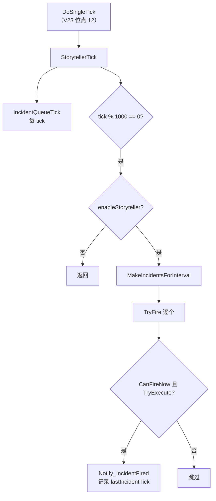

# V09 故事叙述者与事件：每 1000 tick 一次的「该发生点什么了」

> **30 秒速览**
>
> - `StorytellerTick` 每 tick 只做两件事：推进**事件队列**；每 1000 tick 才生成一批新事件。
> - 生成出来的是 `FiringIncident`，逐个交给 `TryFire`——先 `CanFireNow`，再 `TryExecute`，两步都过才真正发生。
> - 事件队列（`IncidentQueue`）支持「预定事件」：到点尝试、失败可重试、重试按 833 tick 哈希错峰。
> - 事件强度由 `StorytellerUtility.DefaultThreatPointsNow(target)` 给出，写入 `incidentParms.points`。
> - `StorytellerComp` 是「事件生成器」的基类，`MakeIntervalIncidents` 每个 comp 各写各的。
>
> **读前须知**：本卷讲「叙述者节拍 + 事件队列 + 点数」；派系与社交见 V11，地图与寻路见 V03，`Thing` 生命周期见 V04。

## Where it sits

**本模块的类结构**

```csharp
public class RimWorld.Storyteller : IExposable {  // 叙述者
    public StorytellerDef def;  // 定义
    public IncidentQueue incidentQueue;  // 预定事件队列
    private int lastIncidentTick;  // 上次事件 tick
    ...
    public void StorytellerTick()  // 每 tick
    public bool TryFire(FiringIncident fi, bool queued = false)  // 尝试触发
    public IEnumerable<FiringIncident> MakeIncidentsForInterval()  // 生成本批事件
}

public class RimWorld.IncidentQueue : IExposable {  // 预定事件队列
    private List<QueuedIncident> queuedIncidents;  // 队列
    ...
    public bool Add(IncidentDef def, int fireTick, IncidentParms parms = null, int retryDurationTicks = 0)  // 入队
    public void IncidentQueueTick()  // 每 tick 检查
}

public class RimWorld.QueuedIncident : IExposable {  // 一条预定事件
    public FiringIncident FiringIncident;  // 事件与参数
    public int FireTick;  // 预定触发 tick
    public int RetryDurationTicks;  // 重试窗口
    public bool TriedToFire;  // 是否已尝试
    ...
    public void Notify_TriedToFire()  // 标记已尝试
}

public class RimWorld.StorytellerComp {  // 事件生成器基类
    public StorytellerCompProperties props;  // 配置
    public virtual IEnumerable<FiringIncident> MakeIntervalIncidents(IIncidentTarget target)  // 生成
}

public static class RimWorld.StorytellerUtility {  // 数值工具
    public static float DefaultThreatPointsNow(IIncidentTarget target)  // 当前威胁点数
}
```

**这一段怎么走**：先认「叙述者持有队列」，再认「队列里是预定事件」，最后认「生成器与点数工具」。叙述者本身不决定「发生什么」，只决定「什么时候问一次生成器」。

## Evolution



| 层 | 方法 | 频率 | 产物 |
|---|---|---|---|
| 队列 | `IncidentQueueTick` | 每 tick | 预定事件触发 |
| 生成 | `MakeIncidentsForInterval` | 1000 tick | `FiringIncident` 列表 |
| 触发 | `TryFire` | 事件 | 事件真正发生 |
| 点数 | `DefaultThreatPointsNow` | 需要时 | 威胁点数 |

**这一段怎么走**：每 tick 推队列，每 1000 tick 问一次生成器；生成的结果逐个尝试触发。队列与生成是两条独立的路径，互不阻塞。

## Stage detail

### S0 `StorytellerTick`：队列每 tick、生成每千 tick

**这一段做什么**：每 tick 先推进预定事件队列；只有 tick 数是 1000 的整数倍时才生成新事件，且 `enableStoryteller` 关闭时直接返回。

**源码**（`RimWorld.Storyteller.StorytellerTick`；中文注释为本文档所加）

```csharp
this.incidentQueue.IncidentQueueTick();                      // 预定事件队列（每 tick）
if (Find.TickManager.TicksGame % 1000 == 0)                  // 每 1000 tick
{
    if (!DebugSettings.enableStoryteller)                    // 调试开关关闭
    {
        return;                                              // 不生成
    }
    foreach (FiringIncident firingIncident in this.MakeIncidentsForInterval())  // 生成一批
    {
        this.TryFire(firingIncident, false);                 // 逐个尝试
    }
}
```

**伪代码**

```text
事件队列.每tick()
若 本局 tick % 1000 = 0:
    若 叙述者被禁用:
        返回
    循环 生成的事件:
        尝试触发(事件, 非队列)
```

- 1000 tick ≈ 16.7 游戏秒（正常倍率）；
- `enableStoryteller` 是调试开关，关闭后不再生成新事件，但队列仍会推进；
- 生成的每个事件立刻尝试，不排队。

> **要点**：生成节拍是 1000 tick，但队列检查是每 tick——预定事件可以精确到 tick 触发。
>
> **陷阱**：`MakeIncidentsForInterval` 可能一次返回多个事件，全部会尝试触发；概率配置不当会「一次来一串」。

**这一段怎么走**：先推队列，再按千 tick 节拍生成并逐个触发。队列与生成互不影响，禁用的只是生成。

### S1 `IncidentQueueTick`：到点、重试与错峰

**这一段做什么**：队列每 tick 倒序扫描——到点未尝试的立刻试；已尝试的要么在重试窗口内按 833 tick 哈希再试，要么过期移除。

**源码**（`RimWorld.IncidentQueue.IncidentQueueTick`；中文注释为本文档所加）

```csharp
for (int i = this.queuedIncidents.Count - 1; i >= 0; i--)                 // 倒序扫描
{
    QueuedIncident queuedIncident = this.queuedIncidents[i];
    if (!queuedIncident.TriedToFire)                                      // 还没试过
    {
        if (queuedIncident.FireTick <= Find.TickManager.TicksGame)        // 到点
        {
            bool flag = Find.Storyteller.TryFire(queuedIncident.FiringIncident, true);  // 触发
            queuedIncident.Notify_TriedToFire();                          // 标记已试
            if (flag || queuedIncident.RetryDurationTicks == 0)           // 成功或无重试
            {
                this.queuedIncidents.Remove(queuedIncident);              // 移除
            }
        }
    }
    else if (queuedIncident.FireTick + queuedIncident.RetryDurationTicks <= Find.TickManager.TicksGame)  // 重试窗口过期
    {
        this.queuedIncidents.Remove(queuedIncident);                      // 移除
    }
    else if (Find.TickManager.TicksGame % 833 == Rand.RangeSeeded(0, 833, queuedIncident.FireTick))  // 错峰重试
    {
        bool flag2 = Find.Storyteller.TryFire(queuedIncident.FiringIncident, true);  // 再试
        queuedIncident.Notify_TriedToFire();
        if (flag2)                                                        // 成功
        {
            this.queuedIncidents.Remove(queuedIncident);                  // 移除
        }
    }
}
```

**伪代码**

```text
循环 i 从队尾到队首:
    条目 = 队列[i]
    若 未尝试:
        若 到期:
            成功 = 尝试触发(条目.事件, 队列)
            标记已尝试()
            若 成功 或 重试时长 = 0:
                移除条目
    否则 若 到期 + 重试时长 ≤ 当前 tick:
        移除条目
    否则 若 当前 tick % 833 = 种子随机(按到期 tick):
        成功 = 尝试触发(条目.事件, 队列)
        标记已尝试()
        若 成功:
            移除条目
```

- `Rand.RangeSeeded(0, 833, FireTick)`：按事件自己的到期 tick 取随机数，保证同一事件的重试相位稳定；
- 重试窗口 `RetryDurationTicks`：0 表示「只试一次」；
- 倒序删除：不影响未处理下标。

> **要点**：重试是「分散到 833 tick 内的某个相位」，不是每 tick 都试——避免大量事件同时重试。
>
> **陷阱**：`Notify_TriedToFire` 在每次尝试后都调用；如果 `TryFire` 抛异常，标记不会执行，下一 tick 会再试。

**这一段怎么走**：未尝试的到点就试，失败按重试窗口与哈希相位再试，过期的移除。整段倒序遍历，单条目最多一次尝试（每 tick）。

### S2 `TryFire`：两道门

**这一段做什么**：事件真正发生要过两道门——`CanFireNow`（条件允许）与 `TryExecute`（执行成功）；都过才记录 tick 并通知故事状态。

**源码**（`RimWorld.Storyteller.TryFire`；中文注释为本文档所加）

```csharp
if (fi.def.Worker.CanFireNow(fi.parms) && fi.def.Worker.TryExecute(fi.parms))  // 条件 + 执行
{
    fi.parms.target.StoryState.Notify_IncidentFired(fi);                       // 通知
    this.lastIncidentTick = GenTicks.TicksGame;                                // 记录
    return true;                                                               // 成功
}
return false;                                                                  // 失败
```

**伪代码**

```text
若 事件.工作者.现在可触发(参数) 且 事件.工作者.尝试执行(参数):
    参数.目标.故事状态.通知事件已发生(事件)
    上次事件 tick = 当前 tick
    返回 真
返回 假
```

- `CanFireNow`：检查冷却、前置条件、目标是否有效；
- `TryExecute`：真正落地（生成袭击、发信件、改天气……）；
- 失败不抛异常，只返回 false。

> **要点**：`TryExecute` 返回 false 时视为「没发生」，队列会按重试策略处理。
>
> **陷阱**：`CanFireNow` 与 `TryExecute` 是两步，中间状态可能变化（例如目标地图被卸载）。

**这一段怎么走**：先判条件，再执行；成功则记录与通知。失败路径没有副作用，调用方可以安全重试。

## Branches

| 分支 | 触发条件 | 行为 | 与主链的差异 |
|---|---|---|---|
| **叙述者禁用** | `!enableStoryteller` | 不生成新事件 | 队列仍推进 |
| **预定事件** | 队列条目到期 | `TryFire(..., queued: true)` | 绕过千 tick 节拍 |
| **重试** | 失败且 `RetryDurationTicks > 0` | 833 tick 相位重试 | 有限次 |
| **过期** | 到期 + 重试窗口已过 | 移除 | 不再尝试 |
| **条件不满足** | `CanFireNow` 假 | 跳过 | 不入队列则丢弃 |

**层积与遗留痕迹**：

1. **1000 tick 生成节拍**：与 150/250/2000 等其它节拍都不同，是叙述者专用。
2. **833 的重试相位**：不是 1000 的约数，说明重试是后加的独立节拍。
3. **`Notify_TriedToFire` 在 TryFire 之外**：标记与尝试分离，异常时状态不一致。

> **要点**：分支表里只有「叙述者禁用」影响生成，其余都影响队列条目的生命周期。
>
> **陷阱**：833 与 1000 的最小公倍数很大，同一条目在重试窗口内的实际尝试次数远少于窗口 tick 数。

**这一段怎么走**：五条分支分别改「生不生成」「走不走节拍」「重不重试」「什么时候放弃」。层积三条说明这些节拍都是各自独立的。

## Contracts

| 方向 | 契约 |
|---|---|
| 入 | `DoSingleTick` 调 `StorytellerTick`（V23 位点 12） |
| 出 | `TryFire` 的布尔结果、`lastIncidentTick`、队列变化 |
| 时序 | 每 tick 推队列 → 每 1000 tick 生成 → 逐个 TryFire |
| 不变量 | 生成节拍固定 1000；重试相位按 FireTick 种子稳定；成功即移除 |
| 边界 | 禁用只停生成；重试窗口 0 表示只试一次；过期移除 |

## Evidence

[claim:V09-C01] 叙述者每 tick 先推进事件队列。
  src: RimWorld.Storyteller.StorytellerTick
  file: analysis/decompiled/Assembly-CSharp/RimWorld/Storyteller.cs
  match: this.incidentQueue.IncidentQueueTick();

[claim:V09-C02] 新事件生成按 1000 tick 节拍。
  src: RimWorld.Storyteller.StorytellerTick
  file: analysis/decompiled/Assembly-CSharp/RimWorld/Storyteller.cs
  match: if (Find.TickManager.TicksGame % 1000 == 0)

[claim:V09-C03] 叙述者被禁用时不生成新事件。
  src: RimWorld.Storyteller.StorytellerTick
  file: analysis/decompiled/Assembly-CSharp/RimWorld/Storyteller.cs
  match: if (!DebugSettings.enableStoryteller)

[claim:V09-C04] 事件触发要同时过条件与执行两道门。
  src: RimWorld.Storyteller.TryFire
  file: analysis/decompiled/Assembly-CSharp/RimWorld/Storyteller.cs
  match: if (fi.def.Worker.CanFireNow(fi.parms) && fi.def.Worker.TryExecute(fi.parms))

[claim:V09-C05] 成功后记录上次事件 tick。
  src: RimWorld.Storyteller.TryFire
  file: analysis/decompiled/Assembly-CSharp/RimWorld/Storyteller.cs
  match: this.lastIncidentTick = GenTicks.TicksGame;

[claim:V09-C06] 队列倒序扫描。
  src: RimWorld.IncidentQueue.IncidentQueueTick
  file: analysis/decompiled/Assembly-CSharp/RimWorld/IncidentQueue.cs
  match: for (int i = this.queuedIncidents.Count - 1; i >= 0; i--)

[claim:V09-C07] 到点且未尝试的条目会立即触发。
  src: RimWorld.IncidentQueue.IncidentQueueTick
  file: analysis/decompiled/Assembly-CSharp/RimWorld/IncidentQueue.cs
  match: if (queuedIncident.FireTick <= Find.TickManager.TicksGame)

[claim:V09-C08] 成功或不需要重试时移除条目。
  src: RimWorld.IncidentQueue.IncidentQueueTick
  file: analysis/decompiled/Assembly-CSharp/RimWorld/IncidentQueue.cs
  match: if (flag || queuedIncident.RetryDurationTicks == 0)

[claim:V09-C09] 重试窗口过期后移除。
  src: RimWorld.IncidentQueue.IncidentQueueTick
  file: analysis/decompiled/Assembly-CSharp/RimWorld/IncidentQueue.cs
  match: else if (queuedIncident.FireTick + queuedIncident.RetryDurationTicks <= Find.TickManager.TicksGame)

[claim:V09-C10] 重试按到期 tick 种子的 833 相位错峰。
  src: RimWorld.IncidentQueue.IncidentQueueTick
  file: analysis/decompiled/Assembly-CSharp/RimWorld/IncidentQueue.cs
  match: else if (Find.TickManager.TicksGame % 833 == Rand.RangeSeeded(0, 833, queuedIncident.FireTick))

[claim:V09-C11] 事件生成器是虚方法，由各 comp 实现。
  src: RimWorld.StorytellerComp.MakeIntervalIncidents
  file: analysis/decompiled/Assembly-CSharp/RimWorld/StorytellerComp.cs
  match: public virtual IEnumerable<FiringIncident> MakeIntervalIncidents(IIncidentTarget target)

[claim:V09-C12] 事件点数由工具方法计算。
  src: RimWorld.StorytellerUtility.DefaultThreatPointsNow
  file: analysis/decompiled/Assembly-CSharp/RimWorld/StorytellerUtility.cs
  match: public static float DefaultThreatPointsNow(IIncidentTarget target)

[claim:V09-C13] 点数被写入事件参数。
  src: RimWorld.StorytellerUtility
  file: analysis/decompiled/Assembly-CSharp/RimWorld/StorytellerUtility.cs
  match: incidentParms.points = StorytellerUtility.DefaultThreatPointsNow(target);

## Open questions

1. `[unresolved]` `MakeIncidentsForInterval` 如何汇总各 `StorytellerComp` 的结果（顺序、去重）未展开。
2. `[unresolved]` `DefaultThreatPointsNow` 的点数公式（殖民者数、财富、难度）未拆解。
3. `[unresolved]` 各类 `StorytellerComp` 的 MTB 配置与实际发生率未统计。

**这一段怎么走**：三条未结项分别指向「生成汇总」「点数公式」「发生率」；都是叙述者的下一层细节。
