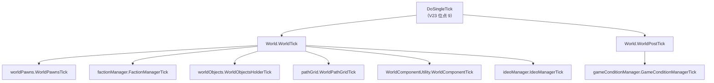

# V10 世界、地块与远行队：地图之外的那一层

> **30 秒速览**
>
> - `World.WorldTick` 只有 7 行：世界层的东西按固定顺序各推一步，没有「总管」。
> - 顺序是：**世界 Pawn → 派系 → 世界对象 → 调试绘制 → 世界路径网格 → 世界组件 → 意识形态**。
> - `WorldPostTick` 只做一件事：跑 `GameConditionManager`（天气/事件条件），且包在 try 里。
> - 地块坐标由 `WorldGrid.LongLatOf(tile)` 统一换算，具体公式委托给 `tile.Layer`。
> - 远行队与世界对象都由 `worldObjects.WorldObjectsHolderTick()` 驱动——它们不是独立的一层。
>
> **读前须知**：本卷讲世界层的 tick 骨架与坐标换算；派系与社交见 V11，叙述者见 V09，意识形态见 V20，地图内寻路见 V03。

## Where it sits

**本模块的类结构**

```csharp
public class RimWorld.Planet.World : IExposable, ILoadReferenceable {  // 世界层
    public WorldPawns worldPawns;  // 世界 Pawn（未在地图上的）
    public FactionManager factionManager;  // 派系
    public WorldObjectsHolder worldObjects;  // 世界对象（远行队、据点、飞船……）
    public WorldPathGrid pathGrid;  // 世界路径网格
    public IdeoManager ideoManager;  // 意识形态
    public GameConditionManager gameConditionManager;  // 世界条件（天气/事件）
    ...
    public void WorldTick()  // 每 tick
    public void WorldPostTick()  // 每 tick（收尾）
    public void WorldUpdate()  // 每帧
}

public class RimWorld.Planet.WorldGrid : IExposable {  // 地块网格
    ...
    public Vector2 LongLatOf(PlanetTile tile)  // 地块 → 经纬度
}

public class RimWorld.Planet.PlanetTile {  // 一个地块
    public PlanetLayer Layer;  // 所属层
    ...
}
```

**这一段怎么走**：先认 `World` 持有的六个子系统，再认 `WorldGrid` 负责坐标换算。世界层没有「主循环」，只有 `WorldTick` 里的固定顺序。

## Evolution



| 位点 | 子系统 | 管什么 |
|---|---|---|
| 1 | `worldPawns` | 不在任何地图上的 Pawn（远行队成员、囚犯……） |
| 2 | `factionManager` | 派系关系与好感 |
| 3 | `worldObjects` | 远行队、据点、飞船等世界对象 |
| 4 | `pathGrid` | 世界层寻路网格 |
| 5 | `WorldComponentUtility` | 所有 `WorldComponent` |
| 6 | `ideoManager` | 意识形态全局状态 |
| 后置 | `gameConditionManager` | 世界条件（天气、日食……） |

**这一段怎么走**：世界 tick 是「六个子系统各走一步」，后置只跑条件管理器。顺序固定，没有依赖注入或调度器。

## Stage detail

### S0 `WorldTick`：七行固定顺序

**这一段做什么**：`WorldTick` 依次驱动世界 Pawn、派系、世界对象、调试绘制、路径网格、世界组件与意识形态；没有任何条件分支。

**源码**（`RimWorld.Planet.World.WorldTick`；中文注释为本文档所加）

```csharp
this.worldPawns.WorldPawnsTick();                       // 世界 Pawn
this.factionManager.FactionManagerTick();               // 派系关系
this.worldObjects.WorldObjectsHolderTick();             // 远行队/据点/飞船
this.debugDrawer.WorldDebugDrawerTick();                // 调试绘制
this.pathGrid.WorldPathGridTick();                      // 世界路径网格
WorldComponentUtility.WorldComponentTick(this);         // 世界组件
this.ideoManager.IdeoManagerTick();                     // 意识形态
```

**伪代码**

```text
世界Pawn.每tick()
派系管理.每tick()
世界对象.每tick()
调试绘制.每tick()
世界路径网格.每tick()
世界组件.每tick(世界)
意识形态管理.每tick()
```

- 顺序即优先级：世界 Pawn 先于派系，派系先于世界对象；
- `WorldComponentTick` 是静态转发，遍历所有 `WorldComponent`；
- 没有 try/catch：任一子系统抛异常会中断本 tick 的后续位点。

> **要点**：七行全部是无条件调用，没有「开关」或「跳过」；世界层比地图层更「硬」。
>
> **陷阱**：`debugDrawer` 也在正式链里——它不是仅调试才跑，而是一直在跑。

**这一段怎么走**：七个调用按固定顺序执行，没有分支。世界层的稳定性依赖每个子系统自己吞异常。

### S1 `WorldPostTick`：只跑条件管理器

**这一段做什么**：`WorldPostTick` 只驱动 `GameConditionManager`（天气、日食、毒雾等世界条件），并包在 try 里。

**源码**（`RimWorld.Planet.World.WorldPostTick`；中文注释为本文档所加）

```csharp
try
{
    this.gameConditionManager.GameConditionManagerTick();  // 世界条件
}
catch (Exception ex)
{
    Log.Error(ex.ToString());                              // 只记日志
}
```

**伪代码**

```text
试:
    世界条件管理.每tick()
捕获:
    记录错误
```

> **要点**：世界条件放在后置，是因为它可能依赖本 tick 已推进的世界状态。
>
> **陷阱**：条件管理器的异常被吞掉，条件可能「卡住不结束」而不报错到玩家。

**这一段怎么走**：单次调用 + 异常隔离。后置段只有这一件事。

### S2 坐标：`LongLatOf` 委托给层

**这一段做什么**：地块到经纬度的换算不在 `WorldGrid` 里实现，而是委托给地块所属的 `PlanetLayer`。

**源码**（`RimWorld.Planet.WorldGrid.LongLatOf`；中文注释为本文档所加）

```csharp
public Vector2 LongLatOf(PlanetTile tile)   // 地块 → 经纬度
{
    return tile.Layer.LongLatOf(tile);      // 委托给所属层
}
```

**伪代码**

```text
过程 经纬度(地块):
    返回 地块.所属层.经纬度(地块)
```

- 多层世界（地表/轨道）各有自己的投影；
- `WorldGrid` 只是入口，不持有公式。

> **要点**：日历与季节（V02）读的经纬度就来自这里，所以「时区最西」实际是「经度最小」。
>
> **陷阱**：`tile.Layer` 为空时直接空引用——地块必须属于某一层。

**这一段怎么走**：入口 → 委托给层 → 返回二维坐标。世界网格本身不做数学。

## Branches

| 分支 | 触发条件 | 行为 | 与主链的差异 |
|---|---|---|---|
| **世界条件异常** | 条件管理器抛异常 | 记录并继续 | 只此一处隔离 |
| **多层世界** | `tile.Layer` 不同 | 各自换算 | 公式不同 |
| **世界 Pawn** | 不在任何地图 | 由 `worldPawns` 驱动 | 不走地图 tick |
| **远行队** | 世界对象 | 由 `worldObjects` 驱动 | 不单独 tick |

**层积与遗留痕迹**：

1. **七行无分支**：世界 tick 从未被重构为调度表。
2. **`debugDrawer` 在正式链**：调试绘制与游戏逻辑同链。
3. **后置只有条件管理器**：与地图后置（电力、区域）不对称。

> **要点**：分支表说明世界层几乎没有分叉——所有差异都在子系统内部。
>
> **陷阱**：世界 Pawn 与地图 Pawn 是两套 tick 路径；同一个 Pawn 在不同位置走不同链。

**这一段怎么走**：四条分支都是子系统内部差异，世界层本身只有「顺序执行」与「后置隔离」。

## Contracts

| 方向 | 契约 |
|---|---|
| 入 | `DoSingleTick` 调 `WorldTick`（位点 9）与 `WorldPostTick`（位点 15） |
| 出 | 各世界子系统推进；条件管理器推进 |
| 时序 | Pawn → 派系 → 对象 → 调试 → 路径 → 组件 → 意识形态；后置条件 |
| 不变量 | 顺序固定；仅后置段隔离异常 |
| 边界 | 世界 Pawn 不走地图 tick；坐标委托给层 |

## Evidence

[claim:V10-C01] 世界 tick 先推进世界 Pawn。
  src: RimWorld.Planet.World.WorldTick
  file: analysis/decompiled/Assembly-CSharp/RimWorld/Planet/World.cs
  match: this.worldPawns.WorldPawnsTick();

[claim:V10-C02] 派系管理紧随世界 Pawn。
  src: RimWorld.Planet.World.WorldTick
  file: analysis/decompiled/Assembly-CSharp/RimWorld/Planet/World.cs
  match: this.factionManager.FactionManagerTick();

[claim:V10-C03] 世界对象（远行队/据点）由持有者统一驱动。
  src: RimWorld.Planet.World.WorldTick
  file: analysis/decompiled/Assembly-CSharp/RimWorld/Planet/World.cs
  match: this.worldObjects.WorldObjectsHolderTick();

[claim:V10-C04] 世界路径网格每 tick 推进。
  src: RimWorld.Planet.World.WorldTick
  file: analysis/decompiled/Assembly-CSharp/RimWorld/Planet/World.cs
  match: this.pathGrid.WorldPathGridTick();

[claim:V10-C05] 世界组件由静态工具统一 tick。
  src: RimWorld.Planet.World.WorldTick
  file: analysis/decompiled/Assembly-CSharp/RimWorld/Planet/World.cs
  match: WorldComponentUtility.WorldComponentTick(this);

[claim:V10-C06] 意识形态管理在世界 tick 末尾。
  src: RimWorld.Planet.World.WorldTick
  file: analysis/decompiled/Assembly-CSharp/RimWorld/Planet/World.cs
  match: this.ideoManager.IdeoManagerTick();

[claim:V10-C07] 世界后置只推进条件管理器。
  src: RimWorld.Planet.World.WorldPostTick
  file: analysis/decompiled/Assembly-CSharp/RimWorld/Planet/World.cs
  match: this.gameConditionManager.GameConditionManagerTick();

[claim:V10-C08] 后置段吞掉异常并记录。
  src: RimWorld.Planet.World.WorldPostTick
  file: analysis/decompiled/Assembly-CSharp/RimWorld/Planet/World.cs
  match: Log.Error(ex.ToString());
  note: 该匹配在目标文件出现 2 次；本条对应 RimWorld.Planet.World.WorldPostTick 内的那一处。

[claim:V10-C09] 世界层有独立的帧级更新入口。
  src: RimWorld.Planet.World.WorldUpdate
  file: analysis/decompiled/Assembly-CSharp/RimWorld/Planet/World.cs
  match: public void WorldUpdate()

[claim:V10-C10] 地块经纬度换算委托给所属层。
  src: RimWorld.Planet.WorldGrid.LongLatOf
  file: analysis/decompiled/Assembly-CSharp/RimWorld/Planet/WorldGrid.cs
  match: return tile.Layer.LongLatOf(tile);

## Open questions

1. `[unresolved]` `WorldObjectsHolderTick` 内部对远行队与据点分别做了什么，未展开。
2. `[unresolved]` `WorldUpdate`（帧级）与 `WorldTick`（tick 级）的分工边界未逐行核对。
3. `[unresolved]` `WorldPawnsTick` 的「世界 Pawn」生命周期（何时进入/离开世界层）属 V04/V05 交界。

**这一段怎么走**：三条未结项分别指向「对象内部」「帧/tick 分工」「世界 Pawn 生命周期」；都可作为 V10 的续篇。
