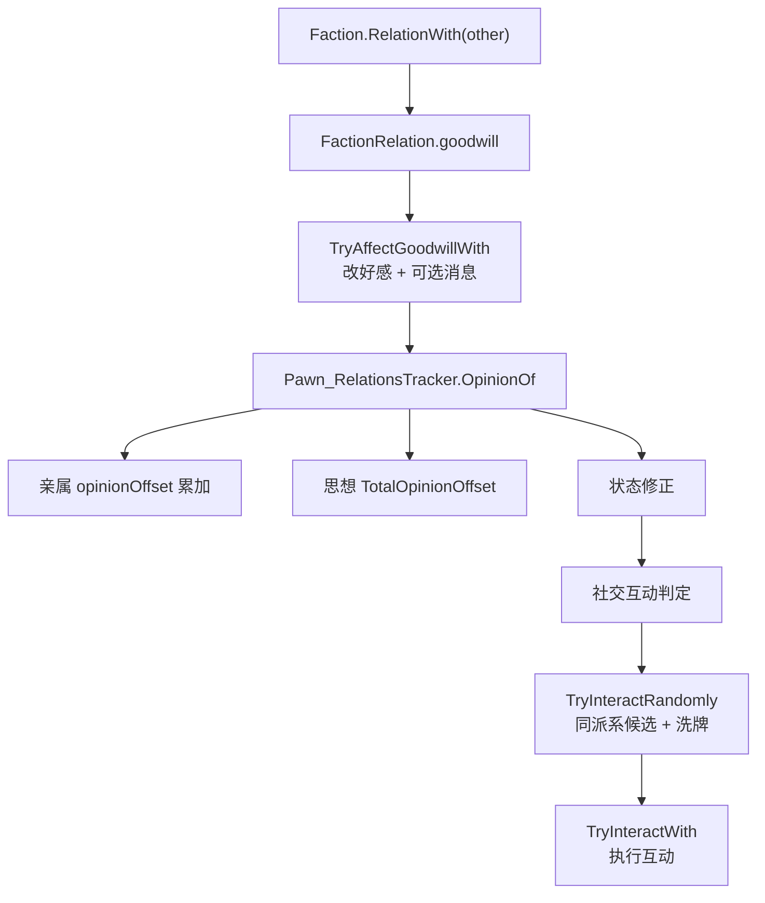

# V11 派系、社交与关系：从阵营好感度到一次随机搭话

> **30 秒速览**
>
> - 派系关系是**成对**存的：`Faction.RelationWith(other)` 在自己持有的关系表里线性查找，找不到就报错（除非显式允许空）。
> - 好感度（goodwill）是关系上的一个整数，`TryAffectGoodwillWith` 修改它，并可选地发消息/敌对信。
> - 个人关系走 `Pawn_RelationsTracker`：亲属关系给固定好感偏移，心情思想再叠加一层，最后按状态修正。
> - 社交互动有冷却：`InteractedTooRecentlyToInteract` 为真就直接放弃，不再找人。
> - 随机搭话只在**同派系、已生成、非敌对**的成员里挑，候选列表先洗牌，逐个试到成功。
>
> **读前须知**：本卷讲「派系关系 → 个人好感 → 一次互动」；思想与心情的结算见 V13，工作与 AI 见 V06/V07，意识形态对关系的改写见 V20。

## Where it sits

**本模块的类结构**

```csharp
public class RimWorld.Faction : IExposable, ILoadReferenceable {  // 派系
    public FactionDef def;  // 定义
    public string name;  // 名称
    private List<FactionRelation> relations;  // 与其他派系的关系
    ...
    public FactionRelation RelationWith(Faction other, bool allowNull = false)  // 取关系
    public int GoodwillWith(Faction other)  // 好感度
    public bool TryAffectGoodwillWith(Faction other, int goodwillChange, ...)  // 改好感
}

public class RimWorld.FactionRelation : IExposable {  // 成对关系
    public Faction other;  // 对方
    public int goodwill;  // 好感度
    public FactionRelationKind kind;  // 敌对/中立/盟友
}

public class RimWorld.Pawn_RelationsTracker : IExposable {  // 个人关系
    private List<DirectPawnRelation> directRelations;  // 亲属等直接关系
    ...
    public int OpinionOf(Pawn other)  // 对某人的好感
    public void AddDirectRelation(PawnRelationDef def, Pawn otherPawn)  // 加关系
}

public class RimWorld.Pawn_InteractionsTracker : IExposable {  // 社交互动
    private int lastInteractionTime;  // 上次互动时间
    ...
    public void InteractionsTrackerTickInterval(int delta)  // 区间尝试
    private bool TryInteractRandomly()  // 随机搭话
    public bool TryInteractWith(Pawn recipient, InteractionDef intDef)  // 指定互动
    public float SocialFightChance(InteractionDef interaction, Pawn initiator)  // 打架概率
}
```

**这一段怎么走**：先认「派系关系是成对表」，再认「个人好感 = 亲属偏移 + 思想偏移 + 状态修正」，最后认「互动是带冷却的随机挑选」。三层从宏观到微观，数据都从上一层的对象里取。

## Evolution



| 层 | 数据 | 谁修改 |
|---|---|---|
| 派系 | `FactionRelation.goodwill` | 事件、贸易、攻击 |
| 个人 | `directRelations` + 思想 | 亲属、互动、记忆 |
| 互动 | `lastInteractionTime` | 每次互动后更新 |

**这一段怎么走**：派系好感是粗粒度、个人好感是细粒度，互动是触发点。三者的关系是「派系决定能不能打、个人决定喜不喜欢、互动决定当下发生什么」。

## Stage detail

### S0 派系关系：成对表与线性查找

**这一段做什么**：`RelationWith` 在自己持有的关系列表里找对方派系；找不到时按 `allowNull` 决定是返回空关系还是报错。

**源码**（`RimWorld.Faction.RelationWith`；中文注释为本文档所加）

```csharp
if (other == this)                                                     // 与自己
{
    Log.Error("Tried to get relation between faction " + ... + " and itself.");  // 报错
    return new FactionRelation();                                      // 空关系
}
for (int i = 0; i < this.relations.Count; i++)                         // 线性查找
{
    if (this.relations[i].other == other)                              // 找到对方
    {
        return this.relations[i];                                      // 返回关系
    }
}
if (!allowNull)                                                        // 不允许空
{
    Log.Error(...);                                                    // 报错
    ...
}
```

**伪代码**

```text
若 对方 = 自己:
    记录错误
    返回 新空关系
循环 关系表:
    若 该项.对方 = 对方:
        返回 该项
若 不允许空:
    记录错误
    …（省略：返回空关系）
```

- 关系是**有向存储、双向语义**：A 的表里存对 B 的关系，B 的表里存对 A 的关系；
- 线性查找：派系数一般几十个，不值得建字典；
- `allowNull` 用于「可能还没建立关系」的查询。

> **要点**：`RelationWith` 只读，不创建；关系在派系生成时由 `TryMakeInitialRelationsWith` 建立。
>
> **陷阱**：与自己比较会直接报错——调用方必须先排除「同派系」的情况。

**这一段怎么走**：先排除自身，再线性查找，最后按 `allowNull` 决定报错还是返回空。整段没有写操作。

### S1 个人好感：三类偏移相加

**这一段做什么**：`OpinionOf` 把「亲属偏移 + 思想偏移 + 状态修正」加起来——非人形、自己、死者直接返回 0。

**源码**（`RimWorld.Pawn_RelationsTracker.OpinionOf`；中文注释为本文档所加）

```csharp
if (!other.RaceProps.Humanlike || this.pawn == other)     // 非人形或自己
{
    return 0;
}
if (this.pawn.Dead)                                       // 死者
{
    return 0;
}
int num = 0;
foreach (PawnRelationDef pawnRelationDef in this.pawn.GetRelations(other))  // 亲属关系
{
    num += pawnRelationDef.opinionOffset;                 // 累加固定偏移
}
if (this.pawn.RaceProps.Humanlike && this.pawn.needs.mood != null)  // 有心情需求
{
    num += this.pawn.needs.mood.thoughts.TotalOpinionOffset(other);  // 叠加思想
}
...
```

**伪代码**

```text
若 对方非人形 或 就是自己:
    返回 0
若 自己已死:
    返回 0
好感 = 0
循环 与对方的关系:
    好感 += 关系.好感偏移
若 人形 且 有心情需求:
    好感 += 思想.对某人的总偏移
…（省略：状态修正与钳制）
```

- 亲属偏移：父母/配偶/子女等固定值；
- 思想偏移：`ThoughtHandler` 汇总与该人相关的记忆与情境思想（V13）；
- 后续还有健康/状态修正（作者注释省略处）。

> **要点**：好感是**每次读取时重算**，不是缓存字段——所以思想变化会立刻反映。
>
> **陷阱**：死者返回 0，但死者仍可能出现在关系表里；遍历关系时要注意「对方已死」的情况。

**这一段怎么走**：先排除三类无效对象，再累加亲属偏移与思想偏移，最后做状态修正。返回值是即时计算的整数。

### S2 随机搭话：冷却、候选、洗牌

**这一段做什么**：`TryInteractRandomly` 先查冷却与发起条件，再把同派系已生成成员洗牌，逐个检查「不是自己、能互动、不敌对」，命中就执行一次互动。

**源码**（`RimWorld.Pawn_InteractionsTracker.TryInteractRandomly`，开头段；中文注释为本文档所加）

```csharp
if (this.InteractedTooRecentlyToInteract())                                   // 冷却中
{
    return false;
}
if (!SocialInteractionUtility.CanInitiateRandomInteraction(this.pawn))        // 不能发起
{
    return false;
}
List<Pawn> list = this.pawn.Map.mapPawns.SpawnedPawnsInFaction(this.pawn.Faction);  // 同派系成员
Pawn_InteractionsTracker.workingList.Clear();
Pawn_InteractionsTracker.workingList.AddRange(list);
Pawn_InteractionsTracker.workingList.Shuffle<Pawn>();                         // 洗牌
List<InteractionDef> allDefsListForReading = DefDatabase<InteractionDef>.AllDefsListForReading;
for (int i = 0; i < Pawn_InteractionsTracker.workingList.Count; i++)          // 逐个试
{
    Pawn p = Pawn_InteractionsTracker.workingList[i];
    if (p != this.pawn && this.CanInteractNowWith(p, null) && SocialInteractionUtility.CanReceiveRandomInteraction(p) && !this.pawn.HostileTo(p))  // 可互动
    {
        InteractionDef interactionDef = null;
        ...
```

**伪代码**

```text
若 互动太近:
    返回 假
若 不能发起随机互动:
    返回 假
列表 = 同派系已生成成员
工作列表.清空()
工作列表.加入全部(列表)
工作列表.洗牌()
全部互动定义 = 定义库.全部()
循环 工作列表:
    p = 当前候选
    若 p ≠ 自己 且 可互动 且 可接收 且 不敌对:
        互动 = 空
        …（省略：挑选互动定义）
```

- `SpawnedPawnsInFaction`：只在本图、本派系、已生成；
- 静态 `workingList`：复用列表避免每次分配；
- 洗牌保证「不是总找最近的那个」。

> **要点**：候选顺序是随机的，但每个候选的判定是确定的——同一 tick 内不会重复试同一个人。
>
> **陷阱**：`workingList` 是静态共享的；如果互动过程中递归调用（例如互动触发新的互动），列表会被覆盖。

**这一段怎么走**：冷却 → 发起条件 → 取候选 → 洗牌 → 逐个判定 → 选中后挑互动定义。冷却与发起条件在候选之前，避免无谓遍历。

## Branches

| 分支 | 触发条件 | 行为 | 与主链的差异 |
|---|---|---|---|
| **同派系查询** | `other == this` | 报错 + 空关系 | 调用方应先排除 |
| **无关系** | 关系表里没有 | `allowNull` 决定报错或空 | — |
| **非人形/死者** | `!Humanlike` / `Dead` | 好感 0 | 不计算 |
| **冷却** | `InteractedTooRecentlyToInteract` | 放弃 | 不遍历候选 |
| **敌对** | `HostileTo(p)` | 跳过该候选 | 只影响个人 |
| **Anomaly 潜教徒** | 特质 + 时间条件 | 特殊互动定义 | DLC 增量 |

**层积与遗留痕迹**：

1. **关系是成对存储**：没有中心化的关系表，查两次才能保证一致。
2. **静态 `workingList`**：性能优化留下的共享缓冲，代价是递归不安全。
3. **Anomaly 分支内嵌**：潜教徒的特殊互动直接写在随机循环里，没有抽成策略。

> **要点**：分支表里只有「冷却」会完全跳过本次互动，其余是候选级过滤。
>
> **陷阱**：`HostileTo` 是个人层面的敌对判定，与派系好感不是一回事。

**这一段怎么走**：六条分支分别改「查不查得到」「算不算好感」「试不试候选」「挑什么互动」。层积三条说明这套设计以性能优先。

## Contracts

| 方向 | 契约 |
|---|---|
| 入 | `Faction` 的关系表在生成时建立；`InteractionsTrackerTickInterval` 驱动互动尝试 |
| 出 | `FactionRelation`、`OpinionOf` 整数、一次 `TryInteractWith` |
| 时序 | 派系关系 → 个人好感 → 互动判定 |
| 不变量 | 关系成对存储；好感即时计算；互动有冷却 |
| 边界 | 自己/死者好感为 0；敌对候选跳过；冷却期不互动 |

## Evidence

[claim:V11-C01] 与自己取关系会报错并返回空关系。
  src: RimWorld.Faction.RelationWith
  file: analysis/decompiled/Assembly-CSharp/RimWorld/Faction.cs
  match: if (other == this)

[claim:V11-C02] 关系表按对方派系线性查找。
  src: RimWorld.Faction.RelationWith
  file: analysis/decompiled/Assembly-CSharp/RimWorld/Faction.cs
  match: if (this.relations[i].other == other)

[claim:V11-C03] 找不到关系时按 `allowNull` 决定是否报错。
  src: RimWorld.Faction.RelationWith
  file: analysis/decompiled/Assembly-CSharp/RimWorld/Faction.cs
  match: if (!allowNull)

[claim:V11-C04] 非人形或自己好感为 0。
  src: RimWorld.Pawn_RelationsTracker.OpinionOf
  file: analysis/decompiled/Assembly-CSharp/RimWorld/Pawn_RelationsTracker.cs
  match: if (!other.RaceProps.Humanlike || this.pawn == other)
  note: 该匹配在目标文件出现 2 次；本条对应 RimWorld.Pawn_RelationsTracker.OpinionOf 内的那一处。

[claim:V11-C05] 死者好感为 0。
  src: RimWorld.Pawn_RelationsTracker.OpinionOf
  file: analysis/decompiled/Assembly-CSharp/RimWorld/Pawn_RelationsTracker.cs
  match: if (this.pawn.Dead)
  note: 该匹配在目标文件出现 3 次；本条对应 RimWorld.Pawn_RelationsTracker.OpinionOf 内的那一处。

[claim:V11-C06] 亲属关系按固定偏移累加。
  src: RimWorld.Pawn_RelationsTracker.OpinionOf
  file: analysis/decompiled/Assembly-CSharp/RimWorld/Pawn_RelationsTracker.cs
  match: num += pawnRelationDef.opinionOffset;

[claim:V11-C07] 人形且有心需求时叠加思想偏移。
  src: RimWorld.Pawn_RelationsTracker.OpinionOf
  file: analysis/decompiled/Assembly-CSharp/RimWorld/Pawn_RelationsTracker.cs
  match: num += this.pawn.needs.mood.thoughts.TotalOpinionOffset(other);

[claim:V11-C08] 互动太近会直接放弃。
  src: RimWorld.Pawn_InteractionsTracker.TryInteractRandomly
  file: analysis/decompiled/Assembly-CSharp/RimWorld/Pawn_InteractionsTracker.cs
  match: if (this.InteractedTooRecentlyToInteract())
  note: 该匹配在目标文件出现 2 次；本条对应 RimWorld.Pawn_InteractionsTracker.TryInteractRandomly 内的那一处。

[claim:V11-C09] 发起随机互动需要额外条件。
  src: RimWorld.Pawn_InteractionsTracker.TryInteractRandomly
  file: analysis/decompiled/Assembly-CSharp/RimWorld/Pawn_InteractionsTracker.cs
  match: if (!SocialInteractionUtility.CanInitiateRandomInteraction(this.pawn))
  note: 该匹配在目标文件出现 2 次；本条对应 RimWorld.Pawn_InteractionsTracker.TryInteractRandomly 内的那一处。

[claim:V11-C10] 候选只取同派系已生成成员。
  src: RimWorld.Pawn_InteractionsTracker.TryInteractRandomly
  file: analysis/decompiled/Assembly-CSharp/RimWorld/Pawn_InteractionsTracker.cs
  match: List<Pawn> list = this.pawn.Map.mapPawns.SpawnedPawnsInFaction(this.pawn.Faction);

[claim:V11-C11] 候选列表会先洗牌。
  src: RimWorld.Pawn_InteractionsTracker.TryInteractRandomly
  file: analysis/decompiled/Assembly-CSharp/RimWorld/Pawn_InteractionsTracker.cs
  match: Pawn_InteractionsTracker.workingList.Shuffle<Pawn>();

[claim:V11-C12] 候选需不是自己、可互动、可接收且不敌对。
  src: RimWorld.Pawn_InteractionsTracker.TryInteractRandomly
  file: analysis/decompiled/Assembly-CSharp/RimWorld/Pawn_InteractionsTracker.cs
  match: if (p != this.pawn && this.CanInteractNowWith(p, null) && SocialInteractionUtility.CanReceiveRandomInteraction(p) && !this.pawn.HostileTo(p))

[claim:V11-C13] 潜教徒有特殊互动定义。
  src: RimWorld.Pawn_InteractionsTracker.TryInteractRandomly
  file: analysis/decompiled/Assembly-CSharp/RimWorld/Pawn_InteractionsTracker.cs
  match: if (this.pawn.story.traits.HasTrait(TraitDefOf.Occultist) && (float)GenTicks.TicksAbs >= (float)this.lastOccultInteraction + 60000f)

[claim:V11-C14] 互动间隔由区间链驱动。
  src: RimWorld.Pawn_InteractionsTracker.InteractionsTrackerTickInterval
  file: analysis/decompiled/Assembly-CSharp/RimWorld/Pawn_InteractionsTracker.cs
  match: public void InteractionsTrackerTickInterval(int delta)

## Open questions

1. `[unresolved]` `TryAffectGoodwillWith` 的钳制与消息条件未逐行拆解。
2. `[unresolved]` `TotalOpinionOffset` 的思想来源（记忆/情境/关系）未展开，属 V13/V20。
3. `[unresolved]` 社交打架概率 `SocialFightChance` 的因子未逐项列出。

**这一段怎么走**：三条未结项分别指向「好感修改」「思想汇总」「打架概率」；第一条静态可补，后两条跨卷。
