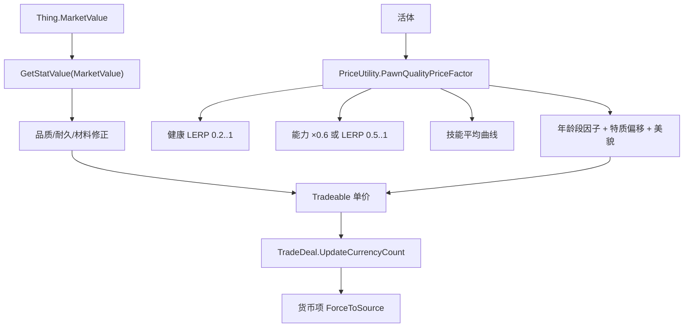

# V12 经济、价格与贸易：一件东西值多少、一次交易怎么结账

> **30 秒速览**
>
> - 物品价格不是字段，而是**属性**：`Thing.MarketValue` 直接读 `StatDefOf.MarketValue`，所以价格受品质、耐久、材料等一切修正影响。
> - 活体（奴隶/动物）有专用价格因子 `PawnQualityPriceFactor`：健康、能力、技能、年龄段、特质、美貌逐项相乘/相加。
> - 交易结算在 `TradeDeal`：把所有非货币项的应付金额累加，再从货币项里扣。
> - 礼物模式（`giftMode`）不结账，改为计算好感变化并赠送。
> - 货币项为空时整段跳过——没有货币就没有结算。
>
> **读前须知**：本卷讲「价格怎么来、交易怎么结」；物品与堆叠见 V04，派系好感见 V11，需求与心情见 V13。

## Where it sits

**本模块的类结构**

```csharp
public class Verse.Thing : IExposable {  // 物品
    ...
    public virtual float MarketValue  // 市价（读 StatDefOf.MarketValue）
}

public static class RimWorld.PriceUtility {  // 价格修正
    public static float PawnQualityPriceFactor(Pawn pawn, StringBuilder explanation = null)  // 活体价格因子
    public static float PawnQualityPriceOffset(Pawn pawn, StringBuilder explanation = null)  // 活体价格偏移
}

public class RimWorld.TradeDeal : IExposable {  // 一次交易
    private List<Tradeable> tradeables;  // 参与交易的项目
    public Tradeable CurrencyTradeable;  // 货币项
    ...
    public void UpdateCurrencyCount()  // 重算应付货币
    public bool TryExecute(out bool actuallyTraded)  // 执行
}

public class RimWorld.Tradeable : IExposable {  // 一个可交易项
    public bool IsCurrency  // 是否货币
    public float CurTotalCurrencyCostForSource  // 本方应付
    ...
    public void ForceToSource(int amount)  // 强制改变数量
}
```

**这一段怎么走**：先认「价格是属性」，再认「活体有专用因子」，最后认「交易靠 `TradeDeal` 汇总」。价格与结算是两件事：前者是估价，后者是移库。

## Evolution



| 层 | 谁 | 输入 | 输出 |
|---|---|---|---|
| 估价 | `MarketValue` | 属性系统 | 单价 |
| 活体估价 | `PawnQualityPriceFactor` | 健康/能力/技能/特质 | 乘数 |
| 结算 | `TradeDeal` | 各 `Tradeable` | 货币变动 |

**这一段怎么走**：单价从属性来，活体再乘一个因子；结算把各项目的金额加总后扣货币。三层各自独立，估价不影响结算流程。

## Stage detail

### S0 `MarketValue`：价格就是属性

**这一段做什么**：`MarketValue` 不存值，直接返回 `StatDefOf.MarketValue` 的当前值——所有修正（品质、耐久、材料）都在属性系统里完成。

**源码**（`Verse.Thing.MarketValue`；中文注释为本文档所加）

```csharp
public virtual float MarketValue   // 市价
{
    get
    {
        return this.GetStatValue(StatDefOf.MarketValue, true, -1);  // 读属性
    }
}
```

**伪代码**

```text
属性 市价:
    取值:
    返回 属性值(MarketValue)
```

- 第三个参数 `-1`：不做缓存/取整；
- 属性值会经过品质曲线、耐久百分比、材料系数等修正；
- 子类可覆写（例如尸体、建筑）。

> **要点**：改价格要改属性或 `ThingDef`，不要直接改 `MarketValue` 的返回值。
>
> **陷阱**：属性是即时计算的，同一物品在不同状态下（耐久下降）价格会变。

**这一段怎么走**：属性读取，一步到位。价格永远反映当前状态。

### S1 活体价格因子：连乘与连加

**这一段做什么**：`PawnQualityPriceFactor` 从 1 开始，按健康、能力、技能、年龄段、特质、美貌逐项修正，得到一个乘数。

**源码**（`RimWorld.PriceUtility.PawnQualityPriceFactor`，核心段；中文注释为本文档所加）

```csharp
float num = 1f;                                                              // 基准
num *= Mathf.Lerp(0.19999999f, 1f, pawn.health.summaryHealth.SummaryHealthPercent);  // 健康 0.2..1
List<PawnCapacityDef> allDefsListForReading = DefDatabase<PawnCapacityDef>.AllDefsListForReading;
for (int i = 0; i < allDefsListForReading.Count; i++)                        // 每种能力
{
    if (!pawn.health.capacities.CapableOf(allDefsListForReading[i]))         // 完全丧失
    {
        num *= 0.6f;                                                         // 打六折
    }
    else
    {
        float num2 = PawnCapacityUtility.CalculateCapacityLevel(...);        // 能力等级
        num *= Mathf.Lerp(0.5f, 1f, num2);                                   // 0.5..1
    }
}
if (pawn.skills != null)                                                     // 有技能
{
    num *= PriceUtility.AverageSkillCurve.Evaluate(pawn.skills.skills.Average<SkillRecord>((SkillRecord sk) => (float)sk.Level));  // 平均等级曲线
}
num *= pawn.ageTracker.CurLifeStage.marketValueFactor;                       // 年龄段
if (pawn.story != null && pawn.story.traits != null)                         // 特质
{
    ...
    num += trait.CurrentData.marketValueFactorOffset;                        // 未压制特质：加偏移
    ...
}
num += pawn.GetStatValue(StatDefOf.PawnBeauty, true, -1) * 0.2f;             // 美貌权重
```

**伪代码**

```text
乘数 = 1
乘数 *= 线性插值(0.2, 1, 健康百分比)
能力列表 = 全部能力
循环 每种能力:
    若 完全不能:
        乘数 *= 0.6
    否则:
        等级 = 计算能力等级(...)
        乘数 *= 线性插值(0.5, 1, 等级)
若 有技能:
    乘数 *= 平均技能曲线(平均等级)
乘数 *= 年龄段.市价因子
若 有特质:
    …（省略：遍历特质）
    乘数 += 特质.市价偏移        # 注意是加
乘数 += 美貌 × 0.2
…（省略：后续修正）
```

- 多数项是**乘**，特质偏移与美貌是**加**；
- 能力「完全丧失」直接 ×0.6，部分丧失按等级插值；
- 平均技能走一条曲线，不是线性。

> **要点**：因子可以大于 1（高技能 + 高美貌），没有上限钳制。
>
> **陷阱**：特质用「加偏移」，如果遍历到多个特质会累加多次——不是取最大值。

**这一段怎么走**：健康 → 能力 → 技能 → 年龄段 → 特质 → 美貌，逐项修正。乘项与加项混用，读代码时要分清。

### S2 `UpdateCurrencyCount`：把应付金额扣成货币

**这一段做什么**：遍历所有非货币项，累加本方应付金额，再让货币项反向变化同样数额。

**源码**（`RimWorld.TradeDeal.UpdateCurrencyCount`；中文注释为本文档所加）

```csharp
if (this.CurrencyTradeable == null || TradeSession.giftMode)          // 无货币或礼物模式
{
    return;                                                          // 不结算
}
float num = 0f;                                                      // 累加
for (int i = 0; i < this.tradeables.Count; i++)
{
    Tradeable tradeable = this.tradeables[i];
    if (!tradeable.IsCurrency)                                       // 非货币项
    {
        num += tradeable.CurTotalCurrencyCostForSource;              // 累加应付
    }
}
this.CurrencyTradeable.ForceToSource(-this.CurrencyTradeable.CostToInt(num));  // 扣货币
```

**伪代码**

```text
若 货币项为空 或 礼物模式:
    返回
总额 = 0
循环 每个交易项:
    项 = 当前交易项
    若 不是货币:
        总额 += 本方应付
货币项.强制改为(−货币项.折算(总额))
```

- `ForceToSource` 传负数：表示「从本方扣除」；
- 只累加 `CurTotalCurrencyCostForSource`，不处理对方；
- 礼物模式走 `FactionGiftUtility`，不扣钱。

> **要点**：货币本身不参与累加（`IsCurrency` 过滤），只作为结算单位。
>
> **陷阱**：`CostToInt` 做取整，小额交易可能因取整出现 1 元误差。

**这一段怎么走**：守卫 → 累加非货币项 → 反向改货币。结算只有一次写操作。

## Branches

| 分支 | 触发条件 | 行为 | 与主链的差异 |
|---|---|---|---|
| **无货币项** | `CurrencyTradeable == null` | 不结算 | 直接返回 |
| **礼物模式** | `TradeSession.giftMode` | 走好感/赠送 | 不扣钱 |
| **能力丧失** | `!CapableOf` | ×0.6 | 与等级插值不同 |
| **无技能** | `skills == null` | 跳过技能曲线 | 机械/动物 |
| **特质压制** | `trait.Suppressed` | 不计偏移 | 只算生效特质 |

**层积与遗留痕迹**：

1. **乘加混用**：健康/能力/技能是乘，特质/美貌是加，没有统一模型。
2. **0.19999999 这类浮点常量**：直接写近似值而不是 0.2。
3. **`CostToInt` 取整**：结算与显示可能差 1。

> **要点**：分支表里只有「礼物模式」会完全改变结算路径。
>
> **陷阱**：能力丧失的 ×0.6 与等级插值的 0.5 下限不同——完全丧失比「等级 0」更便宜。

**这一段怎么走**：五条分支分别改「结不结算」「乘什么」「加什么」。层积三条说明价格模型是逐项堆出来的。

## Contracts

| 方向 | 契约 |
|---|---|
| 入 | `TradeDeal` 由交易窗口构建；`tradeables` 由玩家选择填充 |
| 出 | 单价、活体乘数、货币变动 |
| 时序 | 估价（属性）→ 汇总（TradeDeal）→ 扣款（ForceToSource） |
| 不变量 | 价格即时计算；货币不参与累加；礼物模式不扣钱 |
| 边界 | 无货币不结算；特质压制不计；取整误差 ±1 |

## Evidence

[claim:V12-C01] 市价直接读属性。
  src: Verse.Thing.MarketValue
  file: analysis/decompiled/Assembly-CSharp/Verse/Thing.cs
  match: return this.GetStatValue(StatDefOf.MarketValue, true, -1);

[claim:V12-C02] 活体价格因子从 1 开始。
  src: RimWorld.PriceUtility.PawnQualityPriceFactor
  file: analysis/decompiled/Assembly-CSharp/RimWorld/PriceUtility.cs
  match: float num = 1f;

[claim:V12-C03] 健康按 0.2..1 线性插值。
  src: RimWorld.PriceUtility.PawnQualityPriceFactor
  file: analysis/decompiled/Assembly-CSharp/RimWorld/PriceUtility.cs
  match: num *= Mathf.Lerp(0.19999999f, 1f, pawn.health.summaryHealth.SummaryHealthPercent);

[claim:V12-C04] 完全丧失能力打六折。
  src: RimWorld.PriceUtility.PawnQualityPriceFactor
  file: analysis/decompiled/Assembly-CSharp/RimWorld/PriceUtility.cs
  match: num *= 0.6f;

[claim:V12-C05] 部分能力按等级 0.5..1 插值。
  src: RimWorld.PriceUtility.PawnQualityPriceFactor
  file: analysis/decompiled/Assembly-CSharp/RimWorld/PriceUtility.cs
  match: num *= Mathf.Lerp(0.5f, 1f, num2);

[claim:V12-C06] 技能走平均等级曲线。
  src: RimWorld.PriceUtility.PawnQualityPriceFactor
  file: analysis/decompiled/Assembly-CSharp/RimWorld/PriceUtility.cs
  match: num *= PriceUtility.AverageSkillCurve.Evaluate(pawn.skills.skills.Average<SkillRecord>((SkillRecord sk) => (float)sk.Level));

[claim:V12-C07] 年龄段提供市价因子。
  src: RimWorld.PriceUtility.PawnQualityPriceFactor
  file: analysis/decompiled/Assembly-CSharp/RimWorld/PriceUtility.cs
  match: num *= pawn.ageTracker.CurLifeStage.marketValueFactor;

[claim:V12-C08] 未压制特质按偏移累加。
  src: RimWorld.PriceUtility.PawnQualityPriceFactor
  file: analysis/decompiled/Assembly-CSharp/RimWorld/PriceUtility.cs
  match: num += trait.CurrentData.marketValueFactorOffset;

[claim:V12-C09] 美貌按 0.2 权重加成。
  src: RimWorld.PriceUtility.PawnQualityPriceFactor
  file: analysis/decompiled/Assembly-CSharp/RimWorld/PriceUtility.cs
  match: num += pawn.GetStatValue(StatDefOf.PawnBeauty, true, -1) * 0.2f;

[claim:V12-C10] 无货币或礼物模式不结算。
  src: RimWorld.TradeDeal.UpdateCurrencyCount
  file: analysis/decompiled/Assembly-CSharp/RimWorld/TradeDeal.cs
  match: if (this.CurrencyTradeable == null || TradeSession.giftMode)

[claim:V12-C11] 只累加非货币项的应付金额。
  src: RimWorld.TradeDeal.UpdateCurrencyCount
  file: analysis/decompiled/Assembly-CSharp/RimWorld/TradeDeal.cs
  match: num += tradeable.CurTotalCurrencyCostForSource;

[claim:V12-C12] 货币按负值强制扣减。
  src: RimWorld.TradeDeal.UpdateCurrencyCount
  file: analysis/decompiled/Assembly-CSharp/RimWorld/TradeDeal.cs
  match: this.CurrencyTradeable.ForceToSource(-this.CurrencyTradeable.CostToInt(num));

## Open questions

1. `[unresolved]` `Tradeable` 的买卖价差（买入/卖出系数）如何计算未展开。
2. `[unresolved]` 商队/贸易站的商品生成与库存刷新未拆解。
3. `[unresolved]` `FactionGiftUtility` 的好感换算公式未逐项核对。

**这一段怎么走**：三条未结项分别指向「价差」「商品生成」「礼物换算」；都属 V12 的下一层。
