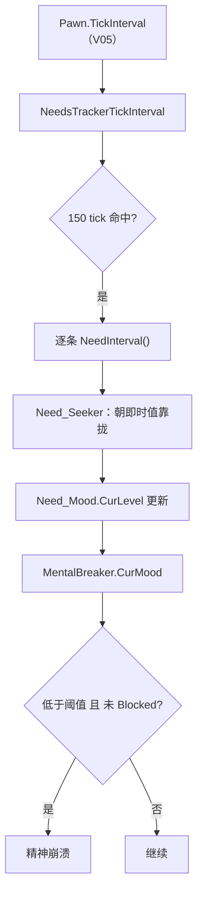

# V13 需求与心情：从 150 tick 的结算到精神崩溃

> **30 秒速览**
>
> - 需求每 **150 tick** 结算一次（V05 §S2），进入 `NeedInterval()`；不同需求子类各自实现「怎么变」。
> - 探索型需求（`Need_Seeker`）不是匀速变化：它朝「即时值」靠拢，上升/下降各有速率，且不会越过即时值。
> - 心情（`Need_Mood`）是一个普通需求，但它的水平被 `MentalBreaker` 拿来和三条阈值比较。
> - 三条阈值都从同一个属性 `MentalBreakThreshold` 派生：极端 = ×1/7、重大 = ×4/7、轻微 = ×1。
> - 精神崩溃要同时满足：**没有当前精神态、心情低于对应阈值、未被 Blocked、生命阶段允许**。
>
> **读前须知**：本卷讲「需求怎么变、心情怎么触发崩溃」；150 tick 量子与需求容器见 V05，工作与 AI 见 V06/V07，思想（Thought）的完整来源见 V11/V20。

## Where it sits

**本模块的类结构**

```csharp
public class RimWorld.Need : IExposable {  // 需求基类
    public NeedDef def;  // 定义
    private float curLevelInt;  // 当前水平（0..MaxLevel）
    ...
    public virtual float CurLevel  // 带钳制的水平
    public float CurLevelPercentage  // 百分比
    public virtual void NeedInterval()  // 区间结算（子类覆写）
}

public class RimWorld.Need_Seeker : Need {  // 探索型需求（美观、舒适……）
    public override float CurInstantLevel  // 当前环境能提供的即时水平
    public override void NeedInterval()  // 朝即时值靠拢
}

public class RimWorld.Need_Mood : Need_Seeker {  // 心情
    ...
}

public class Verse.AI.MentalBreaker {  // 精神崩溃判定
    public float BreakThresholdExtreme  // 极端阈值
    public float BreakThresholdMajor  // 重大阈值
    public float BreakThresholdMinor  // 轻微阈值
    public float CurMood  // 当前心情
    public bool CanDoRandomMentalBreaks  // 生命阶段是否允许
    public bool Blocked  // 是否被临时屏蔽
    public bool BreakExtremeIsImminent  // 极端崩溃是否迫近
}
```

**这一段怎么走**：先认「需求 = 一个有水平的容器」，再认「探索型需求 = 朝即时值靠拢」，最后认「心情是需求、崩溃是阈值比较」。三段都在 150 tick 的节拍上发生。

## Evolution



| 层 | 谁 | 频率 | 结果 |
|---|---|---|---|
| 结算 | `NeedInterval` | 150 tick | 需求水平变化 |
| 求值 | `MentalBreaker.CurMood` | 读取时 | 当前心情 |
| 判定 | 阈值比较 + `Blocked` | 每次检查 | 是否崩溃 |

**这一段怎么走**：150 tick 结算一次需求 → 心情水平随之变化 → 崩溃判定读当前心情与阈值。整条链没有额外计时器，全部挂在需求节拍上。

## Stage detail

### S0 `Need_Seeker.NeedInterval`：朝即时值靠拢

**这一段做什么**：探索型需求不是「按时间加固定值」，而是比较「即时值」与「当前值」——高了就按上升速率靠近，低了就按下降速率靠近，且不会越过即时值。

**源码**（`RimWorld.Need_Seeker.NeedInterval`；中文注释为本文档所加）

```csharp
if (!this.IsFrozen)                                                    // 未冻结
{
    float curInstantLevel = this.CurInstantLevel;                      // 环境即时水平
    if (curInstantLevel > this.CurLevel)                               // 即时值更高
    {
        this.CurLevel += this.def.seekerRisePerHour * 0.06f;           // 按上升速率加
        this.CurLevel = Mathf.Min(this.CurLevel, curInstantLevel);     // 不越过即时值
    }
    if (curInstantLevel < this.CurLevel)                               // 即时值更低
    {
        this.CurLevel -= this.def.seekerFallPerHour * 0.06f;           // 按下降速率减
        this.CurLevel = Mathf.Max(this.CurLevel, curInstantLevel);     // 不低于即时值
    }
}
```

**伪代码**

```text
若 未冻结:
    即时值 = 环境即时水平
    若 即时值 > 当前值:
        当前值 += 上升速率 × 0.06
        当前值 = min(当前值, 即时值)
    若 即时值 < 当前值:
        当前值 -= 下降速率 × 0.06
        当前值 = max(当前值, 即时值)
```

- `0.06`：把「每小时速率」换算成「150 tick 一次」的增量（150/2500 = 0.06）；
- `IsFrozen`：需求被冻结（如低温休眠）时不变化；
- 两个 `if` 互斥：即时值只可能高于或低于当前值。

> **要点**：需求变化是「追赶即时值」，所以环境好时慢慢涨、环境差时慢慢掉，而不是线性累加。
>
> **陷阱**：`0.06` 是硬编码的换算系数；如果需求的 `seekerRisePerHour` 本身不是「每小时」单位，结果会差一个数量级。

**这一段怎么走**：先判冻结，再比较即时值与当前值，按方向加/减并钳制在即时值内。整段只做一次比较与一次钳制。

### S1 心情与三条阈值

**这一段做什么**：心情就是 `Need_Mood` 的水平；`MentalBreaker` 从同一个属性派生出三条阈值——极端、重大、轻微，比例分别是 1/7、4/7、1。

**源码**（`Verse.AI.MentalBreaker`，阈值与求值；中文注释为本文档所加）

```csharp
public float BreakThresholdExtreme                    // 极端阈值
{
    get
    {
        return this.pawn.GetStatValue(StatDefOf.MentalBreakThreshold, true, 5) * 0.14285715f;  // ≈ 1/7
    }
}

public float BreakThresholdMajor                      // 重大阈值
{
    get
    {
        return this.pawn.GetStatValue(StatDefOf.MentalBreakThreshold, true, 5) * 0.5714286f;   // ≈ 4/7
    }
}

public float CurMood                                  // 当前心情
{
    get
    {
        if (this.pawn.needs.mood == null)             // 没有心情需求
        {
            return 0.5f;                              // 中性
        }
        return this.pawn.needs.mood.CurLevel;         // 心情需求水平
    }
}
```

**伪代码**

```text
属性 极端阈值:
    取值:
    返回 阈值属性 × 0.14285715

属性 重大阈值:
    取值:
    返回 阈值属性 × 0.5714286

属性 当前心情:
    取值:
    若 没有心情需求:
        返回 0.5
    返回 心情需求.当前水平
```

- 阈值属性默认 `MentalBreakThreshold`（受特质、基因、状态影响）；
- 极端阈值 ≈ 属性值的 1/7，重大 ≈ 4/7，轻微 = 属性值本身；
- 没有心情需求（动物/机械）时按 0.5 处理，避免误判。

> **要点**：三条阈值同源，调高「精神崩溃阈值」属性会同时抬高三条线——不存在「只调极端」的开关。
>
> **陷阱**：`CurMood` 的 0.5 默认值意味着「无心情需求的生物」永远在轻微阈值之上（除非阈值属性 > 0.5）。

**这一段怎么走**：先读阈值属性，再乘三个系数得到三条线；`CurMood` 直接读心情需求，缺失时给中性值。三条阈值与当前心情都只是属性读取，没有缓存。

### S2 崩溃判定：四个条件同时成立

**这一段做什么**：精神崩溃不是「心情低就一定触发」——还要没有当前精神态、未被 `Blocked`、且生命阶段允许随机崩溃。

**源码**（`Verse.AI.MentalBreaker`，两个判定属性；中文注释为本文档所加）

```csharp
return this.pawn.MentalStateDef == null && this.CurMood < this.BreakThresholdExtreme && !this.Blocked;  // 极端崩溃
```

**伪代码**

```text
返回 无当前精神态 且 心情 < 极端阈值 且 未被屏蔽
```

```csharp
return this.pawn.MentalStateDef == null && !this.BreakExtremeIsImminent && this.CurMood < this.BreakThresholdMajor && !this.Blocked;  // 重大崩溃
```

**伪代码**

```text
返回 无当前精神态 且 极端未迫近 且 心情 < 重大阈值 且 未被屏蔽
```

- `MentalStateDef == null`：已经在崩溃中就不再叠加；
- `BreakExtremeIsImminent`：极端已迫近时不再判重大，避免「降级」重复触发；
- `Blocked`：剧情/调试临时屏蔽。

> **要点**：判定是「即时读取」，没有冷却计时器——只要条件成立，每次检查都可能触发。
>
> **陷阱**：`Blocked` 只阻止新崩溃，不终止已存在的 `MentalState`。

**这一段怎么走**：四个条件用 `&&` 串起来，任一不满足就不触发。极端与重大两条判定共享「无精神态 + 未屏蔽」，差别在阈值与迫近标志。

## Branches

| 分支 | 触发条件 | 行为 | 与主链的差异 |
|---|---|---|---|
| **冻结** | `IsFrozen` | 需求不变化 | 只影响结算 |
| **无心情需求** | `needs.mood == null` | `CurMood = 0.5` | 动物/机械 |
| **崩溃中** | `MentalStateDef != null` | 不再判新崩溃 | 防止叠加 |
| **极端迫近** | `BreakExtremeIsImminent` | 跳过重大判定 | 防止降级重复 |
| **Blocked** | 剧情/调试 | 不触发 | 只挡新崩溃 |
| **生命阶段** | `canDoRandomMentalBreaks` 为假 | 不随机崩溃 | 儿童等 |

**层积与遗留痕迹**：

1. **三条阈值的比例**：1/7 与 4/7 是魔法系数，没有命名常量。
2. **`CurMood` 的 0.5 兜底**：为无心情生物准备的默认值，但也会掩盖「需求缺失」的配置错误。
3. **`Blocked` 与 `BreakExtremeIsImminent` 两个开关**：分别来自剧情控制与「避免重复触发」的补丁。

> **要点**：崩溃判定只读状态，不写状态；真正进入崩溃由上层（`MentalStateHandler`）执行。
>
> **陷阱**：三条阈值判定分散在多个属性里，改一处系数不会同步其它两条。

**这一段怎么走**：六条分支里只有「冻结」改需求变化，其余都改判定；层积三条说明阈值系数与兜底值都是历史遗留。

## Contracts

| 方向 | 契约 |
|---|---|
| 入 | `NeedsTrackerTickInterval` 每 150 tick 调 `NeedInterval`（V05） |
| 出 | 需求水平变化；`CurMood` 与阈值判定 |
| 时序 | 结算 → 心情更新 → 判定（读取时求值） |
| 不变量 | 需求水平钳制在 0..MaxLevel；`CurMood` 缺失时 0.5；崩溃需四条件同时成立 |
| 边界 | 冻结不结算；崩溃中不叠加；`Blocked` 只挡新崩溃 |

## Evidence

[claim:V13-C01] 冻结的需求不参与结算。
  src: RimWorld.Need_Seeker.NeedInterval
  file: analysis/decompiled/Assembly-CSharp/RimWorld/Need_Seeker.cs
  match: if (!this.IsFrozen)

[claim:V13-C02] 即时值高于当前值时按上升速率靠近。
  src: RimWorld.Need_Seeker.NeedInterval
  file: analysis/decompiled/Assembly-CSharp/RimWorld/Need_Seeker.cs
  match: this.CurLevel += this.def.seekerRisePerHour * 0.06f;

[claim:V13-C03] 上升不会越过即时值。
  src: RimWorld.Need_Seeker.NeedInterval
  file: analysis/decompiled/Assembly-CSharp/RimWorld/Need_Seeker.cs
  match: this.CurLevel = Mathf.Min(this.CurLevel, curInstantLevel);

[claim:V13-C04] 即时值低于当前值时按下降速率靠近。
  src: RimWorld.Need_Seeker.NeedInterval
  file: analysis/decompiled/Assembly-CSharp/RimWorld/Need_Seeker.cs
  match: this.CurLevel -= this.def.seekerFallPerHour * 0.06f;

[claim:V13-C05] 下降不会低于即时值。
  src: RimWorld.Need_Seeker.NeedInterval
  file: analysis/decompiled/Assembly-CSharp/RimWorld/Need_Seeker.cs
  match: this.CurLevel = Mathf.Max(this.CurLevel, curInstantLevel);

[claim:V13-C06] 当前心情直接取心情需求水平。
  src: Verse.AI.MentalBreaker.CurMood
  file: analysis/decompiled/Assembly-CSharp/Verse/AI/MentalBreaker.cs
  match: return this.pawn.needs.mood.CurLevel;

[claim:V13-C07] 没有心情需求时按 0.5 处理。
  src: Verse.AI.MentalBreaker.CurMood
  file: analysis/decompiled/Assembly-CSharp/Verse/AI/MentalBreaker.cs
  match: return 0.5f;

[claim:V13-C08] 极端阈值约为属性值的 1/7。
  src: Verse.AI.MentalBreaker.BreakThresholdExtreme
  file: analysis/decompiled/Assembly-CSharp/Verse/AI/MentalBreaker.cs
  match: return this.pawn.GetStatValue(StatDefOf.MentalBreakThreshold, true, 5) * 0.14285715f;

[claim:V13-C09] 重大阈值约为属性值的 4/7。
  src: Verse.AI.MentalBreaker.BreakThresholdMajor
  file: analysis/decompiled/Assembly-CSharp/Verse/AI/MentalBreaker.cs
  match: return this.pawn.GetStatValue(StatDefOf.MentalBreakThreshold, true, 5) * 0.5714286f;

[claim:V13-C10] 轻微阈值就是属性值本身。
  src: Verse.AI.MentalBreaker.BreakThresholdMinor
  file: analysis/decompiled/Assembly-CSharp/Verse/AI/MentalBreaker.cs
  match: return this.pawn.GetStatValue(StatDefOf.MentalBreakThreshold, true, 5);

[claim:V13-C11] 随机崩溃受生命阶段限制。
  src: Verse.AI.MentalBreaker.CanDoRandomMentalBreaks
  file: analysis/decompiled/Assembly-CSharp/Verse/AI/MentalBreaker.cs
  match: return curLifeStage.canDoRandomMentalBreaks;

[claim:V13-C12] 极端崩溃要求无当前精神态且未屏蔽。
  src: Verse.AI.MentalBreaker
  file: analysis/decompiled/Assembly-CSharp/Verse/AI/MentalBreaker.cs
  match: return this.pawn.MentalStateDef == null && this.CurMood < this.BreakThresholdExtreme && !this.Blocked;

[claim:V13-C13] 重大崩溃额外要求极端未迫近。
  src: Verse.AI.MentalBreaker
  file: analysis/decompiled/Assembly-CSharp/Verse/AI/MentalBreaker.cs
  match: return this.pawn.MentalStateDef == null && !this.BreakExtremeIsImminent && this.CurMood < this.BreakThresholdMajor && !this.Blocked;

[claim:V13-C14] 需求水平被钳制在 0 到上限之间。
  src: RimWorld.Need.CurLevel
  file: analysis/decompiled/Assembly-CSharp/RimWorld/Need.cs
  match: this.curLevelInt = Mathf.Clamp(value, 0f, this.MaxLevel);

## Open questions

1. `[unresolved]` `CurInstantLevel` 的计算（美观/舒适如何取环境值）未展开，属各需求子类。
2. `[unresolved]` 思想（Thought）如何汇总进 `Need_Mood` 未拆解，属 V11/V20。
3. `[unresolved]` 三条阈值的比例系数（1/7、4/7）是否有设计文档依据，未考证。

**这一段怎么走**：三条未结项分别指向「即时值来源」「思想汇总」「阈值系数」；前者属需求子类，中者属社交/意识形态卷，后者只能查设计资料。
