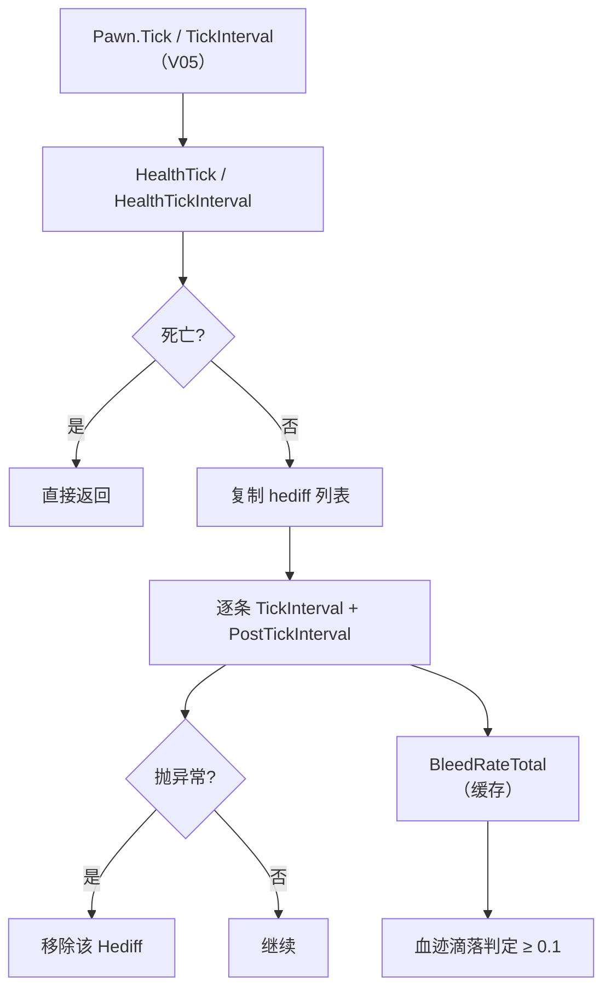

# V14 医疗、身体与伤势：Hediff 怎么 aging、流血怎么算

> **30 秒速览**
>
> - 健康状态全部挂在 `Pawn_HealthTracker` 上：`HealthTick()` 每 tick、`HealthTickInterval(delta)` 按区间。
> - 区间结算遍历 `HediffSet` 的**副本**：每个 `Hediff` 先 `TickInterval` 再 `PostTickInterval`，单个抛异常就移除该 Hediff。
> - 出血率是**缓存值**：`BleedRateTotal` 只在缓存失效时重算，纯读路径不重复累加。
> - `Hediff.TickInterval` 负责年龄累加（`ageTicks += delta`）、每 60 tick 触发 `hediffGivers`、首次可见时记录 tale。
> - 流血会滴落血迹：`BleedRateTotal >= 0.1` 且在地图上时才考虑。
>
> **读前须知**：本卷讲「健康容器 + Hediff 区间 + 出血缓存」；伤害如何产生见 V08，需求与心情见 V13，年龄见 V02。

## Where it sits

**本模块的类结构**

```csharp
public class Verse.Pawn_HealthTracker : IExposable {  // 健康容器
    public HediffSet hediffSet;  // 全部 Hediff 与身体部位
    private bool dead;  // 是否死亡
    ...
    public bool Dead  // 死亡状态
    public bool CanBleed  // 是否会流血
    public void HealthTick()  // 每 tick
    public void HealthTickInterval(int delta)  // 区间
    public void RemoveHediff(Hediff hediff)  // 移除
}

public class Verse.HediffSet {  // Hediff 集合
    public List<Hediff> hediffs;  // 全部 Hediff
    private float cachedBleedRate;  // 出血率缓存
    ...
    public float BleedRateTotal  // 总出血率（缓存）
    private float CalculateBleedRate()  // 重算
}

public class Verse.Hediff : IExposable {  // 一条伤势/疾病/状态
    public HediffDef def;  // 定义
    public Pawn pawn;  // 所属
    public float severityInt;  // 严重度
    private int ageTicks;  // 已存在 tick 数
    public HediffStage CurStage  // 当前阶段
    public bool Visible  // 是否可见
    ...
    public virtual void TickInterval(int delta)  // 区间推进
    public virtual void PostTickInterval(int delta)  // 区间后处理
}
```

**这一段怎么走**：先认「健康容器持有 Hediff 集合」，再认「集合提供缓存过的出血率」，最后认「每条 Hediff 自己按区间推进」。三者是「容器 → 集合 → 条目」的包含关系。

## Evolution



| 层 | 方法 | 频率 | 职责 |
|---|---|---|---|
| 每 tick | `HealthTick` | 每 tick | 即时健康反应 |
| 区间 | `HealthTickInterval` | 区间 | 遍历 Hediff 推进 |
| 条目 | `Hediff.TickInterval` | 区间 | 年龄、giver、可见性 |
| 缓存 | `BleedRateTotal` | 读取时 | 出血率 |

**这一段怎么走**：每 tick 的健康段与区间的遍历段分开；区间段对每条 Hediff 做「推进 + 后处理」，出血率则按需重算。

## Stage detail

### S0 `HealthTickInterval`：副本遍历与异常隔离

**这一段做什么**：区间结算先排除死亡，再把 Hediff 列表复制到临时表，逐条推进；单条抛异常就记录并移除，不中断其它条目。

**源码**（`Verse.Pawn_HealthTracker.HealthTickInterval`，核心段；中文注释为本文档所加）

```csharp
if (this.Dead)                                            // 已死亡
{
    return;                                               // 不结算
}
Pawn_HealthTracker.tmpRemovedHediffs.Clear();             // 清空已移除表
Pawn_HealthTracker.tmpHediffs.Clear();                    // 清空临时表
Pawn_HealthTracker.tmpHediffs.AddRange(this.hediffSet.hediffs);  // 复制一份
foreach (Hediff hediff in Pawn_HealthTracker.tmpHediffs)  // 遍历副本
{
    if (!Pawn_HealthTracker.tmpRemovedHediffs.Contains(hediff))  // 未被移除
    {
        try
        {
            hediff.TickInterval(delta);                   // 区间推进
            hediff.PostTickInterval(delta);               // 区间后处理
        }
        catch (Exception ex)
        {
            ...
            Log.Error(...);                               // 记录
            ...
        }
    }
}
```

**伪代码**

```text
若 已死亡:
    返回
已移除表.清空()
临时表.清空()
临时表.加入全部(hediff 列表)          # 复制
循环 临时表:
    若 不在已移除表:
        试:
            条目.区间推进(delta)
            条目.区间后处理(delta)
        捕获:
            …（省略：拼错误信息）
            记录错误
            移除该条目
```

- 复制列表：`TickInterval` 可能新增/移除 Hediff，直接遍历原列表会抛「集合被修改」；
- `tmpRemovedHediffs`：记录本次循环中已移除的条目，避免二次处理；
- 异常隔离：单条坏数据不会阻断整只 Pawn 的健康结算。

> **要点**：`PostTickInterval` 是「推进后」的钩子，用于依赖推进结果的逻辑（如阶段切换后的通知）。
>
> **陷阱**：移除 Hediff 会改 `hediffSet.hediffs`，但遍历的是副本——所以本 tick 内仍可能访问到刚移除的对象。

**这一段怎么走**：死亡检查 → 复制列表 → 逐条推进 → 异常则移除。副本与已移除表共同保证「遍历中修改」安全。

### S1 出血率：缓存与失效

**这一段做什么**：`BleedRateTotal` 是缓存值——首次读取或缓存被置负时重算，之后直接返回，避免每次判定都遍历全部 Hediff。

**源码**（`Verse.HediffSet.BleedRateTotal`；中文注释为本文档所加）

```csharp
public float BleedRateTotal            // 总出血率
{
    get
    {
        if (this.cachedBleedRate < 0f)  // 缓存失效
        {
            this.cachedBleedRate = this.CalculateBleedRate();  // 重算
        }
        return this.cachedBleedRate;    // 返回缓存
    }
}
```

**伪代码**

```text
属性 总出血率:
    取值:
    若 缓存 < 0:
        缓存 = 重算出血率()
    返回 缓存
```

- 失效标记是「负数」：`-1` 表示需要重算；
- 增删 Hediff 时把缓存置负（由 `HediffSet` 内部完成）；
- 重算遍历所有 Hediff 的 `BleedRate` 并求和。

> **要点**：纯读路径零成本——这是「每 tick 都可能查出血」却不需要每 tick 重算的原因。
>
> **陷阱**：直接改 `severity` 不会自动让缓存失效；必须通过 `HediffSet` 的增删或显式失效接口。

**这一段怎么走**：读缓存 → 失效则重算 → 返回。缓存的生命周期由增删操作控制。

### S2 `Hediff.TickInterval`：年龄、giver 与可见性

**这一段做什么**：每条 Hediff 的区间推进做三件事——累加年龄、每 60 tick 触发一次 `hediffGivers`、首次可见时记录 tale。

**源码**（`Verse.Hediff.TickInterval`，开头段；中文注释为本文档所加）

```csharp
this.ageTicks += delta;                                                    // 年龄累加
if (this.def.hediffGivers != null && this.pawn.IsHashIntervalTick(60, delta))  // 每 60 tick
{
    for (int i = 0; i < this.def.hediffGivers.Count; i++)
    {
        this.def.hediffGivers[i].OnIntervalPassed(this.pawn, this);        // 触发 giver
    }
}
if (this.Visible && !this.visible)                                         // 首次可见
{
    this.visible = true;                                                   // 记住
    if (this.def.taleOnVisible != null)
    {
        TaleRecorder.RecordTale(this.def.taleOnVisible, new object[] { this.pawn, this.def });  // 记录 tale
    }
}
...
```

**伪代码**

```text
年龄 += delta
若 有 giver 且 命中 60 tick:
    循环 每个 giver:
        giver.区间通过(所属, 本条目)
若 可见 且 尚未记录:
    已记录 = 真
    若 有可见 tale:
        记录 tale(所属, 定义)
…（省略：阶段相关的 giver）
```

- `ageTicks` 用 `delta` 累加，所以屏幕外的 Hediff 年龄不会落后；
- `hediffGivers` 是「按定义配置的周期效果」；
- `taleOnVisible` 只在第一次可见时记录一次（靠 `visible` 布尔）。

> **要点**：年龄是「游戏时间」而不是「被结算次数」——相机远近不影响老化。
>
> **陷阱**：`IsHashIntervalTick(60, delta)` 与 Pawn 的 150 量子不同步，Hediff 的 giver 可能比需求结算更频繁。

**这一段怎么走**：累加年龄 → 每 60 tick 跑 giver → 首次可见记 tale → 阶段相关逻辑（后续代码）。整段以 `delta` 为唯一时间输入。

## Branches

| 分支 | 触发条件 | 行为 | 与主链的差异 |
|---|---|---|---|
| **死亡** | `Dead` | 不结算 | 区间整段跳过 |
| **异常** | Hediff 抛异常 | 移除该 Hediff | 不中断其它 |
| **缓存失效** | `cachedBleedRate < 0` | 重算 | 只影响读取 |
| **流血滴落** | `CanBleed && BleedRateTotal >= 0.1` 且在地图 | 考虑滴血迹 | 表现层副作用 |
| **首次可见** | `Visible && !visible` | 记录 tale | 只一次 |
| **giver 周期** | 60 tick 命中 | 触发 giver | 与 150 量子不同步 |

**层积与遗留痕迹**：

1. **静态临时表**：`tmpHediffs`/`tmpRemovedHediffs` 是静态复用缓冲，避免每次分配。
2. **负缓存约定**：用 `-1` 表示失效，没有独立的 dirty 标志。
3. **`-0.1` 流血阈值**：滴血迹的表现阈值是硬编码常量。

> **要点**：分支表里只有「死亡」会整段跳过，其余是单条或读取路径。
>
> **陷阱**：`CanBleed` 为假的生物（机械/石头）即使有出血率也不会滴血迹。

**这一段怎么走**：六条分支分别改「结不结算」「单条失不失效」「读不读缓存」「滴不滴血迹」。层积三条说明这些实现以性能与省分配为主。

## Contracts

| 方向 | 契约 |
|---|---|
| 入 | `Pawn.Tick` / `TickInterval` 调 `HealthTick` / `HealthTickInterval`（V05） |
| 出 | Hediff 状态推进、出血率、tale 记录 |
| 时序 | 死亡检查 → 复制 → 逐条 TickInterval → PostTickInterval |
| 不变量 | 遍历用副本；异常不影响他人；缓存由增删失效 |
| 边界 | 死亡不结算；`CanBleed` 假则不滴血；首次可见只记一次 tale |

## Evidence

[claim:V14-C01] 死亡后不再做健康区间结算。
  src: Verse.Pawn_HealthTracker.HealthTickInterval
  file: analysis/decompiled/Assembly-CSharp/Verse/Pawn_HealthTracker.cs
  match: if (this.Dead)
  note: 该匹配在目标文件出现 9 次；本条对应 Verse.Pawn_HealthTracker.HealthTickInterval 内的那一处。

[claim:V14-C02] 结算前把 Hediff 列表复制到临时表。
  src: Verse.Pawn_HealthTracker.HealthTickInterval
  file: analysis/decompiled/Assembly-CSharp/Verse/Pawn_HealthTracker.cs
  match: Pawn_HealthTracker.tmpHediffs.AddRange(this.hediffSet.hediffs);
  note: 该匹配在目标文件出现 2 次；本条对应 Verse.Pawn_HealthTracker.HealthTickInterval 内的那一处。

[claim:V14-C03] 已移除的条目在本轮跳过。
  src: Verse.Pawn_HealthTracker.HealthTickInterval
  file: analysis/decompiled/Assembly-CSharp/Verse/Pawn_HealthTracker.cs
  match: if (!Pawn_HealthTracker.tmpRemovedHediffs.Contains(hediff))
  note: 该匹配在目标文件出现 2 次；本条对应 Verse.Pawn_HealthTracker.HealthTickInterval 内的那一处。

[claim:V14-C04] 每条 Hediff 先推进再后处理。
  src: Verse.Pawn_HealthTracker.HealthTickInterval
  file: analysis/decompiled/Assembly-CSharp/Verse/Pawn_HealthTracker.cs
  match: hediff.PostTickInterval(delta);

[claim:V14-C05] 单条异常会被移除。
  src: Verse.Pawn_HealthTracker.HealthTickInterval
  file: analysis/decompiled/Assembly-CSharp/Verse/Pawn_HealthTracker.cs
  match: this.RemoveHediff(hediff);
  note: 该匹配在目标文件出现 2 次；本条对应 Verse.Pawn_HealthTracker.HealthTickInterval 内的那一处。

[claim:V14-C06] 出血率读取前先看缓存。
  src: Verse.HediffSet.BleedRateTotal
  file: analysis/decompiled/Assembly-CSharp/Verse/HediffSet.cs
  match: if (this.cachedBleedRate < 0f)

[claim:V14-C07] 缓存失效时重算出血率。
  src: Verse.HediffSet.BleedRateTotal
  file: analysis/decompiled/Assembly-CSharp/Verse/HediffSet.cs
  match: this.cachedBleedRate = this.CalculateBleedRate();

[claim:V14-C08] 滴血迹要求出血率至少 0.1。
  src: Verse.Pawn_HealthTracker.HealthTick
  file: analysis/decompiled/Assembly-CSharp/Verse/Pawn_HealthTracker.cs
  match: if (this.CanBleed && this.hediffSet.BleedRateTotal >= 0.1f && (this.pawn.Spawned || this.pawn.ParentHolder is Pawn_CarryTracker) && this.pawn.SpawnedOrAnyParentSpawned)

[claim:V14-C09] Hediff 年龄按区间 delta 累加。
  src: Verse.Hediff.TickInterval
  file: analysis/decompiled/Assembly-CSharp/Verse/Hediff.cs
  match: this.ageTicks += delta;

[claim:V14-C10] Hediff 的 giver 每 60 tick 触发。
  src: Verse.Hediff.TickInterval
  file: analysis/decompiled/Assembly-CSharp/Verse/Hediff.cs
  match: if (this.def.hediffGivers != null && this.pawn.IsHashIntervalTick(60, delta))

[claim:V14-C11] 首次可见时记录 tale。
  src: Verse.Hediff.TickInterval
  file: analysis/decompiled/Assembly-CSharp/Verse/Hediff.cs
  match: TaleRecorder.RecordTale(this.def.taleOnVisible, new object[] { this.pawn, this.def });

[claim:V14-C12] 免疫系统有独立的区间入口。
  src: Verse.ImmunityHandler.ImmunityHandlerTickInterval
  file: analysis/decompiled/Assembly-CSharp/Verse/ImmunityHandler.cs
  match: internal void ImmunityHandlerTickInterval(int delta)

[claim:V14-C13] 是否会流血是健康容器的属性。
  src: Verse.Pawn_HealthTracker.CanBleed
  file: analysis/decompiled/Assembly-CSharp/Verse/Pawn_HealthTracker.cs
  match: public bool CanBleed

## Open questions

1. `[unresolved]` `CalculateBleedRate` 的求和范围（是否含已移除/隐藏 Hediff）未逐行核对。
2. `[unresolved]` `ImmunityHandlerTickInterval` 的免疫增长与疾病对抗曲线未展开。
3. `[unresolved]` `HealthTick()` 的每 tick 内容（除流血外）未逐段拆解。

**这一段怎么走**：三条未结项分别指向「出血求和」「免疫曲线」「每 tick 段」；都可在后续补读 `HediffSet` 与 `ImmunityHandler`。
