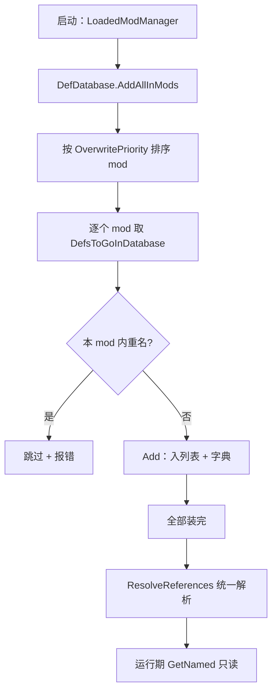

# V15 Def 与 XML 管线：数据怎么变成游戏里的定义

> **30 秒速览**
>
> - 所有 Def 都在 `DefDatabase<T>` 里：一个列表 + 一个按 `defName` 的字典，**启动时一次性装满**。
> - 装载顺序按 mod 的 `OverwritePriority` 排，再按加载顺序排——后者覆盖前者。
> - 同一个 mod 内重名会被跳过并报错；跨 mod 重名则由加载顺序决定谁生效（先装的先占位）。
> - 插入后 `def.index` 用 `ushort` 记录——这决定了上界 65535。
> - 引用解析（`ResolveReferences`）在全部 Def 装完之后统一跑，单条解析失败只记日志。

## Where it sits

**本模块的类结构**

```csharp
public static class Verse.DefDatabase<T> where T : Def {  // 泛型定义库
    private static List<T> defsList;  // 有序列表
    private static Dictionary<string, T> defsByName;  // 名称索引
    ...
    public static void AddAllInMods()  // 从所有 mod 装载
    public static void Add(T def)  // 单条插入
    public static T GetNamed(string defName, bool errorOnFail = true)  // 按名取
    public static T GetNamedSilentFail(string defName)  // 静默取
}

public class Verse.Def {  // 定义基类
    public string defName;  // 唯一名
    public ushort index;  // 在库中的序号
    ...
    public virtual void ResolveReferences()  // 解析引用
}
```

**这一段怎么走**：先认「一个泛型库 + 列表/字典双结构」，再认「装载顺序决定覆盖」，最后认「引用解析是第二阶段」。三步都在启动期完成，运行期只读。

## Evolution



| 阶段 | 方法 | 频率 | 结果 |
|---|---|---|---|
| 装载 | `AddAllInMods` | 启动一次 | 列表 + 字典填满 |
| 插入 | `Add` | 每条 Def | `index` 分配 |
| 解析 | `ResolveReferences` | 启动一次 | 引用绑定 |
| 查询 | `GetNamed` | 运行期 | 只读 |

**这一段怎么走**：装载 → 插入 → 解析 → 查询，四步严格分阶段。运行期不会新增 Def（除非 mod 在运行期动态注入）。

## Stage detail

### S0 `Add`：插入与重名处理

**这一段做什么**：`Add` 先拒空，再把重名循环改写到不重复，最后入列表、入字典、分配 `ushort` 序号。

**源码**（`Verse.DefDatabase<T>.Add`；中文注释为本文档所加）

```csharp
if (def == null)                                        // 空
{
    Log.Error("Tried to add null def to DefDatabase.");  // 报错
    return;                                              // 不入库
}
while (DefDatabase<T>.defsByName.ContainsKey(def.defName))  // 重名
{
    ...
    Log.Error(... + " name: " + def.defName);             // 报错
    def.defName += Mathf.RoundToInt(Rand.Value * 1000f).ToString();  // 加随机后缀
    def.ResolveDefNameHash();                            // 重算哈希
}
DefDatabase<T>.defsList.Add(def);                        // 入列表
DefDatabase<T>.defsByName.Add(def.defName, def);         // 入字典
if (DefDatabase<T>.defsList.Count > 65535)               // 超上限
{
    ... Log.Error(...);                                  // 报错
}
def.index = (ushort)(DefDatabase<T>.defsList.Count - 1); // 分配序号
```

**伪代码**

```text
若 定义 为空:
    记录错误
    返回
循环 字典里已有该名:
    记录错误
    名字 += 随机数
    重算名字哈希
列表.加入(定义)
字典.加入(名字, 定义)
若 列表数量 > 65535:
    …（省略：拼错误信息）
    记录错误
定义.序号 = 列表数量 − 1
```

- 重名不是覆盖，而是**改名保留两条**——这解释了为什么 mod 冲突后会出现「名字带数字」的 Def；
- `ResolveDefNameHash`：名字变了，哈希要重算；
- `index` 是 `ushort`，所以最多 65536 条。

> **要点**：`Add` 从不删除旧 Def；跨 mod 的「覆盖」实际靠加载顺序，先装的先占名。
>
> **陷阱**：重名改名后，XML 里按原名引用的人会找不到——这类错误通常在解析阶段才暴露。

**这一段怎么走**：拒空 → 重名改名 → 入列表/字典 → 检查上限 → 分配序号。整段无删除路径。

### S1 `AddAllInMods`：按覆盖优先级装载

**这一段做什么**：按 mod 的 `OverwritePriority` 与加载顺序排序，逐个 mod 取 Def，用 `HashSet` 做 mod 内去重。

**源码**（`Verse.DefDatabase<T>.AddAllInMods`，开头段；中文注释为本文档所加）

```csharp
HashSet<string> hashSet = new HashSet<string>();                     // mod 内去重
foreach (ModContentPack modContentPack in LoadedModManager.RunningMods.OrderBy<ModContentPack, int>((ModContentPack m) => m.OverwritePriority).ThenBy<ModContentPack, int>((ModContentPack x) => LoadedModManager.RunningModsListForReading.IndexOf(x)))  // 排序
{
    string text = modContentPack.ToString();
    hashSet.Clear();                                                 // 每个 mod 清一次
    foreach (T t in GenDefDatabase.DefsToGoInDatabase<T>(modContentPack))  // 该 mod 的 Def
    {
        if (!hashSet.Add(t.defName))                                 // 本 mod 内重名
        {
            string[] array = new string[7];
            ...
            Log.Error(...);                                          // 报错跳过
        }
    }
}
```

**伪代码**

```text
去重集 = 新建()
循环 每个 mod（按覆盖优先级、再按加载顺序）:
    …（省略：取 mod 名）
    去重集.清空()
    循环 该 mod 的定义:
        若 去重集.加入(名字) 失败:
            …（省略：拼错误信息）
            记录错误
            …（省略：跳过该条）
```

- `OverwritePriority`：mod 自己声明的覆盖优先级；
- `IndexOf`：同优先级时按加载顺序；
- `HashSet` 只在本 mod 内生效，跨 mod 不去重（由 `Add` 的重名逻辑处理）。

> **要点**：排序键有两个，`OrderBy` 后 `ThenBy` 保证稳定。
>
> **陷阱**：`hashSet.Clear()` 在循环内——如果放到循环外，跨 mod 的同名 Def 会被误判为本 mod 重名。

**这一段怎么走**：排序 → 逐 mod → 清去重集 → 逐 Def 检查 → 重名报错。跨 mod 冲突留给 `Add`。

### S2 引用解析：统一阶段、单条隔离

**这一段做什么**：所有 Def 装完后，按类型统一调 `ResolveReferences`；单条失败只记日志，不中断整体。

```csharp
def.ResolveReferences();   // 解析引用
```

```text
定义.解析引用()
```

规则：解析阶段会遍历该类型的全部 Def（可用 `onlyExactlyMyType` 限定精确类型），每条包在 try 里。

> **要点**：解析是「第二阶段」，此时所有 Def 都已存在，可以互相引用。
>
> **陷阱**：解析失败只记日志，Def 仍然留在库里——运行期可能表现为「字段为 null」。

**这一段怎么走**：装载完成后统一解析，单条失败隔离。运行期不再解析。

## Branches

| 分支 | 触发条件 | 行为 | 与主链的差异 |
|---|---|---|---|
| **空 Def** | `def == null` | 报错、不入库 | 不占序号 |
| **重名** | 字典已有同名 | 改名 + 报错 + 保留 | 不覆盖 |
| **超上限** | 数量 > 65535 | 报错 | 仍插入 |
| **mod 内重名** | `HashSet.Add` 失败 | 跳过 + 报错 | 不入库 |
| **解析失败** | `ResolveReferences` 抛异常 | 记日志 | Def 保留 |
| **精确类型** | `onlyExactlyMyType` | 跳过子类 | 只解析本类型 |

**层积与遗留痕迹**：

1. **`ushort index`**：早期为省内存的选择，直接定下 65535 上限。
2. **重名改名而非覆盖**：跨 mod 冲突的处理方式是「都留下」，靠加载顺序决定谁被引用。
3. **两阶段装载**：装载与解析分离，是因为解析需要全量 Def 就位。

> **要点**：分支表里只有「重名」会改数据（改名），其余都是跳过或记录。
>
> **陷阱**：`index` 在插入时分配，`Remove` 后会 `SetIndices` 重排——运行期删除 Def 会让旧索引失效。

**这一段怎么走**：六条分支分别改「入不入库」「名字改不改」「解不解析」。层积三条说明这套设计以「不丢数据」为优先。

## Contracts

| 方向 | 契约 |
|---|---|
| 入 | 启动期 `LoadedModManager.RunningMods` 提供 mod 列表与 XML |
| 出 | `defsList` / `defsByName` / `index` / 解析后的引用 |
| 时序 | 装载 → 插入 → 解析 → 运行期只读 |
| 不变量 | 运行期不新增 Def；名字唯一；`index` 为 `ushort` |
| 边界 | 空 Def 不入库；重名改名；解析失败保留 |

## Evidence

[claim:V15-C01] 空 Def 会被拒绝入库。
  src: Verse.DefDatabase<T>.Add
  file: analysis/decompiled/Assembly-CSharp/Verse/DefDatabase.cs
  match: Log.Error("Tried to add null def to DefDatabase.");

[claim:V15-C02] 重名会进入改名循环。
  src: Verse.DefDatabase<T>.Add
  file: analysis/decompiled/Assembly-CSharp/Verse/DefDatabase.cs
  match: while (DefDatabase<T>.defsByName.ContainsKey(def.defName))

[claim:V15-C03] 重名时给名字追加随机后缀。
  src: Verse.DefDatabase<T>.Add
  file: analysis/decompiled/Assembly-CSharp/Verse/DefDatabase.cs
  match: t.defName += Mathf.RoundToInt(Rand.Value * 1000f).ToString();

[claim:V15-C04] 列表超过 65535 会报错。
  src: Verse.DefDatabase<T>.Add
  file: analysis/decompiled/Assembly-CSharp/Verse/DefDatabase.cs
  match: if (DefDatabase<T>.defsList.Count > 65535)

[claim:V15-C05] 序号按插入顺序分配。
  src: Verse.DefDatabase<T>.Add
  file: analysis/decompiled/Assembly-CSharp/Verse/DefDatabase.cs
  match: def.index = (ushort)(DefDatabase<T>.defsList.Count - 1);

[claim:V15-C06] mod 装载先按覆盖优先级排序。
  src: Verse.DefDatabase<T>.AddAllInMods
  file: analysis/decompiled/Assembly-CSharp/Verse/DefDatabase.cs
  match: foreach (ModContentPack modContentPack in LoadedModManager.RunningMods.OrderBy<ModContentPack, int>((ModContentPack m) => m.OverwritePriority).ThenBy<ModContentPack, int>((ModContentPack x) => LoadedModManager.RunningModsListForReading.IndexOf(x)))

[claim:V15-C07] 每个 mod 用独立去重集。
  src: Verse.DefDatabase<T>.AddAllInMods
  file: analysis/decompiled/Assembly-CSharp/Verse/DefDatabase.cs
  match: hashSet.Clear();

[claim:V15-C08] mod 内重名会被跳过并报错。
  src: Verse.DefDatabase<T>.AddAllInMods
  file: analysis/decompiled/Assembly-CSharp/Verse/DefDatabase.cs
  match: if (!hashSet.Add(t.defName))

[claim:V15-C09] 引用解析在统一阶段调用。
  src: Verse.DefDatabase<T>.ResolveAllReferences
  file: analysis/decompiled/Assembly-CSharp/Verse/DefDatabase.cs
  match: def.ResolveReferences();

[claim:V15-C10] 可按名字取 Def，失败默认报错。
  src: Verse.DefDatabase<T>.GetNamed
  file: analysis/decompiled/Assembly-CSharp/Verse/DefDatabase.cs
  match: public static T GetNamed(string defName, bool errorOnFail = true)

[claim:V15-C11] 提供静默取版本。
  src: Verse.DefDatabase<T>.GetNamedSilentFail
  file: analysis/decompiled/Assembly-CSharp/Verse/DefDatabase.cs
  match: public static T GetNamedSilentFail(string defName)

## Open questions

1. `[unresolved]` `GenDefDatabase.DefsToGoInDatabase` 如何解析 XML、何时应用补丁（PatchOperation）未展开。
2. `[unresolved]` `ResolveReferences` 的按类型顺序与 `onlyExactlyMyType` 的调用点未逐条统计。
3. `[unresolved]` mod 覆盖优先级的具体数值与配置文件位置未取证。

**这一段怎么走**：三条未结项分别指向「XML 解析」「解析顺序」「覆盖优先级」；都是装载管线的下一层。
