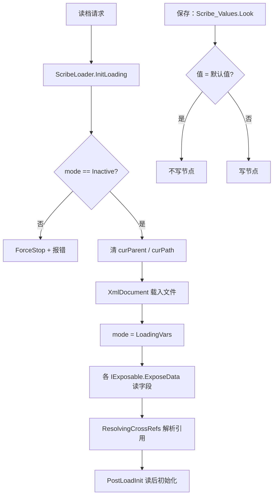

# V16 存档与序列化：一次读档由哪几步组成

> **30 秒速览**
>
> - `Scribe` 是序列化门面，真正的读写分给 `ScribeSaver` / `ScribeLoader`；`Scribe.mode` 决定当前是存、读还是解析引用。
> - 读档第一步 `InitLoading`：检查状态 → 清残留 → 用 `XmlDocument` 载入整份 XML → 把模式切到 `LoadingVars`。
> - 载入失败会 `ForceStop` 并**重新抛出**——读档错误不会被静默吞掉。
> - `Scribe_Values.Look` 只处理「值类型/简单类型」；`Thing`、`IExposable`、`Def`、`TargetInfo` 都有专用入口，用错会报错并跳过。
> - 保存时如果值等于默认值且未强制，就**不写节点**——这是存档体积的主要压缩手段。
>
> **读前须知**：本卷讲「读档入口 + 值序列化的类型守卫」；Def 装载见 V15，`Thing` 生命周期见 V04，世界层对象见 V10。

## Where it sits

**本模块的类结构**

```csharp
public static class Verse.Scribe {  // 序列化门面
    public static ScribeSaver saver;  // 保存器
    public static ScribeLoader loader;  // 读取器
    public static LoadSaveMode mode;  // 当前模式
    ...
    public static bool EnterNode(string nodeName)  // 进节点
    public static void ExitNode()  // 出节点
    public static void ForceStop()  // 强制终止
}

public class Verse.ScribeLoader {  // 读档器
    private XmlNode curXmlParent;  // 当前 XML 节点
    private IExposable curParent;  // 当前对象
    private string curPathRelToParent;  // 相对路径
    public PostLoadIniter initer;  // 读后初始化
    ...
    public void InitLoading(string filePath)  // 开始读档
    public void FinalizeLoading()  // 收尾
    public bool EnterNode(string nodeName)  // 进节点
    public void ForceStop()  // 强制终止
}

public static class Verse.Scribe_Values {  // 值序列化
    public static void Look<T>(ref T value, string label, T defaultValue = default(T), bool forceSave = false)  // 读写值
}

public enum Verse.LoadSaveMode {  // 模式
    Inactive,  // 空闲
    Saving,  // 保存
    LoadingVars,  // 读字段
    ResolvingCrossRefs,  // 解析交叉引用
    PostLoadInit  // 读后初始化
}
```

**这一段怎么走**：先认「门面 + 保存器 + 读取器」三件套，再认 `LoadSaveMode` 的五个阶段。读档不是一步，而是「载入 XML → 读字段 → 解析引用 → 读后初始化」。

## Evolution



| 阶段 | 模式 | 做什么 |
|---|---|---|
| 1 | `LoadingVars` | 读字段值 |
| 2 | `ResolvingCrossRefs` | 把 id 解析成对象引用 |
| 3 | `PostLoadInit` | 依赖其它对象的初始化 |
| 保存 | `Saving` | 写 XML |

**这一段怎么走**：读档从 `InitLoading` 开始，按模式推进三个阶段；保存则按 `Look` 的默认值规则决定写不写。

## Stage detail

### S0 `InitLoading`：载入 XML 并切模式

**这一段做什么**：`InitLoading` 在 try 里用 `XmlDocument` 载入整份存档，成功后把模式切到 `LoadingVars`；失败则 `ForceStop` 并重抛。

**源码**（`Verse.ScribeLoader.InitLoading`，核心段；中文注释为本文档所加）

```csharp
try
{
    using (StreamReader streamReader = new StreamReader(filePath))   // 打开文件
    {
        using (XmlTextReader xmlTextReader = new XmlTextReader(streamReader))  // XML 读取器
        {
            XmlDocument xmlDocument = new XmlDocument();             // 文档
            xmlDocument.Load(xmlTextReader);                          // 载入
            this.curXmlParent = xmlDocument.DocumentElement;          // 根节点
        }
    }
    Scribe.mode = LoadSaveMode.LoadingVars;                           // 切到读字段
}
catch (Exception ex)
{
    ...
    Log.Error(...);                                                   // 记录
    this.ForceStop();                                                 // 复位
    throw;                                                            // 重抛
}
```

**伪代码**

```text
试:
    读文件流
    读 XML
    文档 = 新建()
    文档.载入(读取器)
    当前节点 = 文档.根
    模式 = 读字段
捕获:
    …（省略：拼错误信息）
    记录错误
    强制终止()
    重新抛出
```

- 整份存档一次性读进内存；
- `curXmlParent` 指向根，后续 `EnterNode` 在其上移动；
- 失败必须重抛：读档失败不能继续。

> **要点**：`InitLoading` 只负责「把 XML 读进来 + 切模式」，不解析任何对象。
>
> **陷阱**：模式不是 `Inactive` 时先 `ForceStop` 再继续——上一次读档的残留会被清掉。

**这一段怎么走**：开文件 → 读 XML → 记根节点 → 切模式；异常则复位并重抛。

### S1 `Scribe_Values.Look`：类型守卫

**这一段做什么**：`Look` 在保存模式下先做四道类型检查——`TargetInfo`、`Thing`、`IExposable`、`Def` 都不能用值序列化，用错就报错返回。

**源码**（`Verse.Scribe_Values.Look`，守卫段；中文注释为本文档所加）

```csharp
if (Scribe.mode == LoadSaveMode.Saving)                    // 保存模式
{
    if (typeof(T) == typeof(TargetInfo))                   // TargetInfo
    {
        Log.Error("Saving a TargetInfo " + label + " with Scribe_Values. TargetInfos must be saved with Scribe_TargetInfo.");
        return;
    }
    if (typeof(Thing).IsAssignableFrom(typeof(T)))         // Thing 引用
    {
        Log.Error("Using Scribe_Values with a Thing reference " + label + ". Use Scribe_References or Scribe_Deep instead.");
        return;
    }
    if (typeof(IExposable).IsAssignableFrom(typeof(T)))    // IExposable
    {
        Log.Error("Using Scribe_Values with a IExposable reference " + label + ". Use Scribe_References or Scribe_Deep instead.");
        return;
    }
    if (GenTypes.IsDef(typeof(T)))                         // Def
    {
        Log.Error("Using Scribe_Values with a Def " + label + ". Use Scribe_Defs instead.");
        return;
    }
    ...
}
```

**伪代码**

```text
若 模式 = 保存:
    若 类型 = TargetInfo:
        记录错误
        返回
    若 类型 是 Thing:
        记录错误
        返回
    若 类型 实现 IExposable:
        记录错误
        返回
    若 类型 是 Def:
        记录错误
        返回
    …（省略：默认值比较与写节点）
```

- 四类对象各有专用入口：`Scribe_TargetInfo`、`Scribe_References`/`Scribe_Deep`、`Scribe_Defs`；
- 守卫只在保存模式做——读取时按节点内容恢复；
- 用错不会崩，但该字段不会写入存档。

> **要点**：值序列化只服务「能直接写成字符串」的类型；引用型对象必须走引用表。
>
> **陷阱**：守卫失败只记日志并 `return`，字段静默丢失——读档后表现为「值回到默认」。

**这一段怎么走**：四道类型守卫 → 默认值比较 → 决定写不写。守卫是保存期的安全检查，不影响读取。

## Branches

| 分支 | 触发条件 | 行为 | 与主链的差异 |
|---|---|---|---|
| **模式非空闲** | `mode != Inactive` | `ForceStop` + 报错 | 清残留后继续 |
| **载入失败** | XML 异常 | 复位 + 重抛 | 读档中止 |
| **类型守卫** | 四类对象 | 报错并跳过 | 字段不写 |
| **默认值相等** | `value.Equals(defaultValue)` 且未强制 | 不写节点 | 存档变小 |
| **解析引用** | `ResolvingCrossRefs` | id → 对象 | 依赖引用表 |

**层积与遗留痕迹**：

1. **五个模式**：`Inactive/Saving/LoadingVars/ResolvingCrossRefs/PostLoadInit`，是分阶段读档的核心。
2. **守卫只在一侧**：保存期检查类型，读取期不检查——存档由自己写，读时信任。
3. **`ForceStop` + 重抛**：读档失败既复位又抛出，调用方必须处理。

> **要点**：分支表里只有「默认值相等」会改变输出体积，其余是错误路径。
>
> **陷阱**：默认值比较用 `Equals`，浮点/引用的相等语义会影响「写不写」。

**这一段怎么走**：五条分支分别改「能不能开始」「失败怎么办」「写不写字段」。层积三条说明分阶段设计与单侧守卫。

## Contracts

| 方向 | 契约 |
|---|---|
| 入 | `InitLoading(filePath)` 开始读档；`Scribe.mode` 由门面维护 |
| 出 | `curXmlParent`、模式切换、字段值、引用解析结果 |
| 时序 | 载入 XML → LoadingVars → ResolvingCrossRefs → PostLoadInit |
| 不变量 | 读档期间模式单调推进；值类型不走引用表；失败必须复位 |
| 边界 | 非空闲模式先复位；Save 期四类对象禁用值序列化 |

## Evidence

[claim:V16-C01] 读档开始要求模式为空闲。
  src: Verse.ScribeLoader.InitLoading
  file: analysis/decompiled/Assembly-CSharp/Verse/ScribeLoader.cs
  match: if (Scribe.mode != LoadSaveMode.Inactive)
  note: 该匹配在目标文件出现 2 次；本条对应 Verse.ScribeLoader.InitLoading 内的那一处。

[claim:V16-C02] 模式不对时强制终止。
  src: Verse.ScribeLoader.InitLoading
  file: analysis/decompiled/Assembly-CSharp/Verse/ScribeLoader.cs
  match: Scribe.ForceStop();
  note: 该匹配在目标文件出现 2 次；本条对应 Verse.ScribeLoader.InitLoading 内的那一处。

[claim:V16-C03] 读档会清空父对象残留。
  src: Verse.ScribeLoader.InitLoading
  file: analysis/decompiled/Assembly-CSharp/Verse/ScribeLoader.cs
  match: this.curParent = null;
  note: 该匹配在目标文件出现 3 次；本条对应 Verse.ScribeLoader.InitLoading 内的那一处。

[claim:V16-C04] 存档用 `XmlDocument` 整体载入。
  src: Verse.ScribeLoader.InitLoading
  file: analysis/decompiled/Assembly-CSharp/Verse/ScribeLoader.cs
  match: xmlDocument.Load(xmlTextReader);

[claim:V16-C05] 载入成功后切到「读字段」模式。
  src: Verse.ScribeLoader.InitLoading
  file: analysis/decompiled/Assembly-CSharp/Verse/ScribeLoader.cs
  match: Scribe.mode = LoadSaveMode.LoadingVars;
  note: 该匹配在目标文件出现 2 次；本条对应 Verse.ScribeLoader.InitLoading 内的那一处。

[claim:V16-C06] 载入失败先记录并复位，随后重新抛出。
  src: Verse.ScribeLoader.InitLoading
  file: analysis/decompiled/Assembly-CSharp/Verse/ScribeLoader.cs
  match: string text = "Exception while init loading file: ";
  note: 该行位于 catch 块内，其后依次为 Log.Error、ForceStop 与 throw。

[claim:V16-C07] 值序列化的守卫只在保存模式执行。
  src: Verse.Scribe_Values.Look
  file: analysis/decompiled/Assembly-CSharp/Verse/Scribe_Values.cs
  match: if (Scribe.mode == LoadSaveMode.Saving)

[claim:V16-C08] TargetInfo 必须用专用入口。
  src: Verse.Scribe_Values.Look
  file: analysis/decompiled/Assembly-CSharp/Verse/Scribe_Values.cs
  match: if (typeof(T) == typeof(TargetInfo))

[claim:V16-C09] Thing 引用必须用引用/深度序列化。
  src: Verse.Scribe_Values.Look
  file: analysis/decompiled/Assembly-CSharp/Verse/Scribe_Values.cs
  match: if (typeof(Thing).IsAssignableFrom(typeof(T)))

[claim:V16-C10] IExposable 同样不能走值序列化。
  src: Verse.Scribe_Values.Look
  file: analysis/decompiled/Assembly-CSharp/Verse/Scribe_Values.cs
  match: if (typeof(IExposable).IsAssignableFrom(typeof(T)))

[claim:V16-C11] Def 必须用 `Scribe_Defs`。
  src: Verse.Scribe_Values.Look
  file: analysis/decompiled/Assembly-CSharp/Verse/Scribe_Values.cs
  match: if (GenTypes.IsDef(typeof(T)))

[claim:V16-C12] 默认值相等且未强制时不写节点。
  src: Verse.Scribe_Values.Look
  file: analysis/decompiled/Assembly-CSharp/Verse/Scribe_Values.cs
  match: if (forceSave || (value == null && defaultValue != null) || (value != null && !value.Equals(defaultValue)))

## Open questions

1. `[unresolved]` `ResolvingCrossRefs` 阶段的引用表结构（id → 对象）未展开。
2. `[unresolved]` `PostLoadIniter` 的执行顺序与依赖处理未拆解。
3. `[unresolved]` 存档版本迁移（`ScribeMetaHeaderUtility`）未覆盖。

**这一段怎么走**：三条未结项分别指向「引用表」「读后初始化」「版本迁移」；都是读档管线的后续阶段。
