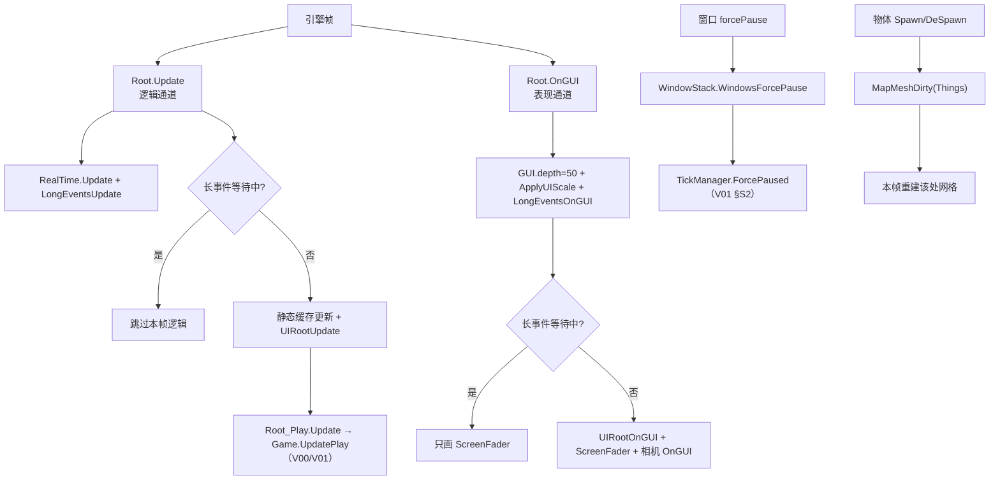

# V17 UI 与渲染桥接：逻辑与表现的那条缝

> **30 秒速览**
>
> - 每帧有**两条通道**：`Update`（逻辑，最终进入 `Game.UpdatePlay`）与 `OnGUI`（表现，进入 `UIRootOnGUI`）。
> - UI 根只有两种：`UIRoot_Play` 与 `UIRoot_Entry`，由 `Root.Start` 按当前场景**二选一**创建，不是运行期切换。
> - 表现层能反向影响时间的唯一入口是**窗口强制暂停**：`WindowStack.WindowsForcePause` → `TickManager.ForcePaused`（V01 §S2）。
> - 物体进出地图会给地图网格打脏标记：`SpawnSetup`/`DeSpawn` → `MapMeshDirty(Position, MapMeshFlagDefOf.Things)`，本帧重建该处网格。
> - 长事件（加载、切场景）期间两条通道都被短路：`Update` 直接跳过逻辑，`OnGUI` 只画淡入淡出。
>
> **读前须知**：本卷讲「逻辑与表现怎么接」；`Game.UpdatePlay` 内部（泵与帧级通道）见 V01，`DoSingleTick` 见 V23，渲染树见 V21（v1），引擎帧源见 V22。

## Where it sits

**本模块的类结构**

```csharp
public class Verse.Root : MonoBehaviour {  // 场景根（MonoBehaviour）
    protected UIRoot uiRoot;  // UI 根（Play 或 Entry）
    protected SoundRoot soundRoot;  // 声音根
    public bool destroyed;  // 场景是否已销毁
    ...
    public virtual void Start()  // 选 UI 根、建声音根
    public virtual void Update()  // 逻辑通道
    public void OnGUI()  // 表现通道（IMGUI）
}

public class Verse.Root_Play : Verse.Root {  // 游玩场景根
    public override void Update()  // 基类 Update 后接 Game.UpdatePlay（V00/V01）
}

public class Verse.UIRoot {  // UI 根的抽象
    public virtual void UIRootUpdate()  // 每帧逻辑侧 UI 更新
    public virtual void UIRootOnGUI()  // 每帧 IMGUI 绘制
}

public class RimWorld.UIRoot_Play : Verse.UIRoot {  // 游玩 UI 根
    public override void UIRootOnGUI()  // 游戏内 HUD
    public override void UIRootUpdate()  // 游戏内 UI 逻辑
}

public class Verse.WindowStack {  // 窗口栈
    private List<Window> windows;  // 当前打开的窗口
    public bool WindowsForcePause  // 是否有窗口要求暂停
    ...
}

public class Verse.MapDrawer {  // 地图网格绘制器
    public void MapMeshDirty(IntVec3 cell, ulong dirtyFlags, bool regenAdjacentCells, bool regenAdjacentSections)  // 标脏
}

public class Verse.CameraDriver : MonoBehaviour {  // 地图相机
    public void CameraDriverOnGUI()  // 相机相关 IMGUI（选中框等）
}
```

**这一段怎么走**：先认三层——场景根 `Root`（选 UI 根）、UI 根 `UIRoot`（逻辑与绘制的分界）、以及两个会反向影响游戏的对象（`WindowStack` 的强制暂停、`MapDrawer` 的脏标记）。本卷只讲这三层怎么接，不深入任何控件。

## Evolution



| 通道 | 入口 | 频率 | 结束后进入 |
|---|---|---|---|
| 逻辑 | `Root.Update` → `Root_Play.Update` | 每帧 | `Game.UpdatePlay`（V01） |
| 表现 | `Root.OnGUI` | 每帧（IMGUI 可能多次） | `UIRootOnGUI`、相机 `OnGUI` |
| 反向 | `WindowStack` / `MapDrawer` | 事件驱动 | 暂停时间 / 标脏网格 |

**这一段怎么走**：两条通道各自从 `Root` 出发：`Update` 走逻辑，最终到 tick 泵；`OnGUI` 走绘制，到 UI 根与相机。反向影响只有两处——窗口让时间停、物体让网格脏。

## Stage detail

### S0 逻辑通道：`Root.Update` 的一帧

**这一段做什么**：`Root.Update` 先把实时钟与长事件推进，再判断「长事件是否要求等待」；不等待时才做静态缓存更新、UI 更新与声音更新。

**源码**（`Verse.Root.Update`，核心段；中文注释为本文档所加）

```csharp
LongEventHandler.LongEventsUpdate(out flag);                    // 推进长事件
if (flag)                                                        // 长事件要求退出
{
    this.destroyed = true;                                       // 标记场景销毁
}
else if (!LongEventHandler.ShouldWaitForEvent)                    // 不需要等待
{
    Rand.EnsureStateStackEmpty();                                 // 随机数栈自检
    ...
    this.uiRoot.UIRootUpdate();                                   // UI 逻辑更新
    if (Time.frameCount > 3 && !Root.prefsApplied)                // 开场几帧后
    {
        Root.prefsApplied = true;                                 // 只应用一次
        Prefs.Apply();                                            // 应用偏好
    }
    this.soundRoot.Update();                                      // 声音更新
}
```

**伪代码**

```text
长事件.推进(out 要求退出)
若 要求退出:
    标记已销毁
否则 若 不处于「长事件等待」:
    随机数栈自检
    …（省略：若干静态缓存更新）
    UI 根.每帧逻辑更新()
    若 帧号 > 3 且 未应用偏好:
        标记已应用
        应用偏好()                      # 只做一次
    声音根.更新()
```

- `RealTime.Update()` 在更前面（`Update` 开头），负责游戏外的实时钟；
- `Root_Play.Update` 在调用 `base.Update()` 之后才进 `Game.UpdatePlay`（V00 §S1）；
- `Prefs.Apply()` 延迟到第 4 帧之后，避免开场时窗口还没就绪。

> **要点**：`UIRootUpdate` 在逻辑通道里、`Game.UpdatePlay` 之前——所以 UI 读到的是**上一帧**推进后的游戏状态。
>
> **陷阱**：`LongEventHandler.ShouldWaitForEvent` 为真时，`UIRootUpdate` 与声音都不跑；此时 UI 显示的是冻结的上一帧，这是「加载画面」的实现方式，不是卡死。

**这一段怎么走**：先推进长事件并判断是否退出/等待，不等待才做缓存自检、UI 逻辑更新、偏好应用与声音更新；`Game.UpdatePlay` 在这之后由 `Root_Play` 调用。逻辑通道的顺序决定了「UI 看到的世界」永远比 tick 泵晚一帧。

### S1 表现通道：`Root.OnGUI` 的一帧

**这一段做什么**：`Root.OnGUI` 设置 IMGUI 深度与缩放，先推进长事件的绘制；等待期间只画淡入淡出，否则依次绘制 UI 根、淡入淡出、地图相机与世界相机。

**源码**（`Verse.Root.OnGUI`，核心段；中文注释为本文档所加）

```csharp
if (!this.destroyed)                                                        // 场景还在
{
    GUI.depth = 50;                                                         // IMGUI 深度
    UI.ApplyUIScale();                                                      // 应用 UI 缩放
    LongEventHandler.LongEventsOnGUI();                                     // 长事件的绘制
    if (LongEventHandler.ShouldWaitForEvent)                                // 等待中
    {
        ScreenFader.OverlayOnGUI(new Vector2((float)UI.screenWidth, (float)UI.screenHeight));  // 只画渐变
    }
    else
    {
        this.uiRoot.UIRootOnGUI();                                          // UI 根绘制
        ScreenFader.OverlayOnGUI(new Vector2((float)UI.screenWidth, (float)UI.screenHeight));  // 渐变覆盖
        if (Find.CameraDriver != null && Find.CameraDriver.isActiveAndEnabled)
        {
            Find.CameraDriver.CameraDriverOnGUI();                          // 地图相机绘制
        }
        if (Find.WorldCameraDriver != null && Find.WorldCameraDriver.isActiveAndEnabled)
        {
            Find.WorldCameraDriver.WorldCameraDriverOnGUI();                // 世界相机绘制
        }
    }
}
```

**伪代码**

```text
若 未销毁:
    设 IMGUI 深度 = 50
    应用 UI 缩放
    长事件.绘制()
    若 长事件等待中:
        画渐变覆盖                       # 加载画面
    否则:
        UI 根.绘制()
        画渐变覆盖
        若 地图相机 存在且启用:
            地图相机.绘制()
        若 世界相机 存在且启用:
            世界相机.绘制()
```

- `GUI.depth = 50`：IMGUI 的深度排序，决定这一层相对其他 GUI 的覆盖关系；
- `ScreenFader`：全屏渐变（转场/加载），在等待与非等待两条路径都出现；
- 两个相机各自 `isActiveAndEnabled` 判断，避免在场景切换瞬间访问已禁用对象。

> **要点**：`OnGUI` 可能一帧被调用多次（IMGUI 的 Layout/Repaint 事件），所以这里的绘制代码不能有副作用。
>
> **陷阱**：`UIRootOnGUI` 在 `UIRootUpdate` 之前还是之后取决于引擎的事件顺序，不是代码保证的；跨帧依赖只能靠 `UIRootUpdate` 里的状态，不要假设「本帧 Update 一定先于 OnGUI」。

**这一段怎么走**：先设深度与缩放，再推进长事件绘制；等待中只画渐变，否则按「UI 根 → 渐变 → 地图相机 → 世界相机」顺序绘制。表现通道只读状态、不写游戏状态，副作用要靠逻辑通道做。

### S2 唯一的时间倒灌：窗口强制暂停

**这一段做什么**：表现层唯一能改变时间推进的地方——窗口栈里有任何一个窗口声明 `forcePause`，`WindowsForcePause` 就为真，进而让 `TickManager.ForcePaused` 为真（V01 §S2）。

**源码**（`Verse.WindowStack.WindowsForcePause`；中文注释为本文档所加）

```csharp
public bool WindowsForcePause            // 是否有窗口要求暂停
{
    get
    {
        for (int i = 0; i < this.windows.Count; i++)  // 遍历窗口
        {
            if (this.windows[i].forcePause)           // 该窗口要求暂停
            {
                return true;                          // 立即为真
            }
        }
        return false;                                 // 都不要求
    }
}
```

**伪代码**

```text
属性 窗口强制暂停:
    取值:
    循环 每个窗口:
        若 窗口.要求暂停:
            返回 真
    返回 假
```

- `forcePause` 是 `Window` 上的字段，在窗口打开/关闭时随窗口进出列表；
- 只要**任意一个**窗口要求，整个游戏就暂停——不是「最上层窗口说了算」。

> **要点**：这是「表现层 → 时间层」唯一的反向通道；其余 UI 操作都只能通过命令/信号影响游戏。
>
> **陷阱**：窗口还在栈里但被隐藏时，`forcePause` 仍然生效——关窗口要真的从栈里移除，而不是只设不可见。

**这一段怎么走**：窗口进出栈 → 属性遍历判断 → 结果为真则 `ForcePaused` 为真 → 泵整帧不推进（V01）。整条链路只有三步，但它是 UI 唯一能「停表」的路径。

### S3 脏标记：物体怎么让地图重画

**这一段做什么**：物体进出地图时给所在格打脏标记，`MapDrawer` 在本帧重建该处网格——表现层不做「每帧全量重画」。

**源码**（`Verse.Thing` 生成/销毁路径中的标脏调用；中文注释为本文档所加）

```csharp
map.mapDrawer.MapMeshDirty(this.Position, MapMeshFlagDefOf.Things, true, false);  // 物品层脏标记
```

**伪代码**

```text
地图.绘制器.标脏(位置, 物品层标志, 重算相邻格=真, 重算相邻区块=假)
```

- 第一个参数是**格**而不是物体：同一格的多个物体共用一个网格段；
- `MapMeshFlagDefOf.Things`：只标「物品层」，地形/建筑层不受影响；
- `true, false`：重算相邻格（避免边缘接缝），但不重算相邻区块（控制重建量）。

> **要点**：脏标记是「本帧重建」而不是「立即重建」——真正的重建发生在绘制阶段，所以同一帧内多次标脏会被合并。
>
> **陷阱**：只改物体外观（换贴图、换颜色）但没标脏，画面不会更新；这类改动必须显式调 `MapMeshDirty`。

**这一段怎么走**：物体生成/销毁 → 对所在格标「物品层」脏 → 本帧绘制时重建该格网格。表现层只处理「哪块脏了」，不决定「怎么画」。

### S4 场景与 UI 根：二选一，不切换

**这一段做什么**：`Root.Start` 按当前场景创建 UI 根——游玩场景用 `UIRoot_Play`，入口场景用 `UIRoot_Entry`；之后不再替换，所谓「切场景」是换场景对象、重新走一遍 `Start`。

**源码**（`Verse.Root.Start`，UI 根选择段；中文注释为本文档所加）

```csharp
if (GenScene.InPlayScene)              // 游玩场景
{
    this.uiRoot = new UIRoot_Play();   // 游戏内 UI 根
}
else if (GenScene.InEntryScene)        // 入口场景
{
    this.uiRoot = new UIRoot_Entry();  // 主菜单 UI 根
}
```

**伪代码**

```text
若 当前是游玩场景:
    UI 根 = 新建 UIRoot_Play
否则 若 当前是入口场景:
    UI 根 = 新建 UIRoot_Entry
```

> **要点**：UI 根是「场景的产物」，不是全局单例；`Root` 每次 `Start` 都会重建声音根与 UI 根。
>
> **陷阱**：切场景时旧 `Root` 会被销毁，任何持有旧 `uiRoot` 引用的对象都会指向已销毁实例——这也是 `Current.Game` 可写（V00 §S1）存在的原因之一。

**这一段怎么走**：`Start` 判断场景类型 → 建对应 UI 根 → 后续每帧走两条通道。切场景不是「换 UI 根」，而是「换整个场景对象再 `Start` 一次」。

## Branches

| 分支 | 触发条件 | 行为 | 与主链的差异 |
|---|---|---|---|
| **长事件** | `LongEventHandler.ShouldWaitForEvent` | `Update` 跳过逻辑；`OnGUI` 只画渐变 | 两条通道都被短路 |
| **窗口强制暂停** | 任一窗口 `forcePause` | 泵整帧不推进 | 只停时间，不停绘制 |
| **场景销毁** | `destroyed` / 长事件要求退出 | `OnGUI` 整段跳过 | 不再绘制 |
| **相机禁用** | `isActiveAndEnabled` 为假 | 跳过对应 `OnGUI` | 场景切换瞬间的安全判断 |
| **偏好应用** | 第 4 帧之后且未应用过 | `Prefs.Apply()` 执行一次 | 只影响开场 |

**层积与遗留痕迹**：

1. **`GUI.depth = 50` 是魔法数**：写死而不是按层配置，说明 IMGUI 的层序从未被系统化。
2. **`ScreenFader` 出现两次**：等待路径与非等待路径各画一次，是「加载画面要盖住 UI」的补丁式写法。
3. **`MapMeshDirty` 的四个重载**：不同调用点传不同参数（是否重算相邻格/区块），没有统一封装。

> **要点**：分支表回答「什么情况下通道被改写」，层积表回答「为什么会有写死的深度值和重复的渐变调用」。
>
> **陷阱**：长事件期间 `OnGUI` 仍然执行（只画渐变）——所以「加载画面」不是「不绘制」，而是「只绘制加载层」。

**这一段怎么走**：五条分支各改一段：长事件短路两条通道、窗口暂停只停时间、场景销毁停绘制、相机禁用跳过绘制、偏好只应用一次。层积三条解释了这些写法为什么不够整齐。

## Contracts

| 方向 | 契约 |
|---|---|
| 入 | 引擎每帧调 `Update` 与 `OnGUI`；`WindowStack`、`MapDrawer` 提供反向影响 |
| 出 | 逻辑侧交 `Game.UpdatePlay`；表现侧交 `UIRootOnGUI` 与相机 |
| 时序 | `Update`：长事件 → 缓存 → `UIRootUpdate` → 偏好 → 声音；`OnGUI`：深度/缩放 → 长事件 → UI → 渐变 → 相机 |
| 不变量 | `OnGUI` 无副作用；UI 根由场景决定；脏标记在本帧绘制阶段消费 |
| 边界 | 长事件等待时逻辑全停；窗口 `forcePause` 停时间不停绘制 |

## Evidence

本卷断言为本轮新写并逐条核对。

[claim:V17-C01] 逻辑通道先推进长事件，再决定是否退出。
  src: Verse.Root.Update
  file: analysis/decompiled/Assembly-CSharp/Verse/Root.cs
  match: LongEventHandler.LongEventsUpdate(out flag);

[claim:V17-C02] 长事件要求退出时标记场景销毁。
  src: Verse.Root.Update
  file: analysis/decompiled/Assembly-CSharp/Verse/Root.cs
  match: this.destroyed = true;

[claim:V17-C03] 长事件等待期间跳过逻辑侧 UI 更新。
  src: Verse.Root.Update
  file: analysis/decompiled/Assembly-CSharp/Verse/Root.cs
  match: else if (!LongEventHandler.ShouldWaitForEvent)

[claim:V17-C04] UI 逻辑更新在逻辑通道里。
  src: Verse.Root.Update
  file: analysis/decompiled/Assembly-CSharp/Verse/Root.cs
  match: this.uiRoot.UIRootUpdate();

[claim:V17-C05] 偏好延迟到第 4 帧之后应用一次。
  src: Verse.Root.Update
  file: analysis/decompiled/Assembly-CSharp/Verse/Root.cs
  match: if (Time.frameCount > 3 && !Root.prefsApplied)

[claim:V17-C06] 声音更新在逻辑通道末尾。
  src: Verse.Root.Update
  file: analysis/decompiled/Assembly-CSharp/Verse/Root.cs
  match: this.soundRoot.Update();

[claim:V17-C07] 表现通道把 IMGUI 深度设为 50。
  src: Verse.Root.OnGUI
  file: analysis/decompiled/Assembly-CSharp/Verse/Root.cs
  match: GUI.depth = 50;

[claim:V17-C08] 表现通道先推进长事件的绘制。
  src: Verse.Root.OnGUI
  file: analysis/decompiled/Assembly-CSharp/Verse/Root.cs
  match: LongEventHandler.LongEventsOnGUI();

[claim:V17-C09] 等待期间只画渐变，不画 UI 根。
  src: Verse.Root.OnGUI
  file: analysis/decompiled/Assembly-CSharp/Verse/Root.cs
  match: ScreenFader.OverlayOnGUI(new Vector2((float)UI.screenWidth, (float)UI.screenHeight));
  note: 该匹配在目标文件出现 2 次；本条对应 Verse.Root.OnGUI 内的那一处。

[claim:V17-C10] 非等待路径先画 UI 根。
  src: Verse.Root.OnGUI
  file: analysis/decompiled/Assembly-CSharp/Verse/Root.cs
  match: this.uiRoot.UIRootOnGUI();

[claim:V17-C11] 地图相机与世界相机各自判断启用后绘制。
  src: Verse.Root.OnGUI
  file: analysis/decompiled/Assembly-CSharp/Verse/Root.cs
  match: Find.CameraDriver.CameraDriverOnGUI();

[claim:V17-C12] 世界相机绘制在最后。
  src: Verse.Root.OnGUI
  file: analysis/decompiled/Assembly-CSharp/Verse/Root.cs
  match: Find.WorldCameraDriver.WorldCameraDriverOnGUI();

[claim:V17-C13] 窗口强制暂停由「任一窗口要求」决定。
  src: Verse.WindowStack.WindowsForcePause
  file: analysis/decompiled/Assembly-CSharp/Verse/WindowStack.cs
  match: if (this.windows[i].forcePause)

[claim:V17-C14] 物体生成/销毁会给所在格打「物品层」脏标记。
  src: Verse.Thing.SpawnSetup
  file: analysis/decompiled/Assembly-CSharp/Verse/Thing.cs
  match: map.mapDrawer.MapMeshDirty(this.Position, MapMeshFlagDefOf.Things, true, false);
  note: 同一模式在 Thing.cs 出现多次（生成/销毁/移动路径），此处取生成路径的那一处。

[claim:V17-C15] 游玩场景的 UI 根是 `UIRoot_Play`。
  src: Verse.Root.Start
  file: analysis/decompiled/Assembly-CSharp/Verse/Root.cs
  match: this.uiRoot = new UIRoot_Play();

[claim:V17-C16] `UIRoot_Play` 覆写了绘制与逻辑更新。
  src: RimWorld.UIRoot_Play.UIRootOnGUI
  file: analysis/decompiled/Assembly-CSharp/RimWorld/UIRoot_Play.cs
  match: public override void UIRootOnGUI()

## Open questions

1. `[unresolved]` `UIRootUpdate` 与 `OnGUI` 的真实调用顺序由引擎事件决定，尚未在运行期确认；本卷只按代码书写顺序叙述。
2. `[unresolved]` `MapMeshDirty` 的四个重载各自被哪些路径调用，未逐处统计；本卷只取生成路径一处。
3. `[unresolved]` `UIRoot_Entry` 的职责（主菜单）未展开，只在 UI 根二选一处提及。

**这一段怎么走**：三条未结项分别指向「两条通道的真实时序」「标脏调用的全貌」「入口场景的 UI 根」；第一项需要运行期确认，后两项可静态补齐。
