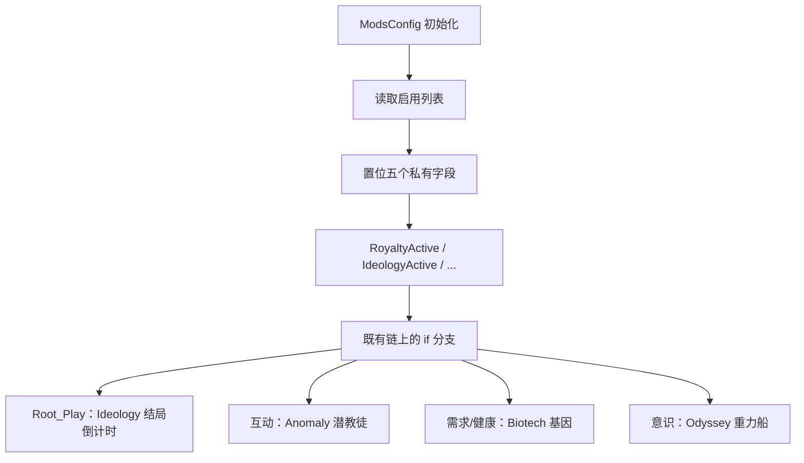

# V18 DLC 增量：五个开关如何改写既有机制

> **30 秒速览**
>
> - 五个 DLC 各有一个静态布尔：`RoyaltyActive` / `IdeologyActive` / `BiotechActive` / `AnomalyActive` / `OdysseyActive`。
> - 这些属性只转发私有字段（如 `ideologyActive`），字段在 `ModsConfig` 初始化时按启用列表置位。
> - 增量不是「另一套代码」，而是**在既有链上插分支**：`if (ModsConfig.IdeologyActive) { ... }`。
> - 典型插入点：结局倒计时（V17 的 `Root_Play.Update`）、潜教徒互动（V11）、基因与意识（V05/V14）、意识形态（V20）。
> - 判断「某个 mod 是否启用」另有 `IsActive` / `AreAllActive` / `IsAnyActiveOrEmpty` 三个通用方法。
>
> **读前须知**：本卷是「DLC 如何接入」的总览；各 DLC 的具体机制分见 V11（社交）、V14（身体）、V20（意识形态）等卷。

## Where it sits

**本模块的类结构**

```csharp
public static class Verse.ModsConfig {  // mod 与 DLC 开关
    private static bool royaltyActive;  // Royalty
    private static bool ideologyActive;  // Ideology
    private static bool biotechActive;  // Biotech
    private static bool anomalyActive;  // Anomaly
    private static bool odysseyActive;  // Odyssey
    ...
    public static bool RoyaltyActive  // 只读属性
    public static bool IdeologyActive
    public static bool BiotechActive
    public static bool AnomalyActive
    public static bool OdysseyActive
    public static bool IsActive(ModMetaData mod)  // 某个 mod 是否启用
    public static bool AreAllActive(string mods)  // 一组 mod 全启用
    public static bool IsAnyActiveOrEmpty(IEnumerable<string> mods, bool trimNames = false)  // 任一启用或列表为空
}
```

**这一段怎么走**：先认「五个布尔 + 五个只读属性」，再认「三个通用 mod 判断」。DLC 代码本身不在这一层，这一层只提供开关。

## Evolution



| 开关 | 接入点举例 | 所在卷 |
|---|---|---|
| `RoyaltyActive` | 帝国/心灵能力 | V18 本卷 |
| `IdeologyActive` | 结局倒计时、戒律 | V17 / V20 |
| `BiotechActive` | 基因、机械师 | V05 / V14 |
| `AnomalyActive` | 潜教徒互动、异常实体 | V11 |
| `OdysseyActive` | 重力船、轨道 | V10 / V22 |

**这一段怎么走**：开关在启动时置位，之后在既有链上用 `if` 插入分支。接入点分散在各卷，本卷只给总表。

## Stage detail

### S0 开关属性：只读转发

**这一段做什么**：五个属性都只做一件事——返回对应的私有字段；没有计算、没有缓存失效。

**源码**（`Verse.ModsConfig.IdeologyActive`；中文注释为本文档所加）

```csharp
public static bool IdeologyActive   // 是否启用 Ideology
{
    get
    {
        return ModsConfig.ideologyActive;  // 转发私有字段
    }
}
```

**伪代码**

```text
属性 Ideology 启用:
    取值:
    返回 私有字段
```

- 五个属性结构完全相同；
- 字段在 `ModsConfig` 初始化时按启用列表置位，运行期不变。

> **要点**：判断 DLC 是否启用是 O(1) 的字段读取，可以在热路径里直接调。
>
> **陷阱**：属性只读，运行期改启用列表不会更新字段——必须重启。

**这一段怎么走**：属性 → 字段，一步转发。五个开关共用同一模式。

### S1 接入方式：在既有链上插分支

**这一段做什么**：DLC 内容不是独立循环，而是在既有方法里加条件分支；分支体内调用 DLC 类型。

```csharp
if (ModsConfig.IdeologyActive)                       // DLC 开关
{
    ArchonexusCountdown.ArchonexusCountdownUpdate();  // DLC 内容
}
```

```text
若 启用 Ideology:
    Ideology 结局倒计时更新()
```

规则：分支只包「DLC 专属调用」，共享逻辑留在分支外；这样关闭 DLC 时行为与旧版一致。

> **要点**：所有 DLC 接入都是这种形态——读代码时看到 `ModsConfig.XxxActive` 就知道后面是增量内容。
>
> **陷阱**：分支内的类型仍然参与编译与加载，DLC 关闭只是不执行，不是不加载。

**这一段怎么走**：开关判断 → DLC 调用。共享逻辑在前，增量在后。

## Branches

| 分支 | 触发条件 | 行为 | 与主链的差异 |
|---|---|---|---|
| **Royalty** | `RoyaltyActive` | 帝国、心灵能力 | 增量 |
| **Ideology** | `IdeologyActive` | 戒律、结局倒计时 | 增量 |
| **Biotech** | `BiotechActive` | 基因、机械师 | 增量 |
| **Anomaly** | `AnomalyActive` | 异常实体、潜教徒 | 增量 |
| **Odyssey** | `OdysseyActive` | 重力船、轨道 | 增量 |
| **mod 判断** | `IsActive` / `AreAllActive` | 任意 mod 是否启用 | 通用 |

**层积与遗留痕迹**：

1. **五个独立布尔**：没有统一的 DLC 枚举，新增 DLC 就要加一个字段 + 一个属性。
2. **分支散落**：接入点分布在各卷，没有集中注册表。
3. **通用 mod 判断与 DLC 判断并存**：`IsActive(mod)` 与 `XxxActive` 是两套入口。

> **要点**：分支表就是「DLC 增量清单」；每条都对应一个 `if`。
>
> **陷阱**：`IsAnyActiveOrEmpty` 对空列表返回真——用于「未配置即全部允许」的场景。

**这一段怎么走**：五条 DLC 分支 + 一条通用判断。层积三条说明这套开关是「按需添加」而非统一设计。

## Contracts

| 方向 | 契约 |
|---|---|
| 入 | `ModsConfig` 初始化时读取启用列表 |
| 出 | 五个只读布尔、三个通用判断 |
| 时序 | 启动置位 → 运行期只读 |
| 不变量 | 属性不影响字段；关闭 DLC 不改变共享逻辑 |
| 边界 | 运行期改列表需重启；空列表在 `IsAnyActiveOrEmpty` 中视为真 |

## Evidence

[claim:V18-C01] Royalty 开关是只读属性。
  src: Verse.ModsConfig.RoyaltyActive
  file: analysis/decompiled/Assembly-CSharp/Verse/ModsConfig.cs
  match: public static bool RoyaltyActive

[claim:V18-C02] Ideology 开关转发私有字段。
  src: Verse.ModsConfig.IdeologyActive
  file: analysis/decompiled/Assembly-CSharp/Verse/ModsConfig.cs
  match: return ModsConfig.ideologyActive;

[claim:V18-C03] Biotech 开关。
  src: Verse.ModsConfig.BiotechActive
  file: analysis/decompiled/Assembly-CSharp/Verse/ModsConfig.cs
  match: public static bool BiotechActive

[claim:V18-C04] Anomaly 开关。
  src: Verse.ModsConfig.AnomalyActive
  file: analysis/decompiled/Assembly-CSharp/Verse/ModsConfig.cs
  match: public static bool AnomalyActive

[claim:V18-C05] Odyssey 开关。
  src: Verse.ModsConfig.OdysseyActive
  file: analysis/decompiled/Assembly-CSharp/Verse/ModsConfig.cs
  match: public static bool OdysseyActive

[claim:V18-C06] 通用 mod 判断存在。
  src: Verse.ModsConfig.IsActive
  file: analysis/decompiled/Assembly-CSharp/Verse/ModsConfig.cs
  match: public static bool IsActive(ModMetaData mod)

[claim:V18-C07] 支持「一组 mod 全启用」判断。
  src: Verse.ModsConfig.AreAllActive
  file: analysis/decompiled/Assembly-CSharp/Verse/ModsConfig.cs
  match: public static bool AreAllActive(string mods)

[claim:V18-C08] 支持「任一启用或为空」判断。
  src: Verse.ModsConfig.IsAnyActiveOrEmpty
  file: analysis/decompiled/Assembly-CSharp/Verse/ModsConfig.cs
  match: public static bool IsAnyActiveOrEmpty(IEnumerable<string> mods, bool trimNames = false)

[claim:V18-C09] Ideology 开关在结局倒计时处做门控。
  src: Verse.Root_Play.Update
  file: analysis/decompiled/Assembly-CSharp/Verse/Root_Play.cs
  match: if (ModsConfig.IdeologyActive)

[claim:V18-C10] Anomaly 开关在社交互动里做门控。
  src: RimWorld.Pawn_InteractionsTracker.TryInteractRandomly
  file: analysis/decompiled/Assembly-CSharp/RimWorld/Pawn_InteractionsTracker.cs
  match: if (ModsConfig.AnomalyActive)
  note: 该匹配在目标文件出现 2 次；本条对应 RimWorld.Pawn_InteractionsTracker.TryInteractRandomly 内的那一处。

## Open questions

1. `[unresolved]` 五个字段在 `ModsConfig` 初始化时的置位逻辑未逐行核对。
2. `[unresolved]` 各 DLC 的专用程序集/内容包与主程序集的边界未统计。
3. `[unresolved]` `IsAnyActiveOrEmpty` 的「空列表视为真」是否符合所有调用点语义，未逐处验证。

**这一段怎么走**：三条未结项分别指向「置位时机」「程序集边界」「空列表语义」；都属启动期配置。
