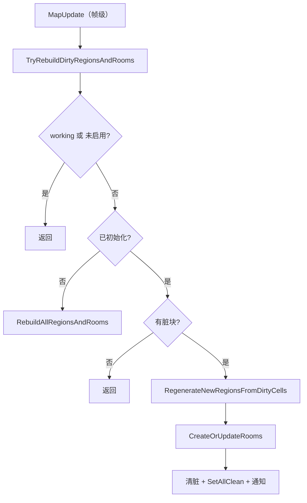

# V19 空间构建：区域、区群与房间

> **30 秒速览**
>
> - 地图的「区域/房间」不是每 tick 重建，而是**脏标记驱动**：谁改了格子，就把该格标脏。
> - `RegionAndRoomUpdater.TryRebuildDirtyRegionsAndRooms` 是唯一入口：先守卫，再全量（首次）或增量（脏块），最后统一清脏。
> - 增量重建分两步：**从脏格重新生成区域** → **创建或合并房间**。
> - 重建过程抛异常只记日志，然后照常清脏——坏状态不会每帧重试。
> - 房间温度不自己算：`Room.Temperature` 只是转发给内部的 `tempTracker`。
>
> **读前须知**：本卷讲「脏标记 → 重建 → 清脏」的骨架；温度结算见 V02/V03 交界，物品进出房间的通知见 V04，寻路代价见 V03。

## Where it sits

**本模块的类结构**

```csharp
public class Verse.RegionAndRoomUpdater {  // 区域/房间重建器
    private Map map;  // 所属地图
    private bool working;  // 是否正在重建
    private bool initialized;  // 是否已初始化
    private List<Region> newRegions;  // 本批新区域
    ...
    public bool Enabled  // 是否启用
    public bool AnythingToRebuild  // 是否有脏块
    public void RebuildAllRegionsAndRooms()  // 全量重建
    public void TryRebuildDirtyRegionsAndRooms()  // 增量重建入口
    private void RegenerateNewRegionsFromDirtyCells()  // 从脏格生成区域
    private void CreateOrUpdateRooms()  // 创建/合并房间
}

public class Verse.Room : IExposable {  // 房间
    private RoomTempTracker tempTracker;  // 温度
    ...
    public float Temperature  // 转发给 tempTracker
    public bool UsesOutdoorTemperature  // 是否用室外温度
    public bool IsHuge  // 是否超大（不参与房间统计）
    public int CellCount  // 格数
    public void Notify_ContainedThingSpawnedOrDespawned(Thing th)  // 物品进出
    public void Notify_TerrainChanged()  // 地形变化
    public void Notify_RoofChanged()  // 屋顶变化
}
```

**这一段怎么走**：先认「重建器持有地图与脏标记」，再认「房间只是被重建出来的结果」。重建器不保存房间列表，房间由区域推导。

## Evolution



| 阶段 | 方法 | 触发 | 结果 |
|---|---|---|---|
| 全量 | `RebuildAllRegionsAndRooms` | 首次 | 全部区域 |
| 增量① | `RegenerateNewRegionsFromDirtyCells` | 有脏块 | 新区域 |
| 增量② | `CreateOrUpdateRooms` | 同上 | 房间合并/拆分 |
| 收尾 | `SetAllClean` | 每次 | 脏标记清除 |

**这一段怎么走**：入口只有一条，首次全量、之后增量；增量分两步，最后统一清脏。全程由帧级 `MapUpdate` 驱动，不是每 tick。

## Stage detail

### S0 `TryRebuildDirtyRegionsAndRooms`：守卫、重建、清脏

**这一段做什么**：先挡「正在重建/未启用」，首次调用走全量；之后只处理脏块，重建完清脏并通知。

**源码**（`Verse.RegionAndRoomUpdater.TryRebuildDirtyRegionsAndRooms`，核心段；中文注释为本文档所加）

```csharp
if (this.working || !this.Enabled)                                  // 正在跑或未启用
{
    return;                                                        // 直接返回
}
this.working = true;                                               // 标记进行中
if (!this.initialized)                                             // 首次
{
    this.RebuildAllRegionsAndRooms();                              // 全量
}
if (!this.map.regionDirtyer.AnyDirty)                              // 没有脏块
{
    this.working = false;                                          // 复位
    return;                                                        // 返回
}
try
{
    this.RegenerateNewRegionsFromDirtyCells();                     // ① 区域
    this.CreateOrUpdateRooms();                                    // ② 房间
}
catch (Exception ex)
{
    ...
    Log.Error(...);                                                // 只记录
}
this.newRegions.Clear();                                           // 清空临时
this.map.regionDirtyer.SetAllClean();                              // 清脏
this.initialized = true;                                           // 已初始化
this.working = false;                                              // 复位
...
```

**伪代码**

```text
若 正在重建 或 未启用:
    返回
正在重建 = 真
若 未初始化:
    全量重建()
若 地图无脏块:
    正在重建 = 假
    返回
试:
    从脏格生成区域()
    创建或更新房间()
捕获:
    …（省略：拼错误信息）
    记录错误
临时区域.清空()
脏标记.全部清除()
已初始化 = 真
正在重建 = 假
…（省略：调试检查与事件通知）
```

- `working`：防止重入（重建过程中又触发重建）；
- `Initialized` 为假时先全量，保证后续增量有基线；
- 异常不阻断清脏：坏状态不会每帧重试。

> **要点**：清脏在 `finally` 之外、异常之后——无论重建成功与否都会清，这是「不卡死」的关键。
>
> **陷阱**：重建失败后房间可能是旧状态，但脏标记已清；下一次要等新的脏块才会再重建。

**这一段怎么走**：守卫 → 首次全量 → 无脏返回 → 两阶段增量 → 清脏复位。整段以「不重入、不卡死」为优先。

### S1 房间状态：转发与通知

**这一段做什么**：房间本身不计算温度与形状，只转发给 `tempTracker`，并在物品/地形/屋顶变化时接收通知。

```csharp
public float Temperature
{
    get { return this.tempTracker.Temperature; }   // 读转发
    set { this.tempTracker.Temperature = value; }  // 写转发
}
```

```text
属性 温度:
    取值: 返回 温度跟踪器.温度
    赋值: 温度跟踪器.温度 = 新值
```

> **要点**：房间是「空间的身份」，温度/角色等实际数据都在子跟踪器里。
>
> **陷阱**：直接改 `Temperature` 绕过温度模型的其它约束，可能破坏热平衡。

**这一段怎么走**：房间 → 跟踪器，读写都转发；状态变化通过 `Notify_*` 进入。

## Branches

| 分支 | 触发条件 | 行为 | 与主链的差异 |
|---|---|---|---|
| **重入** | `working` | 返回 | 不嵌套重建 |
| **未启用** | `!Enabled` | 返回 | 完全跳过 |
| **首次** | `!initialized` | 全量重建 | 一次性 |
| **无脏块** | `!AnyDirty` | 返回 | 常态 |
| **重建异常** | 任一阶段抛异常 | 记录 + 继续清脏 | 不重试 |
| **超大房间** | `IsHuge` | 不参与统计 | 空间语义 |

**层积与遗留痕迹**：

1. **`working` 布尔**：没有用锁，依赖单线程帧级调用。
2. **两阶段重建**：区域与房间分开，因为房间由区域推导。
3. **异常后仍清脏**：优先保证不卡死，代价是可能留下不一致状态。

> **要点**：分支表里只有「首次」会全量，其余都是增量或跳过。
>
> **陷阱**：`IsHuge` 的房间（如整片室外）不参与房间统计，别把它当普通房间。

**这一段怎么走**：六条分支分别改「跑不跑」「全量还是增量」「失败后怎么办」。

## Contracts

| 方向 | 契约 |
|---|---|
| 入 | 帧级 `MapUpdate` 调用；格子变更时由 `RegionDirtyer` 标脏 |
| 出 | 区域/房间结构、脏标记清除、`Notify_RegionsRoomsChanged` |
| 时序 | 守卫 → 全量/增量 → 清脏 → 通知 |
| 不变量 | 不重入；异常也清脏；房间由区域推导 |
| 边界 | 未启用全跳过；超大房间不统计 |

## Evidence

[claim:V19-C01] 重建入口会挡住重入与未启用。
  src: Verse.RegionAndRoomUpdater.TryRebuildDirtyRegionsAndRooms
  file: analysis/decompiled/Assembly-CSharp/Verse/RegionAndRoomUpdater.cs
  match: if (this.working || !this.Enabled)

[claim:V19-C02] 首次调用走全量重建。
  src: Verse.RegionAndRoomUpdater.TryRebuildDirtyRegionsAndRooms
  file: analysis/decompiled/Assembly-CSharp/Verse/RegionAndRoomUpdater.cs
  match: this.RebuildAllRegionsAndRooms();

[claim:V19-C03] 没有脏块时直接返回。
  src: Verse.RegionAndRoomUpdater.TryRebuildDirtyRegionsAndRooms
  file: analysis/decompiled/Assembly-CSharp/Verse/RegionAndRoomUpdater.cs
  match: if (!this.map.regionDirtyer.AnyDirty)

[claim:V19-C04] 增量重建先重建区域。
  src: Verse.RegionAndRoomUpdater.TryRebuildDirtyRegionsAndRooms
  file: analysis/decompiled/Assembly-CSharp/Verse/RegionAndRoomUpdater.cs
  match: this.RegenerateNewRegionsFromDirtyCells();

[claim:V19-C05] 再创建或更新房间。
  src: Verse.RegionAndRoomUpdater.TryRebuildDirtyRegionsAndRooms
  file: analysis/decompiled/Assembly-CSharp/Verse/RegionAndRoomUpdater.cs
  match: this.CreateOrUpdateRooms();

[claim:V19-C06] 重建异常只记录日志。
  src: Verse.RegionAndRoomUpdater.TryRebuildDirtyRegionsAndRooms
  file: analysis/decompiled/Assembly-CSharp/Verse/RegionAndRoomUpdater.cs
  match: string text = "Exception while rebuilding dirty regions: ";

[claim:V19-C07] 重建结束统一清脏。
  src: Verse.RegionAndRoomUpdater.TryRebuildDirtyRegionsAndRooms
  file: analysis/decompiled/Assembly-CSharp/Verse/RegionAndRoomUpdater.cs
  match: this.map.regionDirtyer.SetAllClean();

[claim:V19-C08] 重建结束发出区域房间变更事件。
  src: Verse.RegionAndRoomUpdater.TryRebuildDirtyRegionsAndRooms
  file: analysis/decompiled/Assembly-CSharp/Verse/RegionAndRoomUpdater.cs
  match: this.map.events.Notify_RegionsRoomsChanged();

[claim:V19-C09] 房间温度转发给温度跟踪器。
  src: Verse.Room.Temperature
  file: analysis/decompiled/Assembly-CSharp/Verse/Room.cs
  match: return this.tempTracker.Temperature;

[claim:V19-C10] 房间提供室外温度判定。
  src: Verse.Room.UsesOutdoorTemperature
  file: analysis/decompiled/Assembly-CSharp/Verse/Room.cs
  match: public bool UsesOutdoorTemperature

[claim:V19-C11] 超大房间有独立标记。
  src: Verse.Room.IsHuge
  file: analysis/decompiled/Assembly-CSharp/Verse/Room.cs
  match: public bool IsHuge

[claim:V19-C12] 房间格数可查。
  src: Verse.Room.CellCount
  file: analysis/decompiled/Assembly-CSharp/Verse/Room.cs
  match: public int CellCount

## Open questions

1. `[unresolved]` `CreateOrUpdateRooms` 的合并/拆分规则（哪些房间会被合并）未展开。
2. `[unresolved]` `RoomTempTracker` 的温度平衡算法未拆解。
3. `[unresolved]` `Notify_*` 各通知对房间统计的具体影响未逐条核对。

**这一段怎么走**：三条未结项分别指向「房间合并」「温度模型」「通知影响」；都属 V19 的下一层。
