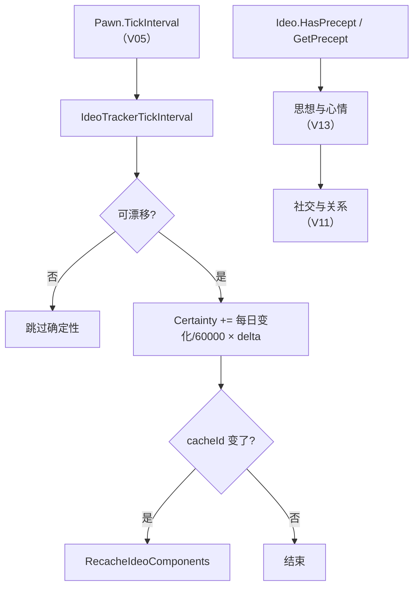

# V20 Ideology 对社会规则的改写：信仰、戒律与确定性

> **30 秒速览**
>
> - 意识形态（`Ideo`）是一组**戒律（Precept）**的集合；戒律决定「什么行为被认可」，进而改写心情与社交。
> - 每个人有 `Pawn_IdeoTracker`：持有自己的 `Ideo` 与**确定性（Certainty）**——确定性越低越可能改信。
> - 确定性按天变化：`CertaintyChangePerDay` 由心情曲线给出，再乘 `delta / 60000` 累加到当前值。
> - 精神崩溃、死亡、经典模式、死亡休眠期间**不改确定性**——避免在异常状态下漂移。
> - 戒律集合有缓存 id：`Ideo` 变动后 `currentCacheId` 变化，追踪器下次 tick 会 `RecacheIdeoComponents`。
>
> **读前须知**：本卷讲「信仰容器 + 确定性变化 + 戒律查询」；心情与思想见 V13，社交见 V11，DLC 增量总览见 V18。

## Where it sits

**本模块的类结构**

```csharp
public class RimWorld.Ideo : IExposable, ILoadReferenceable {  // 意识形态
    private List<Precept> precepts;  // 全部戒律
    public int currentCacheId;  // 缓存版本号
    ...
    public List<Precept> PreceptsListForReading  // 只读列表
    public bool HasPrecept(PreceptDef preceptDef)  // 是否有某戒律
    public Precept GetPrecept(PreceptDef preceptDef)  // 取某戒律
    private float GetPreceptImpact(Precept precept)  // 戒律影响权重
    public List<Precept> GetAllPreceptsAllowingSituationalThought(ThoughtDef def)  // 与思想相关
    public void RecachePrecepts()  // 重建缓存
}

public class RimWorld.Precept : IExposable {  // 一条戒律
    public PreceptDef def;  // 定义
    public Ideo ideo;  // 所属意识形态
    public virtual bool SortByImpact  // 是否按影响排序
    public virtual void Init(Ideo ideo, FactionDef generatingFor = null)  // 绑定
}

public class RimWorld.Pawn_IdeoTracker : IExposable {  // 个人信仰追踪
    private Ideo ideo;  // 当前信仰
    private float certaintyInt;  // 确定性
    private int lastCacheId;  // 上次缓存版本
    ...
    public Ideo Ideo  // 当前信仰
    public float Certainty  // 确定性
    public float CertaintyChangePerDay  // 每日变化
    public void IdeoTrackerTickInterval(int delta)  // 区间推进
    public void SetIdeo(Ideo ideo)  // 改信
    public bool IdeoConversionAttempt(float certaintyReduction, Ideo initiatorIdeo, bool applyCertaintyFactor = true)  // 转化尝试
}
```

**这一段怎么走**：先认「Ideo 是戒律集合」，再认「Precept 是单条规则」，最后认「Tracker 持有信仰与确定性」。确定性是唯一随时间变化的量，其余都是查询。

## Evolution



| 层 | 对象 | 频率 | 作用 |
|---|---|---|---|
| 信仰 | `Ideo` | 变动时 | 戒律集合与缓存 |
| 个人 | `Pawn_IdeoTracker` | 区间 | 确定性漂移、改信 |
| 规则 | `Precept` | 静态 | 决定思想/心情增减 |

**这一段怎么走**：确定性在区间链上漂移，戒律在需要时查询；两者通过 `Ideo` 的缓存 id 保持同步。

## Stage detail

### S0 `IdeoTrackerTickInterval`：确定性漂移与缓存同步

**这一段做什么**：每次区间推进先判断「是否允许漂移」，允许则按每日变化率累加确定性；随后检查 `Ideo` 的缓存 id，变了就重建组件缓存。

**源码**（`RimWorld.Pawn_IdeoTracker.IdeoTrackerTickInterval`；中文注释为本文档所加）

```csharp
if (!this.pawn.Destroyed && !this.pawn.InMentalState && this.ideo != null && !Find.IdeoManager.classicMode && !this.pawn.Deathresting)  // 允许漂移
{
    this.Certainty += this.ApplyCertaintyChangeFactor(this.CertaintyChangePerDay / 60000f) * (float)delta;  // 按 delta 累加
}
if (this.ideo != null && this.ideo.currentCacheId != this.lastCacheId)  // 信仰缓存变了
{
    this.lastCacheId = this.ideo.currentCacheId;                        // 记住新版本
    this.RecacheIdeoComponents();                                       // 重建组件
}
```

**伪代码**

```text
若 未销毁 且 未精神崩溃 且 有信仰 且 非经典模式 且 未死亡休眠:
    确定性 += 因子(每日变化 / 60000) × delta
若 有信仰 且 缓存版本 ≠ 上次:
    上次 = 新版本
    重建信仰组件()
```

- `/60000`：每日变化率换算成「每 tick」；
- `delta`：本次区间跨过的 tick 数（V04）；
- `classicMode`：经典模式关闭意识形态系统；
- `Deathresting`：死亡休眠期间确定性冻结。

> **要点**：确定性是唯一随时间漂移的量；戒律本身不变，变的是「这个人有多确信」。
>
> **陷阱**：`InMentalState` 时不漂移，但崩溃结束后不会补回这段时间的变化——确定性直接跳过。

**这一段怎么走**：先判五个条件，再按 delta 累加确定性，最后同步缓存版本。前半段是数值漂移，后半段是缓存一致性。

### S1 `CertaintyChangePerDay`：由心情曲线决定

**这一段做什么**：每日确定性变化不是常数，而是把「当前心情百分比」喂给一条曲线；没有心情需求的生物返回 0。

**源码**（`RimWorld.Pawn_IdeoTracker.CertaintyChangePerDay`；中文注释为本文档所加）

```csharp
public float CertaintyChangePerDay          // 每日确定性变化
{
    get
    {
        if (this.pawn.needs.mood != null)   // 有心情需求
        {
            return ConversionTuning.CertaintyPerDayByMoodCurve.Evaluate(this.pawn.needs.mood.CurLevelPercentage);  // 按心情取曲线
        }
        return 0f;                          // 无心情：不漂移
    }
}
```

**伪代码**

```text
属性 每日确定性变化:
    取值:
    若 有心情需求:
        返回 曲线(心情百分比)
    返回 0
```

- 曲线 `CertaintyPerDayByMoodCurve` 定义「心情好 → 确定性上升，心情差 → 下降」；
- 返回值可正可负；
- 无心情需求（机械/动物）直接 0。

> **要点**：心情不只影响崩溃（V13），还通过这条曲线影响信仰稳定性——两条链共用同一个心情值。
>
> **陷阱**：曲线按「百分比」取值，不是绝对值；心情上限变化会改变同一条心情下的确定性速率。

**这一段怎么走**：读心情百分比 → 查曲线 → 返回每日变化；无心情则 0。这个值再被 S0 除以 60000 换算成每 tick。

### S2 戒律查询：`HasPrecept` / `GetPrecept`

**这一段做什么**：信仰对外的能力是「查戒律」——有没有某条戒律、取到它、以及它与哪些思想相关。

```csharp
public bool HasPrecept(PreceptDef preceptDef)   // 是否有某戒律
public Precept GetPrecept(PreceptDef preceptDef)  // 取某戒律
public List<Precept> GetAllPreceptsAllowingSituationalThought(ThoughtDef def)  // 相关戒律
```

```text
是否有戒律(定义) → 布尔
取戒律(定义) → Precept
取允许该情境思想的戒律(思想定义) → 列表
```

规则：思想系统（V13）在计算心情时，会遍历「与该思想相关的戒律」，按 `GetPreceptImpact` 给出增减；没有对应戒律就不影响。

> **要点**：戒律不改写思想本身，只改写「这条思想对这个人的权重」。
>
> **陷阱**：`GetPrecept` 在没有该戒律时返回 null，调用方必须判空；`HasPrecept` 才是安全的布尔查询。

**这一段怎么走**：思想 → 找相关戒律 → 取影响权重 → 叠加到心情。戒律是「过滤器」，不是「新思想」。

## Branches

| 分支 | 触发条件 | 行为 | 与主链的差异 |
|---|---|---|---|
| **精神崩溃** | `InMentalState` | 确定性不漂移 | 冻结 |
| **经典模式** | `IdeoManager.classicMode` | 整个系统关闭 | 不漂移 |
| **死亡休眠** | `Deathresting` | 确定性冻结 | 不漂移 |
| **无心情** | `needs.mood == null` | 每日变化 0 | 机械/动物 |
| **改信** | `SetIdeo` | 记录事件、更新信仰 | 拒绝婴儿 |
| **转化尝试** | `IdeoConversionAttempt` | 降确定性 | 可能触发改信 |

**层积与遗留痕迹**：

1. **`/60000` 硬编码**：每日到每 tick 的换算写死在方法里。
2. **缓存 id 机制**：`currentCacheId` 是「戒律集合变了」的廉价信号。
3. **`classicMode` 开关**：为「不要意识形态」的玩家保留的整系统旁路。

> **要点**：分支表里前三条都是「冻结确定性」，说明设计上不希望异常状态影响信仰。
>
> **陷阱**：`SetIdeo` 对婴儿直接返回——婴儿的信仰由成长/暴露机制决定，不走改信。

**这一段怎么走**：六条分支分别改「漂不漂移」「算不算心情」「能不能改信」。层积三条说明这些开关都是后期加的旁路。

## Contracts

| 方向 | 契约 |
|---|---|
| 入 | `Pawn.TickInterval` 调 `IdeoTrackerTickInterval(delta)`（V05） |
| 出 | 确定性变化、缓存重建、戒律查询结果 |
| 时序 | 漂移判定 → 累加 → 缓存同步 |
| 不变量 | 确定性只在允许状态下漂移；戒律集合变动才换缓存 id |
| 边界 | 经典模式整系统关闭；婴儿不可改信；无心情不漂移 |

## Evidence

[claim:V20-C01] 精神崩溃/死亡/经典模式/死亡休眠时不漂移确定性。
  src: RimWorld.Pawn_IdeoTracker.IdeoTrackerTickInterval
  file: analysis/decompiled/Assembly-CSharp/RimWorld/Pawn_IdeoTracker.cs
  match: if (!this.pawn.Destroyed && !this.pawn.InMentalState && this.ideo != null && !Find.IdeoManager.classicMode && !this.pawn.Deathresting)

[claim:V20-C02] 确定性按「每日变化 / 60000 × delta」累加。
  src: RimWorld.Pawn_IdeoTracker.IdeoTrackerTickInterval
  file: analysis/decompiled/Assembly-CSharp/RimWorld/Pawn_IdeoTracker.cs
  match: this.Certainty += this.ApplyCertaintyChangeFactor(this.CertaintyChangePerDay / 60000f) * (float)delta;

[claim:V20-C03] 信仰缓存版本变化会触发重建。
  src: RimWorld.Pawn_IdeoTracker.IdeoTrackerTickInterval
  file: analysis/decompiled/Assembly-CSharp/RimWorld/Pawn_IdeoTracker.cs
  match: this.RecacheIdeoComponents();
  note: 该匹配在目标文件出现 2 次；本条对应 RimWorld.Pawn_IdeoTracker.IdeoTrackerTickInterval 内的那一处。

[claim:V20-C04] 每日确定性变化由心情曲线决定。
  src: RimWorld.Pawn_IdeoTracker.CertaintyChangePerDay
  file: analysis/decompiled/Assembly-CSharp/RimWorld/Pawn_IdeoTracker.cs
  match: return ConversionTuning.CertaintyPerDayByMoodCurve.Evaluate(this.pawn.needs.mood.CurLevelPercentage);

[claim:V20-C05] 无心情需求时每日变化为 0。
  src: RimWorld.Pawn_IdeoTracker.CertaintyChangePerDay
  file: analysis/decompiled/Assembly-CSharp/RimWorld/Pawn_IdeoTracker.cs
  match: return 0f;
  note: 该匹配在目标文件出现 2 次；本条对应 RimWorld.Pawn_IdeoTracker.CertaintyChangePerDay 内的那一处。

[claim:V20-C06] 婴儿不能改信。
  src: RimWorld.Pawn_IdeoTracker.SetIdeo
  file: analysis/decompiled/Assembly-CSharp/RimWorld/Pawn_IdeoTracker.cs
  match: if (this.ideo == ideo || this.pawn.DevelopmentalStage.Baby())

[claim:V20-C07] 改信会记录 `ChangedIdeo` 历史事件。
  src: RimWorld.Pawn_IdeoTracker.SetIdeo
  file: analysis/decompiled/Assembly-CSharp/RimWorld/Pawn_IdeoTracker.cs
  match: Find.HistoryEventsManager.RecordEvent(new HistoryEvent(HistoryEventDefOf.ChangedIdeo, this.pawn.Named(HistoryEventArgsNames.Doer)), true);

[claim:V20-C08] 转化尝试是独立的布尔接口。
  src: RimWorld.Pawn_IdeoTracker.IdeoConversionAttempt
  file: analysis/decompiled/Assembly-CSharp/RimWorld/Pawn_IdeoTracker.cs
  match: public bool IdeoConversionAttempt(float certaintyReduction, Ideo initiatorIdeo, bool applyCertaintyFactor = true)

[claim:V20-C09] 信仰以只读列表暴露戒律。
  src: RimWorld.Ideo.PreceptsListForReading
  file: analysis/decompiled/Assembly-CSharp/RimWorld/Ideo.cs
  match: public List<Precept> PreceptsListForReading

[claim:V20-C10] 戒律存在性查询。
  src: RimWorld.Ideo.HasPrecept
  file: analysis/decompiled/Assembly-CSharp/RimWorld/Ideo.cs
  match: public bool HasPrecept(PreceptDef preceptDef)

[claim:V20-C11] 取指定戒律。
  src: RimWorld.Ideo.GetPrecept
  file: analysis/decompiled/Assembly-CSharp/RimWorld/Ideo.cs
  match: public Precept GetPrecept(PreceptDef preceptDef)

[claim:V20-C12] 戒律影响权重有独立计算入口。
  src: RimWorld.Ideo.GetPreceptImpact
  file: analysis/decompiled/Assembly-CSharp/RimWorld/Ideo.cs
  match: private float GetPreceptImpact(Precept precept)

[claim:V20-C13] 戒律初始化时绑定所属信仰。
  src: RimWorld.Precept.Init
  file: analysis/decompiled/Assembly-CSharp/RimWorld/Precept.cs
  match: public virtual void Init(Ideo ideo, FactionDef generatingFor = null)

## Open questions

1. `[unresolved]` `RecacheIdeoComponents` 重建了哪些缓存（角色、思想、建筑？）未展开。
2. `[unresolved]` `ApplyCertaintyChangeFactor` 的因子来源（角色/戒律/状态）未逐项列出。
3. `[unresolved]` `GetPreceptImpact` 的权重公式与叠加顺序未拆解。

**这一段怎么走**：三条未结项分别指向「缓存内容」「确定性因子」「戒律权重」；都属于 Ideology 的下一层细节，可在后续补读。
