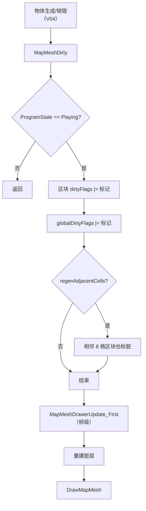

# V21 渲染树与绘制管线：什么被画、什么时候重画

> **30 秒速览**
>
> - 地图绘制以 `Section`（区块）为单位，每个区块有多层 `MapDrawLayer`（地面、物品、建筑、屋顶……）。
> - 「重画」不是立即发生：`MapMeshDirty` 只给区块**打脏标记**，真正重建在绘制阶段。
> - 打脏有两级：单格所在区块，以及可选的相邻 8 格（避免接缝）。
> - 只有 `ProgramState.Playing` 时才标脏；主菜单/建图中直接返回。
> - 全局层（`GlobalLayers`）不按区块切分，另有 `globalDirtyFlags` 统一记录。
>
> **读前须知**：本卷讲「脏标记 → 重建 → 绘制」的骨架；UI 通道见 V17，地图网格与寻路见 V03，区块所属的空间结构见 V19。

## Where it sits

**本模块的类结构**

```csharp
public class Verse.MapDrawer {  // 地图绘制器
    private Map map;  // 所属地图
    private Section[] sections;  // 区块数组
    private List<MapDrawLayer> global;  // 全局层
    private ulong globalDirtyFlags;  // 全局脏标记
    public List<MapDrawLayer> GlobalLayers;  // 全局层（只读）
    ...
    public void MapMeshDirty(IntVec3 loc, ulong dirtyFlags)  // 打脏（便捷）
    public void MapMeshDirty(IntVec3 loc, ulong dirtyFlags, bool regenAdjacentCells, bool regenAdjacentSections)  // 打脏（完整）
    public void MapMeshDrawerUpdate_First()  // 帧级：处理脏区块
    public void DrawMapMesh()  // 绘制
    public void RegenerateLayerNow(Type type)  // 立即重建某层
    public void RegenerateEverythingNow()  // 立即全量重建
}

public abstract class Verse.SectionLayer {  // 区块层
    protected Section section;  // 所属区块
    ...
    public abstract void Regenerate()  // 重建本层
    public abstract void DrawLayer()  // 绘制本层
}

public class Verse.Section {  // 区块
    public ulong dirtyFlags;  // 脏标记
    ...
}
```

**这一段怎么走**：先认「地图 → 区块 → 层」三级结构，再认「脏标记」是唯一的重画触发。绘制器不保存图形，只保存脏标记与层。

## Evolution



| 阶段 | 方法 | 频率 | 结果 |
|---|---|---|---|
| 打脏 | `MapMeshDirty` | 事件驱动 | `dirtyFlags` 置位 |
| 处理 | `MapMeshDrawerUpdate_First` | 每帧 | 重建脏区块 |
| 绘制 | `DrawMapMesh` | 每帧 | 提交绘制 |

**这一段怎么走**：事件打脏 → 帧级处理 → 绘制。打脏与重建分离，保证同一帧内多次修改只重建一次。

## Stage detail

### S0 `MapMeshDirty`：两级打脏

**这一段做什么**：完整版先判断程序状态，再给所在区块与全局打脏；可选地把相邻 8 格也标脏。

**源码**（`Verse.MapDrawer.MapMeshDirty`，完整版开头；中文注释为本文档所加）

```csharp
if (Current.ProgramState != ProgramState.Playing || this.sections == null)  // 非游玩状态
{
    return;                                                                // 不标脏
}
this.SectionAt(loc).dirtyFlags |= dirtyFlags;                              // 所在区块
this.globalDirtyFlags |= dirtyFlags;                                       // 全局
if (regenAdjacentCells)                                                    // 需要相邻格
{
    for (int i = 0; i < 8; i++)
    {
        IntVec3 intVec = loc + GenAdj.AdjacentCells[i];                    // 相邻格
        if (intVec.InBounds(this.map))                                     // 在图内
        {
            this.SectionAt(intVec).dirtyFlags |= dirtyFlags;               // 相邻区块也脏
        }
    }
}
```

**伪代码**

```text
若 程序状态 ≠ 游玩 或 区块为空:
    返回
所在区块.脏标记 |= 标记
全局脏标记 |= 标记
若 需要相邻格:
    循环 8 个方向:
        相邻 = 位置 + 方向
        若 在图内:
            相邻区块.脏标记 |= 标记
```

- `|` 是位或：一次可标多层（物品 + 屋顶）；
- 相邻格标脏是为了消除边缘接缝；
- `regenAdjacentSections` 参数用于跨区块边界的情况。

> **要点**：打脏不改任何图形，只改 `ulong` 位；重建代价被推迟到绘制阶段。
>
> **陷阱**：非 `Playing` 状态直接返回——建图阶段的标脏请求会被丢弃。

**这一段怎么走**：状态守卫 → 本区块 → 全局 → 可选相邻。位或保证多次标脏可合并。

### S1 便捷重载：只有特定层才扩到相邻

**这一段做什么**：两参重载根据标记类型决定是否重算相邻格——只有迷雾、建筑、屋顶这三类才需要。

**源码**（`Verse.MapDrawer.MapMeshDirty`，便捷重载；中文注释为本文档所加）

```csharp
bool flag = (dirtyFlags & (MapMeshFlagDefOf.FogOfWar | MapMeshFlagDefOf.Buildings | MapMeshFlagDefOf.Roofs)) > 0UL;  // 是否需相邻
this.MapMeshDirty(loc, dirtyFlags, flag, false);  // 转调完整版
```

**伪代码**

```text
需要相邻 = (标记 与 (迷雾 | 建筑 | 屋顶)) > 0
打脏(位置, 标记, 需要相邻, 假)
```

> **要点**：物品层（`Things`）不扩相邻，因为物品不会跨越区块边界遮挡。
>
> **陷阱**：用两参重载标「建筑」会自动扩相邻；若要精确控制，用四参版本。

**这一段怎么走**：算标志 → 转调完整版。便捷重载只决定「扩不扩相邻」。

## Branches

| 分支 | 触发条件 | 行为 | 与主链的差异 |
|---|---|---|---|
| **非游玩状态** | `ProgramState != Playing` | 不标脏 | 请求丢弃 |
| **相邻格** | `regenAdjacentCells` | 8 格区块标脏 | 消除接缝 |
| **相邻区块** | `regenAdjacentSections` | 跨区块边界 | 更贵 |
| **全局层** | 任意标脏 | `globalDirtyFlags` 置位 | 不按区块 |
| **立即重建** | `RegenerateLayerNow` | 当场重建 | 绕过帧级 |

**层积与遗留痕迹**：

1. **`ulong` 位标记**：一层一位，最多 64 层。
2. **两级重载**：便捷版按标记类型自动决定相邻，完整版交给调用方。
3. **立即重建接口**：`RegenerateLayerNow`/`RegenerateEverythingNow` 供调试与特殊场景。

> **要点**：分支表里只有「非游玩」会丢请求，其余都改变标脏范围。
>
> **陷阱**：立即重建会打断帧级批次，频繁调用等于放弃合并优化。

**这一段怎么走**：五条分支分别改「标不标」「标多大范围」「什么时候重建」。

## Contracts

| 方向 | 契约 |
|---|---|
| 入 | 物体/地形变化调用 `MapMeshDirty`；帧级 `MapMeshDrawerUpdate_First` |
| 出 | 区块脏标记、全局脏标记、重建后的层、绘制提交 |
| 时序 | 打脏 → 帧级处理 → 绘制 |
| 不变量 | 非游玩不标脏；位或合并；重建在绘制阶段 |
| 边界 | 相邻格可选；立即重建绕过批次 |

## Evidence

[claim:V21-C01] 便捷重载只在迷雾/建筑/屋顶时扩相邻。
  src: Verse.MapDrawer.MapMeshDirty
  file: analysis/decompiled/Assembly-CSharp/Verse/MapDrawer.cs
  match: bool flag = (dirtyFlags & (MapMeshFlagDefOf.FogOfWar | MapMeshFlagDefOf.Buildings | MapMeshFlagDefOf.Roofs)) > 0UL;

[claim:V21-C02] 非游玩状态不标脏。
  src: Verse.MapDrawer.MapMeshDirty
  file: analysis/decompiled/Assembly-CSharp/Verse/MapDrawer.cs
  match: if (Current.ProgramState != ProgramState.Playing || this.sections == null)

[claim:V21-C03] 所在区块按位或打脏。
  src: Verse.MapDrawer.MapMeshDirty
  file: analysis/decompiled/Assembly-CSharp/Verse/MapDrawer.cs
  match: this.SectionAt(loc).dirtyFlags |= dirtyFlags;

[claim:V21-C04] 全局脏标记同步置位。
  src: Verse.MapDrawer.MapMeshDirty
  file: analysis/decompiled/Assembly-CSharp/Verse/MapDrawer.cs
  match: this.globalDirtyFlags |= dirtyFlags;

[claim:V21-C05] 相邻格按需标脏。
  src: Verse.MapDrawer.MapMeshDirty
  file: analysis/decompiled/Assembly-CSharp/Verse/MapDrawer.cs
  match: this.SectionAt(intVec).dirtyFlags |= dirtyFlags;

[claim:V21-C06] 帧级处理入口独立存在。
  src: Verse.MapDrawer.MapMeshDrawerUpdate_First
  file: analysis/decompiled/Assembly-CSharp/Verse/MapDrawer.cs
  match: public void MapMeshDrawerUpdate_First()

[claim:V21-C07] 绘制入口独立存在。
  src: Verse.MapDrawer.DrawMapMesh
  file: analysis/decompiled/Assembly-CSharp/Verse/MapDrawer.cs
  match: public void DrawMapMesh()

[claim:V21-C08] 可以立即重建指定层。
  src: Verse.MapDrawer.RegenerateLayerNow
  file: analysis/decompiled/Assembly-CSharp/Verse/MapDrawer.cs
  match: public void RegenerateLayerNow(Type type)

[claim:V21-C09] 可以立即全量重建。
  src: Verse.MapDrawer.RegenerateEverythingNow
  file: analysis/decompiled/Assembly-CSharp/Verse/MapDrawer.cs
  match: public void RegenerateEverythingNow()

[claim:V21-C10] 全局层以列表暴露。
  src: Verse.MapDrawer.GlobalLayers
  file: analysis/decompiled/Assembly-CSharp/Verse/MapDrawer.cs
  match: public List<MapDrawLayer> GlobalLayers

[claim:V21-C11] 区块层持有所属区块引用。
  src: Verse.SectionLayer
  file: analysis/decompiled/Assembly-CSharp/Verse/SectionLayer.cs
  match: protected Section section;

## Open questions

1. `[unresolved]` `MapMeshDrawerUpdate_First` 每帧处理的区块数量上限未展开。
2. `[unresolved]` 各 `SectionLayer` 子类的 `Regenerate` 实现差异未逐个对比。
3. `[unresolved]` 全局层的绘制顺序与混合模式未拆解。

**这一段怎么走**：三条未结项分别指向「每帧预算」「层实现」「绘制顺序」；都属 V21 的下一层。
