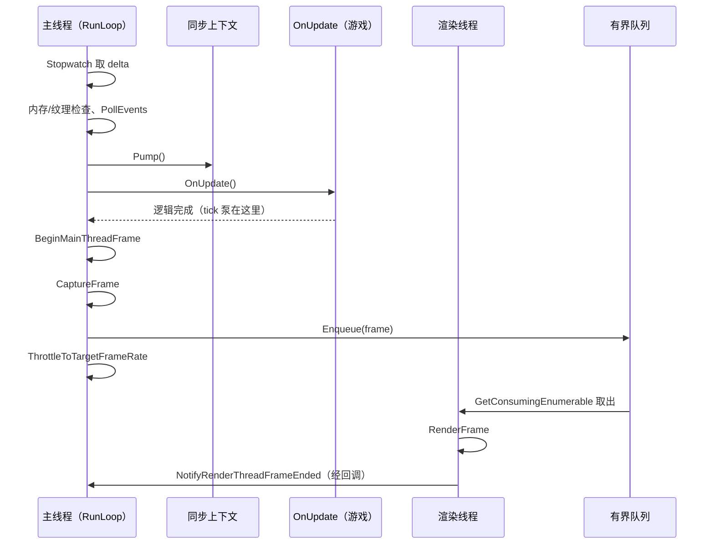

# V22 Waylith 运行模式：帧从哪来、线程怎么分

> **30 秒速览**
>
> - 帧不是 Unity 给的：`Waylith.EngineApplication.RunLoop` 自己用 `Stopwatch` 量帧间隔，主线程跑逻辑与采集，渲染线程跑提交。
> - 两个线程之间只有一条**有界队列**：容量 `max(1, FramesInFlight)`；满了主线程就阻塞——这就是帧率被「反压」的机制。
> - 渲染线程抛出异常不会当场崩游戏：异常被 `ExceptionDispatchInfo` 存进 `_failure`，主线程下一帧 `ThrowIfFaulted` 时再抛。
> - 限速算法是「睡眠到差 1 ms，再自旋补足」：`Thread.Sleep((剩余−0.001)×1000)` + 忙等。
> - 主线程每帧顺序固定：**排空渲染线程回调 → 取 delta → 内存/纹理检查 → 轮询事件 → `Pump()` → `OnUpdate()` → 采集 → 入队 → 限速**。
>
> **读前须知**：本卷讲引擎的**帧源与线程**；帧进来之后怎么变成 tick 见 V01，单 tick 的 24 位点见 V23。全部断言基于 `Waylith/Waylith/` 内层语料（外层是早期不完整转储）。

## Where it sits

**本模块的类结构**

```csharp
public sealed class Waylith.EngineApplication : IDisposable {  // 引擎入口
    private readonly Stopwatch _stopwatch = Stopwatch.StartNew();  // 帧时间来源
    private RenderThread _renderThread;  // 渲染线程（懒创建）
    private MainThreadSynchronizationContext _mainThreadSyncContext;  // 主线程上下文
    public Action OnUpdate;  // 游戏逻辑回调（Root_Play.Update 挂在这里）
    public Action OnShutdown;  // 退出回调
    public event Action<EngineApplication> PrePollEvents;  // 轮询事件前
    public event Action<EngineApplication> FrameEnqueued;  // 帧入队后
    ...
    public int RunLoop()  // 主循环
    private void ThrottleToTargetFrameRate(float frameStartElapsed)  // 限速
    public void WaitForRenderThreadIdle()  // 等渲染线程空闲
}

public sealed class Waylith.Rendering.RenderThread : IDisposable {  // 渲染线程
    private BlockingCollection<RenderFrame> _frames;  // 有界帧队列
    private RenderFrame[] _submittedFrames;  // 已提交帧（按槽位复用）
    private ExceptionDispatchInfo _failure;  // 渲染线程异常
    private ManualResetEventSlim _idle;  // 空闲信号
    ...
    public RenderThread(IRenderContext renderContext, FrameRenderer frameRenderer)  // 建队列与线程
    public void Start()  // 启动后台线程
    public void Enqueue(RenderFrame frame)  // 主线程入队（可能阻塞）
    public void Stop()  // 收尾：CompleteAdding + Join + 等设备空闲
    public void ThrowIfFaulted()  // 主线程侧重抛
    public void WaitUntilIdle()  // 等一帧渲染完
}

public sealed class Waylith.Rendering.FrameRenderer {  // 帧采集与回调
    public void BeginMainThreadFrame(in FrameTiming timing)  // 主线程帧开始
    public RenderFrame CaptureFrame(in FrameTiming timing, ClearValues clear, bool flag)  // 采集一帧
    public void DrainRenderThreadCallbacksOnMainThread()  // 排空渲染线程回调
    public void NotifyRenderThreadFrameEnded(RenderFrame frame)  // 渲染线程帧结束通知
}

public sealed class Waylith.MainThreadSynchronizationContext : SynchronizationContext {  // 主线程消息泵
    public void Pump()  // 执行排队的回调
}
```

**这一段怎么走**：先把三个「跑帧的东西」摆清楚——`EngineApplication` 拥有帧循环与 `Stopwatch`，`RenderThread` 拥有队列与后台线程，`FrameRenderer` 负责采集与回调。`OnUpdate` 是游戏逻辑的唯一挂钩点；队列是两线程之间唯一的通道。

## Evolution



| 阶段 | 线程 | 做什么 | 阻塞点 |
|---|---|---|---|
| 1 | 主 | 排空渲染线程回调、`ThrowIfFaulted` | 若渲染线程已崩溃，这里抛 |
| 2 | 主 | 取 `delta`、内存/纹理检查 | — |
| 3 | 主 | 轮询窗口事件、失焦/最小化判断 | 失焦时 `WaitEventsTimeout(0.1)` |
| 4 | 主 | `syncContext.Pump()` | — |
| 5 | 主 | `OnUpdate()`（游戏逻辑、tick 泵） | 游戏自己的耗时 |
| 6 | 主 | 采集并 `Enqueue` | **队列满时阻塞** |
| 7 | 主 | 限速（睡眠 + 自旋） | 目标帧率 ≤ 0 时不限 |
| 8 | 渲染 | 取帧、渲染、通知、释放 | 队列空时等待 |

**这一段怎么走**：主线程一帧走「排空回调 → 取时间 → 查资源 → 轮询事件 → 泵上下文 → 跑逻辑 → 采集 → 入队 → 限速」，渲染线程从队列另一端取帧。两边的唯一耦合是队列：主线程写、渲染线程读，队列满则主线程停。

## Stage detail

### S0 主循环：一帧的七步

**这一段做什么**：`RunLoop` 的每帧核心——先泵主线程上下文、再调游戏逻辑 `OnUpdate`、然后采集并投递给渲染线程、最后限速；限速前还会处理「不可渲染」的两种退化路径。

**源码**（`Waylith.EngineApplication.RunLoop`，帧核心；中文注释为本文档所加）

```csharp
MainThreadSynchronizationContext mainThreadSyncContext = this._mainThreadSyncContext;  // 取主线程上下文
if (mainThreadSyncContext != null)
{
    mainThreadSyncContext.Pump();                                                      // 执行排队的回调
}
Action onUpdate = this.OnUpdate;                                                       // 游戏逻辑回调
if (onUpdate != null)
{
    onUpdate();                                                                        // 跑一帧逻辑（tick 泵在内）
}
...
FrameTiming frameTiming = new FrameTiming(Time.FrameCount, num3, (double)num2);        // 帧时间信息
this.FrameRenderer.BeginMainThreadFrame(in frameTiming);                               // 帧开始
renderFrame = this.FrameRenderer.CaptureFrame(in frameTiming, this._clearValues, false);  // 采集
this._renderThread.Enqueue(renderFrame);                                               // 投递给渲染线程（可能阻塞）
Action<EngineApplication> frameEnqueued = this.FrameEnqueued;
if (frameEnqueued != null)
{
    frameEnqueued(this);                                                               // 入队后事件
}
```

**伪代码**

```text
上下文 = 主线程同步上下文
若 上下文 非空:
    上下文.泵()                        # 执行排队的回调
回调 = 游戏逻辑回调
若 回调 非空:
    回调()                             # 跑一帧逻辑（tick 泵在内）
…（省略：关闭请求/不可渲染等分支判断）
帧时间 = (帧号, 帧间隔, 累计秒)
帧渲染器.开始主线程帧(帧时间)
renderFrame = 帧渲染器.采集(帧时间, 清屏色, 假)
渲染线程.入队(renderFrame)              # 队列满则阻塞
入队后事件 = FrameEnqueued
若 入队后事件 非空:
    入队后事件(本应用)
```

- `num3`：本帧 `delta`（`_stopwatch` 两次采样之差）；
- `Time.FrameCount`：引擎全局帧号，`FrameTiming` 用它标识帧；
- `CaptureFrame` 之后主线程**不再碰**这帧的数据，所有权交给渲染线程。

> **要点**：`OnUpdate` 在采集**之前**——游戏逻辑必须在本帧画面被采集前完成，否则画面会落后一帧。
>
> **陷阱**：`Enqueue` 是阻塞调用（有界队列）；如果渲染线程慢，卡的是主线程，表现为「帧率掉」而不是「画面延迟增加」。

**这一段怎么走**：先泵上下文、再跑游戏逻辑、然后采集并入队、最后限速。顺序上有两处硬约束：逻辑必须在采集前完成；入队必须在限速前完成，否则限速会把「等待渲染线程」的时间也算进睡眠。

### S1 主线程上下文：为什么要有 `Pump`

**这一段做什么**：`MainThreadSynchronizationContext` 把「其他线程想要在主线程执行的回调」排队，由主循环每帧 `Pump()` 一次；渲染线程的回调就走这条路回到主线程。

```csharp
this._mainThreadSyncContext = new MainThreadSynchronizationContext(Environment.CurrentManagedThreadId);  // 记录主线程 ID
SynchronizationContext.SetSynchronizationContext(this._mainThreadSyncContext);                            // 设为当前上下文
```

```text
主线程上下文 = 新建(当前托管线程 ID)
设为当前同步上下文
```

规则：**任何跨线程回调都不能直接操作游戏状态**，必须先 `Post` 到这里，等主线程 `Pump`；否则会与 tick 泵并发修改同一份状态。

> **要点**：`Pump()` 在 `OnUpdate` 之前——上一帧渲染线程排队的回调会在本帧逻辑开始前执行完。
>
> **陷阱**：`Pump()` 只执行「当时已排队」的回调；`OnUpdate` 期间新 `Post` 的回调要等下一帧。

**这一段怎么走**：主线程在启动时记下自己的线程 ID 并安装上下文；渲染线程与作业线程通过 `Post` 把回调排进来，主循环每帧在跑逻辑前清空一次队列。

### S2 渲染线程：有界队列与消费循环

**这一段做什么**：`RenderThread` 构造时按 `FramesInFlight` 建一个**有界**阻塞队列与同长的槽位数组；主线程 `Enqueue`、渲染线程 `GetConsumingEnumerable` 消费，队列满即反压。

**源码**（`Waylith.Rendering.RenderThread.Enqueue`；中文注释为本文档所加）

```csharp
this.ThrowIfFaulted();          // 渲染线程已崩则直接抛
this.MarkFramePending();        // 标记有一帧在途
try
{
    this._frames.Add(frame);    // 入队（满则阻塞）
}
catch
{
    this.MarkFrameComplete();   // 失败也要还原计数
    frame.Dispose();            // 释放这一帧的资源
    throw;                      // 原样抛出
}
this.ThrowIfFaulted();          // 入队后再查一次
```

**伪代码**

```text
若 渲染线程已崩 → 抛出
标记一帧在途
试:
    队列.添加(frame)            # 满则阻塞
捕获:
    标记一帧完成               # 还原计数
    释放(frame)
    重新抛出
若 渲染线程已崩 → 抛出
```

构造时的容量决定背压强度：

```csharp
this._frames = new BlockingCollection<RenderFrame>(Math.Max(1, renderContext.FramesInFlight));  // 队列容量
this._submittedFrames = new RenderFrame[Math.Max(1, renderContext.FramesInFlight)];            // 槽位数组同长
```

```text
队列 = 新建有界队列(max(1, 在途帧数))
槽位 = 新建数组(max(1, 在途帧数))
```

**这一段做什么**：渲染线程的消费循环——从队列逐帧取出、渲染、在 `finally` 里通知主线程并释放，异常则存进 `_failure` 等待主线程重抛。

**源码**（`Waylith.Rendering.RenderThread.RenderLoop`，消费循环；中文注释为本文档所加）

```csharp
foreach (RenderFrame renderFrame in this._frames.GetConsumingEnumerable())  // 一帧一帧取
{
    bool flag = false;                                                      // 是否交由槽位持有
    FrameProfiler.ScopeHandle scopeHandle = FrameProfiler.Scope("RenderFrame");  // 计时作用域
    try
    {
        flag = this.RenderFrame(renderFrame);                               // 真正渲染
    }
    finally
    {
        scopeHandle.Dispose();                                              // 结束计时
        this._frameRenderer.NotifyRenderThreadFrameEnded(renderFrame);      // 通知主线程
        if (!flag)                                                          // 未被槽位持有
        {
            renderFrame.Dispose();                                          // 释放
        }
        this.MarkFrameComplete();                                           // 计数 -1
    }
}
...
catch (Exception ex)
{
    this._failure = ExceptionDispatchInfo.Capture(ex);                      // 存起来给主线程抛
    ...
}
```

**伪代码**

```text
循环 队列取出一帧:
    flag = 假                              # 默认不持有
    计时作用域 = 开始计时
    试:
        flag = 渲染这一帧()
    最终:
        结束计时
        通知主线程：本帧结束
        若 不持有:
            释放这一帧
        标记一帧完成
…（省略：循环结束）
捕获 异常:
    存为待重抛异常                      # 主线程下一帧 ThrowIfFaulted
    …（省略：停止收新帧）
```

- `FrameProfiler.Scope`：包裹一段耗时统计；
- `flag`：帧是否被「已提交槽位」保留（保留则由槽位负责释放）；
- `finally` 保证「通知 + 释放 + 计数」一定执行，即使 `RenderFrame` 抛异常。

> **要点**：队列容量 = `FramesInFlight`（`max(1, …)`），不是无限队列；这就是「帧率被渲染线程反压」的全部来源。
>
> **陷阱**：`Enqueue` 是阻塞的，而它发生在 `OnUpdate` 之后、限速之前——所以「渲染慢」会先表现为主线程卡在入队，而不是画面撕裂。

**这一段怎么走**：主线程构造时按在途帧数建队列与槽位；每帧 `Enqueue`（满则阻塞），渲染线程用 `GetConsumingEnumerable` 取帧、渲染、在 `finally` 里通知并释放。异常不在这里抛出，而是存进 `_failure`。

### S3 背压与限速：为什么睡觉还要自旋

**这一段做什么**：`ThrottleToTargetFrameRate` 把「本帧已用时间」补到目标帧预算——先睡到差 1 ms，再用忙等补足最后 1 ms，从而把帧率钉在目标值。

**源码**（`Waylith.EngineApplication.ThrottleToTargetFrameRate`；中文注释为本文档所加）

```csharp
int targetFrameRate = EngineWindow.TargetFrameRate;                                  // 目标帧率
if (targetFrameRate <= 0)                                                            // 0 或负 = 不限速
{
    return;
}
double num = 1.0 / (double)targetFrameRate;                                          // 每帧预算（秒）
double num2 = this._stopwatch.Elapsed.TotalSeconds - (double)frameStartElapsed;      // 本帧已用时间
double num3 = num - num2;                                                            // 剩余预算
if (num3 > 0.001)                                                                    // 剩余超过 1 ms
{
    Thread.Sleep((int)((num3 - 0.001) * 1000.0));                                    // 睡到差 1 ms
}
while (this._stopwatch.Elapsed.TotalSeconds - (double)frameStartElapsed < num)        // 剩余 1 ms 自旋
{
}
```

**伪代码**

```text
目标帧率 = 窗口目标帧率
若 目标帧率 ≤ 0:                        # 不限速
    返回
预算 = 1 / 目标帧率
已用 = 计时器.秒 − 帧起点
剩余 = 预算 − 已用
若 剩余 > 0.001:                        # 还够睡
    睡眠((剩余 − 0.001) × 1000)         # 毫秒取整
自旋 当 计时器.秒 − 帧起点 < 预算:      # 最后一毫秒忙等
```

#### 案例 A：60 FPS 下一帧怎么被钉住

| 步骤 | 计算 | 结果 |
|---|---|---|
| 1 | 预算 = 1 / 60 | 16.667 ms |
| 2 | 本帧逻辑用了 4 ms | 剩余 12.667 ms |
| 3 | 剩余 > 1 ms → 睡眠 `(12.667−1)=11.667 ms` | 睡 11 ms |
| 4 | 醒来后已用 ≈ 15.6 ms | 进入自旋 |
| 5 | 自旋到 16.667 ms | 帧结束 |

结论：**睡眠负责「粗调」，自旋负责「精调」**——睡眠误差在毫秒级，最后 1 ms 用忙等补足，才能把帧率稳定在目标值上。代价是最后一毫秒占满一个核心。

> **要点**：`TargetFrameRate <= 0` 表示不限速（跑满）；限速只影响主线程，不影响渲染线程。
>
> **陷阱**：自旋循环没有任何让步（没有 `Yield`/`Sleep(0)`），在单核或极端降频机器上会明显吃掉 CPU。

**这一段怎么走**：先算预算与已用时间，剩余超过 1 ms 就睡掉大部分，最后 1 ms 自旋补足；目标帧率为 0 时整段跳过。限速只在「可渲染」路径执行，最小化/失焦走的是另一条退化路径。

### S4 异常怎么跨线程

**这一段做什么**：渲染线程的异常不直接终止进程，而是被捕获成 `ExceptionDispatchInfo` 存在 `_failure`；主线程每次 `Enqueue` 与每帧开头都会 `ThrowIfFaulted`，把原始异常**带原堆栈**重抛。

```csharp
public void ThrowIfFaulted()          // 主线程侧检查
{
    ExceptionDispatchInfo failure = this._failure;   // 读共享字段
    if (failure == null)
    {
        return;                                      // 没崩
    }
    failure.Throw();                                 // 带原堆栈重抛
}
```

```text
过程 若已崩溃则抛出():
    失败 = 待重抛异常
    若 失败 为空:
        返回
    失败.抛出()                      # 保留原始堆栈
```

规则：`_failure` 只写一次（第一个异常胜出），之后的异常只会让 `CompleteAdding` 停止收帧；主线程在下一帧的 `ThrowIfFaulted`（采集前、入队后各一次）会发现并抛出。

> **要点**：跨线程异常用 `ExceptionDispatchInfo` 保留原始堆栈——否则在主线程重抛时堆栈会指向重抛点，丢失真实来源。
>
> **陷阱**：主线程若一直不调用 `ThrowIfFaulted`（例如卡在别处），渲染线程的异常会「沉默」到下一次入队才暴露。

**这一段怎么走**：渲染线程捕获异常 → 存 `_failure` 并停止收帧；主线程在每帧开头与每次入队后检查 `_failure`，有则带原堆栈抛出。异常的可见时机由主线程的检查点决定，不是异常发生的那一刻。

## Branches

| 分支 | 触发条件 | 行为 | 与主链的差异 |
|---|---|---|---|
| **无头模式** | `Options.Headless` | 走 `RunHeadlessLoop`，不建渲染线程 | 无采集、无限速 |
| **最小化/失焦** | 窗口不可渲染 / 失焦 | 退役 GPU 资源 + 限速；失焦时 `WaitEventsTimeout(0.1)` | 不采集、不入队 |
| **不限速** | `TargetFrameRate <= 0` | 限速直接返回 | 跑满，帧率由逻辑与渲染决定 |
| **忽略限速** | `FrameProfiler.IgnoreThrottle` | 计时后仍限速，但走简化路径 | 用于性能分析 |
| **作业线程** | `Waylith.JobRuntime` | 后台作业线程并行 | 与渲染线程共享 CPU |

**层积与遗留痕迹**：

1. **限速的「1 ms」常数**：睡眠与自旋的分界写死 1 ms，没有按平台/计时器精度调整。
2. **`FramesInFlight` 兜底 `max(1, …)`**：允许配置成 0 但实际至少 1，说明「0 帧在途」从未被支持。
3. **双重 `ThrowIfFaulted`**：入队前后各查一次，是因为 `Enqueue` 可能长时间阻塞，期间渲染线程可能已经崩了。

> **要点**：分支表里只有「无头」与「不可渲染」会完全跳过采集；其余分支都还在主循环里。
>
> **陷阱**：最小化时仍会调用 `ThrottleToTargetFrameRate`——所以在最小化状态下游戏逻辑仍然按目标帧率被限速，不是「完全不跑」。

**这一段怎么走**：六条分支各改一处：无头去掉渲染线程，最小化跳过采集，不限速跳过睡眠，IgnoreThrottle 改计时路径，作业线程并行吃 CPU。层积三条说明这些分支是追加出来的。

## Contracts

| 方向 | 契约 |
|---|---|
| 入 | `RunLoop` 由启动器调用；`OnUpdate` 由游戏挂接（`Root_Play`） |
| 出 | 每帧一次 `OnUpdate`、一次采集与入队；渲染线程负责提交 |
| 时序 | 泵上下文 → `OnUpdate` → 采集 → 入队 → 限速（不可渲染时跳过采集） |
| 不变量 | 队列容量 = `max(1, FramesInFlight)`；`_failure` 只写一次；异常带原堆栈重抛 |
| 边界 | 无头模式无渲染线程；不限速时不做睡眠；最小化/失焦不做采集 |

## Evidence

本卷断言全部基于 `Waylith/Waylith/` 内层语料，本轮新写并逐条核对。

[claim:V22-C01] 主循环启动时安装主线程同步上下文并记录线程 ID。
  src: Waylith.EngineApplication.RunLoop
  file: analysis/decompiled/Waylith/Waylith/EngineApplication.cs
  match: this._mainThreadSyncContext = new MainThreadSynchronizationContext(Environment.CurrentManagedThreadId);

[claim:V22-C02] 无头模式走独立循环，不建渲染线程。
  src: Waylith.EngineApplication.RunLoop
  file: analysis/decompiled/Waylith/Waylith/EngineApplication.cs
  match: return this.RunHeadlessLoop();

[claim:V22-C03] 渲染线程按需创建并启动。
  src: Waylith.EngineApplication.RunLoop
  file: analysis/decompiled/Waylith/Waylith/EngineApplication.cs
  match: this._renderThread = new RenderThread(this.RenderContext, this.FrameRenderer);

[claim:V22-C04] 主循环条件是「窗口未请求关闭」。
  src: Waylith.EngineApplication.RunLoop
  file: analysis/decompiled/Waylith/Waylith/EngineApplication.cs
  match: while (!this.Window.ShouldClose)

[claim:V22-C05] 每帧先排空渲染线程回调，再检查渲染线程是否崩溃。
  src: Waylith.EngineApplication.RunLoop
  file: analysis/decompiled/Waylith/Waylith/EngineApplication.cs
  match: this.FrameRenderer.DrainRenderThreadCallbacksOnMainThread();
  note: 该匹配在目标文件出现 2 次；本条对应 Waylith.EngineApplication.RunLoop 内的那一处。

[claim:V22-C06] 主线程上下文每帧泵一次。
  src: Waylith.EngineApplication.RunLoop
  file: analysis/decompiled/Waylith/Waylith/EngineApplication.cs
  match: mainThreadSyncContext.Pump();
  note: 该匹配在目标文件出现 2 次；本条对应 Waylith.EngineApplication.RunLoop 内的那一处。

[claim:V22-C07] 游戏逻辑由 `OnUpdate` 回调驱动。
  src: Waylith.EngineApplication.RunLoop
  file: analysis/decompiled/Waylith/Waylith/EngineApplication.cs
  match: Action onUpdate = this.OnUpdate;
  note: 该匹配在目标文件出现 2 次；本条对应 Waylith.EngineApplication.RunLoop 内的那一处。

[claim:V22-C08] 帧采集后由主线程投递给渲染线程。
  src: Waylith.EngineApplication.RunLoop
  file: analysis/decompiled/Waylith/Waylith/EngineApplication.cs
  match: this._renderThread.Enqueue(renderFrame);

[claim:V22-C09] 入队后触发 `FrameEnqueued` 事件。
  src: Waylith.EngineApplication.RunLoop
  file: analysis/decompiled/Waylith/Waylith/EngineApplication.cs
  match: Action<EngineApplication> frameEnqueued = this.FrameEnqueued;

[claim:V22-C10] 渲染队列容量为 `max(1, FramesInFlight)`。
  src: Waylith.Rendering.RenderThread..ctor
  file: analysis/decompiled/Waylith/Waylith/Rendering/RenderThread.cs
  match: this._frames = new BlockingCollection<RenderFrame>(Math.Max(1, renderContext.FramesInFlight));

[claim:V22-C11] 渲染线程是后台线程，名为 `RenderThread`。
  src: Waylith.Rendering.RenderThread..ctor
  file: analysis/decompiled/Waylith/Waylith/Rendering/RenderThread.cs
  match: IsBackground = true,

[claim:V22-C12] 入队失败会回滚计数并释放帧。
  src: Waylith.Rendering.RenderThread.Enqueue
  file: analysis/decompiled/Waylith/Waylith/Rendering/RenderThread.cs
  match: this.MarkFrameComplete();
  note: 该匹配在目标文件出现 2 次；本条对应 Waylith.Rendering.RenderThread.Enqueue 内的那一处。

[claim:V22-C13] 渲染线程用阻塞集合的消费枚举取帧。
  src: Waylith.Rendering.RenderThread.RenderLoop
  file: analysis/decompiled/Waylith/Waylith/Rendering/RenderThread.cs
  match: foreach (RenderFrame renderFrame in this._frames.GetConsumingEnumerable())

[claim:V22-C14] 每帧结束都会通知主线程并释放帧（`finally` 保证）。
  src: Waylith.Rendering.RenderThread.RenderLoop
  file: analysis/decompiled/Waylith/Waylith/Rendering/RenderThread.cs
  match: this._frameRenderer.NotifyRenderThreadFrameEnded(renderFrame);

[claim:V22-C15] 渲染线程异常被捕获为可重抛对象。
  src: Waylith.Rendering.RenderThread.RenderLoop
  file: analysis/decompiled/Waylith/Waylith/Rendering/RenderThread.cs
  match: this._failure = ExceptionDispatchInfo.Capture(ex);

[claim:V22-C16] 主线程检查异常时带原堆栈重抛。
  src: Waylith.Rendering.RenderThread.ThrowIfFaulted
  file: analysis/decompiled/Waylith/Waylith/Rendering/RenderThread.cs
  match: failure.Throw();

[claim:V22-C17] 限速先睡眠到差 1 ms。
  src: Waylith.EngineApplication.ThrottleToTargetFrameRate
  file: analysis/decompiled/Waylith/Waylith/EngineApplication.cs
  match: Thread.Sleep((int)((num3 - 0.001) * 1000.0));

[claim:V22-C18] 最后 1 ms 用自旋补足。
  src: Waylith.EngineApplication.ThrottleToTargetFrameRate
  file: analysis/decompiled/Waylith/Waylith/EngineApplication.cs
  match: while (this._stopwatch.Elapsed.TotalSeconds - (double)frameStartElapsed < num)

## Open questions

1. `[unresolved]` `FramesInFlight` 的实际取值来源（渲染上下文/交换链配置）未取证；本卷只确认容量兜底与背压行为。
2. `[runtime-only]` 队列满时主线程阻塞的**实际时长分布**需实测；静态只能确定「会阻塞」。
3. `[unresolved]` `Waylith.JobRuntime` 的线程数与作业调度未展开，只在分支表里提及。

**这一段怎么走**：三条未结项分别指向「配置来源」「阻塞时长」「作业线程」；前两条要读渲染上下文或实测，第三条属 V03 的寻路作业范围。
