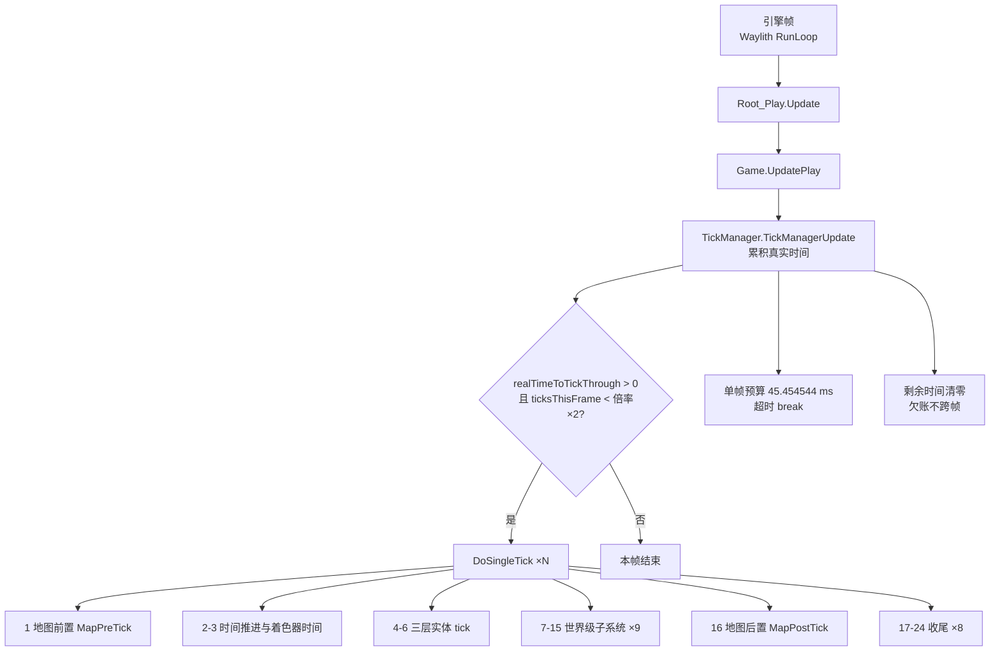

# V23 单 tick 全景：一帧、一跳、一个实体

> **30 秒速览**
>
> - 一秒钟内引擎跑若干帧，每帧最多推进「倍率 × 2」个 tick，单帧超过 45.454544 ms 就停手，欠账直接清零。
> - **一个 tick 里有 24 个执行位点**：地图前置 1 个、时间与实体 8 个、世界级子系统 7 个、地图后置 1 个、收尾 7 个。v1 里的「18 步 / 20 步 / 22 阶段」是三种不同的数法，本卷统一为 24 位点（见 §口径）。
> - 实体 tick 不是「所有物体一起跑」：`TickList` 按 1 / 250 / 2000 分三层，按 `hash(thing) % interval` 分桶，每 tick 只推进相位匹配的那一桶。
> - `GameComponentTick` 是 24 个位点里**唯一不在 try 块内**的——它抛异常会中断本 tick。
> - 实体抛异常时，非 DevMode 用 `Log.ErrorOnce` 按物体 ID 抑制重复刷屏；DevMode 才每次都打印。
>
> **读前须知**：本卷只讲「时间怎么流、一个 tick 里按什么顺序发生什么」，单步内部算法交给各域卷；实体内部（`Thing.DoTick` 的四段、`TickInterval` 区间链）见 V04/V05，地图与寻路见 V03/V19。

## Where it sits

**本模块的类结构**

```csharp
public sealed class Verse.TickManager : IExposable {  // 时间推进的唯一入口
    private int ticksGameInt;  // 游戏内累计 tick（存档）
    private int ticksThisFrame;  // 本帧已推进的 tick 数
    private float realTimeToTickThrough;  // 待消费的真实时间（秒）
    private Stopwatch clock = new Stopwatch();  // 本帧预算计时
    private TickList tickListNormal = new TickList(TickerType.Normal);  // Normal 层
    private TickList tickListRare = new TickList(TickerType.Rare);  // Rare 层
    private TickList tickListLong = new TickList(TickerType.Long);  // Long 层
    private SimpleMovingAverage rawTickTimeAverage = new SimpleMovingAverage(720);  // 单 tick 耗时均值
    private ExponentialMovingAverage smoothedTickTimeAverage = new ExponentialMovingAverage(0.1f);  // 平滑值
    ...
    public int TicksGame  // 本局 tick 数
    public int TicksAbs  // 绝对 tick（含开局偏移）
    public float TickRateMultiplier  // 当前倍率（受倍速与「无事发生」影响）
    private float CurTimePerTick  // 每 tick 消耗的真实秒数
    public bool Paused  // 是否暂停
    public bool ForcePaused  // 外部强制暂停（窗口）
    ...
    public void TickManagerUpdate()  // 每帧：累积 → 双闸门 → 循环 DoSingleTick
    public void DoSingleTick()  // 一个 tick 的全部 24 个位点
    public void RegisterAllTickabilityFor(Thing t)  // 注册到对应层
    public void DeRegisterAllTickabilityFor(Thing t)  // 注销
}

public class Verse.TickList {  // 一层实体的分桶调度
    private TickerType tickType;  // Normal / Rare / Long
    private List<Thing>[] thingLists;  // 每个相位一个桶
    private List<Thing> thingsToRegister;  // 延迟注册队列
    private List<Thing> thingsToDeregister;  // 延迟注销队列
    ...
    private int TickInterval  // 1 / 250 / 2000
    public void Tick()  // 处理增删 → 选桶 → 逐个 DoTick
    private List<Thing> BucketOf(Thing t)  // hash 取模定相位
    public void RegisterThing(Thing t)  // 入队
    public void DeregisterThing(Thing t)  // 入队
}

public class Verse.Game {  // 存档级容器
    public TickManager tickManager;  // 时间泵
    public World world;  // 世界层
    public List<Map> maps;  // 地图列表
    ...
    public void UpdatePlay()  // 每帧：tick 泵 → 世界/地图/组件的帧级更新
}

public class Verse.Map {  // 单张地图
    public void MapPreTick()  // 每 tick、最先
    public void MapPostTick()  // 每 tick、靠后
    public void MapUpdate()  // 每帧一次（与 tick 无关）
}

public class Verse.Root_Play {  // 场景根（MonoBehaviour）
    public void Update()  // 引擎每帧回调 → Game.UpdatePlay
}
```

**这一段怎么走**：先把「谁在推时间」摆清楚——`Root_Play.Update` 每帧回调一次，`Game.UpdatePlay` 把控制权交给 `TickManager.TickManagerUpdate`，后者决定这一帧要跑几个 `DoSingleTick`，再由 `TickList` 把 tick 分发给具体实体。地图与世界不是并列的：它们被 `DoSingleTick` 夹在中间。

## Evolution



| 组 | 位点 | 内容 | 推进单位 |
|---|---|---|---|
| A 地图前置 | 1 | `MapPreTick`（每张地图） | 每 tick |
| B 时间与实体 | 2–6 | `ticksGameInt++`、`Shader.GameSeconds`、Normal/Rare/Long 三层 | 每 tick |
| C 世界级 | 7–15 | DateNotifier、Scenario、WorldTick、StoryWatcher、GameEnder、Storyteller、Tale、Quest、WorldPostTick | 每 tick（内部各自节流） |
| D 地图后置 | 16 | `MapPostTick`（每张地图） | 每 tick |
| E 收尾 | 17–24 | History、GameComponent、LetterStack、Autosaver、调试截图、Filth、运输船、调试控制台 | 每 tick |

### 口径：18 / 20 / 22 / 24 是怎么来的

| 说法 | 出处 | 覆盖到哪 | 缺什么 |
|---|---|---|---|
| **18 步** | v1 V23 标题 | 正文实际列了 20 条 | 标题数字与正文不一致 |
| **20 步** | v1 V23 正文 | 到 `Autosaver` 为止 | 缺 Filth、运输船、调试控制台、调试截图 4 项 |
| **22 阶段** | v1 V01 | 把 20 项加上调试截图与调试控制台 | 仍缺 Filth 与运输船；且未把「地图前置/后置」单独计数 |
| **24 位点** | 本卷（按 `DoSingleTick` 的顶层语句逐条数） | 全部 | —— |

结论：**以源码为准，`DoSingleTick` 有 24 个执行位点**；其中 20 个是游戏子系统，2 个是调试开关（截图、控制台），2 个是收尾清理（Filth、运输船）。后续引用一律用「24 位点」。

**这一段怎么走**：演进图给三层结构（帧 → tick → 实体），阶段表给 24 个位点的分组；口径表说明历史版本为什么数出 18/20/22，结论是本卷统一为 24。读细节时按组跳转，不必从头背 24 条。

## Stage detail

### S0 帧入口：累积器与双闸门

**这一段做什么**：`TickManagerUpdate` 决定「这一帧跑几个 tick」——先把真实帧时间累进待消费时间，再用「倍率 × 2」和「45.454544 ms」两道闸门限制循环，最后把没用完的时间清零。

**源码**（`Verse.TickManager.TickManagerUpdate`；中文注释为本文档所加）

```csharp
this.ticksThisFrame = 0;                                                                    // 每帧计数归零
if (!this.Paused)                                                                            // 暂停则整帧跳过
{
    float curTimePerTick = this.CurTimePerTick;                                              // 每个 tick 要消耗的真实秒数
    if (Mathf.Abs(Time.deltaTime - curTimePerTick) < curTimePerTick * 0.1f)                  // 抖动在 ±10% 内
    {
        this.realTimeToTickThrough += curTimePerTick;                                        // 用理论值，抑制抖动
    }
    else
    {
        this.realTimeToTickThrough += Time.deltaTime;                                        // 偏差大：用实测帧时间
    }
    float tickRateMultiplier = this.TickRateMultiplier;                                      // 当前倍率
    this.clock.Reset();                                                                      // 预算计时器归零
    this.clock.Start();                                                                      // 开始计本帧预算
    while (this.realTimeToTickThrough > 0f && (float)this.ticksThisFrame < tickRateMultiplier * 2f)  // 双闸门之一：倍率×2
    {
        ...
        this.DoSingleTick();                                                                 // 推进一个 tick
        ...
        this.realTimeToTickThrough -= curTimePerTick;                                        // 扣掉一个 tick 的时间
        this.ticksThisFrame++;                                                               // 本帧计数 +1
        ...
        if (this.Paused || (float)this.clock.ElapsedMilliseconds > 45.454544f)               // 双闸门之二：单帧预算
        {
            break;                                                                           // 超预算立即停
        }
    }
    if (this.realTimeToTickThrough > 0f)                                                      // 还有欠账
    {
        this.realTimeToTickThrough = 0f;                                                     // 直接清零，不跨帧
    }
}
```

**伪代码**

```text
本帧 tick 数 = 0
若 未暂停:                                          # 暂停整帧跳过
    每 tick 秒数 = CurTimePerTick
    若 |帧时间 − 每 tick 秒数| < 每 tick 秒数 × 0.1:   # 抖动在 ±10% 内
        待消费时间 += 每 tick 秒数                    # 用理论值
    否则:
        待消费时间 += 帧时间                          # 用实测值
    倍率 = TickRateMultiplier
    预算计时器.重置()
    预算计时器.启动()
    循环 当 待消费时间 > 0 且 本帧 tick 数 < 倍率 × 2:  # 闸门 1
        …（省略：记录单 tick 起始时刻）
        DoSingleTick()
        …（省略：记录结束时刻并更新均值）
        待消费时间 -= 每 tick 秒数
        本帧 tick 数 += 1
        …（省略：平滑值更新）
        若 已暂停 或 预算计时器.毫秒 > 45.454544:      # 闸门 2
            跳出
    若 待消费时间 > 0:
        待消费时间 = 0                               # 欠账清零
```

- `CurTimePerTick`：`1 / (60 × 倍率)`，即「一个 tick 应当消耗多少真实秒」；
- `Time.deltaTime`：来自引擎的帧间隔（V22 的 Stopwatch 差值，上限 1/3 秒）；
- 两道闸门是「**与**」关系：任一不满足就停；预算先到是常态，倍率上限只在单 tick 极快时才会触发。

#### 案例 A：一帧跑几个 tick

假设 60 FPS（帧时间 16.7 ms）、每 tick 2 ms 成本，看三种倍率：

| 倍率 | 每 tick 秒数 | 本帧可消费 | 倍率×2 上限 | 预算 45.45 ms 上限 | 实际跑几个 |
|---|---|---|---|---|---|
| 1× | 16.7 ms | 1 个 | 2 | 22 个 | **1**（时间只够 1 个） |
| 3× | 5.6 ms | 2.98 个 | 6 | 22 个 | **2**（时间够 2.98，取整 2 后余 0.18 清零） |
| 15× | 1.1 ms | 15.2 个 | 30 | 22 个 | **22**（预算先到，倍率上限没用上） |

结论：**低倍率由「时间」限，高倍率由「预算」限，倍率×2 只在单 tick 极快（< 1.5 ms）时才可能成为约束**。

> **要点**：`realTimeToTickThrough` 是「欠账」，但循环结束会被清零——所以卡顿之后不会「补帧」，只会丢时间。
>
> **陷阱**：`ticksThisFrame = 0` 在 `if (!Paused)` 之外，所以暂停帧也会把计数归零；如果某处在暂停期间读 `TicksThisFrame`，读到的是 0 而不是上一帧的值。
>
> **这一段怎么走**：先看是否暂停，再把帧时间累进待消费时间（抖动小用理论值、抖动大用实测值），然后用「倍率×2」与「45.45 ms」两道闸门跑循环，最后把剩余欠账清零。时间在这里是「一次性消费」而不是「记账」。

### S1 一个 tick 的开头：地图前置与时间推进

**这一段做什么**：`DoSingleTick` 的前 10 条语句——先让所有地图做前置，再推进 tick 计数（或按 fastEcology 跳 2000），写着色器时间，最后按 Normal → Rare → Long 推进三层实体。

**源码**（`Verse.TickManager.DoSingleTick`，开头段；中文注释为本文档所加）

```csharp
List<Map> maps = Find.Maps;                                                              // 取地图列表（本 tick 固定）
for (int i = 0; i < maps.Count; i++)
{
    maps[i].MapPreTick();                                                                // 每张地图的前置
}
if (!DebugSettings.fastEcology)                                                           // 正常速度
{
    this.ticksGameInt++;                                                                  // 推进 1 tick
}
else
{
    this.ticksGameInt += 2000;                                                            // 快进生态：一次跳 2000
}
Shader.SetGlobalFloat(ShaderPropertyIDs.GameSeconds, this.TicksGame.TicksToSeconds());    // 写全局着色器时间
this.tickListNormal.Tick();                                                               // Normal 层
this.tickListRare.Tick();                                                                 // Rare 层
this.tickListLong.Tick();                                                                 // Long 层
```

**伪代码**

```text
地图列表 = Find.Maps                        # 本 tick 内固定
循环 每张地图:
    地图.前置()
若 未开启 fastEcology:
    ticksGameInt += 1                       # 正常推进
否则:
    ticksGameInt += 2000                    # 快进：一次跳 2000
写着色器全局时间 = TicksGame 换算成秒
Normal 层.Tick()
Rare 层.Tick()
Long 层.Tick()
```

- `fastEcology` 是调试开关：开启后每 tick 前进 2000，等于把生态快进；
- 着色器时间写在实体 tick 之前，所以这一 tick 内所有实体读到的 `GameSeconds` 都是**推进后**的值。

> **要点**：地图前置在所有全局子系统之前、实体 tick 之前——它负责「准备」，不是「结算」。
>
> **陷阱**：`ticksGameInt` 在实体 tick 之前自增，所以 `TickList` 选桶用的是**本 tick 的编号**；如果把这一步挪到后面，所有分桶相位会整体错位一格。

**这一段怎么走**：取地图列表 → 逐图前置 → 推进 tick 计数（或跳 2000）→ 写着色器时间 → Normal/Rare/Long 依次推进。顺序里只有一处可以换（`ticksGameInt` 必须在三层之前），其余都影响缓存与相位。

### S2 一个 tick 的收尾：世界级子系统与最后清理

**这一段做什么**：`DoSingleTick` 的第 7–24 位点——世界级子系统逐个在 try 块里跑，地图后置把地图层收尾，最后的 8 条语句处理历史、组件、信件、存档、调试截图、污物、运输船与控制台。

**源码**（`Verse.TickManager.DoSingleTick`，收尾段节选；中文注释为本文档所加）

```csharp
try
{
    Find.History.HistoryTick();                                               // 历史统计
}
catch (Exception ex10)
{
    Log.Error(ex10.ToString());                                               // 吞异常，不中断本 tick
}
GameComponentUtility.GameComponentTick();                                     // 唯一不在 try 内的位点
try
{
    Find.LetterStack.LetterStackTick();                                       // 信件过期/清理
}
catch (Exception ex11)
{
    Log.Error(ex11.ToString());
}
try
{
    Find.Autosaver.AutosaverTick();                                           // 自动存档检查
}
catch (Exception ex12)
{
    Log.Error(ex12.ToString());
}
if (DebugViewSettings.logHourlyScreenshot && Find.TickManager.TicksGame >= this.lastAutoScreenshot + 2500)  // 调试：每小时截图
{
    ScreenshotTaker.QueueSilentScreenshot();                                  // 排队截图
    ...
}
try
{
    FilthMonitor.FilthMonitorTick();                                          // 污物统计
}
catch (Exception ex13)
{
    Log.Error(ex13.ToString());
}
try
{
    Find.TransportShipManager.ShipObjectsTick();                              // 运输船
}
catch (Exception ex14)
{
    Log.Error(ex14.ToString());
}
Debug.developerConsoleVisible = false;                                        // 关掉调试控制台
```

**伪代码**

```text
试:                                  # 历史统计
    历史统计()
捕获:
    记录错误
GameComponentTick()                  # 不在 try 内：异常会中断本 tick
试:                                  # 信件清理
    信件清理()
捕获:
    记录错误
试:                                  # 自动存档检查
    自动存档检查()
捕获:
    记录错误
若 调试每小时截图 且 本局 tick ≥ 上次截图 + 2500:
    排队静默截图()
    …（省略：更新上次截图 tick）
试:                                  # 污物统计
    污物统计()
捕获:
    记录错误
试:                                  # 运输船
    运输船 tick()
捕获:
    记录错误
调试控制台可见 = 假
```

- `lastAutoScreenshot`：上次截图的 tick，间隔 2500（= 1 游戏小时）；
- `GameComponentTick` 前后都没有 try：这是刻意的「硬位点」，任何 `GameComponent` 抛异常都会冒泡到 `DoSingleTick` 之外。

> **要点**：24 个位点里只有 `GameComponentTick` 不隔离异常；其余各自 try/catch，单个子系统故障不会阻止后面的位点。
>
> **陷阱**：`Debug.developerConsoleVisible = false` 在每个 tick 末尾执行——所以调试控制台每 tick 都会被关掉，想持续打开必须每帧重新设。

**这一段怎么走**：世界级子系统逐个在 try 里跑完，地图后置收尾，然后进入 8 条固定收尾；`GameComponentTick` 是唯一的裸调用，最后两条是调试开关。整段的设计目标是「一个子系统坏了不影响本 tick 的其他部分」，唯一的例外被刻意放在中间。

### S3 三层桶：`TickList.Tick` 怎么分摊

**这一段做什么**：每层的 `Tick()` 先处理上一 tick 排队的注册/注销，再在 fastEcology 下让所有植物走 `TickLong`，最后只推进相位匹配的那一桶实体，并对每个实体单独 try/catch。

**源码**（`Verse.TickList.Tick`，核心段；中文注释为本文档所加）

```csharp
for (int i = 0; i < this.thingsToRegister.Count; i++)                                    // 先处理注册队列
{
    this.BucketOf(this.thingsToRegister[i]).Add(this.thingsToRegister[i]);               // 按 hash 入桶
}
this.thingsToRegister.Clear();                                                           // 清空注册队列
for (int j = 0; j < this.thingsToDeregister.Count; j++)                                  // 再处理注销队列
{
    this.BucketOf(this.thingsToDeregister[j]).Remove(this.thingsToDeregister[j]);        // 从原桶移除
}
this.thingsToDeregister.Clear();                                                         // 清空注销队列
if (DebugSettings.fastEcology)                                                           // 快进生态
{
    ...
    if (list[l].def.category == ThingCategory.Plant)                                     // 只对植物
    {
        list[l].TickLong();                                                              // 额外走一次 Long
    }
    ...
}
List<Thing> list2 = this.thingLists[Find.TickManager.TicksGame % this.TickInterval];     // 本 tick 只取一个桶
for (int m = 0; m < list2.Count; m++)                                                    // 逐个实体
{
    Thing thing = list2[m];                                                              // 取一个
    if (!thing.Destroyed)                                                                // 已销毁跳过
    {
        try
        {
            thing.DoTick();                                                              // 实体 tick
        }
        catch (Exception ex)
        {
            ...
            Log.ErrorOnce(..., thing.thingIDNumber ^ 576876901);                          // 非 DevMode：按物体抑制刷屏
        }
    }
}
```

**伪代码**

```text
循环 注册队列:                              # 上一 tick 排的队
    按 hash 入桶(物体)
清空 注册队列
循环 注销队列:
    从原桶移除(物体)
清空 注销队列
若 fastEcology:
    …（省略：清温度缓存）
    若 物体是植物:                          # 只对植物
        物体.TickLong()                     # 额外走一次 Long
    …（省略：遍历所有桶）
本桶 = thingLists[本局 tick % 间隔]          # 只取一个相位
循环 本桶 每个实体:
    thing = 当前实体
    若 未销毁:
        试:
            实体.DoTick()
        捕获:
            …（省略：拼位置信息）
            非 DevMode 用 ErrorOnce(按物体 ID 去重)
```

- `BucketOf`：`hash(thing)` 取正后对间隔取模，决定它属于哪个相位；
- `thingsToRegister` / `thingsToDeregister`：注册与注销都延迟到**下一次** `Tick` 开头处理，避免遍历中改集合；
- `ErrorOnce` 的 key 是 `thing.thingIDNumber ^ 576876901`——**同一条错误按物体去重，不是按异常类型**。

#### 案例 B：fastEcology 下植物被 tick 几次

开启 `fastEcology`、观察一株植物（`tickerType = Rare`，间隔 250）：

| 位点 | 正常 | fastEcology |
|---|---|---|
| `ticksGameInt` 每次 | +1 | **+2000** |
| 本 tick 命中的桶 | `tick % 250` 那一个 | 2000 % 250 = 0，**相位恒为 0** |
| 它所在的桶被推进 | 每 250 tick 一次 | 只有相位 0 的 tick 才轮到 |
| 额外 `TickLong` | 无 | **每 tick 一次**（对所有植物） |

结论：fastEcology 下植物的「常规 tick」反而被饿死（相位固定），真正生效的是**每 tick 一次的 `TickLong`**。这不是漏洞，而是调试开关的语义：它想快速推进生态，用 `TickLong` 取代常规节奏。

> **要点**：分桶是「两段哈希」——桶由 `hash(thing)` 决定，相位由 `TicksGame` 决定；两者相乘才得到「这株植物什么时候醒」。
>
> **陷阱**：注册延迟意味着「刚生成的物体**不会**在本 tick 被 tick」；注销同理，本 tick 内已销毁的对象仍可能被遍历到，所以循环里有 `Destroyed` 判断。

**这一段怎么走**：先补做上一 tick 排队的注册/注销，再在 fastEcology 下让所有植物补一次 `TickLong`，然后按相位取一个桶、逐实体 try/catch 推进。桶决定「谁在这一相位」，相位决定「这一 tick 轮到哪个桶」。

### S4 落到实体：这一卷到此为止

`Thing.DoTick` 之后的链路（`tickDelta` 累计、`TickInterval` 区间链、生命周期/需求/工作/AI/健康/心情的顺序）已在 V04 与 V05 拆过，本卷不再重复：**`DoSingleTick` 只负责「把 tick 交给实体」，至于实体在这一 tick 里做哪一段，是区间链的事**。

> **要点**：`TickList` 与 `TickInterval` 是两层节流——前者决定「哪一相位醒」，后者决定「醒来的这一下做多少事」。
>
> **陷阱**：别把 `IsHashIntervalTick` 与分桶混为一谈：前者是实体内部再节流，后者是调度层分桶；两层都命中才会真正执行。

**这一段怎么走**：调度层（`TickList`）按相位分发，实体层（`DoTick` → `TickInterval`）再按区间链决定做哪部分；本卷只覆盖到前一层，后一层按 V04/V05 的结论执行。

## Branches

| 分支 | 触发条件 | 行为 | 与主链的差异 |
|---|---|---|---|
| **暂停** | `Paused` / `ForcePaused` | `TickManagerUpdate` 整帧返回 | 时间不推进，但帧级更新（UI/渲染）继续 |
| **快进生态** | `DebugSettings.fastEcology` | `ticksGameInt += 2000`；所有植物每 tick `TickLong` | 相位固定为 0，常规桶被饿死 |
| **多地图** | `Find.Maps.Count > 1` | 前置/后置各跑一遍所有地图 | 顺序按地图列表，无并行 |
| **异常隔离** | 任一子系统抛异常 | try/catch 记录后继续 | `GameComponentTick` 例外，会中断本 tick |
| **调试截图** | `logHourlyScreenshot` 且间隔 ≥ 2500 | 排队静默截图 | 只影响调试，不参与游戏逻辑 |
| **预算超时** | 单帧 > 45.454544 ms | `break`，剩余欠账清零 | 高倍速下实际倍率由单 tick 成本决定 |

**层积与遗留痕迹**：

1. **三种步数说法的来源**：v1 的 18（标题）、20（正文）、22（V01）分别对应「漏写收尾」「只数到 Autosaver」「把调试项算进去」；源码是 24 位点。
2. **`GameComponentTick` 无 try**：其余 15 个位点都包了 try，唯独它裸调用——从代码形态看是「先写主流程，后补异常隔离」的遗留。
3. **`ErrorOnce` 的 key**：`thing.thingIDNumber ^ 576876901` 是魔法常量，按物体去重；这解释了 v1 里「同一条异常每 tick 刷屏是否有节流」的疑问——非 DevMode 有，DevMode 没有。

> **要点**：分支表回答「什么条件下主链被改写」，层积表回答「为什么代码长成这样」。
>
> **陷阱**：暂停不等于「什么都不跑」——`Game.UpdatePlay` 之后的世界/地图/组件帧级更新仍在执行（见 V23 之外的 V01/V17）。

**这一段怎么走**：六条分支各自改写了主链的一个环节：暂停改「进不进」，快进改「跳多少」，多地图改「循环几次」，异常隔离改「出错后还走不走」，调试截图与控制台只改表现。层积三条说明历史数与异常策略的由来。

## Contracts

| 方向 | 契约 |
|---|---|
| 入 | `TickManagerUpdate` 每帧被 `Game.UpdatePlay` 调一次；`DoSingleTick` 只应由 tick 泵调用 |
| 出 | `TicksGame` 自增（或 +2000）、`GameSeconds` 着色器量、实体 tick、世界/地图子系统 tick |
| 时序 | 地图前置 → 计数自增 → 三层 → 世界级 9 项 → 地图后置 → 收尾 8 项 |
| 不变量 | 24 位点顺序固定；除 `GameComponentTick` 外均异常隔离；欠账不跨帧 |
| 边界 | 暂停时整帧不推进；单帧超预算立即停止；实体已销毁则跳过 |

## Evidence

断言沿用 v1 同名卷的 C01–C25（正文与 match 未改，不再重验），新增 C26–C33 对应本轮新证据。

### 帧入口与累积器

[claim:V23-C01] 每帧入口先取存档容器，再进 tick 泵，最后才做各层的帧级更新。
  src: Verse.Game.UpdatePlay
  file: analysis/decompiled/Assembly-CSharp/Verse/Game.cs
  match: this.tickManager.TickManagerUpdate();

[claim:V23-C02] 地图的帧级更新在 tick 泵之后按地图顺序执行。
  src: Verse.Game.UpdatePlay
  file: analysis/decompiled/Assembly-CSharp/Verse/Game.cs
  match: this.maps[i].MapUpdate();

[claim:V23-C03] 帧内 tick 数同时受「倍率×2」与累积时间两个条件限制。
  src: Verse.TickManager.TickManagerUpdate
  file: analysis/decompiled/Assembly-CSharp/Verse/TickManager.cs
  match: while (this.realTimeToTickThrough > 0f && (float)this.ticksThisFrame < tickRateMultiplier * 2f)

[claim:V23-C04] 单帧超过 45.454544 ms 或暂停时立即停止本帧剩余 tick。
  src: Verse.TickManager.TickManagerUpdate
  file: analysis/decompiled/Assembly-CSharp/Verse/TickManager.cs
  match: if (this.Paused || (float)this.clock.ElapsedMilliseconds > 45.454544f)

[claim:V23-C05] 循环结束会把剩余累积时间清零，欠账不跨帧。
  src: Verse.TickManager.TickManagerUpdate
  file: analysis/decompiled/Assembly-CSharp/Verse/TickManager.cs
  match: this.realTimeToTickThrough = 0f;

### 单 tick 位点

[claim:V23-C06] 每个 tick 的第一步是所有地图的 MapPreTick。
  src: Verse.TickManager.DoSingleTick
  file: analysis/decompiled/Assembly-CSharp/Verse/TickManager.cs
  match: maps[i].MapPreTick();

[claim:V23-C07] tick 计数在 MapPreTick 之后、实体 tick 之前自增。
  src: Verse.TickManager.DoSingleTick
  file: analysis/decompiled/Assembly-CSharp/Verse/TickManager.cs
  match: this.ticksGameInt++;

[claim:V23-C08] 三层 TickList 按 Normal → Rare → Long 的顺序推进。
  src: Verse.TickManager.DoSingleTick
  file: analysis/decompiled/Assembly-CSharp/Verse/TickManager.cs
  match: this.tickListNormal.Tick();

[claim:V23-C09] Rare 层紧随 Normal 层。
  src: Verse.TickManager.DoSingleTick
  file: analysis/decompiled/Assembly-CSharp/Verse/TickManager.cs
  match: this.tickListRare.Tick();

[claim:V23-C10] Long 层在 Rare 之后。
  src: Verse.TickManager.DoSingleTick
  file: analysis/decompiled/Assembly-CSharp/Verse/TickManager.cs
  match: this.tickListLong.Tick();

[claim:V23-C11] 世界层 tick 在实体 tick 之后、故事叙述者之前。
  src: Verse.TickManager.DoSingleTick
  file: analysis/decompiled/Assembly-CSharp/Verse/TickManager.cs
  match: Find.World.WorldTick();

[claim:V23-C12] 故事叙述者在世界 tick 之后运行，即事件看到的是已推进过的世界。
  src: Verse.TickManager.DoSingleTick
  file: analysis/decompiled/Assembly-CSharp/Verse/TickManager.cs
  match: Find.Storyteller.StorytellerTick();

[claim:V23-C13] 任务推进位于故事叙述者之后。
  src: Verse.TickManager.DoSingleTick
  file: analysis/decompiled/Assembly-CSharp/Verse/TickManager.cs
  match: Find.QuestManager.QuestManagerTick();

[claim:V23-C14] 世界 tick 有前置/后置两段，后置在 MapPostTick 之前。
  src: Verse.TickManager.DoSingleTick
  file: analysis/decompiled/Assembly-CSharp/Verse/TickManager.cs
  match: Find.World.WorldPostTick();

[claim:V23-C15] MapPostTick 在全局子系统之后执行。
  src: Verse.TickManager.DoSingleTick
  file: analysis/decompiled/Assembly-CSharp/Verse/TickManager.cs
  match: maps[j].MapPostTick();

[claim:V23-C16] 所有 GameComponent 的 tick 位于 tick 链尾段（自动存档之前）。
  src: Verse.TickManager.DoSingleTick
  file: analysis/decompiled/Assembly-CSharp/Verse/TickManager.cs
  match: GameComponentUtility.GameComponentTick();

[claim:V23-C17] 自动存档检查是 tick 的最后一站。
  src: Verse.TickManager.DoSingleTick
  file: analysis/decompiled/Assembly-CSharp/Verse/TickManager.cs
  match: Find.Autosaver.AutosaverTick();

[claim:V23-C26] fastEcology 下 tick 计数一次跳 2000。
  src: Verse.TickManager.DoSingleTick
  file: analysis/decompiled/Assembly-CSharp/Verse/TickManager.cs
  match: this.ticksGameInt += 2000;

[claim:V23-C27] `GameComponentTick` 是唯一不在 try 块内的位点。
  src: Verse.TickManager.DoSingleTick
  file: analysis/decompiled/Assembly-CSharp/Verse/TickManager.cs
  match: GameComponentUtility.GameComponentTick();
  note: 该调用前后没有 try/catch，其上一行的 catch 属于 HistoryTick 的块。

[claim:V23-C28] 污物统计在收尾段执行。
  src: Verse.TickManager.DoSingleTick
  file: analysis/decompiled/Assembly-CSharp/Verse/TickManager.cs
  match: FilthMonitor.FilthMonitorTick();

[claim:V23-C29] 运输船 tick 在污物统计之后。
  src: Verse.TickManager.DoSingleTick
  file: analysis/decompiled/Assembly-CSharp/Verse/TickManager.cs
  match: Find.TransportShipManager.ShipObjectsTick();

[claim:V23-C30] 每个 tick 末尾都会关闭调试控制台。
  src: Verse.TickManager.DoSingleTick
  file: analysis/decompiled/Assembly-CSharp/Verse/TickManager.cs
  match: Debug.developerConsoleVisible = false;

[claim:V23-C31] 调试每小时截图按 2500 tick 间隔排队。
  src: Verse.TickManager.DoSingleTick
  file: analysis/decompiled/Assembly-CSharp/Verse/TickManager.cs
  match: ScreenshotTaker.QueueSilentScreenshot();

### 三层桶

[claim:V23-C21] 每 tick 只推进哈希相位匹配的那一个桶。
  src: Verse.TickList.Tick
  file: analysis/decompiled/Assembly-CSharp/Verse/TickList.cs
  match: List<Thing> list2 = this.thingLists[Find.TickManager.TicksGame % this.TickInterval];

[claim:V23-C22] 桶内实体逐个 DoTick，且已销毁的跳过。
  src: Verse.TickList.Tick
  file: analysis/decompiled/Assembly-CSharp/Verse/TickList.cs
  match: thing.DoTick();

[claim:V23-C23] 实体归属的桶由哈希取模决定，因此相位在生成时就固定。
  src: Verse.TickList.BucketOf
  file: analysis/decompiled/Assembly-CSharp/Verse/TickList.cs
  match: int num2 = num % this.TickInterval;

[claim:V23-C24] Rare 层的间隔是 250 tick。
  src: Verse.TickList.TickInterval
  file: analysis/decompiled/Assembly-CSharp/Verse/TickList.cs
  match: return 250;

[claim:V23-C25] Long 层的间隔是 2000 tick。
  src: Verse.TickList.TickInterval
  file: analysis/decompiled/Assembly-CSharp/Verse/TickList.cs
  match: return 2000;

[claim:V23-C32] 非 DevMode 下实体异常按物体 ID 去重打印，抑制重复刷屏。
  src: Verse.TickList.Tick
  file: analysis/decompiled/Assembly-CSharp/Verse/TickList.cs
  match: Log.ErrorOnce(defaultInterpolatedStringHandler3.ToStringAndClear(), thing.thingIDNumber ^ 576876901);

[claim:V23-C33] fastEcology 下植物每 tick 额外走一次 `TickLong`。
  src: Verse.TickList.Tick
  file: analysis/decompiled/Assembly-CSharp/Verse/TickList.cs
  match: list[l].TickLong();

### 地图层

[claim:V23-C18] 拾取可用性在 MapPreTick 的最前面计算（供后续采购/搬运判断）。
  src: Verse.Map.MapPreTick
  file: analysis/decompiled/Assembly-CSharp/Verse/Map.cs
  match: this.itemAvailability.Tick();

[claim:V23-C19] 电力网络在 MapPostTick 里结算。
  src: Verse.Map.MapPostTick
  file: analysis/decompiled/Assembly-CSharp/Verse/Map.cs
  match: this.powerNetManager.PowerNetsTick();

[claim:V23-C20] 区域/房间重建每帧做一次增量尝试，而不是每 tick。
  src: Verse.Map.MapUpdate
  file: analysis/decompiled/Assembly-CSharp/Verse/Map.cs
  match: this.regionAndRoomUpdater.TryRebuildDirtyRegionsAndRooms();

## Open questions

1. `[unresolved]` `MapPreTick` / `MapPostTick` 内部的完整顺序（十余个地图组件）尚未逐条取证；本卷只标出首尾两项。取证：读 `Verse.Map.cs` 的两个方法。
2. `[runtime-only]` 高倍速下「预算先到」的实际分界点（单 tick 成本 1.5 ms 假设）需实测；静态只能给出公式。取证：在 `DoSingleTick` 前后打点统计。
3. `[unresolved]` `GameComponentTick` 无 try 的历史原因（是刻意硬位点还是漏包）无法从源码判定；取证：查 v1 早期版本或开发者注释。

**这一段怎么走**：三条未结项分别指向「地图内部顺序」「预算分界点」「硬位点的来历」；前两条可静态或半静态推进，第三条只能靠版本对照。
