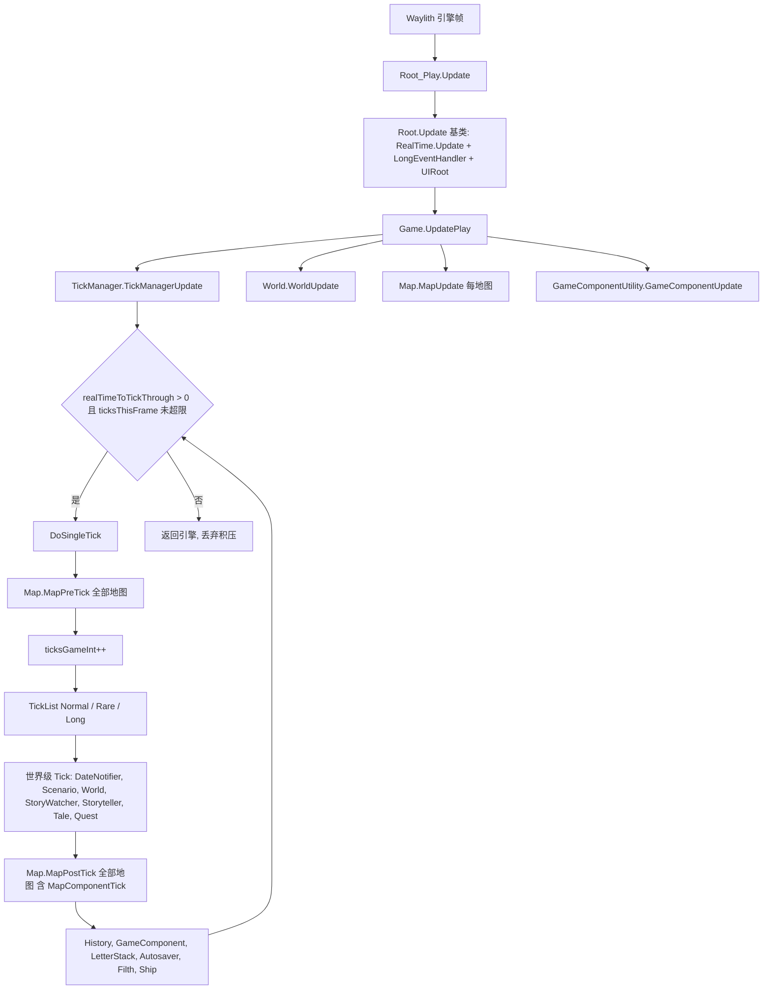

# V00 总览：程序集地图与游戏主链

卷号：V00
状态：初稿（R2）
语料基线：`analysis/decompiled/`（**11340 文件 / 45.6 MB**）、`analysis/index/types.tsv`（**12234 类型** / 111 命名空间；R19 补全 Waylith 与 R24 回测后重算）

## Scope

本卷是整套解构的**地图与索引层**，不深入任何子系统实现，只回答三件事：

1. 游戏由哪些程序集构成，各自负责什么；
2. 从引擎帧回调到世界状态变化的**主链**如何贯通（后续各卷都是这条主链上的分支）；
3. V01–V18 各卷锚定在哪个命名空间/类型上，卷间依赖如何。

边界：不解释任何具体机制（倍率、阈值、概率都在各卷）；不覆盖 XML 数据内容（V15）；不覆盖 DLC 增量（V18）。

## Key types

| 类型 | 全名 | Token | 语料路径 | 角色 |
|---|---|---|---|---|
| `Current` | `Verse.Current` | 0x02000201 | `Assembly-CSharp/Verse/Current.cs` | 全局单例入口（`Current.Game` / `Current.ProgramState` / `Current.Root`） |
| `ProgramState` | `Verse.ProgramState` | 0x02000200 | `Assembly-CSharp/Verse/ProgramState.cs` | 程序三态：`Entry` / `MapInitializing` / `Playing` |
| `Root` | `Verse.Root` | 0x02000202 | `Assembly-CSharp/Verse/Root.cs` | `MonoBehaviour` 基类，帧级 `Update`/`OnGUI` |
| `Root_Play` | `Verse.Root_Play` | 0x02000204 | `Assembly-CSharp/Verse/Root_Play.cs` | 游戏中场景的根，把帧回调接到 `Game.UpdatePlay` |
| `Game` | `Verse.Game` | 0x020001E9 | `Assembly-CSharp/Verse/Game.cs` | 存档级容器：`TickManager`、`World`、`maps`、各种 `Manager` |
| `TickManager` | `Verse.TickManager` | 0x020001FB | `Assembly-CSharp/Verse/TickManager.cs` | 时间推进的唯一入口（详见 V01） |
| `UnityRuntime` | `UnityStubs.Internal.UnityRuntime` | — | `Assembly-CSharp` 外：`UnityStubs/Internal/` | 引擎运行时桥，`Time.deltaTime` 的真实来源 |

程序集构成（5 个，全部反编译落地）：

| 程序集 | 类型数 | 语料量 | 职责 |
|---|---:|---:|---|
| `Assembly-CSharp` | 9706 | 32.1 MB | 全部游戏逻辑：`Verse`（框架）+ `RimWorld`（玩法） |
| `UnityStubs` | 852 | 2.5 MB | Unity API 桩层，转发到 `Waylith.UnityCompat.UnityRuntime` |
| `Waylith` | **887（完整）** | 10.4 MB | 自研引擎（渲染/音频/窗口/资源）；R19 用逐类型提取补全，其中 1 个类型只有 IL |
| `RimWorld`（可执行体） | 68 | 0.5 MB | 入口、启动参数、崩溃处理、资源烘焙 |
| `Waylith.UnityCompat` | 14 | 0.1 MB | Unity 兼容层（`UnityFrame`、`UnityRuntime`、诊断） |

命名空间规模（`analysis/index/namespaces.tsv`，按近似行数排序）：

| 命名空间 | 类型数 | 近似行数 |
|---|---:|---:|
| `RimWorld` | 6083 | 541564 |
| `Verse` | 1951 | 260126 |
| `UnityEngine`（桩） | 352 | 48205 |
| `RimWorld.Planet` | 321 | 44075 |
| `Waylith.Rendering` | 253 | 44046 |
| `RimWorld.QuestGen` | 392 | 29579 |
| `Verse.AI` | 288 | 24901 |

## Control flow

主链（每一帧）与后续各卷的挂点：

各卷在主链上的挂点：

| 卷 | 主链挂点 | 主要命名空间 |
|---|---|---|
| V01 帧循环与 tick 管线 | 本卷即主链 | `Verse` |
| V02 时间与日历 | `DoSingleTick` → `DateNotifier.DateNotifierTick` | `Verse`, `RimWorld`（`DateNotifier`） |
| V03 地图与寻路 | `MapPreTick` → `pathFinder.PathFinderTick` | `Verse`（`PathFinder`/`PathGrid`） |
| V04 Thing 生命周期 | `TickList.Tick` → `Thing.DoTick` | `Verse` |
| V05 Pawn | `Thing.DoTick` 的 Pawn 分支 + `Pawn_*` 组件 | `Verse`, `RimWorld` |
| V06 AI/Job | `Pawn.Tick` → `jobs/jobDriver` | `Verse.AI` |
| V07 工作与生产 | `JobDriver` + `WorkGiver` | `RimWorld` |
| V08 战斗 | `Thing.Tick` 内的 Verb/Projectile | `Verse`, `RimWorld` |
| V09 事件与剧情 | `DoSingleTick` → `Storyteller.StorytellerTick` | `RimWorld` |
| V10 世界与远行队 | `DoSingleTick` → `World.WorldTick` / `WorldPostTick` | `RimWorld.Planet` |
| V11 派系与社交 | 事件/社交 tick 与 `InteractionWorker` | `RimWorld` |
| V12 经济贸易 | `TradeDeal` / `PriceUtility`（被动，由 UI 驱动） | `RimWorld` |
| V13 需求与心情 | `Pawn.Tick` → `needsTracker` / `mindState` | `RimWorld` |
| V14 医疗与基因 | `Hediff` tick（Rare/Long 桶居多） | `RimWorld` |
| V15 Def 与 XML 管线 | 启动期（非 tick） | `Verse`（`DefDatabase`） |
| V16 存档与序列化 | `Scribe` 在存/读档期 | `Verse` |
| V17 UI 与渲染 | `Root.Update` → `uiRoot.UIRootUpdate` / `OnGUI` | `Verse`, `UnityEngine` 桩, `Waylith` |
| V18 DLC 增量 | 各卷同位置 + `ModsConfig.*Active` 判定 | 各程序集 |
| V19 空间构建（R18 新增） | `MapPreTick` 前后的区域/房间重建 | `Verse`, `Verse.AI` |
| V20 Ideology 社会改写（R18 新增） | 思想 → 意见 → 互动权重 | `RimWorld` |
| V21 渲染树（R18 新增） | 表现层（`Draw` 通道） | `Verse` |
| V22 引擎运行模式（R22 新增） | 主链的**上游**（帧源、线程、背压） | `Waylith` |
| V23 单 tick 全景（R25 新增） | **汇总卷**：一 tick 内全部步骤的有序清单 | 全部 |

## Constants

以下为**可重跑基线**（非代码常量，用于确认语料/索引没有漂移）：

| 项 | 值 | 重跑命令 |
|---|---:|---|
| 语料文件数 | 11340 | `powershell -NoProfile -ExecutionPolicy Bypass -File scripts/list-types.ps1` 前先看目录 |
| 类型总数 | 12234 | 同上（脚本输出 `TOTAL types=`） |
| 命名空间数 | 111 | 同上 |
| `RimWorld` 命名空间类型数 | 6083 | `analysis/index/namespaces.tsv` |
| `Verse` 命名空间近似行数 | 260126 | 同上 |

代码侧常量（见各卷）：`Time.maximumDeltaTime = 0.33333334f`、`WorstAllowedFPS = 22`、tick 桶间隔 `1/250/2000`。

## Claims

[claim:V00-C01] 游戏帧回调的落点是 `Root_Play.Update`，它转而驱动 `Game.UpdatePlay`。
  src: Verse.Root_Play.Update  Token: 0x02000204
  file: analysis/decompiled/Assembly-CSharp/Verse/Root_Play.cs#L78
  match: Current.Game.UpdatePlay();

[claim:V00-C02] `Current` 是全局单例，`Game` 实例由它持有。
  src: Verse.Current  Token: 0x02000201
  file: analysis/decompiled/Assembly-CSharp/Verse/Current.cs#L84
  match: public static Game Game

[claim:V00-C03] 程序状态为三态枚举，含 `MapInitializing`（读档/建图期间不推进世界）。
  src: Verse.ProgramState  Token: 0x02000200
  file: analysis/decompiled/Assembly-CSharp/Verse/ProgramState.cs
  match: MapInitializing

[claim:V00-C04] `UnityEngine.Time` 是桩层，真实时间来自 `Waylith.UnityCompat` 的 `UnityRuntime`。
  src: UnityEngine.Time.deltaTime
  file: analysis/decompiled/UnityStubs/UnityEngine/Time.cs
  match: UnityRuntime.Current

[claim:V00-C05] 帧级 `Update` 中，基类先跑 `RealTime.Update` 与长事件，再回到派生类驱动 `Game.UpdatePlay`。
  src: Verse.Root.Update  Token: 0x02000202
  file: analysis/decompiled/Assembly-CSharp/Verse/Root.cs
  match: RealTime.Update();

[claim:V00-C06] `TickManager` 是唯一的时间推进器，且被 `Game` 内的字段持有。
  src: Verse.TickManager  Token: 0x020001FB
  file: analysis/decompiled/Assembly-CSharp/Verse/TickManager.cs
  match: public sealed class TickManager : IExposable

[claim:V00-C07] `Game.UpdatePlay` 每帧把控制权交给 `TickManagerUpdate`。
  src: Verse.Game.UpdatePlay
  file: analysis/decompiled/Assembly-CSharp/Verse/Game.cs#L671
  match: this.tickManager.TickManagerUpdate();

## Resolved questions

R17 解出原 `Open questions` 第 2 条（场景切换点）：

- 场景切换的入口是 `GenScene.GoToMainMenu()`；而「用哪个 UI 根」由 `Root.Start` 按 `GenScene.InPlayScene` / `InEntryScene` 决定（`UIRoot_Play` vs `UIRoot_Entry`）。`Root_Entry`/`Root_Play` 本身是场景里的对象，不是被代码 new 出来的 —— 所以「切换」= 换场景 + `Root` 重新 `Start`。

[claim:V00-C08] 切换场景走 `GenScene.GoToMainMenu()`。
  src: Verse.GenScene.GoToMainMenu
  file: analysis/decompiled/Assembly-CSharp/Verse/GenScene.cs
  match: public static void GoToMainMenu()

[claim:V00-C09] UI 根按当前场景类型在 `Root.Start` 内选择。
  src: Verse.Root.Start
  file: analysis/decompiled/Assembly-CSharp/Verse/Root.cs
  match: if (GenScene.InPlayScene)

## Open questions

1. ~~`Waylith.dll` 只落地 439 个文件~~ → **R19 已解除**：dnSpy 的项目级反编译会在 `Waylith.Rendering.Bc7BlockEncoder`（RID 56，190 方法）上无限循环（0 字节文件即其标记，且 IL 模式可正常导出 31207 行）。改用 `scripts/dump-waylith.ps1` 逐类型提取（20 s 超时 + IL 回退）后，**887/887 类型全覆盖**（1322 个 `.cs` + 1 个 `.il`）。引擎主循环的语料现已可查，但尚未逐行解构（属 V17 后续）。
2. `Root_Entry`（主菜单场景）与 `Root_Play` 的切换点尚未取证；属 V17 范畴。
3. 命名空间规模表来自语料解析，`loc_approx` 是「到下一个类型声明」的近似值，非精确行数；仅用于排序，不作为断言。
4. ~~调用面统计~~ → **R19 已测**：`Assembly-CSharp` 对 `Waylith` 的引用只有 **53 处 / 29 文件**（`Waylith.Profiling` 17、`Rendering.Texture2D` 11、`Rendering` 9、`Graphics` 4、`Rendering.Shader` 4…）；`UnityStubs` 有 **212 处**（`Graphics.Meshes.VertexAttribute` 32、`Rendering` 29、`UnityCompat` 27、`Audio` 12、`Shader` 11…）。即 887 个引擎类型里，游戏逻辑只按名引用了约 20 个 —— 引擎绝大部分是内部实现。
