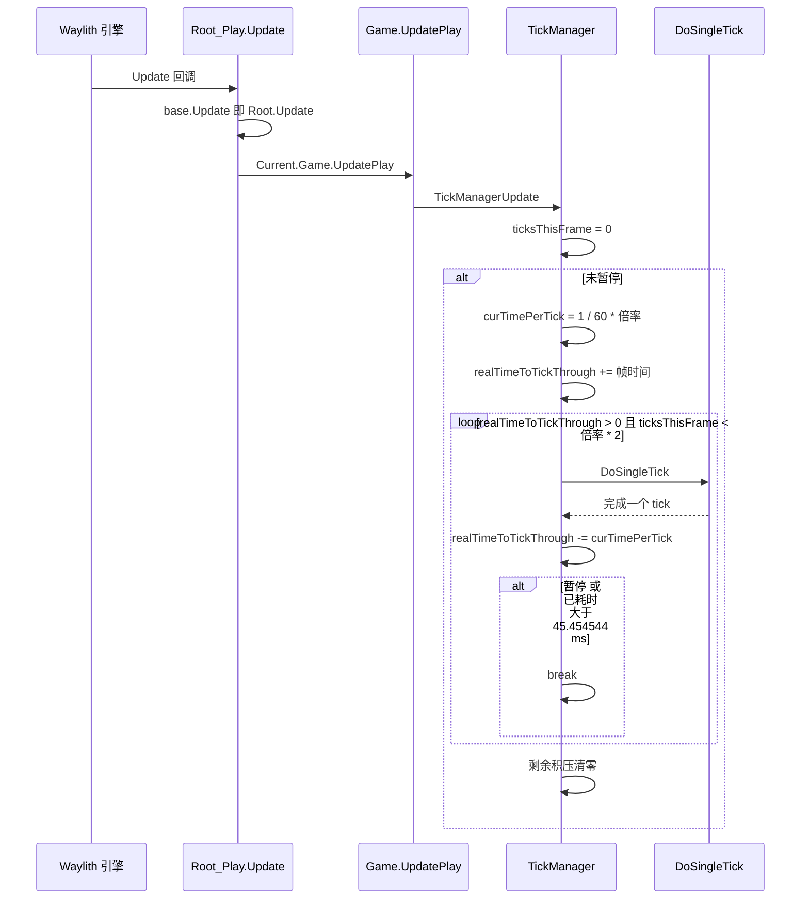
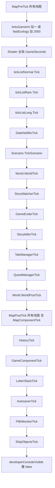
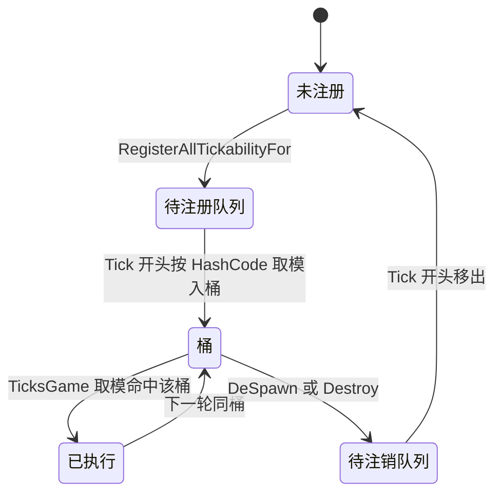

# V01 帧循环与 tick 管线

卷号：V01
状态：初稿（R2）
上游：V00（主链总览）；下游：V02（时间/日历）、V03（地图）、V04（Thing tick）

## Scope

本卷解构 RimWorld 1.7 的**时间推进闸门**：从引擎帧回调开始，一个 tick 如何被决定、被限流、被执行，以及执行时的固定顺序。

覆盖：

1. 帧→tick 的换算与限流（`TickManager.TickManagerUpdate`）；
2. 单 tick 的执行顺序（`TickManager.DoSingleTick`，22 个阶段）；
3. 对象 tick 的分桶调度（`TickList` / `TickerType`）；
4. 地图与全局组件在 tick 中的位置（`MapPreTick` / `MapPostTick` / `MapComponentTick` / `GameComponentTick`）；
5. 时间倍率（`TimeSpeed`）与暂停的判定条件。

不覆盖：日历/季节（V02）、`Thing.DoTick` 内部（V04）、剧情 AI（V09）、UI（V17）。

## Key types

| 类型 | Token | 语料路径 | 关键成员 |
|---|---|---|---|
| `Verse.TickManager` | 0x020001FB | `Assembly-CSharp/Verse/TickManager.cs` | `TickManagerUpdate` / `DoSingleTick` / `TickRateMultiplier` / `TickListFor` |
| `Verse.TickList` | 0x020001F9 | `Assembly-CSharp/Verse/TickList.cs` | `Tick` / `TickInterval` / `BucketOf` |
| `Verse.TickerType` | 0x020006F1 | `Assembly-CSharp/Verse/TickerType.cs` | `Never` / `Normal` / `Rare` / `Long` |
| `Verse.TimeSpeed` | 0x020001FA | `Assembly-CSharp/Verse/TimeSpeed.cs` | `Paused` / `Normal` / `Fast` / `Superfast` / `Ultrafast` |
| `Verse.RealTime` | 0x020006F8 | `Assembly-CSharp/Verse/RealTime.cs` | `Update` / `unpausedTime` |
| `Verse.Game` | 0x020001E9 | `Assembly-CSharp/Verse/Game.cs` | `UpdatePlay` |
| `Verse.Root_Play` | 0x02000204 | `Assembly-CSharp/Verse/Root_Play.cs` | `Update` |
| `Verse.Map` | 0x02000299 | `Assembly-CSharp/Verse/Map.cs` | `MapPreTick` / `MapPostTick` / `MapUpdate` |
| `Verse.MapComponentUtility` | 0x0200029E | `Assembly-CSharp/Verse/MapComponentUtility.cs` | `MapComponentTick` |
| `Verse.GameComponentUtility` | 0x020001EB | `Assembly-CSharp/Verse/GameComponentUtility.cs` | `GameComponentTick` |
| `UnityEngine.Time`（桩） | — | `UnityStubs/UnityEngine/Time.cs` | `deltaTime` / `maximumDeltaTime` |

## Control flow

### 1. 帧 → tick 的限流

要点（全部有 claim 支撑）：

- 累加的不是裸帧时间：若帧时间与「理论每 tick 实时」相差 <10%，则累加理论值而非帧时间，抑制抖动；
- `Time.deltaTime` 已被 `maximumDeltaTime`（1/3 秒）截断；
- 每帧最多推进 `倍率 × 2` 个 tick，且单帧预算 45.454544 ms（=1/22 s）到达即中断；
- 中断后剩余积压被**清零**，即不做追帧补偿（防止卡顿后雪崩）。

### 2. 单 tick 的执行顺序（22 阶段）

多数阶段被包在独立的 `try/catch` 中，单个子系统抛异常只记 `Log.Error`，不中断本 tick（`DebugSettings.fastEcology` 分支与 `tickList` 部分除外）。

### 3. 分桶调度

- 每个 `TickerType` 对应一个 `TickList`，构造时按间隔建立固定数量的桶（Normal 1、Rare 250、Long 2000 个桶）；
- 入桶位置由 `Thing.GetHashCode() % 间隔` 决定，因此同类物体的 tick 在时间上被哈希打散；
- 每 tick 只执行 `thingLists[TicksGame % 间隔]` 这一个桶；
- 注册/注销都是延迟到下一次 `Tick` 开头才生效（避免遍历中改集合）。

## Constants

| 项 | 值 | 位置 |
|---|---|---|
| `TickerType.Normal` 间隔 | 1 tick | `TickList.cs` `TickInterval` |
| `TickerType.Rare` 间隔 | 250 tick | 同上 |
| `TickerType.Long` 间隔 | 2000 tick | 同上 |
| `TimeSpeed.Paused` 倍率 | 0 | `TickManager.cs` `TickRateMultiplier` |
| `TimeSpeed.Normal` | 1 | 同上 |
| `TimeSpeed.Fast` | 3 | 同上 |
| `TimeSpeed.Superfast` | 6（有地图+有事件）/ 12（无事发生）/ 18（无地图） | 同上 |
| `TimeSpeed.Ultrafast` | 15（有地图）/ 150（无地图）/ 20000（`UltraSpeedBoost`） | 同上 |
| `slower.ForcedNormalSpeed` 生效时 | 强制 1（暂停时 0） | 同上 |
| 单 tick 实时长度 | `1 / (60 × 倍率)` 秒 | `CurTimePerTick` |
| 每帧 tick 上限 | `倍率 × 2` | `TickManagerUpdate` |
| 单帧 tick 预算 | 45.454544 ms（= 1000/22） | 同上 |
| `WorstAllowedFPS` | 22 | `TickManager.cs` 字段常量 |
| `Time.maximumDeltaTime` | 0.33333334 s | `UnityStubs/UnityEngine/Time.cs` |
| 抖动抑制阈值 | 帧时间与理论值相差 < `curTimePerTick × 0.1` | `TickManagerUpdate` |
| `fastEcology` 下的 tick 增量 | +2000 tick / 次 | `DoSingleTick` |
| 起始年份 | 5500 | `TickManager.startingYearInt` |
| tick ↔ 游戏秒 | 60 tick = 1 秒 | `GenTicks.TicksToSeconds` |

由表可直接推出：Normal 速度下每游戏秒 60 tick（实时 1 秒），Fast 3 倍速实时 1 秒推进 3 游戏秒，Superfast 有地图时 6 倍，Ultrafast 有地图时 15 倍。

## Claims

[claim:V01-C01] `TimeSpeed` 为五档枚举，Paused 在最前。
  src: Verse.TimeSpeed
  file: analysis/decompiled/Assembly-CSharp/Verse/TimeSpeed.cs
  match: Ultrafast

[claim:V01-C02] 暂停的判定是「档位为 Paused 或 ForcePaused」，后者包含窗口强制暂停、长事件、地图选择器、过场、调试模式等外部条件。
  src: Verse.TickManager.Paused
  file: analysis/decompiled/Assembly-CSharp/Verse/TickManager.cs
  match: return this.curTimeSpeed == TimeSpeed.Paused || this.ForcePaused;

[claim:V01-C03] `slower.ForcedNormalSpeed` 生效时倍率被强制为 1（暂停仍为 0）。
  src: Verse.TickManager.TickRateMultiplier
  file: analysis/decompiled/Assembly-CSharp/Verse/TickManager.cs
  anchor: if (this.slower.ForcedNormalSpeed)
  match: return 1f;

[claim:V01-C04] Fast 档倍率为 3。
  src: Verse.TickManager.TickRateMultiplier
  file: analysis/decompiled/Assembly-CSharp/Verse/TickManager.cs
  anchor: case TimeSpeed.Fast:
  match: return 3f;

[claim:V01-C05] Superfast 在无地图时为 18 倍（世界地图上空转时的加速）。
  src: Verse.TickManager.TickRateMultiplier
  file: analysis/decompiled/Assembly-CSharp/Verse/TickManager.cs
  anchor: case TimeSpeed.Superfast:
  match: return 18f;

[claim:V01-C06] Superfast 在 `NothingHappeningInGame` 成立时为 12 倍。
  src: Verse.TickManager.TickRateMultiplier
  file: analysis/decompiled/Assembly-CSharp/Verse/TickManager.cs
  match: return 12f;

[claim:V01-C06b] 12 倍分支的前置判定确实是 `NothingHappeningInGame()`。
  src: Verse.TickManager.TickRateMultiplier
  file: analysis/decompiled/Assembly-CSharp/Verse/TickManager.cs
  match: if (this.NothingHappeningInGame())

[claim:V01-C06c] 若该判定不成立，Superfast 退回 6 倍。
  src: Verse.TickManager.TickRateMultiplier
  file: analysis/decompiled/Assembly-CSharp/Verse/TickManager.cs
  anchor: if (this.NothingHappeningInGame())
  match: return 6f;

[claim:V01-C07b] Ultrafast 无地图时为 150 倍。
  src: Verse.TickManager.TickRateMultiplier
  file: analysis/decompiled/Assembly-CSharp/Verse/TickManager.cs
  anchor: case TimeSpeed.Ultrafast:
  match: return 150f;

[claim:V01-C07c] Ultrafast 有地图时默认 15 倍。
  src: Verse.TickManager.TickRateMultiplier
  file: analysis/decompiled/Assembly-CSharp/Verse/TickManager.cs
  anchor: case TimeSpeed.Ultrafast:
  match: return 15f;

[claim:V01-C07] 调试开关 `UltraSpeedBoost` 打开时 Ultrafast 倍率为 20000。
  src: Verse.TickManager.TickRateMultiplier
  file: analysis/decompiled/Assembly-CSharp/Verse/TickManager.cs
  anchor: case TimeSpeed.Ultrafast:
  match: return 20000f;

[claim:V01-C08] 单个 tick 对应的实时长度为 `1/(60×倍率)`；倍率为 0 时返回 0。
  src: Verse.TickManager.CurTimePerTick
  file: analysis/decompiled/Assembly-CSharp/Verse/TickManager.cs
  match: return 1f / (60f * this.TickRateMultiplier);

[claim:V01-C09] 帧时间接近理论每 tick 时间时（相差 <10%），累加理论值而非帧时间，避免抖动放大。
  src: Verse.TickManager.TickManagerUpdate
  file: analysis/decompiled/Assembly-CSharp/Verse/TickManager.cs
  match: Mathf.Abs(Time.deltaTime - curTimePerTick) < curTimePerTick * 0.1f

[claim:V01-C10] 每帧最多推进 `倍率×2` 个 tick。
  src: Verse.TickManager.TickManagerUpdate
  file: analysis/decompiled/Assembly-CSharp/Verse/TickManager.cs
  match: ticksThisFrame < tickRateMultiplier * 2f

[claim:V01-C11] 单帧 tick 预算为 45.454544 ms，超过即中断本次推进。
  src: Verse.TickManager.TickManagerUpdate
  file: analysis/decompiled/Assembly-CSharp/Verse/TickManager.cs
  match: this.clock.ElapsedMilliseconds > 45.454544f

[claim:V01-C12] 该预算与常量 `WorstAllowedFPS = 22` 对应（1000/22 ≈ 45.4545）。
  src: Verse.TickManager.WorstAllowedFPS
  file: analysis/decompiled/Assembly-CSharp/Verse/TickManager.cs
  match: public const float WorstAllowedFPS = 22f;

[claim:V01-C13] 循环结束后若仍有积压，直接清零，不做跨帧补偿。
  src: Verse.TickManager.TickManagerUpdate
  file: analysis/decompiled/Assembly-CSharp/Verse/TickManager.cs
  anchor: if (this.realTimeToTickThrough > 0f)
  match: this.realTimeToTickThrough = 0f;

[claim:V01-C14] 每 tick 先对所有地图执行 `MapPreTick`，之后才自增 `ticksGameInt`。
  src: Verse.TickManager.DoSingleTick
  file: analysis/decompiled/Assembly-CSharp/Verse/TickManager.cs
  anchor: public void DoSingleTick()
  match: maps[i].MapPreTick();

[claim:V01-C15] 开启 `DebugSettings.fastEcology` 时每 tick 直接加 2000。
  src: Verse.TickManager.DoSingleTick
  file: analysis/decompiled/Assembly-CSharp/Verse/TickManager.cs
  match: this.ticksGameInt += 2000;

[claim:V01-C16] 三个 `TickList` 在同一个 tick 内按 Normal→Rare→Long 顺序执行。
  src: Verse.TickManager.DoSingleTick
  file: analysis/decompiled/Assembly-CSharp/Verse/TickManager.cs
  anchor: this.tickListNormal.Tick();
  match: this.tickListLong.Tick();

[claim:V01-C17] 日历推进发生在 tick 管线内（`DateNotifier.DateNotifierTick`）。
  src: Verse.TickManager.DoSingleTick
  file: analysis/decompiled/Assembly-CSharp/Verse/TickManager.cs
  match: Find.DateNotifier.DateNotifierTick();

[claim:V01-C18] tick 开始后立即把游戏时间写入着色器全局量（供植被/水面等动画对齐）。
  src: Verse.TickManager.DoSingleTick
  file: analysis/decompiled/Assembly-CSharp/Verse/TickManager.cs
  match: Shader.SetGlobalFloat(ShaderPropertyIDs.GameSeconds, this.TicksGame.TicksToSeconds());

[claim:V01-C19] tick 末尾关闭开发者控制台标记。
  src: Verse.TickManager.DoSingleTick
  file: analysis/decompiled/Assembly-CSharp/Verse/TickManager.cs
  match: Debug.developerConsoleVisible = false;

[claim:V01-C20] 分桶间隔：Normal=1。
  src: Verse.TickList.TickInterval
  file: analysis/decompiled/Assembly-CSharp/Verse/TickList.cs
  anchor: case TickerType.Normal:
  match: return 1;

[claim:V01-C21] 分桶间隔：Rare=250。
  src: Verse.TickList.TickInterval
  file: analysis/decompiled/Assembly-CSharp/Verse/TickList.cs
  anchor: case TickerType.Rare:
  match: return 250;

[claim:V01-C22] 分桶间隔：Long=2000。
  src: Verse.TickList.TickInterval
  file: analysis/decompiled/Assembly-CSharp/Verse/TickList.cs
  anchor: case TickerType.Long:
  match: return 2000;

[claim:V01-C23] 每 tick 只执行 `TicksGame % 间隔` 命中的那一个桶。
  src: Verse.TickList.Tick
  file: analysis/decompiled/Assembly-CSharp/Verse/TickList.cs
  match: this.thingLists[Find.TickManager.TicksGame % this.TickInterval]

[claim:V01-C24] 入桶位置由物体哈希取模决定，使同类物体 tick 在时间上被打散。
  src: Verse.TickList.BucketOf
  file: analysis/decompiled/Assembly-CSharp/Verse/TickList.cs
  match: int num2 = num % this.TickInterval;

[claim:V01-C25] 单个物体 tick 抛异常只记录日志，不中断整个桶。
  src: Verse.TickList.Tick
  file: analysis/decompiled/Assembly-CSharp/Verse/TickList.cs
  match: thing.DoTick();

[claim:V01-C26] `IThingHolder` 类型物体无视 `def.tickerType`，恒定进入 Normal 列表。
  src: Verse.TickManager.TickListFor
  file: analysis/decompiled/Assembly-CSharp/Verse/TickManager.cs
  match: if (t is IThingHolder)

[claim:V01-C27] 地图组件在 `MapPostTick` 内统一 tick。
  src: Verse.Map.MapPostTick
  file: analysis/decompiled/Assembly-CSharp/Verse/Map.cs
  match: MapComponentUtility.MapComponentTick(this);

[claim:V01-C28] `MapPostTick` 起始即处理野生动物生成。
  src: Verse.Map.MapPostTick
  file: analysis/decompiled/Assembly-CSharp/Verse/Map.cs
  anchor: public void MapPostTick()
  match: this.wildAnimalSpawner.WildAnimalSpawnerTick();

[claim:V01-C29] `MapPreTick` 内包含寻路器 tick，说明寻路在 tick 前置阶段推进。
  src: Verse.Map.MapPreTick
  file: analysis/decompiled/Assembly-CSharp/Verse/Map.cs
  anchor: public void MapPreTick()
  match: this.pathFinder.PathFinderTick();

[claim:V01-C30] 地图组件的 tick 被逐个包在 try/catch 中，异常只记日志。
  src: Verse.MapComponentUtility.MapComponentTick
  file: analysis/decompiled/Assembly-CSharp/Verse/MapComponentUtility.cs
  match: components[i].MapComponentTick();

[claim:V01-C31] 全局组件同样逐个 tick 并隔离异常。
  src: Verse.GameComponentUtility.GameComponentTick
  file: analysis/decompiled/Assembly-CSharp/Verse/GameComponentUtility.cs
  match: components[i].GameComponentTick();

[claim:V01-C32] 60 tick 等于 1 游戏秒。
  src: Verse.GenTicks.TicksToSeconds
  file: analysis/decompiled/Assembly-CSharp/Verse/GenTicks.cs
  match: return (float)numTicks / 60f;

[claim:V01-C33] 引擎帧时间被 `maximumDeltaTime` 截断为最多 1/3 秒。
  src: UnityEngine.Time.maximumDeltaTime
  file: analysis/decompiled/UnityStubs/UnityEngine/Time.cs
  match: public static float maximumDeltaTime { get; set; } = 0.33333334f;

[claim:V01-C34] `RealTime.unpausedTime` 按当前倍率累加，是「非暂停实时」的独立计时器。
  src: Verse.RealTime.Update
  file: analysis/decompiled/Assembly-CSharp/Verse/RealTime.cs
  match: RealTime.unpausedTime += RealTime.deltaTime * Find.TickManager.TickRateMultiplier;

[claim:V01-C35] 存档只持久化四个时间标量：`ticksGame`、`gameStartAbsTick`、`startingYear`、`lastSettleTicks`。
  src: Verse.TickManager.ExposeData
  file: analysis/decompiled/Assembly-CSharp/Verse/TickManager.cs
  match: Scribe_Values.Look<int>(ref this.ticksGameInt, "ticksGame", 0, false);

[claim:V01-C36] 起始年份默认 5500。
  src: Verse.TickManager.startingYearInt
  file: analysis/decompiled/Assembly-CSharp/Verse/TickManager.cs
  match: private int startingYearInt = 5500;

[claim:V01-C37] `ForcePaused` 的最后一个条件是建图调试模式，说明调试建图会硬暂停时间。
  src: Verse.TickManager.ForcePaused
  file: analysis/decompiled/Assembly-CSharp/Verse/TickManager.cs
  match: return MapGenerator.debugMode;

[claim:V01-C38] 「无事发生」的判定口径是：玩家派系的清醒人形非食尸鬼殖民者，且家园地图威胁等级低于 Low。
  src: Verse.TickManager.NothingHappeningInGame
  file: analysis/decompiled/Assembly-CSharp/Verse/TickManager.cs
  match: if (pawn.HostFaction == null && pawn.RaceProps.Humanlike && pawn.Awake() && !pawn.IsGhoul)

## Resolved questions

以下两项在 R12 已解（原 `Open questions` 第 1、4 条），并转为可核断言：

- **`fastEcology` 与 `Long` 桶的叠加**：`TickList.Tick` 在 `DebugSettings.fastEcology` 为真时**绕过桶序**，直接对所有桶里的 `ThingCategory.Plant` 调 `TickLong()`；同时 `DoSingleTick` 每 tick 把 `ticksGameInt` 加 2000，于是 Long 桶索引 `TicksGame % 2000` 恒为同一余数。两者叠加的净效果：**植物每 tick 都跑 `TickLong`**，其他 Long 物体也每 tick 命中同一桶（等于每 tick 都跑）。不是两次独立加速，而是「时间跳跃 + 显式植物分支」把 2000 tick 节拍压成 1 tick。
- **`NothingHappeningInGame` 的缓存粒度**：缓存键就是 `TicksGame`。同一 tick 内多次查询（`TickRateMultiplier` 每帧可能被多次读取）复用同一结果；`TicksGame` 前进即重算。缓存不会跨 tick 陈旧，但同 tick 内的状态变化（刚击倒最后一个殖民者）不会即时反映。

[claim:V01-C39] `fastEcology` 下植物走专用分支直接调用 `TickLong`，不依赖桶命中。
  src: Verse.TickList.Tick
  file: analysis/decompiled/Assembly-CSharp/Verse/TickList.cs
  match: if (DebugSettings.fastEcology)

[claim:V01-C40] 「无事发生」判定以 `TicksGame` 为缓存键，同 tick 内复用、跨 tick 重算。
  src: Verse.TickManager.NothingHappeningInGame
  file: analysis/decompiled/Assembly-CSharp/Verse/TickManager.cs
  match: if (this.lastNothingHappeningCheckTick != this.TicksGame)

## Open questions

1. **`TickerType.Long` = 2000 与 `fastEcology` 的 +2000 叠加语义**：`fastEcology` 下每 tick 加 2000，则 Long 桶每 tick 都命中，植物类会每 tick 走 `TickLong`——代码里确有专门分支（`TickList.Tick` 中对 `ThingCategory.Plant` 直接调 `TickLong`），但两者是否互相冗余未验证。
2. **`TickManagerUpdate` 的抖动抑制边界**：`curTimePerTick*0.1` 在 Ultrafast（`curTimePerTick≈0.0011s`）下极窄，几乎总是走 `+= Time.deltaTime` 分支；这是否意味着高倍速下实际倍率由帧率决定而非表值，需要在 V02 用实际时长换算验证。
3. **每帧上限 `倍率×2` 与 45.45 ms 预算的先后**：Ultrafast 下上限为 30 tick，但预算通常先触发，实际每帧 tick 数由单 tick 成本决定；未做定量测试（本项目为静态解构，不运行游戏）。
4. `NothingHappeningInGame` 的缓存粒度是「同一 `TicksGame` 内复用」，但它在 `TickRateMultiplier` 里被调用，而倍率每帧可能被多次查询；缓存失效时机（`lastNothingHappeningCheckTick`）只按 tick 变化，未覆盖同一 tick 内状态变化。
5. `MapUpdate`（非 tick 路径）里也调用 `MapComponentUtility.MapComponentUpdate`，与 `MapComponentTick` 的分工需在 V03 明确。
