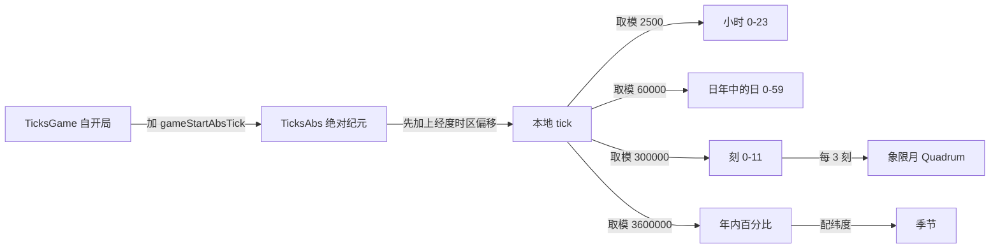
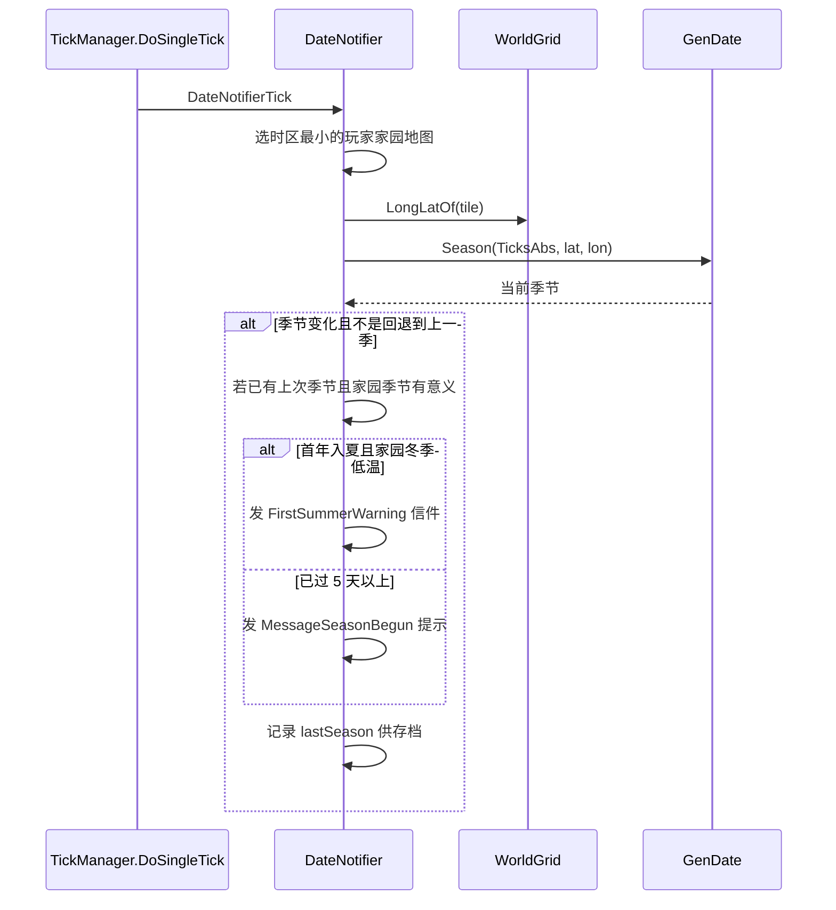
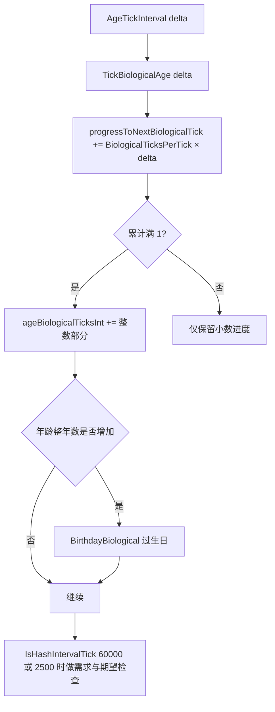

# V02 时间、日历与年龄

卷号：V02
状态：初稿（R3）
上游：V01（tick 管线）、V15（数据来源）；下游：V09（事件按日/季投放）、V13（心情/需求随时间）、V14（年龄与医疗）

## Scope

本卷解构**游戏内时间如何被解释**：`TicksGame`（自开局计时）与 `TicksAbs`（绝对纪元）的换算、一天/一刻/一年/一季的 tick 长度、时区与经度的本地时间、季节判定（含极地特例）、以及生物年龄如何在 tick 上累积与过生日。

同时闭环 V01 留下的疑问：高倍速下实际推进量是否受帧率影响（见 `Open questions` 第 1 条与本卷常量表推导）。

不覆盖：`TimeSpeed` 档位与倍率（V01）；天气与温度（V03/V13）；故事叙述者按日投放事件（V09）。

## Key types

| 类型 | Token | 语料路径 | 角色 |
|---|---|---|---|
| `RimWorld.GenDate` | 0x02001E56 | `Assembly-CSharp/RimWorld/GenDate.cs` | 日历换算的唯一权威（常量 + 全部取整函数） |
| `Verse.GenTicks` | 0x020006F2 | `Assembly-CSharp/Verse/GenTicks.cs` | tick 常量、间隔判定、开局时刻配置 |
| `Verse.TickManager` | 0x020001FB | `Assembly-CSharp/Verse/TickManager.cs` | `TicksGame`/`TicksAbs`/`SettleTick` |
| `RimWorld.DateNotifier` | 0x02001024 | `Assembly-CSharp/RimWorld/DateNotifier.cs` | 每 tick 判季，发季节提示 |
| `RimWorld.SeasonUtility` | 0x02001E5D | `Assembly-CSharp/RimWorld/SeasonUtility.cs` | 按纬度+年内进度算季节权重 |
| `RimWorld.QuadrumUtility` | 0x02001E5B | `Assembly-CSharp/RimWorld/QuadrumUtility.cs` | 四分期（象限月）边界 |
| `Verse.Pawn_AgeTracker` | 0x020004DE | `Assembly-CSharp/Verse/Pawn_AgeTracker.cs` | 生物/历法年龄、生日、成长时刻 |
| `RimWorld.ConfiguredTicksAbsAtGameStartCache` | 0x020015FC | `Assembly-CSharp/RimWorld/ConfiguredTicksAbsAtGameStartCache.cs` | 开局绝对 tick 的缓存 |

## Control flow

### 1. 时间标尺与换算

标尺（全部为常量，见下表）：1 小时 = 2500 tick，1 天 = 60000 tick，1 刻（twelfth）= 5 天 = 300000 tick，1 季 = 3 刻 = 15 天 = 900000 tick，1 年 = 12 刻 = 60 天 = 3600000 tick。

### 2. 每 tick 的日历工作（`DateNotifier.DateNotifierTick`）

### 3. 年龄推进（`Pawn_AgeTracker.AgeTickInterval`）

要点：生物年龄以 `BiologicalTicksPerTick` 作为**速率系数**（默认 1，基因/药物/年龄反转可改），所以「生物年龄」与「历法年龄」在同一年份长度下可能不同步；生日由整年数跨越触发，而不是固定 tick 点。

## Constants

| 常量 | 值 | 位置 |
|---|---:|---|
| `TicksPerHour` | 2500 | `GenDate` |
| `HoursPerDay` | 24 | `GenDate` |
| `TicksPerDay` | 60000 | `GenDate` |
| `DaysPerTwelfth` | 5 | `GenDate` |
| `TicksPerTwelfth` | 300000 | `GenDate` |
| `TwelfthsPerYear` | 12 | `GenDate` |
| `DaysPerSeason` / `DaysPerQuadrum` | 15 | `GenDate` |
| `TicksPerSeason` / `TicksPerQuadrum` | 900000 | `GenDate` |
| `DaysPerYear` | 60 | `GenDate` |
| `TicksPerYear` | 3600000 | `GenDate` |
| `TimeZoneWidth` | 15（度/时区） | `GenDate` |
| `GameStartHourOfDay` | 6 | `GenDate` |
| `DefaultStartingYear` | 5500 | `GenDate` |
| `TicksPerRealSecond` | 60 | `GenTicks` |
| `SecondsPerTick` | 0.016666668（=1/60） | `GenTicks` |
| `TickRareInterval` / `TickLongInterval` | 250 / 2000 | `GenTicks` |

由标尺可直接换算：**1 游戏年 = 60 游戏天 = 3,600,000 tick = 16.7 游戏小时（Normal 速度的实时）**；Ultrafast（15 倍）下推进 1 年约需 1.1 实时小时，若受每帧上限约束则更久（见 `Open questions` 第 1 条）。

## Claims

[claim:V02-C01] 一天 60000 tick（24 小时 × 2500）。
  src: RimWorld.GenDate.TicksPerDay  Token: 0x02001E56
  file: analysis/decompiled/Assembly-CSharp/RimWorld/GenDate.cs
  match: public const int TicksPerDay = 60000;

[claim:V02-C02] 一年 3600000 tick，折合 60 天。
  src: RimWorld.GenDate.TicksPerYear
  file: analysis/decompiled/Assembly-CSharp/RimWorld/GenDate.cs
  match: public const int TicksPerYear = 3600000;

[claim:V02-C03] 一年 60 天，一季 15 天，一季 3 刻。
  src: RimWorld.GenDate.DaysPerYear
  file: analysis/decompiled/Assembly-CSharp/RimWorld/GenDate.cs
  match: public const int DaysPerYear = 60;

[claim:V02-C04] 开局时刻固定在当天 6 点。
  src: RimWorld.GenDate.GameStartHourOfDay
  file: analysis/decompiled/Assembly-CSharp/RimWorld/GenDate.cs
  match: public const int GameStartHourOfDay = 6;

[claim:V02-C05] 时区宽度为 15 度，即每个时区 2500 tick 的偏移。
  src: RimWorld.GenDate.TimeZoneWidth
  file: analysis/decompiled/Assembly-CSharp/RimWorld/GenDate.cs
  match: public const float TimeZoneWidth = 15f;

[claim:V02-C06] 本地 tick 偏移 = 经度对应时区 × 2500。
  src: RimWorld.GenDate.LocalTicksOffsetFromLongitude
  file: analysis/decompiled/Assembly-CSharp/RimWorld/GenDate.cs
  match: return (long)GenDate.TimeZoneAt(longitude) * 2500L;

[claim:V02-C07] 小时数由本地 tick 对 2500 取模再映射到 0–23。
  src: RimWorld.GenDate.HourOfDay
  file: analysis/decompiled/Assembly-CSharp/RimWorld/GenDate.cs
  match: return GenMath.PositiveModRemap(absTicks + GenDate.LocalTicksOffsetFromLongitude(longitude), 2500, 24);

[claim:V02-C08] 已过天数按 `ticksGame / 60000` 向下取整（用自开局 tick，不是绝对 tick）。
  src: RimWorld.GenDate.DaysPassedAt
  file: analysis/decompiled/Assembly-CSharp/RimWorld/GenDate.cs
  match: return Mathf.FloorToInt((float)gameTicks / 60000f);

[claim:V02-C09] 已过年数按 `ticksGame / 3600000` 向下取整。
  src: RimWorld.GenDate.YearsPassedAt
  file: analysis/decompiled/Assembly-CSharp/RimWorld/GenDate.cs
  match: return Mathf.FloorToInt((float)gameTicks / 3600000f);

[claim:V02-C10] 季节不是简单的四等分：由「年内百分比 + 纬度」共同决定。
  src: RimWorld.GenDate.Season
  file: analysis/decompiled/Assembly-CSharp/RimWorld/GenDate.cs
  match: return SeasonUtility.GetReportedSeason(GenDate.YearPercent(absTicks, longitude), latitude);

[claim:V02-C11] 极地存在常夏/常冬季节状态，季节判定可返回它们。
  src: RimWorld.SeasonUtility.GetReportedSeason  Token: 0x02001E5D
  file: analysis/decompiled/Assembly-CSharp/RimWorld/SeasonUtility.cs
  match: return Season.PermanentWinter;

[claim:V02-C12] `Season` 枚举含 `PermanentSummer`/`PermanentWinter` 两个极地取值。
  src: RimWorld.Season  Token: 0x02001E5C
  file: analysis/decompiled/Assembly-CSharp/RimWorld/Season.cs
  match: PermanentSummer

[claim:V02-C13] 象限月是四个：`Aprimay`/`Jugust`/`Septober`/`Decembary`。
  src: RimWorld.Quadrum  Token: 0x02001E5A
  file: analysis/decompiled/Assembly-CSharp/RimWorld/Quadrum.cs
  match: Septober

[claim:V02-C14] 季节提示以「时区最小」的玩家家园地图为准。
  src: RimWorld.DateNotifier.DateNotifierTick  Token: 0x02001024
  file: analysis/decompiled/Assembly-CSharp/RimWorld/DateNotifier.cs
  match: Map map = this.FindPlayerHomeWithMinTimezone();

[claim:V02-C15] 开局 5 天内的季节变化不发宽泛提示（避免开局刷屏）。
  src: RimWorld.DateNotifier.DateNotifierTick
  file: analysis/decompiled/Assembly-CSharp/RimWorld/DateNotifier.cs
  match: else if (GenDate.DaysPassed > 5)

[claim:V02-C16] 季节回退到上一季（例如南半球镜像）不会触发「新季节开始」提示。
  src: RimWorld.DateNotifier.DateNotifierTick
  file: analysis/decompiled/Assembly-CSharp/RimWorld/DateNotifier.cs
  match: if (season != this.lastSeason && (this.lastSeason == Season.Undefined || season != this.lastSeason.GetPreviousSeason()))

[claim:V02-C17] `DateNotifier` 只持久化 `lastSeason` 一个字段。
  src: RimWorld.DateNotifier.ExposeData
  file: analysis/decompiled/Assembly-CSharp/RimWorld/DateNotifier.cs
  match: Scribe_Values.Look<Season>(ref this.lastSeason, "lastSeason", Season.Undefined, false);

[claim:V02-C18] 开局绝对 tick 在 `Game` 初始化时由 `GenTicks.ConfiguredTicksAbsAtGameStart` 写入。
  src: Verse.Game  Token: 0x020001E9
  file: analysis/decompiled/Assembly-CSharp/Verse/Game.cs
  match: this.tickManager.gameStartAbsTick = GenTicks.ConfiguredTicksAbsAtGameStart;

[claim:V02-C19] 开局时刻的算法：`刻序号 × 300000 + 小时(6 + 时区修正) × 2500`。
  src: Verse.GenTicks.ConfiguredTicksAbsAtGameStart  Token: 0x020006F2
  file: analysis/decompiled/Assembly-CSharp/Verse/GenTicks.cs
  match: int num3 = 300000 * (int)twelfth + 2500 * (6 + num2);

[claim:V02-C20] 未指定起始季节时，优先选该地块的「暖刻」，无地块时退回夏季。
  src: Verse.GenTicks.ConfiguredTicksAbsAtGameStart
  file: analysis/decompiled/Assembly-CSharp/Verse/GenTicks.cs
  match: twelfth = TwelfthUtility.FindStartingWarmTwelfth(gameInitData.startingTile);

[claim:V02-C21] `TicksAbs` 依赖 `gameStartAbsTick`，未设置时降级返回 `TicksGame` 并报错。
  src: Verse.TickManager.TicksAbs  Token: 0x020001FB
  file: analysis/decompiled/Assembly-CSharp/Verse/TickManager.cs
  match: if (this.gameStartAbsTick == 0)

[claim:V02-C22] `TicksSinceSettle` 是自「定居刻」起的 tick 数，用于开局保护期类判断。
  src: Verse.TickManager.TicksSinceSettle
  file: analysis/decompiled/Assembly-CSharp/Verse/TickManager.cs
  match: return this.ticksGameInt - this.lastSettleTicksInt;

[claim:V02-C23] 生物年龄整年数 = 生物年龄 tick / 3600000。
  src: Verse.Pawn_AgeTracker.AgeBiologicalYears  Token: 0x020004DE
  file: analysis/decompiled/Assembly-CSharp/Verse/Pawn_AgeTracker.cs
  match: return (int)(this.ageBiologicalTicksInt / 3600000L);

[claim:V02-C24] 生物年龄按 `BiologicalTicksPerTick` 速率累积，速率可不为 1。
  src: Verse.Pawn_AgeTracker.TickBiologicalAge
  file: analysis/decompiled/Assembly-CSharp/Verse/Pawn_AgeTracker.cs
  match: this.progressToNextBiologicalTick += this.BiologicalTicksPerTick * (float)interval;

[claim:V02-C25] 生日由「整年数跨越」触发，不是固定 tick 时刻。
  src: Verse.Pawn_AgeTracker.AgeTickInterval
  file: analysis/decompiled/Assembly-CSharp/Verse/Pawn_AgeTracker.cs
  match: if (ageBiologicalYears < this.AgeBiologicalYears)

[claim:V02-C26] 年龄反转需求检查按 60000 tick（1 天）的哈希间隔执行。
  src: Verse.Pawn_AgeTracker.AgeTickInterval
  file: analysis/decompiled/Assembly-CSharp/Verse/Pawn_AgeTracker.cs
  match: if (this.pawn.IsHashIntervalTick(60000, delta))

[claim:V02-C27] 60 tick = 1 游戏秒，与 `TicksPerRealSecond` 常量一致。
  src: Verse.GenTicks.TicksToSeconds
  file: analysis/decompiled/Assembly-CSharp/Verse/GenTicks.cs
  match: public const int TicksPerRealSecond = 60;

[claim:V02-C28] `GenTicks` 在无 `TickManager` 时用开局配置值顶替 `TicksAbs`。
  src: Verse.GenTicks.TicksAbs
  file: analysis/decompiled/Assembly-CSharp/Verse/GenTicks.cs
  match: return GenTicks.ConfiguredTicksAbsAtGameStart;

## Resolved questions

原 `Open questions` 第 2 条（`IsHashIntervalTick` 定义）已在 R4 由 V04 解出，R12 回填本卷：

- `IsHashIntervalTick` 是 `Verse.Gen` 的扩展方法族（`Map` / `Thing` / `WorldObject` / `Faction` 四个重载），语义为 `(TicksGame + id.HashOffset()) % interval == 0`，盐值 `169495093`。所以本卷的「60000/2500 tick 检查」用的是**实体 ID 哈希错峰**，不是全局定时器。

[claim:V02-C29] `IsHashIntervalTick` 定义在 `Verse.Gen`，`Thing` 版本是第一等重载。
  src: Verse.Gen.IsHashIntervalTick(Thing, int)
  file: analysis/decompiled/Assembly-CSharp/Verse/Gen.cs
  match: public static bool IsHashIntervalTick(this Thing t, int interval)

### 季节权重与缓存（原 OQ3、OQ4）

- **季节权重算法（OQ3）**：`SeasonUtility.GetSeason(yearPct, latitude, out spring, out summer, out fall, out winter, out permanentSummer, out permanentWinter)` —— 六个出参分别是四季与「常夏/常冬」的权重；`GetReportedSeason` 先看常夏/常冬是否为 1，否则用 `MaxBy` 在四季里取最大者。极地不是「特殊分支」，而是权重自然变成 1/0。
- **开局 tick 缓存（OQ4）**：`ConfiguredTicksAbsAtGameStartCache` 只缓存**一个**结果，键是 `cachedForStartingTile` + `cachedForStartingSeason`；改起始季节或换起始地块都会不命中并重算。

### 十二刻名称（原 OQ5）

`Twelfth` 枚举是 `First` … `Twelfth` 共 12 个 + `Undefined`。命名是序数，不含季节语义——季节由纬度+年内进度另行计算（本卷「季节不是四等分」的结论因此更清楚）。

[claim:V02-C30] 季节权重是六参数输出（四季 + 常夏 + 常冬）。
  src: RimWorld.SeasonUtility.GetSeason
  file: analysis/decompiled/Assembly-CSharp/RimWorld/SeasonUtility.cs
  match: public static void GetSeason(float yearPct, float latitude, out float spring, out float summer, out float fall, out float winter, out float permanentSummer, out float permanentWinter)

[claim:V02-C31] 开局 tick 缓存以「起始地块 + 起始季节」为键，只缓存单条结果。
  src: RimWorld.ConfiguredTicksAbsAtGameStartCache
  file: analysis/decompiled/Assembly-CSharp/RimWorld/ConfiguredTicksAbsAtGameStartCache.cs
  match: private PlanetTile cachedForStartingTile = PlanetTile.Invalid;

## Open questions

1. **高倍速实际倍率的闭环（接 V01）**：`TickManagerUpdate` 每帧受「倍率×2」与 45.454544 ms 双闸门限制。以 Ultrafast 15 倍为例，理论每 tick 1.1 ms，则 45.45 ms 预算内最多约 41 tick，而闸门允许 30 tick —— 说明在**单 tick 成本 < 1.5 ms** 时表值可达成，否则由实际耗时决定。本卷只给出换算关系，未做运行时测量（本项目为静态解构）。
2. **`IsHashIntervalTick` 的精确定义未取证**：`Pawn_AgeTracker` 用它做 60000/2500 tick 的检查，但该方法不在已确认的类型清单内（可能是 `Thing` 的扩展或 `Verse.Gen` 的方法），需在 V04 补。
3. **南半球/极地的季节镜像逻辑**只确认了「回退到上一季不发提示」这一表述，`SeasonUtility.GetSeason` 的六参数权重算法（春/夏/秋/冬/常夏/常冬）未逐行解构。
4. `ConfiguredTicksAbsAtGameStartCache` 的缓存键是 `GameInitData`，但命中条件与失效时机（重开新档、改起始季节）未验证。
5. 「1 刻 = 5 天」与 `DaysPerTwelfth` 一致，但 `Twelfth` 枚举的 12 个取值名未记录（枚举在 `RimWorld.Twelfth`，本卷未引用其名称）。
