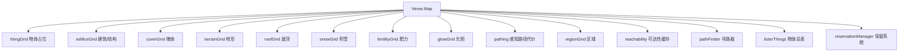
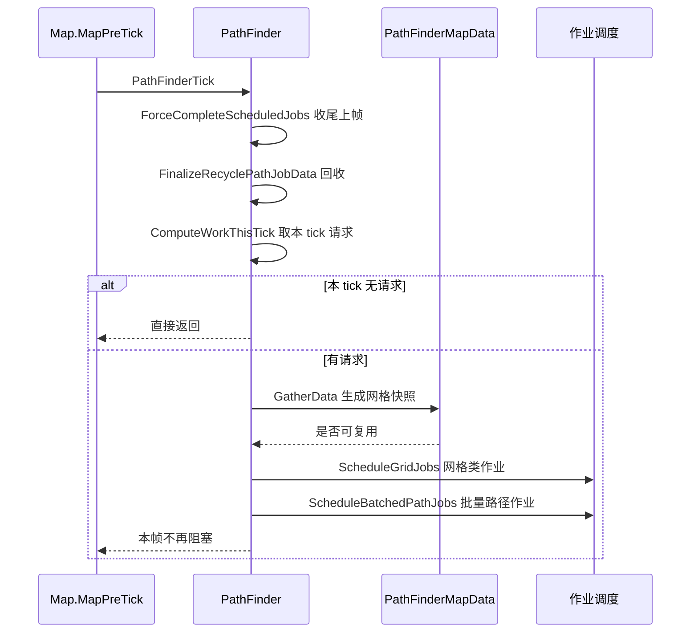
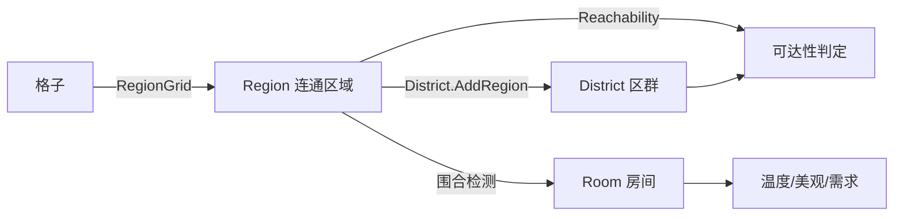

# V03 地图、网格与寻路

卷号：V03
状态：初稿（R4）
上游：V01（`MapPreTick` 位置）、V04（Thing 注册进网格）；下游：V06（AI 走路径）、V10（世界地图）

## Scope

本卷解构**一张地图内部的空间数据结构与寻路**：`Map` 持有的十几种网格、区域/区群（Region/District）体系、可达性缓存，以及 1.7 版改成**批量作业式**的寻路器。

覆盖重点是一个玩家看不见、但决定一切 AI 行为的层：物体进入地图时被注册进哪些网格，地形/物体变化时哪些缓存被清空，路径查询如何排队与摊销。

不覆盖：地形生成（`MapGenerator`，属 V10/生成流程）；`JobDriver` 如何使用路径（V06）；渲染网格（V17）。

## Key types

| 类型 | Token | 语料路径 | 角色 |
|---|---|---|---|
| `Verse.Map` | 0x02000299 | `Assembly-CSharp/Verse/Map.cs` | 地图容器，持有全部网格与子系统 |
| `Verse.PathFinder` | 0x02000362 | `Assembly-CSharp/Verse/PathFinder.cs` | 寻路器（作业式，每 tick 摊销） |
| `Verse.PathFinderMapData` | 0x02000367 | `Assembly-CSharp/Verse/PathFinderMapData.cs` | 寻路的网格快照数据 |
| `Verse.Pathing` | — | `Assembly-CSharp/Verse/Pathing.cs` | 感知路径代价维护（物体/地形变化时重算） |
| `Verse.Reachability` | 0x020002F0 | `Assembly-CSharp/Verse/Reachability.cs` | 可达性缓存（按 pawn/敌对者分桶） |
| `Verse.RegionGrid` | 0x020002F9 | `Assembly-CSharp/Verse/RegionGrid.cs` | 网格 → Region 的映射 |
| `Verse.Region` | 0x020002F5 | `Assembly-CSharp/Verse/Region.cs` | 连通区域（同地形/可通行性） |
| `Verse.District` | 0x020002EB | `Assembly-CSharp/Verse/District.cs` | 由 Region 合并成的更大连通块 |
| `Verse.Room` | 0x02000306 | `Assembly-CSharp/Verse/Room.cs` | 室内空间（区域围合结果） |
| `Verse.TraverseParms` | 0x020000F0 | `Assembly-CSharp/Verse/TraverseParms.cs` | 穿越权限参数（门/危险/水域…） |

## Control flow

### 1. 网格族（`Map` 的字段）

凡是「某格子上有什么」的查询都走这些网格，而不是遍历物体列表；网格的维护发生在物体 spawn/despawn 时（见 V04）。

### 2. 寻路器在 1.7 的形态（批量作业）

关键变化：路径查询**不再是同步 A\***。`PathFinderTick` 每 tick 只处理收集到的请求，把网格数据打包、把作业排进调度器；同步入口 `FindPathNow` 仍保留，供必须立刻拿到结果的场合。这样寻路成本被摊到多帧，代价是路径有延迟。

### 3. Region → District → Room 三层

- `Region` 是「同一种可通行性 + 同一地形类别」的连通格集合；
- `District` 把相邻 `Region` 合并成更大的连通块，供「能不能走过去」这类粗判定用；
- `Room` 是围合出的室内空间，被温度/需求/美观等子系统引用。

可达性判定基于 `Region`/`District` 与 `TraverseParms`（能否穿门、能否涉水、危险上限），不是逐格搜索。

## Constants

| 项 | 值 / 规则 | 位置 |
|---|---|---|
| 网格数量（`Map` 核心） | 9 个几何/状态网格 + 3 个索引（`regionGrid`/`reachability`/`pathFinder`） | `Map` 字段 |
| 寻路摊销方式 | 每 tick 一次批处理，未完成作业下帧收尾 | `PathFinder.PathFinderTick` |
| 路径请求入口 | `PushRequest`（异步）/ `FindPathNow`（同步） | `PathFinder` |
| 启发强度 | 由 `DetermineHeuristicStrength(pawn, start, dest)` 动态决定 | `PathFinder` |
| 代价重算触发 | `def.pathCost != 0` 或不可通行时重算该格路径代价 | `Thing.SpawnSetup/DeSpawn` |
| 可达性失效 | `def.AffectsReachability` 为真时清空缓存 | `Thing.SpawnSetup/DeSpawn` |
| 区域失效 | `def.AffectsRegions` 为真时标脏 | `Thing.SpawnSetup/DeSpawn` |
| 区群集合 | `RegionGrid.allDistricts` | `RegionGrid` |
| 穿越权限判定 | `Region.Allows(TraverseParms, bool isDestination)` | `Region` |

## Claims

[claim:V03-C01] `Map` 直接持有物体总表、寻路器、区域网格与可达性缓存，均为公有字段。
  src: Verse.Map  Token: 0x02000299
  file: analysis/decompiled/Assembly-CSharp/Verse/Map.cs
  match: public ThingGrid thingGrid;

[claim:V03-C02] 寻路器在地图对象上，每张地图一个实例。
  src: Verse.Map.pathFinder
  file: analysis/decompiled/Assembly-CSharp/Verse/Map.cs
  match: public PathFinder pathFinder;

[claim:V03-C03] 可达性缓存同样按地图持有。
  src: Verse.Map.reachability
  file: analysis/decompiled/Assembly-CSharp/Verse/Map.cs
  match: public Reachability reachability;

[claim:V03-C04] `PathFinderTick` 每 tick 先收尾上一批作业，再取本 tick 的请求。
  src: Verse.PathFinder.PathFinderTick  Token: 0x02000362
  file: analysis/decompiled/Assembly-CSharp/Verse/PathFinder.cs
  match: this.ForceCompleteScheduledJobs();

[claim:V03-C05] 本 tick 没有请求时立即返回，不做任何网格打包。
  src: Verse.PathFinder.PathFinderTick
  file: analysis/decompiled/Assembly-CSharp/Verse/PathFinder.cs
  match: if (this.tmpCurrentWork.Count == 0)

[claim:V03-C06] 网格数据按批次 `GatherData` 一次性打包，供后续作业复用。
  src: Verse.PathFinder.PathFinderTick
  file: analysis/decompiled/Assembly-CSharp/Verse/PathFinder.cs
  match: if (this.mapData.GatherData(this.tmpCurrentWork))

[claim:V03-C07] 路径作业被排进调度器批量执行，而不是当场算完。
  src: Verse.PathFinder.PathFinderTick
  file: analysis/decompiled/Assembly-CSharp/Verse/PathFinder.cs
  match: this.ScheduleBatchedPathJobs(jobHandle);

[claim:V03-C08] 仍保留同步寻路入口，供必须立刻得到结果的调用方使用。
  src: Verse.PathFinder.FindPathNow
  file: analysis/decompiled/Assembly-CSharp/Verse/PathFinder.cs
  match: public PawnPath FindPathNow(IntVec3 start, LocalTargetInfo target, Pawn pawn, PathFinderCostTuning? tuning = null, PathEndMode peMode = PathEndMode.OnCell)

[claim:V03-C09] 异步请求通过 `PushRequest` 入队。
  src: Verse.PathFinder.PushRequest
  file: analysis/decompiled/Assembly-CSharp/Verse/PathFinder.cs
  match: public void PushRequest(PathRequest request)

[claim:V03-C10] 启发式强度是动态计算的，不是固定系数。
  src: Verse.PathFinder.DetermineHeuristicStrength
  file: analysis/decompiled/Assembly-CSharp/Verse/PathFinder.cs
  match: private static float DetermineHeuristicStrength(Pawn pawn, IntVec3 start, LocalTargetInfo dest)

[claim:V03-C11] 可达性缓存可按单个 pawn 精确失效，避免全清。
  src: Verse.Reachability.ClearCacheFor  Token: 0x020002F0
  file: analysis/decompiled/Assembly-CSharp/Verse/Reachability.cs
  match: public void ClearCacheFor(Pawn pawn)

[claim:V03-C12] 可达性提供「能否到达殖民地」这类语义化查询，说明判定基于区域而非逐格。
  src: Verse.Reachability.CanReachColony
  file: analysis/decompiled/Assembly-CSharp/Verse/Reachability.cs
  match: public bool CanReachColony(IntVec3 c)

[claim:V03-C13] `Region` 自己决定「能否被某种穿越参数穿过」。
  src: Verse.Region.Allows  Token: 0x020002F5
  file: analysis/decompiled/Assembly-CSharp/Verse/Region.cs
  match: public bool Allows(TraverseParms tp, bool isDestination)

[claim:V03-C14] `District` 由多个 `Region` 合并而成。
  src: Verse.District.AddRegion  Token: 0x020002EB
  file: analysis/decompiled/Assembly-CSharp/Verse/District.cs
  match: public void AddRegion(Region r)

[claim:V03-C15] 全部区群由区域网格统一持有。
  src: Verse.RegionGrid.allDistricts  Token: 0x020002F9
  file: analysis/decompiled/Assembly-CSharp/Verse/RegionGrid.cs
  match: public List<District> allDistricts = new List<District>();

[claim:V03-C16] 区域查询有两个版本：需要时重建（`GetValidRegionAt`）与只读不重建（`GetValidRegionAt_NoRebuild`）。
  src: Verse.RegionGrid.GetValidRegionAt_NoRebuild
  file: analysis/decompiled/Assembly-CSharp/Verse/RegionGrid.cs
  match: public Region GetValidRegionAt_NoRebuild(IntVec3 c)

[claim:V03-C17] 物体进入地图时若会影响区域，会标脏区域重建。
  src: Verse.Thing.SpawnSetup
  file: analysis/decompiled/Assembly-CSharp/Verse/Thing.cs
  match: map.regionDirtyer.Notify_ThingAffectingRegionsSpawned(this);

[claim:V03-C18] 物体的路径代价在 spawn 时被立即重算，因此建筑落地即影响寻路。
  src: Verse.Thing.SpawnSetup
  file: analysis/decompiled/Assembly-CSharp/Verse/Thing.cs
  match: map.pathing.RecalculatePerceivedPathCostUnderThing(this);

[claim:V03-C19] 地形网格独立于物体网格存放地形数据。
  src: Verse.Map.terrainGrid
  file: analysis/decompiled/Assembly-CSharp/Verse/Map.cs
  match: public TerrainGrid terrainGrid;

[claim:V03-C20] 区域网格独立存放「格子属于哪个区域」的映射。
  src: Verse.Map.regionGrid
  file: analysis/decompiled/Assembly-CSharp/Verse/Map.cs
  match: public RegionGrid regionGrid;

## Resolved questions

原 `Open questions` 之外的一处跨卷悬空（V01 遗留）在 R12 解开：

- **`MapComponentTick` 与 `MapComponentUpdate` 的分工**：前者在 tick 路径（`Map.MapPostTick` 内），后者在**帧路径**（`Map.MapUpdate` 末尾，与 `WeatherManagerUpdate`、`FleckManagerUpdate` 同批）。同一组件因此有两套钩子：逻辑推进走 tick，表现/插值走帧。这也解释了为什么地图组件的动画不会随加速档位抖动。

[claim:V03-C21] 帧路径（`MapUpdate`）末尾单独调用组件的 update 钩子，与 tick 路径分离。
  src: Verse.Map.MapUpdate
  file: analysis/decompiled/Assembly-CSharp/Verse/Map.cs
  match: MapComponentUtility.MapComponentUpdate(this);

### PathFinderCostTuning 的调参面（原 OQ2）

`PathFinderCostTuning` 是一组具名代价字段，覆盖「墙/门/蓝图/水/危险/主区域外」等维度，其中墙与门还带**按血量递增的附加代价**：

| 字段 | 含义 |
|---|---|
| `costBlockedWallBase` | 撞墙绕行基础代价 |
| `costBlockedWallExtraPerHitPoint` | 每点墙血量追加代价 |
| `costBlockedWallExtraForNaturalWalls` | 自然岩壁额外代价 |
| `costBlockedDoor` / `costBlockedDoorPerHitPoint` | 门与按血量的追加 |
| `costOffLordWalkGrid` | 走出可走区域代价 |
| `costDanger` | 穿越危险格代价 |
| `costWater` | 涉水代价 |
| `costBlueprintFrame` | 蓝图/框架代价 |

所以「AI 走位偏好」不是单一权重，而是**九维代价向量**在 A\* 上的投影。

[claim:V03-C22] 路径代价以「撞墙基础代价」为首个调参项，其余按维度排列。
  src: Verse.PathFinderCostTuning
  file: analysis/decompiled/Assembly-CSharp/Verse/PathFinderCostTuning.cs
  match: public int costBlockedWallBase;

### 区域危险度缓存（原 OQ4，部分）

`Region.DangerFor(pawn)` 不是每问每算：它按 `GenTicks.TicksGame` 缓存整张表的过期时刻，并在表内按 `Pawn` 分别缓存结果（`cachedDangers` 字典）。所以在同一 tick 内反复询问同一 (区域, pawn) 组合是零成本的；跨 tick 才重算。与 `Reachability` 的 `maxDanger` 如何叠加仍未定论（后者按可达性过滤，前者按区域评估）。

[claim:V03-C23] 区域危险度按 tick 过期 + 按 pawn 分桶缓存。
  src: Verse.Region.DangerFor
  file: analysis/decompiled/Assembly-CSharp/Verse/Region.cs
  match: if (this.cachedDangersForTick != GenTicks.TicksGame)

## Resolved questions

原 `Open questions` 第 1 条（作业调度的真实并行度）在 R20 解除阻塞并解出——`Waylith` 语料补全后 `Waylith.Jobs` 可直接读：

- 引擎自带一套**专用线程池**，不是 .NET `ThreadPool`：`WaylithJobRuntime` 首次使用时建 `Math.Max(1, Environment.ProcessorCount - 1)` 个线程，`IsBackground = true`、`Priority = AboveNormal`，每个线程跑 `WorkerLoop(workerIndex)` 并绑定自己的槽位。
- 对外接口是 `BeginFrame(frameIndex)` + 三组 `For(...)`（数组 / 列表 / 整数区间）与结构化作业 `For<TJob>(job, iterationCount, batchSize) where TJob : struct, IWaylithParallelForJob`。
- 所以寻路的 `JobHandle` / `ScheduleBatchedPathJobs` 落在这套线程池上：**并行度 = CPU 核数 − 1**（留一个核给主线程），按 `batchSize` 切分迭代。

[claim:V03-C24] 作业线程数取「CPU 核数 − 1」，至少 1 个。
  src: Waylith.Jobs.WaylithJobRuntime
  file: analysis/decompiled/Waylith/Jobs/WaylithJobRuntime.cs
  match: int num = Math.Max(1, Environment.ProcessorCount - 1);

[claim:V03-C25] 工作线程是后台线程，进程退出时不会阻止关闭。
  src: Waylith.Jobs.WaylithJobRuntime
  file: analysis/decompiled/Waylith/Jobs/WaylithJobRuntime.cs
  match: thread.IsBackground = true;

[claim:V03-C26] 工作线程优先级高于普通线程，说明并行作业被视为延迟敏感。
  src: Waylith.Jobs.WaylithJobRuntime
  file: analysis/decompiled/Waylith/Jobs/WaylithJobRuntime.cs
  match: thread.Priority = ThreadPriority.AboveNormal;

[claim:V03-C27] 结构化并行作业通过 `IWaylithParallelForJob` + batchSize 切分迭代。
  src: Waylith.Jobs.WaylithJobRuntime.For
  file: analysis/decompiled/Waylith/Jobs/WaylithJobRuntime.cs
  match: public static void For<TJob>(TJob job, int iterationCount, int batchSize = 1) where TJob : struct, IWaylithParallelForJob

[claim:V03-C28] 作业系统按帧推进（每帧一个 frameIndex）。
  src: Waylith.Jobs.WaylithJobRuntime.BeginFrame
  file: analysis/decompiled/Waylith/Jobs/WaylithJobRuntime.cs
  match: public static void BeginFrame(int frameIndex)

### 危险上限与区域危险的关系（原 OQ4）

两者不叠加、而是**分层**：`Region.DangerFor(pawn)` 负责「这个区域对某个 pawn 有多危险」，`Reachability` 的 `maxDanger` 是**过滤门槛** —— 调用方传入 `Danger maxDanger`，它被包进 `TraverseParms.For(traverseMode, maxDanger, ...)`，由区域/网格的穿越判定去比对。即：先算危险（区域侧），再用上限过滤（可达性侧），不是一个函数里做两次判断。

[claim:V03-C29] 危险上限通过 `TraverseParms` 传入可达性判定，而非在可达性内部重算危险。
  src: Verse.Reachability.CanReach
  file: analysis/decompiled/Assembly-CSharp/Verse/Reachability.cs
  match: return this.CanReach(start, dest, peMode, TraverseParms.For(traverseMode, maxDanger, false, false, false, true, false));

## Open questions

1. **作业调度的真实并行度未取证**：`ScheduleBatchedPathJobs`/`ScheduleGridJob`/`JobHandle` 表明用了作业系统，但 `Waylith` 引擎侧实现未全量落地（见 `state.md` 限制 1），无法确认是工作线程并行还是主线程分帧。
2. `PathFinderCostTuning`（0x02000363）的调参项未解构：它决定门、污物、水、危险等代价权重，直接决定 AI 走位。
3. `Pathing.RecalculatePerceivedPathCostUnderThing` 的代价传播范围（是否影响相邻格/对角线）未验证。
4. `Region.DangerFor(pawn)` 的危险评估与 `Reachability` 的 `maxDanger` 判定如何叠加，未做交叉验证。
5. `Room` 的围合判定（`Region` 如何升级为 `Room`）未解构，属 V13/V17 交叉面。
