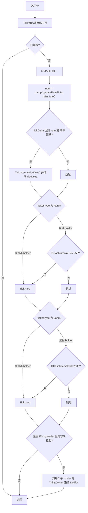
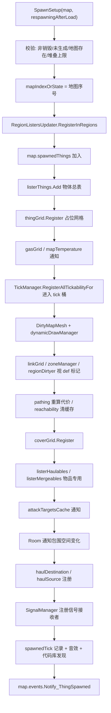

# V04 Thing 系统与实体生命周期

卷号：V04
状态：初稿（R4）
上游：V01（tick 分桶）、V03（网格/区域）；下游：V05（Pawn）、V06（AI）、V07（搬运/仓储）

## Scope

本卷解构**地图上一切实体（`Thing`）的生命周期与 tick 语义**：从生到死要经过哪些注册/注销步骤、`DoTick` 内部如何决定「这次到底跑不跑 `TickRare`/`TickLong`」、被容器夹持时内容物如何递归 tick，以及 `IsHashIntervalTick` 这个被全代码库到处用的错峰原语。

这是 V01 分桶机制的下半场：V01 讲的是「桶怎么选东西」，本卷讲的是「东西被选中后到底做了什么」。

不覆盖：`Pawn` 特有逻辑（V05）；道具/建筑的玩法语义（V07/V08）；`ThingDef` 字段表（V15）。

## Key types

| 类型 | Token | 语料路径 | 角色 |
|---|---|---|---|
| `Verse.Thing` | 0x0200059A | `Assembly-CSharp/Verse/Thing.cs` | 实体基类：`DoTick`/`SpawnSetup`/`DeSpawn`/`Destroy` |
| `Verse.ThingWithComps` | 0x020005A6 | `Assembly-CSharp/Verse/ThingWithComps.cs` | 带组件容器的实体（建筑/武器/Pawn 的基类） |
| `Verse.ThingComp` | 0x02000546 | `Assembly-CSharp/Verse/ThingComp.cs` | 组件基类（行为可插拔） |
| `Verse.ThingOwner` | 0x0200059D | `Assembly-CSharp/Verse/ThingOwner.cs` | 容器物品表（库存/夹持物） |
| `Verse.ListerThings` | 0x02000292 | `Assembly-CSharp/Verse/ListerThings.cs` | 按 `ThingDef` 分桶的物体总表 |
| `Verse.ReservationManager` | — | `Assembly-CSharp/Verse/ReservationManager.cs` | 保留系统（谁占了哪个目标） |
| `Verse.Gen`（扩展方法） | — | `Assembly-CSharp/Verse/Gen.cs` | `IsHashIntervalTick` / `HashOffset` 所在 |
| `Verse.GenTicks` | 0x020006F2 | `Assembly-CSharp/Verse/GenTicks.cs` | `IsTickInterval` 等间隔判定 |

## Control flow

### 1. `DoTick` 的四段结构（`Thing.DoTick`）



三层节流的区别值得记住：

| 层 | 依据 | 何时生效 |
|---|---|---|
| 分桶（V01） | `def.tickerType` + `TicksGame % 间隔` | 决定 `DoTick` 本身被调用的频率 |
| `TickInterval` | `UpdateRateTicks` 与 clamp 上下限 | 物体级可变速率（可被 def/组件改写） |
| `IsHashIntervalTick` | `(TicksGame + 物体ID哈希偏移) % 间隔` | 仅在「被强制每 tick 调用」的实体（holder）内部用来错峰 |

### 2. 出生：`SpawnSetup` 的注册级联



要点：**一次 spawn 会触碰十余个子系统**，且每一步都由 `def` 上的开关决定（`AffectsRegions`、`AffectsReachability`、`pathCost`、`CanAffectLinker`、`receivesSignals`…）。所以「加了个物体」在代码层面等价于一次跨子系统广播。

### 3. 死亡：`DeSpawn` 的镜像注销

`DeSpawn` 与 `SpawnSetup` 严格对称：区域注销 → 总表移除 → 网格注销 → 选中态取消 → 网格脏标记 → 区域/代价/可达性失效 → **`TickManager.DeRegisterAllTickabilityFor`** → `mapIndexOrState = -1` → 物品索引与攻击目标缓存清理 → 释放保留 → 记录 `despawnedTick`。

`spawnedTick` / `despawnedTick` 是「这段时间在图上存在」的原始证据，被大量逻辑（如新鲜度、腐坏、出生保护）依赖。

### 4. 错峰原语 `IsHashIntervalTick`

```text
HashOffsetTicks(t) = Find.TickManager.TicksGame + t.thingIDNumber.HashOffset()
HashOffset(int x)  = Gen.HashCombineInt(x, 169495093)
IsHashIntervalTick(t, interval)        → HashOffsetTicks(t) % interval == 0
IsHashIntervalTick(t, interval, delta) → |HashOffsetTicks(t) % interval| < delta
```

同一套原语也提供 `Map` / `WorldObject` / `Faction` 版本（各自用 `uniqueID` / `ID` / 派系 id 做偏移）。这解释了为什么两个同时生成的东西不会在同 tick 做耗时检查。

## Constants

| 项 | 值 / 规则 | 位置 |
|---|---|---|
| 哈希盐 | `169495093` | `Gen.HashOffset(int)` |
| Rare 错峰间隔 | 250 tick | `Thing.DoTick` |
| Long 错峰间隔 | 2000 tick | `Thing.DoTick` |
| `tickDelta` 持久化 | 存档保留（读档后节流相位不丢） | `Thing.ExposeData` |
| 有效间隔 | `clamp(UpdateRateTicks, MinTickIntervalRate, MaxTickIntervalRate)` | `Thing.DoTick` |
| 未生成标记 | `mapIndexOrState == -1` | `Thing.SpawnSetup/DeSpawn` |
| 销毁模式 | `DestroyMode.Vanish` / `KillFinalize` … | `Thing.DeSpawn`/`Kill` |
| 容器内容暂停 | `ThingOwnerUtility.ContentsSuspended(holder)` | `Thing.DoTick` |
| 堆叠上限 | `def.stackLimit`（超出即截断并报错） | `Thing.SpawnSetup` |

## Claims

[claim:V04-C01] `DoTick` 的第一段是每此调用都执行的 `Tick()`，之后才进入节流判定。
  src: Verse.Thing.DoTick  Token: 0x0200059A
  file: analysis/decompiled/Assembly-CSharp/Verse/Thing.cs
  anchor: using (ProfilerBlock.Scope("DoTick()"))
  match: this.Tick();

[claim:V04-C02] 每次 `DoTick` 都会推进 `tickDelta`，作为可变速率的计数依据。
  src: Verse.Thing.DoTick
  file: analysis/decompiled/Assembly-CSharp/Verse/Thing.cs
  match: this.tickDelta++;

[claim:V04-C03] 有效间隔被三元 clamp 限定在 `MinTickIntervalRate` 与 `MaxTickIntervalRate` 之间。
  src: Verse.Thing.DoTick
  file: analysis/decompiled/Assembly-CSharp/Verse/Thing.cs
  match: int num = Mathf.Min(Mathf.Max(this.UpdateRateTicks, this.MinTickIntervalRate), this.MaxTickIntervalRate);

[claim:V04-C04] 达到间隔或以偏移命中时执行 `TickInterval(tickDelta)` 并清零计数。
  src: Verse.Thing.DoTick
  file: analysis/decompiled/Assembly-CSharp/Verse/Thing.cs
  match: this.TickInterval(this.tickDelta);

[claim:V04-C05] 被强制每 tick 调用的 holder 类型，其 Rare 检查靠哈希错峰，而不是靠分桶。
  src: Verse.Thing.DoTick
  file: analysis/decompiled/Assembly-CSharp/Verse/Thing.cs
  match: this.IsHashIntervalTick(250)

[claim:V04-C06] Long 同理，间隔 2000。
  src: Verse.Thing.DoTick
  file: analysis/decompiled/Assembly-CSharp/Verse/Thing.cs
  match: this.IsHashIntervalTick(2000)

[claim:V04-C07] 容器内容会被递归 tick，形成「holder 树」逐层下推。
  src: Verse.Thing.DoTick
  file: analysis/decompiled/Assembly-CSharp/Verse/Thing.cs
  match: directlyHeldThings.DoTick();

[claim:V04-C08] 内容可被整体挂起（例如冷冻舱/暂停容器），挂起后不再递归 tick。
  src: Verse.Thing.DoTick
  file: analysis/decompiled/Assembly-CSharp/Verse/Thing.cs
  match: ThingOwnerUtility.ContentsSuspended(this.cachedHolder)

[claim:V04-C09] 哈希错峰的时间基准 = 当前 tick + 物体 ID 的哈希偏移。
  src: Verse.Gen.HashOffsetTicks(Thing)
  file: analysis/decompiled/Assembly-CSharp/Verse/Gen.cs
  match: return Find.TickManager.TicksGame + t.thingIDNumber.HashOffset();

[claim:V04-C10] 哈希偏移由固定盐 `169495093` 与 ID 组合而成。
  src: Verse.Gen.HashOffset(int)
  file: analysis/decompiled/Assembly-CSharp/Verse/Gen.cs
  match: return Gen.HashCombineInt(baseInt, 169495093);

[claim:V04-C11] `IsHashIntervalTick` 的判定就是取模为零（带 delta 的版本是「余数小于 delta」）。
  src: Verse.Gen.IsHashIntervalTick(Thing, int)
  file: analysis/decompiled/Assembly-CSharp/Verse/Gen.cs
  match: return t.HashOffsetTicks() % interval == 0;

[claim:V04-C12] 生成时先把自己登记进所在区域的监听列表。
  src: Verse.Thing.SpawnSetup
  file: analysis/decompiled/Assembly-CSharp/Verse/Thing.cs
  match: RegionListersUpdater.RegisterInRegions(this, map);

[claim:V04-C13] 生成时进入物体总表，这是全图按类型检索的基础。
  src: Verse.Thing.SpawnSetup
  file: analysis/decompiled/Assembly-CSharp/Verse/Thing.cs
  match: map.listerThings.Add(this);

[claim:V04-C14] 生成时注册 tick 能力，桶归属由此决定（对应 V01 的 `TickListFor`）。
  src: Verse.Thing.SpawnSetup
  file: analysis/decompiled/Assembly-CSharp/Verse/Thing.cs
  match: Find.TickManager.RegisterAllTickabilityFor(this);

[claim:V04-C15] 生成时进入掩体网格，射击判定依赖它。
  src: Verse.Thing.SpawnSetup
  file: analysis/decompiled/Assembly-CSharp/Verse/Thing.cs
  match: map.coverGrid.Register(this);

[claim:V04-C16] 生成时通知攻击目标缓存，敌对搜索立即可见。
  src: Verse.Thing.SpawnSetup
  file: analysis/decompiled/Assembly-CSharp/Verse/Thing.cs
  match: map.attackTargetsCache.Notify_ThingSpawned(this);

[claim:V04-C17] 物品类实体额外进入「可搬运」索引。
  src: Verse.Thing.SpawnSetup
  file: analysis/decompiled/Assembly-CSharp/Verse/Thing.cs
  match: map.listerHaulables.Notify_Spawned(this);

[claim:V04-C18] 生成时把包围房间标记为「内容变化」，房间温度/美观随之失效。
  src: Verse.Thing.SpawnSetup
  file: analysis/decompiled/Assembly-CSharp/Verse/Thing.cs
  match: room.Notify_ContainedThingSpawnedOrDespawned(this);

[claim:V04-C19] 死亡/移除时注销 tick 能力，此后不再进入任何桶。
  src: Verse.Thing.DeSpawn
  file: analysis/decompiled/Assembly-CSharp/Verse/Thing.cs
  match: Find.TickManager.DeRegisterAllTickabilityFor(this);

[claim:V04-C20] 注销后用 `mapIndexOrState = -1` 表示「不在任何地图上」。
  src: Verse.Thing.DeSpawn
  file: analysis/decompiled/Assembly-CSharp/Verse/Thing.cs
  match: this.mapIndexOrState = -1;

[claim:V04-C21] 注销时记录 `despawnedTick`，与 `spawnedTick` 一起构成存在区间。
  src: Verse.Thing.DeSpawn
  file: analysis/decompiled/Assembly-CSharp/Verse/Thing.cs
  match: this.despawnedTick = Find.TickManager.TicksGame;

[claim:V04-C22] 注销时释放以本物体为目标的全部保留，避免 AI 指向幽灵目标。
  src: Verse.Thing.DeSpawn
  file: analysis/decompiled/Assembly-CSharp/Verse/Thing.cs
  match: map.physicalInteractionReservationManager.ReleaseAllForTarget(this);

[claim:V04-C23] `Kill` 只是把销毁模式切到 `KillFinalize` 再走 `Destroy`。
  src: Verse.Thing.Kill
  file: analysis/decompiled/Assembly-CSharp/Verse/Thing.cs
  match: this.Destroy(DestroyMode.KillFinalize);

[claim:V04-C24] `tickDelta` 参与存档，读档后节流相位延续而不会重置。
  src: Verse.Thing.ExposeData
  file: analysis/decompiled/Assembly-CSharp/Verse/Thing.cs
  match: Scribe_Values.Look<int>(ref this.tickDelta, "tickDelta", 0, false);

[claim:V04-C25] 生成时校验堆叠上限，超出即截断并报错（不静默丢弃）。
  src: Verse.Thing.SpawnSetup
  file: analysis/decompiled/Assembly-CSharp/Verse/Thing.cs
  match: if (this.stackCount > this.def.stackLimit)

## Resolved questions

原 `Open questions` 第 1、2 条在 R12 已解，其中第 1 条是本项目最反直觉的发现之一：

- **`UpdateRateTicks` 的默认值不是常量，而是「相机更新率」**：`Thing.UpdateRateTicks` 返回 `GenTicks.GetCameraUpdateRate(this)`：不在当前地图、或不在相机视野内 → **15**；在视野内 → `(int)(CameraDriver.CurrentZoom + 1)`（缩放越近间隔越小）。也就是说**物体 tick 频率取决于它是否被看着**，屏幕外的东西自动降到 1/15。覆盖者只有四个：`Pawn`（动物固定 15）、`Fire`、`PawnFlyer`、`Projectile`，另有 `Building` 覆写了 `MinTickIntervalRate`。
- **`TickInterval` 与 `Tick` 的关系**：`ThingWithComps.Tick` 只是把 `CompTick()` 转发给每个组件，`TickInterval(delta)` 转发 `CompTickInterval(delta)`；组件自己是空的就什么都不做。所以「基类 Tick 是不是空的」答案是：`Thing` 层面的 `Tick` 没有可见实现，行为全部由子类/组件/覆写提供。

[claim:V04-C26] 默认更新速率来自相机视野判定，屏幕外固定 15。
  src: Verse.Thing.UpdateRateTicks
  file: analysis/decompiled/Assembly-CSharp/Verse/Thing.cs
  match: return GenTicks.GetCameraUpdateRate(this);

[claim:V04-C27] 视野内时更新间隔随相机缩放变化（缩放越近越快）。
  src: Verse.GenTicks.GetCameraUpdateRate
  file: analysis/decompiled/Assembly-CSharp/Verse/GenTicks.cs
  match: return (int)(cameraDriver.CurrentZoom + 1);

[claim:V04-C28] 组件化转发：每 tick 调组件的 `CompTick`。
  src: Verse.ThingWithComps.Tick
  file: analysis/decompiled/Assembly-CSharp/Verse/ThingWithComps.cs
  match: this.comps[i].CompTick();

### 地图索引字段（原 OQ5）

`mapIndexOrState` 的实际声明是 `private sbyte mapIndexOrState = -1;` —— 用有符号字节存地图序号，负值当哨兵（`-1` 未生成、`-2`/`-3` 其他状态，见 `Thing` 内的比较）。所以理论上限 127 张地图（正数范围），与 `Find.Maps` 的实际规模（通常 < 10）相距很远；这条不是实际约束，只是紧凑存档的副产物。

[claim:V04-C29] 地图索引字段是 `sbyte`，负值用作状态哨兵。
  src: Verse.Thing.mapIndexOrState
  file: analysis/decompiled/Assembly-CSharp/Verse/Thing.cs
  match: private sbyte mapIndexOrState = -1;

## Open questions

1. **`UpdateRateTicks` 的实际来源未解构**：它是 `public virtual`，可能被 `ThingComp`/`Pawn`/`Building` 覆写；本卷只确认了 clamp 逻辑，未统计各覆写实现（属 V05/V07 交叉面）。
2. `TickInterval(tickDelta)` 的默认实现与 `Tick()` 的关系未逐行确认（基类 `Tick` 是空的？），需在 V05 看 `Pawn.Tick` 是否走 `TickInterval`。
3. `ThingOwner.DoTick` 的递归深度限制：holder 树可嵌套（人 → 背包 → 容器），代码里用 `tmpHolders` 逐层展开，但嵌套过深时的保护未验证。
4. `ReservationManager` 未单独解构（本卷只引用 `physicalInteractionReservationManager.ReleaseAllForTarget`）；保留系统的冲突裁决规则属 V06。
5. `mapIndexOrState` 用 `sbyte` 存地图序号，理论上限 128 张地图；与 `Find.Maps` 实际容量限制的关系未验证。
