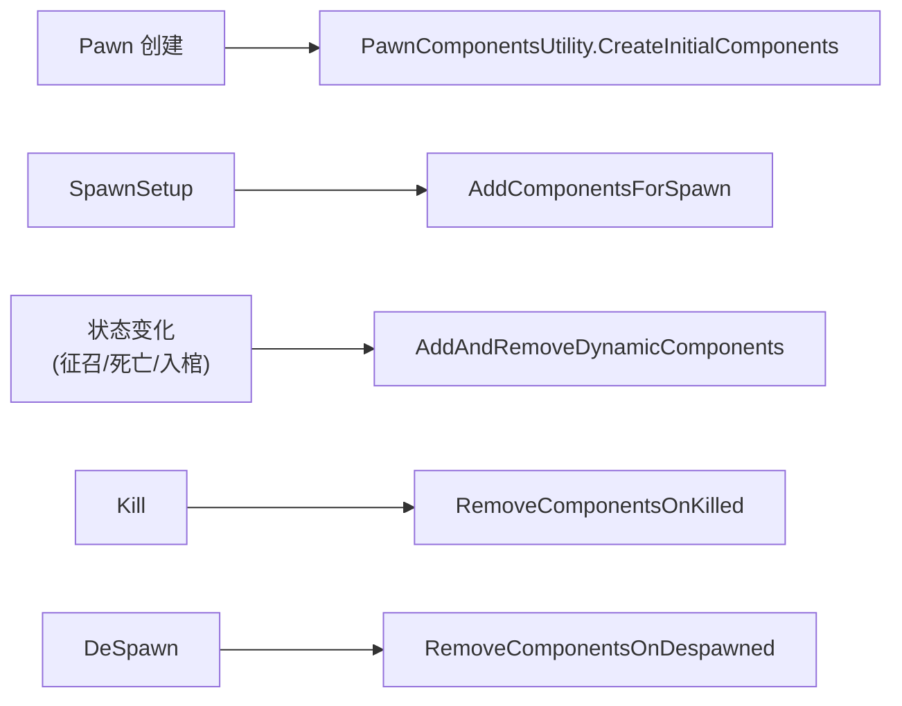
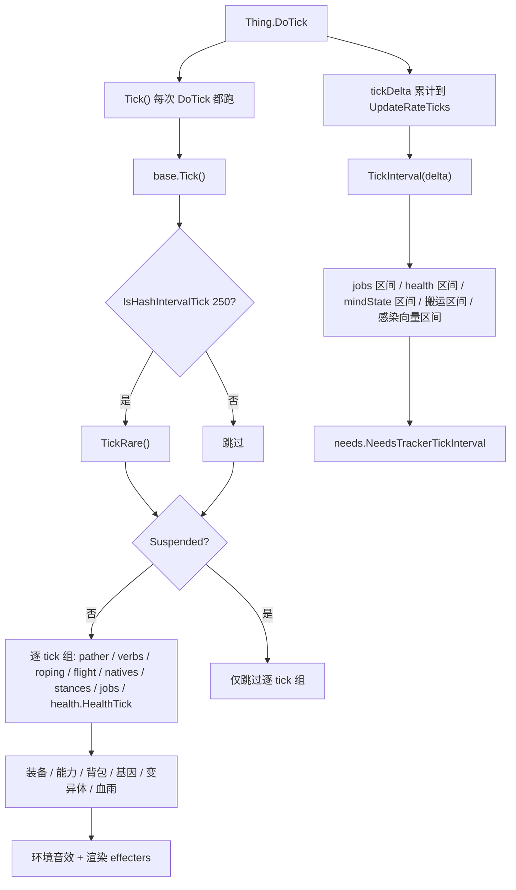

# V05 Pawn 构成与状态

卷号：V05
状态：初稿（R5）
上游：V04（Thing 生命周期）；下游：V06（AI/Job）、V13（需求/心情）、V14（健康/基因）

## Scope

本卷解构 **Pawn 这个「复合实体」如何组装与推进**：它不是一个大类，而是 `ThingWithComps` + 二十来个专职组件（components）的组合体；本卷说明组件什么时候被创建/销毁、`Tick()` 与 `TickInterval(delta)` 各负责哪一半、以及「动物每 15 tick 才跑一次区间逻辑」这条性能设计的实际边界。

不覆盖：健康/疾病的内部规则（V14）；需求/心情的具体数值与曲线（V13）；Job/ThinkTree（V06）；战斗（V08）；基因表达细节（V14）。

## Key types

| 类型 | Token | 语料路径 | 角色 |
|---|---|---|---|
| `Verse.Pawn` | 0x020004D6 | `Assembly-CSharp/Verse/Pawn.cs` | 复合实体主体（5628 行，全项目最大之一） |
| `Verse.ThingWithComps` | 0x020005A6 | `Assembly-CSharp/Verse/ThingWithComps.cs` | 组件化基类（`Tick`/`TickInterval` 转发） |
| `Verse.PawnComponentsUtility` | — | `Assembly-CSharp/Verse/PawnComponentsUtility.cs` | 组件创建/销毁的唯一入口 |
| `Verse.Pawn_HealthTracker` | 0x020004E3 | `Assembly-CSharp/Verse/Pawn_HealthTracker.cs` | 健康（详见 V14） |
| `RimWorld.Pawn_NeedsTracker` | — | `Assembly-CSharp/RimWorld/Pawn_NeedsTracker.cs` | 需求容器（**注意在 RimWorld 命名空间**） |
| `Verse.Pawn_MindState` | — | `Assembly-CSharp/Verse/Pawn_MindState.cs` | 心理状态、精神状态入口 |
| `Verse.Pawn_JobTracker` | — | `Assembly-CSharp/Verse/Pawn_JobTracker.cs` | 任务执行（V06） |
| `Verse.Pawn_AgeTracker` | 0x020004DE | `Assembly-CSharp/Verse/Pawn_AgeTracker.cs` | 年龄（V02 已解构） |
| `RimWorld.Pawn_GeneTracker` | 0x02001598 | `Assembly-CSharp/RimWorld/Pawn_GeneTracker.cs` | 基因（V14） |
| `Verse.Pawn_EquipmentTracker` / `Pawn_InventoryTracker` / `Pawn_CarryTracker` | 0x020004E1 / 0x020004E5 / 0x020004E0 | 同名文件 | 装备/背包/搬运手 |

## Control flow

### 1. 组件组是「动态」的，不是构造时一次成型

含义：**Pawn 的字段并非永远可用**。例如 `jobs`、`drafter`、`roping` 这类组件只在特定状态下存在，代码里到处都是 `if (this.jobs != null)` 判空（本卷 claim 已覆盖该类判空）。这不是防御性冗余，而是组件的生命周期决定。

### 2. 两个 tick 入口分工（`Pawn.Tick` vs `Pawn.TickInterval`）

关键差异：

| 入口 | 跑什么 | 频率 |
|---|---|---|
| `Tick()` | 移动、动词（射击）、姿态、Job 推进、健康逐 tick、装备/基因 | **每次 `DoTick`**（人类 = 每 tick） |
| `TickInterval(delta)` | Job 区间逻辑、健康区间、心理状态、需求衰减、感染向量 | 每 `UpdateRateTicks` 次 `DoTick`（人类 1，**动物 15**） |
| `TickRare()` | 由 `IsHashIntervalTick(250)` 在 `Tick()` 内触发 | 每 250 tick，相位由实体 ID 哈希决定 |

**动物 15 tick 一次区间逻辑**是本卷最值得记的性能事实：`UpdateRateTicks` 被 `Pawn` 覆写，非动物返回基类值（1），动物返回 15。所以同一套需求/心理系统在动物身上以 1/15 的频率推进，`delta` 参数负责把「欠下的时长」补进计算。

### 3. 需求的真实节奏

`Pawn_NeedsTracker.NeedsTrackerTickInterval(delta)` 并不是每个 `delta` 都算，而是再套一层哈希：`IsHashIntervalTick(150, delta)` 不成立就直接返回。也就是说需求的 `NeedInterval()` 大约每 150 tick 跑一次（2.5 游戏秒），与 `delta` 共同决定一次的推进量。

## Constants

| 项 | 值 | 位置 |
|---|---|---|
| 动物 `UpdateRateTicks` | 15 | `Pawn.UpdateRateTicks` |
| 人类 `UpdateRateTicks` | 1（基类默认） | `Thing.UpdateRateTicks` |
| `TickRare` 触发间隔 | 250 tick | `Pawn.Tick` |
| 需求 `NeedInterval` 间隔 | 150 tick | `Pawn_NeedsTracker` |
| 组件创建入口 | `PawnComponentsUtility.*` | 4 个生命周期钩子 |
| 悬浮（`Suspended`）效果 | 跳过逐 tick 组与区间组 | `Pawn.Tick`/`TickInterval` |

## Claims

[claim:V05-C01] `Pawn` 覆写了 `UpdateRateTicks`：动物返回 15，其余退回基类（1）。
  src: Verse.Pawn.UpdateRateTicks  Token: 0x020004D6
  file: analysis/decompiled/Assembly-CSharp/Verse/Pawn.cs
  anchor: public override int UpdateRateTicks
  match: return 15;

[claim:V05-C02] `Pawn.Tick` 是 `protected override`，即只由 `Thing.DoTick` 内部调用，外部不能直接 tick 它。
  src: Verse.Pawn.Tick
  file: analysis/decompiled/Assembly-CSharp/Verse/Pawn.cs
  match: protected override void Tick()

[claim:V05-C03] `Pawn.Tick` 在每 tick 路径里用哈希错峰触发 `TickRare`（间隔 250）。
  src: Verse.Pawn.Tick
  file: analysis/decompiled/Assembly-CSharp/Verse/Pawn.cs
  match: if (this.IsHashIntervalTick(250))

[claim:V05-C04] 移动由 `pather.PatherTick()` 在每 tick 路径中推进，只对已生成（Spawned）的 Pawn 执行。
  src: Verse.Pawn.Tick
  file: analysis/decompiled/Assembly-CSharp/Verse/Pawn.cs
  match: this.pather.PatherTick();

[claim:V05-C05] 动词（射击/近战）每 tick 推进一次。
  src: Verse.Pawn.Tick
  file: analysis/decompiled/Assembly-CSharp/Verse/Pawn.cs
  match: this.verbTracker.VerbsTick();

[claim:V05-C06] Job 推进也在每 tick 路径，但只对非世界层面的 Pawn 执行。
  src: Verse.Pawn.Tick
  file: analysis/decompiled/Assembly-CSharp/Verse/Pawn.cs
  match: pawn_JobTracker.JobTrackerTick();

[claim:V05-C07] 健康逐 tick 推进，是「每 tick」而非「区间」的一部分。
  src: Verse.Pawn.Tick
  file: analysis/decompiled/Assembly-CSharp/Verse/Pawn.cs
  match: this.health.HealthTick();

[claim:V05-C08] 基因组件在每 tick 路径中推进。
  src: Verse.Pawn.Tick
  file: analysis/decompiled/Assembly-CSharp/Verse/Pawn.cs
  match: pawn_GeneTracker.GeneTrackerTick();

[claim:V05-C09] 渲染相关 effecters 也挂在 `Tick` 尾部，说明表现层与逻辑层共用同一 tick 入口。
  src: Verse.Pawn.Tick
  file: analysis/decompiled/Assembly-CSharp/Verse/Pawn.cs
  match: pawn_DrawTracker.renderer.EffectersTick(suspended || this.IsWorldPawn());

[claim:V05-C10] `TickInterval(delta)` 承载「区间逻辑」：Job、健康、心理、搬运、感染向量。
  src: Verse.Pawn.TickInterval
  file: analysis/decompiled/Assembly-CSharp/Verse/Pawn.cs
  match: protected override void TickInterval(int delta)

[claim:V05-C11] Job 的区间逻辑单独有一份（`JobTrackerTickInterval`），与每 tick 的 `JobTrackerTick` 并存。
  src: Verse.Pawn.TickInterval
  file: analysis/decompiled/Assembly-CSharp/Verse/Pawn.cs
  match: pawn_JobTracker.JobTrackerTickInterval(delta);

[claim:V05-C12] 健康同样有区间版本 `HealthTickInterval(delta)`，与 `HealthTick()` 分工。
  src: Verse.Pawn.TickInterval
  file: analysis/decompiled/Assembly-CSharp/Verse/Pawn.cs
  match: this.health.HealthTickInterval(delta);

[claim:V05-C13] 心理状态在区间路径推进，且仅在未死亡时执行。
  src: Verse.Pawn.TickInterval
  file: analysis/decompiled/Assembly-CSharp/Verse/Pawn.cs
  match: this.mindState.MindStateTickInterval(delta);

[claim:V05-C14] 需求在区间路径的最后推进。
  src: Verse.Pawn.TickInterval
  file: analysis/decompiled/Assembly-CSharp/Verse/Pawn.cs
  match: this.needs.NeedsTrackerTickInterval(delta);

[claim:V05-C15] 需求推进前还有一层哈希节流：`IsHashIntervalTick(150, delta)` 不成立就直接返回。
  src: RimWorld.Pawn_NeedsTracker.NeedsTrackerTickInterval
  file: analysis/decompiled/Assembly-CSharp/RimWorld/Pawn_NeedsTracker.cs
  anchor: public void NeedsTrackerTickInterval(int delta)
  match: if (!this.pawn.IsHashIntervalTick(150, delta))

[claim:V05-C16] 需求的实际更新调用是 `NeedInterval()`（间隔语义，而非每 tick）。
  src: RimWorld.Pawn_NeedsTracker.NeedsTrackerTickInterval
  file: analysis/decompiled/Assembly-CSharp/RimWorld/Pawn_NeedsTracker.cs
  match: this.needs[i].NeedInterval();

[claim:V05-C17] 组件是动态增删的：Spawn 时补组件。
  src: Verse.Pawn
  file: analysis/decompiled/Assembly-CSharp/Verse/Pawn.cs
  match: PawnComponentsUtility.AddComponentsForSpawn(this);

[claim:V05-C18] 组件可按状态动态增删（`AddAndRemoveDynamicComponents`）。
  src: Verse.Pawn
  file: analysis/decompiled/Assembly-CSharp/Verse/Pawn.cs
  match: PawnComponentsUtility.AddAndRemoveDynamicComponents(this, false);

[claim:V05-C19] 死亡时移除一批组件（因此 `jobs` 等字段在尸体上可能为 null）。
  src: Verse.Pawn
  file: analysis/decompiled/Assembly-CSharp/Verse/Pawn.cs
  match: PawnComponentsUtility.RemoveComponentsOnKilled(this);

[claim:V05-C20] 离图（DeSpawn）时移除另一批组件。
  src: Verse.Pawn
  file: analysis/decompiled/Assembly-CSharp/Verse/Pawn.cs
  match: PawnComponentsUtility.RemoveComponentsOnDespawned(this);

[claim:V05-C21] 代码里对 `mindState` 显式判空，印证组件可能不存在。
  src: Verse.Pawn
  file: analysis/decompiled/Assembly-CSharp/Verse/Pawn.cs
  match: if (this.mindState == null || this.mindState.Active)

[claim:V05-C22] `Suspended`（如入棺/被吞）会同时跳过逐 tick 组与区间组，只有音效/渲染仍跑。
  src: Verse.Pawn.Tick
  file: analysis/decompiled/Assembly-CSharp/Verse/Pawn.cs
  match: bool suspended = this.Suspended;

[claim:V05-C23] 未生成（在容器内）时，Pawn 只从宿主物获得舒适度，不跑移动与区间逻辑。
  src: Verse.Pawn.TickInterval
  file: analysis/decompiled/Assembly-CSharp/Verse/Pawn.cs
  match: if (!base.Spawned)

[claim:V05-C24] `TickRare` 是 Pawn 自己的覆写入口，被哈希门控调用。
  src: Verse.Pawn.TickRare
  file: analysis/decompiled/Assembly-CSharp/Verse/Pawn.cs
  match: public override void TickRare()

## Resolved questions

原 `Open questions` 第 1、3、5 条在 R12 已解：

- **需求量子（第 1 条）**：`NeedInterval` 单次推进量**固定为 150 tick 的量**，不随 `delta` 缩放（`FoodFallPerTick * 150f`、`seekerPerHour * 0.06f`）。`delta` 只用于哈希窗口容差，因此人类（步长 1）与动物（步长 15）都是每 150 tick 恰好命中一次 —— 详见 V13。
- **组件清单（第 3 条）**：`PawnComponentsUtility` 初始化 **30 个**组件，含 `ageTracker` / `health` / `records` / `inventory` / `meleeVerbs` / `verbTracker` / `carryTracker` / `needs` / `mindState` / `ownership` / `thinker` / `jobs` / `stances` / `duplicate` / `equipment` / `apparel` / `skills` / `story` / `guest` / `guilt` / `workSettings` / `royalty` / `ideo` / `style` / `surroundings` / `genes` / `styleObserver` / `creepjoiner` / `connections` / `abilities`。
- **`TickRare` 与 `TickInterval` 是否冗余（第 5 条）**：不冗余。`TickRare` 由 `IsHashIntervalTick(250)` 在每 tick 路径触发，是**固定 250 tick 的粗粒度**；`TickInterval` 由 `UpdateRateTicks` 驱动，是**可变速率**（且默认随相机视野在 1–15 间变化）。两者服务于不同的节流需求。

[claim:V05-C25] 组件初始化清单里包含基因追踪器，印证「30 组件」结构的末端。
  src: RimWorld.PawnComponentsUtility
  file: analysis/decompiled/Assembly-CSharp/RimWorld/PawnComponentsUtility.cs
  match: pawn.genes = new Pawn_GeneTracker(pawn);

### `Suspended` 的来源（原 OQ4）

`Pawn` 覆写了 `Suspended`：`base.Suspended || Find.WorldPawns.GetSituation(this) == WorldPawnSituation.ReservedByQuest`。即两处来源：

1. 基类 `Thing.Suspended`（被容器夹持/未在地图上等）；
2. **世界层「被任务预留」**——即使人在世界里闲着，只要被某个任务保留，也按挂起处理，跳过逐 tick 与区间逻辑。

这也解释了「任务预留的人为什么看起来不动」：不是 AI 停了，是 tick 组被整体跳过。

[claim:V05-C26] `Suspended` 在 Pawn 层叠加了「被任务预留」这一世界层条件。
  src: Verse.Pawn.Suspended
  file: analysis/decompiled/Assembly-CSharp/Verse/Pawn.cs
  match: return base.Suspended || Find.WorldPawns.GetSituation(this) == WorldPawnSituation.ReservedByQuest;

### `TickInterval` 尾段（原 OQ2）

1654 行之后还有一长串区间钩子，按顺序：`apparel` → **`interactions`** → `caller` → `skills` → `drafter` → `relations` → `psychicEntropy`（Royalty 门控）→ `guest`（仅人形）→ `ideo`。所以 `TickInterval` 的完整语义是「按 delta 摊销的社交/技能/关系/理念/灵能层」，与每 tick 的移动/动词/Job 推进明确分工；`interactions` 就在这里推进，也是 V11「互动频率」问题的落点。

[claim:V05-C27] 社交互动的区间钩子挂在 `TickInterval` 中段（服装之后、呼叫之前）。
  src: Verse.Pawn.TickInterval
  file: analysis/decompiled/Assembly-CSharp/Verse/Pawn.cs
  match: this.interactions.InteractionsTrackerTickInterval(delta);

## Open questions

1. **`NeedInterval()` 单次推进量是否随时长缩放**：需求调用点固定 150 tick，但 `delta`（1 或 15）会影响 `TickInterval` 的进入频率，两者叠加后动物需求衰减速率是否与人类等价（按游戏时间）未验证，需与 V13 一起核对 `Need` 的 `NeedInterval` 实现。
2. `Pawn.TickInterval` 尾部（1654 行之后）未完整读完，可能还有需求之外的区间逻辑（如交互/思想）。
3. `PawnComponentsUtility` 的完整组件清单未逐项列出（本卷只覆盖了 4 个生命周期钩子与 20 余个已知字段），V06/V13/V14 会各自补自己关心的组件。
4. `Suspended` 的判定来源（`InCryptosleep` / 被吞 / 地图暂停）未逐条取证。
5. `TickRare` 与新引入的 `TickInterval` 体系是否功能重叠（都在做低频工作），未做系统性对比；这是 1.7 重构后可能出现的历史冗余。
