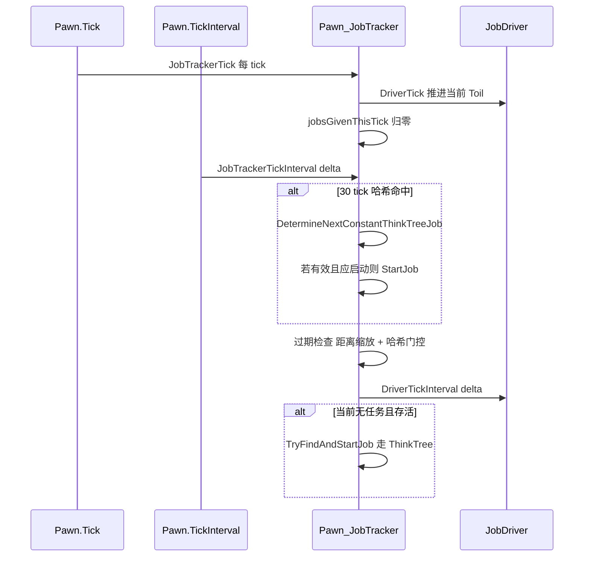
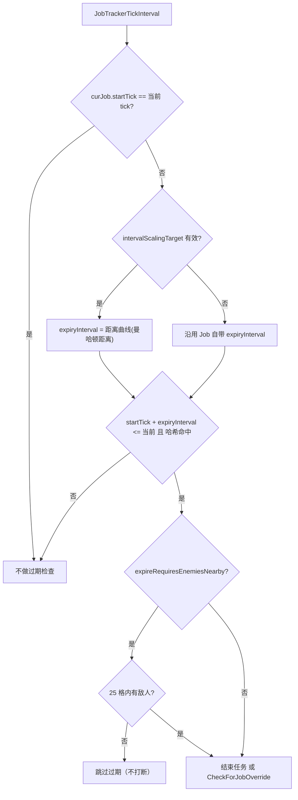

# V06 AI：ThinkTree / Job / JobDriver / Toil

卷号：V06
状态：初稿（R6）
上游：V03（寻路）、V04（实体）、V05（Pawn tick 双入口）；下游：V07（工作）、V08（战斗）、V13（精神状态）

## Scope

本卷解构 **AI 如何把「想做什么」变成「每 tick 在做什么」**：`ThinkTree`（决策树）产出 `Job`，`JobDriver` 把 `Job` 编译成一串 `Toil`，每 tick 只推进当前 `Toil`。核心是三层之间的时序与节流，以及保留系统（Reservation）如何在多层间避免抢占。

不覆盖：具体 `JobDef` 的种类与参数（属 V15/Def 与各玩法卷）；`WorkGiver` 的工作挑选（V07）；精神状态（V13）。

## Key types

| 类型 | Token | 语料路径 | 角色 |
|---|---|---|---|
| `Verse.AI.Pawn_JobTracker` | 0x020008B0 | `Assembly-CSharp/Verse/AI/Pawn_JobTracker.cs` | 任务队列与驱动（1317 行） |
| `Verse.AI.Job` | 0x02000850 | `Assembly-CSharp/Verse/AI/Job.cs` | 任务数据（目标/数量/过期） |
| `Verse.AI.JobDriver` | 0x02000838 | `Assembly-CSharp/Verse/AI/JobDriver.cs` | 任务执行器（把 Job 展开为 Toil） |
| `Verse.AI.Toil` | 0x0200083B | `Assembly-CSharp/Verse/AI/Toil.cs` | 最小行为单元（钩子集合） |
| `Verse.AI.ThinkNode` | 0x020008F1 | `Assembly-CSharp/Verse/AI/ThinkNode.cs` | 决策树节点 |
| `Verse.AI.ReservationManager` | 0x020008B5 | `Assembly-CSharp/Verse/AI/ReservationManager.cs` | 保留系统（目标占用裁决） |
| `Verse.AI.Pawn_MindState` | 0x020008B2 | `Assembly-CSharp/Verse/AI/Pawn_MindState.cs` | 心理状态与其决策入口 |
| `Verse.AI.MentalStateHandler` | 0x0200085F | `Assembly-CSharp/Verse/AI/MentalStateHandler.cs` | 精神状态切换 |

## Control flow

### 1. 每 tick 与区间：AI 的两个速度

三条时序事实：

1. **每 tick 只做一件事**：`JobTrackerTick` 的全部内容是 `curDriver.DriverTick()` 与计数器归零；
2. **选新任务不在每 tick 发生**：走 `JobTrackerTickInterval`，`IsHashIntervalTick(30, delta)` 命中才跑「常驻决策树」（`ConstantThinkTree`，用于精神状态/需求驱动的强制行为）；
3. **没有任务时才去决策**：`curJob == null && !Dead && mindState.Active` → `TryFindAndStartJob()`。也就是说 ThinkTree 的完整扫描只发生在「手上没活」的时刻。

### 2. Job 的过期是「距离缩放 + 哈希」的复合判定

设计意图很清楚：**走路越远，任务超时阈值越大**；且部分任务在无敌情况下不该被判超时（否则玩家会看到小人莫名其妙放弃远距离工作）。

### 3. Job → Toil 的展开与推进

- `TryMakePreToilReservations(bool errorOnFailed)` 是**抽象方法**：每个驱动器必须显式声明它要占用哪些目标，这是防抢占的第一道闸；
- `Toil` 是钩子容器：`initAction` / `tickAction` / `tickIntervalAction` / `endConditions` / `preInitActions` / `preTickActions` / `finishActions`，外加 `atomicWithPrevious`（与前一 toil 合并为不可打断单元）与 `socialMode`（是否允许顺便闲聊）；
- 驱动器还提供 `Notify_PatherArrived` / `Notify_PatherFailed` / `Notify_DamageTaken` / `Notify_StanceChanged` 等回调，让路径与战斗事件能中途改变行为。

### 4. 保留系统

`ReservationManager` 是跨 AI 的唯一仲裁者：

- `CanReserve(claimant, target, maxPawns, stackCount, layer, ignoreOtherReservations)` 先问「能不能占」；
- `Reserve(...)` 与 `CanReserve` 参数几乎一致，另有 `errorOnFailed` 与 `canReserversStartJobs`（占用者是否必须先开工，防「占着茅坑」）；
- `Release` / `ReleaseClaimedBy` / `ReleaseAllClaimedBy` / `ReleaseAllForTarget` 提供四个粒度的释放，`ReleaseAllForTarget` 正是 V04 中物体消失时调用的那个。

## Constants

| 项 | 值 | 位置 |
|---|---|---|
| 常驻决策树扫描间隔 | 30 tick 哈希 | `Pawn_JobTracker.JobTrackerTickInterval` |
| 敌人感知半径（过期判定用） | 25 格 | `PawnUtility.EnemiesAreNearby(pawn, 25, …)` |
| 任务过期阈值 | `Job.expiryInterval`，可被距离曲线覆盖 | `Pawn_JobTracker` |
| 默认保留上限 | `maxPawns = 1` | `ReservationManager.CanReserve` |
| 保留层 | `ReservationLayerDef`（可分层占用同一目标） | `ReservationManager` |
| Toil 社交模式默认 | `RandomSocialMode.Normal` | `Toil.socialMode` |

## Claims

[claim:V06-C01] 每 tick 的任务推进只有一行实际动作：驱动当前 JobDriver。
  src: Verse.AI.Pawn_JobTracker.JobTrackerTick  Token: 0x020008B0
  file: analysis/decompiled/Assembly-CSharp/Verse/AI/Pawn_JobTracker.cs
  match: jobDriver.DriverTick();

[claim:V06-C02] 每 tick 结束时把「本 tick 已发任务数」清零，用于限流与调试统计。
  src: Verse.AI.Pawn_JobTracker.JobTrackerTick
  file: analysis/decompiled/Assembly-CSharp/Verse/AI/Pawn_JobTracker.cs
  match: this.jobsGivenThisTick = 0;

[claim:V06-C03] 常驻决策树（精神状态/需求类强制行为）走 30 tick 哈希节流，不在每 tick 执行。
  src: Verse.AI.Pawn_JobTracker.JobTrackerTickInterval
  file: analysis/decompiled/Assembly-CSharp/Verse/AI/Pawn_JobTracker.cs
  match: if (this.pawn.IsHashIntervalTick(30, delta))

[claim:V06-C04] 该分支的决策来源是「常驻决策树」，与主动找活的两套 ThinkTree 分离。
  src: Verse.AI.Pawn_JobTracker.JobTrackerTickInterval
  file: analysis/decompiled/Assembly-CSharp/Verse/AI/Pawn_JobTracker.cs
  match: ThinkResult thinkResult = this.DetermineNextConstantThinkTreeJob();

[claim:V06-C05] 区间路径也会推进驱动器（`DriverTickInterval`），说明部分 toil 逻辑按 delta 摊销。
  src: Verse.AI.Pawn_JobTracker.JobTrackerTickInterval
  file: analysis/decompiled/Assembly-CSharp/Verse/AI/Pawn_JobTracker.cs
  match: this.curDriver.DriverTickInterval(delta);

[claim:V06-C06] 只有在「没有当前任务、未死亡、心理状态活跃」时才主动找活。
  src: Verse.AI.Pawn_JobTracker.JobTrackerTickInterval
  file: analysis/decompiled/Assembly-CSharp/Verse/AI/Pawn_JobTracker.cs
  match: if (this.curJob == null && !this.pawn.Dead && this.pawn.mindState.Active)

[claim:V06-C07] 找活的入口是 `TryFindAndStartJob`（内部走 ThinkTree 扫描）。
  src: Verse.AI.Pawn_JobTracker.JobTrackerTickInterval
  file: analysis/decompiled/Assembly-CSharp/Verse/AI/Pawn_JobTracker.cs
  match: this.TryFindAndStartJob();

[claim:V06-C08] 任务过期阈值可由「到目标的曼哈顿距离」经曲线缩放，越远越宽松。
  src: Verse.AI.Pawn_JobTracker.JobTrackerTickInterval
  file: analysis/decompiled/Assembly-CSharp/Verse/AI/Pawn_JobTracker.cs
  match: this.curJob.expiryInterval = (int)Pawn_JobTracker.DistanceIntervalCurve.Evaluate((float)lengthManhattan);

[claim:V06-C09] 过期判定要求「已过阈值」且「哈希命中」，不是到点即断。
  src: Verse.AI.Pawn_JobTracker.JobTrackerTickInterval
  file: analysis/decompiled/Assembly-CSharp/Verse/AI/Pawn_JobTracker.cs
  match: flag = this.curJob.startTick + this.curJob.expiryInterval <= GenTicks.TicksGame && this.pawn.IsHashIntervalTick(this.curJob.expiryInterval, delta);

[claim:V06-C10] 需要敌人的任务在无敌情况下不会被判过期。
  src: Verse.AI.Pawn_JobTracker.JobTrackerTickInterval
  file: analysis/decompiled/Assembly-CSharp/Verse/AI/Pawn_JobTracker.cs
  match: if (!this.curJob.expireRequiresEnemiesNearby || PawnUtility.EnemiesAreNearby(this.pawn, 25, false, -1f, 1, false))

[claim:V06-C11] 每个驱动器必须显式实现「预占目标」，这是防抢占的设计要求。
  src: Verse.AI.JobDriver.TryMakePreToilReservations  Token: 0x02000838
  file: analysis/decompiled/Assembly-CSharp/Verse/AI/JobDriver.cs
  match: public abstract bool TryMakePreToilReservations(bool errorOnFailed);

[claim:V06-C12] 驱动器有两个 tick 入口：每 tick 与按 delta。
  src: Verse.AI.JobDriver.DriverTickInterval
  file: analysis/decompiled/Assembly-CSharp/Verse/AI/JobDriver.cs
  match: public void DriverTickInterval(int delta)

[claim:V06-C13] 驱动器可被外部跳转到指定 toil（用于中断/续接逻辑）。
  src: Verse.AI.JobDriver.JumpToToil
  file: analysis/decompiled/Assembly-CSharp/Verse/AI/JobDriver.cs
  match: public void JumpToToil(Toil to)

[claim:V06-C14] `Toil` 的结束条件是函数列表，可叠加多个判定。
  src: Verse.AI.Toil.endConditions  Token: 0x0200083B
  file: analysis/decompiled/Assembly-CSharp/Verse/AI/Toil.cs
  match: public List<Func<JobCondition>> endConditions = new List<Func<JobCondition>>();

[claim:V06-C15] `atomicWithPrevious` 让相邻 toil 合并成不可分割单元。
  src: Verse.AI.Toil.atomicWithPrevious
  file: analysis/decompiled/Assembly-CSharp/Verse/AI/Toil.cs
  match: public bool atomicWithPrevious;

[claim:V06-C16] toil 默认允许随机社交（干活时会顺带聊天）。
  src: Verse.AI.Toil.socialMode
  file: analysis/decompiled/Assembly-CSharp/Verse/AI/Toil.cs
  match: public RandomSocialMode socialMode = RandomSocialMode.Normal;

[claim:V06-C17] 每个 toil 支持「按 tick 间隔」的钩子，即 toil 内部也分快慢路径。
  src: Verse.AI.Toil.tickIntervalAction
  file: analysis/decompiled/Assembly-CSharp/Verse/AI/Toil.cs
  match: public Action<int> tickIntervalAction;

[claim:V06-C18] 保留查询与占用是分开的两个 API（先问能不能占，再占）。
  src: Verse.AI.ReservationManager.CanReserve  Token: 0x020008B5
  file: analysis/decompiled/Assembly-CSharp/Verse/AI/ReservationManager.cs
  match: public bool CanReserve(Pawn claimant, LocalTargetInfo target, int maxPawns = 1, int stackCount = -1, ReservationLayerDef layer = null, bool ignoreOtherReservations = false)

[claim:V06-C19] 保留支持分层占用：同一目标可被不同层同时保留。
  src: Verse.AI.ReservationManager.CanReserve
  file: analysis/decompiled/Assembly-CSharp/Verse/AI/ReservationManager.cs
  match: ReservationLayerDef layer = null

[claim:V06-C20] 目标消失时有批量释放入口（V04 的 DeSpawn 调用它）。
  src: Verse.AI.ReservationManager.ReleaseAllForTarget
  file: analysis/decompiled/Assembly-CSharp/Verse/AI/ReservationManager.cs
  match: public void ReleaseAllForTarget(Thing t)

[claim:V06-C21] 可按派系查询「是否被某派系任何人占用」，供敌对行为判定用。
  src: Verse.AI.ReservationManager.IsReservedByAnyoneOf
  file: analysis/decompiled/Assembly-CSharp/Verse/AI/ReservationManager.cs
  match: public bool IsReservedByAnyoneOf(LocalTargetInfo target, Faction faction)

## Resolved questions

原 `Open questions` 第 2 条（`TryFindAndStartJob` 的扫描顺序）在 R12 已解：

- 入口 `TryFindAndStartJob()` 先做两道防御（无 `thinker` 报错返回；已有 `curJob` 只警告），然后只调一次 `DetermineNextJob(out thinkTree, false)`；
- `DetermineNextJob` 的顺序是**两级**：先 `DetermineNextConstantThinkTreeJob()`（常驻树，命中即返回，`thinkTree = ConstantThinkTree`）；未命中才走 `thinker.MainThinkNodeRoot.TryIssueJobPackage(pawn, params)`（主动树）；主动树抛异常时走 `JobUtility.TryStartErrorRecoverJob` 并返回空结果；
- 另有重入保护 `determiningNextJob`，防止决策过程中再次触发决策。

所以「常驻树 vs 主动树」不是并列候选，而是**短路优先级**：常驻树（精神状态/需求类强制行为）永远先判。

[claim:V06-C22] 决策顺序是常驻树优先、命中即返回，之后才轮到主动树。
  src: Verse.AI.Pawn_JobTracker.DetermineNextJob
  file: analysis/decompiled/Assembly-CSharp/Verse/AI/Pawn_JobTracker.cs
  match: ThinkResult thinkResult = this.DetermineNextConstantThinkTreeJob();

[claim:V06-C23] 主动树通过 `MainThinkNodeRoot.TryIssueJobPackage` 触发，与常驻树是两条路径。
  src: Verse.AI.Pawn_JobTracker.DetermineNextJob
  file: analysis/decompiled/Assembly-CSharp/Verse/AI/Pawn_JobTracker.cs
  match: thinkResult2 = this.pawn.thinker.MainThinkNodeRoot.TryIssueJobPackage(this.pawn, new JobIssueParams

## Resolved questions

R15 解出原 `Open questions` 第 1、3、4、5 条：

- **ThinkNode 语义（OQ1）**：决策树是**有序优先级列表**——`ThinkNode_Priority.TryIssueJobPackage` 顺序遍历 `subNodes`，返回第一个非空结果，全空才返回 `NoJob`。`ThinkNode_Conditional` 是装饰器基类，派生出上百个具体条件（`ConditionalBurning`、`ConditionalCanCrawl`、`ConditionalAnimalWrongSeason`…）。所以「AI 想干什么」= 一棵按序求值的条件-动作树，先命中先返回。
- **`DriverTick` 与 `DriverTickInterval` 的分工（OQ3）**：前者管**完成时机**——`ticksLeftThisToil--`、检查结束/失败条件、按 `ToilCompleteMode`（Instant/Delay/Ticks…）推进下一个 toil；后者管**摊销逻辑**——逐个调 `preTickIntervalActions(delta)`（以及 toil 的 `tickIntervalAction`）。即「什么时候算完」在每 tick，「做了什么」可在区间。
- **`atomicWithPrevious` 的用法（OQ4）**：不是全局默认，而是**按驱动逐个 toil 显式开启**（如 `JobDriver_Ingest`、`JobDriver_GiveToPawn`、`JobDriver_HaulCorpseToPublicPlace`、`JobDriver_PrepareCaravan_GatherItems`）。语义是「与前一 toil 合并成一个不可分割单元」，因此打断会被推迟到该单元结束。
- **精神状态与 Job 的先后（OQ5）**：`Pawn.TickInterval` 的顺序是 **jobs（1613）→ health（1619）→ mindState（1625）→ carry（1627）**。所以同一区间内**先推进 Job，再由心理状态决定是否中断**；结合 V13 的结论（崩溃由 `MentalBreaker` 区间判定），中断发生在 Job 推进之后，而非之前。

[claim:V06-C24] 决策树按子节点顺序求值，第一个非空结果即返回。
  src: Verse.AI.ThinkNode_Priority.TryIssueJobPackage
  file: analysis/decompiled/Assembly-CSharp/Verse/AI/ThinkNode_Priority.cs
  match: thinkResult = this.subNodes[i].TryIssueJobPackage(pawn, jobParams);

[claim:V06-C25] 每 tick 路径维护 toil 剩余 tick 计数，作为完成时机的基础。
  src: Verse.AI.JobDriver.DriverTick
  file: analysis/decompiled/Assembly-CSharp/Verse/AI/JobDriver.cs
  match: this.ticksLeftThisToil--;

[claim:V06-C26] 区间路径执行 `preTickIntervalActions`，把带 delta 的逻辑与完成判定分开。
  src: Verse.AI.JobDriver.DriverTickInterval
  file: analysis/decompiled/Assembly-CSharp/Verse/AI/JobDriver.cs
  match: curToil.preTickIntervalActions[i](delta);

[claim:V06-C27] `atomicWithPrevious` 是按 toil 显式开启的合并标记（示例：进食驱动）。
  src: JobDriver_Ingest
  file: analysis/decompiled/Assembly-CSharp/RimWorld/JobDriver_Ingest.cs
  match: toil.atomicWithPrevious = true;

[claim:V06-C28] Job 区间推进排在心理状态区间之前。
  src: Verse.Pawn.TickInterval
  file: analysis/decompiled/Assembly-CSharp/Verse/Pawn.cs
  match: pawn_JobTracker.JobTrackerTickInterval(delta);

[claim:V06-C29] 心理状态区间紧随其后，因此中断判定发生在 Job 推进之后。
  src: Verse.Pawn.TickInterval
  file: analysis/decompiled/Assembly-CSharp/Verse/Pawn.cs
  match: this.mindState.MindStateTickInterval(delta);

## Open questions

1. **`ThinkTree` 的节点语义未解构**：`ThinkNode` 只是基类（178 行），真正的优先级/遍历规则在各子类（`ThinkNode_Priority`、`ThinkNode_Conditional`…），属本卷后续或 V13 扩展。
2. `TryFindAndStartJob` 的完整扫描顺序（常驻树 vs 主动树 vs 优先工作）未逐行读，只确认了入口与「无任务才触发」。
3. `JobDriver.DriverTick` 与 `DriverTickInterval` 内部如何分工（哪些 toil 逻辑在每 tick、哪些在 delta）未展开。
4. `Toil` 的 `atomicWithPrevious` 在中断时的具体语义（能否被强制打断）未验证。
5. 精神状态下 `MentalStateTickInterval` 与 `JobTrackerTickInterval` 的先后（哪个先决定中断）未排序确认，V13 需补。
