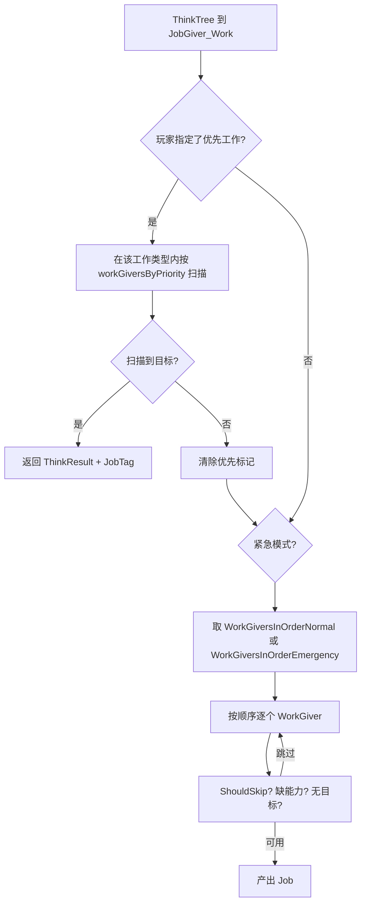
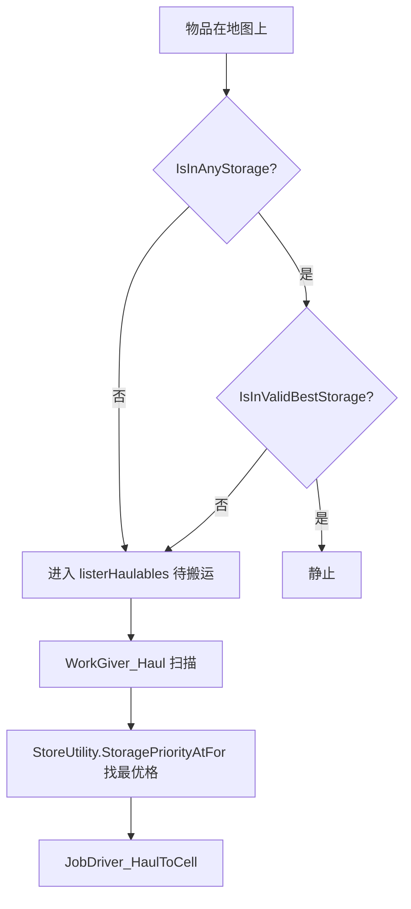

# V07 工作与生产

卷号：V07
状态：初稿（R6）
上游：V06（Job/Toil）、V04（Thing/Lister）；下游：V12（经济价值）、V13（心情与工作偏好）

## Scope

本卷解构 **「殖民地怎么被驱动起来」**：`WorkTypeDef` 的优先级体系如何决定谁去做什么、`WorkGiver` 如何扫描出可做目标、`Bill`/`RecipeDef` 如何把生产变成账单项、以及物品在搬运链路上如何选目标格。

核心是两张表：**优先级表**（玩家可调的工作类型顺序）与**扫描顺序表**（每个工作类型内的 WorkGiver 排列）。两者共同决定 AI「先干什么」。

不覆盖：具体配方数值（Def 面）；搬运的路径执行（V03/V06）；贸易与价格（V12）。

## Key types

| 类型 | Token | 语料路径 | 角色 |
|---|---|---|---|
| `RimWorld.Pawn_WorkSettings` | 0x02000D2C | `Assembly-CSharp/RimWorld/Pawn_WorkSettings.cs` | 每个 Pawn 的工作优先级（含缓存列表） |
| `Verse.WorkTypeDef` | 0x020001DA | `Assembly-CSharp/Verse/WorkTypeDef.cs` | 工作类型（采矿/种植/建造…） |
| `RimWorld.WorkGiver` | 0x02000BB2 | `Assembly-CSharp/RimWorld/WorkGiver.cs` | 工作提供者（基类） |
| `RimWorld.WorkGiver_Scanner` | 0x02000BB3 | `Assembly-CSharp/RimWorld/WorkGiver_Scanner.cs` | 扫描式工作提供者（基于目标枚举） |
| `RimWorld.JobGiver_Work` | — | `Assembly-CSharp/RimWorld/JobGiver_Work.cs` | 决策树里「找活」的节点 |
| `RimWorld.Bill` | 0x02000997 | `Assembly-CSharp/RimWorld/Bill.cs` | 生产账单基类 |
| `RimWorld.Bill_Production` | 0x02001AD8 | `Assembly-CSharp/RimWorld/Bill_Production.cs` | 常规生产账单（配方 + 数量/模式） |
| `RimWorld.BillStack` | 0x02000998 | `Assembly-CSharp/RimWorld/BillStack.cs` | 账单栈（建筑上的工作队列） |
| `Verse.RecipeDef` | 0x020001AB | `Assembly-CSharp/Verse/RecipeDef.cs` | 配方（投入/产出/工作量/技能要求） |
| `RimWorld.StoreUtility` | 0x02000BB1 | `Assembly-CSharp/RimWorld/StoreUtility.cs` | 仓储判定与目标格选择 |
| `RimWorld.StorageSettings` / `SlotGroup` | 0x02001A8D / 0x02001A87 | 同名文件 | 存储策略与格组 |

## Control flow

### 1. 「找活」的两层顺序

- `Pawn_WorkSettings` 为每个 Pawn 缓存两张**有序列表**：常规与紧急；
- 列表顺序来自 `WorkTypeDef` 的优先级设置（`SetPriority`/`GetPriority`），玩家在 UI 里拖动的正是这张表；
- 紧急模式（如救火、就医）用另一张表，顺序不同；
- 玩家右键强制的优先工作（`priorityWork`）绕过整个顺序，先试该类型，失败才回落。

### 2. 生产的账本结构

- `Bill` 是抽象基类，核心抽象方法只有一个：`ShouldDoNow()`（是否该做）；其余都是可覆写钩子（`CanFinishNow`、`PawnAllowedToStartAnew`、`CheckIngredientsIfSociallyProper` 等）；
- `Bill_Production` 增加了「做几个/做到库存多少/无限」这类生产模式；
- 完成一次迭代走 `Notify_IterationCompleted(billDoer, ingredients)`，材料在这里被消耗、产物在这里被生成；
- `BillStack.RemoveIncompletableBills()` 会在条件不再满足时清理账单（例如配方被 DLC 移除）。

### 3. 搬运与仓储

`StoreUtility` 的判定链是**优先级驱动**的：先看当前所在位置的存储优先级，再看全图是否有更高优先级的可用格；`StoragePriorityAtFor` 同时是「能否放这里」与「这里有多好」的答案。

## Constants

| 项 | 值 / 规则 | 位置 |
|---|---|---|
| 工作优先级粒度 | `WorkTypeDef` 为键的整数优先级 | `Pawn_WorkSettings` |
| 工作列表缓存 | 常规 / 紧急两张有序表 | `WorkGiversInOrderNormal` / `WorkGiversInOrderEmergency` |
| 紧急模式判定 | `JobGiver_Work.emergency` | `JobGiver_Work` |
| 优先工作来源 | `pawn.mindState.priorityWork`（玩家右键） | `JobGiver_Work` |
| 工作类型内顺序 | `workGiversByPriority` | `WorkTypeDef` |
| 账单抽象 | 只需实现 `ShouldDoNow()` | `Bill` |
| 搬运判定 | `IsInAnyStorage` / `IsInValidBestStorage` | `StoreUtility` |
| 存储优先级 | `StoragePriority` 枚举 | `StoreUtility.StoragePriorityAtFor` |

## Claims

[claim:V07-C01] 每个 Pawn 的工作顺序是缓存的列表，而不是每次重新排序。
  src: RimWorld.Pawn_WorkSettings.WorkGiversInOrderNormal  Token: 0x02000D2C
  file: analysis/decompiled/Assembly-CSharp/RimWorld/Pawn_WorkSettings.cs
  match: public List<WorkGiver> WorkGiversInOrderNormal

[claim:V07-C02] 紧急模式使用另一张缓存表，顺序与常规不同。
  src: RimWorld.Pawn_WorkSettings.WorkGiversInOrderEmergency
  file: analysis/decompiled/Assembly-CSharp/RimWorld/Pawn_WorkSettings.cs
  match: public List<WorkGiver> WorkGiversInOrderEmergency

[claim:V07-C03] 优先级按工作类型设置，玩家 UI 拖动的就是它。
  src: RimWorld.Pawn_WorkSettings.SetPriority
  file: analysis/decompiled/Assembly-CSharp/RimWorld/Pawn_WorkSettings.cs
  match: public void SetPriority(WorkTypeDef w, int priority)

[claim:V07-C04] 读取优先级同样以工作类型为键。
  src: RimWorld.Pawn_WorkSettings.GetPriority
  file: analysis/decompiled/Assembly-CSharp/RimWorld/Pawn_WorkSettings.cs
  match: public int GetPriority(WorkTypeDef w)

[claim:V07-C05] 找活节点自己也有优先级，参与上层决策树排序。
  src: RimWorld.JobGiver_Work.GetPriority
  file: analysis/decompiled/Assembly-CSharp/RimWorld/JobGiver_Work.cs
  match: public override float GetPriority(Pawn pawn)

[claim:V07-C06] 玩家强制的优先工作会在正常顺序之前被尝试。
  src: RimWorld.JobGiver_Work.TryIssueJobPackage
  file: analysis/decompiled/Assembly-CSharp/RimWorld/JobGiver_Work.cs
  match: if (this.emergency && CS$<>8__locals1.pawn.mindState.priorityWork.IsPrioritized)

[claim:V07-C07] 优先工作按该工作类型内的 WorkGiver 顺序逐个试。
  src: RimWorld.JobGiver_Work.TryIssueJobPackage
  file: analysis/decompiled/Assembly-CSharp/RimWorld/JobGiver_Work.cs
  match: List<WorkGiverDef> workGiversByPriority = CS$<>8__locals1.pawn.mindState.priorityWork.WorkGiver.workType.workGiversByPriority;

[claim:V07-C08] 常规路径按「常规/紧急」两表之一遍历。
  src: RimWorld.JobGiver_Work.TryIssueJobPackage
  file: analysis/decompiled/Assembly-CSharp/RimWorld/JobGiver_Work.cs
  match: List<WorkGiver> list = ((!this.emergency) ? CS$<>8__locals1.pawn.workSettings.WorkGiversInOrderNormal : CS$<>8__locals1.pawn.workSettings.WorkGiversInOrderEmergency);

[claim:V07-C09] 每个 WorkGiver 都可声明「对某个 Pawn 直接跳过」。
  src: RimWorld.WorkGiver.ShouldSkip  Token: 0x02000BB2
  file: analysis/decompiled/Assembly-CSharp/RimWorld/WorkGiver.cs
  match: public virtual bool ShouldSkip(Pawn pawn, bool forced = false)

[claim:V07-C10] 能力不足（如失明不能做手术）由能力检查统一把关。
  src: RimWorld.WorkGiver.MissingRequiredCapacity
  file: analysis/decompiled/Assembly-CSharp/RimWorld/WorkGiver.cs
  match: public PawnCapacityDef MissingRequiredCapacity(Pawn pawn)

[claim:V07-C11] 非扫描类工作（如「去睡觉」）走 `NonScanJob`，不做目标枚举。
  src: RimWorld.WorkGiver.NonScanJob
  file: analysis/decompiled/Assembly-CSharp/RimWorld/WorkGiver.cs
  match: public virtual Job NonScanJob(Pawn pawn)

[claim:V07-C12] 账单的核心抽象只有「现在该不该做」。
  src: RimWorld.Bill.ShouldDoNow  Token: 0x02000997
  file: analysis/decompiled/Assembly-CSharp/RimWorld/Bill.cs
  match: public abstract bool ShouldDoNow();

[claim:V07-C13] 账单可声明「是否可能完成」，用于剔除失效配方。
  src: RimWorld.Bill.CompletableEver
  file: analysis/decompiled/Assembly-CSharp/RimWorld/Bill.cs
  match: public virtual bool CompletableEver

[claim:V07-C14] 完成一次迭代时统一回调，材料消耗与产物生成都在这里发生。
  src: RimWorld.Bill.Notify_IterationCompleted
  file: analysis/decompiled/Assembly-CSharp/RimWorld/Bill.cs
  match: public virtual void Notify_IterationCompleted(Pawn billDoer, List<Thing> ingredients)

[claim:V07-C15] 账单可以限制「谁有资格开始做」（技能/身份）。
  src: RimWorld.Bill.PawnAllowedToStartAnew
  file: analysis/decompiled/Assembly-CSharp/RimWorld/Bill.cs
  match: public virtual bool PawnAllowedToStartAnew(Pawn p)

[claim:V07-C16] 账单栈会主动清理不再可完成的账单。
  src: RimWorld.BillStack.RemoveIncompletableBills  Token: 0x02000998
  file: analysis/decompiled/Assembly-CSharp/RimWorld/BillStack.cs
  match: public void RemoveIncompletableBills()

[claim:V07-C17] 搬运判定以「当前是否在存储区」为第一问。
  src: RimWorld.StoreUtility.IsInAnyStorage  Token: 0x02000BB1
  file: analysis/decompiled/Assembly-CSharp/RimWorld/StoreUtility.cs
  match: public static bool IsInAnyStorage(this Thing t)

[claim:V07-C18] 存储优先级按「格子 + 物品」计算，同格不同物品可不同优先级。
  src: RimWorld.StoreUtility.StoragePriorityAtFor
  file: analysis/decompiled/Assembly-CSharp/RimWorld/StoreUtility.cs
  match: public static StoragePriority StoragePriorityAtFor(IntVec3 c, Thing t, bool forced = false)

[claim:V07-C19] 格组（SlotGroup）是存储的最小组织单位，由格子反查得到。
  src: RimWorld.StoreUtility.GetSlotGroup
  file: analysis/decompiled/Assembly-CSharp/RimWorld/StoreUtility.cs
  match: public static SlotGroup GetSlotGroup(this Thing thing)

[claim:V07-C20] 「是否在最优存储中」单独成判据，用于反复搬运的抑制。
  src: RimWorld.StoreUtility.IsInValidBestStorage
  file: analysis/decompiled/Assembly-CSharp/RimWorld/StoreUtility.cs
  match: public static bool IsInValidBestStorage(this Thing t)

## Resolved questions

原 `Open questions` 第 2 条（`workGiversByPriority` 的生成规则）在 R12 已解：

- 该列表在 `WorkTypeDef` 内部由 Def 的 `priorityInType` 字段**降序排序**生成（`orderby d.priorityInType descending`），即顺序来自**数据**（XML 里每条 WorkGiver 的 `priorityInType`），不是代码写死。
- 因此改 mod 的 WorkGiver 优先级只需改 Def 数值，无需改代码；而玩家在 UI 里拖动的是更上层的「工作类型优先级」，两者是不同粒度。

[claim:V07-C21] 工作类型内的 WorkGiver 顺序由 Def 的 `priorityInType` 降序生成。
  src: Verse.WorkTypeDef.workGiversByPriority
  file: analysis/decompiled/Assembly-CSharp/Verse/WorkTypeDef.cs
  match: orderby d.priorityInType descending

## Resolved questions

### 生产模式（原 OQ3）

`Bill_Production` 用**三个字段 + 一个覆写**表达全部模式：`repeatMode`（`BillRepeatModeDef`，默认 `RepeatCount`）、`targetCount`（默认 10）、`paused`；`ShouldDoNow()` 在三者之上做判定。所以「做 N 个 / 做到库存 X / 无限 / 暂停」不是状态机，而是**模式枚举 + 目标数 + 布尔**的组合。

### 工作量与技能（原 OQ4，部分）

`Bill.GetWorkAmount(thing)` 直接返回 `recipe.WorkAmountTotal(thing)` —— 配方给的是**基础工作量**；技能/速度的折减发生在别处（`WorkSpeedGlobal` 一类的 stat），不在 `GetWorkAmount` 内部。

[claim:V07-C22] 生产模式是「模式枚举 + 目标数量 + 暂停位」三件套，而非状态机。
  src: RimWorld.Bill_Production.repeatMode
  file: analysis/decompiled/Assembly-CSharp/RimWorld/Bill_Production.cs
  match: public BillRepeatModeDef repeatMode = BillRepeatModeDefOf.RepeatCount;

[claim:V07-C23] 工作量来自配方，账单层不做技能折减。
  src: RimWorld.Bill.GetWorkAmount
  file: analysis/decompiled/Assembly-CSharp/RimWorld/Bill.cs
  match: public virtual float GetWorkAmount(Thing thing = null)

### 搬运的「预留格」（原 OQ5）

没有独立的「格子预留」子系统：`JobDriver_HaulToCell.TryMakePreToilReservations` 直接**同时预占两个目标**——目的地格（`TargetIndex.B`）与物品（`TargetIndex.A`），各自 `maxPawns = 1`。所以两个搬运工不会抢同一格，靠的是 V06 的通用保留系统在**格子**上的占用，而不是 `SlotGroup` 自己的机制（`SlotGroup` 只提供 `CellsList` 与增删格通知）。

[claim:V07-C24] 搬运同时预占目的地格与物品，各限一个占用者。
  src: Verse.AI.JobDriver_HaulToCell.TryMakePreToilReservations
  file: analysis/decompiled/Assembly-CSharp/Verse/AI/JobDriver_HaulToCell.cs
  match: return this.pawn.Reserve(this.job.GetTarget(TargetIndex.B), this.job, 1, -1, null, errorOnFailed, false) && this.pawn.Reserve(this.job.GetTarget(TargetIndex.A), this.job, 1, -1, null, errorOnFailed, false);

[claim:V07-C25] `SlotGroup` 只维护格子集合与增删通知，不承担预留职责。
  src: RimWorld.SlotGroup.CellsList
  file: analysis/decompiled/Assembly-CSharp/RimWorld/SlotGroup.cs
  match: public List<IntVec3> CellsList

### 工作量与技能折减的位置（原 OQ4）

`RecipeDef.WorkAmountTotal(thing)` 是**纯数据聚合**：`thing == null` 时走 `WorkAmountForStuff(null)`，`SmeltOrDestroyThing` 且可熔炼时改用 `smeltingWorkAmount`，其余按配方基础值。**技能/速度的折减不在这里** —— 它在工作执行侧（`WorkSpeedGlobal` 一类 stat × `job` 的工作速率），所以「配方工作量」与「实际耗时」是两个独立量。

[claim:V07-C26] 配方工作量是数据聚合，不含技能系数。
  src: Verse.RecipeDef.WorkAmountTotal
  file: analysis/decompiled/Assembly-CSharp/Verse/RecipeDef.cs
  match: public float WorkAmountTotal(Thing thing)

[claim:V07-C27] 熔炼类配方有独立的工作量字段，覆盖通用算法。
  src: Verse.RecipeDef.WorkAmountTotal
  file: analysis/decompiled/Assembly-CSharp/Verse/RecipeDef.cs
  match: return this.smeltingWorkAmount;

## Open questions

1. **`WorkGiver_Scanner` 的扫描成本未量化**：它按区域/全图枚举目标，`ShouldSkip` 只是前置剪枝；在大型地图上「找活」的成本主要由扫描决定，本卷未统计各 WorkGiver 的扫描范围。
2. `WorkTypeDef.workGiversByPriority` 的生成规则（Def 里的 `priorityInType` 还是代码排序）未取证。
3. `Bill_Production` 的三种模式（做 N 个 / 做到库存 X / 无限）的具体状态机未逐行解构。
4. 配方工作量（`RecipeDef.workAmount`）与技能等级如何折算出实际耗时，属 V15/V12 交叉面，未验证。
5. 搬运链路的「预留格」机制（`SlotGroup` 预订避免多个搬运工抢同一格）未解构。
