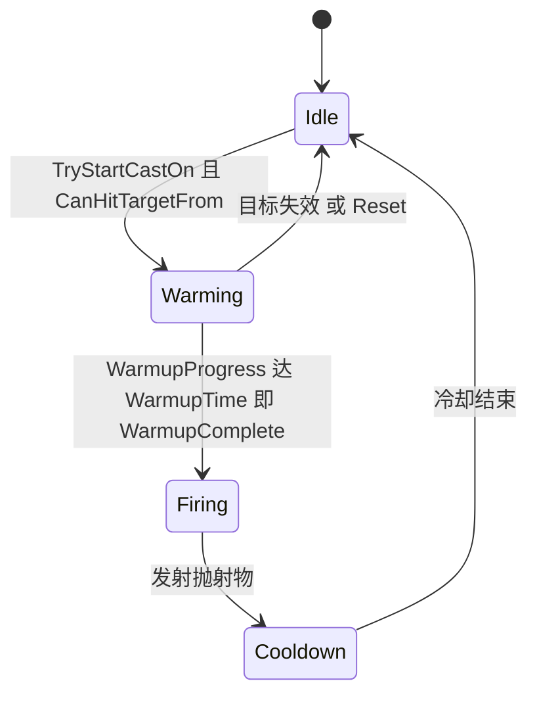
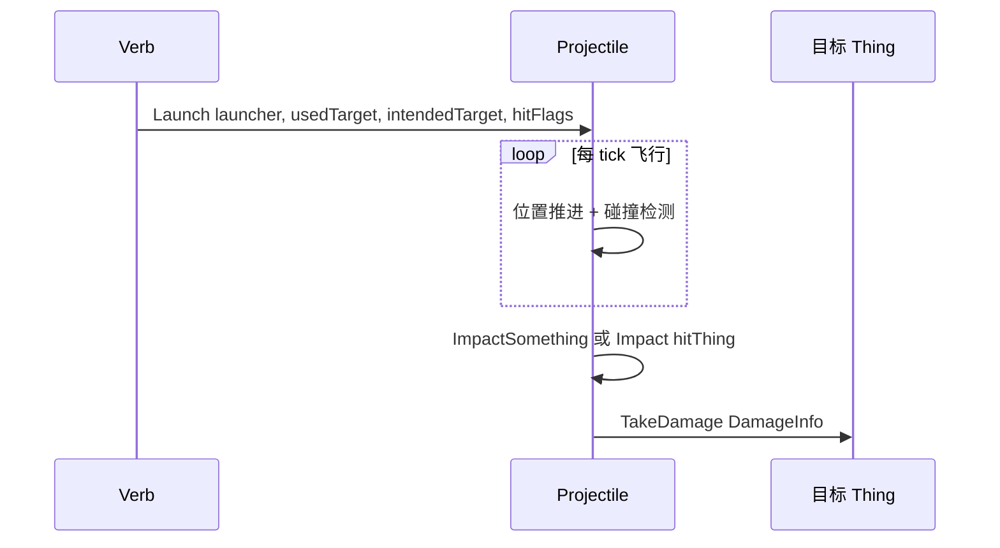
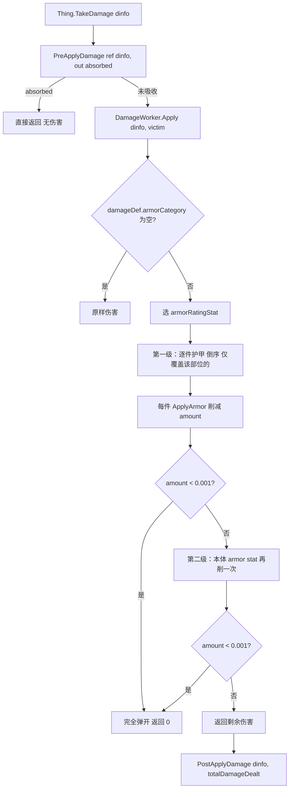

# V08 战斗、伤害与护甲

卷号：V08
状态：初稿（R7）
上游：V04（Thing 伤害钩子）、V05（Pawn）、V06（Job/Toil 驱动射击）；下游：V14（伤口生成）

## Scope

本卷解构 **一次攻击从「瞄准」到「掉血」的完整链路**：`Verb` 的暖机/冷却状态机、`Projectile` 的飞行与命中、`DamageInfo` 的传递、护甲的**两级削伤**算法、以及 `TakeDamage` 前后的钩子（吸收/事后回调）。

不覆盖：具体武器数值（Def 面）、伤口自愈（V14）、精神状态对战斗的影响（V13）、AI 选目标（V06）。

## Key types

| 类型 | Token | 语料路径 | 角色 |
|---|---|---|---|
| `Verse.Verb` | 0x02000735 | `Assembly-CSharp/Verse/Verb.cs` | 攻击动作状态机（暖机/冷却/发射） |
| `Verse.VerbTracker` | 0x02000736 | `Assembly-CSharp/Verse/VerbTracker.cs` | 每个东西的动词集合与 tick |
| `Verse.Projectile` | 0x02000593 | `Assembly-CSharp/Verse/Projectile.cs` | 抛射物飞行与命中 |
| `Verse.DamageInfo` | 0x020006A0 | `Assembly-CSharp/Verse/DamageInfo.cs` | 伤害数据（量/类型/穿甲/部位/来源） |
| `Verse.DamageWorker` | 0x0200013C | `Assembly-CSharp/Verse/DamageWorker.cs` | 伤害落地实现（返回 `DamageResult`） |
| `Verse.ArmorUtility` | 0x020003F2 | `Assembly-CSharp/Verse/ArmorUtility.cs` | 护甲削伤算法（两级） |
| `Verse.CoverUtility` | 0x02000726 | `Assembly-CSharp/Verse/CoverUtility.cs` | 掩体对命中/伤害的影响 |
| `Verse.ShotReport` | 0x0200072A | `Assembly-CSharp/Verse/ShotReport.cs` | 单次射击的命中率分解 |
| `Verse.Pawn_StanceTracker` | 0x020004E7 | `Assembly-CSharp/Verse/Pawn_StanceTracker.cs` | 姿态（瞄准/待机/倒地） |
| `RimWorld.Verb_MeleeAttack` | 0x02001FED | `Assembly-CSharp/RimWorld/Verb_MeleeAttack.cs` | 近战特化 |

## Control flow

### 1. 一次远程攻击的状态机



- `VerbTick()` 是每 tick 的推进器（由 `Pawn.Tick` 里的 `verbTracker.VerbsTick()` 驱动，见 V05）；
- 暖机期间 `WarmupProgress` 累积，到达 `WarmupTime` 触发 `WarmupComplete`；
- `CanHitTargetFrom(root, targ)` 是发射前的合法性检查（射界/射程/视线）；
- 中断（目标死亡/被击退）走 `Reset()`，暖机进度清零。

### 2. 抛射物



`Projectile.Launch` 接收**两个目标**：`usedTarget`（已算好落点）与 `intendedTarget`（原本想打谁），`hitFlags` 决定能否命中非目标 Pawn 与是否阻止友伤 —— 这就是「子弹可能打到挡路的人」的实现部位。

### 3. 伤害落地与护甲的两级削伤



两条容易误解的规则：

1. **护甲分两级**：先逐件衣物（`WornApparel` 倒序，只算 `CoversBodyPart(part)` 的那些），再算 Pawn 本体的护甲属性（皮肤/机械体装甲）。衣物每一件都独立削一次，不是取最大值；
2. **弹开的判定是绝对阈值**：削到 `amount < 0.001f` 就判 `deflected` 并返回 0，而不是按比例。

金属弹开效果（火花/叮当声）由 `useDeflectMetalEffect` 或材料 `IsMetal` 决定，机械体的本体护甲默认算金属。

### 4. 伤害钩子的两个位置

- `PreApplyDamage(ref DamageInfo dinfo, out bool absorbed)`：**可改伤害数据、可整体吸收**（护盾/无敌/相位）；
- `PostApplyDamage(DamageInfo dinfo, float totalDamageDealt)`：事后回调（记仇、护甲耐久、受伤触发）。

两者都是 `Thing` 上的 `public virtual`，`Pawn` 有覆写（见 V05 claim）。

## Constants

| 项 | 值 / 规则 | 位置 |
|---|---|---|
| 弹开阈值 | `amount < 0.001f` | `ArmorUtility` |
| 护甲遍历顺序 | 衣物倒序（后穿的先削） | `ArmorUtility.GetPostArmorDamage` |
| 护甲生效条件 | `CoversBodyPart(part)` | 同上 |
| 护甲类别 | `damageDef.armorCategory`（为空则无护甲） | 同上 |
| 金属弹开判定 | `useDeflectMetalEffect` / `Stuff.IsMetal` / 机械体 | `ArmorUtility.ApplyArmor` |
| 命中率分解 | `ShotReport` | `Verse.ShotReport` |

## Claims

[claim:V08-C01] 护甲只在伤害类型声明了护甲类别时生效，否则原样伤害。
  src: Verse.ArmorUtility.GetPostArmorDamage  Token: 0x020003F2
  file: analysis/decompiled/Assembly-CSharp/Verse/ArmorUtility.cs
  match: if (damageDef.armorCategory == null)

[claim:V08-C02] 第一级削伤按穿戴衣物**倒序**逐件进行。
  src: Verse.ArmorUtility.GetPostArmorDamage
  file: analysis/decompiled/Assembly-CSharp/Verse/ArmorUtility.cs
  match: for (int i = wornApparel.Count - 1; i >= 0; i--)

[claim:V08-C03] 只有覆盖受损部位的衣物才参与削伤。
  src: Verse.ArmorUtility.GetPostArmorDamage
  file: analysis/decompiled/Assembly-CSharp/Verse/ArmorUtility.cs
  match: if (apparel.def.apparel.CoversBodyPart(part))

[claim:V08-C04] 每件衣物独立削一次，不是取最高护甲值。
  src: Verse.ArmorUtility.GetPostArmorDamage
  file: analysis/decompiled/Assembly-CSharp/Verse/ArmorUtility.cs
  match: ArmorUtility.ApplyArmor(ref amount, armorPenetration, apparel.GetStatValue(armorRatingStat, true, -1), apparel, ref damageDef, pawn, out flag);

[claim:V08-C05] 削到 0.001 以下即判弹开并直接返回 0。
  src: Verse.ArmorUtility.GetPostArmorDamage
  file: analysis/decompiled/Assembly-CSharp/Verse/ArmorUtility.cs
  match: if (amount < 0.001f)

[claim:V08-C06] 第二级削伤用的是 Pawn 本体护甲属性，armorThing 为 null。
  src: Verse.ArmorUtility.GetPostArmorDamage
  file: analysis/decompiled/Assembly-CSharp/Verse/ArmorUtility.cs
  match: ArmorUtility.ApplyArmor(ref amount, armorPenetration, pawn.GetStatValue(armorRatingStat, true, -1), null, ref damageDef, pawn, out flag2);

[claim:V08-C07] 金属弹开效果由衣物标记或材料金属性决定；无衣物时机械体默认算金属。
  src: Verse.ArmorUtility.ApplyArmor
  file: analysis/decompiled/Assembly-CSharp/Verse/ArmorUtility.cs
  match: metalArmor = armorThing.def.apparel.useDeflectMetalEffect || (armorThing.Stuff != null && armorThing.Stuff.IsMetal);

[claim:V08-C08] 伤害统一入口是 `Thing.TakeDamage`。
  src: Verse.Thing.TakeDamage
  file: analysis/decompiled/Assembly-CSharp/Verse/Thing.cs
  match: public DamageWorker.DamageResult TakeDamage(DamageInfo dinfo)

[claim:V08-C09] 生效前有一道可整体吸收的钩子，且允许改写伤害数据。
  src: Verse.Thing.PreApplyDamage
  file: analysis/decompiled/Assembly-CSharp/Verse/Thing.cs
  match: public virtual void PreApplyDamage(ref DamageInfo dinfo, out bool absorbed)

[claim:V08-C10] 生效后有事后回调，带实际造成的总伤害。
  src: Verse.Thing.PostApplyDamage
  file: analysis/decompiled/Assembly-CSharp/Verse/Thing.cs
  match: public virtual void PostApplyDamage(DamageInfo dinfo, float totalDamageDealt)

[claim:V08-C11] 伤害落地由 `DamageWorker.Apply` 完成，返回结构化结果（供日志/战斗记录用）。
  src: Verse.DamageWorker.Apply  Token: 0x0200013C
  file: analysis/decompiled/Assembly-CSharp/Verse/DamageWorker.cs
  match: public virtual DamageWorker.DamageResult Apply(DamageInfo dinfo, Thing victim)

[claim:V08-C12] 动词有暖机时长与暖机进度两个可读量，说明攻击是分阶段而非瞬发。
  src: Verse.Verb.WarmupTime  Token: 0x02000735
  file: analysis/decompiled/Assembly-CSharp/Verse/Verb.cs
  match: public virtual float WarmupTime

[claim:V08-C13] 暖机进度是公开可读状态。
  src: Verse.Verb.WarmupProgress
  file: analysis/decompiled/Assembly-CSharp/Verse/Verb.cs
  match: public float WarmupProgress

[claim:V08-C14] 发射前要过射界/射程合法性检查。
  src: Verse.Verb.CanHitTargetFrom
  file: analysis/decompiled/Assembly-CSharp/Verse/Verb.cs
  match: public virtual bool CanHitTargetFrom(IntVec3 root, LocalTargetInfo targ)

[claim:V08-C15] 动词由 `VerbTick` 每 tick 推进。
  src: Verse.Verb.VerbTick
  file: analysis/decompiled/Assembly-CSharp/Verse/Verb.cs
  match: public void VerbTick()

[claim:V08-C16] `Reset` 用于中断（目标失效/被击退）时清状态。
  src: Verse.Verb.Reset
  file: analysis/decompiled/Assembly-CSharp/Verse/Verb.cs
  match: public virtual void Reset()

[claim:V08-C17] 抛射物携带两种目标与命中标志：决定能否误伤挡路者。
  src: Verse.Projectile.Launch  Token: 0x02000593
  file: analysis/decompiled/Assembly-CSharp/Verse/Projectile.cs
  match: public void Launch(Thing launcher, LocalTargetInfo usedTarget, LocalTargetInfo intendedTarget, ProjectileHitFlags hitFlags, bool preventFriendlyFire = false, Thing equipment = null)

[claim:V08-C18] 命中处理区分「被护盾挡住」与正常命中。
  src: Verse.Projectile.Impact
  file: analysis/decompiled/Assembly-CSharp/Verse/Projectile.cs
  match: protected virtual void Impact(Thing hitThing, bool blockedByShield = false)

[claim:V08-C19] 未命中目标时走 `ImpactSomething`（打地/打掩体）。
  src: Verse.Projectile.ImpactSomething
  file: analysis/decompiled/Assembly-CSharp/Verse/Projectile.cs
  match: protected virtual void ImpactSomething()

## Resolved questions

原 `Open questions` 第 4 条（穿甲-护甲折算公式）在 R12 已解，并**修正本卷正文的一处表述**：

- 护甲不是「按护甲值削掉一部分伤害」，而是**概率判定 + 减半 + 伤害类型转换**三步：
  1. `num2 = max(armorRating - armorPenetration, 0)` —— 穿甲先抵消护甲；
  2. 掷 `Rand.Value`：`< num2 × 0.5` → **完全弹开**（伤害归零）；`< num2` → **伤害减半**（`RoundRandom(dam/2)`），且若伤害类型是 `Sharp` 则**转为 `Blunt`**；否则原样命中；
  3. 衣物在参与判定前先**自己吃 25% 的伤害**（`damAmount * 0.25f` 打到衣物本体），这就是护甲耐久消耗的来源。

因此正文里「削伤」的措辞应理解为「按概率弹开/减半」，而不是线性减免；`< 0.001f` 那条零伤短路是判定后的结果，不是阈值减免。

[claim:V08-C20] 穿甲先抵消护甲值，再以该值作为概率使用。
  src: Verse.ArmorUtility.ApplyArmor
  file: analysis/decompiled/Assembly-CSharp/Verse/ArmorUtility.cs
  match: float num2 = Mathf.Max(armorRating - armorPenetration, 0f);

[claim:V08-C21] 参与判定前，衣物先承受 25% 的伤害（耐久消耗）。
  src: Verse.ArmorUtility.ApplyArmor
  file: analysis/decompiled/Assembly-CSharp/Verse/ArmorUtility.cs
  match: float num = damAmount * 0.25f;

[claim:V08-C22] 被减半后若原类型为锐伤，会转成钝伤继续结算。
  src: Verse.ArmorUtility.ApplyArmor
  file: analysis/decompiled/Assembly-CSharp/Verse/ArmorUtility.cs
  match: damageDef = DamageDefOf.Blunt;

### ShotReport 的命中率分解（原 OQ1）

`ShotReport` 把一次射击的命中概率拆成**多个独立因子相乘**：

| 字段 | 含义 |
|---|---|
| `factorFromShooterAndDist` | 射手能力 + 距离 |
| `factorFromEquipment` | 武器精度 |
| `factorFromTargetSize` | 目标体型 |
| `coversOverallBlockChance` | 掩体总体遮挡概率 |
| `FactorFromPosture` | 姿态（瞄准/站立/倒地） |
| `FactorFromExecution` | 处决加成 |

对外给出三层读数：`AimOnTargetChance`（不含掩体）、`PassCoverChance`（穿过掩体的概率）、`TotalEstimatedHitChance`（最终命中）。`HitReportFor(caster, verb, target)` 是唯一构造入口，`GetRandomCoverToMissInto()` 负责「打偏时打到了哪个掩体」。

### 掩体（原 OQ2）

`CoverUtility` 提供四类能力：`CalculateCoverGiverSet`（找出所有遮挡物）、`CalculateOverallBlockChance`（合成总体遮挡率）、`BaseBlockChance(this ThingDef/Thing)`（单个物体的基础遮挡值）、`TotalSurroundingCoverScore` / `ThingCovered`（周边遮挡评分与整体是否被掩护）。掩体只影响**命中概率**，不直接改伤害。

### 伤害子类与部位选择（原 OQ3）

`DamageWorker_AddInjury` 是绝大多数伤害的基类（`Bite`/`Blunt`/`Cut`/`Scratch`/`Stab`/`Flame`/`Frostbite`/`Nerve`/`MiningBomb` 全部继承它），另有 `AddGlobal`、`Extinguish` 两个旁支。部位选择在虚方法 `ChooseHitPart`：

```text
GetRandomNotMissingPart(dinfo.Def, dinfo.Height, dinfo.Depth, null)
```

即**按伤害的高度/深度约束，在「未缺失部位」里随机**；多部位扩散由 `DamagePropagationPartsRange` 控制，过度击杀有 `ReduceDamageToPreserveOutsideParts` 保护。

### 近战与远程的差异（原 OQ5）

`Verb_MeleeAttack` 只覆写了 `TryCastShot()`，**没有抛射物阶段**——命中即结算；远程走 `Projectile` 的飞行与 `Impact`。因此「近战无法被掩体阻挡、也不存在飞行时间」是由结构决定的，不是特例处理。

[claim:V08-C23] 单次射击命中报告由唯一入口构造。
  src: Verse.ShotReport.HitReportFor
  file: analysis/decompiled/Assembly-CSharp/Verse/ShotReport.cs
  match: public static ShotReport HitReportFor(Thing caster, Verb verb, LocalTargetInfo target)

[claim:V08-C24] 掩体遮挡率是命中率的独立因子之一。
  src: Verse.ShotReport
  file: analysis/decompiled/Assembly-CSharp/Verse/ShotReport.cs
  match: private float coversOverallBlockChance;

[claim:V08-C25] 掩体总体遮挡率由覆盖物集合合成。
  src: Verse.CoverUtility.CalculateOverallBlockChance
  file: analysis/decompiled/Assembly-CSharp/Verse/CoverUtility.cs
  match: public static float CalculateOverallBlockChance(LocalTargetInfo target, IntVec3 shooterLoc, Map map)

[claim:V08-C26] 单个物体有自己的基础遮挡值。
  src: Verse.CoverUtility.BaseBlockChance
  file: analysis/decompiled/Assembly-CSharp/Verse/CoverUtility.cs
  match: public static float BaseBlockChance(this ThingDef def)

[claim:V08-C27] 受伤部位由虚方法 `ChooseHitPart` 决定，子类可覆写。
  src: Verse.DamageWorker_AddInjury.ChooseHitPart
  file: analysis/decompiled/Assembly-CSharp/Verse/DamageWorker_AddInjury.cs
  match: protected virtual BodyPartRecord ChooseHitPart(DamageInfo dinfo, Pawn pawn)

[claim:V08-C28] 默认部位选择是「按高度/深度约束在未缺失部位中随机」。
  src: Verse.DamageWorker_AddInjury.ChooseHitPart
  file: analysis/decompiled/Assembly-CSharp/Verse/DamageWorker_AddInjury.cs
  match: return pawn.health.hediffSet.GetRandomNotMissingPart(dinfo.Def, dinfo.Height, dinfo.Depth, null);

[claim:V08-C29] 割伤等具体伤害类型都是 `DamageWorker_AddInjury` 的子类。
  src: Verse.DamageWorker_Cut
  file: analysis/decompiled/Assembly-CSharp/Verse/DamageWorker_Cut.cs
  match: public class DamageWorker_Cut : DamageWorker_AddInjury

[claim:V08-C30] 近战只覆写 `TryCastShot`，没有抛射物阶段。
  src: RimWorld.Verb_MeleeAttack
  file: analysis/decompiled/Assembly-CSharp/RimWorld/Verb_MeleeAttack.cs
  match: protected override bool TryCastShot()

## Open questions

1. **`ShotReport` 的命中率分解未逐项解构**（361 行）：射程/技能/体型/掩体/移动各自权重未取证，属 V08 后续。
2. `CoverUtility`（166 行）的掩体遮挡判定未展开：掩体既影响命中率，也可能改变伤害加成。
3. `DamageWorker` 的子类（割伤/烧伤/爆裂…）如何决定部位与附加效果，未解构；本卷只覆盖基类契约。
4. `ApplyArmor` 内部的穿甲-护甲折算公式（`armorPenetration` 如何抵消 `armorRating`）只确认了入口与金属判定，公式主体未逐行读。
5. 近战（`Verb_MeleeAttack`，336 行）与远程的差异（是否有抛射物阶段）未对比。
