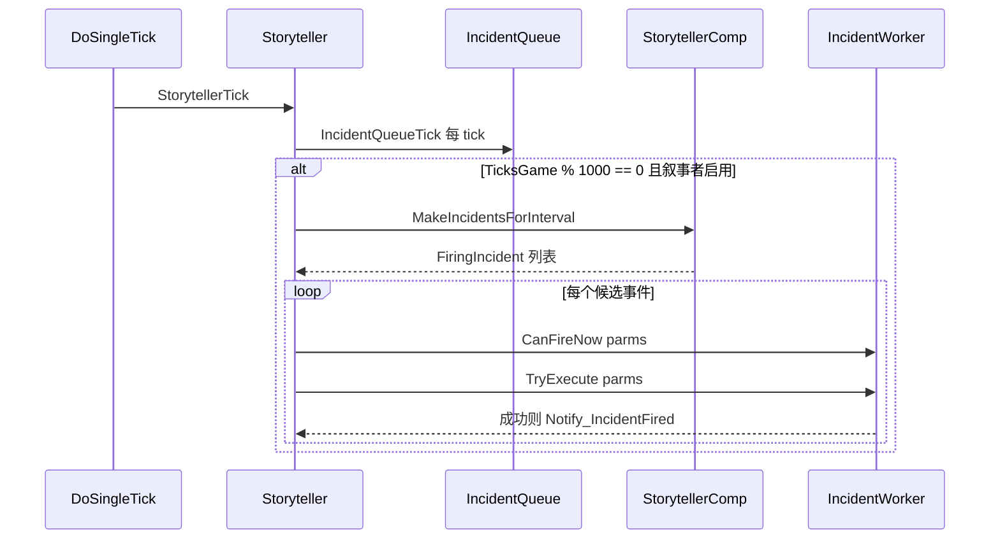
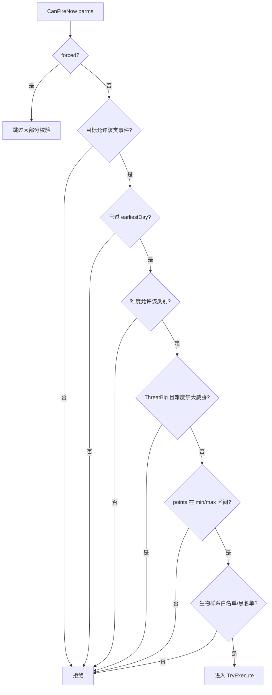
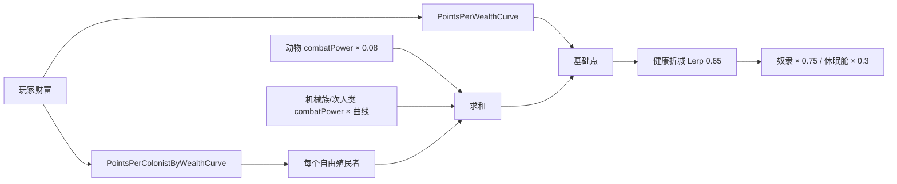

# V09 叙事者、事件与任务

卷号：V09
状态：初稿（R8）
上游：V01（tick 位置）、V02（天数计时）、V15（IncidentDef 数据）；下游：V10（事件在世界层面的落地）、V11（派系事件）

## Scope

本卷解构 **「游戏什么时候给你添乱」**：叙事者（`Storyteller`）的生成节拍、事件（`Incident`）的合法性闸门、威胁点（threat points）如何由财富/人口/健康算出、延迟事件队列，以及任务（`Quest`）生成入口。

不覆盖：具体事件的效果实现（101 个 `IncidentWorker_*` 各自行为）、任务节点的完整脚本表（`QuestGen` 属 Def/脚本面）、袭击编队细节。

## Key types

| 类型 | Token | 语料路径 | 角色 |
|---|---|---|---|
| `RimWorld.Storyteller` | 0x020011C4 | `Assembly-CSharp/RimWorld/Storyteller.cs` | 节拍器：每 1000 tick 请求事件 |
| `RimWorld.StorytellerComp` | — | `Assembly-CSharp/RimWorld/StorytellerComp.cs` | 事件生成策略组件（可多个） |
| `RimWorld.StorytellerComp_OnOffCycle` | — | `Assembly-CSharp/RimWorld/StorytellerComp_OnOffCycle.cs` | 开关周期型策略（含开局强制袭击） |
| `RimWorld.StorytellerUtility` | 0x020011F5 | `Assembly-CSharp/RimWorld/StorytellerUtility.cs` | 威胁点计算（财富/人口/健康曲线） |
| `RimWorld.IncidentWorker` | — | `Assembly-CSharp/RimWorld/IncidentWorker.cs` | 事件落地基类（`CanFireNow`/`TryExecute`） |
| `RimWorld.IncidentQueue` | — | `Assembly-CSharp/RimWorld/IncidentQueue.cs` | 延迟事件队列（按 tick 排队） |
| `RimWorld.Quest` | 0x02001044 | `Assembly-CSharp/RimWorld/Quest.cs` | 任务实例 |
| `RimWorld.QuestGen.QuestGen` | 0x02002156 | `Assembly-CSharp/RimWorld/QuestGen/QuestGen.cs` | 任务生成器 |

## Control flow

### 1. 事件节拍：每 tick 队列 + 每 1000 tick 生成

要点：**生成是周期性的，执行是逐候选的**。`TicksGame % 1000 == 0` 是硬编码节拍（1000 tick ≈ 16.7 游戏秒），与难度/财富无关；难度只影响「生成什么」和「允不允许」。

### 2. 事件合法性闸门（`IncidentWorker.CanFireNow`）

这些闸门决定了「为什么前 3 天不会有袭击」「为什么极地不刷某些事件」「为什么低财富时不来大袭击」。`parms.forced`（剧本/调试/任务强制）会绕过大部分检查。

### 3. 威胁点：财富为主、人口乘算、健康折减

`DefaultThreatPointsNow` 是**所有袭击强度的统一标尺**：事件用 `parms.points` 与此比较，`minThreatPoints`/`maxThreatPoints` 决定能不能刷。

### 4. 延迟事件

`IncidentQueue` 支持把事件排在未来的某个 tick（`Add(def, fireTick, parms, retryDurationTicks)`），每 tick 检查到期；这就是「三天后会有商队」这类预告的实现方式。

## Constants

| 项 | 值 | 位置 |
|---|---|---|
| 事件生成节拍 | `TicksGame % 1000 == 0` | `Storyteller.StorytellerTick` |
| 生成总开关 | `DebugSettings.enableStoryteller` | 同上 |
| 事件最早天数 | `IncidentDef.earliestDay` | `IncidentWorker.CanFireNow` |
| 大威胁开关 | `difficulty.allowBigThreats` | 同上 |
| 威胁点区间 | `minThreatPoints` / `maxThreatPoints` | 同上 |
| 财富曲线 | `PointsPerWealthCurve` | `StorytellerUtility` |
| 每殖民者点数 | `PointsPerColonistByWealthCurve(财富)` | 同上 |
| 动物点数系数 | `0.08 × combatPower`，caravan ×0.7 | 同上 |
| 健康折减权重 | 0.65 | 同上 |
| 奴隶系数 | 0.75 | 同上 |
| 休眠舱系数 | 0.3 | 同上 |
| 开局强制袭击 | `forceRaidEnemyBeforeDaysPassed` | `StorytellerComp_OnOffCycle` |

## Claims

[claim:V09-C01] 叙事者每 tick 只推进延迟队列，事件生成不在每 tick 发生。
  src: RimWorld.Storyteller.StorytellerTick  Token: 0x020011C4
  file: analysis/decompiled/Assembly-CSharp/RimWorld/Storyteller.cs
  match: this.incidentQueue.IncidentQueueTick();

[claim:V09-C02] 事件生成节拍硬编码为每 1000 tick 一次。
  src: RimWorld.Storyteller.StorytellerTick
  file: analysis/decompiled/Assembly-CSharp/RimWorld/Storyteller.cs
  match: if (Find.TickManager.TicksGame % 1000 == 0)

[claim:V09-C03] 叙事者有一个全局调试开关，关闭后整段生成逻辑直接返回。
  src: RimWorld.Storyteller.StorytellerTick
  file: analysis/decompiled/Assembly-CSharp/RimWorld/Storyteller.cs
  match: if (!DebugSettings.enableStoryteller)

[claim:V09-C04] 生成流程是先拿到本区间候选事件列表，再逐个尝试触发。
  src: RimWorld.Storyteller.StorytellerTick
  file: analysis/decompiled/Assembly-CSharp/RimWorld/Storyteller.cs
  match: foreach (FiringIncident firingIncident in this.MakeIncidentsForInterval())

[claim:V09-C05] 触发必须同时满足「允许」与「执行成功」两个条件，成功才记账。
  src: RimWorld.Storyteller.TryFire
  file: analysis/decompiled/Assembly-CSharp/RimWorld/Storyteller.cs
  match: if (fi.def.Worker.CanFireNow(fi.parms) && fi.def.Worker.TryExecute(fi.parms))

[claim:V09-C06] 成功后记录最近事件 tick，用于后续节奏与 UI。
  src: RimWorld.Storyteller.TryFire
  file: analysis/decompiled/Assembly-CSharp/RimWorld/Storyteller.cs
  match: this.lastIncidentTick = GenTicks.TicksGame;

[claim:V09-C07] 事件生成策略是组件化的：每个 comp 自己产出候选事件。
  src: RimWorld.StorytellerComp.MakeIntervalIncidents
  file: analysis/decompiled/Assembly-CSharp/RimWorld/StorytellerComp.cs
  match: public virtual IEnumerable<FiringIncident> MakeIntervalIncidents(IIncidentTarget target)

[claim:V09-C08] 开局存在「强制袭击」窗口，天数未到前优先强制敌袭。
  src: RimWorld.StorytellerComp_OnOffCycle.GenerateIncident
  file: analysis/decompiled/Assembly-CSharp/RimWorld/StorytellerComp_OnOffCycle.cs
  match: if ((float)GenDate.DaysPassedSinceSettle < this.Props.forceRaidEnemyBeforeDaysPassed)

[claim:V09-C09] 事件有最早可发生天数，按「定居后天数」而非游戏总天数计算。
  src: RimWorld.IncidentWorker.CanFireNow
  file: analysis/decompiled/Assembly-CSharp/RimWorld/IncidentWorker.cs
  match: if (GenDate.DaysPassedSinceSettle < this.def.earliestDay)

[claim:V09-C10] 难度可整体禁止大威胁事件。
  src: RimWorld.IncidentWorker.CanFireNow
  file: analysis/decompiled/Assembly-CSharp/RimWorld/IncidentWorker.cs
  match: (this.def.category == IncidentCategoryDefOf.ThreatBig && !Find.Storyteller.difficulty.allowBigThreats)

[claim:V09-C11] 事件点数必须落在该事件声明的区间内才会触发。
  src: RimWorld.IncidentWorker.CanFireNow
  file: analysis/decompiled/Assembly-CSharp/RimWorld/IncidentWorker.cs
  match: if (parms.points >= 0f && parms.points < this.def.minThreatPoints)

[claim:V09-C12] 生物群系白名单会单独拦截。
  src: RimWorld.IncidentWorker.CanFireNow
  file: analysis/decompiled/Assembly-CSharp/RimWorld/IncidentWorker.cs
  match: if (!this.def.allowedBiomes.NullOrEmpty<BiomeDef>())

[claim:V09-C13] 威胁点的基础项是「玩家财富 → 曲线」。
  src: RimWorld.StorytellerUtility.DefaultThreatPointsNow  Token: 0x020011F5
  file: analysis/decompiled/Assembly-CSharp/RimWorld/StorytellerUtility.cs
  match: float num = StorytellerUtility.PointsPerWealthCurve.Evaluate(playerWealthForStoryteller);

[claim:V09-C14] 每个自由殖民者贡献点数，且该点数本身也是财富的函数（人越多不等于线性变强）。
  src: RimWorld.StorytellerUtility.DefaultThreatPointsNow
  file: analysis/decompiled/Assembly-CSharp/RimWorld/StorytellerUtility.cs
  match: num3 = StorytellerUtility.PointsPerColonistByWealthCurve.Evaluate(playerWealthForStoryteller);

[claim:V09-C15] 战斗动物按 combatPower 的 8% 计入，且随远行队额外打折。
  src: RimWorld.StorytellerUtility.DefaultThreatPointsNow
  file: analysis/decompiled/Assembly-CSharp/RimWorld/StorytellerUtility.cs
  match: num3 = 0.08f * pawn.kindDef.combatPower;

[claim:V09-C16] 健康状态按 0.65 权重折算进点数，伤员不算满员战力。
  src: RimWorld.StorytellerUtility.DefaultThreatPointsNow
  file: analysis/decompiled/Assembly-CSharp/RimWorld/StorytellerUtility.cs
  match: num3 = Mathf.Lerp(num3, num3 * pawn.health.summaryHealth.SummaryHealthPercent, 0.65f);

[claim:V09-C17] 睡在低温休眠舱里的人只按 30% 计入点数。
  src: RimWorld.StorytellerUtility.DefaultThreatPointsNow
  file: analysis/decompiled/Assembly-CSharp/RimWorld/StorytellerUtility.cs
  match: if (pawn.ParentHolder != null && pawn.ParentHolder is Building_CryptosleepCasket)

[claim:V09-C18] 奴隶按 75% 计入点数。
  src: RimWorld.StorytellerUtility.DefaultThreatPointsNow
  file: analysis/decompiled/Assembly-CSharp/RimWorld/StorytellerUtility.cs
  match: if (pawn.IsSlaveOfColony)

[claim:V09-C19] 延迟事件队列支持指定未来触发 tick 与重试窗口。
  src: RimWorld.IncidentQueue.Add
  file: analysis/decompiled/Assembly-CSharp/RimWorld/IncidentQueue.cs
  match: public bool Add(IncidentDef def, int fireTick, IncidentParms parms = null, int retryDurationTicks = 0)

[claim:V09-C20] 延迟队列每 tick 检查到期，是「预告类事件」的实现基础。
  src: RimWorld.IncidentQueue.IncidentQueueTick
  file: analysis/decompiled/Assembly-CSharp/RimWorld/IncidentQueue.cs
  match: public void IncidentQueueTick()

## Resolved questions

R13 解出原 `Open questions` 第 1、2、4、5 条：

- **候选取舍（OQ1）**：`MakeIncidentsForInterval` 是按 `StorytellerComp` 分组的**迭代器链**——每个 comp 调 `MakeIntervalIncidents(target)` 产出一串候选，`Storyteller` 逐条 `TryFire`；**没有全局排序**，先到先试，成功即止。
- **单事件概率（OQ5 的下半）**：`StorytellerComp.IncidentChanceFinal` = `BaseChanceThisGame` × 当前人口因子 × 人口意图因子 × `ChanceFactorNow(target)` × **近期重复衰减**（`QuestTuning.RecentStoryWeightFactors[近期第 i 次]`）；选中用 `RandomElementByWeightWithFallback(IncidentChanceFinal)`。所以「刚来过的事件」会被压权重。
- **难度改的是强度不是频率（OQ5 的上半）**：`threatScale` 在**点数公式**里相乘——`… × Find.Storyteller.difficulty.threatScale × pointsFactorFromDaysPassed(定居天数)`，并夹在 `GlobalPointsMin()` 与 **10000** 之间。频率侧只受类别开关（`allowBigThreats` 等）影响。
- **`parms.points` 的赋值方（OQ4）**：`StorytellerComp.GenerateParms` → `StorytellerUtility.DefaultParmsNow`，仅当 `incCat.needsParmsPoints` 为真时才写 `points = DefaultThreatPointsNow(target)`；其余事件（如能力/复杂威胁）由调用方自己赋 `parms.points`。
- **三条曲线取点（OQ2）**：
  - `PointsPerWealthCurve`：(0,0) → (14000,0) → (400000,2400) → (700000,3600)
  - `PointsPerColonistByWealthCurve`：(0,15) → (10000,15) → (400000,140) → (1000000,200)
  - 机械/次人类系数曲线：(0,0.2) → (10000,0.2) → (400000,0.3) → (1000000,0.4)
  注意第一条：**财富 ≤ 14000 时基础点数为 0**，这解释了开局前几天的袭击全靠「每殖民者点数」撑。
- **任务生成（OQ3，部分）**：`QuestGen` 是**脚本驱动**——入口是 `QuestGen.Root`（`QuestScriptDef`），配合 `Rule` 列表（描述/命名/内容）与 `QuestTextRequest` 生成文本，不是硬编码流程；节点树内部未展开。

[claim:V09-C21] 事件候选是按 comp 分组产出的迭代器，先到先试，无全局排序。
  src: RimWorld.Storyteller.MakeIncidentsForInterval
  file: analysis/decompiled/Assembly-CSharp/RimWorld/Storyteller.cs
  match: Storyteller.<MakeIncidentsForInterval>d__48

[claim:V09-C22] 单事件概率含近期重复衰减，刚发生的事件权重被压。
  src: RimWorld.StorytellerComp.IncidentChanceFinal
  file: analysis/decompiled/Assembly-CSharp/RimWorld/StorytellerComp.cs
  match: num *= QuestTuning.RecentStoryWeightFactors[i];

[claim:V09-C23] 事件点数只在该类别需要点数时才由默认点数填充。
  src: RimWorld.StorytellerUtility.DefaultParmsNow
  file: analysis/decompiled/Assembly-CSharp/RimWorld/StorytellerUtility.cs
  match: incidentParms.points = StorytellerUtility.DefaultThreatPointsNow(target);

[claim:V09-C24] 难度通过 `threatScale` 乘进点数，并且点数还受「定居天数」曲线与上限 10000 约束。
  src: RimWorld.StorytellerUtility
  file: analysis/decompiled/Assembly-CSharp/RimWorld/StorytellerUtility.cs
  match: return Mathf.Clamp(num4 * num5 * Find.Storyteller.difficulty.threatScale * Find.Storyteller.def.pointsFactorFromDaysPassed.Evaluate((float)GenDate.DaysPassedSinceSettle), StorytellerUtility.GlobalPointsMin(), 10000f);

[claim:V09-C25] 财富基础曲线的起点是「14000 财富以下为 0 点」。
  src: RimWorld.StorytellerUtility.PointsPerWealthCurve
  file: analysis/decompiled/Assembly-CSharp/RimWorld/StorytellerUtility.cs
  match: new CurvePoint(14000f, 0f),

[claim:V09-C26] 每殖民者点数曲线：中段 400000 财富对应 140 点。
  src: RimWorld.StorytellerUtility.PointsPerColonistByWealthCurve
  file: analysis/decompiled/Assembly-CSharp/RimWorld/StorytellerUtility.cs
  match: new CurvePoint(400000f, 140f),

[claim:V09-C27] 任务生成以 `QuestScriptDef` 为根，属脚本驱动。
  src: RimWorld.QuestGen.QuestGen.Root
  file: analysis/decompiled/Assembly-CSharp/RimWorld/QuestGen/QuestGen.cs
  match: public static QuestScriptDef Root

## Open questions

1. **`MakeIncidentsForInterval` 的候选选择算法未解构**：它遍历 `StorytellerComp` 列表并汇总，但「多个 comp 同时给出候选时如何取舍」未读（涉及 `StorytellerCompProperties` 的权重与冷却）。
2. `StorytellerUtility` 中三条曲线的具体形状（`PointsPerWealthCurve`、`PointsPerColonistByWealthCurve`、机械族/次人类系数曲线）只确认存在，未取点。
3. `Quest` 生成（`QuestGen`）的脚本化流程未展开：`QuestNode` 树、`QuestScriptDef`、奖励/失败处理都是独立体系，属后续扩展卷。
4. `IncidentParms.points` 由谁赋值（叙事者默认点数 vs 事件自定义）未排序。
5. 难度对事件**频率**（不只是类别）的影响未确认：本卷只看到类别/大威胁开关，未见频率系数。
