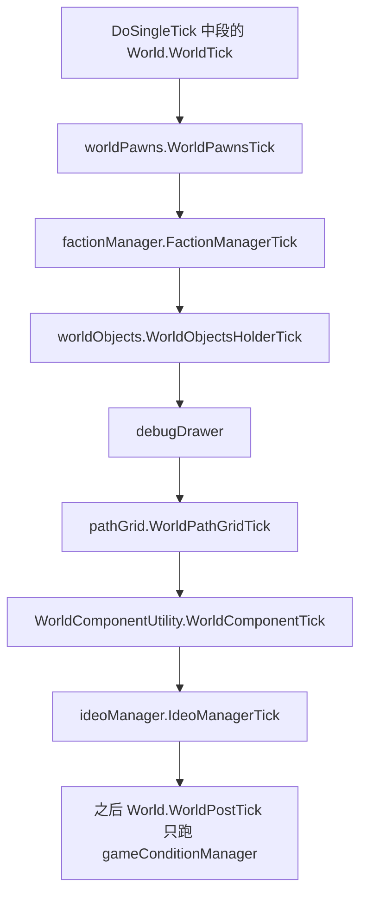
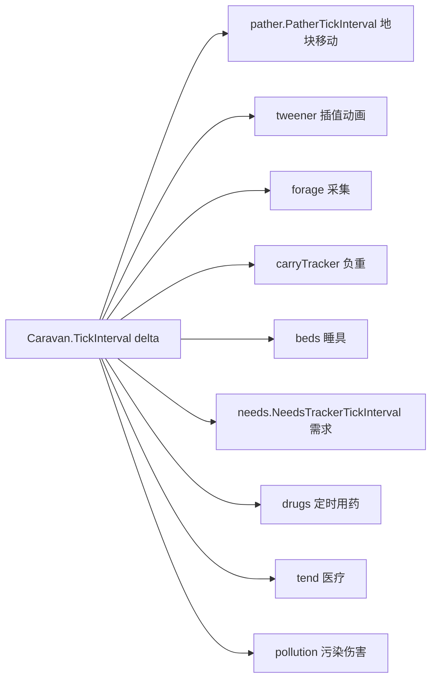

# V10 世界、地块与远行队

卷号：V10
状态：初稿（R9）
上游：V01（tick 位置）、V02（时间标尺）；下游：V09（世界事件）、V12（贸易）

## Scope

本卷解构 **「地图之外的那一层」**：世界地图的世界对象（`WorldObject`）如何在 tick 中被推进、远行队（`Caravan`）在没有地图的情况下如何消耗时间与资源、以及世界层与地图层的推进节奏差异。

不覆盖：世界生成算法（`WorldGenerator`）、地点/遗迹的地图内容（属生成与 Def 面）、商队交易的数值（V12）。

## Key types

| 类型 | Token | 语料路径 | 角色 |
|---|---|---|---|
| `RimWorld.Planet.World` | 0x0200233C | `Assembly-CSharp/RimWorld/Planet/World.cs` | 世界层总容器（tick 入口） |
| `RimWorld.Planet.WorldObjectsHolder` | 0x0200236E | `Assembly-CSharp/RimWorld/Planet/WorldObjectsHolder.cs` | 世界对象集合与 tick 分发 |
| `RimWorld.Planet.WorldObject` | 0x020023E0 | `Assembly-CSharp/RimWorld/Planet/WorldObject.cs` | 世界对象基类（`DoTick` 契约） |
| `RimWorld.Planet.Caravan` | 0x0200237D | `Assembly-CSharp/RimWorld/Planet/Caravan.cs` | 远行队（无地图的 Pawn 集合） |
| `RimWorld.Planet.Caravan_PathFollower` | 0x02002397 | `Assembly-CSharp/RimWorld/Planet/Caravan_PathFollower.cs` | 世界层寻路（地块跳跃） |
| `RimWorld.Planet.Caravan_NeedsTracker` | 0x020023A9 | `Assembly-CSharp/RimWorld/Planet/Caravan_NeedsTracker.cs` | 远行队的需求推进 |
| `RimWorld.Planet.WorldGrid` | 0x02002355 | `Assembly-CSharp/RimWorld/Planet/WorldGrid.cs` | 地块网格与邻接 |
| `RimWorld.Planet.PlanetLayer` | 0x02002344 | `Assembly-CSharp/RimWorld/Planet/PlanetLayer.cs` | 层面（地表/轨道） |
| `RimWorld.Planet.Site` / `Settlement` | 0x020023BD / 0x020023B7 | 同名文件 | 场所与定居点 |

## Control flow

### 1. 世界层每 tick 的固定顺序

注意 `WorldPostTick` 在 `DoSingleTick` 里位于「所有地图的 `MapPostTick` 之后」，且只做天气/条件推进——世界层的「后半段」比地图层薄得多。

### 2. 世界对象的分发

`WorldObjectsHolderTick` 先把对象列表**复制到临时表**再逐个 `DoTick()`：与 V03 的健康 tick 一样是「遍历快照」，防止对象在 tick 中创建/销毁对象导致集合修改。

### 3. 远行队：没有地图的 Pawn

这是全项目最值得注意的一点：**远行队复用同一套子系统**（寻路、需求、搬运、睡具、医疗）但换成「世界层实现」。所以远行队里的人也饿、也累、也需要吃药，只是它们的 tick 走 `Caravan_*Tracker` 而不是 `Pawn_*Tracker`。

移动速度不是固定值：`Caravan.TicksPerMove` 交给 `CaravanTicksPerMoveUtility.GetTicksPerMove(caravan, explanation)` 计算（受负重、地形、路线、动物影响），可见性则交给 `CaravanVisibilityCalculator`。

### 4. 世界层与地图层的节奏差异

| 层 | 每 tick 做什么 | 备注 |
|---|---|---|
| 地图层 | `MapPreTick` → tick 桶 → `MapPostTick`（含 `MapComponentTick`） | 重：网格、寻路、物体 |
| 世界层 | `WorldTick`（对象/派系/路径网格）+ `WorldPostTick`（天气条件） | 轻：只在有对象时才忙 |
| 无地图时 | `TimeSpeed.Superfast`/`Ultrafast` 倍率放宽（V01） | 世界地图上空转会被加速 |

最后一行解释了「为什么远行队在世界上跑得飞快」：不是远行队自己加速，而是**没有地图时倍率表直接给到 18/150 倍**。

## Constants

| 项 | 值 / 规则 | 位置 |
|---|---|---|
| 世界 tick 阶段数 | 7（`WorldTick`）+ 1（`WorldPostTick`） | `World` |
| 对象分发 | 遍历快照表 | `WorldObjectsHolder.WorldObjectsHolderTick` |
| 远行队移动成本 | `CaravanTicksPerMoveUtility.GetTicksPerMove` 动态计算 | `Caravan.TicksPerMove` |
| 远行队可见性 | `CaravanVisibilityCalculator.Visibility` | `Caravan.Visibility` |
| 远行队 tick 子系统 | 路径/插值/采集/负重/睡具/需求/婴儿/用药/医疗/污染 | `Caravan.TickInterval` |

## Claims

[claim:V10-C01] 世界层 tick 的入口是 `World.WorldTick`，由 `DoSingleTick` 中段调用。
  src: RimWorld.Planet.World.WorldTick  Token: 0x0200233C
  file: analysis/decompiled/Assembly-CSharp/RimWorld/Planet/World.cs
  match: public void WorldTick()

[claim:V10-C02] 世界层第一件事是推进世界层面的 Pawn（不在任何地图上的）。
  src: RimWorld.Planet.World.WorldTick
  file: analysis/decompiled/Assembly-CSharp/RimWorld/Planet/World.cs
  match: this.worldPawns.WorldPawnsTick();

[claim:V10-C03] 派系管理器在世界层 tick 中推进（好感衰减、关系更新等）。
  src: RimWorld.Planet.World.WorldTick
  file: analysis/decompiled/Assembly-CSharp/RimWorld/Planet/World.cs
  match: this.factionManager.FactionManagerTick();

[claim:V10-C04] 世界对象由集合统一分发推进。
  src: RimWorld.Planet.World.WorldTick
  file: analysis/decompiled/Assembly-CSharp/RimWorld/Planet/World.cs
  match: this.worldObjects.WorldObjectsHolderTick();

[claim:V10-C05] 世界路径网格单独推进，说明世界层寻路也有自己的缓存结构。
  src: RimWorld.Planet.World.WorldTick
  file: analysis/decompiled/Assembly-CSharp/RimWorld/Planet/World.cs
  match: this.pathGrid.WorldPathGridTick();

[claim:V10-C06] 世界组件的 tick 排在对象之后。
  src: RimWorld.Planet.World.WorldTick
  file: analysis/decompiled/Assembly-CSharp/RimWorld/Planet/World.cs
  match: WorldComponentUtility.WorldComponentTick(this);

[claim:V10-C07] `WorldPostTick` 只做天气/条件推进，是地图 `MapPostTick` 之后的一小段。
  src: RimWorld.Planet.World.WorldPostTick
  file: analysis/decompiled/Assembly-CSharp/RimWorld/Planet/World.cs
  match: this.gameConditionManager.GameConditionManagerTick();

[claim:V10-C08] 世界对象分发用「快照表」，避免 tick 中集合被修改。
  src: RimWorld.Planet.WorldObjectsHolder.WorldObjectsHolderTick  Token: 0x0200236E
  file: analysis/decompiled/Assembly-CSharp/RimWorld/Planet/WorldObjectsHolder.cs
  match: WorldObjectsHolder.tmpWorldObjects.AddRange(this.worldObjects);

[claim:V10-C09] 每个世界对象走自己的 `DoTick` 契约。
  src: RimWorld.Planet.WorldObjectsHolder.WorldObjectsHolderTick
  file: analysis/decompiled/Assembly-CSharp/RimWorld/Planet/WorldObjectsHolder.cs
  match: WorldObjectsHolder.tmpWorldObjects[i].DoTick();

[claim:V10-C10] 远行队的 tick 是「区间式」的，与 Pawn 的 `TickInterval` 同构。
  src: RimWorld.Planet.Caravan.TickInterval  Token: 0x0200237D
  file: analysis/decompiled/Assembly-CSharp/RimWorld/Planet/Caravan.cs
  match: protected override void TickInterval(int delta)

[claim:V10-C11] 远行队复用寻路子系统，但用的是世界层实现。
  src: RimWorld.Planet.Caravan.TickInterval
  file: analysis/decompiled/Assembly-CSharp/RimWorld/Planet/Caravan.cs
  match: this.pather.PatherTickInterval(delta);

[claim:V10-C12] 远行队的需求由专用追踪器推进（`Caravan_NeedsTracker`）。
  src: RimWorld.Planet.Caravan.TickInterval
  file: analysis/decompiled/Assembly-CSharp/RimWorld/Planet/Caravan.cs
  match: this.needs.NeedsTrackerTickInterval(delta);

[claim:V10-C13] 远行队也会采集（forage），这是「无补给行军」的机制基础。
  src: RimWorld.Planet.Caravan.TickInterval
  file: analysis/decompiled/Assembly-CSharp/RimWorld/Planet/Caravan.cs
  match: this.forage.ForageTrackerTickInterval(delta);

[claim:V10-C14] 远行队同样有医疗与用药检查，说明无地图不等于无模拟。
  src: RimWorld.Planet.Caravan.TickInterval
  file: analysis/decompiled/Assembly-CSharp/RimWorld/Planet/Caravan.cs
  match: CaravanTendUtility.CheckTend(this, delta);

[claim:V10-C15] 生物科技开启时，远行队还会受污染伤害。
  src: RimWorld.Planet.Caravan.TickInterval
  file: analysis/decompiled/Assembly-CSharp/RimWorld/Planet/Caravan.cs
  match: CaravanPollutionUtility.CheckDamageFromPollution(this, delta);

[claim:V10-C16] 每格移动成本不是常量，而是由工具类动态计算。
  src: RimWorld.Planet.Caravan.TicksPerMove
  file: analysis/decompiled/Assembly-CSharp/RimWorld/Planet/Caravan.cs
  match: return CaravanTicksPerMoveUtility.GetTicksPerMove(this, null);

[claim:V10-C17] 远行队可见性同样由独立计算器得出（影响被袭击概率）。
  src: RimWorld.Planet.Caravan.Visibility
  file: analysis/decompiled/Assembly-CSharp/RimWorld/Planet/Caravan.cs
  match: return CaravanVisibilityCalculator.Visibility(this, null);

[claim:V10-C18] 世界对象写入时会按层（PlanetLayer）分桶，说明存在多层世界（地表/轨道）。
  src: RimWorld.Planet.WorldObjectsHolder.AddToCache
  file: analysis/decompiled/Assembly-CSharp/RimWorld/Planet/WorldObjectsHolder.cs
  match: if (!this.layerWorldObjects.TryGetValue(o.Tile.Layer, out list))

## Resolved questions

原 `Open questions` 第 3 条（世界层与地图层的暂停一致性）在 R12 已解：

- `TickManager.DoSingleTick` 里 `Find.World.WorldTick()` 是**无条件调用**的，与「当前在哪张地图」「是否打开了世界地图」无关；世界层与地图层共用同一个 `DoSingleTick` 节拍。
- 因此两层的暂停是**同一闸门**：`TickManagerUpdate` 不推进时，世界与地图一起停；进入地图不会让世界停摆，只是渲染切换。

[claim:V10-C19] 世界层 tick 在 `DoSingleTick` 中无条件执行，与当前地图无关。
  src: Verse.TickManager.DoSingleTick
  file: analysis/decompiled/Assembly-CSharp/Verse/TickManager.cs
  match: Find.World.WorldTick();

## Resolved questions

R16 解出原 `Open questions` 第 1、2、4、5 条：

- **世界对象的三段式 tick（OQ1）**：`WorldObject` 与 `Thing` **同构**——有 `UpdateRateTicks`（可覆写）、`DoTick()`、`Tick()`、`TickInterval(delta)`；`DoTick` 内部按 `UpdateRateTicks` 累积后调 `TickInterval`。`Settlement` 确实覆写了 `TickInterval`（有持续逻辑），而 `Site` 只覆写表现层成员（`Label`/`Material`/`ExpandingIcon`），不覆写 tick —— 所以「地点」是静态的，「定居点」才是活跃模拟对象。
- **移动成本模型（OQ2）**：`GetTicksPerMove` 无队时返回 **3300**（默认值）；穿梭机返回 **0**（瞬移）；常规情况取三组输入：人形基数、**坐骑/驮兽速度因子**（`StatDefOf.CaravanRidingSpeedFactor`，排序取前 N 个后求均值，不足补 1.0）、以及负重比（`massUsage`/`massCapacity`）。
- **层面机制（OQ4）**：`PlanetLayer` 是**带代价的连接图**——`AddConnection(target, cost)` / `HasConnectionFromTo` / `PlanetLayerConnection`，加上 `MarkRootSurface`、`CanSelectLayer`、`PlanetTileForID`。所谓「太空层/地表层」不是特殊代码路径，而是同一套层面图上的不同节点，切换即沿连接迁移。
- **远行队转地图战斗（OQ5）**：入口是 `CaravanArrivalAction_AttackSettlement.Arrived(caravan)` → `SettlementUtility.Attack(caravan, settlement)`。也就是说「遇袭/攻城」不是 `Caravan` 自己切图，而是**抵达行动（ArrivalAction）**在到达时把控制权交给地图侧的 Settlement 战斗工具。

[claim:V10-C20] 世界对象也有 `UpdateRateTicks`，与 Thing 同一套节流模型。
  src: RimWorld.Planet.WorldObject.UpdateRateTicks
  file: analysis/decompiled/Assembly-CSharp/RimWorld/Planet/WorldObject.cs
  match: protected virtual int UpdateRateTicks

[claim:V10-C21] 世界对象的区间钩子存在，供活跃对象覆写。
  src: RimWorld.Planet.WorldObject.TickInterval
  file: analysis/decompiled/Assembly-CSharp/RimWorld/Planet/WorldObject.cs
  match: protected virtual void TickInterval(int delta)

[claim:V10-C22] 定居点覆写了区间钩子，说明它是活跃模拟对象。
  src: RimWorld.Planet.Settlement.TickInterval
  file: analysis/decompiled/Assembly-CSharp/RimWorld/Planet/Settlement.cs
  match: protected override void TickInterval(int delta)

[claim:V10-C23] 无队伍时的默认移动成本是 3300 tick/格。
  src: RimWorld.Planet.CaravanTicksPerMoveUtility.GetTicksPerMove
  file: analysis/decompiled/Assembly-CSharp/RimWorld/Planet/CaravanTicksPerMoveUtility.cs
  match: return 3300;

[claim:V10-C24] 坐骑/驮兽速度按属性收集后排前 N 取均值，参与移动成本。
  src: RimWorld.Planet.CaravanTicksPerMoveUtility.GetTicksPerMove
  file: analysis/decompiled/Assembly-CSharp/RimWorld/Planet/CaravanTicksPerMoveUtility.cs
  match: CaravanTicksPerMoveUtility.caravanAnimalSpeedFactors.Add(pawn.GetStatValue(StatDefOf.CaravanRidingSpeedFactor, true, -1));

[claim:V10-C25] 层面之间以带代价的连接相连，构成可迁移的图。
  src: RimWorld.Planet.PlanetLayer.AddConnection
  file: analysis/decompiled/Assembly-CSharp/RimWorld/Planet/PlanetLayer.cs
  match: public void AddConnection(PlanetLayer target, float cost)

[claim:V10-C26] 攻城由抵达行动转交地图侧工具，而非 Caravan 自己切图。
  src: RimWorld.Planet.CaravanArrivalAction_AttackSettlement.Arrived
  file: analysis/decompiled/Assembly-CSharp/RimWorld/Planet/CaravanArrivalAction_AttackSettlement.cs
  match: SettlementUtility.Attack(caravan, this.settlement);

## Open questions

1. **`WorldObject.DoTick` 与 `TickInterval` 的关系未逐条确认**：本卷只确认了分发点与 `Caravan` 的区间覆写，`Site`/`Settlement` 等各自推进什么未展开。
2. `CaravanTicksPerMoveUtility.GetTicksPerMove` 的完整成本模型（负重/地形/夜间/动物）未解构。
3. 世界层与地图层的「暂停一致性」：进入地图时世界是否继续 tick，未验证（涉及 `ProgramState` 与 `TimeSpeed` 的交互）。
4. `PlanetLayer`（1641 行）的层面机制（轨道层/地表层切换、`Gravship` 起降）未展开，属 V18 交叉面。
5. 远行队遇袭（`CaravanMeeting`/`Ambush`）如何切换到地图战斗未解构。
