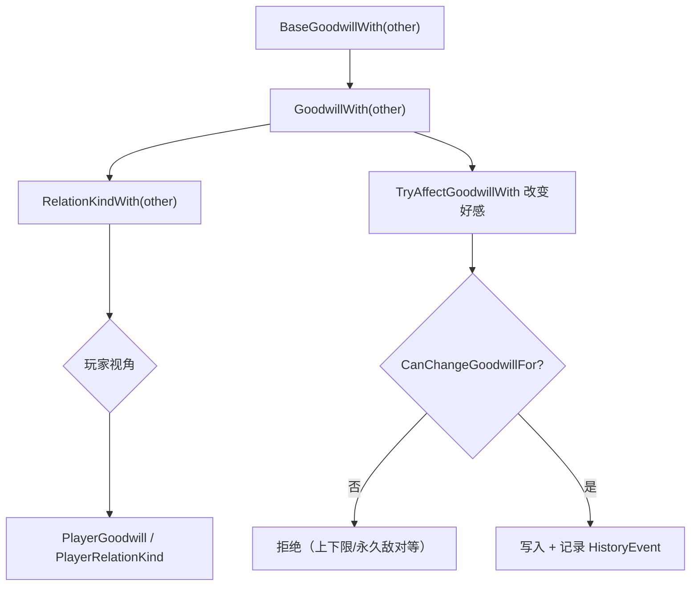
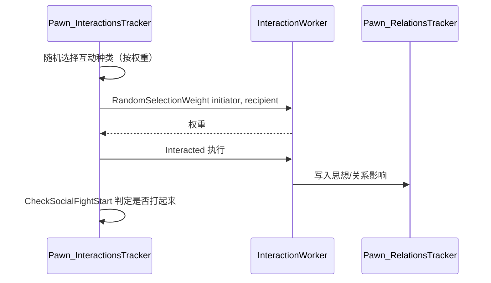

# V11 派系、社交与关系

卷号：V11
状态：初稿（R8）
上游：V05（Pawn）、V13（心情/思想）；下游：V09（派系事件）、V12（贸易）、V10（世界层面派系）

## Scope

本卷解构 **「人怎么看待彼此与外人」**：派系好感（goodwill）的两级模型（自然好感 + 修正）、关系类型判定、个体之间的意见（opinion）如何由社交互动累积、以及社交互动的权重选择与冲突（social fight）触发。

不覆盖：具体互动 Def 的文本与数值（Def 面）、恋爱/婚姻的完整流程、意识形态（Ideology）对社交的改写（V18）。

## Key types

| 类型 | Token | 语料路径 | 角色 |
|---|---|---|---|
| `RimWorld.Faction` | 0x020015FE | `Assembly-CSharp/RimWorld/Faction.cs` | 派系（好感、关系类型、成员） |
| `RimWorld.FactionManager` | 0x02001603 | `Assembly-CSharp/RimWorld/FactionManager.cs` | 派系注册与生成 |
| `RimWorld.Pawn_RelationsTracker` | 0x020015CA | `Assembly-CSharp/RimWorld/Pawn_RelationsTracker.cs` | 个体关系与意见（1224 行） |
| `RimWorld.Pawn_InteractionsTracker` | 0x020015C6 | `Assembly-CSharp/RimWorld/Pawn_InteractionsTracker.cs` | 社交互动调度与冲突判定 |
| `RimWorld.InteractionWorker` | — | `Assembly-CSharp/RimWorld/InteractionWorker.cs` | 单次互动的实现与权重 |
| `RimWorld.SocialCardUtility` | 0x02001CEE | `Assembly-CSharp/RimWorld/SocialCardUtility.cs` | UI 汇总（意见分解展示） |
| `RimWorld.FactionDef` | 0x02000F59 | `Assembly-CSharp/RimWorld/FactionDef.cs` | 派系定义（数据面） |

## Control flow

### 1. 派系好感是「自然值 + 修正」的两级模型

关键区分：

- `BaseGoodwillWith` 是**自然好感**（不受事件影响，由 Def/剧本给）；
- `GoodwillWith` 是**当前好感**（自然值 + 累积修正，夹到上下限）；
- `RelationKindWith` 把数值映射成关系类型（敌对/中立/盟友），但**不是纯数值阈值**：存在 `permanentEnemy` 这类覆盖；
- 所有好感变更都走 `TryAffectGoodwillWith`，且带一个 `HistoryEventDef` 参数 —— 这就是「为什么好感变化会在历史里留下记录」。

### 2. 个体意见（opinion）与社交互动

- **互动不是随机均等**：每种互动有 `RandomSelectionWeight(initiator, recipient)`，可按性格/关系/状态动态改权重；
- `Interacted(...)` 是唯一执行入口，输出文本/信件/高亮等表现；
- 意见 `OpinionOf(other)` 是逐对计算的**动态值**（不存累积数，而是由思想、关系、事件求和），这与派系好感的「累积修正」模型不同；
- 社交冲突（`SocialFightStart`）由 `SocialFightChance(interaction, initiator)` 概率触发，`SocialFightPossible` 先做可行性检查。

### 3. 两级模型的对照

| 维度 | 派系好感 | 个体意见 |
|---|---|---|
| 存储 | 累积修正写入派系 | 每次动态求和 |
| 范围 | 派系对派系 | Pawn 对 Pawn |
| 变更入口 | `TryAffectGoodwillWith` | 思想/互动写入 |
| 上限/下限 | 有明确上下限 | 理论无界（受思想数量限制） |
| 关系类型 | `RelationKindWith`（可被覆盖） | `OpinionOf` 阈值（社交关系 Def 判定） |

## Constants

| 项 | 值 / 规则 | 位置 |
|---|---|---|
| 自然好感 | `NaturalGoodwill` / `BaseGoodwillWith` | `Faction` |
| 当前好感 | `GoodwillWith`（含修正，夹取） | `Faction` |
| 玩家视角快捷 | `PlayerGoodwill` / `PlayerRelationKind` | `Faction` |
| 变更入口 | `TryAffectGoodwillWith(other, amount, …)` | `Faction` |
| 可变更性检查 | `CanChangeGoodwillFor(other, delta)` | `Faction` |
| 意见计算 | `Pawn_RelationsTracker.OpinionOf(other)` | 关系追踪器 |
| 互动权重 | `InteractionWorker.RandomSelectionWeight` | `InteractionWorker` |
| 社交冲突概率 | `SocialFightChance(interaction, initiator)` | 互动追踪器 |

## Claims

[claim:V11-C01] 玩家好感是派系上的独立读数（含所有修正后的当前值）。
  src: RimWorld.Faction.PlayerGoodwill  Token: 0x020015FE
  file: analysis/decompiled/Assembly-CSharp/RimWorld/Faction.cs
  match: public int PlayerGoodwill

[claim:V11-C02] 关系类型与好感数值分开暴露，说明类型不是纯数值映射。
  src: RimWorld.Faction.PlayerRelationKind
  file: analysis/decompiled/Assembly-CSharp/RimWorld/Faction.cs
  match: public FactionRelationKind PlayerRelationKind

[claim:V11-C03] 除当前好感外还有「自然好感」这一独立基线。
  src: RimWorld.Faction.NaturalGoodwill
  file: analysis/decompiled/Assembly-CSharp/RimWorld/Faction.cs
  match: public int NaturalGoodwill

[claim:V11-C04] 派系间好感计算统一走 `GoodwillWith`。
  src: RimWorld.Faction.GoodwillWith
  file: analysis/decompiled/Assembly-CSharp/RimWorld/Faction.cs
  match: public int GoodwillWith(Faction other)

[claim:V11-C05] 自然好感另有单独入口，印证「自然值 + 修正」的两级结构。
  src: RimWorld.Faction.BaseGoodwillWith
  file: analysis/decompiled/Assembly-CSharp/RimWorld/Faction.cs
  match: public int BaseGoodwillWith(Faction other)

[claim:V11-C06] 关系类型由 `RelationKindWith` 统一判定。
  src: RimWorld.Faction.RelationKindWith
  file: analysis/decompiled/Assembly-CSharp/RimWorld/Faction.cs
  match: public FactionRelationKind RelationKindWith(Faction other)

[claim:V11-C07] 好感变更受「能否变更」检查约束（上下限、永久状态等）。
  src: RimWorld.Faction.CanChangeGoodwillFor
  file: analysis/decompiled/Assembly-CSharp/RimWorld/Faction.cs
  match: public bool CanChangeGoodwillFor(Faction other, int goodwillChange)

[claim:V11-C08] 好感变更入口带历史事件参数，因此每次变动都可在历史里追溯。
  src: RimWorld.Faction
  file: analysis/decompiled/Assembly-CSharp/RimWorld/Faction.cs
  match: this.TryAffectGoodwillWith(ofPlayer, num3, flag, !this.temporary, historyEventDef, null);

[claim:V11-C09] 个体意见是逐对动态计算的（`OpinionOf`），不是存下来的累积值。
  src: RimWorld.Pawn_RelationsTracker.OpinionOf  Token: 0x020015CA
  file: analysis/decompiled/Assembly-CSharp/RimWorld/Pawn_RelationsTracker.cs
  match: public int OpinionOf(Pawn other)

[claim:V11-C10] 互动种类的选择靠权重函数，权重可依赖双方状态。
  src: RimWorld.InteractionWorker.RandomSelectionWeight
  file: analysis/decompiled/Assembly-CSharp/RimWorld/InteractionWorker.cs
  match: public virtual float RandomSelectionWeight(Pawn initiator, Pawn recipient)

[claim:V11-C11] 互动执行统一走 `Interacted`，表现层（信件/高亮）由它输出。
  src: RimWorld.InteractionWorker.Interacted
  file: analysis/decompiled/Assembly-CSharp/RimWorld/InteractionWorker.cs
  match: public virtual void Interacted(Pawn initiator, Pawn recipient, List<RulePackDef> extraSentencePacks, out string letterText, out string letterLabel, out LetterDef letterDef, out LookTargets lookTargets)

[claim:V11-C12] 指定种类的互动由追踪器统一发起。
  src: RimWorld.Pawn_InteractionsTracker.TryInteractWith  Token: 0x020015C6
  file: analysis/decompiled/Assembly-CSharp/RimWorld/Pawn_InteractionsTracker.cs
  match: public bool TryInteractWith(Pawn recipient, InteractionDef intDef)

[claim:V11-C13] 社交冲突有独立的可行性检查，先判「能不能打」。
  src: RimWorld.Pawn_InteractionsTracker.SocialFightPossible
  file: analysis/decompiled/Assembly-CSharp/RimWorld/Pawn_InteractionsTracker.cs
  match: public bool SocialFightPossible(Pawn otherPawn)

[claim:V11-C14] 冲突概率是互动的函数，不同互动触发冲突的倾向不同。
  src: RimWorld.Pawn_InteractionsTracker.SocialFightChance
  file: analysis/decompiled/Assembly-CSharp/RimWorld/Pawn_InteractionsTracker.cs
  match: public float SocialFightChance(InteractionDef interaction, Pawn initiator)

[claim:V11-C15] 冲突判定在互动流程内被调用，因此一次互动可能直接升级为打架。
  src: RimWorld.Pawn_InteractionsTracker.CheckSocialFightStart
  file: analysis/decompiled/Assembly-CSharp/RimWorld/Pawn_InteractionsTracker.cs
  match: public bool CheckSocialFightStart(InteractionDef interaction, Pawn initiator)

## Resolved questions

原 `Open questions` 第 1 条（`OpinionOf` 构成项）在 R12 已解：

- 构成顺序：亲属关系 `opinionOffset` 求和 → 加 `needs.mood.thoughts.TotalOpinionOffset(other)`（社交思想） → 若结果非零，再**乘以**所有 hediff 阶段的 `opinionOfOthersFactor`（疾病/药物会放大或缩小观感） → 若为正面且双方敌对则归零 → 最后 `Clamp(-100, 100)`。
- 所以个体意见**是有界的**（±100），且敌对状态会一票否决正面评价 —— 这与派系好感的「累积修正」模型互为镜像。

[claim:V11-C16] 个体意见最终被夹到 -100..100。
  src: RimWorld.Pawn_RelationsTracker.OpinionOf
  file: analysis/decompiled/Assembly-CSharp/RimWorld/Pawn_RelationsTracker.cs
  match: return Mathf.Clamp(num, -100, 100);

[claim:V11-C17] 亲属关系偏移是意见的第一构成项。
  src: RimWorld.Pawn_RelationsTracker.OpinionOf
  file: analysis/decompiled/Assembly-CSharp/RimWorld/Pawn_RelationsTracker.cs
  match: num += pawnRelationDef.opinionOffset;

[claim:V11-C18] 敌对关系会把正面意见清零。
  src: RimWorld.Pawn_RelationsTracker.OpinionOf
  file: analysis/decompiled/Assembly-CSharp/RimWorld/Pawn_RelationsTracker.cs
  match: if (num > 0 && this.pawn.HostileTo(other))

### 关系类型的来源（原 OQ3）

`RelationKindWith` 不按好感阈值现算，而是取**已存储的关系记录**：`RelationWith(other, false).kind`。所以「永久敌对/盟友」是记录里的既定 `kind`，好感数值变化不会自动改写它；这也解释了为什么某些派系即使好感回升也仍是敌对。

[claim:V11-C19] 关系类型来自存储的关系记录，而非好感阈值推导。
  src: RimWorld.Faction.RelationKindWith
  file: analysis/decompiled/Assembly-CSharp/RimWorld/Faction.cs
  match: return this.RelationWith(other, false).kind;

### 互动发起频率（原 OQ4）

`Pawn_InteractionsTracker.InteractionsTrackerTickInterval(delta)` 的门槛是**两个条件的与**：距上次互动超过 **320 tick**，且 `IsHashIntervalTick(60, delta)` 命中。社交模式还会先改行为：`RandomSocialMode.Off` 直接关闭意向并返回，`Quiet` 也关闭意向但继续走其余逻辑。所以「多久聊一次」= 320 tick 冷却 + 60 tick 哈希窗口，且受当前社交模式（工作/战斗/心情）调节。

### 好感上下限（原 OQ2，部分）

好感并非随处硬夹 100：`CheckReachNaturalGoodwill` 用的是 `IntRange(NaturalGoodwill - 50, NaturalGoodwill + 50)` —— 即**向自然好感回归的带宽是 ±50**；真正的上下限在关系变更入口（`TryAffectGoodwillWith` 的调用方）与 `GoodwillSituationManager` 侧。

[claim:V11-C20] 互动意向需要「320 tick 冷却 + 60 tick 哈希命中」双条件。
  src: RimWorld.Pawn_InteractionsTracker.InteractionsTrackerTickInterval
  file: analysis/decompiled/Assembly-CSharp/RimWorld/Pawn_InteractionsTracker.cs
  match: if (Find.TickManager.TicksGame > this.lastInteractionTime + 320 && this.pawn.IsHashIntervalTick(60, delta))

[claim:V11-C21] 自然好感回归带宽是 ±50（不是全局硬夹）。
  src: RimWorld.Faction.CheckReachNaturalGoodwill
  file: analysis/decompiled/Assembly-CSharp/RimWorld/Faction.cs
  match: IntRange intRange = new IntRange(this.NaturalGoodwill - 50, this.NaturalGoodwill + 50);

### 好感的硬边界（原 OQ2）

上下限**就在变更入口**，不在 Def：`TryAffectGoodwillWith` 里 `num3 = Mathf.Clamp(num2 + goodwillChange, -100, 100)`。所以好感永远落在 −100..100；而 `CheckReachNaturalGoodwill` 的 ±50 是「向自然值回归」的带宽，两者是不同概念（前者是硬夹取，后者是回归触发区间）。

[claim:V11-C22] 好感在变更入口被硬夹在 −100..100。
  src: RimWorld.Faction.TryAffectGoodwillWith
  file: analysis/decompiled/Assembly-CSharp/RimWorld/Faction.cs
  match: int num3 = Mathf.Clamp(num2 + goodwillChange, -100, 100);

## Open questions

1. **`OpinionOf` 的构成项未展开**：它把思想、关系、社交事件等求和，但各项权重与上限（是否可被无界累积）未验证。
2. 派系好感的夹取上下限来源（Def 还是难度）未确认；`CanChangeGoodwillFor` 的内部条件只确认存在。
3. `RelationKindWith` 中「永久敌对/永久盟友」的覆盖逻辑未读。
4. 社交互动的**发起频率**（多少 tick 一次、在什么状态下才发起）未取证；本卷只覆盖了「怎么选、怎么执行」。
5. 意识形态（Ideology）对社交的改写（`Precept*` 影响互动权重）属 V18，未纳入。
