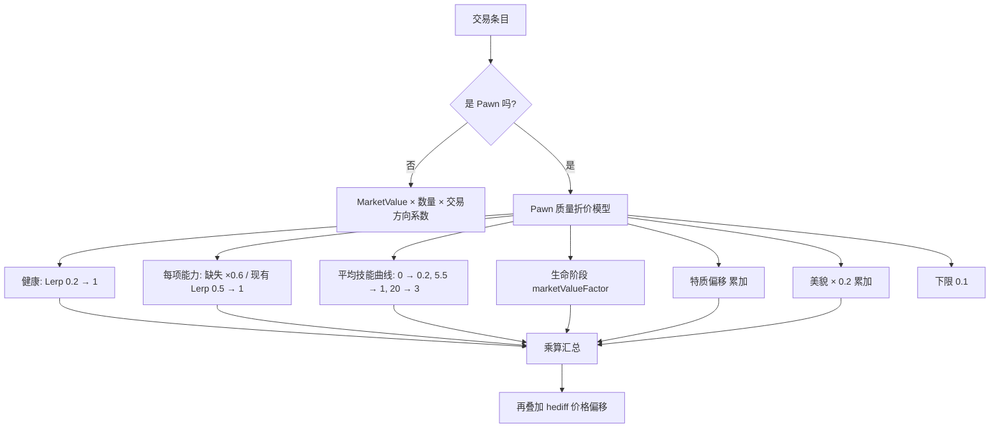
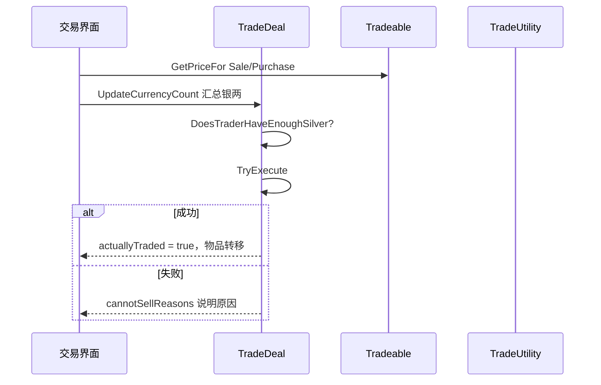

# V12 经济、价格与贸易

卷号：V12
状态：初稿（R9）
上游：V04（Thing/堆叠）、V11（派系好感影响价格）；下游：V10（远行队交易）、V15（Def 面价格字段）

## Scope

本卷解构 **价格从哪来、交易怎么结算**：物品的 `MarketValue` 体系、**Pawn（奴隶/囚犯）独有的质量折价模型**、`Tradeable` 的买卖方向与单价、`TradeDeal` 的银两结算与失败条件。

不覆盖：`TraderKindDef`/`StockGenerator` 的库存生成规则（属 Def 面与随机表）、商队来访频率（属 V09/V10）、好感对价格的乘数（属 V11 + 难度设置）。

## Key types

| 类型 | Token | 语料路径 | 角色 |
|---|---|---|---|
| `RimWorld.PriceUtility` | 0x02001F32 | `Assembly-CSharp/RimWorld/PriceUtility.cs` | **Pawn 质量折价**（健康/能力/技能/特质） |
| `RimWorld.Tradeable` | 0x02001B8E | `Assembly-CSharp/RimWorld/Tradeable.cs` | 可交易条目（买卖方向 + 单价 + 数量） |
| `RimWorld.TradeDeal` | 0x02001B93 | `Assembly-CSharp/RimWorld/TradeDeal.cs` | 交易会话（银两结算与校验） |
| `RimWorld.TradeUtility` | 0x02001B9A | `Assembly-CSharp/RimWorld/TradeUtility.cs` | 交易可行性/发射投送等辅助 |
| `RimWorld.Pawn_TraderTracker` | 0x020015AB | `Assembly-CSharp/RimWorld/Pawn_TraderTracker.cs` | Pawn 型商人的库存 |
| `RimWorld.TraderKindDef` / `StockGenerator` | 0x02001004 / 0x02001B79 | 同名文件 | 商人类型与库存生成（数据面） |

## Control flow

### 1. 物品价格 vs Pawn 价格：两套完全不同的模型

关键结构：**除了特质/美貌/hediff 是加法，其余全是乘法**。所以一个「健康但技能差」的奴隶会被技能曲线单独压下，而「技能高但缺条腿」的会被能力因子单独压下 —— 两者叠加时衰减是乘性的（可能非常低），这就是「残废奴隶几乎卖不上价」的机制来源。

### 2. Pawn 价格的三条曲线

| 因子 | 公式 | 效果 |
|---|---|---|
| 健康 | `Lerp(0.2, 1, SummaryHealthPercent)` | 满血 1.0，濒死 0.2 |
| 单项能力 | 缺失 → ×0.6；存在 → `Lerp(0.5, 1, level)` | 每项能力独立相乘，能力越多因子越多 |
| 平均技能 | 曲线 (0→0.2) (5.5→1.0) (20→3.0) | 全 0 技能只剩 20%，全 20 技能可到 3 倍 |
| 生命阶段 | `CurLifeStage.marketValueFactor` | 婴儿/老人折价 |
| 特质 | 未抑制特质累加 `marketValueFactorOffset` | 好特质加价 |
| 美貌 | `+ PawnBeauty × 0.2` | 加算 |
| 下限 | `max(0.1, …)` | 再差也值 10% |

### 3. 交易结算

`TradeDeal` 的失败不是抛异常，而是**收集原因字符串**（`cannotSellReasons`）——UI 直接展示，这也是玩家能看到「对方没钱/你卖的东西对方不收」的实现。

## Constants

| 项 | 值 | 位置 |
|---|---|---|
| Pawn 价格下限 | 0.1 | `PriceUtility.MinFactor` |
| 健康因子区间 | 0.2 – 1.0 | `SummaryHealthImpact` |
| 能力因子区间 | 0.5 – 1.0（缺失固定 0.6） | `CapacityImpact` / `MissingCapacityFactor` |
| 平均技能曲线 | (0, 0.2) / (5.5, 1.0) / (20, 3.0) | `AverageSkillCurve` |
| 美貌加成系数 | 0.2 | `PawnQualityPriceFactor` |
| hediff 价格偏移生效门槛 | 绝对值 ≥ 1 | `PawnQualityPriceOffset` |
| 交易失败表达 | 原因列表而非异常 | `TradeDeal.cannotSellReasons` |

## Claims

[claim:V12-C01] 健康对 Pawn 价格是乘性折减，满血 1.0、濒死约 0.2。
  src: RimWorld.PriceUtility.PawnQualityPriceFactor  Token: 0x02001F32
  file: analysis/decompiled/Assembly-CSharp/RimWorld/PriceUtility.cs
  match: num *= Mathf.Lerp(0.19999999f, 1f, pawn.health.summaryHealth.SummaryHealthPercent);

[claim:V12-C02] 完全丧失某项能力的惩罚是固定乘 0.6，而不是按等级渐变。
  src: RimWorld.PriceUtility.PawnQualityPriceFactor
  file: analysis/decompiled/Assembly-CSharp/RimWorld/PriceUtility.cs
  match: num *= 0.6f;

[claim:V12-C03] 具备该能力时按等级在 0.5–1.0 之间折减，且逐项能力连乘。
  src: RimWorld.PriceUtility.PawnQualityPriceFactor
  file: analysis/decompiled/Assembly-CSharp/RimWorld/PriceUtility.cs
  match: num *= Mathf.Lerp(0.5f, 1f, num2);

[claim:V12-C04] 技能因子取「全技能等级平均值」再查曲线，因此单项专精不如全面。
  src: RimWorld.PriceUtility.PawnQualityPriceFactor
  file: analysis/decompiled/Assembly-CSharp/RimWorld/PriceUtility.cs
  match: num *= PriceUtility.AverageSkillCurve.Evaluate(pawn.skills.skills.Average<SkillRecord>((SkillRecord sk) => (float)sk.Level));

[claim:V12-C05] 技能曲线是三点折线：0 级 0.2、5.5 级 1.0、20 级 3.0。
  src: RimWorld.PriceUtility.AverageSkillCurve
  file: analysis/decompiled/Assembly-CSharp/RimWorld/PriceUtility.cs
  match: new CurvePoint(20f, 3f),

[claim:V12-C06] 生命阶段自带价格系数（婴儿/老人折价）。
  src: RimWorld.PriceUtility.PawnQualityPriceFactor
  file: analysis/decompiled/Assembly-CSharp/RimWorld/PriceUtility.cs
  match: num *= pawn.ageTracker.CurLifeStage.marketValueFactor;

[claim:V12-C07] 特质对价格是加法偏移，且只算未被抑制的特质。
  src: RimWorld.PriceUtility.PawnQualityPriceFactor
  file: analysis/decompiled/Assembly-CSharp/RimWorld/PriceUtility.cs
  match: num += trait.CurrentData.marketValueFactorOffset;

[claim:V12-C08] 美貌是加法项，权重 0.2。
  src: RimWorld.PriceUtility.PawnQualityPriceFactor
  file: analysis/decompiled/Assembly-CSharp/RimWorld/PriceUtility.cs
  match: num += pawn.GetStatValue(StatDefOf.PawnBeauty, true, -1) * 0.2f;

[claim:V12-C09] 无论折价多重，Pawn 价格下限是 0.1。
  src: RimWorld.PriceUtility.MinFactor
  file: analysis/decompiled/Assembly-CSharp/RimWorld/PriceUtility.cs
  match: private const float MinFactor = 0.1f;

[claim:V12-C10] hediff 可通过按物体基础价补偿价格（例如植入物可拆回）。
  src: RimWorld.PriceUtility.PawnQualityPriceOffset
  file: analysis/decompiled/Assembly-CSharp/RimWorld/PriceUtility.cs
  match: num2 = hediffs[i].def.spawnThingOnRemoved.BaseMarketValue;

[claim:V12-C11] 价格偏移只累加绝对值 ≥1 的项，避免小额噪声。
  src: RimWorld.PriceUtility.PawnQualityPriceOffset
  file: analysis/decompiled/Assembly-CSharp/RimWorld/PriceUtility.cs
  match: if (num2 >= 1f || num2 <= -1f)

[claim:V12-C12] 单价按交易方向分别给出（买价与卖价不是同一个数）。
  src: RimWorld.Tradeable.GetPriceFor  Token: 0x02001B8E
  file: analysis/decompiled/Assembly-CSharp/RimWorld/Tradeable.cs
  match: public virtual float GetPriceFor(TradeAction action)

[claim:V12-C13] 银两本身也被建模为一种「货币条目」，从而走同一套结算。
  src: RimWorld.Tradeable.IsCurrency
  file: analysis/decompiled/Assembly-CSharp/RimWorld/Tradeable.cs
  match: public virtual bool IsCurrency

[claim:V12-C14] 交易会话统计可交易条目数，用于 UI 与校验。
  src: RimWorld.TradeDeal.TradeableCount  Token: 0x02001B93
  file: analysis/decompiled/Assembly-CSharp/RimWorld/TradeDeal.cs
  match: public int TradeableCount

[claim:V12-C15] 银两总额每次变动后统一重算。
  src: RimWorld.TradeDeal.UpdateCurrencyCount
  file: analysis/decompiled/Assembly-CSharp/RimWorld/TradeDeal.cs
  match: public void UpdateCurrencyCount()

[claim:V12-C16] 成交前校验对方银两是否足够。
  src: RimWorld.TradeDeal.DoesTraderHaveEnoughSilver
  file: analysis/decompiled/Assembly-CSharp/RimWorld/TradeDeal.cs
  match: public bool DoesTraderHaveEnoughSilver()

[claim:V12-C17] 执行结果通过布尔输出参数告知「是否真的发生了交易」。
  src: RimWorld.TradeDeal.TryExecute
  file: analysis/decompiled/Assembly-CSharp/RimWorld/TradeDeal.cs
  match: public bool TryExecute(out bool actuallyTraded)

[claim:V12-C18] 不可卖的原因被收集成列表而不是抛异常，供 UI 展示。
  src: RimWorld.TradeDeal.cannotSellReasons
  file: analysis/decompiled/Assembly-CSharp/RimWorld/TradeDeal.cs
  match: public List<string> cannotSellReasons = new List<string>();

[claim:V12-C19] 是否「永远可卖」由 Def 面声明，贸易工具只做查询。
  src: RimWorld.TradeUtility.EverPlayerSellable  Token: 0x02001B9A
  file: analysis/decompiled/Assembly-CSharp/RimWorld/TradeUtility.cs
  match: public static bool EverPlayerSellable(ThingDef def)

[claim:V12-C20] 交易物资通过发射舱投送，存在专门的发射载荷枚举入口。
  src: RimWorld.TradeUtility.AllLaunchableThingsForTrade
  file: analysis/decompiled/Assembly-CSharp/RimWorld/TradeUtility.cs
  match: public static IEnumerable<Thing> AllLaunchableThingsForTrade(Map map, ITrader trader = null)

## Resolved questions

原 `Open questions` 第 2 条（好感/难度对买卖价的乘数位置）在 R12 部分解出：

- `Tradeable.GetPriceFor(action)` 本身**不做任何计算**：先 `InitPriceDataIfNeeded()` 把两个价格算好并缓存，之后按方向返回 `pricePlayerBuy` 或 `pricePlayerSell`。
- 因此买/卖差价与所有乘数（好感、难度、交易技能、流派）都收敛在 `InitPriceDataIfNeeded()` 这一次计算里，且**每个交易条目每会话只算一次** —— 交易中改变好感不会即时改价。

[claim:V12-C21] 买价与卖价是两条独立缓存字段，按方向直接返回。
  src: RimWorld.Tradeable.GetPriceFor
  file: analysis/decompiled/Assembly-CSharp/RimWorld/Tradeable.cs
  match: return this.pricePlayerBuy;

[claim:V12-C22] 价格在首次访问时惰性初始化并缓存。
  src: RimWorld.Tradeable.GetPriceFor
  file: analysis/decompiled/Assembly-CSharp/RimWorld/Tradeable.cs
  match: this.InitPriceDataIfNeeded();

### 物品价格的本体（原 OQ1）

`StatWorker_MarketValue.GetValueUnfinalized` + `CalculatedBaseMarketValue(def, stuffDef)` 给出的是**配方成本法**：

-  ingredient 成本累加（`ingredientCount.FixedIngredient.BaseMarketValue`）
- 产物列表成本累加（`thingDefCountClass.thingDef.BaseMarketValue`）
- 材料成本：`CostStuffCount / VolumePerUnit × 材料单价`（体积大的材料更贵）
- 追加固定额（`CostStuffCount * 2`）
- 最后除以产出数量

质量与材料不在这段里，而是由 `StatPart_Quality` / `StatPart_Quality_Offset` / `StatPart_Stuff` 作为 **StatPart** 追加修正。所以「物品价格 = 配方材料成本 ÷ 产量，再被质量/材料倍率修正」。

### 库存生成（原 OQ3）

`StockGenerator` 是**按需生成器**：抽象方法 `GenerateThings(PlanetTile, Faction)`，配合 `ResolveReferences`、`HandlesThingDef`、`TradeabilityFor`。它**没有自己的定时器**——库存是在构建交易会话时按地块现算，因此不存在「商人库存定期刷新」的独立 tick。

### 两类商人的差异（原 OQ4）

| | Pawn 型商人（`Pawn_TraderTracker`） | 定居点商人（`Settlement_TraderTracker`） |
|---|---|---|
| 库存载体 | 自身 `Goods`（`IEnumerable<Thing>`，背在身上的物品/被俘者） | `StockListForReading`（列表） |
| 交易结算 | `GiveSoldThingToTrader` / `GiveSoldThingToPlayer` | 走通用 `TradeDeal` |
| 价格随机 | 有 `RandomPriceFactorSeed`（每个 pawn 一个种子，价格波动可复现） | 走派系/难度 |
| 可达性 | `ReachableForTrade` 判定 | 地图内直接可达 |

### 发射费用（原 OQ5）

`TradeUtility.LaunchSilver(map, fee)` **只把 fee 传下去** → `LaunchThingsOfType(ThingDefOf.Silver, fee, map, null)`；`PlayerHomeMapWithMostLaunchableSilver` 只负责挑「可发射银两最多的家园地图」。也就是说**费用由调用方给定，与距离/重量无关**；重量/容量限制在发射舱那一侧处理，不在这条调用链上。

[claim:V12-C23] 物品价格由 StatWorker 计算，可被 StatPart 后置修正。
  src: RimWorld.StatWorker_MarketValue.GetValueUnfinalized
  file: analysis/decompiled/Assembly-CSharp/RimWorld/StatWorker_MarketValue.cs
  match: public override float GetValueUnfinalized(StatRequest req, bool applyPostProcess = true)

[claim:V12-C24] 材料成本按「用量 / 单位体积 × 材料单价」计入，体积大的材料更贵。
  src: RimWorld.StatWorker_MarketValue.CalculatedBaseMarketValue
  file: analysis/decompiled/Assembly-CSharp/RimWorld/StatWorker_MarketValue.cs
  match: num += (float)def.CostStuffCount / stuffDef.VolumePerUnit * stuffDef.GetStatValueAbstract(StatDefOf.MarketValue, null);

[claim:V12-C25] 发射费用直接转成「发射等值银两」，无距离/重量换算。
  src: RimWorld.TradeUtility.LaunchSilver
  file: analysis/decompiled/Assembly-CSharp/RimWorld/TradeUtility.cs
  match: TradeUtility.LaunchThingsOfType(ThingDefOf.Silver, fee, map, null);

[claim:V12-C26] 库存生成是抽象方法，按地块即时生成，没有独立定时器。
  src: RimWorld.StockGenerator.GenerateThings
  file: analysis/decompiled/Assembly-CSharp/RimWorld/StockGenerator.cs
  match: public abstract IEnumerable<Thing> GenerateThings(PlanetTile forTile, Faction faction = null);

[claim:V12-C27] Pawn 型商人的货物挂在自身身上（`Goods`），而非列表库存。
  src: RimWorld.Pawn_TraderTracker.Goods
  file: analysis/decompiled/Assembly-CSharp/RimWorld/Pawn_TraderTracker.cs
  match: public IEnumerable<Thing> Goods

[claim:V12-C28] 定居点商人用库存列表，与 Pawn 型商人是两套载体。
  src: RimWorld.Settlement_TraderTracker.StockListForReading
  file: analysis/decompiled/Assembly-CSharp/RimWorld/Planet/Settlement_TraderTracker.cs
  match: public List<Thing> StockListForReading

[claim:V12-C29] Pawn 型商人带价格随机种子，使价格波动可按个体复现。
  src: RimWorld.Pawn_TraderTracker.RandomPriceFactorSeed
  file: analysis/decompiled/Assembly-CSharp/RimWorld/Pawn_TraderTracker.cs
  match: public int RandomPriceFactorSeed

### 价格惰性初始化的实现（原 OQ2）

`Tradeable.InitPriceDataIfNeeded()` 的逻辑很短：

- 若 `pricePlayerBuy > 0f` 直接返回 —— **已算过就永不再算**（会话内固定）；
- 货币本身双向价都直接等于 `BaseMarketValue`（银两不打折）；
- 其余分支才去查好感/难度/技能等乘数。

所以「交易中改好感不会改价」不是巧合，而是缓存语义：价格在第一次查询时定死，直到新会话。

[claim:V12-C30] 价格一旦算出就整场会话不再重算。
  src: RimWorld.Tradeable.InitPriceDataIfNeeded
  file: analysis/decompiled/Assembly-CSharp/RimWorld/Tradeable.cs
  match: if (this.pricePlayerBuy > 0f)

[claim:V12-C31] 货币（银两）双向价都等于面值，不参与差价。
  src: RimWorld.Tradeable.InitPriceDataIfNeeded
  file: analysis/decompiled/Assembly-CSharp/RimWorld/Tradeable.cs
  match: this.pricePlayerBuy = this.BaseMarketValue;

## Open questions

1. **`MarketValue` 本体（物品价格）未解构**：它是 `StatDefOf.MarketValue` 的 stat 计算（受质量/耐久/材料/数量影响），属 Stat 系统，本卷只覆盖了 Pawn 专有折价。
2. 好感与难度对买/卖价的乘数（差价/税率）未定位：可能在 `Tradeable.GetPriceFor` 的上层或 `TradeDeal` 之外。
3. `StockGenerator` 的库存生成与重生成节奏未解构。
4. `Pawn_TraderTracker`（商队型商人）与固定贸易站的差异未对比。
5. 发射舱投送的费用计算（`LaunchSilver`）与距离/重量关系未验证。
