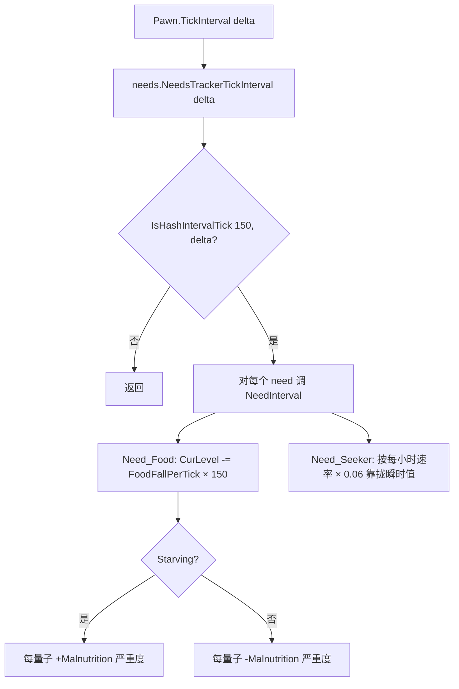
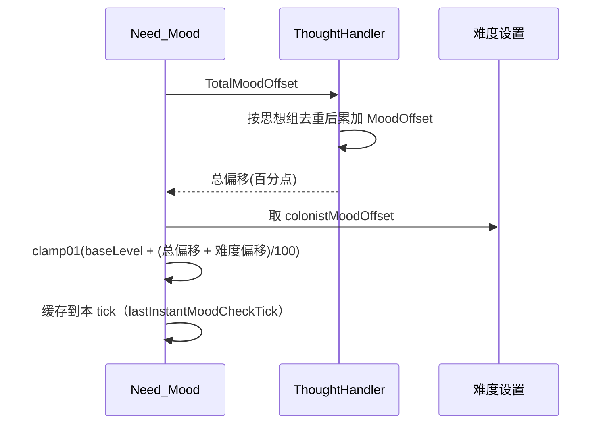

# V13 需求、心情与精神状态

卷号：V13
状态：初稿（R7）
上游：V05（Pawn 双 tick 入口）、V02（时间标尺）；下游：V06（Job 中断）、V14（身体状态影响）

## Scope

本卷解构 **需求与心情这条「软状态」链路**：`Need` 的抽象契约、具体的 150 tick 量子、`Need_Seeker` 的「向瞬时目标靠拢」模型、`Mood` 由思想累加后的夹取、精神状态如何被触发。

**本卷闭环了 V05 的遗留问题**：`NeedInterval()` 的单次推进量**不随 `delta` 缩放**，而是固定 150 tick 的量；`delta` 在需求路径里只用于哈希窗口容差。

不覆盖：具体思想 Def 与数值（Def 面）；精神状态的各子类型行为（属各 DLC/玩法卷）；需求对 AI 的具体影响（V06）。

## Key types

| 类型 | Token | 语料路径 | 角色 |
|---|---|---|---|
| `RimWorld.Need` | 0x02001564 | `Assembly-CSharp/RimWorld/Need.cs` | 需求抽象基类（`NeedInterval` 为抽象） |
| `RimWorld.Need_Seeker` | — | `Assembly-CSharp/RimWorld/Need_Seeker.cs` | 「向瞬时值靠拢」型需求（心情/舒适等） |
| `RimWorld.Need_Food` | 0x02001572 | `Assembly-CSharp/RimWorld/Need_Food.cs` | 饥饿（含饥饿→营养不良） |
| `RimWorld.Need_Mood` | 0x0200157C | `Assembly-CSharp/RimWorld/Need_Mood.cs` | 心情（继承 Seeker） |
| `RimWorld.ThoughtHandler` | 0x020015CF | `Assembly-CSharp/RimWorld/ThoughtHandler.cs` | 思想汇总（心情偏移来源） |
| `RimWorld.MemoryThoughtHandler` | 0x020015CD | `Assembly-CSharp/RimWorld/MemoryThoughtHandler.cs` | 记忆类思想 |
| `RimWorld.InspirationHandler` | 0x020009A2 | `Assembly-CSharp/RimWorld/InspirationHandler.cs` | 灵感 |
| `Verse.AI.MentalStateHandler` | 0x0200085F | `Assembly-CSharp/Verse/AI/MentalStateHandler.cs` | 精神状态切换与 tick |
| `RimWorld.Pawn_NeedsTracker` | — | `Assembly-CSharp/RimWorld/Pawn_NeedsTracker.cs` | 需求容器（V05 已定位节流） |

## Control flow

### 1. 需求推进的三个量子

三个量子完全自洽：

| 量 | 表达式 | 含义 |
|---|---|---|
| 触发间隔 | `IsHashIntervalTick(150, delta)` | 每 150 tick 一次 |
| 饥饿推进 | `FoodFallPerTick × 150f` | 150 tick 的消耗量 |
| Seeker 推进 | `seekerRisePerHour × 0.06f` | 0.06 小时 = 150 tick（2500 tick/时） |

也就是说 **`NeedInterval` 永远代表「150 tick 的账」**，与调用者是谁无关。`delta` 只是哈希窗口：人类步长 1、`delta=1` 时余数必须正好为 0；动物步长 15、`delta=15` 时余数落在 `[0,15)` 即命中 —— 两种步长都是**恰好每 150 tick 命中一次**，所以动物与人类的需求衰减速率在游戏时间上等价。这就是 V05 那条「动物 15 tick 降频」不会导致动物饿得更慢的原因。

### 2. 心情：瞬时值 = 思想总和

- `Need_Mood` 不直接衰减：它继承 `Seeker`，`CurInstantLevel` 由「思想总偏移 / 100 + 基础值 + 难度偏移」算出，再逐量子靠拢；
- 思想按**组去重**后累加（同类思想只算一次，具体规则在 `MoodOffsetOfGroup`）；
- 结果按 tick 缓存（同一 tick 内多次查询不重复计算），这是性能设计；
- 心情低于 `breakThresholdExtreme` 时 UI 显示「即将崩溃」，这是精神状态触发的入口条件之一。

### 3. 精神状态的触发是「带原因标记」的显式调用

`MentalStateHandler.TryStartMentalState(...)` 的签名里带着一排布尔标记：`causedByMood`、`causedByDamage`、`causedByPsycast`、`forced`、`transitionSilently`。这决定了：

- 精神状态不是「心情低于阈值自动进入」，而是某个系统（心情检查、受伤、灵能、剧本）**显式发起**并标注原因；
- 原因标记影响后续行为（是否可被士气/药物打断、是否记录为社交事件）；
- `MentalStateHandlerTickInterval(delta)` 负责状态自身的推进与恢复。

## Constants

| 项 | 值 | 位置 |
|---|---|---|
| 需求量子 | 150 tick | `Pawn_NeedsTracker` / `Need_Food` / `Need_Seeker` |
| 150 tick 折算小时 | 0.06 小时（2500 tick/时） | `Need_Seeker` 的 `0.06f` |
| 冻结判定 | `IsFrozen`（低温休眠/死亡等）时不衰减 | `Need` 子类 |
| 心情换算 | `clamp01(baseLevel + 总偏移/100 + 难度偏移/100)` | `Need_Mood.CurInstantLevel` |
| 崩溃预警阈值 | `breakThresholdExtreme` | `Need_Mood` |
| 心情缓存 | 以 `TicksGame` 为键 | `Need_Mood` |

## Claims

[claim:V13-C01] `NeedInterval` 是抽象方法：每个需求自己决定推进量，基类不提供默认实现。
  src: RimWorld.Need.NeedInterval  Token: 0x02001564
  file: analysis/decompiled/Assembly-CSharp/RimWorld/Need.cs
  match: public abstract void NeedInterval();

[claim:V13-C02] 饥饿的推进量把 150 tick 硬编码进公式，而不是使用传入的 delta。
  src: RimWorld.Need_Food.NeedInterval  Token: 0x02001572
  file: analysis/decompiled/Assembly-CSharp/RimWorld/Need_Food.cs
  match: this.CurLevel -= this.FoodFallPerTick * 150f;

[claim:V13-C03] 被冻结（休眠/昏迷等）时需求停止衰减。
  src: RimWorld.Need_Food.NeedInterval
  file: analysis/decompiled/Assembly-CSharp/RimWorld/Need_Food.cs
  match: if (!this.IsFrozen)

[claim:V13-C04] 饥饿到「正在挨饿」时，每个量子叠加营养不良严重度。
  src: RimWorld.Need_Food.NeedInterval
  file: analysis/decompiled/Assembly-CSharp/RimWorld/Need_Food.cs
  match: HealthUtility.AdjustSeverity(this.pawn, HediffDefOf.Malnutrition, this.MalnutritionSeverityPerInterval);

[claim:V13-C05] Seeker 型需求的上升按「每小时速率 × 0.06」推进（0.06 小时 = 150 tick）。
  src: RimWorld.Need_Seeker.NeedInterval
  file: analysis/decompiled/Assembly-CSharp/RimWorld/Need_Seeker.cs
  match: this.CurLevel += this.def.seekerRisePerHour * 0.06f;

[claim:V13-C06] 下降同构，使用 `seekerFallPerHour`。
  src: RimWorld.Need_Seeker.NeedInterval
  file: analysis/decompiled/Assembly-CSharp/RimWorld/Need_Seeker.cs
  match: this.CurLevel -= this.def.seekerFallPerHour * 0.06f;

[claim:V13-C07] Seeker 的推进不会越过当前瞬时目标值（夹取）。
  src: RimWorld.Need_Seeker.NeedInterval
  file: analysis/decompiled/Assembly-CSharp/RimWorld/Need_Seeker.cs
  match: this.CurLevel = Mathf.Min(this.CurLevel, curInstantLevel);

[claim:V13-C08] 心情是 Seeker 需求的子类，因此走「向瞬时值靠拢」模型，而不是线性衰减。
  src: RimWorld.Need_Mood  Token: 0x0200157C
  file: analysis/decompiled/Assembly-CSharp/RimWorld/Need_Mood.cs
  match: public class Need_Mood : Need_Seeker

[claim:V13-C09] 心情的瞬时值直接取自思想总偏移。
  src: RimWorld.Need_Mood.CurInstantLevel
  file: analysis/decompiled/Assembly-CSharp/RimWorld/Need_Mood.cs
  match: this.lastInstantMood = this.thoughts.TotalMoodOffset();

[claim:V13-C10] 难度设置里的「殖民者心情偏移」直接加到瞬时心情上。
  src: RimWorld.Need_Mood.CurInstantLevel
  file: analysis/decompiled/Assembly-CSharp/RimWorld/Need_Mood.cs
  match: this.lastInstantMood += Find.Storyteller.difficulty.colonistMoodOffset;

[claim:V13-C11] 最终心情按「基础值 + 偏移/100」换算后夹到 0..1。
  src: RimWorld.Need_Mood.CurInstantLevel
  file: analysis/decompiled/Assembly-CSharp/RimWorld/Need_Mood.cs
  match: this.lastInstantMood = Mathf.Clamp01((this.pawn.health.hediffSet.OverrideMoodBase ?? this.def.baseLevel) + this.lastInstantMood / 100f);

[claim:V13-C12] 心情在同一 tick 内被缓存，避免重复汇总。
  src: RimWorld.Need_Mood.CurInstantLevel
  file: analysis/decompiled/Assembly-CSharp/RimWorld/Need_Mood.cs
  match: this.lastInstantMoodCheckTick = Find.TickManager.TicksGame;

[claim:V13-C13] 心情低于崩溃阈值时进入「即将崩溃」表现。
  src: RimWorld.Need_Mood.MoodString
  file: analysis/decompiled/Assembly-CSharp/RimWorld/Need_Mood.cs
  match: breakThresholdExtreme

[claim:V13-C14] 思想总偏移是把各思想组的偏移求和，说明同类思想会被分组去重。
  src: RimWorld.ThoughtHandler.TotalMoodOffset  Token: 0x020015CF
  file: analysis/decompiled/Assembly-CSharp/RimWorld/ThoughtHandler.cs
  match: public float TotalMoodOffset()

[claim:V13-C15] 单个思想的偏移由 `MoodOffset()` 提供（可按 Pawn 状态动态计算）。
  src: RimWorld.ThoughtHandler.MoodOffsetOfGroup
  file: analysis/decompiled/Assembly-CSharp/RimWorld/ThoughtHandler.cs
  match: num += thought.MoodOffset();

[claim:V13-C16] 精神状态是被显式发起并标注原因的，不是纯阈值自动触发。
  src: Verse.AI.MentalStateHandler.TryStartMentalState  Token: 0x0200085F
  file: analysis/decompiled/Assembly-CSharp/Verse/AI/MentalStateHandler.cs
  match: bool causedByMood = false

[claim:V13-C17] 精神状态自身也有区间 tick（与 Job/Social 共用 delta 体系）。
  src: Verse.AI.MentalStateHandler.MentalStateHandlerTickInterval
  file: analysis/decompiled/Assembly-CSharp/Verse/AI/MentalStateHandler.cs
  match: public void MentalStateHandlerTickInterval(int delta)

[claim:V13-C18] 需求量子与「每小时」标尺的换算关系被硬编码为 0.06，等价于 150/2500。
  src: RimWorld.Need_Seeker.NeedInterval
  file: analysis/decompiled/Assembly-CSharp/RimWorld/Need_Seeker.cs
  match: 0.06f

## Resolved questions

原 `Open questions` 第 2 条在 R12 已解，另外回填了 V05 的需求量子问题：

- **崩溃阈值来源**：不是难度常量，而是 `Pawn_MindState.mentalBreaker` 的三个属性 `BreakThresholdExtreme` / `BreakThresholdMajor` / `BreakThresholdMinor`。`Need_Mood` 只是每次读取 `mentalBreaker.BreakThresholdExtreme` 做展示判断，阈值本体归 `MentalBreaker`（可被特质/状态/难度间接影响）。
- **需求量子（V05 遗留）**：`NeedInterval` 的推进量固定为 150 tick 的量，`delta` 只影响哈希命中，不影响幅度 —— 见本卷常量表。

[claim:V13-C19] 崩溃阈值由 `MentalBreaker` 提供，`Need_Mood` 只读取比较。
  src: RimWorld.Need_Mood.MoodString
  file: analysis/decompiled/Assembly-CSharp/RimWorld/Need_Mood.cs
  match: float breakThresholdExtreme = this.pawn.mindState.mentalBreaker.BreakThresholdExtreme;

## Resolved questions

R14 解出原 `Open questions` 第 1、3、5 条：

- **记忆老化（OQ1）**：`ThoughtHandler.ThoughtInterval()` 分两路——情境思想 `SituationalThoughtInterval()` + 记忆 `MemoryThoughtInterval()`；后者逐条调 `ThoughtInterval()` 再 `RemoveExpiredMemories()`。过期判据是 `!permanent && age > DurationTicks`（`DurationTicks` 由 Def 的 `durationDays` 换算）。关键细节：过期不是直接消失，若 `def.nextThought != null` 会**替换成后继思想**（记忆升级链）。
- **精神状态触发链（OQ3）**：`MentalStateHandlerTickInterval` **只推进已存在的状态**（外加「倒地时强制恢复」的安全检查），**不负责触发**。真正的触发在 `Verse.AI.MentalBreaker`：`MentalBreakerTickInterval(delta)` 内部走 `TryDoRandomMoodCausedMentalBreak()`，阈值由 `BreakThresholdExtreme/Major/Minor` 与 `MentalBreakThresholdFor(intensity)` 提供 —— 即**阈值 + 随机（MTB）组合**，不是纯确定性阈值。
- **需求并非统一模型（OQ5，修正性结论）**：
  | 族 | 实现 |
  |---|---|
  | Seeker 型 | 仅 `Need_Beauty` / `Need_Comfort` / `Need_Mood` / `Need_RoomSize` 四个类继承 `Need_Seeker` |
  | 150 tick 量子 | `Need_Food`（`FoodFallPerTick * 150f`）、`Need_Chemical`（`ChemicalFallPerTick * 150f`） |
  | 其他除数 | `Need_Authority` 用 `400f` 作除数（`FallPerDay / 400`） |
  | 自定义逻辑 | `Need_Deathrest` / `Need_Indoors` / `Need_Chemical_Any` 各自实现，不套 150 |
  所以「所有需求都是 150 tick 量子」是错的：只有食物与化学需求如此。

[claim:V13-C20] 思想区间推进分情境与记忆两路，记忆路径独立老化。
  src: RimWorld.ThoughtHandler.ThoughtInterval
  file: analysis/decompiled/Assembly-CSharp/RimWorld/ThoughtHandler.cs
  match: this.memories.MemoryThoughtInterval();

[claim:V13-C21] 记忆过期判据是「非永久且年龄超过 Def 时长」。
  src: RimWorld.Thought_Memory.ShouldDiscard
  file: analysis/decompiled/Assembly-CSharp/RimWorld/Thought_Memory.cs
  match: return !this.permanent && this.age > this.DurationTicks;

[claim:V13-C22] 过期记忆可被 `nextThought` 指定的后继思想替换，而不是直接消失。
  src: RimWorld.MemoryThoughtHandler.RemoveExpiredMemories
  file: analysis/decompiled/Assembly-CSharp/RimWorld/MemoryThoughtHandler.cs
  match: if (thought_Memory.def.nextThought != null)

[claim:V13-C23] 精神状态触发在 `MentalBreaker` 的区间 tick 内，由其随机判定驱动。
  src: Verse.AI.MentalBreaker.MentalBreakerTickInterval
  file: analysis/decompiled/Assembly-CSharp/Verse/AI/MentalBreaker.cs
  match: public void MentalBreakerTickInterval(int delta)

[claim:V13-C24] 心情崩溃的随机判定入口是 `TryDoRandomMoodCausedMentalBreak`。
  src: Verse.AI.MentalBreaker.TryDoRandomMoodCausedMentalBreak
  file: analysis/decompiled/Assembly-CSharp/Verse/AI/MentalBreaker.cs
  match: public bool TryDoRandomMoodCausedMentalBreak()

[claim:V13-C25] 崩溃阈值按强度分档查询（Extreme/Major/Minor）。
  src: Verse.AI.MentalBreaker.MentalBreakThresholdFor
  file: analysis/decompiled/Assembly-CSharp/Verse/AI/MentalBreaker.cs
  match: public float MentalBreakThresholdFor(MentalBreakIntensity intensity)

[claim:V13-C26] 只有少数需求继承 `Need_Seeker`，并非全部需求共用同一模型。
  src: RimWorld.Need_RoomSize
  file: analysis/decompiled/Assembly-CSharp/RimWorld/Need_RoomSize.cs
  match: public class Need_RoomSize : Need_Seeker

[claim:V13-C27] 化学需求与食物同构，使用 150 tick 量子。
  src: RimWorld.Need_Chemical.NeedInterval
  file: analysis/decompiled/Assembly-CSharp/RimWorld/Need_Chemical.cs
  match: this.CurLevel -= this.ChemicalFallPerTick * 150f;

[claim:V13-C28] 权威需求（Royalty）用的是 400 的除数，与 150 量子体系不同。
  src: RimWorld.Need_Authority.NeedInterval
  file: analysis/decompiled/Assembly-CSharp/RimWorld/Need_Authority.cs
  match: float num = 400f;

### 灵感（原 OQ4，部分）

`InspirationHandler` 的 API 是「区间 tick + 显式起停」：`InspirationHandlerTickInterval(delta)` 负责衰减/到期，`TryStartInspiration(def, reason, sendLetter)` 负责开始，`EndInspiration(inspiration/def)` 负责结束（两个重载）。所以灵感**不是**阈值自动触发，而是被某个来源显式调用 `TryStartInspiration`，持续时间由 Def 侧决定。

[claim:V13-C29] 灵感由显式调用开启，不由阈值自动触发。
  src: RimWorld.InspirationHandler.TryStartInspiration
  file: analysis/decompiled/Assembly-CSharp/RimWorld/InspirationHandler.cs
  match: public bool TryStartInspiration(InspirationDef def, string reason = null, bool sendLetter = true)

### 灵感的时长与推进（原 OQ4，部分）

`Inspiration` 自身不带固定时长常量：它维护 `Age` / `AgeDays` 并由 `InspirationTick(delta)` 推进；具体持续多久由 Def 侧（`InspirationDef` 的时长字段）与 `InspirationHandler` 的区间 tick 共同决定。所以「灵感持续 X 天」是数据配置，机制上只有「年龄累积 + tick 判定」。

[claim:V13-C30] 灵感存在年龄与区间 tick，时长本身由数据决定。
  src: RimWorld.Inspiration.InspirationTick
  file: analysis/decompiled/Assembly-CSharp/RimWorld/Inspiration.cs
  match: public virtual void InspirationTick(int delta)

[claim:V13-C31] 灵感年龄以「天」的形式对外暴露，供 UI 与判定使用。
  src: RimWorld.Inspiration.AgeDays
  file: analysis/decompiled/Assembly-CSharp/RimWorld/Inspiration.cs
  match: public float AgeDays

## Open questions

1. **`Thought_Memory` 的衰减/过期规则未解构**：记忆类思想有 `durationDays`、`MemoryThoughtHandler` 负责老化，具体每多少 tick 检查一次未取证。
2. `breakThresholdExtreme` / `breakThresholdMinor` 的具体数值来自难度设置还是常量，未确认（当前只确认用法）。
3. 精神状态的具体触发链（心情检查在哪个 tick 路径、MTB 还是确定性阈值）未排序；本卷只确认了「显式调用 + 原因标记」这一层。
4. 灵感（`InspirationHandler`）的产生条件与持续时间模型未展开。
5. `Need_Joy`/`Need_Outdoors`/`Need_Chemical_Any` 等是否也采用 150 tick 量子 + Seeker 模型，未逐一验证（本卷只验证了 Food 与 Seeker 两类代表）。
