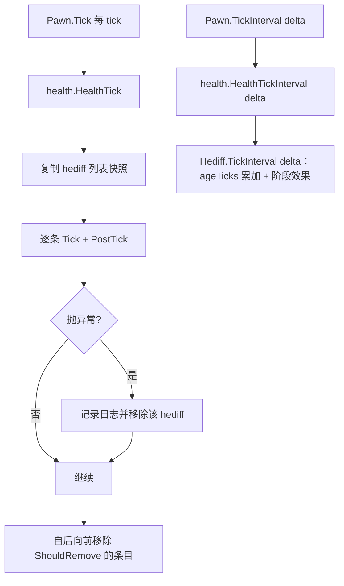
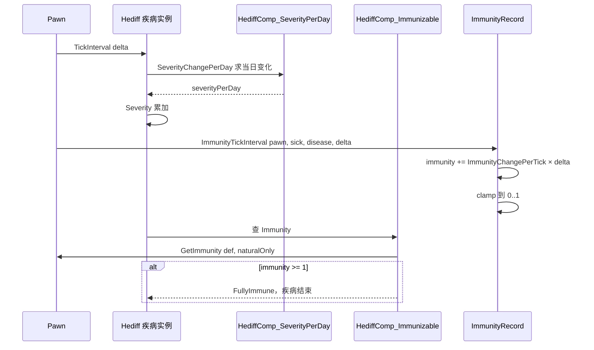

# V14 医疗、身体与基因

卷号：V14
状态：初稿（R5）
上游：V05（Pawn 组件）、V02（时间标尺）；下游：V08（伤害来源）、V13（心情，疾病影响）

## Scope

本卷解构 **健康数据如何被表达与推进**：`Hediff` 体系（伤口/疾病/植入物/成瘾）、身体部位模型、免疫与严重度的双轨推进、医疗手术账单，以及基因（endogene/xenogene）的 tick 方式。

核心结论先说：**`Hediff.Tick()` 是空实现**。一切周期性效果都在 `TickInterval(delta)` 与各 `HediffComp` 里，且几乎全部套在「60 tick 哈希」这一层节流上。

不覆盖：伤害计算公式（V08）；心情/精神状态具体数值（V13）；基因对各项属性的具体加成（属 V15/Def 面）。

## Key types

| 类型 | Token | 语料路径 | 角色 |
|---|---|---|---|
| `Verse.Pawn_HealthTracker` | 0x020004E3 | `Assembly-CSharp/Verse/Pawn_HealthTracker.cs` | 健康总控：`HealthTick`/`HealthTickInterval`/`AddHediff` |
| `Verse.Hediff` | — | `Assembly-CSharp/Verse/Hediff.cs` | 状态条目基类（`Severity`/`TickInterval`/`CurStage`） |
| `Verse.Hediff_Injury` | 0x020004B2 | `Assembly-CSharp/Verse/Hediff_Injury.cs` | 伤口（自愈/留疤） |
| `Verse.Hediff_MissingPart` | 0x020004BC | `Assembly-CSharp/Verse/Hediff_MissingPart.cs` | 缺失部位 |
| `Verse.HediffComp_SeverityPerDay` | — | `Assembly-CSharp/Verse/HediffComp_SeverityPerDay.cs` | 严重度日变化（疾病/成瘾核心） |
| `Verse.HediffComp_Immunizable` | 0x0200048E | `Assembly-CSharp/Verse/HediffComp_Immunizable.cs` | 免疫获取（疾病） |
| `Verse.ImmunityHandler` | 0x020004CC | `Assembly-CSharp/Verse/ImmunityHandler.cs` | 免疫记录容器（按病种） |
| `Verse.ImmunityRecord` | 0x020004CD | `Assembly-CSharp/Verse/ImmunityRecord.cs` | 单病种免疫进度 |
| `Verse.BodyPartRecord` | 0x02000118 | `Assembly-CSharp/Verse/BodyPartRecord.cs` | 身体部位实例 |
| `RimWorld.Bill_Medical` | 0x02001497 | `Assembly-CSharp/RimWorld/Bill_Medical.cs` | 手术账单 |
| `RimWorld.Pawn_GeneTracker` | 0x02001598 | `Assembly-CSharp/RimWorld/Pawn_GeneTracker.cs` | 基因容器（xeno/endo 两类） |

## Control flow

### 1. 健康 tick 的双层结构



- 逐 tick 路径（`HealthTick`）负责**最基础的状态推进与异常隔离**：一条 hediff 抛异常会被单独移除，不影响其余条目（这是游戏能带病继续跑的关键容错）；
- 区间路径（`HealthTickInterval` → `Hediff.TickInterval(delta)`）负责**周期性判定**：`ageTicks += delta`、各阶段的 `hediffGivers`、精神崩溃、呕吐、遗忘思想等。

### 2. 疾病的「严重度 vs 免疫」双轨



要点：

- **免疫是按病种记账**的（`ImmunityRecord` 里存 `hediffDef` / `source` / `immunity`），不是挂在疾病实例上；所以同一种病反复得，免疫进度累积；
- 免疫增速 = `immunityPerDaySick`（或健康时的 `immunityPerDay`）× `ImmunityGainSpeed` 属性；基因与植入物可整体免疫（`AnyGeneMakesFullyImmuneTo`）；
- 免疫随机数用 `loadID ^ world.persistentRandomValue` 做种子，保证**同一存档同一疾病的行为可复现**。

### 3. MTB 判定的统一写法

`Hediff.TickInterval` 里所有随机事件都长这样：

```text
Rand.MTBEventOccurs(mtbDays, 60000f, 60f)
```

`mtbDays`（平均间隔天数）→ 以 60000 tick（1 天）为基准、以 60 tick 为一次采样窗口求概率。所以「阶段 A 有 3% 概率触发精神崩溃」这类描述，实际执行是一次 60 tick 粒度、按 MTB 折算的掷骰。

### 4. 手术与基因

- 手术不是特例代码：`Bill_Medical` 继承自普通 `Bill`，只多了 `Part`（作用部位）与 `Notify_IterationCompleted`（完成后施加 `addedPart`/`hediff`）等重写；
- 基因分两类容器：`endogenes`（种系，可遗传）与 `xenogenes`（外源，可被异种类型替换），两者在 `GeneTrackerTick` 中分别遍历并只 tick `Active` 的条目；整个基因系统被 `ModLister.BiotechInstalled` 门控。

## Constants

| 项 | 值 | 位置 |
|---|---|---|
| 疾病严重度基准 | 按「天」表述（`severityPerDay`），内部按 tick 折算 | `HediffComp_SeverityPerDay` |
| 免疫进度范围 | 0..1（`Clamp01`） | `ImmunityRecord` |
| 免疫满值判定 | `Immunity >= 1f` | `HediffComp_Immunizable` |
| hediffGivers 采样间隔 | 60 tick 哈希 | `Hediff.TickInterval` |
| 精神崩溃/mentalStateGiver MTB 基准 | 60000 tick（1 天），窗口 60 tick | `Hediff.TickInterval` |
| 呕吐 MTB 窗口 | 600 tick | `Hediff.TickInterval` |
| 遗忘思想 MTB 窗口 | 400 tick | `Hediff.TickInterval` |
| 基因系统开关 | `ModLister.BiotechInstalled` | `Pawn_GeneTracker` |

## Claims

[claim:V14-C01] `HealthTick` 在死亡后立即返回，不推进任何 hediff。
  src: Verse.Pawn_HealthTracker.HealthTick  Token: 0x020004E3
  file: analysis/decompiled/Assembly-CSharp/Verse/Pawn_HealthTracker.cs
  anchor: public void HealthTick()
  match: if (this.Dead)

[claim:V14-C02] 健康 tick 遍历的是 hediff 列表的**快照**，避免遍历中被修改。
  src: Verse.Pawn_HealthTracker.HealthTick
  file: analysis/decompiled/Assembly-CSharp/Verse/Pawn_HealthTracker.cs
  match: Pawn_HealthTracker.tmpHediffs.AddRange(this.hediffSet.hediffs);

[claim:V14-C03] 每条 hediff 的 tick 被单独 try/catch 保护。
  src: Verse.Pawn_HealthTracker.HealthTick
  file: analysis/decompiled/Assembly-CSharp/Verse/Pawn_HealthTracker.cs
  match: hediff.Tick();

[claim:V14-C04] tick 之后紧接 `PostTick`，两段式钩子。
  src: Verse.Pawn_HealthTracker.HealthTick
  file: analysis/decompiled/Assembly-CSharp/Verse/Pawn_HealthTracker.cs
  match: hediff.PostTick();

[claim:V14-C05] 抛异常的 hediff 会被移除，而不是让整个 Pawn 崩掉。
  src: Verse.Pawn_HealthTracker.HealthTick
  file: analysis/decompiled/Assembly-CSharp/Verse/Pawn_HealthTracker.cs
  match: Exception ticking hediff

[claim:V14-C06] 每 tick 结束前统一清理 `ShouldRemove` 的条目。
  src: Verse.Pawn_HealthTracker.HealthTick
  file: analysis/decompiled/Assembly-CSharp/Verse/Pawn_HealthTracker.cs
  match: if (hediff2.ShouldRemove)

[claim:V14-C07] `HediffSet` 与 `ImmunityHandler` 是健康追踪器构造时就建立的常驻对象。
  src: Verse.Pawn_HealthTracker..ctor
  file: analysis/decompiled/Assembly-CSharp/Verse/Pawn_HealthTracker.cs
  match: this.immunity = new ImmunityHandler(pawn);

[claim:V14-C08] 施加 hediff 的统一入口带部位、伤害来源与伤害结果三个可选参数。
  src: Verse.Pawn_HealthTracker.AddHediff
  file: analysis/decompiled/Assembly-CSharp/Verse/Pawn_HealthTracker.cs
  match: public void AddHediff(Hediff hediff, BodyPartRecord part = null, DamageInfo? dinfo = null, DamageWorker.DamageResult result = null)

[claim:V14-C09] 入库走 `AddDirect`，说明去重/合并规则在 `HediffSet` 内。
  src: Verse.Pawn_HealthTracker.AddHediff
  file: analysis/decompiled/Assembly-CSharp/Verse/Pawn_HealthTracker.cs
  match: this.hediffSet.AddDirect(hediff, dinfo, result);

[claim:V14-C10] `Hediff.Tick()` 是空实现的虚方法：逐 tick 阶段默认什么也不做。
  src: Verse.Hediff.Tick
  file: analysis/decompiled/Assembly-CSharp/Verse/Hediff.cs
  anchor: public virtual void Tick()
  match: public virtual void Tick()

[claim:V14-C11] 真正的周期逻辑在 `TickInterval(delta)`：先累加存在时长。
  src: Verse.Hediff.TickInterval
  file: analysis/decompiled/Assembly-CSharp/Verse/Hediff.cs
  match: this.ageTicks += delta;

[claim:V14-C12] `hediffGivers` 的推进被 60 tick 哈希节流。
  src: Verse.Hediff.TickInterval
  file: analysis/decompiled/Assembly-CSharp/Verse/Hediff.cs
  match: if (this.def.hediffGivers != null && this.pawn.IsHashIntervalTick(60, delta))

[claim:V14-C13] 阶段级精神事件用 MTB 掷骰：以 1 天为基准、60 tick 为采样窗口。
  src: Verse.Hediff.TickInterval
  file: analysis/decompiled/Assembly-CSharp/Verse/Hediff.cs
  match: Rand.MTBEventOccurs(mentalStateGiver.mtbDays, 60000f, 60f)

[claim:V14-C14] 呕吐判定用 600 tick 窗口。
  src: Verse.Hediff.TickInterval
  file: analysis/decompiled/Assembly-CSharp/Verse/Hediff.cs
  match: Rand.MTBEventOccurs(curStage.vomitMtbDays, 60000f, 600f)

[claim:V14-C15] 免疫进度按 delta 累加并夹到 0..1。
  src: Verse.ImmunityRecord.ImmunityTickInterval  Token: 0x020004CD
  file: analysis/decompiled/Assembly-CSharp/Verse/ImmunityRecord.cs
  match: this.immunity += this.ImmunityChangePerTick(pawn, sick, diseaseInstance) * (float)delta;

[claim:V14-C16] 免疫上限被 `Clamp01` 限制，满 1 即视为获得免疫。
  src: Verse.ImmunityRecord.ImmunityTickInterval
  file: analysis/decompiled/Assembly-CSharp/Verse/ImmunityRecord.cs
  match: this.immunity = Mathf.Clamp01(this.immunity);

[claim:V14-C17] 患病状态下的免疫增速来自 `immunityPerDaySick` 并乘以 `ImmunityGainSpeed` 属性。
  src: Verse.ImmunityRecord.ImmunityChangePerTick
  file: analysis/decompiled/Assembly-CSharp/Verse/ImmunityRecord.cs
  match: num *= pawn.GetStatValue(StatDefOf.ImmunityGainSpeed, true, -1);

[claim:V14-C18] 免疫记录按病种（`HediffDef`）记账，而非按疾病实例。
  src: Verse.ImmunityRecord.ExposeData
  file: analysis/decompiled/Assembly-CSharp/Verse/ImmunityRecord.cs
  match: Scribe_Defs.Look<HediffDef>(ref this.hediffDef, "hediffDef");

[claim:V14-C19] 免疫查询区分「自然免疫」与「含基因/植入物的总免疫」。
  src: Verse.ImmunityHandler.GetImmunity  Token: 0x020004CC
  file: analysis/decompiled/Assembly-CSharp/Verse/ImmunityHandler.cs
  match: public float GetImmunity(HediffDef def, bool naturalImmunityOnly = false)

[claim:V14-C20] 基因可提供整体免疫（无需免疫进度）。
  src: Verse.ImmunityHandler.AnyGeneMakesFullyImmuneTo
  file: analysis/decompiled/Assembly-CSharp/Verse/ImmunityHandler.cs
  match: public bool AnyGeneMakesFullyImmuneTo(HediffDef def)

[claim:V14-C21] 免疫满值的判定就是 `Immunity >= 1f`。
  src: Verse.HediffComp_Immunizable.FullyImmune  Token: 0x0200048E
  file: analysis/decompiled/Assembly-CSharp/Verse/HediffComp_Immunizable.cs
  match: return this.Immunity >= 1f;

[claim:V14-C22] 疾病的自然免疫读数走 `naturalImmunityOnly = true` 的重载。
  src: Verse.HediffComp_Immunizable.NaturalImmunity
  file: analysis/decompiled/Assembly-CSharp/Verse/HediffComp_Immunizable.cs
  match: return base.Pawn.health.immunity.GetImmunity(base.Def, true);

[claim:V14-C23] 严重度日变化由属性对象计算后可带区间随机，缓存进组件字段并参与存档。
  src: Verse.HediffComp_SeverityPerDay.CompPostPostAdd
  file: analysis/decompiled/Assembly-CSharp/Verse/HediffComp_SeverityPerDay.cs
  match: this.severityPerDay = this.Props.CalculateSeverityPerDay();

[claim:V14-C24] 组件对外只暴露「每天变化多少」这一个钩子，由 Hediff 基类统一折算为 tick。
  src: Verse.HediffComp_SeverityPerDay.SeverityChangePerDay
  file: analysis/decompiled/Assembly-CSharp/Verse/HediffComp_SeverityPerDay.cs
  match: public override float SeverityChangePerDay()

[claim:V14-C25] 手术不是独立系统：`Bill_Medical` 继承普通账单，只是多了作用部位。
  src: RimWorld.Bill_Medical.Part  Token: 0x02001497
  file: analysis/decompiled/Assembly-CSharp/RimWorld/Bill_Medical.cs
  match: public BodyPartRecord Part

[claim:V14-C26] 手术在账单完成时施加效果（植入/切除随之发生）。
  src: RimWorld.Bill_Medical.Notify_IterationCompleted
  file: analysis/decompiled/Assembly-CSharp/RimWorld/Bill_Medical.cs
  match: public override void Notify_IterationCompleted(Pawn billDoer, List<Thing> ingredients)

[claim:V14-C27] 整个基因系统被 Biotech 开关门控，未安装即整段跳过。
  src: RimWorld.Pawn_GeneTracker.GeneTrackerTick  Token: 0x02001598
  file: analysis/decompiled/Assembly-CSharp/RimWorld/Pawn_GeneTracker.cs
  match: if (!ModLister.BiotechInstalled)

[claim:V14-C28] 基因分外源与种系两类，各自遍历且只 tick 激活条目。
  src: RimWorld.Pawn_GeneTracker.GeneTrackerTick
  file: analysis/decompiled/Assembly-CSharp/RimWorld/Pawn_GeneTracker.cs
  match: this.xenogenes[i].Tick();

## Resolved questions

原 `Open questions` 第 2 条（`severityPerDay` 如何折算到 tick）在 R12 已解，数字很干净：

- `HediffComp_SeverityModifierBase.CompPostTickInterval` 每 **200 tick**（`IsHashIntervalTick(200, delta)`）执行一次，把 `SeverityChangePerDay()` 的返回值**乘以 0.0033333334f** 后累加。
- `0.0033333334 ≈ 200 / 60000` —— 即「每日变化量 × 该次间隔占一天的比例」。所以疾病的严重度是**每 200 tick 步进一次**、步长 = 日变化量 × 1/300。
- 常量 `SeverityUpdateInterval = 200` 与之呼应；换句话说，疾病曲线的分辨率是 200 tick（约 3.3 游戏秒），不是逐 tick。

[claim:V14-C29] 严重度更新间隔固定 200 tick。
  src: Verse.HediffComp_SeverityModifierBase.CompPostTickInterval
  file: analysis/decompiled/Assembly-CSharp/Verse/HediffComp_SeverityModifierBase.cs
  match: if (base.Pawn.IsHashIntervalTick(200, delta))

[claim:V14-C30] 日变化量按 200/60000 的比例折算为该步长的增量。
  src: Verse.HediffComp_SeverityModifierBase.CompPostTickInterval
  file: analysis/decompiled/Assembly-CSharp/Verse/HediffComp_SeverityModifierBase.cs
  match: num *= 0.0033333334f;

## Resolved questions

R14 解出原 `Open questions` 第 3、4、5 条，并对第 1 条给出定性结论：

- **`HediffSet.AddDirect` 的合并规则（OQ3）**：先校验（def 不能为空、部位不能是缺失部位），再把 `ageTicks` 归零，然后**遍历现有 hediff 逐个 `TryMergeWith`**；只要有任何一条接受合并，就不新增条目。未合并则入列、`PostAdd(dinfo)`、并标脏情境思想。所以「同一个病叠加还是新增」由各 hediff 自己的 `TryMergeWith` 决定，不是 `HediffSet` 统一策略。
- **身体树结构（OQ4）**：`BodyPartRecord` 是**树节点**（`Index`/`IsCorePart` + `GetChildParts(tag)` / `GetPartAndAllChildParts()`），层级来自 `BodyDef`；缺失部位的判定用 `GetNotMissingParts(...)` 与 `PartOrAnyAncestorHasDirectlyAddedParts(part)` —— 即沿**祖先链**回溯，装了假肢的整条子树都被视为「已有直接替代物」。
- **成瘾与化学需求（OQ5）**：`Hediff_Addiction : HediffWithComps` 直接持有两个引用 —— `Need`（由 `def.chemicalNeed` 从 pawn 的需求里查得）与 `Chemical`（按名字从 `DefDatabase<ChemicalDef>` 解析）。`Need_Chemical` 的欲望分档里 `Withdrawal` 是独立档位，因此「戒断」是需求档位而不是单独的 hediff。
- **伤口自愈（OQ1，定性）**：`Hediff_Injury` **没有覆写 `TickInterval`**，自愈走通用 `HediffComp_SeverityPerDay` 通道（负的日变化量），留疤与永久化由 `HediffComp_GetsPermanent` 决定；`Severity` 到健康的换算系数是 `75f * HealthScale`。具体自愈速率取决于各伤的 Def 配置，属数据面。

[claim:V14-C31] 新增 hediff 时先尝试与现有条目合并，任一接受即不新增。
  src: Verse.HediffSet.AddDirect
  file: analysis/decompiled/Assembly-CSharp/Verse/HediffSet.cs
  match: if (this.hediffs[i].TryMergeWith(hediff))

[claim:V14-C32] 缺失部位上不允许追加 hediff（防止给不存在的部位开伤）。
  src: Verse.HediffSet.AddDirect
  file: analysis/decompiled/Assembly-CSharp/Verse/HediffSet.cs
  match: Tried to add health diff to missing part

[claim:V14-C33] 新 hediff 的年龄从 0 开始计，与「已存在时长」语义一致。
  src: Verse.HediffSet.AddDirect
  file: analysis/decompiled/Assembly-CSharp/Verse/HediffSet.cs
  match: hediff.ageTicks = 0;

[claim:V14-C34] 身体部位可按子树整体遍历，支撑「祖先链」判定。
  src: Verse.BodyPartRecord
  file: analysis/decompiled/Assembly-CSharp/Verse/BodyPartRecord.cs
  match: public IEnumerable<BodyPartRecord> GetPartAndAllChildParts()

[claim:V14-C35] 伤口到健康的换算系数是 75 × HealthScale。
  src: Verse.Hediff_Injury.SummaryHealthPercentImpact
  file: analysis/decompiled/Assembly-CSharp/Verse/Hediff_Injury.cs
  match: return this.Severity / (75f * this.pawn.HealthScale);

[claim:V14-C36] 成瘾 hediff 通过 `chemicalNeed` 反查化学需求。
  src: RimWorld.Hediff_Addiction.Need
  file: analysis/decompiled/Assembly-CSharp/RimWorld/Hediff_Addiction.cs
  match: public Need_Chemical Need

[claim:V14-C37] 成瘾对象按名字从 `ChemicalDef` 库解析出化学物质 Def。
  src: RimWorld.Hediff_Addiction.Chemical
  file: analysis/decompiled/Assembly-CSharp/RimWorld/Hediff_Addiction.cs
  match: public ChemicalDef Chemical

## Open questions

1. **伤口自愈（`Hediff_Injury`）的速率公式未取证**：它继承 `Hediff`，但自愈与留疤逻辑在覆写里；本卷只确认了基类的两段钩子结构。属 V14 后续补充项。
2. `Hediff.TickInterval` 中 `severityPerDay` 如何折算为每 delta 的增量（是否 `severityPerDay / 60000 * delta`）未逐行确认，`HediffComp_SeverityModifierBase` 的具体算术待补。
3. `HediffSet.AddDirect` 的去重/合并规则（同部位同病是否叠加）未解构。
4. `BodyPartRecord` 的身体树结构（`BodyDef` 定义的部位层级、缺失部位如何回溯到父部位）未展开。
5. 成瘾（`Hediff_Addiction`）与戒断的机制只在类型层面确认存在，`Chemical`/`Need_Chemical` 的联动属 V13。
