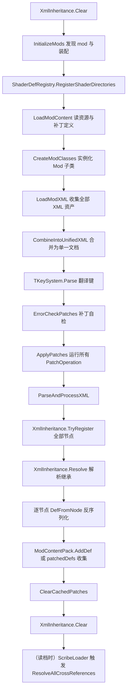
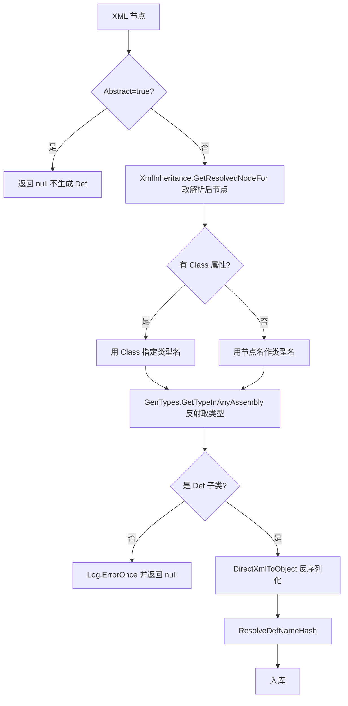

# V15 Def 与 XML 数据管线

卷号：V15
状态：初稿（R3）
上游：V00；下游：V02–V18 全部（所有玩法数值都来自 Def）

## Scope

本卷解构**静态数据如何变成运行时可用的 `Def` 对象**：从 Mod 目录扫描 XML，到合并、继承解析、补丁应用、反序列化、去重入库，最后到跨引用解析。

这是整套解构的**数据前提**：V02–V14 里出现的任何数值（`TicksPerDay`、伤害系数、tick 间隔、事件权重）都来自这条管线产出的对象，而不是硬编码。

不覆盖：`Def` 的具体子类字段表（散见各卷）；`Assets.zip` 内的贴图/音频加载；Harmony 补丁（属 mod 汇编层）。

## Key types

| 类型 | Token | 语料路径 | 角色 |
|---|---|---|---|
| `Verse.LoadedModManager` | 0x02000332 | `Assembly-CSharp/Verse/LoadedModManager.cs` | 装载总调度（唯一的顺序权威） |
| `Verse.DefDatabase<T>` | 0x02000107 | `Assembly-CSharp/Verse/DefDatabase.cs` | 按类型分库的静态注册表 |
| `Verse.DirectXmlLoader` | 0x0200050B | `Assembly-CSharp/Verse/DirectXmlLoader.cs` | XML 节点 → `Def` 实例 |
| `Verse.XmlInheritance` | 0x02000516 | `Assembly-CSharp/Verse/XmlInheritance.cs` | `Name`/`ParentName`/`Abstract`/`Inherit` 继承解析 |
| `Verse.PatchOperation` | 0x0200034A | `Assembly-CSharp/Verse/PatchOperation.cs` | XML 补丁基类（`Success` 三态） |
| `Verse.ModContentPack` | 0x0200033F | `Assembly-CSharp/Verse/ModContentPack.cs` | 单个 mod 的 Def/补丁/资源容器 |
| `Verse.CrossRefHandler` | 0x02000520 | `Assembly-CSharp/Verse/CrossRefHandler.cs` | 读档期跨引用解析 |
| `Verse.ScribeLoader` | 0x02000525 | `Assembly-CSharp/Verse/ScribeLoader.cs` | 存档读取入口（调用跨引用解析） |
| `Verse.GenDefDatabase` | — | `Assembly-CSharp/Verse/GenDefDatabase.cs` | 按名查 Def（带缓存） |

## Control flow

### 装载总顺序（`LoadedModManager.LoadAllActiveMods`）

两条要点：

- **补丁在合并之后、解析之前**执行，因此补丁操作的是「所有 mod 的 XML 合在一起后」的文档，可以跨 mod 修改节点；
- **继承解析先于反序列化**：`TryRegister` 收集全部节点 → `Resolve` 一次性算出每个节点的最终形态 → 再逐个 `DefFromNode`。

### 单节点反序列化（`DirectXmlLoader.DefFromNode`）

### 继承合并语义（`XmlInheritance.RecursiveNodeCopyOverwriteElements`）

- 解析一个节点 = **深拷贝父节点的已解析结果**，再用子节点内容逐层覆盖；
- `Inherit="false"` 是**清空父内容再整体替换**，不是"不继承"；
- 合并时检查重复节点名（`CheckForDuplicateNodes`），除非该字段在 `allowDuplicateNodesFieldNames` 白名单内。

## Constants

| 项 | 值 | 位置 |
|---|---|---|
| 单个 Def 类型的上限 | 65535（`ushort` 索引上限） | `DefDatabase.Add` |
| 重名 Def 处理 | 追加 `0..999` 随机后缀直到不冲突 | `DefDatabase.Add` |
| 同一 mod 内重名 | 直接跳过并 `Log.Error` | `DefDatabase.AddAllInMods` |
| 继承属性名 | `Name` / `ParentName` / `Inherit` | `XmlInheritance` 常量 |
| 条件加载属性 | `MayRequire` / `MayRequireAnyOf` | `ParseAndProcessXML` |
| 补丁生效态 | `Success`：`Always` / `Never` / `Invert` | `PatchOperation.Apply` |
| Mod 装库排序键 | `OverwritePriority`，其次 load index | `DefDatabase.AddAllInMods` |
| XML 反序列化器选择 | 命令行 `legacy-xml-deserializer` 可切回旧实现 | `ParseAndProcessXML` |

## Claims

[claim:V15-C01] 装载总入口是 `LoadAllActiveMods`，它按固定顺序串起各阶段。
  src: Verse.LoadedModManager.LoadAllActiveMods  Token: 0x02000332
  file: analysis/decompiled/Assembly-CSharp/Verse/LoadedModManager.cs
  match: public static void LoadAllActiveMods(bool hotReload = false)

[claim:V15-C02] 补丁在 XML 合并成单一文档之后才应用，因此可跨 mod 修改节点。
  src: Verse.LoadedModManager.LoadAllActiveMods
  file: analysis/decompiled/Assembly-CSharp/Verse/LoadedModManager.cs
  match: LoadedModManager.ApplyPatches(xmlDocument, dictionary);

[claim:V15-C03] 合并阶段把各 mod 的 XML 归并为单一 `XmlDocument`，并记录节点到来源资产的映射。
  src: Verse.LoadedModManager.CombineIntoUnifiedXML
  file: analysis/decompiled/Assembly-CSharp/Verse/LoadedModManager.cs
  match: xmlDocument = LoadedModManager.CombineIntoUnifiedXML(list, dictionary);

[claim:V15-C04] 补丁按 mod 装载顺序依次执行，每个 mod 的补丁集合是 `Patches`。
  src: Verse.LoadedModManager.ApplyPatches
  file: analysis/decompiled/Assembly-CSharp/Verse/LoadedModManager.cs
  match: SelectMany<ModContentPack, PatchOperation>

[claim:V15-C05] `PatchOperation.Apply` 用 `Success` 三态覆盖子类的返回结果（`Always` 强制成功、`Never` 强制失败、`Invert` 取反）。
  src: Verse.PatchOperation.Apply  Token: 0x0200034A
  file: analysis/decompiled/Assembly-CSharp/Verse/PatchOperation.cs
  match: else if (this.success == PatchOperation.Success.Invert)

[claim:V15-C06] 直接使用 `PatchOperation` 基类不会修改任何东西，只会报错并判定失败。
  src: Verse.PatchOperation.ApplyWorker
  file: analysis/decompiled/Assembly-CSharp/Verse/PatchOperation.cs
  match: Attempted to use PatchOperation directly; patch will always fail

[claim:V15-C07] 继承的两段式：先 `TryRegister` 收集所有节点，再一次性 `Resolve`。
  src: Verse.LoadedModManager.ParseAndProcessXML
  file: analysis/decompiled/Assembly-CSharp/Verse/LoadedModManager.cs
  match: XmlInheritance.TryRegister(list[i], (loadableXmlAsset != null) ? loadableXmlAsset.mod : null);

[claim:V15-C08] 解析阶段在反序列化之前统一执行。
  src: Verse.LoadedModManager.ParseAndProcessXML
  file: analysis/decompiled/Assembly-CSharp/Verse/LoadedModManager.cs
  match: XmlInheritance.Resolve();

[claim:V15-C09] `Abstract="true"` 的节点不生成 `Def`（只作为继承模板）。
  src: Verse.DirectXmlLoader.DefFromNode  Token: 0x0200050B
  file: analysis/decompiled/Assembly-CSharp/Verse/DirectXmlLoader.cs
  match: if (xmlAttribute != null && xmlAttribute.Value.Equals("true", StringComparison.InvariantCultureIgnoreCase))

[claim:V15-C10] 节点类型由 `Class` 属性或节点名决定，经反射在任意程序集中查找。
  src: Verse.DirectXmlLoader.DefFromNode
  file: analysis/decompiled/Assembly-CSharp/Verse/DirectXmlLoader.cs
  match: Type typeInAnyAssembly = GenTypes.GetTypeInAnyAssembly(node.Name, null);

[claim:V15-C11] 解析后的节点与原始节点分离：`GetResolvedNodeFor` 取的是继承合并结果。
  src: Verse.DirectXmlLoader.DefFromNode
  file: analysis/decompiled/Assembly-CSharp/Verse/DirectXmlLoader.cs
  match: XmlNode resolvedNodeFor = XmlInheritance.GetResolvedNodeFor(node);

[claim:V15-C12] 继承合并 = 深拷贝父结果后递归覆盖子节点内容。
  src: Verse.XmlInheritance.ResolveXmlNodeFor  Token: 0x02000516
  file: analysis/decompiled/Assembly-CSharp/Verse/XmlInheritance.cs
  match: XmlNode xmlNode = node.parent.resolvedXmlNode.CloneNode(true);

[claim:V15-C13] `Inherit="false"` 的语义是清空父内容再整体替换，而非"不继承"。
  src: Verse.XmlInheritance.RecursiveNodeCopyOverwriteElements
  file: analysis/decompiled/Assembly-CSharp/Verse/XmlInheritance.cs
  anchor: private static void RecursiveNodeCopyOverwriteElements
  match: if (xmlAttribute != null && xmlAttribute.Value.ToLower() == "false")

[claim:V15-C14] `MayRequire` / `MayRequireAnyOf` 属性提供条件加载，未激活的 mod 相关节点被跳过。
  src: Verse.LoadedModManager.ParseAndProcessXML
  file: analysis/decompiled/Assembly-CSharp/Verse/LoadedModManager.cs
  match: if (array2.NullOrEmpty<string>() || ModLister.AnyModActiveNoSuffix(array2))

[claim:V15-C15] 有 mod 归属的 Def 进入该 mod 的负载，无归属的进入 `patchedDefs`。
  src: Verse.LoadedModManager.ParseAndProcessXML
  file: analysis/decompiled/Assembly-CSharp/Verse/LoadedModManager.cs
  match: LoadedModManager.patchedDefs.Add(def);

[claim:V15-C16] 入库顺序由 `OverwritePriority` 优先、装载序次之决定。
  src: Verse.DefDatabase.AddAllInMods  Token: 0x02000107
  file: analysis/decompiled/Assembly-CSharp/Verse/DefDatabase.cs
  match: OrderBy<ModContentPack, int>((ModContentPack m) => m.OverwritePriority)

[claim:V15-C17] 同一 mod 内出现重名 Def 时，后一个被跳过而不是覆盖。
  src: Verse.DefDatabase.AddAllInMods
  file: analysis/decompiled/Assembly-CSharp/Verse/DefDatabase.cs
  match: if (!hashSet.Add(t.defName))

[claim:V15-C18] 补丁产生的 Def 在全部 mod 的 Def 之后追加入库。
  src: Verse.DefDatabase.AddAllInMods
  file: analysis/decompiled/Assembly-CSharp/Verse/DefDatabase.cs
  match: foreach (T t2 in LoadedModManager.PatchedDefsForReading.OfType<T>())

[claim:V15-C19] 跨 mod 撞名时 `DefDatabase.Add` 不报错退出，而是给 defName 追加随机后缀直到唯一。
  src: Verse.DefDatabase.Add
  file: analysis/decompiled/Assembly-CSharp/Verse/DefDatabase.cs
  match: t.defName += Mathf.RoundToInt(Rand.Value * 1000f).ToString();

[claim:V15-C20] 单类型 Def 数量受 `ushort` 索引限制，超过 65535 会告警。
  src: Verse.DefDatabase.Add
  file: analysis/decompiled/Assembly-CSharp/Verse/DefDatabase.cs
  match: if (DefDatabase<T>.defsList.Count > 65535)

[claim:V15-C21] 每个 Def 的 `index` 就是它在库中的插入序号，`shortHash` 另行解析。
  src: Verse.DefDatabase.Add
  file: analysis/decompiled/Assembly-CSharp/Verse/DefDatabase.cs
  match: def.index = (ushort)(DefDatabase<T>.defsList.Count - 1);

[claim:V15-C22] 跨引用不是装载期解析，而是读档流程内由 `ScribeLoader` 触发。
  src: Verse.ScribeLoader  Token: 0x02000525
  file: analysis/decompiled/Assembly-CSharp/Verse/ScribeLoader.cs
  match: this.crossRefs.ResolveAllCrossReferences();

[claim:V15-C23] 反序列化实现可切换：默认走 `DirectXmlToObjectNew`，命令行 `legacy-xml-deserializer` 切回旧实现。
  src: Verse.LoadedModManager.ParseAndProcessXML
  file: analysis/decompiled/Assembly-CSharp/Verse/LoadedModManager.cs
  match: bool flag = !GenCommandLine.CommandLineArgPassed("legacy-xml-deserializer");

## Resolved questions

原 `Open questions` 第 3 条（`OverwritePriority` 的取值来源）在 R12 已解：

- `OverwritePriority` **不是 About.xml 里的可配置字段**，而是 `ModContentPack` 上的只读属性：`IsCoreMod ? 0 : 1`，其中 `IsCoreMod` 的判断是 `PackageId == "ludeon.rimworld"`。
- 所以装库排序实际上只有两档：**核心模块永远第一**，其余按装载顺序。这也意味着 mod 无法通过元数据声明「我要覆盖别人」，只能靠补丁（V15 的 `PatchOperation` 链）。

[claim:V15-C24] 装库优先级只有「核心模块 0 / 其他 1」两档，由 PackageId 判定。
  src: Verse.ModContentPack.OverwritePriority
  file: analysis/decompiled/Assembly-CSharp/Verse/ModContentPack.cs
  match: return (!this.IsCoreMod) ? 1 : 0;

[claim:V15-C25] 核心模块的身份由固定 PackageId 字符串判定。
  src: Verse.ModContentPack.IsCoreMod
  file: analysis/decompiled/Assembly-CSharp/Verse/ModContentPack.cs
  match: return this.PackageId == "ludeon.rimworld";

### 补丁自检与翻译键（原 OQ2）

- `ErrorCheckPatches` 是**纯自检**：遍历所有 mod 的 `Patches`，调每个补丁的 `ConfigErrors()` 并把每条错误打日志，**不修改文档**；因此顺序上它排在 `ApplyPatches` 之前，只影响报错内容不影响结果。
- `TKeySystem` 使用**硬编码映射**（`ShouldUseHardcodedMapping => true`），`Parse` 阶段扫描合并后的 XML 建立键表，属于翻译层，同样不参与 Def 生成。

### 热重载路径（原 OQ5）

`hotReload=true` 与正常装载的差异集中在三处：先 `ClearDefs` 清空各 mod 负载 → 对已存在同名 Def 走 `Gen.MemberwiseShallowCopy` 就地覆盖（保留 `shortHash`/`index`/`modContentPack` 与分类树节点）→ 被替换的旧对象改名为 `_HotReloadedThrowaway` 后丢弃。也就是说**热重载不重建对象引用图**，而是原地改字段，这是它快但可能残留旧引用的原因。

### 翻译注入与旧名兼容（原 OQ1，部分）

`DefInjectionPackage` 与 `BackCompatibility` 是联动的：`BackCompatibleDefName(..., forDefInjections: true, ...)` 这条重载专门给注入用 —— 旧存档/旧语言包里的 defName 会被转换器链逐个映射到新名。因此注入的触发时机与语言切换无关地依赖「读档/加载时的名字解析」这一步。

[claim:V15-C26] 补丁自检只收集 `ConfigErrors()` 并记日志，不修改文档。
  src: Verse.LoadedModManager.ErrorCheckPatches
  file: analysis/decompiled/Assembly-CSharp/Verse/LoadedModManager.cs
  match: foreach (string text in patchOperation.ConfigErrors())

[claim:V15-C27] 热重载用「浅拷贝覆盖 + 旧对象改名丢弃」的方式保留引用图。
  src: Verse.LoadedModManager.ParseAndProcessXML
  file: analysis/decompiled/Assembly-CSharp/Verse/LoadedModManager.cs
  match: item.defName += "_HotReloadedThrowaway";

[claim:V15-C28] 翻译键系统使用硬编码映射，不依赖运行时推断。
  src: Verse.TKeySystem.ShouldUseHardcodedMapping
  file: analysis/decompiled/Assembly-CSharp/Verse/TKeySystem.cs
  match: private static bool ShouldUseHardcodedMapping

[claim:V15-C29] 旧 defName 的兼容映射有独立的「供注入使用」入口。
  src: Verse.BackCompatibilityConverter.BackCompatibleDefName
  file: analysis/decompiled/Assembly-CSharp/Verse/BackCompatibilityConverter.cs
  match: public abstract string BackCompatibleDefName(Type defType, string defName, bool forDefInjections = false, XmlNode node = null);

## Open questions

1. **`DefInjectionPackage` 未被本卷覆盖**：它是「官方语言包/翻译覆盖 Def 字段」的机制（948 行，V15 范围内最大类型），与 XML 装载共用字段路径语法，但触发时机（语言切换、热重载）尚未取证。
2. `TKeySystem.Parse` 与 `ErrorCheckPatches` 的具体校验规则未展开（前者是翻译键索引，后者是补丁自检）；两者都在补丁应用之前，顺序影响补丁报错内容，值得单独一轮。
3. `OverwritePriority` 的取值来源（`About.xml` 还是代码）未确认；仅确认它是排序第一键。
4. 「补丁产物」与「mod 自带 Def」在 `AddDef` 上的差异（`patchedDefs` 走 `AddAllInMods` 尾部追加，因此补丁生成的 Def 天然排在最后）是否需要按类型分别验证，未做。
5. 热重载路径（`hotReload=true`）与正常装载差异较大（`ClearDefs`、`MemberwiseShallowCopy`、`_HotReloadedThrowaway` 改名），本卷只标注存在，不做展开。
