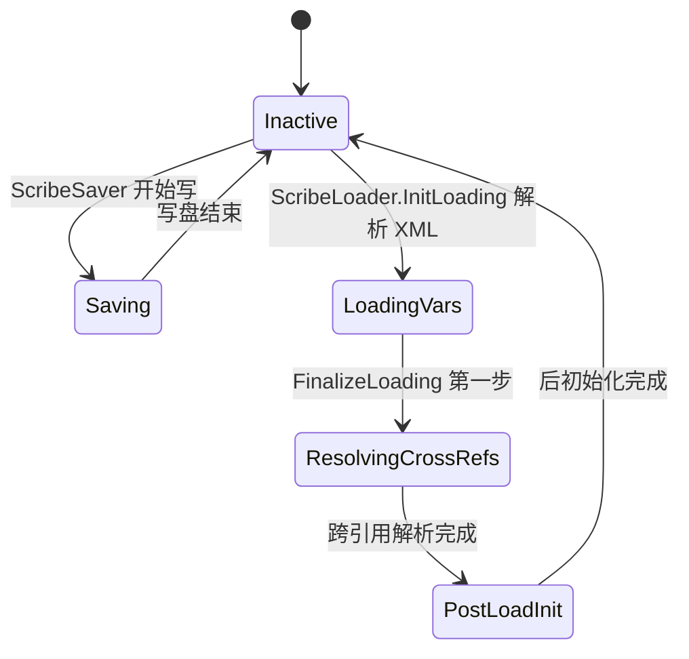
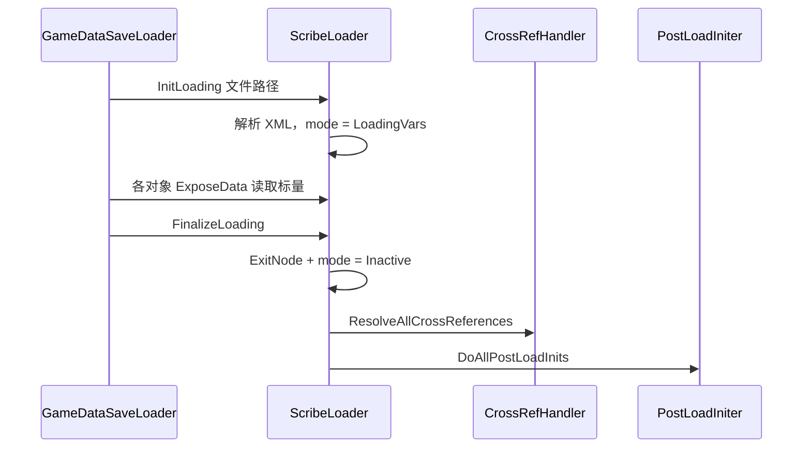
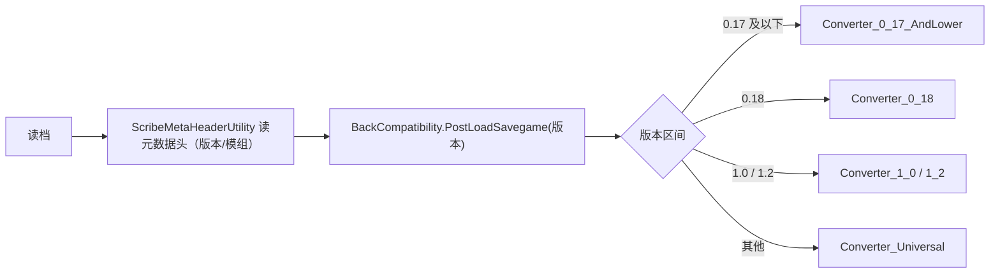

# V16 存档、序列化与版本迁移

卷号：V16
状态：初稿（R11）
上游：V01（时间字段）、V04/V05（实体与 Pawn 状态）、V15（Def 数据）；下游：无（横向支撑层）

## Scope

本卷解构 **游戏状态如何落盘与复原**：`Scribe` 的全局模式状态机、`Scribe_*` 原语族、`IExposable.ExposeData` 契约、读档三步（装载变量 → 解析跨引用 → 后初始化）、以及跨版本存档的迁移转换器。

这是全部前序卷的「落地层」：V01 的时间标量、V04 的 `tickDelta`、V09 的 `lastIncidentTick`、V14 的 `ageBiologicalTicks` 都是通过这套原语持久化的。

不覆盖：存档文件的二进制压缩（`MapFileCompressor`）、具体字段的业务含义（各卷自述）、UI 存档列表。

## Key types

| 类型 | Token | 语料路径 | 角色 |
|---|---|---|---|
| `Verse.Scribe` | — | `Assembly-CSharp/Verse/Scribe.cs` | 全局模式状态机与原语调度 |
| `Verse.LoadSaveMode` | — | `Assembly-CSharp/Verse/LoadSaveMode.cs` | 五态枚举 |
| `Verse.Scribe_Values` / `Scribe_Deep` / `Scribe_Defs` / `Scribe_Collections` | 0x0200052D（Collections） | 同名文件 | 原语族（值/深对象/Def/集合） |
| `Verse.ScribeExtractor` | 0x02000524 | `Assembly-CSharp/Verse/ScribeExtractor.cs` | 从 XML 节点提取值 |
| `Verse.ScribeLoader` | 0x02000525 | `Assembly-CSharp/Verse/ScribeLoader.cs` | 读档驱动器 |
| `Verse.ScribeSaver` | 0x02000529 | `Assembly-CSharp/Verse/ScribeSaver.cs` | 存档写出器 |
| `Verse.CrossRefHandler` | 0x02000520 | `Assembly-CSharp/Verse/CrossRefHandler.cs` | 跨引用登记与解析 |
| `Verse.LoadIDsWantedBank` | 0x02000522 | `Assembly-CSharp/Verse/LoadIDsWantedBank.cs` | 「待解析 ID」需求表 |
| `Verse.GameDataSaveLoader` | 0x02000518 | `Assembly-CSharp/Verse/GameDataSaveLoader.cs` | 存/读档对外入口 |
| `Verse.BackCompatibility` | 0x02000681 | `Assembly-CSharp/Verse/BackCompatibility.cs` | 版本迁移分派（含 0.17/0.18/1.0/1.2/Universal 转换器） |

## Control flow

### 1. 模式状态机

五个状态对应五种语义，**任何时刻只有一个**：`Scribe.mode` 是全局单例字段，`Scribe_Values.Look` 之类原语按当前 mode 决定「读还是写、要不要写默认值」。

### 2. 读档三步

关键设计：**跨引用不是立刻解析的**。读变量阶段只登记「我想要哪个 ID」，把所有需要解析的引用攒到 `LoadIDsWantedBank`，等全部对象构造完才统一解析 —— 否则存档里 A 指向 B、B 还没构造完成就会失败。这也解释了 V15 中「跨引用解析发生在读档流程内」的结论。

### 3. 原语族的分工

| 原语 | 用途 | 典型调用 |
|---|---|---|
| `Scribe_Values.Look<T>(ref T, label, default, forceSave)` | 标量（int/float/bool/enum） | V01 的 `ticksGame`、V04 的 `tickDelta` |
| `Scribe_Deep.Look<T>` | 深对象（嵌套 `IExposable`） | V14 的 `hediffSet` |
| `Scribe_Defs.Look<T>` | Def 引用（存 defName） | V14 的 `hediffDef` |
| `Scribe_Collections` | 列表/字典 | 各处集合字段 |
| `Scribe_Universal` | 未知类型兜底 | 兼容旧存档 |

所有原语共享 `ref` + `label` 的调用形态，因此「字段名一旦写进存档就不能改」——`label` 就是存档键名。

### 4. 版本迁移

迁移是**按版本分派的转换器链**，不是运行时兼容层。元数据头里带版本号与模组列表，读档后立即按来源版本跑对应转换器。

## Constants

| 项 | 值 | 位置 |
|---|---|---|
| 模式状态数 | 5（Inactive / Saving / LoadingVars / ResolvingCrossRefs / PostLoadInit） | `LoadSaveMode` |
| 默认模式 | `Inactive` | `Scribe.mode` |
| 读档第一步 | 解析 XML 后置 `LoadingVars` | `ScribeLoader.InitLoading` |
| 读档收尾前置条件 | 当前必须为 `LoadingVars`，否则报错返回 | `ScribeLoader.FinalizeLoading` |
| 收尾顺序 | ExitNode → Inactive → 解析跨引用 → 后初始化 | 同上 |
| 迁移转换器 | 0.17 及以下 / 0.18 / 1.0 / 1.2 / Universal | `BackCompatibility*` |

## Claims

[claim:V16-C01] `Scribe.mode` 是全局单例字段，默认 `Inactive`。
  src: Verse.Scribe.mode
  file: analysis/decompiled/Assembly-CSharp/Verse/Scribe.cs
  match: public static LoadSaveMode mode = LoadSaveMode.Inactive;

[claim:V16-C02] 模式枚举共五态，含存档专用的 `Saving`。
  src: Verse.LoadSaveMode
  file: analysis/decompiled/Assembly-CSharp/Verse/LoadSaveMode.cs
  match: PostLoadInit

[claim:V16-C03] 读档时模式经 `ResolvingCrossRefs` 这一独立阶段，说明跨引用解析是显式步骤。
  src: Verse.LoadSaveMode
  file: analysis/decompiled/Assembly-CSharp/Verse/LoadSaveMode.cs
  match: ResolvingCrossRefs

[claim:V16-C04] 标量原语用 `ref` + `label` + 默认值 + 强制写开关的固定形态。
  src: Verse.Scribe_Values.Look  Token: 0x02000533
  file: analysis/decompiled/Assembly-CSharp/Verse/Scribe_Values.cs
  match: public static void Look<T>(ref T value, string label, T defaultValue = default(T), bool forceSave = false)

[claim:V16-C05] 读档初始化会先校验前置状态，非 `Inactive` 即报错并强制停止。
  src: Verse.ScribeLoader.InitLoading  Token: 0x02000525
  file: analysis/decompiled/Assembly-CSharp/Verse/ScribeLoader.cs
  match: if (Scribe.mode != LoadSaveMode.Inactive)

[claim:V16-C06] 初始化解析的是 XML 文档，说明存档是 XML 结构（可被压缩包装）。
  src: Verse.ScribeLoader.InitLoading
  file: analysis/decompiled/Assembly-CSharp/Verse/ScribeLoader.cs
  match: xmlDocument.Load(xmlTextReader);

[claim:V16-C07] 解析成功后才把模式切到 `LoadingVars`，失败则整体回滚。
  src: Verse.ScribeLoader.InitLoading
  file: analysis/decompiled/Assembly-CSharp/Verse/ScribeLoader.cs
  match: Scribe.mode = LoadSaveMode.LoadingVars;

[claim:V16-C08] 收尾阶段要求当前必须处于 `LoadingVars`，否则直接返回不推进。
  src: Verse.ScribeLoader.FinalizeLoading
  file: analysis/decompiled/Assembly-CSharp/Verse/ScribeLoader.cs
  match: if (Scribe.mode != LoadSaveMode.LoadingVars)

[claim:V16-C09] 收尾先把模式复位为 `Inactive`，再去做跨引用解析。
  src: Verse.ScribeLoader.FinalizeLoading
  file: analysis/decompiled/Assembly-CSharp/Verse/ScribeLoader.cs
  match: Scribe.mode = LoadSaveMode.Inactive;

[claim:V16-C10] 跨引用解析是收尾的第一步（变量全部读完之后）。
  src: Verse.ScribeLoader.FinalizeLoading
  file: analysis/decompiled/Assembly-CSharp/Verse/ScribeLoader.cs
  match: this.crossRefs.ResolveAllCrossReferences();

[claim:V16-C11] 后初始化（`PostLoadInit`）排在跨引用解析之后，是三步的最后一步。
  src: Verse.ScribeLoader.FinalizeLoading
  file: analysis/decompiled/Assembly-CSharp/Verse/ScribeLoader.cs
  match: this.initer.DoAllPostLoadInits();

[claim:V16-C12] 跨引用处理器与后初始化器都是读档器持有的成员，生命周期与一次读档绑定。
  src: Verse.ScribeLoader.crossRefs
  file: analysis/decompiled/Assembly-CSharp/Verse/ScribeLoader.cs
  match: public CrossRefHandler crossRefs = new CrossRefHandler();

[claim:V16-C13] 存/读档都有对外统一入口，而不是各处直接操作 Scribe。
  src: Verse.GameDataSaveLoader.SaveGame  Token: 0x02000518
  file: analysis/decompiled/Assembly-CSharp/Verse/GameDataSaveLoader.cs
  match: public static void SaveGame(string fileName)

[claim:V16-C14] 载入前有独立的版本校验入口，说明版本判断在真正加载之前发生。
  src: Verse.GameDataSaveLoader.CheckVersionAndLoadGame
  file: analysis/decompiled/Assembly-CSharp/Verse/GameDataSaveLoader.cs
  match: public static void CheckVersionAndLoadGame(string saveFileName)

[claim:V16-C15] 真正的加载入口接受文件名，内部再走 ScribeLoader 流程。
  src: Verse.GameDataSaveLoader.LoadGame
  file: analysis/decompiled/Assembly-CSharp/Verse/GameDataSaveLoader.cs
  match: public static void LoadGame(string saveFileName)

[claim:V16-C16] 读档收尾后立即按来源版本跑兼容转换，说明迁移是加载流程的固定一段。
  src: Verse.Game
  file: analysis/decompiled/Assembly-CSharp/Verse/Game.cs
  match: BackCompatibility.PostLoadSavegame(ScribeMetaHeaderUtility.loadedGameVersion);

[claim:V16-C17] 兼容层按大版本分散成多个转换器（0.17 及以下、0.18、1.0、1.2…）。
  src: Verse.BackCompatibilityConverter_0_18  Token: 0x02000684
  file: analysis/decompiled/Assembly-CSharp/Verse/BackCompatibilityConverter_0_18.cs
  match: public class BackCompatibilityConverter_0_18

[claim:V16-C18] 存在兜底转换器处理无法精确归类的版本。
  src: Verse.BackCompatibilityConverter_Universal  Token: 0x0200068B
  file: analysis/decompiled/Assembly-CSharp/Verse/BackCompatibilityConverter_Universal.cs
  match: public class BackCompatibilityConverter_Universal

[claim:V16-C19] 集合序列化单独成原语族，说明列表/字典有专门处理（而非逐元素手写）。
  src: Verse.Scribe_Collections  Token: 0x0200052D
  file: analysis/decompiled/Assembly-CSharp/Verse/Scribe_Collections.cs
  match: public static class Scribe_Collections

[claim:V16-C20] 元数据头工具独立存在，负责往存档里写入版本号与模组 ID 列表。
  src: Verse.ScribeMetaHeaderUtility  Token: 0x0200052B
  file: analysis/decompiled/Assembly-CSharp/Verse/ScribeMetaHeaderUtility.cs
  match: Scribe_Values.Look<string>(ref currentVersionStringWithRev, "gameVersion", null, false);

## Resolved questions

R13 解出原 `Open questions` 第 1、2、3、5 条：

- **写出流程（OQ1）**：`ScribeSaver` 是 `ScribeLoader` 的镜像——`InitSaving(filePath, documentElementName)` 建文档 → `EnterNode/ExitNode` 逐层 → `WriteElement/WriteAttribute` 写值 → `FinalizeSaving` 落盘；另有两个辅助结构：`savedNodes`（同名节点去重）与 `loadIDsErrorsChecker`（写出时的 LoadID 一致性检查）。
- **延迟引用协议（OQ2）**：`LoadIDsWantedBank` 用**两个字典**登记，键是 `(IExposable parent, string pathRelToParent)` 元组：单个引用登记到 `idsRead`，列表登记到 `idListsRead`。读取阶段先登记（`RegisterLoadIDReadFromXml`），解析阶段用 `Take<T>(pathRelToParent, parent)` / `TakeList` 按同一键取回。**键的语义是「某个对象在某个相对路径上想要的 ID」**，因此同一对象不同字段不会串。
- **版本迁移的分派机制（OQ3）**：`BackCompatibility.PostLoadSavegame(loadingVersion)` 遍历 `conversionChain`，对每个转换器先问 `AppliesToLoadedGameVersion(true)`，命中才调它的 `PostLoadSavegame`。转换器自身实现 `AppliesToVersion(major, minor)` 与逐对象的 `PostExposeData(obj)` 钩子——即**按版本区间分派 + 按对象改写**，不是一次性整体重写。
- **地图压缩（OQ5）**：`MapFileCompressor : IExposable` 参与存档，`BuildCompressedString()` 打包、`ThingsToSpawnAfterLoad()` 还原，判据由 `CompressibilityDecider` 决定哪些东西可压。它只影响体积与加载顺序，不改变状态语义。

[claim:V16-C21] 写出侧有独立的初始化入口（文件路径 + 文档根名）。
  src: Verse.ScribeSaver.InitSaving
  file: analysis/decompiled/Assembly-CSharp/Verse/ScribeSaver.cs
  match: public void InitSaving(string filePath, string documentElementName)

[claim:V16-C22] 延迟引用以「父对象 + 相对路径」为键登记。
  src: Verse.LoadIDsWantedBank.idsRead
  file: analysis/decompiled/Assembly-CSharp/Verse/LoadIDsWantedBank.cs
  match: private Dictionary<ValueTuple<IExposable, string>, LoadIDsWantedBank.IdRecord> idsRead = new Dictionary<ValueTuple<IExposable, string>, LoadIDsWantedBank.IdRecord>();

[claim:V16-C23] 兼容转换器在转换链中逐个自判是否适用。
  src: Verse.BackCompatibility.PostLoadSavegame
  file: analysis/decompiled/Assembly-CSharp/Verse/BackCompatibility.cs
  match: if (BackCompatibility.conversionChain[i].AppliesToLoadedGameVersion(true))

[claim:V16-C24] 地图以压缩字符串形式随存档持久化。
  src: Verse.MapFileCompressor.BuildCompressedString
  file: analysis/decompiled/Assembly-CSharp/Verse/MapFileCompressor.cs
  match: public void BuildCompressedString()

### 模组列表与迁移（原 OQ4）

存档元数据头写入三份清单：`modIds`、`modSteamIds`、`modNames`（均来自 `LoadedModManager.RunningMods`）。读档时用 `LoadedModsMatchesActiveModsNoInfo()` 比对，得出 `modListChanged` 标志 —— 即**模组变化不直接触发版本迁移**，而是被记录为一个「与当前加载集不一致」的布尔，供上层决定是否警告/清理。

[claim:V16-C25] 读档会比对存档模组列表与当前激活集，产出变更标志。
  src: Verse.ScribeMetaHeaderUtility
  file: analysis/decompiled/Assembly-CSharp/Verse/ScribeMetaHeaderUtility.cs
  match: ScribeMetaHeaderUtility.modListChanged = !ScribeMetaHeaderUtility.LoadedModsMatchesActiveModsNoInfo();

## Open questions

1. **`ScribeSaver` 的写出流程未逐行解构**：只知道存在与 `Saving` 模式，节点路径拼接与默认值抑制（`forceSave` 的反面）细节未读。
2. `LoadIDsWantedBank` 的登记/查询协议（延迟引用的键格式）未展开。
3. `BackCompatibility` 各转换器的具体改写规则（字段改名、枚举值迁移）未抽查任何一个 —— 这部分工作量最大且最易出错。
4. `ScribeMetaHeaderUtility` 的模组列表（mod list）如何参与版本判定（模组变化是否也触发迁移）未验证。
5. `MapFileCompressor`（地图压缩）与存档体积的关系未解构，属存储优化层。
