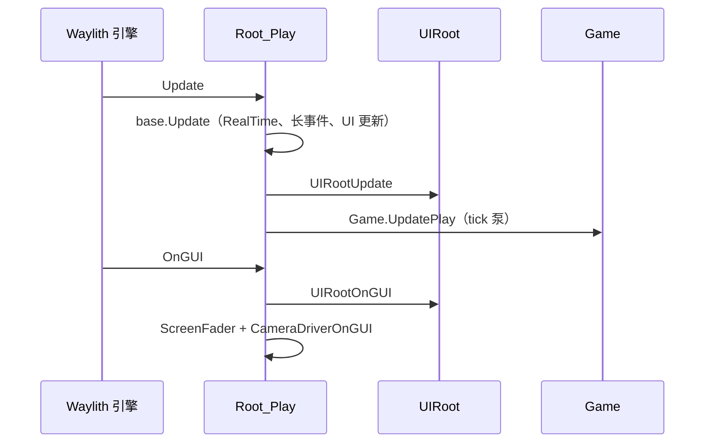
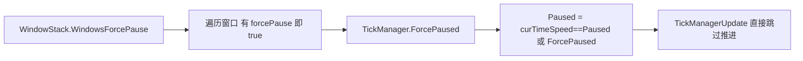
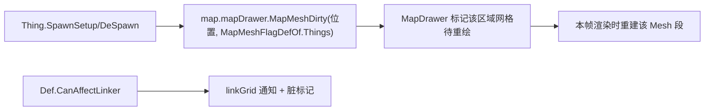

# V17 UI、渲染与引擎桥接

卷号：V17
状态：初稿（R10）
上游：V01（帧循环）、V00（Waylith 程序集边界）；下游：无（终端表现层）

## Scope

本卷解构 **逻辑与表现的分界线**：每帧两条通道（`Update` 逻辑、`OnGUI` 表现）如何分工、窗口栈如何反向影响时间推进（强制暂停）、渲染脏标记如何从物体生命周期传导到网格重绘，以及 RimWorld 逻辑与 Waylith 引擎之间的桥接面。

不覆盖：具体控件与排版（`Widgets`/`Window` 子类）、贴图与着色器内容（`Assets.zip`）、`Waylith` 引擎内部实现（语料不完整，见 `state.md` 限制 1）。

## Key types

| 类型 | Token | 语料路径 | 角色 |
|---|---|---|---|
| `Verse.Root` | 0x02000202 | `Assembly-CSharp/Verse/Root.cs` | 帧入口，分 `Update` 与 `OnGUI` 两条通道 |
| `Verse.Root_Play` | 0x02000204 | `Assembly-CSharp/Verse/Root_Play.cs` | 游戏中场景根（`Update` 驱动 `Game.UpdatePlay`） |
| `Verse.UIRoot` | — | `Assembly-CSharp/Verse/UIRoot.cs` | 抽象 UI 根：`UIRootUpdate` / `UIRootOnGUI` |
| `Verse.WindowStack` | 0x02000680 | `Assembly-CSharp/Verse/WindowStack.cs` | 窗口栈（含「强制暂停」判定） |
| `Verse.CameraDriver` | 0x020000F3 | `Assembly-CSharp/Verse/CameraDriver.cs` | 相机（负责 `CameraDriverOnGUI`） |
| `Verse.MapDrawer` | 0x020002A7 | `Assembly-CSharp/Verse/MapDrawer.cs` | 地图网格绘制与脏标记 |
| `Verse.PawnRenderTree` | 0x02000392 | `Assembly-CSharp/Verse/PawnRenderTree.cs` | Pawn 渲染树（节点化绘制） |
| `Verse.GlobalTextureAtlasManager` | 0x020004F0 | `Assembly-CSharp/Verse/GlobalTextureAtlasManager.cs` | 全局图集（每帧更新、场景切换释放） |
| `UnityStubs.Internal.UnityRuntime` | — | `UnityStubs/Internal/` | 引擎桥（`Time.deltaTime` 的真实来源） |

## Control flow

### 1. 每帧两条通道

分工严格：

- **`Update` 通道**：时间、tick、逻辑、输入轮询；
- **`OnGUI` 通道**：绘制、窗口、相机层叠加。

两者**不共享状态推进**：`OnGUI` 里做逻辑会随重绘次数变化（IMGUI 一帧可能多次 `OnGUI`），所以 RimWorld 把所有可变状态放在 `Update` 里。这条纪律是本项目「进程规则」与表现层能分离的根本原因。

### 2. 窗口栈反向影响时间

这是表现层唯一被允许「倒灌」进逻辑层的地方：`TickManager.ForcePaused` 的条件里包含 `Find.WindowStack.WindowsForcePause`（V01 已记录）。所以「打开贸易/剧本选择窗口时世界冻结」不是特例代码，而是窗口自己声明 `forcePause`。

### 3. 渲染脏标记的传导

渲染不是「每帧全图重画」：物体出现/消失只在 `CanAffectLinker` 或 spawn/despawn 时打脏标记，其余帧复用网格。

### 4. 引擎桥接

逻辑层不直接调 Waylith：`UnityEngine.Time` 等类型是**桩**，内部转发到 `UnityStubs.Internal.UnityRuntime`，再进 `Waylith.UnityCompat`。这层桩让 RimWorld 逻辑保持 Unity 风格 API，而实际引擎可替换。

## Constants

| 项 | 值 / 规则 | 位置 |
|---|---|---|
| 逻辑通道 | `Update` | `Root` / `Root_Play` |
| 表现通道 | `OnGUI` | `Root` / `UIRoot` |
| 窗口强制暂停 | 任一窗口 `forcePause == true` | `WindowStack.WindowsForcePause` |
| 物体脏标记 | `MapMeshFlagDefOf.Things` | `MapDrawer.MapMeshDirty` |
| 图集释放时机 | 场景切换（`Root.Start`） | `GlobalTextureAtlasManager` |
| 帧时间来源 | `UnityRuntime.Time.DeltaTime`（上限 1/3 s） | `UnityStubs` |

## Claims

[claim:V17-C01] UI 根有独立的「逻辑更新」入口，由帧循环调用。
  src: Verse.UIRoot.UIRootUpdate
  file: analysis/decompiled/Assembly-CSharp/Verse/UIRoot.cs
  match: public virtual void UIRootUpdate()

[claim:V17-C02] UI 根另有「绘制」入口，与逻辑更新分离。
  src: Verse.UIRoot.UIRootOnGUI
  file: analysis/decompiled/Assembly-CSharp/Verse/UIRoot.cs
  match: public virtual void UIRootOnGUI()

[claim:V17-C03] 帧 `Update` 中先跑基类逻辑，再调 UI 更新，然后才由派生类驱动 tick。
  src: Verse.Root.Update
  file: analysis/decompiled/Assembly-CSharp/Verse/Root.cs
  match: this.uiRoot.UIRootUpdate();

[claim:V17-C04] 帧 `OnGUI` 中调 UI 绘制。
  src: Verse.Root.OnGUI
  file: analysis/decompiled/Assembly-CSharp/Verse/Root.cs
  match: this.uiRoot.UIRootOnGUI();

[claim:V17-C05] 相机层叠加绘制也在 `OnGUI` 通道内。
  src: Verse.Root.OnGUI
  file: analysis/decompiled/Assembly-CSharp/Verse/Root.cs
  match: Find.CameraDriver.CameraDriverOnGUI();

[claim:V17-C06] 场景切换时会释放运行时图集，避免跨场景句柄泄漏。
  src: Verse.Root.Start
  file: analysis/decompiled/Assembly-CSharp/Verse/Root.cs
  match: GlobalTextureAtlasManager.FreeAllRuntimeAtlases();

[claim:V17-C07] 窗口栈对外暴露「是否有窗口强制暂停」这一聚合判定。
  src: Verse.WindowStack.WindowsForcePause  Token: 0x02000680
  file: analysis/decompiled/Assembly-CSharp/Verse/WindowStack.cs
  match: public bool WindowsForcePause

[claim:V17-C08] 判定依据是逐个窗口的 `forcePause` 标记，任一为真即暂停。
  src: Verse.WindowStack.WindowsForcePause
  file: analysis/decompiled/Assembly-CSharp/Verse/WindowStack.cs
  match: if (this.windows[i].forcePause)

[claim:V17-C09] 窗口栈的绘制入口独立于逻辑更新。
  src: Verse.WindowStack.WindowStackOnGUI
  file: analysis/decompiled/Assembly-CSharp/Verse/WindowStack.cs
  match: public void WindowStackOnGUI()

[claim:V17-C10] 物体出现时只打「Things 层」脏标记，说明渲染是按层分块重绘的。
  src: Verse.Thing.SpawnSetup
  file: analysis/decompiled/Assembly-CSharp/Verse/Thing.cs
  match: map.mapDrawer.MapMeshDirty(this.Position, MapMeshFlagDefOf.Things, true, false);

[claim:V17-C11] 只有 `CanAffectLinker` 的物体才会触发连接层重绘，避免无谓脏标记。
  src: Verse.Thing.SpawnSetup
  file: analysis/decompiled/Assembly-CSharp/Verse/Thing.cs
  match: if (this.def.CanAffectLinker)

[claim:V17-C12] 动态绘制对象走独立管理器注册（不参与静态网格）。
  src: Verse.Thing.SpawnSetup
  file: analysis/decompiled/Assembly-CSharp/Verse/Thing.cs
  match: map.dynamicDrawManager.RegisterDrawable(this);

## Resolved questions

原 `Open questions` 第 1 条（`UIRoot_Play` 覆写）在 R12 已解：

- `UIRoot_Play : UIRoot` 位于 **`RimWorld` 命名空间**（不在 `Verse`），覆写了 `Init`、`UIRootOnGUI`、`UIRootUpdate` 三个入口。因此「游戏内 UI 根」与「主菜单 UI 根（`UIRoot_Entry`）」的差异全部收敛在各自的三处覆写里，`Verse.UIRoot` 只定义契约。

[claim:V17-C13] 游戏内 UI 根覆写了 update 入口，实现差异集中在覆写层。
  src: RimWorld.UIRoot_Play.UIRootUpdate
  file: analysis/decompiled/Assembly-CSharp/RimWorld/UIRoot_Play.cs
  match: public override void UIRootUpdate()

### 输入分发顺序（原 OQ5）

`WindowStack` 在 `OnGUI` 里做事件吞噬：若 `Event.current` 是 `mouseDown` 且该点**不落在任何窗口内**，就把事件 `Use()` 掉（`Notify_ClickedInsideWindow` 是反向标记）。由此形成「最上层窗口先吃输入，点击窗口外被栈吞掉」的规则；窗口内部再自行分发（`GetsInput`）。

[claim:V17-C14] 窗口栈在点击落空时直接吞掉该鼠标事件，阻止穿透到地图。
  src: Verse.WindowStack
  file: analysis/decompiled/Assembly-CSharp/Verse/WindowStack.cs
  match: if (Event.current.type == EventType.mouseDown && this.GetWindowAt(UI.GUIToScreenPoint(Event.current.mousePosition)) == null)

## Resolved questions

原 `Open questions` 第 4 条（引擎侧真正产生帧的那层）在 R20 解除阻塞并解出——`Waylith` 语料补全后可直接读：

- **帧源是主线程的 `Stopwatch` 驱动循环**：`EngineApplication.RunLoop()` 里 `while (!Window.ShouldClose)`，每帧 `num2 = _stopwatch.Elapsed.TotalSeconds`，`num3 = num2 - num`（即 delta 秒），随后 `EngineApplication.BeginFrame(num3, num2)` → `Time.BeginFrame` 写入 `Time.DeltaTime` / `Time.Elapsed`，帧尾 `EndFrame()` 让 `Time.FrameCount++`。
- **绘制在独立渲染线程**：进入循环前先 `new RenderThread(RenderContext, FrameRenderer)` 并 `Start()`，主线程每帧只做 `DrainRenderThreadCallbacksOnMainThread()` 与把 `FrameTiming(FrameCount, delta, elapsed)` 交给渲染线程，不直接提交绘制命令。
- 因此 `UnityEngine.Time.deltaTime`（桩）→ `UnityStubs.UnityRuntime.Time.DeltaTime` → `Waylith.Time.DeltaTime` → 主循环的 Stopwatch 差值，这条链现在完整可追。
- 附带两条帧策略：窗口失焦且 `RunInBackground` 关时走 `Glfw.WaitEventsTimeout(0.1)` 空转；帧缓冲最小化时跳过渲染。

[claim:V17-C15] 引擎在进入主循环前启动独立渲染线程。
  src: Waylith.EngineApplication.RunLoop
  file: analysis/decompiled/Waylith/EngineApplication.cs
  match: this._renderThread = new RenderThread(this.RenderContext, this.FrameRenderer);

[claim:V17-C16] 帧间隔由 Stopwatch 差值产生，而不是引擎内部定时器。
  src: Waylith.EngineApplication.RunLoop
  file: analysis/decompiled/Waylith/EngineApplication.cs
  match: float num2 = (float)this._stopwatch.Elapsed.TotalSeconds;

[claim:V17-C17] 每帧把 delta 与累计时间写入引擎 Time。
  src: Waylith.EngineApplication.RunLoop
  file: analysis/decompiled/Waylith/EngineApplication.cs
  match: EngineApplication.BeginFrame(num3, num2);

[claim:V17-C18] 帧时间被打包成 FrameTiming 交给渲染线程。
  src: Waylith.EngineApplication.RunLoop
  file: analysis/decompiled/Waylith/EngineApplication.cs
  match: FrameTiming frameTiming = new FrameTiming(Time.FrameCount, num3, (double)num2);

[claim:V17-C19] `Waylith.Time.DeltaTime` 是帧级写入的静态量。
  src: Waylith.Time.BeginFrame
  file: analysis/decompiled/Waylith/Time.cs
  match: Time.DeltaTime = deltaTime;

[claim:V17-C20] 帧计数在帧尾自增，`FrameCount` 由此而来。
  src: Waylith.Time.EndFrame
  file: analysis/decompiled/Waylith/Time.cs
  match: Time.FrameCount++;

## Open questions

1. **`UIRoot_Play` 的覆写未取证**：本卷只确认了 `Verse.UIRoot` 的两个虚方法，`UIRoot_Play` 与 `UIRoot_Entry` 的差异（游戏内/主菜单）未读。
2. `OnGUI` 一帧可能被调用多次（IMGUI 布局/绘制两遍）—— 本卷按代码结构推断逻辑全在 `Update`，未通过运行时验证。
3. `PawnRenderTree`（643 行）的节点化绘制流程未解构，属表现层深度内容。
4. `Waylith` 引擎侧（真正提交绘制命令的那层）语料不完整，桥接面只到 `UnityRuntime` 桩层。
5. `WindowStack` 的输入分发顺序（谁能吃掉点击）未展开。
