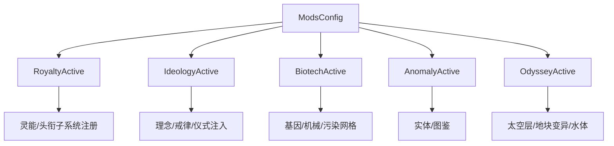

# V18 DLC 机制增量

卷号：V18
状态：初稿（R10）
上游：V01–V17 全部；下游：无（横向扩展层）

## Scope

本卷不再重复各卷已解构的基础机制，只记录 **五个 DLC 如何以「增量」方式挂进既有主链**：开关怎么判、注入了哪些新子系统、在原类型上加了哪些钩子点。

覆盖目标：Royalty（灵能/头衔）、Ideology（戒律/模因/仪式）、Biotech（基因/机械/污染）、Anomaly（实体/代码库）、Odyssey（太空层/地块变异/水体）。

不覆盖：各 DLC 的全部 Def 内容与具体数值（属数据面）；单独 DLC 的完整玩法流程。

## Key types

| 类型 | Token | 程序集/路径 | DLC | 角色 |
|---|---|---|---|---|
| `Verse.ModsConfig` | — | `Assembly-CSharp/Verse/ModsConfig.cs` | 全部 | 五个静态启用开关（唯一权威） |
| `RimWorld.Pawn_PsychicEntropyTracker` | 0x020015A1 | `RimWorld/Pawn_PsychicEntropyTracker.cs` | Royalty | 灵能熵/心灵焦点 |
| `RimWorld.RoyalTitleDef` | 0x02001FFF | 同名 | Royalty | 头衔（带权限与需求） |
| `RimWorld.AbilityDef` | 0x02000F2B | 同名 | Royalty/Biotech/Anomaly | 能力定义 |
| `RimWorld.Ideo` | 0x02001620 | 同名 | Ideology | 理念（戒律集合 + 成员事件） |
| `RimWorld.PreceptDef` / `MemeDef` | 0x02000FC9 / 0x02000FAC | 同名 | Ideology | 戒律与模因 |
| `RimWorld.RitualBehaviorWorker` | 0x02001680 | 同名 | Ideology | 仪式执行器 |
| `RimWorld.XenotypeDef` / `Verse.GeneDef` | 0x02001016 / 0x020000B8 | 同名 | Biotech | 异种类型与基因 |
| `RimWorld.AnomalyUtility` / `EntityCodex` | 0x02001E29 / 0x02001025 | 同名 | Anomaly | 实体发现与图鉴 |
| `RimWorld.TileMutatorDef` | 0x02001307 | 同名 | Odyssey | 地块变异（地形/规则改写） |

## Control flow

### 1. 五个开关是所有 DLC 代码的唯一入口

所有 DLC 代码都写成 `if (ModsConfig.XxxActive)` 的**前置判断 + 就地注入**，而不是继承替换。这意味着关掉 DLC 只是让代码路径不进入，基础类型仍然存在（例如 `Pawn_GeneTracker` 字段存在但 `GeneTrackerTick` 直接返回，见 V14）。

### 2. 各 DLC 的挂点位置

| DLC | 挂点 | 具体表现 |
|---|---|---|
| Royalty | Pawn 组件 | `Pawn_PsychicEntropyTracker` 有自己的 `TickInterval`，与 V05 的双入口体系一致 |
| Ideology | Pawn/地图/世界 | `Ideo` 持有戒律列表，成员事件（`Notify_MemberTookAction` 等）驱动思想 |
| Biotech | 地图网格 + Pawn | 污染网格按需创建（`pollutionGrid == null` 时初始化），基因走 `Pawn_GeneTracker` |
| Anomaly | 物体生成 + UI | 物体生成时走 `AnomalyUtility.ShouldNotifyCodex` 决定是否进图鉴 |
| Odyssey | 地图构建 + tick | `Map` 构造与 tick 中多处 `OdysseyActive` 分支；地块变异 `TileMutatorDef.Worker.Tick(map)` |

### 3. Odyssey 的「地块变异」是最深的一次注入

`TileMutatorDef` 在 `MapPostTick` 内被逐条 tick（V01 记录过该位置），意味着 **Odyssey 可以在地块层面持续改写地图规则**，而不只是加内容。这是五个 DLC 里对既有主链侵入最深的一处。

## Constants

| 项 | 值 / 规则 | 位置 |
|---|---|---|
| DLC 开关数 | 5（Royalty/Ideology/Biotech/Anomaly/Odyssey） | `ModsConfig` |
| 开关生效方式 | `ModsConfig.XxxActive` 静态属性 | 同上 |
| 灵能熵 tick | 走 `PsychicEntropyTrackerTickInterval(delta)` | `Pawn_PsychicEntropyTracker` |
| 污染网格 | 首次使用时创建（`pollutionGrid == null`） | `Map` |
| 图鉴登记 | 物体生成时按 `AnomalyUtility.ShouldNotifyCodex` 判断 | `Thing.SpawnSetup` |
| 地块变异 | `TileMutatorDef.Worker.Tick(map)` 每 tick | `Map.MapPostTick` |

## Claims

[claim:V18-C01] Royalty 的启用判据是 `ModsConfig.RoyaltyActive` 静态属性。
  src: Verse.ModsConfig.RoyaltyActive
  file: analysis/decompiled/Assembly-CSharp/Verse/ModsConfig.cs
  match: public static bool RoyaltyActive

[claim:V18-C02] Ideology 判据同构。
  src: Verse.ModsConfig.IdeologyActive
  file: analysis/decompiled/Assembly-CSharp/Verse/ModsConfig.cs
  match: public static bool IdeologyActive

[claim:V18-C03] Biotech 判据同构。
  src: Verse.ModsConfig.BiotechActive
  file: analysis/decompiled/Assembly-CSharp/Verse/ModsConfig.cs
  match: public static bool BiotechActive

[claim:V18-C04] Anomaly 判据同构。
  src: Verse.ModsConfig.AnomalyActive
  file: analysis/decompiled/Assembly-CSharp/Verse/ModsConfig.cs
  match: public static bool AnomalyActive

[claim:V18-C05] Odyssey 判据同构，五个 DLC 共用同一套开关模型。
  src: Verse.ModsConfig.OdysseyActive
  file: analysis/decompiled/Assembly-CSharp/Verse/ModsConfig.cs
  match: public static bool OdysseyActive

[claim:V18-C06] 灵能引擎是 Pawn 的一个独立组件，有自己的区间 tick（与 V05 双入口一致）。
  src: RimWorld.Pawn_PsychicEntropyTracker.PsychicEntropyTrackerTickInterval  Token: 0x020015A1
  file: analysis/decompiled/Assembly-CSharp/RimWorld/Pawn_PsychicEntropyTracker.cs
  match: public void PsychicEntropyTrackerTickInterval(int delta)

[claim:V18-C07] 心灵焦点被显式建模为可读数值，供能力消耗与 UI 使用。
  src: RimWorld.Pawn_PsychicEntropyTracker.CurrentPsyfocus
  file: analysis/decompiled/Assembly-CSharp/RimWorld/Pawn_PsychicEntropyTracker.cs
  match: public float CurrentPsyfocus

[claim:V18-C08] 焦点以「档位」形式暴露，说明 UI 与规则使用离散分档而非连续值。
  src: RimWorld.Pawn_PsychicEntropyTracker.PsyfocusBand
  file: analysis/decompiled/Assembly-CSharp/RimWorld/Pawn_PsychicEntropyTracker.cs
  match: public int PsyfocusBand

[claim:V18-C09] 灵能熵有严重度分级枚举，可作为负面后果的触发依据。
  src: RimWorld.Pawn_PsychicEntropyTracker.Severity
  file: analysis/decompiled/Assembly-CSharp/RimWorld/Pawn_PsychicEntropyTracker.cs
  match: public PsychicEntropySeverity Severity

[claim:V18-C10] 焦点可通过冥想物品（focus）获得，说明冥想是数值来源而非纯仪式。
  src: RimWorld.Pawn_PsychicEntropyTracker.GainPsyfocus
  file: analysis/decompiled/Assembly-CSharp/RimWorld/Pawn_PsychicEntropyTracker.cs
  match: public void GainPsyfocus(Thing focus = null)

[claim:V18-C11] Ideology 的理念对象直接持有戒律列表，戒律是「查表式」而非条件注入。
  src: RimWorld.Ideo.PreceptsListForReading  Token: 0x02001620
  file: analysis/decompiled/Assembly-CSharp/RimWorld/Ideo.cs
  match: public List<Precept> PreceptsListForReading

[claim:V18-C12] 理念通过「成员做了某事」这类事件驱动思想，与 V13 的思想系统对接。
  src: RimWorld.Ideo.Notify_MemberTookAction
  file: analysis/decompiled/Assembly-CSharp/RimWorld/Ideo.cs
  match: public void Notify_MemberTookAction(HistoryEvent ev, bool canApplySelfTookThoughts)

[claim:V18-C13] Biotech 的污染网格是按需惰性创建的，不是每张地图都建。
  src: Verse.Map
  file: analysis/decompiled/Assembly-CSharp/Verse/Map.cs
  match: if (ModsConfig.BiotechActive && this.pollutionGrid == null)

[claim:V18-C14] Odyssey 在地图构造与 tick 中多处分支，属于对主链侵入较深的 DLC。
  src: Verse.Map
  file: analysis/decompiled/Assembly-CSharp/Verse/Map.cs
  match: if (ModsConfig.OdysseyActive)

[claim:V18-C15] 地块变异通过 `TileInfo.Mutators` 枚举，说明变异是数据驱动的多重叠加。
  src: Verse.Map.MapPostTick
  file: analysis/decompiled/Assembly-CSharp/Verse/Map.cs
  match: foreach (TileMutatorDef tileMutatorDef in this.TileInfo.Mutators)

[claim:V18-C16] Anomaly 的图鉴登记发生在物体生成流程内，与 V04 的 spawn 级联同一处。
  src: Verse.Thing.SpawnSetup
  file: analysis/decompiled/Assembly-CSharp/Verse/Thing.cs
  match: if (AnomalyUtility.ShouldNotifyCodex(this, EntityDiscoveryType.Spawn, out list))

[claim:V18-C17] 基因系统整段被 Biotech 开关门控（详见 V14），是「就地短路」而非条件编译。
  src: RimWorld.Pawn_GeneTracker.GeneTrackerTick
  file: analysis/decompiled/Assembly-CSharp/RimWorld/Pawn_GeneTracker.cs
  match: if (!ModLister.BiotechInstalled)

## Resolved questions

原 `Open questions` 第 1 条（`ModsConfig` 与 `ModLister` 双轨）在 R12 已解：

- 两者都只是**缓存布尔字段的公共读口**：`ModsConfig.BiotechActive` → 读 `ModsConfig.biotechActive`；`ModLister.BiotechInstalled` → 读 `ModLister.biotechInstalled`。一个是「已启用」，一个是「已安装」，语义不同而非重复实现。
- 因此 DLC 代码里两种写法并存是**语义区分**：用 `Installed` 的多为「功能是否存在」的静态判断（如基因 tick 早退），用 `Active` 的多为「本次游戏是否启用」的玩法判断。

[claim:V18-C18] `ModsConfig.*Active` 读取自身缓存字段，表示「已启用」。
  src: Verse.ModsConfig.BiotechActive
  file: analysis/decompiled/Assembly-CSharp/Verse/ModsConfig.cs
  match: return ModsConfig.biotechActive;

[claim:V18-C19] `ModLister.*Installed` 读取另一套缓存，表示「已安装」。
  src: Verse.ModLister.BiotechInstalled
  file: analysis/decompiled/Assembly-CSharp/Verse/ModLister.cs
  match: return ModLister.biotechInstalled;

### 仪式与机械族的结构（原 OQ3、OQ4）

- **仪式（OQ3）**：`RitualBehaviorWorker` 的虚方法是完整生命周期钩子——`CanStartRitualNow(...)`、`CanExecuteOn(target, obligation)`、`TryExecuteOn(target, organizer, ritual, obligation, assignments, playerForced)`、`Tick(LordJob_Ritual)`、`GetExplanation(ritual, assignments, quality)`，另有 `ExposeData`。注意 `quality` 已经是**入参**，说明仪式质量由外部（`Precept_Ritual`/角色分配）先算出再传入，而不是在 worker 内累计。
- **机械族（OQ4）**：`Pawn_MechanitorTracker` 是控制组 + 带宽模型——`AssignPawnControlGroup(pawn, preferredWorkMode)`、`UnassignPawnFromAnyControlGroup`、`Notify_BandwidthChanged`、`CanOverseeSubject(subject)`、`AnySelectedDraftedMechs`。所以「机械师」不是一个 Job，而是一个**把机械分配给控制组并受带宽约束**的追踪器。

[claim:V18-C20] 仪式的可执行性由 worker 的虚方法判定，质量是外部入参。
  src: RimWorld.RitualBehaviorWorker.CanExecuteOn
  file: analysis/decompiled/Assembly-CSharp/RimWorld/RitualBehaviorWorker.cs
  match: public virtual bool CanExecuteOn(TargetInfo target, RitualObligation obligation)

[claim:V18-C21] 机械师以「控制组 + 带宽」模型管理机械，而非独立 Job 流程。
  src: RimWorld.Pawn_MechanitorTracker.AssignPawnControlGroup
  file: analysis/decompiled/Assembly-CSharp/RimWorld/Pawn_MechanitorTracker.cs
  match: public void AssignPawnControlGroup(Pawn pawn, MechWorkModeDef preferredWorkMode = null)

## Resolved questions

原 `Open questions` 第 5 条（Odyssey 太空层与 `Gravship` 起降）在 R21 解出（语料 R19 补全后可直读）：

- **层是数据定义的，不是硬编码两套场景**：`PlanetLayerDef` 用一组开关描述层的性质 —— `SurfaceTiles`（是否地表）、`isSpace`（是否太空）、`canFormCaravans`（能否走远行队）、`rangeDistanceFactor`、`alwaysRaycastable`、`obstructsExpandingIcons`，外加五个 `onlyAllowWhitelisted*`（事件 / 生物群系 / 天气条件 / 任务 / 抵达方式的白名单门控）。层之间的迁移走 V10 已解构的连接图（`AddConnection(target, cost)`）。
- **`Gravship` 是「地图 ↔ 世界」双态对象**：由地图上的引擎 `Gravship(Building_GravEngine engine)` 创建；起飞时 `WorldComponent_GravshipController.InitiateTakeoff(engine, targetTile)` → `RemoveGravshipFromMap(engine)` 把它从地图摘出变为世界对象 → `BeginTakeoffCutscene()`；降落则 `InitiateLanding(gravship, map, landingPos, landingRot)` → `BeginLandingCutscene(...)` → 落回地图。
- **起降是固定 10 秒过场，且过场期间游戏时间被硬暂停**：控制器用 `timeLeft` 计时（进度 `num = Clamp01(1 - timeLeft/10)`），每帧 `timeLeft -= Time.deltaTime`；`Prefs.GravshipCutscenes` 可跳过。过场进行时静态标记 `cutsceneInProgress` 为真，而 `TickManager.ForcePaused` 正好把 `WorldComponent_GravshipController.CutsceneInProgress` 列为强制暂停条件（见 V01）—— 所以过场不是「在跑动画时顺便暂停」，而是**暂停由渲染层的状态位直接驱动**。`LandingAreaConfirmationInProgress`（落点确认）同理。
- 整段逻辑被 `if (!ModsConfig.OdysseyActive) return;` 门控，符合 V18 的「前置判断 + 就地注入」结论。

[claim:V18-C22] 太空层的身份由数据标记决定，而不是独立场景。
  src: RimWorld.PlanetLayerDef.isSpace
  file: analysis/decompiled/Assembly-CSharp/RimWorld/PlanetLayerDef.cs
  match: public bool isSpace;

[claim:V18-C23] 层可单独禁止远行队通行，说明层的玩法规则是逐层配置的。
  src: RimWorld.PlanetLayerDef.canFormCaravans
  file: analysis/decompiled/Assembly-CSharp/RimWorld/PlanetLayerDef.cs
  match: public bool canFormCaravans = true;

[claim:V18-C24] 层的白名单门控覆盖事件、天气条件、任务与抵达方式。
  src: RimWorld.PlanetLayerDef.onlyAllowWhitelistedIncidents
  file: analysis/decompiled/Assembly-CSharp/RimWorld/PlanetLayerDef.cs
  match: public bool onlyAllowWhitelistedIncidents;

[claim:V18-C25] 重力船由地图上的引擎构造，随后才成为世界对象。
  src: RimWorld.Planet.Gravship..ctor
  file: analysis/decompiled/Assembly-CSharp/RimWorld/Planet/Gravship.cs
  match: public Gravship(Building_GravEngine engine)

[claim:V18-C26] 起飞入口接收目标地块，因此跨层迁移是「指定落点」而不是随机。
  src: Verse.WorldComponent_GravshipController.InitiateTakeoff
  file: analysis/decompiled/Assembly-CSharp/Verse/WorldComponent_GravshipController.cs
  match: public void InitiateTakeoff(Building_GravEngine engine, PlanetTile targetTile)

[claim:V18-C27] 起飞时船被从地图移除（转为世界对象）。
  src: Verse.WorldComponent_GravshipController.RemoveGravshipFromMap
  file: analysis/decompiled/Assembly-CSharp/Verse/WorldComponent_GravshipController.cs
  match: private Gravship RemoveGravshipFromMap(Building_GravEngine engine)

[claim:V18-C28] 降落入口接收地图、落点与朝向，即落地是精确到格与旋转的。
  src: Verse.WorldComponent_GravshipController.InitiateLanding
  file: analysis/decompiled/Assembly-CSharp/Verse/WorldComponent_GravshipController.cs
  match: public void InitiateLanding(Gravship gravship, Map map, IntVec3 landingPos, Rot4 landingRot)

[claim:V18-C29] 起降过场长度为 10 秒（进度按 timeLeft/10 归一）。
  src: Verse.WorldComponent_GravshipController.WorldComponentUpdate
  file: analysis/decompiled/Assembly-CSharp/Verse/WorldComponent_GravshipController.cs
  match: float num = Mathf.Clamp01(1f - this.timeLeft / 10f);

[claim:V18-C30] 过场计时按帧推进（用引擎帧时间），因此受帧率影响。
  src: Verse.WorldComponent_GravshipController.WorldComponentUpdate
  file: analysis/decompiled/Assembly-CSharp/Verse/WorldComponent_GravshipController.cs
  match: this.timeLeft -= Time.deltaTime;

[claim:V18-C31] 过场进行中由一个静态标记对外暴露，供 tick 泵暂停时间。
  src: Verse.WorldComponent_GravshipController
  file: analysis/decompiled/Assembly-CSharp/Verse/WorldComponent_GravshipController.cs
  match: private static bool cutsceneInProgress = false;

[claim:V18-C32] 整段 Odyssey 逻辑在组件更新入口处被 DLC 开关短路。
  src: Verse.WorldComponent_GravshipController.WorldComponentUpdate
  file: analysis/decompiled/Assembly-CSharp/Verse/WorldComponent_GravshipController.cs
  match: if (!ModsConfig.OdysseyActive)

## Open questions

1. **`ModsConfig` 与 `ModLister` 两套判定并存**：DLC 代码里既有 `ModsConfig.XxxActive`（缓存布尔）也有 `ModLister.BiotechInstalled`（查包），二者一致性未验证。
2. Royalty 的头衔系统（`RoyalTitleDef` 权限/需求）如何与需求系统（V13）挂钩未解构。
3. Ideology 的仪式（`RitualBehaviorWorker`，305 行）完整流程与「仪式质量」评分未展开。
4. Biotech 的机械族（`Mech`）与 Mechanitor 机制未单独解构，只确认了污染网格与基因。
5. Odyssey 的太空层（`PlanetLayer` 多层级、`GravshipController` 起降）只确认存在，细节属 V10 遗留。
