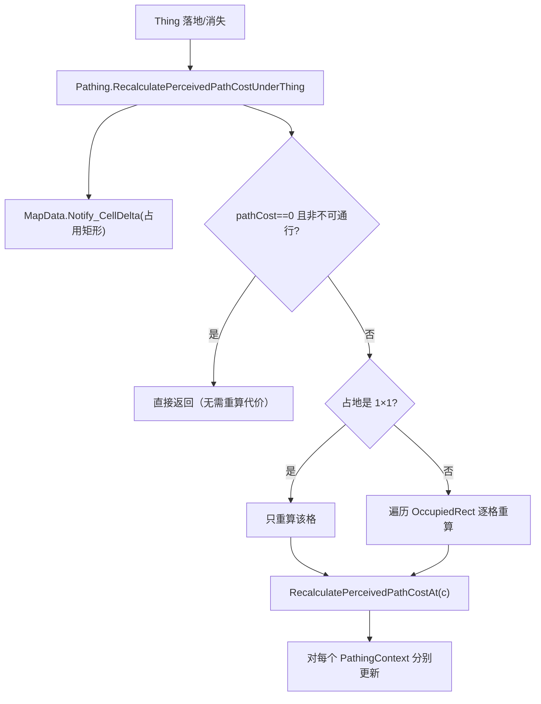
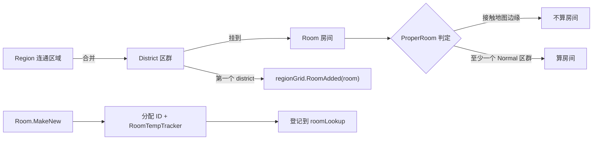

# V19 空间构建：代价传播与房间围合

卷号：V19（新增卷，原 V03-OQ03 / V03-OQ05）
状态：初稿（R18）
上游：V03（网格与寻路）、V04（Thing 生命周期）；下游：V13（房间对心情的影响）、V17（房间渲染）

## Scope

本卷处理 V03 遗留的两处**空间构建**深水区：

1. **感知路径代价的传播范围**——物体落地时，代价究竟被重算了多少格；
2. **房间（`Room`）如何被围合出来**——从 `Region` 到 `District` 再到 `Room` 的判定链，以及「什么算真正的房间」。

不覆盖：寻路算法本体（V03）、温度/美观的房间数值（V13）、房间的渲染裁剪（V17）。

## Key types

| 类型 | Token | 语料路径 | 角色 |
|---|---|---|---|
| `Verse.AI.Pathing` | — | `Assembly-CSharp/Verse/AI/Pathing.cs` | 感知路径代价维护（**注意在 `Verse.AI`**） |
| `Verse.PathFinderMapData` | 0x02000367 | `Assembly-CSharp/Verse/PathFinderMapData.cs` | 寻路网格快照，接收 cell delta |
| `Verse.PathingContext` | — | `Assembly-CSharp/Verse/AI/PathingContext.cs` | 按 `PathGridDef` 分层的代价上下文 |
| `Verse.Region` | 0x020002F5 | `Assembly-CSharp/Verse/Region.cs` | 连通区域 |
| `Verse.District` | 0x020002EB | `Assembly-CSharp/Verse/District.cs` | 区域合并块（**房间的宿主**） |
| `Verse.Room` | 0x02000306 | `Assembly-CSharp/Verse/Room.cs` | 房间（区群集合 + 温度追踪器） |
| `Verse.RegionAndRoomUpdater` | — | `Assembly-CSharp/Verse/RegionAndRoomUpdater.cs` | 区域/房间重建的调度者 |

## Control flow

### 1. 代价重算的传播范围（原 V03-OQ03）

**结论：传播不外扩。** 重算范围严格等于物体占用的格（1×1 时就是那一格），不波及相邻格或对角线；唯一的全局动作是把占用矩形作为 `Notify_CellDelta` 告知寻路器数据层。所以「在窄道中间放个箱子」不会让周围一圈的代价都变，而是窄道那几格自己变成高代价。

### 2. 房间围合（原 V03-OQ05）

关键点：

- **房间不是几何射线围出来的**，而是「区域合并成区群 → 区群挂到房间」的结果；`Region.Room` 只是转发 `district.Room`；
- `Room.MakeNew(map)` 负责分配 ID、建 `RoomTempTracker`、登记进 `regionAndRoomUpdater.roomLookup`；
- `Room.AddDistrict` 在**第一个**区群加入时才调 `regionGrid.RoomAdded`，说明房间的注册时机是「从无到有」那一刻；
- `ProperRoom` 的判据是**两个否/是条件**：碰到地图边缘 → 不是房间；至少要有一个 `RegionType.Normal` 的区群 → 是房间。

因此「封闭房间」的本质是：**它的区群没有触达地图边缘**。这比想象中朴素，也解释了为什么拆掉一格墙就可能让整个房间失去温度模拟。

## Constants

| 项 | 值 / 规则 | 位置 |
|---|---|---|
| 代价重算范围 | 物体 `OccupiedRect`（1×1 即单格） | `Pathing.RecalculatePerceivedPathCostUnderThing` |
| 早退条件 | `pathCost == 0` 且 非 `Impassable` | 同上 |
| 房间注册时机 | 第一个 district 加入时 | `Room.AddDistrict` |
| 「真房间」判据 | 不触地图边缘 + 至少一个 `RegionType.Normal` 区群 | `Room.ProperRoom` |
| 房间热度追踪 | 每房间一个 `RoomTempTracker` | `Room.MakeNew` |

## Claims

[claim:V19-C01] 物体落地先向寻路数据层通报占用矩形（cell delta）。
  src: Verse.AI.Pathing.RecalculatePerceivedPathCostUnderThing
  file: analysis/decompiled/Assembly-CSharp/Verse/AI/Pathing.cs
  match: this.map.pathFinder.MapData.Notify_CellDelta(thing.OccupiedRect());

[claim:V19-C02] 只有 1×1 的物体走单格快路径，多格物体逐格遍历。
  src: Verse.AI.Pathing.RecalculatePerceivedPathCostUnderThing
  file: analysis/decompiled/Assembly-CSharp/Verse/AI/Pathing.cs
  match: if (thing.def.size == IntVec2.One)

[claim:V19-C03] 单格重算会对每个 `PathingContext` 分别更新代价。
  src: Verse.AI.Pathing.RecalculatePerceivedPathCostAt
  file: analysis/decompiled/Assembly-CSharp/Verse/AI/Pathing.cs
  match: foreach (KeyValuePair<PathGridDef, PathingContext> keyValuePair in this.contexts)

[claim:V19-C04] 房间归属在区群层：`Region.Room` 只是转发 `District.Room`。
  src: Verse.Region.Room
  file: analysis/decompiled/Assembly-CSharp/Verse/Region.cs
  match: return district.Room;

[claim:V19-C05] 房间由 `Room.MakeNew` 创建并登记到 map 的 roomLookup。
  src: Verse.Room.MakeNew
  file: analysis/decompiled/Assembly-CSharp/Verse/Room.cs
  match: public static Room MakeNew(Map map)

[claim:V19-C06] 房间在第一个区群加入时才向区域网格登记。
  src: Verse.Room.AddDistrict
  file: analysis/decompiled/Assembly-CSharp/Verse/Room.cs
  match: this.Map.regionGrid.RoomAdded(this);

[claim:V19-C07] 触到地图边缘的区群会让房间失去「真房间」资格。
  src: Verse.Room.ProperRoom
  file: analysis/decompiled/Assembly-CSharp/Verse/Room.cs
  match: if (this.TouchesMapEdge)

## Resolved questions

R23 解出原 `Open questions` 第 2、4 条：

- **多层代价由 Def 声明语义（OQ2）**：`PathGridDef` 只是 Def，带 `workerType = typeof(PathGrid)`（用哪个网格实现）、`fencePassable`（围栏是否可穿）、`flying`（是否飞行层）。`PathingContext` 则持有 `Map` + 一个 `PathGrid` 实例。所以「普通/水道/飞行」不是三种代码分支，而是**同一套 `PathGrid` 实现 + 三份不同的 Def 通行语义**。
- **房间衍生标记（OQ4）**：`IsHuge` 是**阈值判定**（`RegionCount > 60`）；`IsPrisonCell` 是**缓存字段**（在房间更新时算好，读取时直接返回）。两者启发式不同：一个是即时计算，一个是惰性维护。

[claim:V19-C08] 路径网格层用 Def 声明通行语义（围栏可穿）。
  src: RimWorld.PathGridDef.fencePassable
  file: analysis/decompiled/Assembly-CSharp/Verse/PathGridDef.cs
  match: public bool fencePassable;

[claim:V19-C09] 飞行层同样只是 Def 上的一个标记，而非独立代码路径。
  src: RimWorld.PathGridDef.flying
  file: analysis/decompiled/Assembly-CSharp/Verse/PathGridDef.cs
  match: public bool flying;

[claim:V19-C10] 「巨大房间」用区群数量阈值判定。
  src: Verse.Room.IsHuge
  file: analysis/decompiled/Assembly-CSharp/Verse/Room.cs
  match: return this.RegionCount > 60;

[claim:V19-C11] 「牢房」是缓存字段，读取时不再计算。
  src: Verse.Room.IsPrisonCell
  file: analysis/decompiled/Assembly-CSharp/Verse/Room.cs
  match: return this.isPrisonCell;

### 重建粒度与房间数值（原 OQ1、OQ3）

- **重建有两个入口（OQ1）**：`RegionAndRoomUpdater` 提供 `RebuildAllRegionsAndRooms()`（全量）与 `TryRebuildDirtyRegionsAndRooms()`（脏区增量），并用 `AnythingToRebuild` 对外告知是否有待办、`Enabled` 做总闸。也就是说「改动一格」默认走增量，只有结构性变化才全量重建。
- **房间数值是惰性缓存（OQ3）**：`Room.GetStat(RoomStatDef)` 会先 `UpdateRoomStatsAndRole()`，无区域时直接返回 `roomStat.roomlessScore`（空房间基线），否则读 `stats[roomStat]` 这张 `DefMap`。所以房间的感染率/美观/空间不是逐帧算，而是**脏时重算 + 读取缓存**。

[claim:V19-C12] 区域/房间重建有全量与增量两条路径。
  src: Verse.RegionAndRoomUpdater.TryRebuildDirtyRegionsAndRooms
  file: analysis/decompiled/Assembly-CSharp/Verse/RegionAndRoomUpdater.cs
  match: public void TryRebuildDirtyRegionsAndRooms()

[claim:V19-C13] 房间数值按 Def 缓存在 DefMap 中，读取前会触发一次惰性重算。
  src: Verse.Room.GetStat
  file: analysis/decompiled/Assembly-CSharp/Verse/Room.cs
  match: public float GetStat(RoomStatDef roomStat)

[claim:V19-C14] 无区域的房间使用 `roomlessScore` 作为基线。
  src: Verse.Room.GetStat
  file: analysis/decompiled/Assembly-CSharp/Verse/Room.cs
  match: return roomStat.roomlessScore;

## Open questions

1. `RegionAndRoomUpdater` 的重建触发粒度（哪些事件会触发整片重建、哪些走增量）未解构。
2. `PathingContext` 的多层 `PathGridDef`（普通/水道/空中？）各自代价公式未展开。
3. `Room` 的 `RoomStat`（感染率、美观、空间）如何由区群与家具聚合，属 V13 数据面。
4. `ProperRoom` 之外还有 `IsPrisonCell` / `IsHuge` 等衍生标记，其判定未读。
