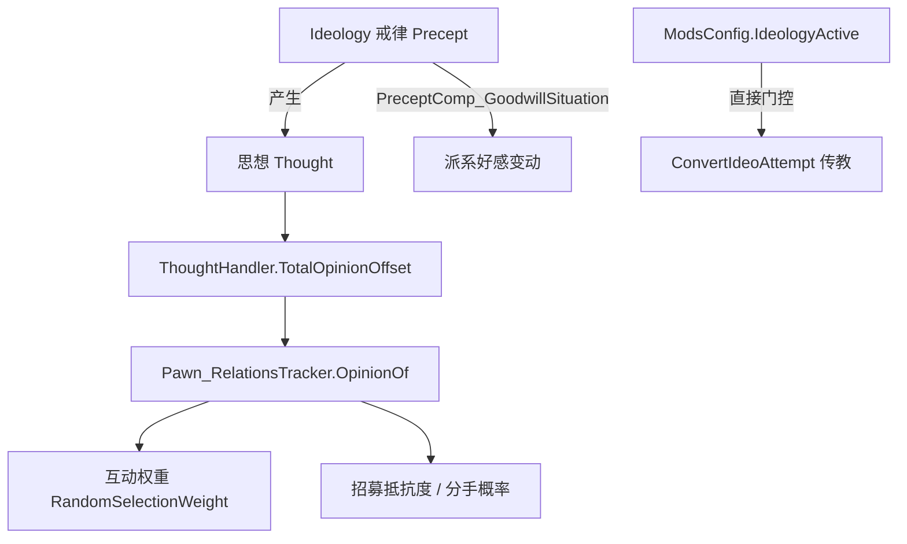

# V20 Ideology 对社会规则的改写

卷号：V20（新增卷，原 V11-OQ05）
状态：初稿（R18）
上游：V11（派系/社交）、V13（思想与心情）、V18（DLC 门控）；下游：无

## Scope

本卷回答一个具体问题：**Ideology 是怎么改写社交行为的**？答案不是「给互动权重加系数」，而是三条性质不同的通路：直接门控的传教互动、经由思想系统的间接影响、以及派系层的观感修正。

不覆盖：戒律（`PreceptDef`）的数据面、仪式流程（V18）、理念生成的完整算法。

## Key types

| 类型 | Token | 语料路径 | 角色 |
|---|---|---|---|
| `RimWorld.InteractionWorker_ConvertIdeoAttempt` | 0x02001516 | `Assembly-CSharp/RimWorld/InteractionWorker_ConvertIdeoAttempt.cs` | 唯一被 Ideology **直接门控**的互动 |
| `RimWorld.InteractionWorker_RomanceAttempt` | 0x02001523 | 同名文件 | 恋爱（权重依赖意见） |
| `RimWorld.InteractionWorker_MarriageProposal` | 0x0200151E | 同名文件 | 求婚（权重依赖意见） |
| `RimWorld.InteractionWorker_Breakup` | — | 同名文件 | 分手（权重反向依赖意见） |
| `RimWorld.InteractionWorker_RecruitAttempt` | 0x02001521 | 同名文件 | 招募（抵抗度依赖意见） |
| `RimWorld.ThoughtHandler` | 0x020015CF | `Assembly-CSharp/RimWorld/ThoughtHandler.cs` | 思想总偏移（意见的来源） |
| `RimWorld.Pawn_RelationsTracker` | 0x020015CA | `Assembly-CSharp/RimWorld/Pawn_RelationsTracker.cs` | 意见合成（V11 已解构） |
| `Verse.ModsConfig` | — | `Assembly-CSharp/Verse/ModsConfig.cs` | `IdeologyActive` 总开关 |

## Control flow

三条通路的分工：

| 通路 | 机制 | 例子 |
|---|---|---|
| **直接门控** | `InteractionWorker` 内判 `ModsConfig.IdeologyActive` | `ConvertIdeoAttempt`（传教） |
| **间接（主导）** | 戒律 → 思想 → 意见 → 互动权重/抵抗度 | 恋爱、求婚、分手、招募 |
| **派系层** | 戒律影响好感变动 | `PreceptComp_GoodwillSituation` |

因此「Ideology 改了社交权重」这句话在实现上是：**它改的是思想，思想改了意见，意见改了权重** —— 中间隔了两层，而不是在 `RandomSelectionWeight` 里查戒律。

## Constants

| 项 | 值 / 规则 | 位置 |
|---|---|---|
| 传教互动的门控 | `ModsConfig.IdeologyActive` | `InteractionWorker_ConvertIdeoAttempt` |
| 恋爱权重因子 | 意见（`OpinionOf`）参与 | `InteractionWorker_RomanceAttempt` |
| 分手权重因子 | `InverseLerp(100, -100, 意见)`（意见越高越不易分手） | `InteractionWorker_Breakup` |
| 招募抵抗度 | 以意见查曲线 | `InteractionWorker_RecruitAttempt` |
| 戒律→好感 | `PreceptComp_GoodwillSituation` | Ideology 数据面 |

## Claims

[claim:V20-C01] 传教互动是 Ideology 直接门控的：未启用即整段跳过。
  src: RimWorld.InteractionWorker_ConvertIdeoAttempt
  file: analysis/decompiled/Assembly-CSharp/RimWorld/InteractionWorker_ConvertIdeoAttempt.cs
  match: if (!ModsConfig.IdeologyActive)

[claim:V20-C02] 恋爱权重以「发起者对接受者的意见」为输入。
  src: RimWorld.InteractionWorker_RomanceAttempt.RandomSelectionWeight
  file: analysis/decompiled/Assembly-CSharp/RimWorld/InteractionWorker_RomanceAttempt.cs
  match: int num3 = initiator.relations.OpinionOf(recipient);

[claim:V20-C03] 分手权重把意见反向映射（意见越高，分手概率越低）。
  src: RimWorld.InteractionWorker_Breakup
  file: analysis/decompiled/Assembly-CSharp/RimWorld/InteractionWorker_Breakup.cs
  match: float num = Mathf.InverseLerp(100f, -100f, (float)initiator.relations.OpinionOf(recipient));

[claim:V20-C04] 意见本身由社交思想总和参与构成，这是 Ideology 影响社交的中转站。
  src: RimWorld.Pawn_RelationsTracker.OpinionOf
  file: analysis/decompiled/Assembly-CSharp/RimWorld/Pawn_RelationsTracker.cs
  match: num += this.pawn.needs.mood.thoughts.TotalOpinionOffset(other);

## Resolved questions

R23 解出原 `Open questions` 第 1 条（`PreceptComp_GoodwillSituation` 的公式位置）：

- 该组件**只持有一个 Def 引用**：`public GoodwillSituationDef goodwillSituation;`。修正逻辑不在组件里，而在 `GoodwillSituationDef` + `GoodwillSituationManager` 一侧 —— 也就是说 Ideology 的「戒律改好感」是**数据驱动**（Def 声明情境，manager 求值），组件本身只是挂载点。

[claim:V20-C05] 好感情境组件是纯数据挂载，不含计算逻辑。
  src: RimWorld.PreceptComp_GoodwillSituation
  file: analysis/decompiled/Assembly-CSharp/RimWorld/PreceptComp_GoodwillSituation.cs
  match: public GoodwillSituationDef goodwillSituation;

### 「意见 → 权重」的映射形状（原 OQ3）

不是 `SimpleCurve` 取点，而是**分段线性 `Mathf.InverseLerp`**，且是双向两次映射：

- 发起者意见 → 发起意愿：`InverseLerp(num2, 100f, opinion)`（`num2` 为下限门槛）；
- 接受者意见 → 接受意愿：`InverseLerp(100f, 0f, opinion)` / `InverseLerp(5f, 100f, opinion)` 两处不同区间；
- 另有 `InverseLerp(0.15f, 1f, num)` 把某个 0..1 量拉伸到可用区间，以及基因缺失项 `missingGeneRomanceChanceFactor` 的乘性修正。

所以「意见越高越容易」是线性插值而非曲线拟合；且**发起方与接受方用不同的映射区间** —— 高好感对「愿不愿意发起」和「愿不愿意接受」的边际效用不同。

[claim:V20-C06] 恋爱权重把意见线性映射到概率区间，而非用曲线取点。
  src: RimWorld.InteractionWorker_RomanceAttempt.RandomSelectionWeight
  file: analysis/decompiled/Assembly-CSharp/RimWorld/InteractionWorker_RomanceAttempt.cs
  match: float num8 = Mathf.InverseLerp(num2, 100f, (float)num3);

[claim:V20-C07] 接受侧另有一套反向映射（意见越高越易接受）。
  src: RimWorld.InteractionWorker_RomanceAttempt
  file: analysis/decompiled/Assembly-CSharp/RimWorld/InteractionWorker_RomanceAttempt.cs
  match: num *= Mathf.InverseLerp(100f, 0f, (float)recipient.relations.OpinionOf(pawn));

### 拒绝行为与基因因子（原 OQ2、OQ4）

- **`UnwillingToDo` 不直接改社交权重（OQ2）**：它的钩子是 `MemberWillingToDo(HistoryEvent ev)` —— 判定「成员是否愿意做某件被记为历史事件的事」。社交影响是**间接**的：拒绝行为生成历史事件 → 触发相应的思想/观感，再经意见进入互动权重。所以戒律对社交的作用路径仍是 V20 的三通路之一，而不是新增第四条。
- **基因因子是「逐 Def」而不是「逐 xenotype」（OQ4）**：恋爱权重里出现的是 `genesListForReading[i].def.missingGeneRomanceChanceFactor` —— 按**具体基因 Def** 乘修正；同种异种类型（xenotype）之间的差异来自各自携带的基因集合，而不是 xenotype 层的统一系数。

[claim:V20-C08] 拒绝类戒律挂在「成员是否愿意做某事」的历史事件钩子上。
  src: RimWorld.PreceptComp_UnwillingToDo.MemberWillingToDo
  file: analysis/decompiled/Assembly-CSharp/RimWorld/PreceptComp_UnwillingToDo.cs
  match: public override bool MemberWillingToDo(HistoryEvent ev)

[claim:V20-C09] 基因对社交权重的影响是逐基因 Def 的乘性因子。
  src: RimWorld.InteractionWorker_RomanceAttempt
  file: analysis/decompiled/Assembly-CSharp/RimWorld/InteractionWorker_RomanceAttempt.cs
  match: float num3 = genesListForReading[i].def.missingGeneRomanceChanceFactor;

## Open questions

1. `PreceptComp_GoodwillSituation` 的具体修正公式未展开（戒律如何映射成好感增量）。
2. `PreceptComp_UnwillingToDo*`（拒绝工作）对社交的连带影响未评估。
3. 「意见 → 权重」的曲线形状（各 `InteractionWorker` 的 `SimpleCurve` 控制点）未逐条取点。
4. 异种类型（Biotech）与 Ideology 的交叉影响（同一互动在不同 xenotype 间的权重差）未验证。
