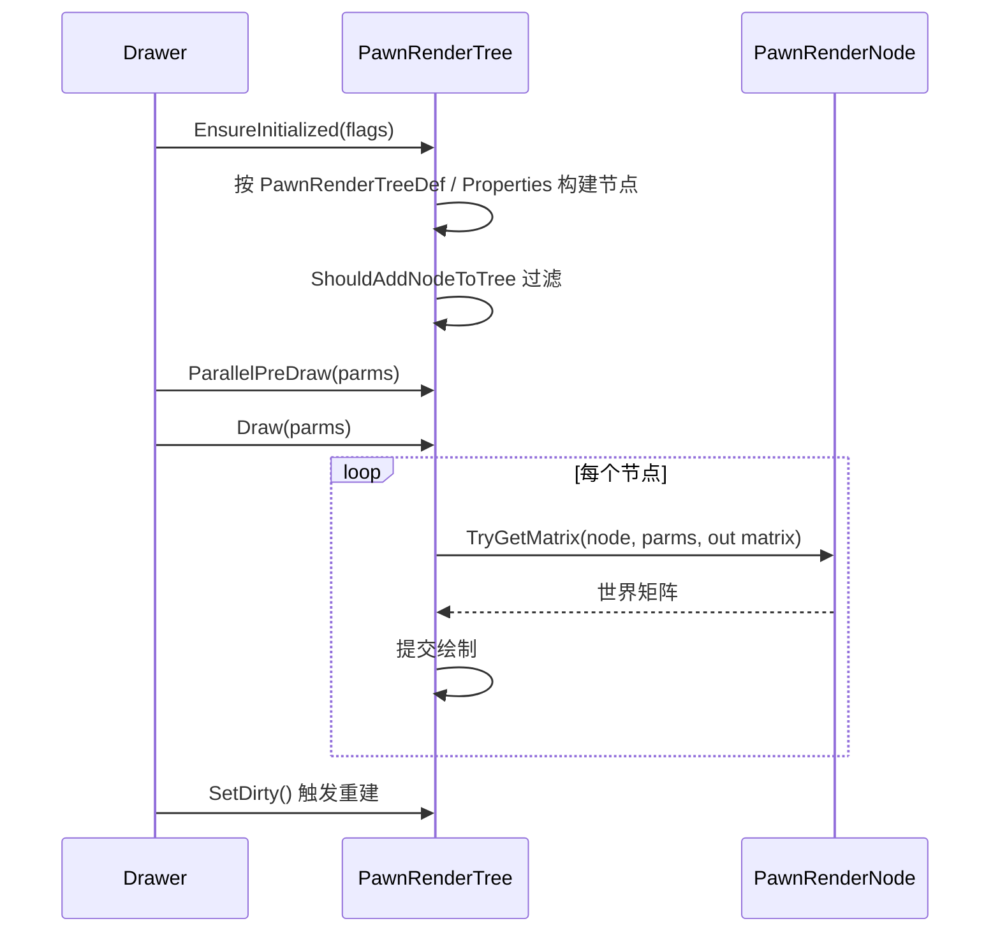

# V21 渲染树与绘制管线

卷号：V21（新增卷，原 V17-OQ03）
状态：初稿（R18）
上游：V17（UI/渲染入口）、V18（DLC 节点扩展）；下游：无

## Scope

本卷解构 **`PawnRenderTree`**：Pawn 的绘制不再是「一张贴图 + 偏移」，而是**节点树**——每个可绘元素（身体、头、头发、衣服、武器、被携带物…）是一个节点，由数据（`PawnRenderNodeProperties`）驱动构建，逐帧求矩阵后提交绘制。

不覆盖：具体贴图与着色器、`Waylith` 引擎侧的绘制实现（语料不完整）、UI 控件。

## Key types

| 类型 | Token | 语料路径 | 角色 |
|---|---|---|---|
| `Verse.PawnRenderTree` | 0x02000392 | `Assembly-CSharp/Verse/PawnRenderTree.cs` | 节点树本体（643 行） |
| `Verse.PawnRenderNode` | — | `Assembly-CSharp/Verse/PawnRenderNode.cs` | 节点基类（持有属性与变换） |
| `Verse.PawnRenderNodeProperties` | — | `Assembly-CSharp/Verse/PawnRenderNodeProperties.cs` | 节点配置（数据驱动） |
| `Verse.PawnRenderNodeTagDef` | — | `Assembly-CSharp/Verse/PawnRenderNodeTagDef.cs` | 节点标签（按标签定位节点） |
| `Verse.PawnDrawParms` | — | `Assembly-CSharp/Verse/PawnDrawParms.cs` | 单次绘制参数（位置/朝向/旗标） |
| `Verse.PawnRenderFlags` | — | `Assembly-CSharp/Verse/PawnRenderFlags.cs` | 绘制旗标（初始化/可见性等） |

节点配置的派生类型说明了树的构成方式：`PawnRenderNodeProperties_Carried`、`_Overlay`、`_Parent`、`_Eye`、`_Swaddle`、`_Spastic`、`_BulbfreakTentacle`、`_NociosphereSegment`… —— 即**每种可绘结构都是一个 Properties 子类**，而非硬编码分支。

## Control flow

四条要点：

1. **构建是懒初始化 + 变脏重建**：`EnsureInitialized(PawnRenderFlags)` 首次构建；外观变化（换装、加假肢、基因表达）走 `SetDirty()` 标记，下次绘制前重建；
2. **过滤在构建期**：`ShouldAddNodeToTree(props)` 决定某类节点是否加入（例如未装备武器就不建武器节点、缺少某部位就不建该部位节点）；
3. **定位靠标签**：`TryGetNodeByTag(tag, out node)` / `SetTagNode(tag, node)` 让动画、瞄准、携带物等子系统按标签取节点，而不是按树位置遍历；
4. **矩阵是逐节点求的**：`TryGetMatrix(node, parms, out Matrix4x4)` 结合 `GetRootTPRS`（位置/支点/旋转/缩放）产出最终变换，`TryGetAnimationPartForNode` 再叠加动画部件。

## Constants

| 项 | 值 / 规则 | 位置 |
|---|---|---|
| 构建时机 | `EnsureInitialized`（懒初始化） | `PawnRenderTree` |
| 重建触发 | `SetDirty()` | 同上 |
| 节点过滤 | `ShouldAddNodeToTree(props)` | 同上 |
| 节点定位 | 按 `PawnRenderNodeTagDef` 标签 | `TryGetNodeByTag` / `SetTagNode` |
| 变换求解 | 逐节点 `TryGetMatrix` + `GetRootTPRS` | 同上 |
| 预绘制 | `ParallelPreDraw(parms)` | 同上 |

## Claims

[claim:V21-C01] 渲染树是懒初始化的：首帧按绘制旗标构建。
  src: Verse.PawnRenderTree.EnsureInitialized
  file: analysis/decompiled/Assembly-CSharp/Verse/PawnRenderTree.cs
  match: public void EnsureInitialized(PawnRenderFlags defaultRenderFlagsNow)

[claim:V21-C02] 每次绘制接受一套绘制参数，而不是直接读全局状态。
  src: Verse.PawnRenderTree.Draw
  file: analysis/decompiled/Assembly-CSharp/Verse/PawnRenderTree.cs
  match: public void Draw(PawnDrawParms parms)

[claim:V21-C03] 变换按节点逐个求解（输出世界矩阵）。
  src: Verse.PawnRenderTree.TryGetMatrix
  file: analysis/decompiled/Assembly-CSharp/Verse/PawnRenderTree.cs
  match: public bool TryGetMatrix(PawnRenderNode node, PawnDrawParms parms, out Matrix4x4 matrix)

[claim:V21-C04] 节点是否加入树由属性判定，说明树是数据驱动构建的。
  src: Verse.PawnRenderTree.ShouldAddNodeToTree
  file: analysis/decompiled/Assembly-CSharp/Verse/PawnRenderTree.cs
  match: public bool ShouldAddNodeToTree(PawnRenderNodeProperties props)

[claim:V21-C05] 外观变化通过脏标记触发重建，避免逐帧重建。
  src: Verse.PawnRenderTree.SetDirty
  file: analysis/decompiled/Assembly-CSharp/Verse/PawnRenderTree.cs
  match: public void SetDirty()

[claim:V21-C06] 节点可按标签查找，供动画/装备等子系统定位。
  src: Verse.PawnRenderTree.TryGetNodeByTag
  file: analysis/decompiled/Assembly-CSharp/Verse/PawnRenderTree.cs
  match: public bool TryGetNodeByTag(PawnRenderNodeTagDef tag, out PawnRenderNode node)

## Resolved questions

R23 解出原 `Open questions` 第 1 条（`PawnRenderTreeDef` 的布局数据）：

- 树在 Def 里就是**单根**：`public PawnRenderNodeProperties root;`。也就是说整棵渲染树是一个 `PawnRenderNodeProperties` 实例的嵌套树（子节点挂在 Properties 的 children 上），`ResolveReferences` 负责把引用接好。所以「Def 面」与「运行时节点」是同构的：Def 描述形状，运行时按形状建节点。

[claim:V21-C07] 渲染树在 Def 层是单根嵌套结构。
  src: Verse.PawnRenderTreeDef.root
  file: analysis/decompiled/Assembly-CSharp/Verse/PawnRenderTreeDef.cs
  match: public PawnRenderNodeProperties root;

### DLC 新增节点清单（原 OQ4）

全语料里 `PawnRenderNodeProperties*` 只有 **11 个文件**（1 个基类 + 10 个具名子类）：

`Carried`、`Overlay`、`Parent`、`Eye`、`Swaddle`、`Spastic`、`Tattoo`、`BulbfreakTentacle`、`NociosphereSegment`、`NociosphereSegmentOutline`。

其中 `Tattoo`/`Overlay` 对应 Ideology，`BulbfreakTentacle`/`NociosphereSegment*` 对应 Anomaly，`Swaddle` 对应 Biotech 婴儿。这说明 DLC 对渲染树的扩展是**逐个具名节点**，而不是「开放插件式」—— 新外观要加节点就得改代码并新增子类。

[claim:V21-C08] 渲染节点扩展是具名子类（示例：纹身节点）。
  src: Verse.PawnRenderNodeProperties_Tattoo
  file: analysis/decompiled/Assembly-CSharp/Verse/PawnRenderNodeProperties_Tattoo.cs
  match: public class PawnRenderNodeProperties_Tattoo

### 预绘制与动画合成（原 OQ2、OQ3）

- **`ParallelPreDraw` 不是多线程（OQ2，修正性结论）**：名字里的 "Parallel" 指「与网格/材质上传并行的准备阶段」，实现是**单线程顺序**——先按需重建（`ShouldRecache` 或 `RecacheRequested` 命中时清空 `drawRequests` 并让根节点 `AppendRequests` 重新收集），再线性遍历 `drawRequests` 逐个求矩阵。没有 `Parallel.For` 也没有作业分派。
- **动画与矩阵是两段合成（OQ3）**：`TryGetAnimationPartForNode(node)` 用 `node.Props.tagDef` 在当前动画里查部件（`currentAnimation.TryGetPartForNodeTag`），矩阵则由 `TryGetMatrix(node, parms)` 单独求。顺序是「按标签取动画部件 → 与节点矩阵合成 → 提交绘制」，两者解耦，因此同一节点可以只换动画不换矩阵。

[claim:V21-C09] 预绘制阶段按需重建绘制请求列表，再线性求矩阵。
  src: Verse.PawnRenderTree.ParallelPreDraw
  file: analysis/decompiled/Assembly-CSharp/Verse/PawnRenderTree.cs
  match: this.rootNode.AppendRequests(parms, this.drawRequests);

[claim:V21-C10] 动画部件按节点标签在当前动画中查找，与矩阵求解分离。
  src: Verse.PawnRenderTree.TryGetAnimationPartForNode
  file: analysis/decompiled/Assembly-CSharp/Verse/PawnRenderTree.cs
  match: return this.currentAnimation != null && node.Props.tagDef != null && node.tree.currentAnimation.TryGetPartForNodeTag(node.Props.tagDef, out animationPart);

## Open questions

1. `PawnRenderTreeDef` 的节点布局数据（Def 面）与 `Properties` 的对应关系未逐条展开。
2. `ParallelPreDraw` 的并行度与 `Waylith` 引擎侧配合方式受语料缺失限制（见 `state.md`）。
3. 动画部件（`AnimationPart`）与节点矩阵的合成顺序未细读。
4. DLC（Biotech 异种器官、Anomaly 变异体）新增的节点 Properties 清单未统计。
