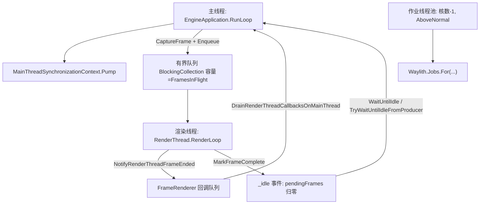
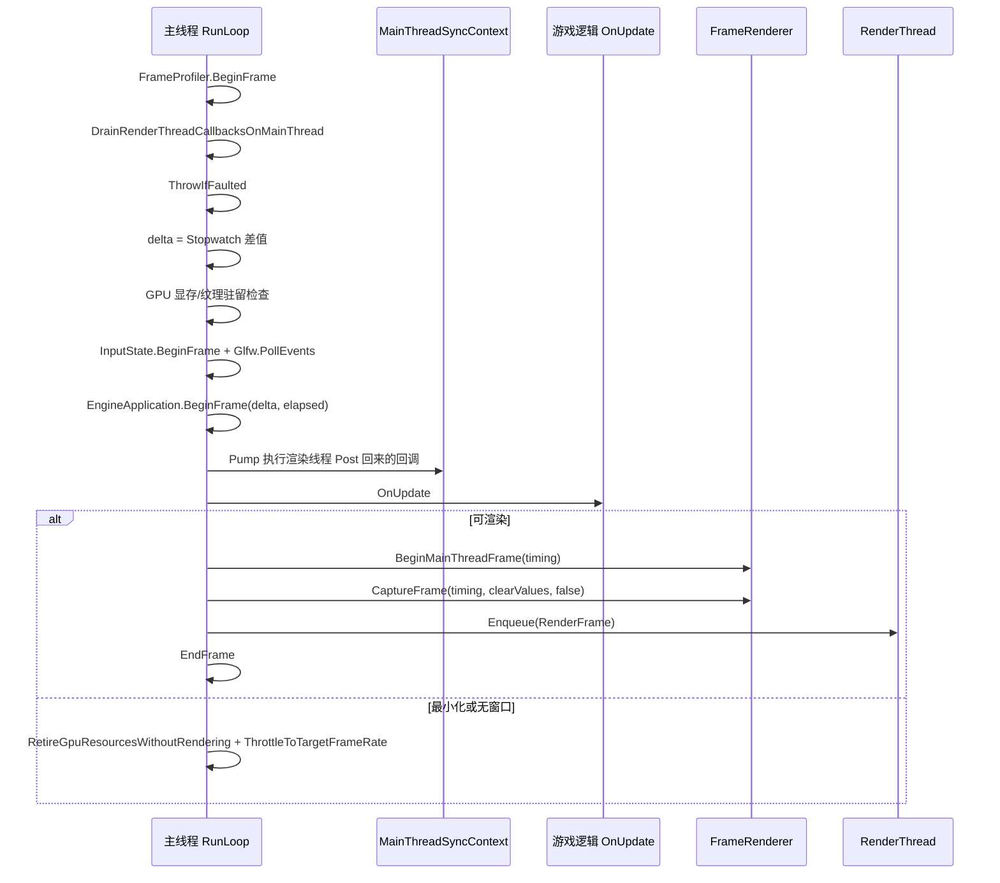
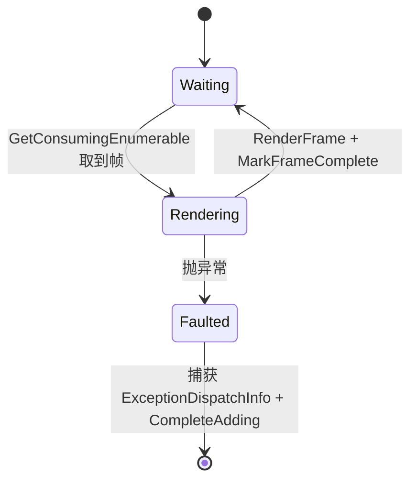

# V22 Waylith 引擎运行模式

卷号：V22（新增卷，R22）
状态：初稿（R22）
上游：V01（tick 泵）、V17（UI/渲染入口）、V03（作业并行度）；下游：无

## Scope

本卷把 `Waylith` 从「游戏逻辑的外部依赖」提升为研究对象，解构**引擎自身的运行模式**：进程如何启动、开了哪些线程、每帧主线程按什么顺序做事、渲染线程如何被喂帧与如何反馈、错误如何跨线程传播、以及背压如何形成隐式的帧率上限。

前提：`Waylith` 语料在 R19 补全（887/887 类型），本轮所有结论直接来自引擎源码而非桩层推断。

不覆盖：Vulkan 层的具体调用（`GraphicsDevice` 1430 行只取结构）、音频后端实现、字体与着色器编译细节。

## Key types

| 类型 | Token/RID | 语料路径 | 角色 |
|---|---|---|---|
| `Waylith.EngineApplication` | RID 26 | `Waylith/EngineApplication.cs` | 进程级入口与主循环（69 方法） |
| `Waylith.Rendering.RenderThread` | RID — | `Waylith/Rendering/RenderThread.cs` | 渲染线程与有界帧队列 |
| `Waylith.Rendering.FrameRenderer` | — | `Waylith/Rendering/FrameRenderer.cs` | 帧捕获与渲染特性链 |
| `Waylith.MainThreadSynchronizationContext` | RID 31 | `Waylith/MainThreadSynchronizationContext.cs` | 把回调泵回主线程 |
| `Waylith.EngineWindow` | RID 28 | `Waylith/EngineWindow.cs` | GLFW 窗口与静态尺寸状态 |
| `Waylith.Jobs.WaylithJobRuntime` | RID 334 | `Waylith/Jobs/WaylithJobRuntime.cs` | 作业线程池（核数 − 1） |
| `Waylith.Time` | RID 36 | `Waylith/Time.cs` | 帧时间与帧计数 |
| `Waylith.Diagnostics.ProcessLifetime` | — | `Waylith/Diagnostics/ProcessLifetime.cs` | 进程生命周期与崩溃处理 |

## Control flow

### 1. 线程拓扑



三条自建线程 + 一条外部线程：主线程（逻辑与帧捕获）、渲染线程、作业线程池；GLFW 的事件轮询仍在主线程（`Glfw.PollEvents()`）。

### 2. 单帧时序（主线程）



关键顺序：**先 Pump 回调、再跑游戏更新、最后才捕获并投递帧**。所以渲染线程上一帧的回调会在下一帧逻辑之前生效，而游戏更新永远在帧捕获之前完成 —— 这就是「逻辑不会看到半帧状态」的保证。

### 3. 渲染线程的消费者循环



- 队列是 `BlockingCollection<RenderFrame>`，**容量 = `FramesInFlight`**；
- 每个帧处理完在 `finally` 里 `NotifyRenderThreadFrameEnded` + （未被保留则）`Dispose` + `MarkFrameComplete`；
- 渲染线程异常不直接崩进程：`ExceptionDispatchInfo.Capture` 存到 `_failure`，随后下一次主线程的 `Enqueue`/`ThrowIfFaulted` 把它抛到主线程 —— **错误跨线程回传**。

### 4. 背压与帧率

`MarkFramePending` / `MarkFrameComplete` 维护 `_pendingFrames` 计数，并驱动 `ManualResetEventSlim _idle`（初始已置位）：

```text
MarkFramePending:  lock { _pendingFrames++; _idle.Reset(); }
MarkFrameComplete: lock { _pendingFrames--; if (0) _idle.Set(); }
```

配合容量为 `FramesInFlight` 的有界队列，形成两道天然限制：**队列满时 `Enqueue` 阻塞主线程**（等于 GPU 队列深度），需要等待全部帧完成时用 `WaitUntilIdle()`（仅生产者线程可用 `TryWaitUntilIdleFromProducer`）。此外主线程还有显式的 `ThrottleToTargetFrameRate(elapsed)`。

## Constants

| 项 | 值 / 规则 | 位置 |
|---|---|---|
| 帧队列容量 | `Math.Max(1, renderContext.FramesInFlight)` | `RenderThread..ctor` |
| 空闲事件初值 | 已置位（无待处理帧） | `_idle = new ManualResetEventSlim(true)` |
| 作业线程数 | `Math.Max(1, ProcessorCount - 1)`，`AboveNormal` | `WaylithJobRuntime` |
| 帧 delta 来源 | `Stopwatch.Elapsed` 差值 | `EngineApplication.RunLoop` |
| 帧尾动作 | `Time.FrameCount++` | `Waylith.Time.EndFrame` |
| 帧率限制 | 显式 `ThrottleToTargetFrameRate` | `EngineApplication` |
| 最小化时 | 不捕获帧，改为释放 GPU 资源 + 限速 | `RetireGpuResourcesWithoutRendering` |
| 单实例 | `RestartManager.WaitForPrecedingInstanceExit` | `EngineApplication.Run` |

## Claims

[claim:V22-C01] 进程入口先做单实例握手，再构造引擎应用。
  src: Waylith.EngineApplication.Run
  file: analysis/decompiled/Waylith/EngineApplication.cs
  match: RestartManager.WaitForPrecedingInstanceExit(options.CommandLineAccessor);

[claim:V22-C02] 整个运行期被包在进程生命周期作用域内（异常时仍能清理）。
  src: Waylith.EngineApplication.Run
  file: analysis/decompiled/Waylith/EngineApplication.cs
  match: using (ProcessLifetime.Create(() => app))

[claim:V22-C03] 启动顺序是：构造 → 用户 initialize 回调 → RunLoop。
  src: Waylith.EngineApplication.Run
  file: analysis/decompiled/Waylith/EngineApplication.cs
  match: num = app.RunLoop();

[claim:V22-C04] 主线程在循环开始时安装自定义 SynchronizationContext。
  src: Waylith.EngineApplication.RunLoop
  file: analysis/decompiled/Waylith/EngineApplication.cs
  match: this._mainThreadSyncContext = new MainThreadSynchronizationContext(Environment.CurrentManagedThreadId);

[claim:V22-C05] 每帧先泵一次主线程回调队列，再跑游戏更新。
  src: Waylith.EngineApplication.RunLoop
  file: analysis/decompiled/Waylith/EngineApplication.cs
  match: mainThreadSyncContext.Pump();

[claim:V22-C06] 游戏更新是通过 `OnUpdate` 委托注入的，引擎不依赖具体游戏类型。
  src: Waylith.EngineApplication.RunLoop
  file: analysis/decompiled/Waylith/EngineApplication.cs
  match: onUpdate();

[claim:V22-C07] 帧由主线程捕获后投递给渲染线程，而不是主线程直接提交。
  src: Waylith.EngineApplication.RunLoop
  file: analysis/decompiled/Waylith/EngineApplication.cs
  match: renderFrame = this.FrameRenderer.CaptureFrame(in frameTiming, this._clearValues, false);

[claim:V22-C08] 投递动作即入队（异步）。
  src: Waylith.EngineApplication.RunLoop
  file: analysis/decompiled/Waylith/EngineApplication.cs
  match: this._renderThread.Enqueue(renderFrame);

[claim:V22-C09] 不可渲染时（最小化）不是空转，而是释放 GPU 资源并按目标帧率限速。
  src: Waylith.EngineApplication.RunLoop
  file: analysis/decompiled/Waylith/EngineApplication.cs
  match: this.RetireGpuResourcesWithoutRendering();

[claim:V22-C10] 帧队列是有界阻塞集合，容量等于飞行中帧数。
  src: Waylith.Rendering.RenderThread..ctor
  file: analysis/decompiled/Waylith/Rendering/RenderThread.cs
  match: this._frames = new BlockingCollection<RenderFrame>(Math.Max(1, renderContext.FramesInFlight));

[claim:V22-C11] 渲染线程用消费循环取帧，天然序列化渲染。
  src: Waylith.Rendering.RenderThread.RenderLoop
  file: analysis/decompiled/Waylith/Rendering/RenderThread.cs
  match: foreach (RenderFrame renderFrame in this._frames.GetConsumingEnumerable())

[claim:V22-C12] 渲染线程的异常被捕获后跨线程回传到主线程。
  src: Waylith.Rendering.RenderThread.RenderLoop
  file: analysis/decompiled/Waylith/Rendering/RenderThread.cs
  match: this._failure = ExceptionDispatchInfo.Capture(ex);

[claim:V22-C13] 故障时停止接收新帧，避免主线程继续投递。
  src: Waylith.Rendering.RenderThread.RenderLoop
  file: analysis/decompiled/Waylith/Rendering/RenderThread.cs
  match: this._frames.CompleteAdding();

[claim:V22-C14] 空闲事件用 `ManualResetEventSlim` 表示「没有待处理帧」。
  src: Waylith.Rendering.RenderThread
  file: analysis/decompiled/Waylith/Rendering/RenderThread.cs
  match: private readonly ManualResetEventSlim _idle = new ManualResetEventSlim(true);

[claim:V22-C15] 投递一帧即复位空闲事件。
  src: Waylith.Rendering.RenderThread.MarkFramePending
  file: analysis/decompiled/Waylith/Rendering/RenderThread.cs
  match: this._idle.Reset();

[claim:V22-C16] 待处理帧归零才重新置位，`WaitUntilIdle` 因此是「全部帧完成」语义。
  src: Waylith.Rendering.RenderThread.MarkFrameComplete
  file: analysis/decompiled/Waylith/Rendering/RenderThread.cs
  match: this._idle.Set();

[claim:V22-C17] 只有生产者线程能安全等待空闲（其余线程的等待语义未定义）。
  src: Waylith.Rendering.RenderThread.IsProducerThread
  file: analysis/decompiled/Waylith/Rendering/RenderThread.cs
  match: return renderThread == null || Environment.CurrentManagedThreadId == renderThread._producerThreadId;

[claim:V22-C18] 活动渲染线程以静态量发布，供跨线程查询。
  src: Waylith.Rendering.RenderThread.Start
  file: analysis/decompiled/Waylith/Rendering/RenderThread.cs
  match: Volatile.Write<RenderThread>(ref RenderThread._active, this);

[claim:V22-C19] 渲染特性是可增删的链式集合，帧捕获由 `CaptureFrame` 统一完成。
  src: Waylith.Rendering.FrameRenderer.CaptureFrame
  file: analysis/decompiled/Waylith/Rendering/FrameRenderer.cs
  match: public RenderFrame CaptureFrame(in FrameTiming timing, NativeList<VkClearValue> clearValues, bool requestRenderContextRebuild)

[claim:V22-C20] 帧时间以值类型 `FrameTiming` 传递，避免共享可变状态。
  src: Waylith.Rendering.FrameRenderer.BeginMainThreadFrame
  file: analysis/decompiled/Waylith/Rendering/FrameRenderer.cs
  match: public void BeginMainThreadFrame(in FrameTiming timing)

## Resolved questions

R23 解出原 `Open questions` 第 2、4、5 条：

- **限速算法（OQ5）是「睡眠 + 忙等」混合**：`ThrottleToTargetFrameRate` 先算剩余预算 `num3 = 1/targetFps - 已用时间`，若 >1 ms 就 `Thread.Sleep((num3 - 0.001)*1000)`，随后用**空转 while** 把最后 1 ms 补足。也就是说帧率上限靠「先睡到接近、再自旋到精确」，属于对延迟敏感的取舍（睡眠精度只有毫秒级）。
- **音频没有自建线程（OQ4）**：`AudioBackend` 是抽象类，`new Thread` 在引擎里只出现在 `WaylithJobRuntime`（作业池）与 `ProfilerWindowAggregator`（诊断窗口）。`SetOutputPaused` 由主线程在检测到失焦时调用，具体播放线程由后端实现决定，不在引擎调度范围内。
- **两条回调路径（OQ2）分工明确**：`RenderToMainThreadDispatcher`（`ConcurrentQueue<Action>` + `Enqueue/Invoke/Clear`）承载「渲染线程随时投递、主线程每帧 `DrainRenderThreadCallbacksOnMainThread` 一次性执行」；`AddNextFrameCallback` 走另一条 CAS 合并的 `_nextFrameEvents` 委托，在**帧边界**执行。前者用于跨线程结果回传，后者用于「下一帧开始时做一次」的钩子。

[claim:V22-C21] 限速先用睡眠逼近目标帧长，再空转补足精度。
  src: Waylith.EngineApplication.ThrottleToTargetFrameRate
  file: analysis/decompiled/Waylith/EngineApplication.cs
  match: Thread.Sleep((int)((num3 - 0.001) * 1000.0));

[claim:V22-C22] 睡眠之后的剩余时间用忙等补齐。
  src: Waylith.EngineApplication.ThrottleToTargetFrameRate
  file: analysis/decompiled/Waylith/EngineApplication.cs
  match: while (this._stopwatch.Elapsed.TotalSeconds - (double)frameStartElapsed < num)

[claim:V22-C23] 音频后端是抽象契约，引擎不为它建线程。
  src: Waylith.Audio.AudioBackend
  file: analysis/decompiled/Waylith/Audio/AudioBackend.cs
  match: public abstract class AudioBackend

[claim:V22-C24] 跨线程回调在主线程每帧被一次性排空。
  src: Waylith.Rendering.FrameRenderer.DrainRenderThreadCallbacksOnMainThread
  file: analysis/decompiled/Waylith/Rendering/FrameRenderer.cs
  match: this.RenderToMainThread.Invoke();

[claim:V22-C25] 该通道是线程安全队列，允许渲染线程随时投递。
  src: Waylith.Rendering.RenderToMainThreadDispatcher
  file: analysis/decompiled/Waylith/Rendering/RenderToMainThreadDispatcher.cs
  match: private readonly ConcurrentQueue<Action> _callbacks = new ConcurrentQueue<Action>();

[claim:V22-C26] 「下一帧回调」是另一条路径，用 CAS 合并委托而非队列。
  src: Waylith.Rendering.FrameRenderer.AddNextFrameCallback
  file: analysis/decompiled/Waylith/Rendering/FrameRenderer.cs
  match: nextFrameEvents = this._nextFrameEvents;

### 交换链与呈现（原 OQ3）

`GraphicsDevice` 只提供**提交入口**，不自己持有交换链：

- `PresentQueue` / `PresentFamilyIndex` 暴露呈现队列与队列族；
- `SubmitGraphicsAndPresent(waitSemaphores, waitStages, commandBuffers, signalSemaphores, fence, Func<VkResult> present)` —— 真正的 `vkQueuePresentKHR` 由调用方以**委托**形式传入。

也就是说「acquire / present」的时序由 `WindowRenderContext` 一侧决定，设备层只负责把图形命令与呈现动作串在同一次提交里。渲染线程与主线程的分工因此能保持：主线程捕获帧，渲染线程提交，交换链逻辑属于 render context。

[claim:V22-C27] 呈现动作以委托注入，设备层不内建交换链时序。
  src: Waylith.Graphics.GraphicsDevice.SubmitGraphicsAndPresent
  file: analysis/decompiled/Waylith/Graphics/GraphicsDevice.cs
  match: Func<VkResult> present)

[claim:V22-C28] 呈现队列与队列族索引由设备层暴露给上层。
  src: Waylith.Graphics.GraphicsDevice.PresentQueue
  file: analysis/decompiled/Waylith/Graphics/GraphicsDevice.cs
  match: public Queue PresentQueue { get; }

## Open questions

1. **`BlockingCollection` 满时的阻塞语义**：容量 = `FramesInFlight` 意味着队列满会阻塞主线程，但队列满的实际触发条件（GPU 提交延迟 vs 队列深度配置）未实测。
2. `FrameRenderer` 的 `RenderToMainThreadDispatcher` 与 `AddNextFrameCallback` 两条回调路径的合并/顺序未细读。
3. `GraphicsDevice`（1430 行）的交换链获取/呈现细节、`VkRenderPass` 复用策略未展开。
4. 音频后端与 `AudioBackend.SetOutputPaused` 的线程归属（是否自建音频线程）未确认。
5. `EngineApplication` 的 `ThrottleToTargetFrameRate` 具体算法（睡眠 / 忙等 / 混合）未读。
