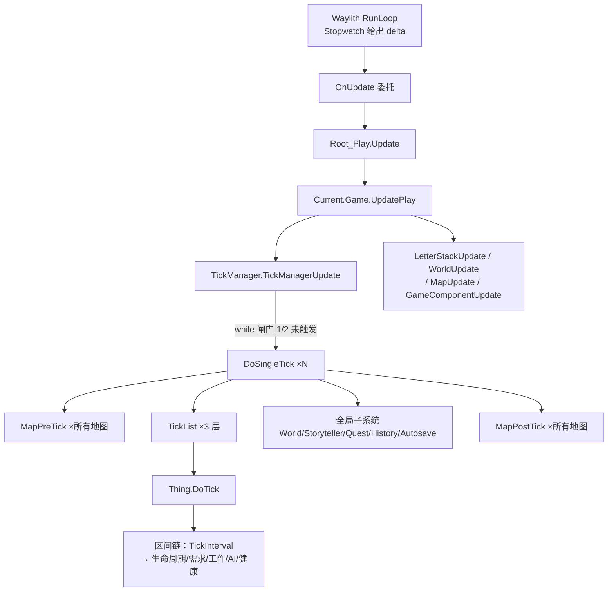
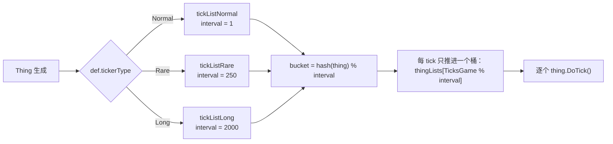

# V23 单 tick 全景：一次 tick 里发生的一切

卷号：V23（新增卷，R25）
状态：初稿（R25）
汇总自：V01（tick 泵）、V02（时间）、V03（区域/寻路）、V04（Thing）、V05（Pawn）、V06（AI）、V09（故事叙述者）、V16（存档）、V19（空间重建）、V22（引擎运行模式）

## Scope

本卷把前面各卷拆开讲过的东西**按一次 tick 的时间顺序重新串一遍**：从引擎交出 `deltaTime`，到某个殖民者决定下一步去搬哪块石头，全部落在同一条调用链上。

读法：先看 §3.1 的三层结构，再看 §3.3 的 18 步有序清单；需要细节时按每步后面的「详见」跳卷。

不覆盖：单步内部算法（各卷已讲），以及需要实际运行才能观察的抖动行为。

## Key types

| 类型 | 角色 | 详见 |
|---|---|---|
| `Waylith.EngineApplication` | 帧源（Stopwatch + 渲染线程） | V22 |
| `Verse.Root_Play` | 场景根，每帧 `Update` | V17 |
| `Verse.Game` | 存档级容器，`UpdatePlay` 为每帧入口 | V16 |
| `Verse.TickManager` | tick 泵：累积、双闸门、顺序调度 | V01 |
| `Verse.TickList` | 三层桶（Normal/Rare/Long）+ 哈希分桶 | V04 |
| `Verse.Map` | `MapPreTick` / `MapPostTick` / `MapUpdate` | V03 |
| `Verse.Thing` | `DoTick` → 区间链 | V04, V05 |
| `RimWorld.Storyteller` | `StorytellerTick`（事件生成） | V09 |

## Control flow

### 3.1 三层结构：帧 / tick / 实体



**关键分界**：`TickManagerUpdate` 之外的调用（`LetterStackUpdate`、`WorldUpdate`、`MapUpdate`、`GameComponentUpdate`、`SignalManagerUpdate`、`GlobalTextureAtlasManagerUpdate`）都是**每帧一次**，不随 tick 数变化；只有 `DoSingleTick` 里的东西才按 tick 推进。

### 3.2 累积器与两道闸门（伪代码）

```text
TickManagerUpdate():
    ticksThisFrame = 0
    if Paused: return
    curTimePerTick = CurTimePerTick                 # 1 / (60 × 倍率)
    if |Time.deltaTime − curTimePerTick| < curTimePerTick × 0.1:
        realTimeToTickThrough += curTimePerTick     # 抖动抑制：用理论值
    else:
        realTimeToTickThrough += Time.deltaTime     # 偏差大：用实测值
    tickRateMultiplier = TickRateMultiplier
    clock.Restart()
    while realTimeToTickThrough > 0 and ticksThisFrame < tickRateMultiplier × 2:
        DoSingleTick()
        realTimeToTickThrough -= curTimePerTick
        ticksThisFrame++
        if Paused or clock.ElapsedMilliseconds > 45.454544: break
    if realTimeToTickThrough > 0: realTimeToTickThrough = 0    # 余量丢弃
```

三道约束同时生效：**倍率×2 的帧内上限**、**45.454544 ms 的单帧预算**、以及退出时的**余量清零**（欠账不跨帧累计，避免追帧雪崩）。

### 3.3 `DoSingleTick` 的 18 步（严格顺序）

```text
DoSingleTick():
 1  for map in Find.Maps: map.MapPreTick()            # 见 §3.4
 2  ticksGameInt++                                    # fastEcology 时 +2000
 3  Shader.SetGlobalFloat(GameSeconds, TicksToSeconds(TicksGame))
 4  tickListNormal.Tick()                             # 见 §3.5
 5  tickListRare.Tick()
 6  tickListLong.Tick()
 7  DateNotifier.DateNotifierTick()                   # 季节/日期回调
 8  Scenario.TickScenario()                           # 剧本部件
 9  World.WorldTick()                                 # 世界对象/远行队
10  StoryWatcher.StoryWatcherTick()                   # 威胁/财富观察
11  GameEnder.GameEndTick()                           # 结局判定
12  Storyteller.StorytellerTick()                     # 事件生成（每 1000 tick）
13  TaleManager.TaleManagerTick()                     # 传说记录
14  QuestManager.QuestManagerTick()                   # 任务推进
15  World.WorldPostTick()                             # 世界后置
16  for map in Find.Maps: map.MapPostTick()           # 见 §3.4
17  History.HistoryTick()                             # 历史统计
18  GameComponentUtility.GameComponentTick()          # 所有 GameComponent
19  LetterStack.LetterStackTick()                     # 信件过期/清理
20  Autosaver.AutosaverTick()                         # 自动存档检查
```

顺序上的三条硬约束：

- **`MapPreTick` 在所有全局子系统之前**，`MapPostTick` 在它们之后 —— 地图层的「准备/收尾」夹住整个世界层；
- **`ticksGameInt++` 在三层 TickList 之前**，所以桶选择用的是**本 tick 的编号**；
- **第 7–20 步各自 `try/catch` + `Log.Error`**：单个子系统抛异常不会中断本 tick，也不会阻止后续子系统运行（`GameComponentTick` 除外，它不在 try 里）。

### 3.4 地图层的两段

```text
MapPreTick():                         # 每 tick、每地图、最先
    itemAvailability.Tick()
    listerHaulables.ListerHaulablesTick()
    autoBuildRoofAreaSetter.AutoBuildRoofAreaSetterTick_First()
    roofCollapseBufferResolver.CollapseRoofsMarkedToCollapse()
    windManager.WindManagerTick()
    mapTemperature.MapTemperatureTick()
    temporaryThingDrawer.Tick()
    pathFinder.PathFinderTick()

MapPostTick():                        # 每 tick、每地图、靠后
    wildAnimalSpawner.WildAnimalSpawnerTick()
    wildPlantSpawner.WildPlantSpawnerTick()
    powerNetManager.PowerNetsTick()
    steadyEnvironmentEffects.SteadyEnvironmentEffectsTick()
    ...（其余地图组件后置）
```

`MapUpdate()` 则**每帧一次**，与 tick 无关，负责天空/电力连接/区域清理/发光/领主/绘制与 `MapComponentUtility.MapComponentUpdate`。

### 3.5 三层桶与哈希相位



```text
TickList.Tick():
    注册：BucketOf(t) = t.GetHashCode() 取正 % TickInterval → 加入该桶
    注销：同法从桶里移除
    if fastEcology: 所有植物额外 TickLong()
    bucket = thingLists[TicksGame % TickInterval]
    for thing in bucket:
        if not thing.Destroyed:
            try: thing.DoTick()
            catch: Log.Error（带位置信息）
```

要点：**桶由哈希决定、相位由 tick 号决定**。所以 Rare 层的 N 个物体不是同一 tick 一起醒，而是被哈希摊到 250 个相位上 —— 这也是为什么「每 250 tick 一次」在观感上是均匀分布的。容器类物体另有 `IsHashIntervalTick(250)` / `IsHashIntervalTick(2000)` 的守卫，避免每 tick 扫描内容物。

### 3.6 落到单个 Thing 上

`thing.DoTick()` 之后的顺序由 V05 解构的区间链决定（`TickInterval(delta)` → 生命周期 → 需求 → 工作 → AI → 健康 → 心情 …），本卷不重复。一句话概括：**`DoTick` 只做当 tick 该做的那一段，跨 tick 的状态靠 `TickInterval` 的 `delta` 累计**。

## Constants

| 项 | 值 | 位置 |
|---|---|---|
| 每帧 tick 上限 | `倍率 × 2` | `TickManager.TickManagerUpdate` |
| 单帧预算 | `45.454544 ms` | 同上 |
| 余量处理 | 循环结束清零（不跨帧累计） | 同上 |
| 抖动抑制带 | `±10%` 的 `CurTimePerTick` | 同上 |
| Normal 层间隔 | `1` | `TickList.TickInterval` |
| Rare 层间隔 | `250` | 同上 |
| Long 层间隔 | `2000` | 同上 |
| 桶选择 | `hash(thing) % interval` | `TickList.BucketOf` |
| 桶相位 | `TicksGame % interval` | `TickList.Tick` |
| fastEcology 时间步 | `+2000 tick` | `TickManager.DoSingleTick` |
| 事件生成节拍 | `TicksGame % 1000 == 0` | `Storyteller`（V09） |

## Claims

[claim:V23-C01] 每帧入口先取存档容器，再进 tick 泵，最后才做各层的帧级更新。
  src: Verse.Game.UpdatePlay
  file: analysis/decompiled/Assembly-CSharp/Verse/Game.cs
  match: this.tickManager.TickManagerUpdate();

[claim:V23-C02] 地图的帧级更新在 tick 泵之后按地图顺序执行。
  src: Verse.Game.UpdatePlay
  file: analysis/decompiled/Assembly-CSharp/Verse/Game.cs
  match: this.maps[i].MapUpdate();

[claim:V23-C03] 帧内 tick 数同时受「倍率×2」与累积时间两个条件限制。
  src: Verse.TickManager.TickManagerUpdate
  file: analysis/decompiled/Assembly-CSharp/Verse/TickManager.cs
  match: while (this.realTimeToTickThrough > 0f && (float)this.ticksThisFrame < tickRateMultiplier * 2f)

[claim:V23-C04] 单帧超过 45.454544 ms 或暂停时立即停止本帧剩余 tick。
  src: Verse.TickManager.TickManagerUpdate
  file: analysis/decompiled/Assembly-CSharp/Verse/TickManager.cs
  match: if (this.Paused || (float)this.clock.ElapsedMilliseconds > 45.454544f)

[claim:V23-C05] 循环结束会把剩余累积时间清零，欠账不跨帧。
  src: Verse.TickManager.TickManagerUpdate
  file: analysis/decompiled/Assembly-CSharp/Verse/TickManager.cs
  match: this.realTimeToTickThrough = 0f;

[claim:V23-C06] 每个 tick 的第一步是所有地图的 MapPreTick。
  src: Verse.TickManager.DoSingleTick
  file: analysis/decompiled/Assembly-CSharp/Verse/TickManager.cs
  match: maps[i].MapPreTick();

[claim:V23-C07] tick 计数在 MapPreTick 之后、实体 tick 之前自增。
  src: Verse.TickManager.DoSingleTick
  file: analysis/decompiled/Assembly-CSharp/Verse/TickManager.cs
  match: this.ticksGameInt++;

[claim:V23-C08] 三层 TickList 按 Normal → Rare → Long 的顺序推进。
  src: Verse.TickManager.DoSingleTick
  file: analysis/decompiled/Assembly-CSharp/Verse/TickManager.cs
  match: this.tickListNormal.Tick();

[claim:V23-C09] Rare 层紧随 Normal 层。
  src: Verse.TickManager.DoSingleTick
  file: analysis/decompiled/Assembly-CSharp/Verse/TickManager.cs
  match: this.tickListRare.Tick();

[claim:V23-C10] Long 层在 Rare 之后。
  src: Verse.TickManager.DoSingleTick
  file: analysis/decompiled/Assembly-CSharp/Verse/TickManager.cs
  match: this.tickListLong.Tick();

[claim:V23-C11] 世界层 tick 在实体 tick 之后、故事叙述者之前。
  src: Verse.TickManager.DoSingleTick
  file: analysis/decompiled/Assembly-CSharp/Verse/TickManager.cs
  match: Find.World.WorldTick();

[claim:V23-C12] 故事叙述者在世界 tick 之后运行，即事件看到的是已推进过的世界。
  src: Verse.TickManager.DoSingleTick
  file: analysis/decompiled/Assembly-CSharp/Verse/TickManager.cs
  match: Find.Storyteller.StorytellerTick();

[claim:V23-C13] 任务推进位于故事叙述者之后。
  src: Verse.TickManager.DoSingleTick
  file: analysis/decompiled/Assembly-CSharp/Verse/TickManager.cs
  match: Find.QuestManager.QuestManagerTick();

[claim:V23-C14] 世界 tick 有前置/后置两段，后置在 MapPostTick 之前。
  src: Verse.TickManager.DoSingleTick
  file: analysis/decompiled/Assembly-CSharp/Verse/TickManager.cs
  match: Find.World.WorldPostTick();

[claim:V23-C15] MapPostTick 在全局子系统之后执行。
  src: Verse.TickManager.DoSingleTick
  file: analysis/decompiled/Assembly-CSharp/Verse/TickManager.cs
  match: maps[j].MapPostTick();

[claim:V23-C16] 所有 GameComponent 的 tick 位于 tick 链尾段（自动存档之前）。
  src: Verse.TickManager.DoSingleTick
  file: analysis/decompiled/Assembly-CSharp/Verse/TickManager.cs
  match: GameComponentUtility.GameComponentTick();

[claim:V23-C17] 自动存档检查是 tick 的最后一站。
  src: Verse.TickManager.DoSingleTick
  file: analysis/decompiled/Assembly-CSharp/Verse/TickManager.cs
  match: Find.Autosaver.AutosaverTick();

[claim:V23-C18] 拾取可用性在 MapPreTick 的最前面计算（供后续采购/搬运判断）。
  src: Verse.Map.MapPreTick
  file: analysis/decompiled/Assembly-CSharp/Verse/Map.cs
  match: this.itemAvailability.Tick();

[claim:V23-C19] 电力网络在 MapPostTick 里结算。
  src: Verse.Map.MapPostTick
  file: analysis/decompiled/Assembly-CSharp/Verse/Map.cs
  match: this.powerNetManager.PowerNetsTick();

[claim:V23-C20] 区域/房间重建每帧做一次增量尝试，而不是每 tick。
  src: Verse.Map.MapUpdate
  file: analysis/decompiled/Assembly-CSharp/Verse/Map.cs
  match: this.regionAndRoomUpdater.TryRebuildDirtyRegionsAndRooms();

[claim:V23-C21] 每 tick 只推进哈希相位匹配的那一个桶。
  src: Verse.TickList.Tick
  file: analysis/decompiled/Assembly-CSharp/Verse/TickList.cs
  match: List<Thing> list2 = this.thingLists[Find.TickManager.TicksGame % this.TickInterval];

[claim:V23-C22] 桶内实体逐个 DoTick，且已销毁的跳过。
  src: Verse.TickList.Tick
  file: analysis/decompiled/Assembly-CSharp/Verse/TickList.cs
  match: thing.DoTick();

[claim:V23-C23] 实体归属的桶由哈希取模决定，因此相位在生成时就固定。
  src: Verse.TickList.BucketOf
  file: analysis/decompiled/Assembly-CSharp/Verse/TickList.cs
  match: int num2 = num % this.TickInterval;

[claim:V23-C24] Rare 层的间隔是 250 tick。
  src: Verse.TickList.TickInterval
  file: analysis/decompiled/Assembly-CSharp/Verse/TickList.cs
  match: return 250;

[claim:V23-C25] Long 层的间隔是 2000 tick。
  src: Verse.TickList.TickInterval
  file: analysis/decompiled/Assembly-CSharp/Verse/TickList.cs
  match: return 2000;

## Open questions

1. `DoSingleTick` 第 7–20 步的 `try/catch` 会吞掉异常只记日志，**同一异常每 tick 重复刷屏**的实际表现（是否有节流）未验证。
2. `fastEcology` 下 `ticksGameInt += 2000` 会让桶相位跳变 2000 的整数倍，对 250/2000 层等价于相位不变，但对哈希分桶的**初次对齐**影响未细究。
3. `MapPreTick` 里 `pathFinder.PathFinderTick()` 与作业池（V03）的交互顺序：寻路结果是在本 tick 内可见还是下一 tick，需运行验证。
4. `AutosaverTick` 的触发条件（间隔、是否在 tick 边界）未展开。
