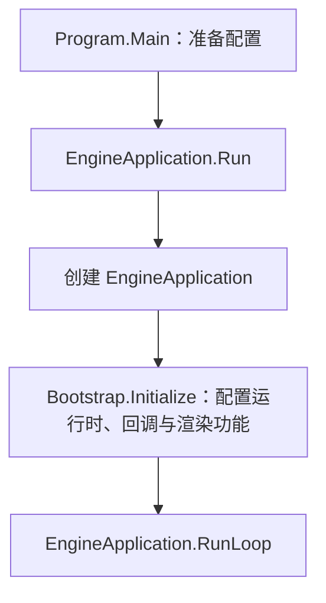
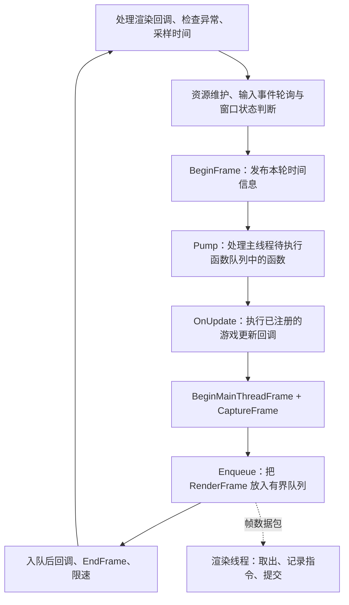

# Waylith：第一轮源码讨论材料

本文记录第一轮源码梳理与文章边界建议，供共同讨论，尚未写成正式文章。范围为工作区现有的 RimWorld 1.7 语料；本轮采用静态阅读，没有运行游戏或测量性能。

模块总图见 [Waylith 模块概览](02-waylith-overview.md)。

目前的正文已按一条线性主线重新组织，见 [Waylith 模块汇总稿 v0.2](14-waylith-summary-draft.md)。下文保留第一轮讨论与源码定位，其中“三篇文章”是当时的边界建议。

## 第一轮的三篇文章边界建议

| 暂定篇目 | 核心内容 | 与下一篇的交接 |
|---|---|---|
| Waylith（一）：应用入口与主循环 | 从程序入口、应用创建与初始化进入 RunLoop，解释一轮循环的计时、输入、更新回调、渲染交接、限速及主要分支。 | 说明 OnUpdate 和 CaptureFrame 的职责，分别交给后两篇展开。 |
| Waylith（二）：引擎怎样驱动游戏 | Bootstrap 的注册、UnityRuntime、UnityWorld 的生命周期分发，以及 Root_Play、Game 的入口。 | 在游戏入口保留接续位置；Game 与 TickManager 的内部流程留给游戏流程模块。 |
| Waylith（三）：引擎怎样收集绘制数据并交给 Vulkan | 渲染模块的登记与采集、RenderFrame 入队、渲染线程取包、指令记录、提交与呈现的主要调用顺序。 | 数据结构、pass 内部实现和资源管理细节放入独立渲染模块，在地图、空间与 UI 解析完成之后研究。 |

第一篇可以围绕“谁在持续驱动这段程序”展开。读者先认识循环和回调，再进入不同模块的实现。

## 已确认的启动顺序

`Program.Main` 构造 EngineApplicationOptions，向 `EngineApplication.Run` 传入 `Bootstrap.Initialize`。Run 创建 EngineApplication，调用初始化回调，再进入 RunLoop。



这里需要解释“传入一个初始化函数”与“调用一个初始化函数”的区别。Bootstrap 在进入循环前完成配置；循环里调用的是它注册的更新回调。

定位：Program.Main（`RimWorldWaylith.Program.cs:21`）、EngineApplication.Run（`Waylith.EngineApplication.cs:499`）。

## 常规绘制路径：一轮循环做什么

下面只画窗口正常、允许更新且可以绘制时的主路径。实线表示主线程上的执行顺序，虚线表示将数据交给另一个线程；渲染线程可以与后续主线程工作重叠。



- **时间**：Stopwatch 的相邻采样之差得到 deltaTime。`Time.BeginFrame` 更新引擎时间，`Time.EndFrame` 增加帧号。deltaTime 与一次游戏 tick 的时长需要分别解释。
- **输入与窗口**：循环主动轮询 GLFW 事件，并根据窗口、焦点和配置选择后续路径。
- **游戏更新**：主循环调用 OnUpdate 这个 Action；游戏具体做什么，由注册的回调决定。
- **采集**：FrameRenderer 取得本轮渲染特性列表，调用各特性的 CaptureFrame，把结果放入 RenderFrame。
- **交接**：RenderThread.Enqueue 使用有界 BlockingCollection。队列满时 Add 会等待，限制主线程继续生产帧数据的速度。
- **限速**：ThrottleToTargetFrameRate 按目标预算等待；剩余较多时 Sleep，最后用循环等待。它控制目标上限，不能保证每轮都能按时完成。

定位：RunLoop（`Waylith.EngineApplication.cs:583`）、Time（`Waylith.Time.cs:45`）、限速（`Waylith.EngineApplication.cs:1521`）、入队与容量（`Waylith.Rendering.RenderThread.cs:19`）。

## 游戏怎样接住更新回调

已确认的连接如下，完整步骤将在第二篇展开：

```text
EngineApplication.RunLoop
  → OnUpdate 中由 Bootstrap 注册的回调
    → UnityRuntime.Step(deltaTime, elapsedTime)
      → 更新时间与场景状态
      → UnityWorld.Update
        → 分发活动 Behaviour 的 Update 消息
      → UnityWorld.LateUpdate
      → 屏幕相机的 PreCull 分发

游玩场景的一个具体接点：
  GameRoot 上的 Root_Play.Update
    → Current.Game.UpdatePlay
      → TickManager.TickManagerUpdate
      → 其他帧级更新
```

Bootstrap 的 BuildPlayScene 将 Root_Play 添加到 GameRoot。UnityWorld 持有 Behaviour 状态，对活动且未销毁的对象分发消息；消息按类型查找并缓存为可调用的委托。这些机制连接了兼容运行时与游戏层的 Update 方法。

这里的 UnityWorld 是兼容层管理场景对象和生命周期的容器，需与游戏中的 `RimWorld.Planet.World` 分别介绍。

定位：Bootstrap 注册 OnUpdate（`RimWorldWaylith.Bootstrap.cs:73`）、UnityRuntime.Step（`Waylith.UnityCompat.UnityRuntime.cs:106`）、UnityWorld.Update（`Waylith.UnityCompat.UnityWorld.cs:708`）、消息分发（`Waylith.UnityCompat.UnityWorld.cs:1178`）、消息查找（`Waylith.UnityCompat.UnityWorld.cs:1468`）、BuildPlayScene（`RimWorldWaylith.Bootstrap.cs:785`）、Root_Play.Update（`Verse.Root_Play.cs:63`）、Game.UpdatePlay（`Verse.Game.cs:661`）。

## 游戏怎样提供渲染数据

`Bootstrap.ConfigureFrameRenderer` 注册计算、世界、地图、相机采集、后处理、界面和截图等渲染特性。FrameRenderer 通过 IRenderFeature 接口访问它们。

以地图特性为例：`MapRenderFeature.CaptureFrame` 判断地图绘制条件，取得 `MeshDrawSubmission.CaptureFlushedSnapshot`，结合相机、绘制命令、持久绘制来源及相关状态，形成 MeshDrawFrame。它作为该特性的 payload 放入 RenderFrame。

因此，RenderFrame 保存的是后续渲染需要的数据：时间信息、特性列表、各特性的 payload、活动标记等。最终图像还要经过渲染线程记录指令、提交给图形设备和呈现的过程。

```text
游戏侧已积累的绘制提交与相关状态
  → MapRenderFeature 等特性的 CaptureFrame
  → FrameRenderer 将各特性结果装入 RenderFrame
  → RenderThread.Enqueue
  → 渲染线程取出 RenderFrame
  → 尝试获取可用的渲染帧与资源
  → FrameRenderer.RecordFrame 调用相关 pass 记录指令
  → TrySubmitFrame
  → 图形提交与 PresentKHR
```

这是成功主路径的摘要。窗口重建、获取帧失败和表面丢失等分支会改变这条路径；提交也不等于 GPU 已完成或屏幕已经显示。

定位：注册渲染特性（`RimWorldWaylith.Bootstrap.cs:300`）、FrameRenderer.CaptureFrame（`Waylith.Rendering.FrameRenderer.cs:206`）、MapRenderFeature.CaptureFrame（`RimWorldWaylith.Rendering.MapRenderFeature.cs:57`）、RenderFrame 数据（`Waylith.Rendering.RenderFrame.cs:14`）、渲染线程取帧与记录（`Waylith.Rendering.RenderThread.cs:159`）、提交与呈现（`Waylith.Graphics.WindowRenderContext.cs:415`）。

## frame 在文中分别指什么

| 用语 | 这里的含义 |
|---|---|
| 引擎的一轮更新 | 主线程按相应路径执行一轮运行工作。需要说明具体分支，不能把所有 while 迭代都当作成功绘制。 |
| FrameTiming | 帧号、deltaTime 和累计时间等时间信息。 |
| RenderFrame | 从渲染特性采集的、交给渲染线程的数据包。 |
| 提交帧、交换链图像与显示结果 | 渲染后端、GPU 和呈现流程中的不同阶段；与逻辑更新、数据入队分别说明。 |
| 游戏 tick | 游戏模拟的推进单位，由游戏层的时间调度控制。 |

## 需要保留的分支与边界

- 无头模式进入 RunHeadlessLoop，保留更新路径，但没有常规窗口渲染采集与入队流程。
- 在相关配置下失去焦点时，循环进入等待事件的路径；这与仅因最小化而不能渲染的路径要分别说明。
- 不能渲染的分支仍可能执行 OnUpdate，再跳过采集与入队。
- 队列容量是 `max(1, FramesInFlight)`，但这个数字不能直接当作所有在途工作或显示延迟的总量。
- 渲染线程会在异常路径保存 ExceptionDispatchInfo，主线程在检查点重抛。首篇可说明作用，细节留到线程交接部分。

这些边界用于修正主路径的解释。实际延迟、占用、帧率和等待时长仍需运行观察或测量。

## 参考 v3 时需要细化的两处表述

1. V22 把 Root_Play.Update 简写为挂在 OnUpdate 上。完整解释需要补上 Bootstrap、UnityRuntime 与 UnityWorld 的连接。
2. V22 将有界队列描述为两线程间的唯一通道，并将渲染回调归入通用的主线程待执行函数队列。代码另有 RenderToMainThreadDispatcher：`FrameRenderer.DrainRenderThreadCallbacksOnMainThread` 调用它的 Invoke；MainThreadSynchronizationContext.Pump 则处理另一份队列。两者要分别画出。

定位：渲染回调入口（`Waylith.Rendering.FrameRenderer.cs:151`）、RenderToMainThreadDispatcher（`Waylith.Rendering.RenderToMainThreadDispatcher.cs:14`）、MainThreadSynchronizationContext.Pump（`Waylith.MainThreadSynchronizationContext.cs:80`）。原项目文档保持不动。

## 本轮之后的讨论起点

先讨论第一篇的讲述方式：从 Main 进入应用创建与循环，沿每一步说明当前控制权属于谁、读取或改变了什么、下一步交给谁。OnUpdate 与渲染采集先给出清楚的模块边界，随后再分别深入。

第三篇的范围已经确定：说明引擎怎样收集绘制数据、经队列交给渲染线程，再记录并提交 Vulkan 指令。交换链、指令缓冲和等待只解释理解这条流程所需的作用；特性返回的数据结构、各 pass 内部实现和资源管理细节，收在后续的渲染模块中。

## 当前阅读位置与范围调整

已沿更新通道读到 Root_Play.Update；游戏流程分支停在 Current.Game.UpdatePlay，尚未展开其内部实现。接续位置保存在 [Root_Play 阅读笔记](07-waylith-root-play.md)。

Waylith 主线回到 RunLoop 中 OnUpdate 返回之后：主线程准备与采集 → RenderFrame → 渲染线程接收 → 指令记录、提交与呈现 → 帧数据及资源收尾。游戏模块通过接口提供什么数据，可以在边界处说明；地图、Pawn、任务和 tick 的内部规则分别留到对应模块。

正常窗口帧已读通主线程采集、线程交接、资源获取、记录、提交、呈现请求及回收。最新整理：[帧的时序、结束与等待](13-waylith-frame-timeline.md)，用于对齐两条线程、GPU 和平台呈现，并汇总主要等待位置。这里作为帧级主线的阶段停点，游戏流程书签保持不变。

当前的 [Waylith 模块汇总稿 v0.2](14-waylith-summary-draft.md) 已按“总览 → 引擎创建 → 初始化 → 两条线程与三个队列 → 主线程 → 渲染线程 → 渲染数据的交换与提交”重排。主线程内部依次说明总览、RunLoop 代码、队列泵、OnUpdate、采集与限速，相关源码片段和图示放在对应位置。

最新范围调整：详细渲染内容已从汇总稿分出，保存在 [渲染模块资料](15-rendering-module-notes.md)。该模块在地图、空间与 UI 的解析完成之后继续；此前的源码笔记和图源保留，作为后续研究材料。
