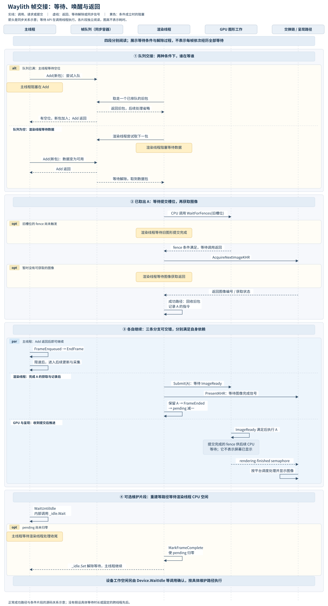
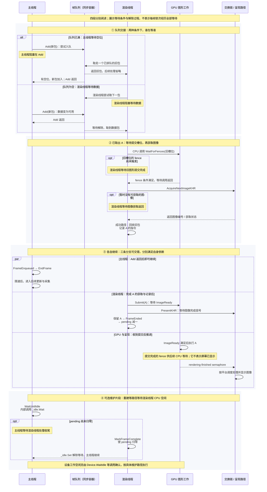

# Waylith 阅读笔记：帧的时序、结束与等待

阅读位置：正常窗口路径已经从主线程更新接到帧采集、队列交接、指令记录、图形提交与呈现请求。本段将已经读过的代码按线程和同步关系重新对齐，解释几种“结束”与主要等待位置。游戏流程分支仍保留在 Game.UpdatePlay 入口。

## 先看等待、返回与并行关系

图中 A 表示一个 RenderFrame 数据包，另外加入帧队列这个同步容器。四段分别阅读：①对照队列满与空时的等待；②表示已取出数据包后，渲染线程等待槽位和图像的过程；③对齐可交错推进的主线程、渲染线程、GPU 与呈现；④另列重建等维护路径的等待。

实线表示调用、请求或提交，虚线表示返回、等待条件解除或同步信号。等待 API 在调用线程执行；虚线回应不是另行登记的逐帧确认回调。SVG 中的黄色框标出条件成立时的阻塞。队列满时，取走旧包腾出空位即可让生产者继续，和 GPU 完成本次图形提交是不同条件。

图不按耗时比例绘制，不表示四段在每帧依次发生，也不规定 EndFrame 与 FrameEnded 谁先发生。fence 注释说明另一条完成关系，不表示它与 semaphore 同时触发。第三段采用成功提交路径；重建、退出、无头和失焦等完整分支见此前笔记。



导出：[SVG 矢量图](figures/waylith-frame-timeline.svg)、[PNG 预览](figures/waylith-frame-timeline.png)。下面保留可编辑 Mermaid。



独立图源：[Mermaid](figures/waylith-frame-timeline.mmd)；本地导出：[SVG 导出脚本](figures/render-frame-timeline.mjs)。脚本支持本图使用的 Mermaid sequence 语法子集，直接从独立图源生成 SVG；PNG 为该 SVG 的预览。

## 几种结束分别收尾什么

| 位置或状态 | 谁推进 | 能够据此确认什么 |
| --- | --- | --- |
| FrameEnqueued | 主线程 | Enqueue 已正常返回，执行入队后事件 |
| EngineApplication.EndFrame | 主线程 | 调用分配运行时的本轮收尾，再通过 Time.EndFrame 增加引擎 FrameCount |
| RenderThreadFrameEnded | 渲染线程 | 到达本次数据包的 CPU 处理收尾通知；正常收尾随后处理释放判断和 pending 计数 |
| 对应提交的 fence 已触发 | GPU 提交完成关系 | 所提交指令缓冲已完成执行，后续 CPU 可以据此复用相应槽位 |
| 图像实际显示 | 呈现引擎与平台 | 图像到达实际显示阶段；上述几个 CPU 方法没有提供其精确显示时间 |

EndFrame 位于主线程的入队后事件之后、限速之前。主循环这段收尾没有以本帧 FrameEnded 或 GPU fence 作为显式等待条件。渲染线程的处理速度与实际调度，决定它此刻已经推进到哪里。

RenderThreadFrameEnded 也会出现在数据包未进入本次记录、提交的收尾路径，例如获取资源时返回重建状态。因此，这个事件应按 CPU 处理边界理解。

Vulkan 的提交 fence 对应所提交指令缓冲的完成；呈现的排队操作与呈现引擎实际处理另有边界。参见 [vkQueueSubmit](https://docs.vulkan.org/refpages/latest/refpages/source/vkQueueSubmit.html) 与 [vkQueuePresentKHR](https://docs.vulkan.org/refpages/latest/refpages/source/vkQueuePresentKHR.html)。

定位：主线程入队后顺序（`Waylith.EngineApplication.cs:793`）、EngineApplication.EndFrame（`Waylith.EngineApplication.cs:919`）、帧计数增加（`Waylith.Time.cs:52`）、渲染线程收尾（`Waylith.Rendering.RenderThread.cs:159`）。

## 后续帧可以怎样与 A 重叠

Enqueue(A) 返回后，主线程完成自己的收尾与限速，就可以进入后续轮次。此时 A 仍可能处于队列、渲染线程处理或 GPU 执行阶段。队列容量和提交槽位限制了各阶段推进的空间。

如果渲染线程因等待旧槽位的 fence 暂时不能继续从队列取包，后续数据包可以先填入队列；队列满后，主线程会在下一次 Add 等待。因此，GPU 或渲染线程处理变慢，也可能让主线程停下来等待队列空位。

这里描述一种允许发生的执行关系，不预设每次等待的时长。队列容量只限制等待取出的包数，无法单独推算最终显示延迟。

定位：有界队列及 Add（`Waylith.Rendering.RenderThread.cs:19`）、获取前等待槽位 fence（`Waylith.Graphics.RenderContext.cs:245`）。

## 数据包回收发生在后续槽位复用时

正常提交路径先将 A 保存在 _submittedFrames 的相应槽位。RenderLoop 随后结束 A 的 CPU 处理、减少 pending，但保留的数据包仍然存在。

后续再次选中 A 使用过的提交槽位时，TryAcquireNextFrame 先等待旧提交的 fence；正常返回后，RenderThread 释放该槽位保存的旧 RenderFrame。

```text
保留 A → FrameEnded(A) → pending 减一
    ……后续处理……
再次选中 A 的提交槽位 → 等待 A 的提交 fence → 回收 A
```

fence 可能早已触发，此时等待可以立即满足。槽位复用也不必发生在主线程紧邻的下一轮，取决于槽位轮转和实际执行路径。

因此，pending 归零、渲染线程 CPU 处理空闲，以及所有提交包都已回收，是分别由不同代码位置推进的状态。

定位：提交路径保留 A（`Waylith.Rendering.RenderThread.cs:258`）、pending 的收尾（`Waylith.Rendering.RenderThread.cs:297`）、获取后回收旧槽位包（`Waylith.Rendering.RenderThread.cs:206`）、DisposeSubmittedFrame（`Waylith.Rendering.RenderThread.cs:321`）。

## 已确认的主要等待位置

| 等待位置 | 哪一侧等待 | 等待什么 |
| --- | --- | --- |
| BlockingCollection.Add | 主线程 | 满队列中出现空位 |
| GetConsumingEnumerable | 渲染线程 | 空队列中出现数据，或生产端结束后耗尽队列 |
| WaitForFences | 渲染线程 | 本次选中槽位的旧图形提交完成 |
| AcquireNextImageKHR | 渲染线程 | 取得可供使用的交换链图像 |
| PresentKHR | 渲染线程调用接口时 | 驱动和平台处理呈现调用；接口允许阻塞，具体耗时依实现和状态 |
| ThrottleToTargetFrameRate | 主线程 | 达到目标帧率的本轮时间预算 |
| WaitUntilIdle、Device.WaitIdle | 重建、停机或无绘制维护等路径的调用线程 | 分别等待渲染线程 pending 处理空闲与设备工作空闲，按实际调用路径理解 |

另外，CPU 队列访问锁发生争用时也可能等待。表中列的是本轮主干代码已经定位的等待接口，不是整套运行时所有耗时来源的清单。

定位：队列为空时的等待（`Waylith.Rendering.RenderThread.cs:163`）、图像获取（`Waylith.Graphics.WindowRenderContext.cs:503`）、呈现调用（`Waylith.Graphics.WindowRenderContext.cs:415`）、限速（`Waylith.EngineApplication.cs:1521`）、无绘制维护的两种等待（`Waylith.EngineApplication.cs:1513`）、提交访问锁（`Waylith.Graphics.GraphicsDevice.cs:533`）。

## 等待也会进入下一次 deltaTime

从第二次普通采样起，主线程 deltaTime 来自相邻采样点之差，其中可以包含上一轮的更新、采集、入队等待与限速。渲染端的阻塞通过队列影响主线程时，也会反映到这个采样间隔中。

限速使用同一轮的起始采样作为预算起点，减去已经经过的时间。如果更新、采集和队列等待已经耗尽预算，它不会再额外等待完整的一段目标帧时长。因而，队列等待、呈现等待与目标帧率限制，不能简单看成每帧固定相加的几段时间。

这是源码中的控制关系；实际帧率、重叠程度和显示延迟仍需运行观察。图中没有假设测量结果。

定位：采样点（`Waylith.EngineApplication.cs:620`）、限速预算计算（`Waylith.EngineApplication.cs:1521`）。

## 本轮的阅读位置

Waylith 正常窗口帧的驱动、交接、记录、提交、呈现请求及回收路径已接通。这里可以作为帧级主线的阶段停点；之后讨论文章编排时，可将启动、更新桥接和渲染帧协作分别组织。窗口重建、资源服务和其他分支仍可按需要单独展开，游戏流程从已保存的 Game.UpdatePlay 入口恢复。

进入汇总：[从启动到每一帧：Waylith 怎样驱动 RimWorld（v0.1）](14-waylith-summary-draft.md)。
